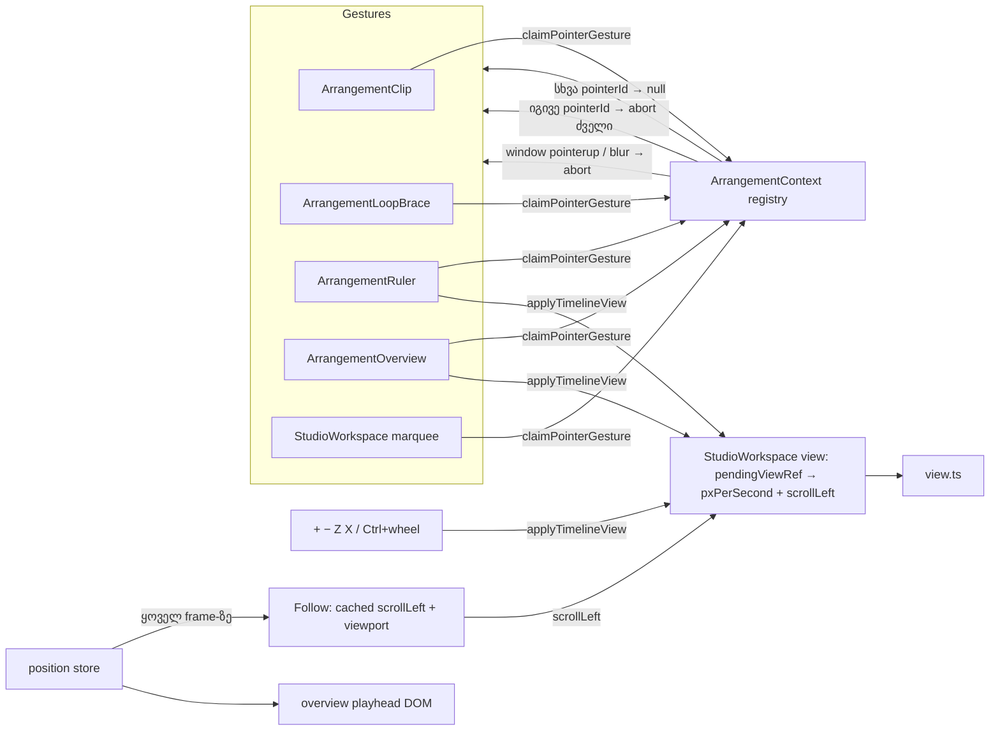

# Studio Lab — ერთი gesture მთელ სამუშაო სივრცეში, escalation-ის ინტერვალი, Play პროექტის ბოლოს მიღმა და ნავიგაცია (SRW-10)

**თარიღი:** 2026-10-09
**სტატუსი:** In Progress. C-ის round 6-ის ვერდიქტი FAIL-ია (`tmp/studio-real-loop/c-round-6.md`): RF6-2 (C-R6-02) და R10-N5 (C-R6-03) ჩავარდა, round 6-ის დანარჩენი ID-ები C-მ PASS-ად შეაფასა. C-R6-01 ღიაა. სამივე ბაგის გასწორება round 7-შია (დოკ. 016) და C-ის შემოწმებას ელოდება. G6-R-ის 21 ID, რომელიც C-მ round 6-ში თავიდან არ გაუშვა, PASS არ არის: ის milestone-ის რეგრესიაზე შემოწმდება. Real-mouse / real-Chrome პუნქტები Tech Lead-ის სიაშია.
**შეცვლილი პროექტი:** Store

## კონტექსტი

Round 5-ის შემდეგ C-მ ერთი Medium და ოთხი Low ბაგი იპოვა (`tmp/studio-real-loop/c-round-5.md`). B-მ escalation-ის ინტერვალის წინააღმდეგობა დააფიქსირა:

- **C-R5-02 (Medium):** D-23 gesture-ს მხოლოდ ერთი კომპონენტის შიგნით იცავდა. პირველი pointer-ის drag-ის დროს მეორე pointer-ს შეეძლო სხვა clip-ის გადატანა ან ხაზის **M**-ის დაჭერა. ეს edit ჯერ ისტორიაში ჩაიწერებოდა, შემდეგ კი პირველი gesture მას უჩუმრად აუქმებდა.
- **B-R5-01:** მუდმივი ჩამორჩენისას escalation-ებს შორის დათვლილი დრო ≈ 700 ms იყო. ეს RF5-1b-ის 600 ms-იან ზღვარს აჭარბებდა.
- **C-R5-05 (Low):** Play `projectEnd`-ის მიღმა 0-ზე ხტებოდა და ჩასმის პოზიცია იკარგებოდა.
- **C-R5-01, C-R5-03, C-R5-04 (Low):**
  - ბიბლიოთეკის სიის სათაურები ერთნაირად იჭრებოდა;
  - lane-ghost-ის label clip-ების სათაურებს ეფარებოდა;
  - lane-kind paste refusal დროს არ ასახელებდა.
- **SRW-10 (FB-01):** ნავიგაცია — anchored zoom, ruler-ის drag, Z/X ისტორია, overview, Follow, Fit.

## მიდგომა

**D-26 — ერთი gesture მთელ სამუშაო სივრცეში.**
- context-ში არის `claimPointerGesture(pointerId, abort)` registry. ის არსებულ `beginPointerGesture()` მთვლელზე დგას.
- ყველა gesture მას იძახებს: clip, brace, marquee, playhead, ruler და overview.
- სხვა `pointerId` უარყოფილია: gesture არ იწყება, selection არ იცვლება.
- იგივე `pointerId` ნიშნავს, რომ ძველ gesture-ს `pointerup` დაეკარგა. ძველი gesture მთავრდება თავისი abort-ით (preview ბრუნდება, ჩანაწერი არ იწერება), შემდეგ ახალი იწყება.
- Mute, Solo, Volume, ბიბლიოთეკიდან დამატება და drop, Split, Delete, Loop, Duplicate, Undo/Redo gesture-ის დროს უარყოფილია `GESTURE_EDIT_BLOCKED_MESSAGE`-ით.
- **Safety net:** registry window-ის capture-phase `pointerup` / `pointercancel`-ს აქტიური pointer-ისთვის უსმენს. 0 ms-ის შემდეგ, თუ gesture ისევ აქტიურია, ის abort-ით მთავრდება. window-ის `blur` gesture-ს ასევე ამთავრებს: clip-ისა და brace-ის drag უკან ბრუნდება, ჩანაწერი არ იწერება.
- ruler-სა და overview-ს `lostpointercapture` handler-ი აქვს. playhead-ის handle-ი `buttons === 0`-იან `pointerdown`-ს არ იღებს.
- უარყოფილი ალტერნატივა: commit-ის მიმდინარე state-ზე rebase. ორი პარალელური edit-ის შერწყმა რთულია და Ableton-იც ერთ edit gesture-ს უშვებს.

**D-24a — escalation-ის ინტერვალი.** ერთ ელემენტზე escalation-ებს შორის მინიმუმი 1000 ms-დან 600 ms-მდე შემცირდა. ის წინა escalation seek-ის `seeked`-იდან (ან pending timeout-იდან) ითვლება. გადაწყვეტილება სუფთა ფუნქციაში (`video-sync.ts`) გადავიდა, dock-ი მას იძახებს. D-24-ის დანარჩენი წესები არ შეცვლილა.

**D-27 — Play პროექტის ბოლოს მიღმა.**
- პოზიცია `projectEnd`-ზე (დაკვრა ბოლოში გაჩერდა) → Play 0-დან იწყება, როგორც ადრე.
- პოზიცია `projectEnd` + EPS-ის მიღმა, აქტიური loop-ის გარეშე → Play არ იწყება, პოზიცია არ იცვლება და სტატუსი ხსნის მიზეზს.
- უარი AudioContext-ის შექმნამდე მოწმდება.
- აქტიური loop D-17-ის წესებს ინარჩუნებს.

**Low ბაგები:**
- **სიის სათაურები:** optional `shortTitle` (მაგ. „ბასი“) მთავარ სტრიქონზეა და wrap-დება, არ იჭრება. ქვემოთ collection-ის label-ია (`სინთეზური დემო · ღამის პულსი`).
- **ghost:** ghost-ის ტექსტი ghost-ის შიგნით იჭრება. უარის მიზეზი footer-ის drag-hint-ში ჩანს.
- **paste:** lane-kind უარი ხაზს და დროს ასახელებს.
- **Shift-ის hint:** ორი ფორმულირება აქვს: „ჩაიკეტება“ (Shift არ არის დაჭერილი) და „ჩაკეტილია“ (დაჭერილია).

**D-28 — ნავიგაცია.**
- ხედი არის `{ pxPerSecond, scrollLeft }` და Zoom-ის ისტორია. ის `StudioWorkspace`-ს ეკუთვნის: zoom context-შია, scroll DOM-ში, ისტორია და Follow ref-ებში.
- მათემატიკა სუფთა `view.ts`-შია (DOM-ის გარეშე).
- ნავიგაცია ისტორიას არ წერს, audio-ს და ვიდეოს sync-ს არ ეხება.
- **Zoom:**
  - ზღვრები 0.5–320 px/წმ, slider ლოგარითმულია;
  - Ctrl+wheel ×1.15, მაჩვენებლის ქვეშ anchor-ით;
  - +/− ×1.25, anchor: მონიშნულის ცენტრი, თუ არ არის — ხილული playhead, თუ არც ის — ცენტრი;
  - Z მონიშნულს ხედის 60 %-ზე აჩვენებს, X ისტორიიდან აბრუნებს.
- **Ruler:**
  - click < 4 px seek-ს `pointerup`-ზე აკეთებს;
  - drag ჰორიზონტალურად pan-ია, ვერტიკალურად zoom: `startZoom · exp(−lift/140)`, anchor-ით;
  - ორმაგი click: მონიშნულის Zoom ან Fit.
- **Overview:**
  - dock strip-შია, ვიდეოს მარცხნივ, და სიმაღლეს არ ამატებს;
  - `role="slider"`, frame და playhead DOM-ში პირდაპირ ახლდება (position store და scroll), ამიტომ position-ის განახლება მას ხელახლა არ არენდერებს;
  - click ცენტრავს, drag pan-ია და zoom, ორმაგი click არის Fit, ←/→ 5 წმ-ით აჩოჩებს;
  - overview-ზე ფოკუსისას +/−/Z/X/Space მუშაობს (გამონაკლისი „focused slider“ წესიდან, რადგან overview თავად ნავიგაციის კონტროლია).
- **Follow:**
  - ჩართულია default-ად. თუ playhead ხედიდან გადის, ხედი ისე ჩოჩდება, რომ playhead მესამედზე აღმოჩნდეს;
  - ხელით ნავიგაცია დაკვრისას Follow-ს აჩერებს (`Follow ‖`);
  - Follow-ის ღილაკი ან Play მას აბრუნებს;
  - pointer gesture-ის დროს Follow არ ჩოჩავს.
- **Fit:** zoom = (viewport − 4) / extent, სადაც extent = max(projectEnd, loop end, 10 წმ).
- **Transport:** 1440×900-ზე ერთ რიგად ეტევა. ამისთვის loop-ის readout loop strip-ის header-ის უჯრაში გადავიდა (იგივე ტექსტი და `data-testid`). ღილაკების padding და Undo/Redo-ს სიგანე შემცირდა.

## არქიტექტურა

## შეცვლილი ფაილები

- `app/contexts/ArrangementContext.tsx` — D-26 registry და safety net, refusal-ები, D-27, zoom-ის clamp.
- `app/components/arrangement/ArrangementClip.tsx` — registry, ghost-ის ტექსტის მოჭრა, waveform-ის სვეტების ზღვარი (4096).
- `app/components/arrangement/ArrangementLoopBrace.tsx` — registry.
- `app/components/arrangement/ArrangementLane.tsx` — ghost-ის `overflow-hidden`, ტექსტი ghost-ის შიგნით.
- `app/components/arrangement/ArrangementRuler.tsx` — ruler-ის ნავიგაცია (seek release-ზე, pan/zoom drag, ორმაგი click), lost capture, ticks.
- `app/components/arrangement/ArrangementOverview.tsx` — ახალი: overview strip.
- `app/components/arrangement/ArrangementTransport.tsx` — Follow, ⇔, ↩ Zoom, Fit, ლოგარითმული slider, კომპაქტური რიგი.
- `app/components/arrangement/ArrangementVideoDock.tsx` — strip-ის slot overview-სთვის, D-24a-ს გამოძახება. sync loop და `<video>` ელემენტები უცვლელია.
- `app/components/arrangement/ArrangementLibrary.tsx` — მოკლე სათაური და collection-ის სტრიქონი.
- `app/components/arrangement/StudioWorkspace.tsx`:
  - ხედის მართვა, Follow, Ctrl+wheel და კლავიშები;
  - footer-ის hint და ზემოთ აღწერილი refusal-ის ხაზი;
  - loop-ის readout loop strip-ში;
  - `data-lenis-prevent` (იხ. პრობლემები).
- `app/lib/arrangement/view.ts` — ახალი: ნავიგაციის მათემატიკა.
- `app/lib/arrangement/video-sync.ts` — D-24a.
- `app/types/arrangement.ts` — optional `shortTitle`.
- `app/data/studio-lab-demo.ts` — `shortTitle` stem-ებსა და მიქსზე.
- ტესტები: `view.test.ts` (ახალი), `gesture-guard.test.tsx` (ახალი), `video-sync.test.ts`, `ArrangementContext.test.ts`, `gesture-reentry.test.tsx`.
- დოკ. 012/013/014 — მხოლოდ სტატუსი და TODO.

## პრობლემები და გადაწყვეტები

- **სხვა pointer-ის edit-ის უჩუმარი გაუქმება → workspace-ის registry.**
  - Problem: per-component guard-ი სხვა კომპონენტს ვერ ხედავდა.
  - Solution: ერთი registry context-ში. ტესტებით დადასტურდა, რომ 7 ახალი ტესტი round-5-ის კოდზე ვარდებოდა (7/7 FAIL).
- **დაკარგული touch `pointerup` → lock.**
  - Problem: ახალი touch ახალ `pointerId`-ს იღებს. თუ ძველის `pointerup` დაიკარგა, ყველა edit სამუდამოდ იბლოკებოდა.
  - Solution: window-ის safety net (capture `pointerup`/`pointercancel`, `blur`) და `lostpointercapture`.
- **Transport 1440-ზე ორ რიგად.**
  - Problem: ახალმა ღილაკებმა რიგი 1440 px-ს გადააჭარბა.
  - Solution: loop-ის readout loop strip-ის header-ში გადავიდა და ღილაკები დაპატარავდა. 1440-ზე ერთი რიგია, მარაგი ≈ 19 px. 1280-ზე რიგი wrap-დება, ხაზები, ruler და loop strip ხილული რჩება.
- **Follow-ის forced layout ყოველ frame-ზე.**
  - Problem: Follow-ის შემოწმება ყოველ frame-ზე `scrollLeft`/`clientWidth`-ს კითხულობდა. drift run-ებში ArrangementContext-ის rAF-ში 110 ms-იანი app LoAF გამოჩნდა (round 5-ში 16 run-ში 0 იყო).
  - Solution: cached scroll (scroll event) და viewport-ის სიგანე (ResizeObserver). ამის შემდეგ app LoAF ≤ 27 ms იყო ან საერთოდ არ იყო.
- **Wheel-ის native scroll.**
  - Problem: root-ის Lenis smooth scroll (`root.tsx`, დაცული ფაილი) ყველა ვერტიკალურ wheel-ზე `preventDefault`-ს იძახებს. ამიტომ timeline-ისა და ბიბლიოთეკის ჩვეულებრივი wheel scroll რეალურ ბრაუზერში იბლოკებოდა (NAV-07).
  - Solution: `data-lenis-prevent` workspace-ის root-ზე (იგივე pattern, რაც `Modal.tsx`-შია). Ctrl+wheel-ს Lenis ისედაც არ ეხება.
- **სწრაფი wheel-ის მოვლენები და ძველი ხედი.**
  - Problem: zoom-ის განახლება React-ის render-ს ელოდება. ერთ frame-ში მოსული რამდენიმე მოვლენა ძველ ხედს კითხულობდა.
  - Solution: `pendingViewRef`. `getTimelineView` მოთხოვნილ ხედს აბრუნებს, სანამ layout effect მას არ გამოიყენებს.
- **Waveform დიდ zoom-ზე.**
  - Problem: 320 px/წმ-ზე path-ის სვეტები ათიათასობით იყო.
  - Solution: 4096-ის ზღვარი, SVG `viewBox` მასშტაბირებს.

## ტესტირება

- **Unit / component:**
  - arrangement 17 ფაილი, 297 ტესტი;
  - სრული სუიტი 49 ფაილი, 761 ტესტი;
  - `tsc` 0, Biome (owned და `./app`) 0 შეცდომა, build გავიდა;
  - ახალი ტესტები: D-26 (11), ruler/overview (navigation, lost capture, render count), `view.ts`-ის მათემატიკა, D-24a (599/600 ms, მუდმივი ჩამორჩენის სიმულაცია), D-27 (სამი შემთხვევა და AudioContext-ის არ შექმნა), lane-kind paste-ის მესიჯი.
- **ბრაუზერი (A, gstack headless, სინთეზური pointer-ები `buttons: 1`-ით):**
  - R26-1 (a/b/c), R26-2, R26-3 (clip და brace stale) და blur-ის safety net;
  - R27-1, R6-L1, R6-G1, R6-H1, R6-P1, R4-B3;
  - R10-N1..N8.
  - რიცხვები `tmp/studio-real-loop/a-round-6.md`-შია. ეს A-ს საკუთარი შემოწმებაა, არა C-ის PASS.
- **Escalation (D-24a), ხელოვნური ჩამორჩენა:**
  - 3 run, თითოში 6 escalation;
  - escalation წინა `seeked`-დან ≥ 640 ms-ში;
  - episode ≈ 260–350 ms;
  - seek-ის დროს `currentTime`-ში ჩაწერა არ ყოფილა.
  - ორ run-ში forcing-ის შეწყვეტიდან 139–160 ms-ში კიდევ ერთი escalation იყო: ეს უკვე დაწყებული episode-ის დასასრულია. C-მ უნდა შეაფასოს.
- **Drift:** A-მ RF6-2-ის მხოლოდ ნაწილი გაუშვა (R3-V1, 7 run): 3 PASS, 2 INVALID (stall cover), 1 FAIL (max 0.1209, Follow-ის გასწორებამდე), 1-ის analysis დაიკარგა. სრულ სერიას C უშვებს.

## TODO / შემდეგი ნაბიჯები

- C round 6 ჩატარდა: RF6-2 და R10-N5 FAIL, დანარჩენი ID-ები PASS (RF6-1 შენიშვნით).
- ღია ბაგები: C-R6-01 (Volume drag-ის commit სხვა gesture-ის შუაში), C-R6-02 (drift-ის რეგრესია), C-R6-03 (ბოლო ruler label-ის overflow). სამივე round 7-ში გასწორდა (დოკ. 016) და C-ის შემოწმებას ელოდება.
- G6-R-ის 21 გაუშვებელი ID (R1-B5, R2-V1, R3-V2, R3-V4, R4-B1, R5-L3, R5-L4, R5-L5, R6-S5, R7-D2..D5, R8-M3, R8-M4, R9-C5, R11A-2 keys, R12-L2, R12-L4, R5-B5, R5-B1u) milestone-ის რეგრესიაზე.
- Tech Lead (real mouse / real Chrome):
  - R10-N1/N2 რეალური mouse-ით, Ctrl+wheel და trackpad pinch;
  - R23-1/R23-2 scrollbar და wheel scroll Lenis-ის გასწორების შემდეგ;
  - R12-L4 HTML5 drag-and-drop, R8-M1/M2;
  - RF6-1/RF6-2 წყნარ Windows Chrome-ზე (VP9 და H.264) — C-R6-02-ის გამო სავალდებულოა.
- ღია საკითხები C/B-სთვის:
  - stale playhead scrub abort-ისას პოზიციას ინარჩუნებს და არ აბრუნებს;
  - marquee `buttons === 0`-ს არ ამოწმებს;
  - `commitTrackVolume`-ის guard — C-R6-01, round 7-ში (D-30);
  - window-ის blur ნებისმიერ gesture-ს ამთავრებს.
- შემდეგი რაუნდი: SRW-11B (detail panel, track height, floating video).

## შენიშვნა (2026-10-15, round 45): Delete დროის მონაკვეთზე

ეს დოკუმენტი დროის მონაკვეთზე Delete-ის ქცევას არ აღწერს (`tmp/studio-real-loop/checkpoint-oct13-review.md`, suggestion 1). SRW-24-ის შემდეგ (მომხმარებლის მოთხოვნა 2026-10-11, root `docs/technical/studio-real-workspace/delete-selection-update.md`; implementation: `034-studio-lab-delete-keeps-gap.md`) მოქმედი ქცევაა:
- **Delete/Backspace** დროის მონაკვეთზე მასალას შლის და **სიცარიელეს ტოვებს**;
- დროს ამოჭრის და სიცარიელეს ხურავს მხოლოდ **Ctrl+Shift+X** (Cut Time);
- **Ctrl+Shift+L** არსებულ მონაკვეთს ყველა ხაზზე ავრცელებს.
