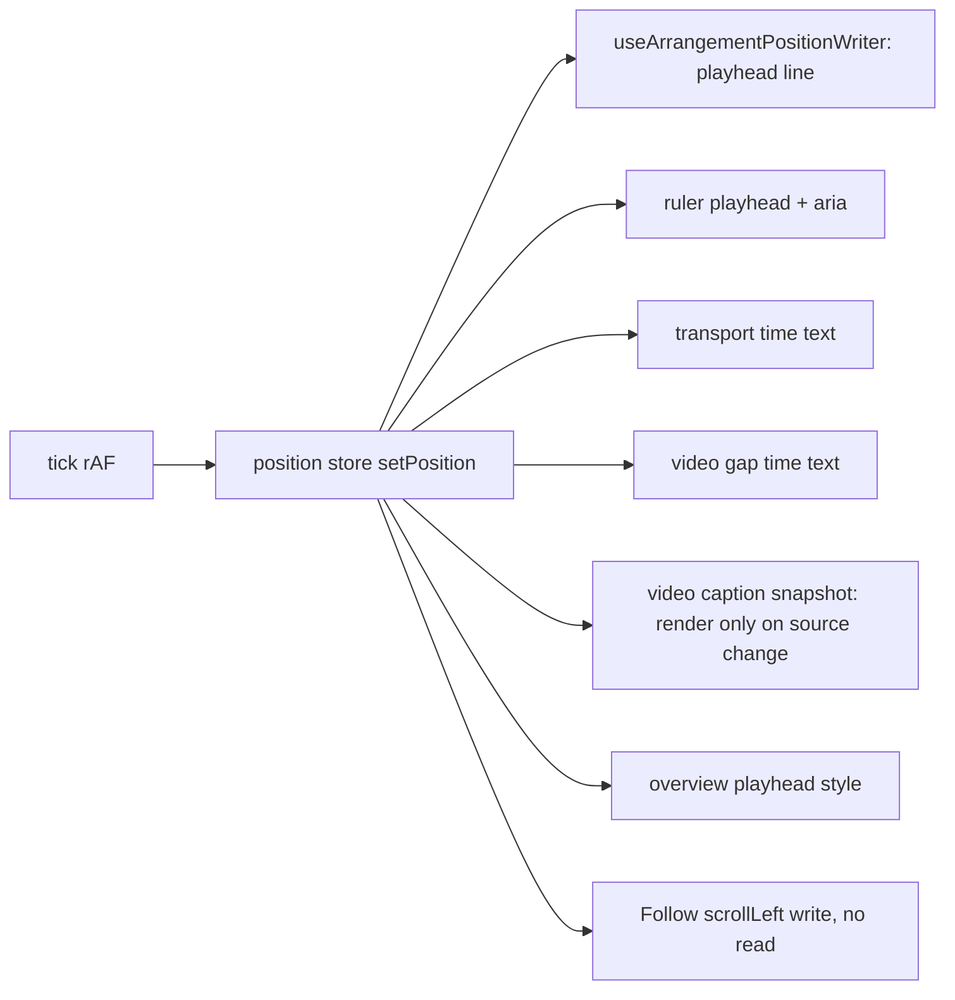
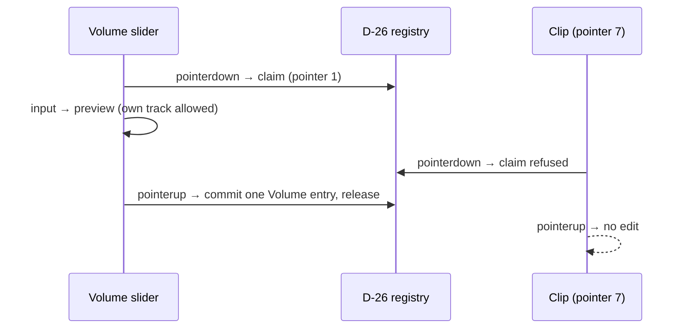

# Studio Lab — დაკვრის კადრის დისციპლინა, ruler-ის ბოლო label და Volume-ის gesture (round 7)

**თარიღი:** 2026-10-09
**სტატუსი:** In Progress. C-ის round 7-ის verdict: **FAIL** RF7-3-ზე (ახალი ბაგი C-R7-01, Medium). C-R6-02 ღიად რჩება; ახალი ბაგი C-R7-02 (Low) ღიაა. C-R6-01 და C-R6-03 C-მ დახურა. round 7-ის დანარჩენი ID-ები C-მ გაიარა (`tmp/studio-real-loop/c-round-7.md`). ღია ბაგები round 9-შია.
**შეცვლილი პროექტი:** Store

## კონტექსტი

C-ის round 6-ის შემოწმებამ (`tmp/studio-real-loop/c-round-6.md`) სამი დაკავშირებული ბაგი იპოვა საერთო timeline-ზე:

- **C-R6-02 (Medium):** drift-ის რეგრესია. 30 R3-V1 run-იდან 6 ჩავარდა და 8-ს app-attributed LoAF ≥ 10 ms ჰქონდა: ArrangementContext-ის rAF (16–58 ms), VideoDock-ის `step` (22 ms) და Play-ის შემდეგ React-ის 62 ms-იანი `performWorkUntilDeadline`. Round 5-ში ასეთი LoAF არ ყოფილა.
- **C-R6-03 (Low):** Fit-ის შემდეგ ბოლო ruler label (`5:30`) content-ის ბოლოს 19.2 px-ით სცდებოდა და horizontal scroll-ს ზრდიდა. ცარიელ პროექტზე იგივე `0:30`-ზე 31.6 px იყო.
- **C-R6-01 (Low):** clip gesture-მდე დაწყებული Volume preview clip gesture-ის შუაში commit-დებოდა და `Volume` entry-ს წერდა.

## მიდგომა

### S1 — ჯერ გაზომვა, შემდეგ გასწორება

C-ის LoAF ჩანაწერებში ყველაზე დიდი app script-ები იყო:

| Run | LoAF | Script | ხანგრძლივობა |
|---|---|---|---|
| Lr_5 | 74 ms | `ArrangementContext.tsx` FrameRequestCallback (tick) | 58 ms |
| L_7 | 58 ms | იგივე tick | 33 ms |
| Lr2_2 | 88 ms | React `performWorkUntilDeadline` (MessagePort) + tick | 62 + 16 ms |
| Lr2_2 | 69 ms | `ArrangementVideoDock.tsx` `step` + tick | 22 + 25 ms |

C-ის `rafcost.js` tick-ს ზომავდა მხოლოდ სინქრონულად (med 0.1–0.2 ms). LoAF კი callback-ის შემდეგ microtask-ებსაც ითვლის. `tick()` → `setPosition` → `useSyncExternalStore`-ის ყველა subscriber-ი React-ის sync re-render-ს გეგმავს microtask-ში. ამიტომ playhead-ის ყოველი კადრი რამდენიმე კომპონენტის React render-ი იყო.

A-ს გაზომვამ (C-ის light harness-ის ასლი, R3-V1, 13 წმ, დროებითი `performance.now()` instrumentation, რომელიც ბოლოს წაიშალა) ეს დაადასტურა: tick სინქრონულად p50 0.3 ms იყო, microtask-ებთან ერთად კი p50 2.0 ms.

გასწორება:

- **პირდაპირი DOM ჩაწერა.** ახალი hook `useArrangementPositionWriter` position store-ს `useLayoutEffect`-ში უსმენს და DOM-ს React render-ის გარეშე წერს. მასზე გადავიდა timeline-ის playhead ხაზი, ruler-ის playhead (ხაზი, handle, `aria-valuenow`/`aria-valuetext`), transport-ის დროის ტექსტი და ვიდეოს gap-ის დროის ტექსტი.
- **Video caption** ახლა მხოლოდ მაშინ ხელახლა რენდერდება, როცა playhead-ის ქვეშ ვიდეოს წყარო იცვლება (`useSyncExternalStore` snapshot = source id).
- **Follow** scroll-ის ჩაწერის შემდეგ `scrollLeft`-ს აღარ კითხულობს. ეს per-frame გზაში write → read იყო; კლამპს scroll handler ისედაც ამოწმებს.
- **Overview** scroll-ზე React state-ს აღარ ცვლის: `aria-valuenow`/`aria-valuetext` პირდაპირ იწერება, ბოლო მნიშვნელობა ref-შია.
- **Play-ის render-ის ბიუჯეტი:** ruler-ის tick-ების სია (`ArrangementRulerTicks`) და ბიბლიოთეკის სტრიქონი (`ArrangementLibraryOption`) memo-ზეა, stable handler-ებით. Clip-ები და overview უკვე memo-ზე იყო.
- `left`-ზე `transform`-ის ნაცვლად დარჩა: forced layout გაზომვით 0 იყო, C-ის harness-ები (`c6.js`, `loopplay.js`) და არსებული ტესტი `style.left`-ს კითხულობენ.
- `video-sync.ts` და dock-ის `step` არ შეცვლილა: `step` p50 0.1–0.3 ms იყო და გაზომვამ მისი ცვლილება არ გაამართლა.
- Context-ის დაყოფა (`isPlaying` ცალკე context-ში) უარვყავით: `useArrangement()`-ის ფორმას შეცვლიდა.

### S2 — ruler-ის ბოლო label

`view.ts`-ის ახალი `rulerTickMarks(seconds, pxPerSecond)` ყველა tick-ს ინარჩუნებს. Label-ს კი აგდებს, თუ მისი სავარაუდო ბოლო (`time·px/s + 5 px + სიმბოლო·8 px`; 5 px = `left-1` + tick-ის border) ruler-ის სიგანეს სცდება. Tick-ის ხაზი რჩება, label ნახევრად არ იჭრება. `overflow-hidden` უარვყავით, რადგან label-ს ნახევრად მოჭრიდა.

### S3 — D-30: Volume-ის drag gesture-ია

- Slider-ის `pointerdown` (`button 0`, `buttons ≠ 0`) D-26 registry-ს `claimPointerGesture`-ით იკავებს (`beginTrackVolumeGesture`).
- აქტიური drag-ის დროს მეორე pointer-ის clip, brace, marquee, ruler და playhead უარყოფილია. Mute, Solo და სხვა ბრძანებები `GESTURE_EDIT_BLOCKED_MESSAGE`-ით უარყოფილია.
- საკუთარი track-ის preview დაშვებულია. გამოშვებისას (`pointerup` slider-ზე ან მხოლოდ window-ზე, ან `lostpointercapture`) იწერება ერთი `Volume` entry. Commit track-ზეა მიბმული (`commitTrackVolume(trackId)`): სხვა slider-ის `pointerup` ამ drag-ს ვერ დაასრულებს.
- Abort (იმავე slider-ის blur drag-ის შუაში — `blurTrackVolume(trackId)`, window-ის blur, `pointercancel`, იგივე pointer-ის takeover) preview-ს შენახულ მნიშვნელობაზე აბრუნებს და entry-ს არ წერს. სხვა slider-ის blur, მაგალითად როცა focus ახალ slider-ზე გადადის, აქტიურ drag-ს არ ეხება.
- Provider-ის unmount აქტიურ gesture-ს და window-ის listener-ებს ათავისუფლებს.
- თუ registry სხვა gesture-ს უჭირავს, claim უარყოფილია: slider არ მოძრაობს, snap-back და სტატუსი უცვლელია.
- `commitTrackVolume` სხვა gesture-ის დროს აღარ წერს. გადაუწყვეტელი keyboard preview ინახება და მომდევნო commit/undo/redo-ზე (`flushPendingVolume`) ჩაიწერება.

## არქიტექტურა

## შეცვლილი ფაილები

- `app/contexts/ArrangementContext.tsx` — `useArrangementPositionWriter`; D-30: `beginTrackVolumeGesture`, `blurTrackVolume`, track-ზე მიბმული `commitTrackVolume` და მისი guard, preview-ის revert, unmount cleanup.
- `app/lib/arrangement/view.ts` — `rulerTickMarks`, `RULER_LABEL_OFFSET_PX`, `RULER_LABEL_CHAR_WIDTH_PX`.
- `app/components/arrangement/StudioWorkspace.tsx` — playhead ხაზი writer-ით; Follow-ში read-after-write მოიხსნა.
- `app/components/arrangement/ArrangementRuler.tsx` — memo tick სია label-fit წესით; playhead writer-ით.
- `app/components/arrangement/ArrangementTransport.tsx` — დროის ტექსტი writer-ით.
- `app/components/arrangement/ArrangementVideoDock.tsx` — მხოლოდ position subscriber-ები: caption-ის snapshot, gap-ის დრო writer-ით.
- `app/components/arrangement/ArrangementOverview.tsx` — scroll-ზე state აღარ იცვლება.
- `app/components/arrangement/ArrangementLibrary.tsx` — memo სტრიქონი, stable handler-ები.
- `app/components/arrangement/ArrangementLane.tsx` — Volume slider-ის D-30 handler-ები.
- ტესტები: `__tests__/render-budget.test.tsx` (ახალი), `gesture-guard.test.tsx`, `view.test.ts`.
- დოკ. 015 — მხოლოდ სტატუსი და TODO.

## პრობლემები და გადაწყვეტები

- **Problem:** `rafcost.js` tick-ს 0.1 ms-ად აჩვენებდა, LoAF კი 16–58 ms-ს. **Solution:** გაზომვაში callback-ის შემდეგი microtask-იც ჩავრთეთ. React-ის sync re-render-ი მასში ჩანდა (p50 2.0 ms) და სწორედ ის მოვაშორეთ კადრს.
- **Problem:** memo კომპონენტის render-ის დათვლა ტესტში, როცა ის მოდულის შიდა კომპონენტია. **Solution:** ტესტში მინიმალური `__REACT_DEVTOOLS_GLOBAL_HOOK__` commit-ის fiber-ებს ამოწმებს (props/state-ის იდენტობა). დადებითი კონტროლები (Transport, Ruler, Library, Lane, LibraryPlayheadText) ადასტურებს, რომ დეტექტორი re-render-ს ხედავს.
- **Problem:** bundler-მა `memo(function X)`-ის შიდა ფუნქციას სახელი შეუცვალა (`X2`). **Solution:** არსებული `XInner` + `memo(XInner)` ნიმუში.
- **Problem:** slider-ის საკუთარი claim-ის შემდეგ `previewTrackVolume` gesture-ის გამო საკუთარ preview-საც უარყოფდა. **Solution:** აქტიური Volume gesture-ის track-ისთვის გამონაკლისი.
- **Problem (code-reviewer H1):** ბრაუზერში slider B-ზე დაჭერისას focus A-დან B-ზე გადადის. A-ს blur B-ს ახლად დაწყებულ drag-ს აუქმებდა და D-30-ის დაცვა იკარგებოდა. **Solution:** blur და commit track-ზეა მიბმული (`blurTrackVolume(trackId)`, `commitTrackVolume(trackId)`). ამას ტესტი ამოწმებს.
- **Problem (code-reviewer M2):** touch-ის `pointercancel`-ის შემდეგ `lostpointercapture` ნაწილობრივ მნიშვნელობას ინახავდა. **Solution:** აქტიური pointer-ის `pointercancel` preview-ს აბრუნებს, D-26-ის abort-ის მსგავსად.

## ტესტირება

**გაზომვა (A, headless Chromium, C-ის light harness-ის ასლი, R3-V1, 13 წმ; per-function p50/p95/max, steady, Play-დან 300 ms-ის შემდეგ):**

| Callback | Before (B_1..3) | After (A_1..3) |
|---|---|---|
| tick, სინქრონულად | 0.3 / 0.6–0.7 / 3.6–5.7 ms | 0.2–0.3 / 0.4–0.5 / 1.4–19.9 ms |
| tick + microtask-ები (React) | **2.0 / 3.5–4.2 / 7.7–32.3 ms** | **0.7–0.8 / 1.1–1.5 / 3.5–34.7 ms** |
| dock `step` (+microtask) | 0.3 / 0.8–1.0 / 2.8–12.7 ms | 0.2 / 0.4–0.5 / 1.8–9.8 ms |
| position subscriber-ები (თითო) | p50 0–0.1, p95 ≤ 0.3, max ≤ 5.6 ms | p50 0–0.1, p95 ≤ 0.2, max ≤ 19.6 ms (ერთჯერადი) |
| app script-ის forced layout, steady | 0 | 0 |
| Play click + React render (5 click, median) | **22.1 ms** (35/18/41/15/22) | **10.8 ms** (38/12/9/10/11) |
| Drift R3-V1 | 3/3 PASS, app LoAF ≥ 10 ms: 0, CPU med 33–42 % | 3/3 PASS, app LoAF ≥ 10 ms: 0, CPU med 14–19 % |
| Drift R2-V3 | — (A-ს არ გაუშვია) | **2/3 PASS; V3_2 FAIL** (max 0.1203 წმ, app LoAF 0, forced layout 0, CPU 28/36 %) |

After-run-ები უფრო დაბალ CPU-ზე გაეშვა, ამიტომ max სვეტი გარემოზეა დამოკიდებული. p50/p95 სვეტი კადრის სამუშაოს ასახავს.

- **RF7-3 repro (A):** C-ის თანმიმდევრობა: 5 RF5-2 loop run, შემდეგ 3 ახალი Play. Loop: L6_1..5 PASS, პირველი run-ის 3 wrap: vt 2.297/2.296/2.294. ახალი Play: F_1..3-ში `play()` −0.01/+0.0007/+0.0007 წმ-ზე, w1 ≤ 0.048, w2 ≤ 0.051. F_1-ის `hold:false` C-ის წესით harness artifact-ია. C-ის F_1..3-ის ჩავარდნა (`plays:[]`) A-მ ვერ გაიმეორა.
- **S2 ბრაუზერში:** 1280×720 და 1440×900. ცარიელი პროექტი (default და Fit) და Fit Ctrl+D ×2-ის შემდეგ (05:04.056): `scrollWidth − content ≤ 1 px`, label-ებს შორის მინ. 40 px, 0 overlap, 0 მოჭრილი label.
- **S3 ბრაუზერში (სინთეზური pointer-ები):** R30-1-ის რიგი: clip უძრავია, ერთი `Volume` entry slider-ის გამოშვებისას, შემდეგ Mute მუშაობს. R30-2: ერთი entry 0.3, Ctrl+Z → 1.
- **Unit / component:** სრული სუიტი 50 ფაილი, 779 ტესტი (761 + 18 ახალი). `tsc` 0, Biome 0 შეცდომა, build გავიდა. R30-U-ს 3 ტესტი round 6-ის lane handler-ებზე და guard-ის გარეშე `commitTrackVolume`-ზე ვარდება (დროებით აღდგენილი ასლით შემოწმდა, git stash-ის გარეშე).
- **Code-reviewer:** 0 Critical, 1 High, 4 Medium, 8 Low. H1, M1–M4, L1, L2 და L7 გასწორდა. L5 განზრახ არ შეიცვალა: `preventDefault` refusal-ის სტატუსს გააქრობდა. დეტალები `tmp/studio-real-loop/a-round-7.md` §6-შია.

**RF7-2 A-ს საკუთარი გაზომვითაც მზად არ არის:** R2-V3-ის ერთი run ჩავარდა app-attributed LoAF-ის გარეშე. C-R6-02 ღიად რჩება, სანამ C-ის run-ები არ გაივლის. ყველაფერი C-ის შემოწმებას ელოდება.

## TODO / შემდეგი ნაბიჯები

- C round 7 ჩატარდა: FAIL RF7-3-ზე (C-R7-01). round 9 (ბაგების რაუნდი): C-R7-01, C-R6-02, C-R7-02.
- Tech Lead: RF7-2 წყნარ Windows Chrome-ზე (VP9 და H.264).
- დარჩენილი per-frame React consumer-ი: `ArrangementLibraryPreview`-ის `LibraryPlayheadText` (ფაილი round 7-ის ownership-ში არ იყო).
- Play-ის შემდეგ `isTransportRunning`-ის ცვლილება (hold-ის ბოლოს) ისევ ხელახლა არენდერებს `useArrangement()`-ის consumer-ებს. ოთხი სია memo-ს გამო არ რენდერდება.
- R2-V3-ის V3_2-ის მიზეზი (0.1203 წმ, app LoAF-ის გარეშე) გამოსაკვლევია.
- B-სთვის (code-reviewer L3): `rulerTickStep` label-ის სიგანეს არ ითვალისწინებს. 5-სიმბოლოიანი label-ები (მაგ. „10:00“ 4 px/წმ-ზე) ზღვართან ახლოსაა.
- Round 8: SRW-11B, ეტაპი 1 (PNL-01) — დოკ. 017 (C-ის შემოწმებას ელოდება).
