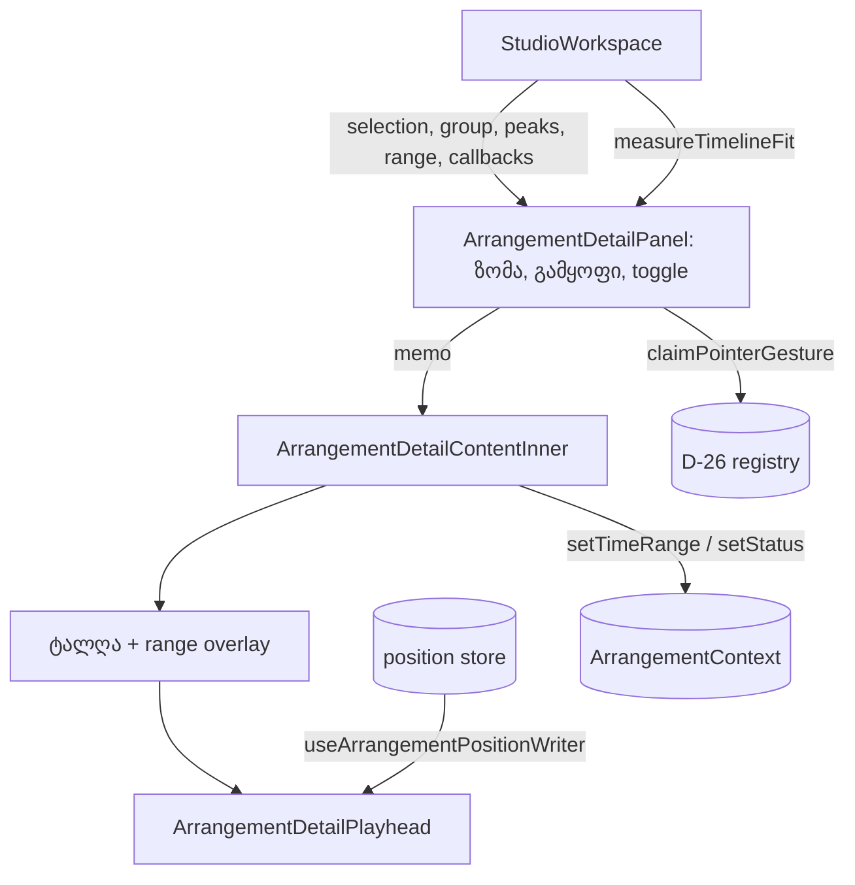

# Studio Lab — კლიპის დეტალების panel (SRW-11B, ეტაპი 1, round 8)

**თარიღი:** 2026-10-09
**სტატუსი:** In Progress.
- **C round 8 (`c-round-8.md`):** ეტაპი 1-ის feature ID-ები R11-P1b, R11-P1c, R11-P1d, R11-P1e, R11-P4d, R11-U1 და R8-D1 PASS-ია.
- **რაუნდის ვერდიქტი FAIL-ია** §8.2-ის წესებზე 2 (writer envelope) და 3 (`tick` + mt, D − N).
- **C-R8-01 (Medium)** ღიაა: ღია panel-ით და მონიშნული კლიპით R3-V1 drift ვარდება. გადაწყვეტა round 9-ში მიდის (დოკ. 018, pending C).
**შეცვლილი პროექტი:** Store

## კონტექსტი

FB-08 და Ableton-ის PNL-01: არჩეული კლიპის დეტალები timeline-ის ქვეშ უნდა ჩანდეს. D-29 ამას სამ ეტაპად ყოფს. ეს ეტაპი 1-ია: Clip Detail panel. ეტაპი 2 (ტრეკის fold/სიმაღლე + auto-fit) და ეტაპი 3 (მცურავი ვიდეო) შემდეგ რაუნდებშია. D-29a panel-ის საწყის მდგომარეობას 1280×720-ის სიმაღლის ბიუჯეტით ადგენს.

## მიდგომა

- **ადგილი:** panel-ი მარჯვენა სვეტშია, timeline-ის scroller-ის ქვეშ და footer-ის ზემოთ. Scroller-ი `flex-1 min-h-0`-ია, ამიტომ ზუსტად panel-ის სიმაღლით მცირდება. გადაფარვა არ ხდება.
- **View state:** სიმაღლე და დაკეცვა panel-ის ლოკალური state-ია. ის `Arrangement`-ში, ისტორიაში, context-ში და export-ში არ ხვდება. Undo მას არ ცვლის. Reload-ის შემდეგ არ ინახება.
- **D-29a:** პირველი render დაკეცილია. layout effect-ში ერთხელ იზომება scroller-ის `clientHeight` (horizontal scrollbar-ის გარეშე) და timeline-ის შიგთავსის სიმაღლე (ruler + loop strip + ხაზები). panel-ი 144 px-ით იხსნება მხოლოდ მაშინ, თუ `clientHeight − (144 − 36) ≥ შიგთავსი`. პირველი ცვლილება transition-ის გარეშე ხდება: `motion-safe` transition მომხმარებლის პირველი მოქმედების შემდეგ ირთვება, drag-ის დროს კი გამორთულია.
- **გამყოფი:** panel-ის ზედა კიდეზეა, `absolute`, layout-ს 0 px-ს უმატებს. Pointer drag D-26-ის registry-ს იკავებს (`claimPointerGesture`). abort (blur, pointercancel, იმავე pointer-ის ახალი gesture) drag-მდე არსებულ ზომას აბრუნებს. ↑/↓ ±16 px-ია, clamp 120–280. ისრები გამყოფზე იხარჯება და კლიპს არ ამოძრავებს. დაკეცილ panel-ზე drag ან ისარი ჯერ panel-ს ხსნის.
- **Space toggle-ზე:** toggle-ი Space-ს `keydown`/`keyup`-ზე თავად ამუშავებს და window-ის handler-ამდე აჩერებს. panel-ი ერთხელ იკეცება ან იშლება, transport არ იწყება. `StudioWorkspace`-ის გლობალური handler არ შეცვლილა.
- **Range-ის ველები:** სწორი შეყვანა (სასრული, end > start, კლიპის ±0.01 წმ-ში) კლიპის საზღვრებში იჭრება და არსებულ `setTimeRange`-ს გადაეცემა, ისტორიის გარეშე. თუ ჭრის შემდეგ end ≤ start, შეყვანა უარყოფილია. უარის სტატუსი: `მონაკვეთი კლიპის საზღვრებში უნდა იყოს; დასასრული დასაწყისზე მეტი უნდა იყოს.` აქტიური gesture-ის დროს — `GESTURE_EDIT_BLOCKED_MESSAGE`. ველები ყველა კლიპზე ჩართულია, ვიდეოკლიპის ჩათვლით, რადგან timeline-ის range gesture (`ArrangementClip.tsx`, კლიპის სხეულის `beginGesture('range')`) კლიპის ტიპს არ ამოწმებს. ჯგუფზე და მონიშვნის გარეშე ველები გამორთულია; მიზეზი `title`-შია.
- **Render budget:** შიგთავსი (`ArrangementDetailContentInner`) `memo`-ა და მხოლოდ სტაბილურ props-ს იღებს: `useMemo`-ით მიღებულ selection/group-ს, peaks-ს, range-ს და სტაბილურ callback-ებს. Detail playhead პოზიციას `useArrangementPositionWriter`-ით პირდაპირ DOM-ში წერს: `left` კლიპის სიგრძის პროცენტია, `display` მხოლოდ ხილვადობის შეცვლისას იცვლება. Layout-ს კადრზე არ კითხულობს.
- **design-philosopher-ის გადაწყვეტილება:** სათაური `კლიპის დეტალები`; ჭდეები `ხაზი` · `start` · `სიგრძე` · `offset`; toggle `დაკეცვა ▾` / `გაშლა ▸`; მარცხნივ ინფორმაცია, შუაში ტალღა, მარჯვნივ ველები. Follow-up-ები (არ გამოყენებულა): footer-ის `arrangement-selected-clip` ხაზის დუბლირება, `bg-foreground/60`-ის ხილვადობა ტალღაზე, Latin/ქართული ჭდეების ერთიანი წესი.

### მუდმივები

| მუდმივა | მნიშვნელობა |
|---|---|
| ნაგულისხმევი სიმაღლე | 144 px |
| დიაპაზონი | 120–280 px |
| ისრის ბიჯი | ±16 px |
| დაკეცილი | 36 px |
| გამყოფის layout სიმაღლე | 0 px (hit area 6 px header-ის თავზე) |
| range-ის ტოლერანსი | ±0.01 წმ კლიპის საზღვრიდან |
| transition | 300 ms, მხოლოდ `motion-safe:` |

## არქიტექტურა

## შეცვლილი ფაილები

- `app/components/arrangement/ArrangementDetailPanel.tsx` — ახალი: panel, გამყოფი, შიგთავსი, detail playhead.
- `app/lib/arrangement/panels.ts` — ახალი: სიმაღლის clamp და ბიჯი, D-29a-ს გადაწყვეტილება, range-ის ვალიდაცია და clamp.
- `app/components/arrangement/StudioWorkspace.tsx` — panel-ის mount scroller-ის ქვეშ, selection/group/peaks props, `measureTimelineFit`.
- `app/components/arrangement/ArrangementClip.tsx` — მხოლოდ `buildPeakShape`-ის export.
- ტესტები: `panels.test.ts` (ახალი), `detail-panel.test.tsx` (ახალი), `render-budget.test.tsx` (ახალი შემთხვევა + timeout).
- დოკ. 016 — მხოლოდ სტატუსი და TODO.

`ArrangementContext.tsx` არ შეცვლილა: საჭირო წევრები უკვე არსებობდა.

## პრობლემები და გადაწყვეტები

- **Problem:** D-29a-ს გაზომვა layout effect-ში style-ს უკვე ითვლის. transition რომ იმავე task-ში ჩართულიყო, 36→144 ცვლილება ანიმაციით გამოჩნდებოდა. **Solution:** transition მომხმარებლის პირველ მოქმედებაზე ირთვება.
- **Problem:** window-ის keyup handler Space-ზე `preventDefault`-ს იძახებს, ამიტომ ღილაკი Space-ით ვერ აქტიურდებოდა. **Solution:** toggle Space-ს keydown-ზე თავად ამუშავებს და ორივე event-ს აჩერებს.
- **Problem:** scroller-ის `scrollHeight` შიგთავსის სიმაღლედ არ გამოდგება, რადგან ის `clientHeight`-ზე ნაკლები არასოდესაა. **Solution:** იზომება timeline-ის შიგთავსის `offsetHeight`.
- **Problem (code-reviewer M1):** ტოლერანსის ფარგლებში კიდესთან შეყვანილი მნიშვნელობა შებრუნებულ range-ს ქმნიდა. **Solution:** `clampDetailRangeToClip` ორივე ბოლოს ჭრის და end > start-ს ხელახლა ამოწმებს.
- **Problem (code-reviewer M2):** კლიპის გადატანის შემდეგ ველებში ძველი მნიშვნელობები რჩებოდა. **Solution:** ველები range-ის, კლიპის start-ისა და სიგრძის ცვლილებისას სინქრონდება (layout effect, კლიპთან გადაკვეთის მიხედვით).
- **Problem:** `render-budget.test.tsx`-ის პირველი არსებული ტესტი სრულ, პარალელურ გაშვებაზე 5 წმ-ის timeout-ს სცდებოდა. A/B-მ აჩვენა, რომ ცალკე გაშვება panel-ით და მის გარეშე ერთნაირია (2.5–3.5 წმ). **Solution:** ამ ტესტს 15 წმ-იანი timeout მიეცა. assertion-ები არ შეცვლილა.

## ტესტირება

ყველაფერი pending C.

- `panels.test.ts`: clamp, ±16, D-29a (1440: 650/368 → ღია; 1280: 412/368 → დაკეცილი; ზღვარი 476/475), range-ის ვალიდაცია და clamp.
- `detail-panel.test.tsx`: toggle და ისრები ისტორიას არ წერს; registry-ს დაკავება (მეორე pointer კლიპზე იგნორირდება, Mute უარყოფილია); blur/pointercancel ზომას აბრუნებს; სტატუსების ზუსტი ტექსტი; გამორთული ველები; ვიდეოს placeholder; შეყვანის ველში shortcut-ები არ მუშაობს; Space toggle-ზე; D-29a transition-ის გარეშე; კიდეზე ჩაკეცილი range და გადატანილი კლიპი.
- `render-budget.test.tsx`: შიგთავსი 0-ჯერ რენდერდება 60 კადრზე და Play → Pause → Play-ზე (mount > 0, positive control `ArrangementDetailPanel` > 0).
- Guard-ის შემოწმება: registry-ის claim დროებით მოიხსნა → 3 ტესტი ჩავარდა; ფაილი ბაიტ-ბაიტ აღდგა.
- ბრაუზერი (A, gstack, synthetic pointers): 1440×900 → ღია 144, 1280×720 → დაკეცილი 36; drag ±40, clamp 120/280, ↑/↓ (`press`), Space toggle-ზე, ველებში shortcut-ები, range 3.5/7.25, detail playhead-ის მონოტონური მოძრაობა, Fit უცვლელი. R3-V1-ის 3 run detail writer-ის დროებითი გაზომვით (A-ს harness-ის drift verdict, C-ს არ შეუმოწმებია). რიცხვები: `tmp/studio-real-loop/a-round-8.md`.

## TODO / შემდეგი ნაბიჯები

- C round 8 დასრულდა: feature ID-ები PASS-ია, რაუნდი §8.2-ის წესებზე 2 და 3 ვარდება, C-R8-01 ღიაა.
- Round 9 (ბაგების რაუნდი, დოკ. 018): C-R8-01 (compositor-only detail playhead) და C-R6-02.
- Round 10: SRW-11B ეტაპი 2 — fold/სიმაღლე + auto-fit; 1280×720-ზე D-29a-ს ბიუჯეტის შეთანხმება.
- Round 11 (ბაგების რაუნდი): C-R7-01 და C-R7-02.
- Round 12: SRW-11B ეტაპი 3 — მცურავი ვიდეო.
- design-philosopher-ის follow-up-ები (footer-ის დუბლირება, overlay-ის ხილვადობა, ჭდეების ენა) — B-სთვის.
- Tech Lead: გამყოფის drag რეალური მაუსით (R11-P3m).
