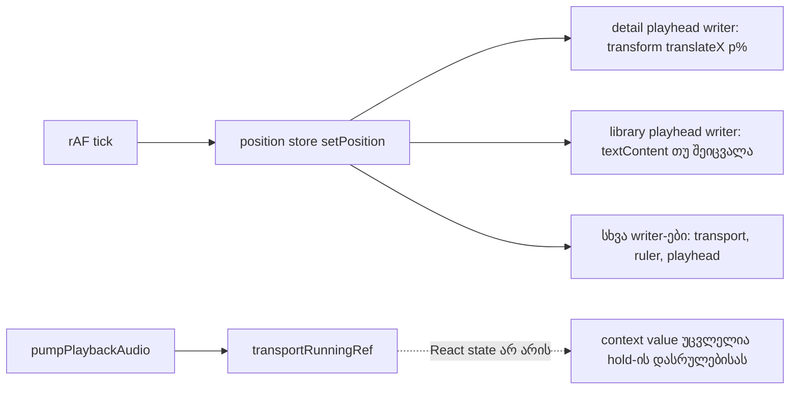

# Studio Lab — detail playhead compositor-only და per-frame ხარჯის შემცირება (round 9: C-R8-01, C-R6-02)

**თარიღი:** 2026-10-10
**სტატუსი:** In Progress — C round 9 (`c-round-9.md`): R9-D3, R9-L1, R9-L2, R9-U და R9-Doc **PASS**. R9-D1 **FAIL** (mode D 2/3, D_3 max 0.1564 წმ). R9-D2 **FAIL** წესი 3-ზე (D − N p95 +0.3 ms). R9-L3 **FAIL** (N 3/3, RF5-3 3/3, D 2/3). C-R8-01 და C-R6-02 ღიაა; შემდეგი მტკიცებულება Tech Lead-ის quiet-Chrome run-ია.
**შეცვლილი პროექტი:** Store

## კონტექსტი

- **C-R8-01 (Medium).** C-ის round 8-ის გაზომვაში R3-V1 drift ვარდება 3/3-ზე, როცა 1440×900-ზე Clip Detail panel ღიაა და მუსიკის კლიპი მონიშნულია (mode D).
  - პანელის დაკეცვისას (mode P) იგივე გაზომვა 3/3 გადის, მონიშვნის გარეშე (mode N) 2/3.
  - App LoAF და forced layout არ ჩანდა, ამიტომ ეჭვი rendering-ზე (layout/paint/raster) მოდიოდა.
  - Detail playhead ყოველ frame-ზე `left` %-ს წერდა, 480-სვეტიანი SVG waveform-ის თავზე.
- **C-R6-02.** ორი per-frame ხარჯი დარჩა:
  - `LibraryPlayheadText` ყოველ frame-ზე React render-ით ახლდებოდა (`useArrangementPosition`).
  - `isTransportRunning` memoized context value-ში იყო. start hold-ის დასრულებისას ის ერთხელ იცვლებოდა და Play-ის პირველ frame-ებში ყველა `useArrangement()` consumer-ს თავიდან არენდერებდა. ამ მნიშვნელობას არცერთი კომპონენტი არ კითხულობდა.

## მიდგომა

1. **ჯერ probe, შემდეგ fix.**
   - დროებითი ლოკალური ცვლილებებით ორი probe გაიზომა:
     - S: waveform ჩანს, ხაზი არასდროს ჩანს;
     - L: ხაზი მოძრაობს, SVG არ არის.
   - თითო probe მონაცვლეობდა D-სთან.
   - შედეგი (დეტალები ქვემოთ) **გადაწყვეტილების მისაღებად საკმარისი არ არის**: A-ს სესიაში D-მაც გაიარა, ამიტომ S და L ვერ გაირჩა.
   - ამიტომ შესრულდა B-ის მიერ აღწერილი სავალდებულო DOM contract: compositor-only ხაზი და waveform-ის paint containment. სტატიკური SVG-ის ცალკე გამარტივება probe-მა არ გაამართლა და არ გაკეთებულა.
2. **Detail playhead.**
   - `[data-testid=arrangement-detail-playhead]` ახლა `absolute inset-0` wrapper-ია `will-change-transform`-ით. 1 px-იანი `bg-accent` ხაზი wrapper-ის მარცხენა კიდეზეა.
   - ყოველ frame-ზე ერთადერთი ჩაწერაა `style.transform = translateX(p%)`, სადაც `p = (position − clip.start) / clip.duration × 100`.
   - `translateX`-ის % wrapper-ის საკუთარ სიგანეს ეხება, ანუ waveform-ის ყუთის სიგანეს. ამიტომ სიგანე საერთოდ არ იზომება და layout არ იკითხება.
   - `left`/`width`/`height` frame-ზე არ იწერება. `display` იცვლება მხოლოდ კლიპში შესვლა/გამოსვლისას.
   - Writer position-store-ის writer pattern-ში რჩება (`useArrangementPositionWriter`), frame rate უცვლელია.
3. **Waveform-ის ყუთი** — `contain-strict` (Tailwind 4.1).
   - ბრაუზერში computed `contain` არის `strict`, ყუთის ზომა კი იგივეა, რაც containment-ის გარეშე: 704×91 px 1440×900-ზე. ამიტომ `contain-paint`-ზე გადასვლა საჭირო არ გახდა.
4. **`LibraryPlayheadText`** — position writer, რომელიც ref-ით მიბმული ``-ის `textContent`-ს წერს.
   - წერს მხოლოდ მაშინ, როცა `formatArrangementTime`-ის ტექსტი იცვლება.
   - ტექსტი, ადგილი და კლასები იგივეა. Frame-ზე React render-ი 0-ია.
   - span-ს დაემატა `data-testid="arrangement-library-playhead"`, reviewer-ის L9-ის მიხედვით, რომ ტესტმა და C-მა ის სტაბილურად იპოვოს.
   - `memo` არ გამოიყენება. ტოლი სახელის მქონე `const`-ში ჩასმისას bundler-მა შიდა ფუნქციას `LibraryPlayheadText2` დაარქვა, რაც render probe-ს არღვევს. სხვა ვარიანტი usage-ის ერთი token-ის შეცვლა იქნებოდა, რაც დავალების "მხოლოდ `LibraryPlayheadText` და import" ფარგლებს სცდება და B-ს გადაეცა.
   - Library preview-ის დროს მშობელი 20 Hz-ით ხელახლა არენდერდება, ამიტომ ეს span-იც ხელახლა არენდერდება. Playback frame-ზე render-ი 0-ია.
5. **`isTransportRunning`** ამოღებულია context value-ის ტიპიდან, value-დან, memo deps-დან და `useState`-იდან.
   - `markTransportRunning` ახლა მხოლოდ `transportRunningRef`-ს ანახლებს, რომელსაც `pumpPlaybackAudio` კითხულობს.
   - Scheduler-ის, hold-ისა და video-sync-ის ლოგიკა უცვლელია.
   - `useArrangementPosition` export-ად რჩება.

## DOM contract (C-სთვის)

- Per frame: `[data-testid=arrangement-detail-playhead]`-ზე მხოლოდ `transform`-ის ცვლილება. ფორმატი: `translateX(<number>%)`.
- პოზიცია: `p = parseFloat(style.transform.slice(11))`. ის 0–100-ის ფარგლებშია და კლიპის ფარდობით პოზიციას აღნიშნავს.
- `display`: `none` ↔ `block` მხოლოდ კლიპის საზღვარზე. `left`, `width` და `height` ცარიელია.

## არქიტექტურა

## შეცვლილი ფაილები

- `app/components/arrangement/ArrangementDetailPanel.tsx`: მხოლოდ `ArrangementDetailPlayhead` და waveform-ის ყუთის კლასი (`contain-strict`).
- `app/components/arrangement/ArrangementLibraryPreview.tsx`: მხოლოდ `LibraryPlayheadText` და import.
- `app/contexts/ArrangementContext.tsx`: `isTransportRunning`-ის ტიპი, value, deps და `useState`; `markTransportRunning` მხოლოდ ref-ს წერს.
- `app/lib/arrangement/__tests__/render-budget.test.tsx`: 3 ახალი ტესტი და ორი დასახელებული assertion-ის ცვლილება.
- დოკ. 017: მხოლოდ სტატუსი და TODO.

## პრობლემები და გადაწყვეტები

- **Probe-მა მიზეზი ვერ გამოყო.** A-ს სესიაში D (wrapper-ით) 4/4 გავიდა. ამიტომ S და L D-ს ვერ შეედარა.
  - გადაწყვეტა: გამოყენებულია B-ის სავალდებულო contract-ი, რომელიც ორივე კანდიდატს ფარავს: compositor-only ხაზი და ყუთის paint containment.
  - საბოლოო შეფასება C-ის გაზომვაა.
- **ტესტის პირველი ვერსია არასწორად ვარაუდობდა,** რომ ხაზი თავიდან დამალულია, თუმცა პოზიცია 0 კლიპის შიგნითაა.
  - გადაწყვეტა: ტესტი ჯერ კლიპის გარეთ (25 წმ) აყენებს პოზიციას.
- **RF7-P2-ის ბრმა წერტილი.** იქ მთვლელები hold-ის დასრულების შემდეგ იწმინდება, ამიტომ ტესტი flip-ს ვერ ხედავდა.
  - გადაწყვეტა: R9-L2-ის ტესტი მთვლელებს Play-ის click-ისთანავე წმენდს, როცა `getLivePosition() === 0` (hold ჯერ აქტიურია). შემდეგ 450 ms და 30 frame ელოდება, რომ hold-ი რეალურად დასრულდეს.
  - Guard proof-მა აჩვენა, რომ ტესტი flip-ს ხედავს: `isTransportRunning`-ის დაბრუნებისას ტესტი identity-ზე ვარდება.

## ტესტირება

ყველა რიცხვი A-ს გაზომვაა და C-ს ჯერ არ შეუმოწმებია. სრული ცხრილი: `tmp/studio-real-loop/a-round-9.md`.

- **Unit/render-budget:**
  - `render-budget.test.tsx`-ს 3 ახალი ტესტი დაემატა:
    - detail playhead: per-frame მხოლოდ `transform`, `left`/`width`/`height` არ იწერება და layout არ იკითხება;
    - `LibraryPlayheadText`: 0 render 60 frame-ზე, ტექსტი იცვლება;
    - context value იგივე ობიექტია hold-ის დასრულებამდე და მის შემდეგ, consumer-ების render 0-ია.
  - შეიცვალა ორი დასახელებული assertion: `translateX` `left`-ის ნაცვლად და `LibraryPlayheadText` 0 render.
  - span-ის კლასი ტესტში ზუსტად `tabular-nums`-ად მოწმდება. ეს განზრახ შეზღუდვაა: ახალი კლასის დამატება ტესტს ჩააგდებს.
  - სამივე ახალი ტესტი round 8-ის კოდზე ვარდება.
  - Guard proof-ები:
    - `useArrangementPosition`-ის render-ის დაბრუნებისას R9-L1 ვარდება;
    - `isTransportRunning`-ის დაბრუნებისას R9-L2 identity-ზე ვარდება.
    - ორივე ფაილი byte-for-byte აღდგა (`cmp`).
- **Gates:** vitest 809/809 (arrangement 345), tsc 0, Biome 0 error, build წარმატებულია, protected hash-ები OK.
- **ბრაუზერი (1440×900):**
  - computed `contain: strict`, ყუთის ზომა უცვლელია;
  - 180 frame-ში 180 style mutation, ყველა მხოლოდ `transform`;
  - მოძრაობა მონოტონურია;
  - ვიდეოკლიპის (8–12 წმ) გარეთ ხაზი დამალულია (0 დარღვევა);
  - ბიბლიოთეკის ტექსტი იცვლება და transport-ს ემთხვევა;
  - Follow ღია panel-ით: 0 invisible.
- **Probe (C-R8-01):** A-ს სესიაში D 4/4 გავიდა. S 2/2 ვალიდური გავიდა (1 harness-ის შეცდომა), L 3/3 გავიდა. `tick` + mt p95 ყველგან 2.1–2.7 ms-ია. შედეგი: გადაწყვეტილების მისაღებად საკმარისი არ არის.
- **ფიქსის შემდეგ, R3-V1:**
  - D: 3/3 PASS ერთ სესიაში. D_1 წინა სესიაში FAIL-ია (ერთი hard seek; LoAF-ში app script-ი არ არის). ის სესია გარემომ შეწყვიტა.
  - N 3/3 და P 3/3 PASS.
  - `tick` + mt-ის მედიანა D 0.4/0.9 ms, N 0.3/0.7 ms. D − N = +0.1/+0.2 ms, ზღვარზე.
  - Fix-მდე ყველა run-ში p50 1.2–1.5 ms იყო. ეს შეესაბამება ყოველ frame-ზე `LibraryPlayheadText`-ის React render-ის მოხსნას.
- **RF5-3:** harness-ის ვერდიქტია `pass:false` ×3.
  - ერთადერთი "not paused" pre-row თავად `play()`-ია −0.010 წმ-ზე, media 1.1–2.1 ms-ზე (ერთ frame-ზე ნაკლები).
  - w1 ≤ 0.040, w2 ≤ 0.042.
  - ეს C-ის round-7-ის artifact-წესის ფორმას ემთხვევა, მაგრამ C-ის მიერ ნანახ 0.6 ms-ზე მეტია. გადაწყვეტა C-სია.

## TODO / შემდეგი ნაბიჯები

- C round 9 დასრულდა (შედეგი სტატუსის ხაზშია). მიმდებარე რეგრესიები (R11-P1c, R11-P1d, R11-P1e, R4-M2, RF7-P2, R10-N4, R26-1) PASS-ია.
- C-R8-01 და C-R6-02 ღიაა (Medium). კოდი გაყინულია; შემდეგი საჭირო მტკიცებულება Tech Lead-ის quiet-Chrome run-ია (RF7-2, D layout).
- Round 10: C-R7-01 და C-R7-02 (დოკ. 019). Round 11: SRW-11B ეტაპი 2. Round 12: ეტაპი 3.
