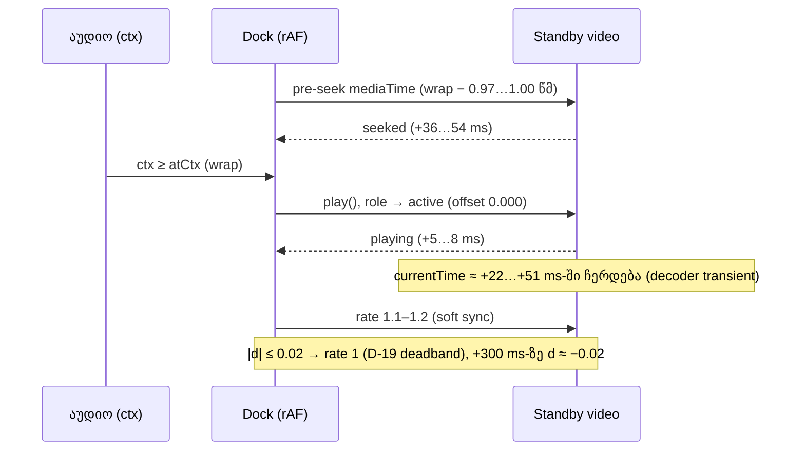

# Studio Lab — loop wrap-ზე ვიდეოს დაგვიანების დიაგნოზი და ruler-ის ბოლო tick-ი (round 10: C-R7-01, C-R7-02)

**თარიღი:** 2026-10-10
**სტატუსი:** C round 10 შემოწმდა (verdict FAIL, `c-round-10.md`). R10-W2, R10-R1, R10-R2 და R10-Doc — PASS; R10-W3 — not applicable (წყარო არ შეცვლილა). R10-W1 — FAIL: 9 wrap-იდან 6 ფანჯარაზე დაბლაა, `d` +300 ms-ზე ცხრავე wrap-ში −0.017-სა და −0.020-ს შორისაა. C-R7-02 დაიხურა. C-R7-01 ღიად რჩება და round 12-ში D-19a-თი (post-swap settle) გადაწყდება — PASS ან „resolved“ არ არის.
**შეცვლილი პროექტი:** Store

## კონტექსტი

- **C-R7-01 (Medium).** C-ის round-7 run-ში (L6_1) loop 2–4-ის პირველ wrap-ზე ვიდეო +300 ms-ზე 2.244-ზე იყო, RF5-2-ის ფანჯარა კი [2.29, 2.31]-ია. ბაგი წყვეტილია: ზოგჯერ 10–56 ms-ით გვიანდება. ის SRW-11B-ის მესამე ეტაპამდე (მცურავი ვიდეო) უნდა დაიხუროს.
- **C-R7-02 (Low).** C-ის zoom sweep-ზე scroller-ის `scrollWidth` content-ის სიგანეს 1.41 px-ით (1280×720, 206.8 px/წმ) და 1.47 px-ით (1440×900, 186.5 px/წმ) აჭარბებდა. ცარიელ default-ზე ზუსტად 1.0 px იყო.

## მიდგომა

### C-R7-01: ჯერ გაზომვა, მერე გადაწყვეტილება

Dock-ში დროებით ჩაიდო probe (wrapper), რომელიც ყოველ wrap-ზე წერდა:
- standby-ის pre-seek-ის დროს ან გამოტოვების მიზეზს;
- `seeked`-ის დროს;
- swap-ის მომენტში `lateBy`-ს, `readyState`-ს, `seeking`-ს, `currentTime − mediaTime`-ს და `playPending`-ს;
- `play()`-ის latency-ს;
- swap-იდან 500 ms-ის განმავლობაში ყოველ rAF-ზე `video.currentTime`-ს, აუდიოდან მოსალოდნელ დროს, მათ სხვაობას `d`-ს და rate-ის ჩაწერებს.

Probe-ის შემდეგ dock backup-იდან აღდგა და `cmp`-ით იდენტურია. `app/`-ში probe-ის marker 0-ია.

გაზომვა: C-ის L6 layout (1440×900, video clip 0–6.008, loop 2–4, Play 1.0-დან, 8.5 წმ). 6 run × 3 wrap = 18 wrap. აქედან 2 run fresh page load-ის შემდეგ პირველი run-ია (W_1 და F_1, swap #1 სესიაში).

შედეგი (A-ს გაზომვა, არა C-ის verdict):

| მიზეზი | რას ვეძებდით | რა ვნახეთ | დასკვნა |
|---|---|---|---|
| (a) გვიანი pre-seek | seek-ის გამოტოვება ან `seeked` wrap-ის შემდეგ | seek wrap-მდე 0.97–1.00 წმ-ით ადრე იწყება, `seeked` 36–54 ms-ში მოდის, ანუ wrap-მდე ≈ 0.91–0.96 წმ-ით ადრე (პირველ swap-ზე ≈ 0.92). ერთადერთი გამოტოვება `metadata`-ა, ერთი rAF-ით, მხოლოდ პირველ swap-ზე | უარყოფილია |
| (b) პირველი swap-ის warm-up | გრძელი `play()` → `playing` მხოლოდ swap #1-ზე | `play()` → `playing` 4.5–7.7 ms ყველა swap-ზე. პირველ swap-ზე 7.2–7.6 ms-ია, დანარჩენზე 4.5–6.4 ms | უარყოფილია |
| (d) positioned tolerance + start latency | swap-ის მომენტში offset < −0.01 | offset 18/18 wrap-ზე ზუსტად 0.000-ია, `readyState` 4, `seeking` false, `playPending` false | უარყოფილია |
| (m) გაზომვა | `d` მთელ 500 ms-ში ±10 ms-ში რჩება | `d` −0.044…−0.055-მდე აღწევს, +300 ms-ზე −0.014…−0.024-ია | უარყოფილია |
| (c) გარემო | — | იხ. ქვემოთ | **ყველაზე მეტად ეს მიზეზი ემთხვევა** |

**მექანიზმი, რომელიც ყველა swap-ზე მეორდება (არა მხოლოდ პირველზე):**
1. `play()` wrap-იდან 0–12 ms-ში იძახება, `playing` 5–8 ms-ში მოდის.
2. ≈ +22 ms-დან ≈ +51 ms-მდე ვიდეოს `currentTime` ≈ 2.015-ზე ჩერდება. ყველაზე სავარაუდოდ, ეს headless decoder-ის start transient-ია. ეს დასკვნაა გაზომვიდან და არა დადასტურებული ფაქტი: app-ის მხარეს ამ მომენტში არაფერი იცვლება (rate 1, seek არ არის).
3. ჩამორჩენა +60…+130 ms-ზე 0.044–0.055-ს აღწევს.
4. D-19-ის soft sync 1.1–1.2 rate-ით ეწევა. |d| ≤ 0.02-ზე (D-19-ის deadband) rate 1-ს უბრუნდება, ამიტომ +300 ms-ზე ჩამორჩენა deadband-ის კიდეზე, −0.014…−0.024-ზე რჩება.

**რატომ არ შეიცვალა source.** ამოცანა ფიქსს მხოლოდ დადასტურებულ (a), (b) ან (d)-ზე უშვებს, მონაცემები კი სამივეს უარყოფს. დაშვებული ფორმები ამ მექანიზმს ვერ წვდება:
- pre-roll-ს ორი ელემენტის ერთდროულად დაკვრა ერთ frame-ზე მეტხანს დასჭირდებოდა, `multiPlayingMaxMs ≤ 17` კი ამას კრძალავს;
- ერთი frame-ით ადრე `play()` ერთ კონკრეტულ run-ზე მორგება იქნებოდა და ტესტით ვერ დამტკიცდებოდა.

**სპეციფიკაციის ურთიერთქმედება (B-ს და Tech Lead-ის გადასაწყვეტი, A-მ არაფერი შეცვალა):**
- RF5-2-ის ფანჯრის ნახევარი 0.01-ია, D-19 კი |d| ≤ 0.02-ზე კორექციას აჩერებს.
- ექვსივე run-ში steady-state median |d| 0.010–0.013-ია.
- ამიტომ D-19-ის მიხედვით 20 ms-ზე დიდი ნებისმიერი transient-ის შემდეგ ვიდეო deadband-ის კიდეზე ჩერდება. ეს მნიშვნელობა [2.29, 2.31]-ის ზღვარზე ან მის გარეთაა.

**Harness-ის შენიშვნა C-სთვის (§6.4; ეს (m)-ის მტკიცება არ არის).** +300 ms-ის sample პირველი rAF-ია, სადაც ctx ≥ wrap + 0.3. Run-ის ფაზის მიხედვით ის ctxRel 0.302-ზე ან 0.310-ზე ხვდება და ფიქსირებულ 2.30-ს ედრება. ამიტომ ერთი და იგივე ≈ −0.02 ჩამორჩენა ზოგჯერ 2.276-ად იკითხება (W_1 wrap 3, @0.302), ზოგჯერ 2.292-ად (W_1 wrap 1, @0.31).

**შენიშვნა.** `stopAllSlots` standby-ის `preparedKey`-ს არ ასუფთავებს. ამიტომ W_2–W_5-ის პირველ wrap-ზე standby წინა run-იდან უკვე მომზადებული იყო (offset 0). ეს ბაგი არ არის.

### C-R7-02: ბოლო tick-ის ხაზი content-ის ბოლოზე

დიაგნოზი (ორივე viewport, ცარიელი default და sweep-ის ყველა zoom, სადაც overflow > 1; 0.5–1-ის შუალედის მნიშვნელობებსაც იგივე მიზეზი აქვს):
- scroller-ში ყველაზე მარჯვენა ელემენტი ruler-ის ბოლო tick-ია (`border-l` div);
- ის ზუსტად content-ის ბოლოზე დგას (`left = seconds × pps`), ამიტომ მისი 1 px ხაზი content-ს 1 px-ით სცდება;
- Chrome `scrollWidth`-ს მთელ რიცხვამდე ამრგვალებს, ამიტომ overflow [0.5, 1.5] შუალედშია;
- ბოლო label ყოველთვის content-ის შიგნითაა;
- timeline-ის `seconds` = `ceil(projectEnd + 30)` (`StudioWorkspace`): ცარიელზე 30, sweep-ზე 1652.

ფიქსი `rulerTickMarks`-შია: tick, რომლის ხაზიც (`time × pps + 1 px`) ruler-ის სიგანეს სცდება, სიაში აღარ ხვდება.
- Label-იანი tick ამით ვერ ქრება: label-ს `x + 5 + 8 × სიმბოლო ≤ სიგანე` სჭირდება. უმოკლესი label (`0:00`) 4 სიმბოლოა, ანუ `x ≤ სიგანე − 37`.
- Label-ის ტექსტი, დაშორება (≥ 40 px), step-ის წესი და render-ის memo უცვლელია.
- Render-ის კომპონენტი (`ArrangementRulerTicksInner`) არ შეცვლილა.
- **ხილული ცვლილება (განზრახ):** content-ის ბოლოს 1 px-იანი ხაზი აღარ ჩანს, რადგან ის სწორედ ეს tick იყო. ბოლოს 30 წმ-იანი tail-ია, ამიტომ ეს მხოლოდ ვიზუალური დეტალია.

## არქიტექტურა

## შეცვლილი ფაილები

- `app/lib/arrangement/view.ts` — `rulerTickMarks` ფილტრავს tick-ს, რომლის ხაზიც ruler-ის ბოლოს სცდება. ახალი კონსტანტა `RULER_TICK_LINE_PX`.
- `app/lib/arrangement/__tests__/view.test.ts` — C-ის ორი უარესი zoom-ისა და ცარიელი default-ის ახალი შემთხვევები. ერთ არსებულ შემთხვევაში ცარიელი 30 წმ-ის ბოლო tick-ის მოლოდინი შეიცვალა (named exception).
- დოკ. 018 — მხოლოდ სტატუსი და TODO (C round 9-ის შედეგი).
- `ArrangementVideoDock.tsx` და `video-sync.ts` — **არ შეცვლილა** (probe დროებითი იყო და აღდგა).

## პრობლემები და გადაწყვეტები

- **Problem:** B-ის კრიტერიუმი „ბოლო ელემენტის მარჯვენა კიდე ≤ content + 1“ round-9-ის ფუნქციაზეც გადის (1200 + 1 ≤ 1201), ამიტომ guard-ს არ იძლევა. **Solution:** ტესტი უფრო მკაცრ პირობას ამოწმებს: tick-ის ხაზი ≤ სიგანე. round-9-ის ფუნქციაზე ეს ტესტი ვარდება. მოსალოდნელია `scrollWidth − სიგანე ≤ 0.5`, თუ Chrome `scrollWidth`-ს უახლოეს მთელამდე ამრგვალებს. ეს ჯერ ვარაუდია და მას C-ის R10-R1 ადასტურებს ან უარყოფს. A-ს ფიქსის შემდეგ გაზომვა ქვემოთ, ტესტირებაშია.
- **Problem:** Vite ნებისმიერ ცვლილებაზე გვერდს გადატვირთავს. **Solution:** browser-ის გაზომვებისას store-ის არცერთი ფაილი არ შეცვლილა. ruler-ის დიაგნოზი გაკეთდა სუფთა source-ზე, wrap-ის run-ები კი probe-ის ჩადებიდან აღდგენამდე.

## ტესტირება

- `view.test.ts`-ის ახალი შემთხვევები: (30 წმ, 40 px/წმ), (1652 წმ, 186.4894 px/წმ), (1652 წმ, 206.796 px/წმ). თითოეული ამოწმებს:
  - ყველა tick-ის ხაზი ≤ სიგანე;
  - ბოლო label-ის შეფასება ≤ სიგანე;
  - label-ების რაოდენობა 30 / 3304 / 3304-ია, როგორც C-ის round-7-ის sweep-ში.
- Guard: ფილტრის დროებით მოხსნისას სამივე შემთხვევა ვარდება, აღდგენის შემდეგ `cmp`-იდენტურია (`a-round-10/guard-c-r7-02.txt`).
- A-ს გაზომვა ფიქსის შემდეგ (`r702diag.js`, C-ის `n5r`-ის იგივე ნაბიჯები; ეს C-ის verdict არ არის):
  - max overflow 1280×720-ზე 0.5 px-ია, 1440×900-ზე 0.484 px, ცარიელ default-ზე 0;
  - label-ების რაოდენობა sweep-ის ყველა zoom-ზე C-ის round-7-ის `n5r-*.json`-ს ემთხვევა.
  - Overlap-ს და cut-ს A-ს script-ი არ ითვლის. მათ C-ის `n5r` ამოწმებს.
- Wrap-ის გაზომვები: `tmp/studio-real-loop/a-round-10/runs/*_wraps.json` და `wrap-table.md`.

## TODO / შემდეგი ნაბიჯები

- C round 10 დასრულდა: R10-W2/R1/R2/Doc — PASS, R10-W3 — not applicable, R10-W1 — FAIL (6/9 ფანჯარაზე დაბლა; `d` +300 ms-ზე −0.017…−0.020 ცხრავე wrap-ში). C-R7-02 დაიხურა.
- C-R7-01 ღიაა (Medium). მიზეზი D-19-ის 0.02 წმ deadband-ისა და RF5-2-ის ±0.01 წმ ფანჯრის ურთიერთქმედებაა. B-მ გადაწყვეტა D-19a-დ (post-swap settle) ჩაწერა `plan.md`-ში; იმპლემენტაცია round 12-შია. Tech Lead-ის quiet-Chrome RF7-3 run კვლავ საჭირო მტკიცებულებაა.
