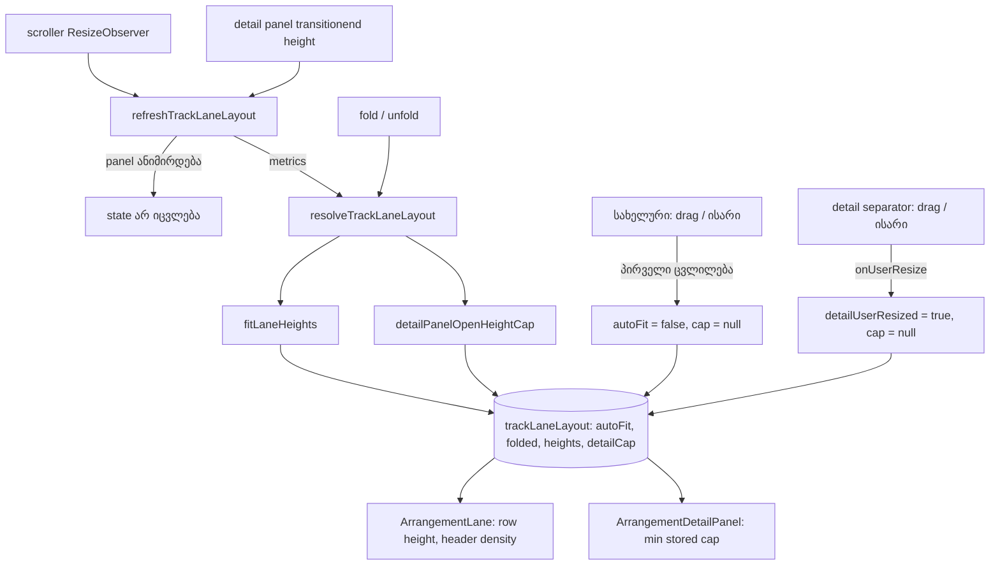

# Studio Lab — ხაზის დაკეცვა, სიმაღლე და lane auto-fit (SRW-11B, ეტაპი 2, round 11)

**თარიღი:** 2026-10-10
**სტატუსი:** C round 11 შემოწმდა (verdict PASS, `c-round-11.md`). R11-P2, R11-P2k, R11-P2a, R11-P4, R11-U და R11-Doc — PASS; §6-ის მიმდებარე რეგრესიები და G11-1..3 — PASS. 4 Low დაკვირვება: C-R11-01..04. C-R11-01..03 panel polish 14a-ში გადადის (`plan.md` D-29c) და ღიად რჩება; C-R11-04 მიღებული კონვენციაა (კოდი არ იცვლება).
**შეცვლილი პროექტი:** Store

## კონტექსტი

FB-08 და Ableton-ის TRK-04/TRK-05: მომხმარებელს ხაზის დაკეცვა და სიმაღლის შეცვლა სჭირდება. D-29 ამას SRW-11B-ის მეორე ეტაპად ადგენს, D-29b კი 1280×720-ის სიმაღლის ბიუჯეტს წყვეტს. ღია detail panel-ით (144 px) 4 ხაზი ნაგულისხმევი 80 px-ით აღარ ეტევა, ამიტომ ხაზები auto-fit-ით პატარავდება. თუ მინიმუმებიც არ ეტევა, panel-ი პირველი იკლებს.

## მიდგომა

- **View state:** fold, ხაზების სიმაღლე, auto-fit-ის flag, detail panel-ის cap და „მომხმარებელმა panel-ის ზომა შეცვალა“ `StudioWorkspace`-ის ლოკალური state-ია, track id-ით. `Arrangement`-ში, ისტორიაში, `ArrangementContext`-ში და export-ში არ ხვდება. Undo მას არ ცვლის.
- **სიმაღლის კონვენცია:** „სიმაღლე“ (60–180, ვიდეო 52–180, ნაგულისხმევი 80, `aria-valuenow`) ხაზის შიგთავსის სიმაღლეა. რიგის (row) სიმაღლე = სიმაღლე + 1 px ქვედა border. დაკეცილი რიგი ზუსტად 36 px-ია border-ის ჩათვლით (შიგთავსი 35). სიმაღლე ერთხელ, რიგის `style.height`-ზე იწერება (`border-box`). Header და ხაზის სხეული ამ რიგში იჭიმება, ამიტომ ყოველთვის ერთი სიმაღლისაა.
- **Fold:** ღილაკი `▾`/`▸` სახელის რიგის დასაწყისშია (`aria-expanded`, `aria-label` „{სახელი} დაკეცვა ან გახსნა“, `title` „დაკეცვა / გახსნა“). Space ღილაკზე ხაზს კეცავს და transport-ს არ იწყებს: keydown-ზე `preventDefault` + `stopPropagation`, `repeat` იგნორირდება, keyup-იც ჩერდება. Fold auto-fit-ს არ თიშავს. სანამ სხვა pointer gesture აქტიურია, fold იგნორირდება.
- **დაკეცილი header:** ერთი რიგი — fold, სახელი, (ვიდეოზე კომპაქტური „＋“), M და S იგივე `h-6 w-6` ზომით, იგივე `aria-label`/`aria-pressed`-ით და D-26-ის უარის ქცევით. Volume და „ორიგინალი ხმა“ დამალულია. „· აქტიური“ სუფიქსი დაკეცილზე დამალულია (აქტიურობას `border-l-brand` და `aria-pressed` აჩვენებს).
- **დაკეცილი კლიპი:** ტალღის სხეული და range gesture არ რენდერდება, ამიტომ დაკეცილ ხაზზე მონიშვნა ვერ დაიწყება. Header-ით გადატანა, მონიშვნა, cross-lane drag (დაკეცილზე და დაკეცილიდან) და ორივე trim უცვლელია. კლიპის `title`-ს ემატება ხაზი „ხაზი დაკეცილია — დროის მოსანიშნად გაშალე“.
- **სიმაღლის სახელური:** რიგის ქვედა კიდეზე, მთელ სიგანეზე (header + ხაზი), `absolute`, layout-ს 0 px-ს უმატებს. `role="separator"`, `aria-orientation="horizontal"`, `tabIndex 0`, `aria-label` „{სახელი} სიმაღლე“, `aria-valuemin` 60 (ვიდეო 52), `aria-valuemax` 180. Hit area 6 px-ია, `cursor-row-resize`, მოსვენებულ მდგომარეობაში უხილავია, hover/drag-ზე `bg-accent/60`, focus-ზე `ring-inset ring-brand` — detail panel-ის გამყოფის იდიომი.
  - **Pointer drag** D-26-ის registry-ს იკავებს: სხვა pointer-ის კლიპზე დაჭერა იგნორირდება, Mute და სხვა ბრძანებები `GESTURE_EDIT_BLOCKED_MESSAGE`-ით უარს ამბობს, Follow არ ახვევს. სიმაღლე = საწყისი + Δy, clamp. `pointercancel` და registry-ის abort (მაგ. window blur) აღადგენს საწყის სიმაღლეს, ამ ხაზის fold-ს და auto-fit-ს (snapshot-იდან, სხვა ცვლილებების დაბრუნების გარეშე).
  - **↓ = +8, ↑ = −8**, clamp. ისრები სახელურზე იხარჯება, კლიპს არ ამოძრავებს.
  - დაკეცილ ხაზზე ისარი ან pointerdown მხოლოდ ხსნის ხაზს (როგორც detail panel-ის გამყოფი).
  - **პირველი ხელით ცვლილება** (drag-ის პირველი რეალური მოძრაობა ან ისარი) auto-fit-ს სესიისთვის თიშავს. ყველა ხაზი ინარჩუნებს მიმდინარე სიმაღლეს.
  - სახელურზე file/library drop ხაზის სხეულს გადაეცემა მხოლოდ მაშინ, როცა pointer header-ის მარჯვნივაა (`clientX ≥ max(body.left, header.right)`), ამიტომ ხაზის ბოლო 6 px drop-ისთვის მკვდარი ზონა არ არის, header-ის ზოლი კი drop target არ ხდება.
- **Motion:** `motion-safe:transition-[height] duration-300` მხოლოდ fold/unfold-სა და ისრის ნაბიჯზე. Drag-ისა და resize-ით გამოწვეული auto-fit-ის დროს transition არ არის. ახალი CSS ფაილი და `app/styles` არ შეცვლილა.

### Auto-fit-ის ფორმულა (`fitLaneHeights`, `panels.ts`)

- **ხილული ხაზების არე** = scroller-ის `clientHeight` − sticky chrome (ruler 28 + loop strip 16, `offsetHeight`-ით გაზომილი).
- Horizontal scrollbar `clientHeight`-ში უკვე არ შედის, ამიტომ ხელახლა აღარ აკლდება. Headless Chrome-ში `offsetHeight − clientHeight` = 0, ჩვეულებრივ Chrome-ში ≈ 10 px — ფორმულა ცოცხალი გაზომვაა და ორივეზე სწორია.
- `free` = ხილული არე − დაკეცილი რიგები × 36 − ღია რიგები × 1 (border).
- თუ ღია ხაზები × 80 ≤ `free` → ყველა 80 (ნაგულისხმევი).
- სხვა შემთხვევაში:
  - ვიდეო = clamp(52, 80, min(round(free × 0.2), free − აუდიოს რაოდენობა × 60));
  - თითო ღია აუდიო = clamp(60, 80, floor((free − ვიდეო) / აუდიოს რაოდენობა));
  - არცერთი ხაზი 80-ზე მაღლა არ იზრდება.
  - `min(..., free − n × 60)` პროტოტიპის ფორმულის დამატებაა: ის მხოლოდ 5+ აუდიო ხაზზე მოქმედებს, სადაც ვიდეოს წილი აუდიოს მინიმუმებს გადაწევდა. 4 ხაზზე შედეგი პროტოტიპისას ემთხვევა.
- **როდის ითვლება:** არსებული scroller `ResizeObserver`-ის callback-ში (ახალი observer არ დამატებულა), fold/unfold-ის შემდეგ, snapshot-ის აღდგენისას და detail panel-ის `height` transition-ის `transitionend`-ზე. სანამ panel ანიმირდება (`getAnimations()` არ არის ცარიელი), callback state-ს საერთოდ არ ცვლის. Panel-ის toggle-ზე ხაზები ერთხელ, transition-ის ბოლოს გადაითვლება. ცვლილების გარეშე state იგივე object რჩება და render არ ხდება.

### D-29b — detail panel-ის cap (`detailPanelOpenHeightCap`)

- სანამ auto-fit ჩართულია და მომხმარებელს panel-ის ზომა არ შეუცვლია, panel-ის გახსნილი სიმაღლე = min(შენახული, cap).
- **Cap** = floor(სვეტი − chrome − მინიმალური რიგები), სადაც სვეტი = scroller-ის `clientHeight` + panel-ის მიმდინარე rendered სიმაღლე. ეს ჯამი panel-ის გახსნა/დაკეცვისა და ანიმაციის დროს უცვლელია, ამიტომ უკუკავშირის მარყუჟი არ წარმოიქმნება. მინიმალური რიგები = Σ(დაკეცილი ? 36 : მინიმუმი + 1) = 53 + 3 × 61 = 236 (ნაგულისხმევ განლაგებაზე).
- cap ≥ 280 → cap არ არის (null). cap < 120 → 120 და timeline ვერტიკალურად scroll-დება.
- **მომხმარებლის არჩევანი იმარჯვებს:** გამყოფის პირველი რეალური ვერტიკალური drag ან ისარი გახსნილ panel-ზე cap-ს სესიისთვის თიშავს. Drag და ისარი rendered სიმაღლიდან იწყება, ამიტომ ზომა არ ხტება. დაკეცილ panel-ზე ისარი ან pointerdown მხოლოდ ხსნის მას და cap ჩართული რჩება. გაუქმებული drag (`pointercancel`, abort) cap-ს აბრუნებს.
- Cap-ით გამოწვეული ზომის ცვლილება transition-ის გარეშე ხდება (layout effect transition-ს თიშავს, თუ შეიცვალა მხოლოდ cap და rendered სიმაღლე, ხოლო panel-ის საკუთარი ზომა არა). შემდეგი toggle ისევ ანიმირდება.
- `aria-valuenow` = rendered სიმაღლე. დაკეცილზე `aria-valuetext` „დაკეცილია · {h} px“, სადაც h ის სიმაღლეა, რომლითაც გაიხსნება.
- D-29a-ს mount-ის გადაწყვეტილება უცვლელია.

### კომპაქტური header

| სიმაღლე | განლაგება |
|---|---|
| დაკეცილი (36 რიგი) | ერთი რიგი: fold · სახელი · (ვიდეო: „＋“) · M · S; `pt-0 pb-1.5` |
| 52–59 (მხოლოდ ვიდეო) | ორი რიგი, `gap-0.5 pt-0 pb-1.5`; „＋ საკუთარი ვიდეო“ → icon „＋“ (h-5, იგივე `aria-label`, `title` „საკუთარი ვიდეო“); M, S და Volume ჩანს |
| 60–79 | ორი რიგი, `gap-1 pt-0.5 pb-1.5`; ვიდეოზე „ორიგინალი ხმა“ დამალულია, Volume-ს `title` „ვიდეოს ორიგინალი ხმა“ აქვს |
| 80+ | სრული განლაგება („ორიგინალი ხმა“-ს ჩათვლით) |

- `pb-1.5` (6 px) იმიტომ, რომ 6 px სახელური M/S/Volume-ს არ გადაფაროს.
- `justify-center-safe` overflow-ს ქვემოთ აგზავნის, ამიტომ `scrollHeight` მას აჩვენებს.
- Fold ღილაკი `-ml-1 -mr-0.5`-ით header-ის padding-ში შედის, ღილაკს „＋ საკუთარი ვიდეო“ `px-1` აქვს. ამის გარეშე ვიდეოს სახელი „ვი…“-მდე იჭრებოდა (48 px სჭირდებოდა, 40.4 ჰქონდა). ახლა 50/50-ია.

### design-philosopher-ის გადაწყვეტილება (read-only, ციტატის შეჯამება)

1. Fold ღილაკი border-ისა და ფონის გარეშე, `h-5 w-5`, `text-muted hover:text-foreground`, მხოლოდ `aria-expanded` — disclosure-ად იკითხება და არა მესამე toggle-ად. სახელის ღილაკის გვერდით და არა მის შიგნით.
2. დაკეცილზე ერთი რიგი, M/S `h-6 w-6` რჩება, „· აქტიური“ იმალება.
3. სახელური მოსვენებულ მდგომარეობაში უხილავია, detail separator-ის კლასებით (`hover:bg-accent/60`, `ring-inset ring-brand`).
4. 52 px-ზე „＋“ `h-5 w-5` (20 + 2 + 24 + 4 ≤ 52); labelled „＋ საკუთარი ვიდეო“ 60–75-ზე რჩება; „ორიგინალი ხმა“-ს დამალვა მისაღებია, Volume-ზე `title`-ით.
- **Conflict:** ruling-ი სახელურისთვის `z-30`-ს ითხოვდა. A იყენებს `z-20`-ს, რადგან sticky ruler-ის ბლოკი `z-30`-ია და DOM-ში ადრე დგას. `z-30` სახელური ვერტიკალური scroll-ისას ruler-ს გადაეფარებოდა. `z-20` DOM-ის რიგით header-ის (`z-20`) თავზე მაინც ხატავს.

## არქიტექტურა

## შეცვლილი ფაილები

- `app/components/arrangement/StudioWorkspace.tsx` — view state, recompute არსებულ `ResizeObserver`-ში და `transitionend`-ზე, fold/სიმაღლის/snapshot/user-resize callback-ები, props `ArrangementLane`-სა და `ArrangementDetailPanel`-ს. Chrome ref-ით იზომება, panel-ი `scroller.nextElementSibling`-ით. Key handler-ები, transport, Follow, ruler, marquee-ს მათემატიკა და footer უცვლელია.
- `app/components/arrangement/ArrangementLane.tsx` — fold ღილაკი, სიმაღლის სახელური, რიგის სიმაღლე `style`-ით, კომპაქტური/დაკეცილი header, drop-ის გადაცემა სახელურიდან, `folded` კლიპებზე.
- `app/components/arrangement/ArrangementClip.tsx` — მხოლოდ `folded` prop: სხეული და range gesture არ რენდერდება, `title`-ს ხაზი ემატება.
- `app/components/arrangement/ArrangementDetailPanel.tsx` — მხოლოდ §2.4: `openHeightCap`, `onUserResize`, drag/ისარი rendered სიმაღლიდან, `aria-valuenow`/`aria-valuetext`, cap-ით გამოწვეული ზომის ცვლილება transition-ის გარეშე. Playhead-ის writer, ტალღა, range overlay, ველები და შიგთავსი byte-ით უცვლელია.
- `app/lib/arrangement/panels.ts` — `clampTrackHeight`, `stepTrackHeight`, `trackRowHeight`, `trackMinHeight`, `minimumLaneRowsHeight`, `fitLaneHeights`, `detailPanelOpenHeightCap`. არსებული export-ები უცვლელია.
- ტესტები: `panels.test.ts` (დამატება), `detail-panel.test.tsx` (დამატება), `track-layout.test.tsx` (ახალი).
- დოკ. 019 — მხოლოდ სტატუსი და TODO (C round 10).

## პრობლემები და გადაწყვეტები

- **Problem:** D-29b-ის cap ცოცხალი scroller-იდან რომ გამოითვალოს, panel-ის გახსნა scroller-ს ამცირებს და cap-იც მცირდება (უკუკავშირი). **Solution:** სვეტი = scroller + panel-ის rendered სიმაღლე; unit ტესტი ამტკიცებს, რომ cap დაკეცილზე, გახსნილზე და ანიმაციის შუაში ერთნაირია.
- **Problem:** panel-ის 300 ms transition-ზე observer ყოველ კადრზე ირთვება. **Solution:** ანიმაციის დროს state არ იცვლება, ხაზები ერთხელ `transitionend`-ზე გადაითვლება (Profiler-ის ტესტი: 1 commit).
- **Problem:** code-reviewer-მა იპოვა (pass 1): cap-ის ყოველკადრიანი გადათვლა, გაუქმებული separator drag cap-ს სამუდამოდ თიშავდა, cap-ის ცვლილება resize-ზე ანიმირდებოდა, სახელურზე 6 px drop-ის მკვდარი ზონა, დაკეცილი ხაზის drag 36 → 80 + Δy-ზე ხტებოდა და სხვა Low-ები. **Solution:** ყველა გასწორდა ტესტებით. pass 2-ზე: header-ის ზოლი drop target-ად იქცა და ისარი დაკეცილ panel-ზე cap-ს თიშავდა — გასწორდა. pass 3-ზე: პირველი ისრის ნაბიჯი cap-ის ცვლილებად იკითხებოდა და ანიმაციას კარგავდა, ხოლო drop-ის კიდე scroll-ის შემდეგ არასწორი იყო — გასწორდა. ორივე guard proof-ით მოწმდება.
- **Problem:** browser-ში ვიდეოს სახელი „ვი…“-მდე იჭრებოდა. **Solution:** fold ღილაკი padding-ში შევიდა, labelled ღილაკს `px-1` მიეცა. სახელი 50/50 px.
- **Problem:** step-1-ის გაზომვით (მხოლოდ ვიდეოკლიპი, მონიშვნის გარეშე) 1280×720-ზე cap არ ირთვება (column 442 → cap 162). მონიშნული კლიპით footer ორ სტრიქონად იქცევა და scroller 20 px-ით მცირდება (column 422 → cap 142). **Solution:** ფორმულა ცოცხალია. A-ს გაზომვით ამ შემთხვევაში panel 142-ია, `aria-valuenow` 142, ხაზები 52/60/60/60, scroll არ არის.

## ტესტირება

- **Unit (`panels.test.ts`):** clamp/step თითო ტიპზე (აუდიო 60–180, ვიდეო 52–180, ±8); `fitLaneHeights` — ეტევა → 80, ზღვარზე, 1 px ქვემოთ, მოკლე → მინიმუმები, დაკეცილი აკლდება, ვიდეოს წილი, 80-ზე მაღლა არასოდეს, გაუზომავი → 80; cap — ეტევა → null, მოკლე → [120, 280), შეუძლებელი → 120, დაკეცილი 36-ით, invariant სვეტი (დაკეცილი = გახსნილი = ანიმაციის შუა).
- **Component (`track-layout.test.tsx`, 23 ტესტი):** fold + M/S `aria-pressed`, ვიდეოს კომპაქტური „＋“, ისტორიის გარეშე და Undo სიმაღლეებს არ ცვლის, registry (მეორე pointer, Mute უარი, pointercancel, blur abort), სხვა gesture-ის დროს pointerdown იგნორირდება, ↑/↓ ±8 და clamp კლიპის nudge-ის გარეშე, დაკეცილი ხაზის ისარი/pointerdown მხოლოდ ხსნის, Space fold-ზე transport-ს არ იწყებს, ერთი სიმაღლე რიგზე, დაკეცილი კლიპი (range body არ არის, title, trim ერთი ისტორიის ჩანაწერით), auto-fit/fold-ის დაბრუნება/პირველი ხელით ცვლილება, auto-fit ჩართული რჩება fold-ისა და გაუქმებული drag-ის შემდეგ, ანიმაციის skip + `transitionend`, უცვლელ tick-ებზე 0 commit, committed drag თიშავს auto-fit-ს, fold gesture-ის დროს, cap (click/გაუქმებული drag ინარჩუნებს, ხელით ცვლილება თიშავს), cross-lane drag-ები 81/36/81/141 რიგებზე, cap-ის ცვლილება transition-ის გარეშე, დაკეცილ panel-ზე ისარი cap-ს ინარჩუნებს, drop-ის გადაცემა სახელურიდან (scroll-ის ჩათვლით).
- **Component (`detail-panel.test.tsx`, +5):** cap ზღუდავს rendered სიმაღლეს და `aria-valuenow`/`aria-valuetext`-ს, ისარი/drag rendered-იდან იწყება და cap-ს თიშავს, გაუქმებული drag cap-ს აბრუნებს, 1440-ის მსგავს სვეტზე cap არ ირთვება.
- **Guard proof:** `fitLaneHeights`-ში „80-ზე მაღლა არასოდეს“ clamp-ის მოხსნა → 4 ტესტი ვარდება; cap-ის ცოცხალ scroller-ზე გადაყვანა → 5 ტესტი ვარდება; cap-resize-ის კლასიფიკაცია size-ის შემოწმების გარეშე → 1 ტესტი ვარდება. სამივე `cmp`-ით აღდგა (`a-round-11/guard-proof.txt`).
- **A-ს browser-ის გაზომვა (headless Chrome, gstack browse; ეს C-ის verdict არ არის):** 1440×900-ზე ნაგულისხმევი რიგები 81, panel 144 (cap არ ირთვება); music დაკეცილი 36 (header = ხაზი = 35), SFX drag +60 → 140 (რიგი 141), ↑×3 → 116, Space fold-ზე transport არ იწყება, ↑ სახელურზე კლიპი არ მოძრაობს, cross-lane music → stems და stems → დაკეცილი music, marquee stems → SFX ზუსტად 2 კლიპს ირჩევს, library drop SFX-ზე SFX-ზე ჯდება. 1280×720-ზე panel დაკეცილი იწყება, toggle-ის შემდეგ 142 (cap, მონიშნული კლიპით), ხაზები 52/60/60/60, ყველა რიგი scroller-შია, scroll არ არის; music-ის დაკეცვა სხვებს 72-მდე უბრუნებს; separator-ის +60 drag → 202 და timeline scroll-დება; ხელით ცვლილების შემდეგ window resize სიმაღლეს არ ცვლის. ყველა header 36/52/56/60/72/76/84/140/180-ზე ეტევა.

## TODO / შემდეგი ნაბიჯები

- C round 11 დასრულდა (PASS): R11-P2, R11-P2k, R11-P2a, R11-P4, R11-U, R11-Doc, §6-ის მიმდებარე რეგრესიები და G11-1..3 — PASS.
- C-R11-01, C-R11-02, C-R11-03 (Low) ღიაა → panel polish 14a (`plan.md` D-29c). C-R11-04 (Low) მიღებული კონვენციაა, კოდი არ იცვლება.
- Follow-up-ები (B-სთვის, panel polish-ის რაუნდში): fold-ის უარი gesture-ის დროს ჩუმია (Mute სტატუსს აჩვენებს); ხელით ცვლილების შემდეგ cap ქრება და შეზღუდული panel შენახულ სიმაღლემდე იზრდება (კონტრაქტის სიტყვასიტყვითი ქცევა); დაკეცილ ხაზზე `aria-valuenow` გაშლის სიმაღლეს აჩვენებს `aria-valuetext`-ით „დაკეცილია“; fold ღილაკს `aria-controls` არ აქვს; Home გამყოფზე გლობალურ seek-ს აკეთებს; tight/folded `pt-0`-ზე focus ring-ი ზემოთ შეიძლება მოიჭრას (fold-სა და „＋“-ზე `ring-inset`); panel-ი `scroller.nextElementSibling`-ით იძებნება.
