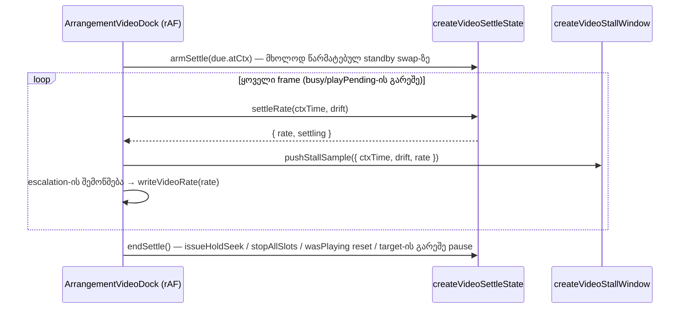

# Studio Lab — ვიდეოს settle standby swap-ის შემდეგ (C-R7-01, დაზუსტებული D-19a, round 12)

**თარიღი:** 2026-10-10
**სტატუსი:** C round 12-ის verdict (`c-round-12.md`): **FAIL**, მხოლოდ R12-S-ის სიტყვასიტყვით წაკითხვაზე. PASS: R12-W1, R12-U, R12-Doc, R2-V3, RF5-3, R5-L3, R5-E1, RF7-P2, dock-ის სწრაფი შემოწმება და G12-1..3. R12-S სიტყვასიტყვით FAIL-ია: 5 ჩაწერა (1.1) პირველ swap-მდე, როცა settle unarmed-ია. B-მ R12-S-ის scope შეასწორა (`plan.md` D-19b): ის პირველი arm-იდან იზომება, ზღვარი 0.02 უცვლელია და round 12-ის FAIL ჩანაწერში რჩება. C-R7-01 headless-ში დაიხურა; Tech Lead-ის quiet-Chrome RF7-3 სავალდებულოა. C-R12-01 (Low) milestone-ის RF5-3-ზე გადავიდა და ღიაა. `sourceChanged` (code-reviewer Low 1) მიღებულია კოდის ცვლილების გარეშე (D-19b).
**შეცვლილი პროექტი:** Store

## კონტექსტი

C-მ round 10-ში loop wrap-ზე (L6, loop 2–4) გაზომა ასეთი სურათი:
- standby `<video>` swap-ის მომენტში ზუსტად არის პოზიციონირებული (offset ≈ 0);
- `play()`-ის შემდეგ headless decoder-ი `currentTime`-ს +22…+51 ms-ის განმავლობაში აჩერებს, ამიტომ ჩამორჩენა ≈ −0.05 წმ-მდე იზრდება;
- მდგრადი soft sync (D-19, K = 4) ამას 1.1–1.2 rate-ით ეწევა და deadband-ის (0.02) კიდეზე ჩერდება;
- შედეგად +300 ms-ზე `d` ცხრავე wrap-ში −0.017…−0.020 იყო.

Regression-ის ფანჯარა ±0.01-ია, ამიტომ deadband და ფანჯარა ერთმანეთს ეწინააღმდეგება. B-მ ეს უფრო მკაცრი მიმართულებით გადაწყვიტა (`plan.md` D-19a და მისი დაზუსტება): swap-ის შემდეგ app უფრო ვიწროდ კონვერგირდება. ფანჯარა არ ფართოვდება.

## მიდგომა

- **ცალკე settle რეჟიმი მხოლოდ standby swap-ის შემდეგ.** მდგრადი წესი (`videoRateCorrection`, K = 4, deadband 0.02) ბაიტამდე უცვლელია. Settle-ის დროს გამოიყენება იგივე ფორმის ფუნქცია, `videoSettleRateCorrection`, ვიწრო band-ითა და უფრო დიდი gain-ით.
- **Settle-ის დასრულება:**
  - (a) band-ში ხელახლა შესვლისას, თუ |d| ერთხელ მაინც გასცდა band-ს. პირველი in-band sample (მაგ. d ≈ −0.0007) settle-ს არ ამთავრებს;
  - (b) swap-იდან 1.0 წმ-ის შემდეგ, აუდიო-საათით (`ctxTime`);
  - (c) dock-ის `endSettle()`-ით.

  უკან წასული საათიც settle-ს ამთავრებს. NaN drift band-ს არც ტოვებს და არც მასში შედის.
- **D-24-ს უპირატესობა.** ჯერ მდგრადი rate ითვლება. თუ ის stall-ის კიდეზეა (`isVideoRateAtStallEdge`), იწერება მდგრადი rate და settle არ მთავრდება. სხვა შემთხვევაში იწერება settle-ის rate. ამიტომ escalation-ის მიმდევრობა იდენტურია.
- **ალტერნატივები, რომლებიც უარყოფილია:**
  - ფანჯრის გაფართოება — Tech Lead-ის გადაწყვეტილებაა;
  - გლობალურად ვიწრო deadband — მდგრად მდგომარეობაში rate-ს არხევდა;
  - wrap-ზე seek swap-ის ნაცვლად — აკრძალულია;
  - ნასწავლი lead — აკრძალულია.

### მუდმივები და მათი დასაბუთება

| მუდმივა | მნიშვნელობა | დასაბუთება |
|---|---|---|
| `VIDEO_SETTLE_BAND_SECONDS` | 0.008 | D-19a-ს ზედა ზღვარი. ±0.01-იანი ფანჯრის შიგნითაა |
| `VIDEO_SETTLE_GAIN` | 9 | K ∈ [8, 9]. 70 ms-იან freeze-ზე K = 9 უფრო მდგრადია (−0.0076 vs −0.0097) |
| `VIDEO_SETTLE_RATE_MAX` | 1.45 | მკაცრად `VIDEO_STALL_LAG_RATE`-ის (1.5) ქვემოთ, ამიტომ settle stall-ის კიდეს ვერ ქმნის |
| `VIDEO_SETTLE_RATE_MIN` | 0.55 | მკაცრად `VIDEO_STALL_LEAD_RATE`-ის (0.5) ზემოთ |
| `VIDEO_SETTLE_MAX_SECONDS` | 1.0 | Settle-ის ზედა ზღვარი |

### სიმულაციის მოდელი

მოდელი დეტერმინისტულია, ტაიმერების გარეშე:
- 60 Hz frame-ები;
- rate მოქმედებს ჩაწერიდან ერთი frame-ის შემდეგ;
- 0.05-იანი ბიჯი;
- swap ხდება offset 0-ზე, ვიდეო კი +22 ms-დან 30 ms-ით ჩერდება;
- ყოველი sample გადის `createVideoStallWindow`-ში ისე, როგორც dock-ში.

| მოდელი | d(+300 ms) | max rate | settle-ის დასრულება |
|---|---|---|---|
| მდგრადი წესი (K = 4), settle-ის გარეშე | −0.0183 | 1.10 | — |
| settle K = 9, 30 ms freeze | −0.0060 | 1.25 | +0.183 წმ (re-entry) |
| settle K = 9, 50 ms freeze | −0.0055 | 1.40 | +0.250 წმ |
| settle K = 9, 70 ms freeze | −0.0076 | 1.45 | +0.300 წმ |
| settle K = 8, 30 ms freeze | −0.0069 | 1.25 | +0.200 წმ |

400 ms-იანი freeze-ის დროს escalation ხდება frame 27-ზე, settle-ითაც და მის გარეშეც.

B-ის მოდელით rate 1.35-ს არ აჭარბებს. ჩემს 30 ms-იან მოდელში peak 1.25-ია. რიცხვები ჩემი გაშვებიდანაა.

## არქიტექტურა

Hold-release-ის start და paused/first-Play start settle-ს **არ** რთავს:
- ამ დროს ვიდეო seek-and-hold-ით ან start hold-ით არის პოზიციონირებული;
- decoder-ის post-swap freeze-ის სცენარი მხოლოდ standby swap-ს ეხება;
- D-19a-ს დაზუსტება ამას პირდაპირ კრძალავს.

## შეცვლილი ფაილები

- `app/lib/arrangement/video-sync.ts`:
  - ხუთი `VIDEO_SETTLE_*` მუდმივა;
  - `VideoSettleRate`, `VideoSettleState` ტიპები;
  - `videoSettleRateCorrection`, `createVideoSettleState`.

  არსებული export-ები უცვლელია.
- `app/components/arrangement/ArrangementVideoDock.tsx`:
  - `DockSyncState`-ში `postSwapSettle` და `postSwapSettles`;
  - swap-ის ბლოკში `armSettle` და მთვლელი;
  - rate-ის ჩაწერაში `settleRate`;
  - `endSettle()` ოთხ ადგილას;
  - `data-video-settles` ატრიბუტი `publishCounters`-ში.
- `app/lib/arrangement/__tests__/video-sync.test.ts` — მხოლოდ ახალი ტესტები. Import-ის სიას ახალი სახელები დაემატა.
- `docs/implementation/2026/quarter-IV/020-studio-lab-track-fold-autofit.md` — მხოლოდ სტატუსი და TODO (C round 11).

## პრობლემები და გადაწყვეტები

- **პრობლემა:** D-19a-ს სიტყვასიტყვითი წესით („settle მთავრდება, როცა |d| პირველად შევა band-ში“) settle პირველსავე frame-ზე დასრულდებოდა.
  **გადაწყვეტა:** re-entry წესი. Guard 1 ამტკიცებს, რომ ძველი წესი ტესტებს აგდებს.
- **პრობლემა:** მდგრადი წესის კიდე ზუსტად |d| = 0.11875-ზე floating-point-ის გამო 1.45-ია და არა 1.5 (4·0.11875/0.05 = 9.4999…).
  **გადაწყვეტა:** D-24-ის priority-ის ტესტი ±0.119-ს იყენებს, property ტესტი კი მთელ grid-ს ამოწმებს.
- **პრობლემა:** code-reviewer-მა აჩვენა, რომ NaN drift re-entry-ად ითვლებოდა.
  **გადაწყვეტა:** re-entry ახლა ითხოვს `|d| ≤ band`-ს, ამიტომ NaN settle-ს აღარ ამთავრებს.
- **ღია საკითხი (B-სთვის):** `sourceChanged` branch-ში settle არ მთავრდება, რადგან §2.2 dock-ში მხოლოდ ჩამოთვლილ ადგილებს უშვებს. ეფექტი 1.0 წმ-ის cap-ით შეზღუდულია.

## ტესტირება

- **`video-sync.test.ts`:** 58/58, მათ შორის 21 ახალი R12-U ტესტი:
  - მუდმივები;
  - `videoSettleRateCorrection`: band, მონოტონურობა, [MIN, MAX], 0.05 ბიჯი, gain;
  - settle state: in-band პირველი sample, re-entry, cap, cap-ის ქვემოთ, `endSettle`, უკან წასული საათი, ხელახალი arm, NaN, steady rule grid-ზე −1.2…+1.2, arm-ის გარეშე;
  - D-24-ის priority და stall-edge-ის property ტესტი;
  - სიმულაცია, მდგრადი control და 400 ms-იანი stall-ის შედარება.
- **Guard proof:** `tmp/studio-real-loop/a-round-12/guard-proof.txt`.
  - Guard 1 („პირველი in-band sample ამთავრებს“) 3 ტესტს აგდებს, მათ შორის re-entry ტესტს და სიმულაციას.
  - Guard 2 (`VIDEO_SETTLE_RATE_MAX` = 1.5) 3 ტესტს აგდებს, მათ შორის მუდმივების ტესტს.
  - ფაილი ორივეჯერ `cmp`-ით აღდგა.
- **Gate-ები:** `tsc` 0; vitest 877/877 (53 ფაილი); build გავიდა; Biome 0 error owned path-ებზე და `./app`-ზე (218 warning, იგივე რაც round 11-ში, არცერთი ამ ფაილებში).
- **A-ს browser-ის გაზომვა (headless Chrome, gstack browse, C-ის round-10 harness-ის ასლი; ეს C-ის verdict არ არის):**
  - L6, 1440×900, 3 run, ყოველი fresh page load-ით;
  - 9 wrap-ის `d300`: 0.0036, 0.0072, 0.0066 / 0.0074, 0.0035, −0.0092 / −0.0008, 0.0002, 0.0006;
  - `data-video-settles` ყოველ run-ში 0 → 3 (= swaps), escalations 0;
  - rate max 1.45, multi 0, sets while seeking 0, frames past loop.end 0.
  - W_2 wrap 1-ის `maxAbsD500` = 1.98: ერთი row +0.7 ms-ზე ჯერ კიდევ ძველ ელემენტს აჩვენებს (harness-ისა და dock-ის rAF-ის რიგითობა იმავე frame-ში). დანარჩენი row-ების max ≈ 0.056-ია. ეს C-მ უნდა შეაფასოს.

## TODO / შემდეგი ნაბიჯები

- C round 12 დასრულდა: R12-W1, R12-U, R12-Doc, R2-V3, RF5-3, R5-L3, R5-E1, RF7-P2, dock-ის სწრაფი შემოწმება და G12-1..3 PASS-ია. R12-S სიტყვასიტყვით FAIL-ია (5 ჩაწერა პირველ swap-მდე); B-ის D-19b-ით R12-S პირველი arm-იდან იზომება.
- C-R7-01 headless-ში დაიხურა (D-19b). Tech Lead-ის quiet-Chrome RF7-3 (VP9 + H.264) SRW-03-ისა და SRW-05-ისთვის სავალდებულო მტკიცებულებად რჩება.
- C-R12-01 (Low, start transient) ღიაა და milestone-ის RF5-3-ში შემოწმდება.
- `endSettle()` source-ის ცვლილებისას (code-reviewer Low 1): B-მ D-19b-ში მიიღო 1 წმ-ის bound მეხუთე end site-ის გარეშე.
