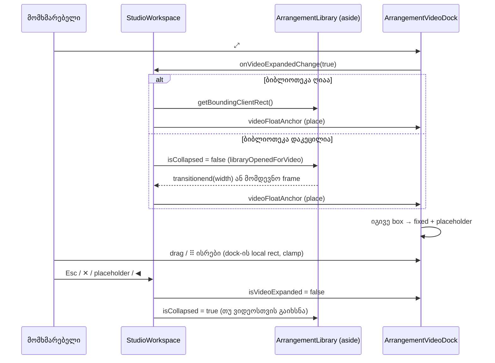

# Studio Lab — მცურავი გაფართოებული ვიდეო (SRW-11B ეტაპი 3, VID-06, D-29d, round 13)

**თარიღი:** 2026-10-10
**სტატუსი:** In Progress — C round 13: PASS (R13-F1..F6, R13-U, R13-Doc, მიმდებარე რეგრესიები და G13-1..3; `c-round-13.md`). C-R13-01..03 ღიაა → round 14 (doc 023). D-29e ცვლის D-29d-ის placement-ს (ყუთი ბიბლიოთეკის body-ში, მის ქვედა კიდეზე).
**შეცვლილი პროექტი:** Store

## კონტექსტი

Dock-ის კომპაქტური ვიდეო 160×90-ია, ამიტომ კადრის დეტალის შესამოწმებლად დიდი ხედი საჭიროა. D-29 და D-29d (`plan.md`) ითხოვს, რომ იგივე ყუთი ბიბლიოთეკის თავზე „მცურავ“ ფანჯრად გაიზარდოს. Sync-ის ლოგიკა არ უნდა შეიცვალოს: SRW-03-ის C-R7-01 round 12-ში ახლახან დაიხურა headless-ში.

## მიდგომა

- **იგივე ყუთი, `position: fixed`.** ორი `<video>`-ის მშობელი div `fixed` ხდება inline `left`/`top`/`width`-ით, სიმაღლეს კი `aspect-video` იძლევა. Portal, reparent, remount და `key` არ არის, ამიტომ ორივე `<video>` იგივე DOM node რჩება იგივე ref-ით, როლით, `muted`-ით და test id-ით.
- **Placeholder.** სანამ ყუთი მცურავია, კომპაქტურ ადგილას 160×90 placeholder ჩანს (`ვიდეო გაფართოებულია` + `დაბრუნება`). Dock-ის ზოლის სიმაღლე არ იცვლება.
- **View state `StudioWorkspace`-შია:** `isVideoExpanded`, `isLibraryCollapsed`, `libraryOpenedForVideo` და საწყისი მდებარეობა (`videoFloatAnchor`). ის `Arrangement`-ში, ისტორიასა და `ArrangementContext`-ში არ ინახება. Undo მას არ ცვლის, export კი არ ეხება.
- **ბიბლიოთეკა controlled ხდება:** `isCollapsed`, `onCollapsedChange` და `asideRef` props. ◀/▶, 40 px rail, 288–480 px separator, width transition და collapse-ზე preview-ის გაჩერება უცვლელია.
- **გადატანის მდებარეობა dock-ის local state-ია.** Drag-ის დროს pointer move ყუთის `left`/`top`-ს პირდაპირ წერს (React render-ის გარეშე), state კი gesture-ის ბოლოს ერთხელ, clamp-ით ინახება. Drag-ის დროს ⠿-ის ისრები და resize-ის re-clamp ყუთს არ ამოძრავებს. ისრების ნაბიჯი functional update-ით ითვლება, ამიტომ სწრაფი ზედიზედ ისრებიც სრულად აისახება.
- **ფოკუსი:** ✕-ით, placeholder-ით ან Esc-ით დაბრუნებისას, თუ ფოკუსი მცურავ კონტროლზე იყო, ის ⤢-ზე ბრუნდება (◀ ფოკუსს არ იპარავს). ⠿-ზე pointerdown მას ფოკუსს აძლევს.
- **Esc** workspace-ის არსებულ `keydown`-შია, Export-ის/ტექსტური ველის early return-ის შემდეგ და Space-მდე. ის `defaultPrevented`-ს პატივს სცემს, ამიტომ ბიბლიოთეკის ძებნის Esc ჯერ ძებნას ასუფთავებს.
- **⠿-ის ისრები** 16 px-ით ამოძრავებს. Handler იძახებს `preventDefault`-სა და `stopPropagation`-ს, ამიტომ clip nudge, ნავიგაცია და seek არ ხდება. Space-ის workspace-ის წესი (transport toggle) უცვლელია.
- **ალტერნატივები, რომლებიც უარყოფილია:** portal (D-29d კრძალავს — remount და sync-ის რისკი); state `ArrangementContext`-ში (გაყინულია, C-R8-01/C-R6-02-ის სამიზნე); placement-ის rAF polling (აკრძალულია).

### Placement-ის დრო

თუ ბიბლიოთეკა უკვე ღიაა, მაგრამ მისი width transition ჯერ კიდევ მიმდინარეობს (▶ და მაშინვე ⤢; `getAnimations()`-ში width-ის `CSSTransition`), ყუთი `transitionend`/`transitioncancel`-ს ელოდება.

| შემთხვევა | როდის ლაგდება ყუთი |
|---|---|
| ბიბლიოთეკა უკვე ღიაა | მაშინვე, ⤢-ის click-ში (aside-ის rect) |
| ბიბლიოთეკა დაკეცილია, width transition აქტიურია | aside-ის `transitionend`-ზე (`propertyName === 'width'`, `target === aside`); fallback: transition-ის დრო + 100 ms |
| ბიბლიოთეკა დაკეცილია, transition არ არის (reduced motion) | მომდევნო frame-ზე (ერთი `requestAnimationFrame`) |

სანამ ყუთი არ დალაგდება, ის კომპაქტურ ადგილას რჩება და placeholder არ ჩანს. ასე არც ცარიელი fixed ყუთი ჩანს და არც ვიდეო იმალება.

### Placement-ის მათემატიკა (`panels.ts`)

- მუდმივები: offset 8, max width 640, library inset 16, key step 16, aspect 16:9.
- `placeFloatingVideoOverLibrary`: (library.left + 8, library.top + 8), width = min(640, library.width − 16), height = width × 9/16, შემდეგ clamp.
- `clampFloatingVideoRect`: left ∈ [0, vw − w], top ∈ [0, vh − h]. თუ viewport ყუთზე პატარაა, ან input არასასრულია, კოორდინატი 0-ია.
- `stepFloatingVideoRect`: ისარი → clamp-ული მდებარეობა 16 px-იანი ბიჯის შემდეგ; სხვა key → `null`.

## არქიტექტურა

## შეცვლილი ფაილები

- `app/lib/arrangement/panels.ts` — `FLOATING_VIDEO_*` მუდმივები, `FloatingVideoRect`/`FloatingVideoViewport`/`FloatingVideoLibraryRect` ტიპები, `placeFloatingVideoOverLibrary`, `clampFloatingVideoRect`, `stepFloatingVideoRect`. არსებული export-ები უცვლელია.
- `app/components/arrangement/ArrangementLibrary.tsx` — controlled collapse props და `asideRef`.
- `app/components/arrangement/StudioWorkspace.tsx` — view state, placement-ის დრო, Esc, status-ის ტექსტები, props ბიბლიოთეკასა და dock-ს.
- `app/components/arrangement/ArrangementVideoDock.tsx` — მხოლოდ layout: props, dock-ის local rect, drag/keys/resize handler-ები, placeholder და ⤢/✕/⠿. ორი sync effect და `publishCounters` ბაიტამდე უცვლელია.
- `app/lib/arrangement/__tests__/panels.test.ts` — მხოლოდ ახალი ტესტები.
- `app/lib/arrangement/__tests__/floating-video.test.tsx` — ახალი component ტესტები.
- `docs/implementation/2026/quarter-IV/021-studio-lab-post-swap-settle.md` — მხოლოდ სტატუსი და TODO (C round 12).

## პრობლემები და გადაწყვეტები

- **პრობლემა:** `/studio-lab` root-ის framer-motion `PageTransition`-შია. Ancestor-ზე non-`none` `transform` `fixed`-ს მასთან მიაბამდა.
  **გადაწყვეტა:** კოდამდე გაიზომა (`tmp/studio-real-loop/a-round-13/runs/containing-block-1440*.json`). Load-ის შემდეგ dock-ის ყველა ancestor-ზე `transform`, `filter`, `contain` და `will-change` არის `none`/`auto` (პირდაპირ გახსნისას და header-ის ბმულითაც). Route-ის შესვლისას wrapper-ს ≈ 300 ms-ით `translateY(4.9px)`/`opacity: 0` აქვს და შემდეგ `none` ხდება. ამ დროს ვიდეო ჯერ გაფართოებული ვერ იქნება, ამიტომ ეს stop-condition არ არის.
- **პრობლემა:** Tailwind-ის `motion-reduce:transition-none` მხოლოდ `transition-property: none`-ს წერს, `transition-duration` კი `0.3s` რჩება (გაზომილია გვერდის CSS-ში). §2.2-ის სიტყვასიტყვითი პირობა („computed `transitionDuration` 0“) reduced motion-ზე `transitionend`-ს სამუდამოდ დაელოდებოდა.
  **გადაწყვეტა:** პირობა ამოწმებს property-საც: width transition აქტიურია მხოლოდ მაშინ, როცა `transitionProperty` შეიცავს `width`-ს ან `all`-ს და შესაბამისი duration > 0. სხვა შემთხვევაში ყუთი მომდევნო frame-ზე ლაგდება. ტესტი ზუსტად Chrome-ის reduced-motion მნიშვნელობებს იყენებს.
- **პრობლემა:** თუ `transitionend` არ მოვიდა (მაგ. ფონურ tab-ში), ყუთი სამუდამოდ კომპაქტური დარჩებოდა.
  **გადაწყვეტა:** ერთი fallback timer (transition-ის დრო + 100 ms). ეს polling არ არის.
- **პრობლემა (A-ს browser-ში ნაპოვნი):** Export-ის ღია ფანჯრით რეალურმა Esc-მა ფანჯარაც დახურა და ვიდეოც დააბრუნა. ბრაუზერი listener-ებს შორის microtask-ს ასრულებს, ამიტომ React Modal-ის `document` listener-ის `onClose`-ს workspace-ის `window` listener-მდე ასრულებს და `exportOpenRef` უკვე false იყო. jsdom-ის სინქრონული `dispatchEvent` ამას მალავდა.
  **გადაწყვეტა:** capture-phase `window` keydown listener აღნიშნავს მოვლენას, თუ Export ღიაა, და early return ამ ნიშანსაც ამოწმებს. ტესტი ბრაუზერის რიგს `flushSync`-ით ასახავს და ამტკიცებს, რომ dialog workspace-ის listener-მდე ქრება.
- **პრობლემა (A-ს browser-ში ნაპოვნი):** ერთ task-ში სამი ზედიზედ ArrowRight მხოლოდ 16 px-ს ამოძრავებდა (stale rect render-ებს შორის).
  **გადაწყვეტა:** functional `setState`; ტესტი სინქრონულ burst-ს ამოწმებს.
- **პრობლემა:** `FLOATING_VIDEO_ARROW_STEPS[key]` plain object-ზე `'constructor'`-ისთვის prototype-ის ფუნქციას დააბრუნებდა.
  **გადაწყვეტა:** `Map`. ტესტი `'constructor'`-ზე `null`-ს ამოწმებს.

## ტესტირება

- **`panels.test.ts`:** 37/37 (28 არსებული უცვლელია + 9 ახალი): მუდმივები, ვიწრო/ფართო ბიბლიოთეკა, 640-ის cap, 16:9, clamp ოთხივე კიდეზე, viewport ყუთზე პატარა, non-finite, ოთხივე ისარი და clamp კიდეებზე.
- **`floating-video.test.tsx`:** 28/28 (18 თავდაპირველი + 10 code-review-ისა და browser-ის აღმოჩენების შემდეგ: fallback timer, გაუქმებული pending placement (◀/Esc), drag-ის commit, blur abort, ⠿-ის ფოკუსი, ფოკუსის დაბრუნება, ისრები/resize drag-ის დროს, Export + Esc ბრაუზერის რიგით, ისრების burst). იგივე `<video>` node-ები, placeholder, ✕/placeholder/Esc დაბრუნება, Esc no-op (`defaultPrevented`, ტექსტური ველი, Export ღიაა), ძებნის Esc-ის უპირატესობა, ◀ გაფართოებულზე, ბიბლიოთეკის დროებითი გახსნა/დაკეცვა, reduced motion, `transitionend`-ის ფილტრი, ⠿-ის ისრები clip nudge-ის/seek-ის/zoom-ის გარეშე, pointer drag + clamp + D-26 registry, drag-ის release დაბრუნებისას, resize re-clamp, Space-ის workspace-ის წესი.
- **Guard proof** (`tmp/studio-real-loop/a-round-13/guard-proof.txt`, ყოველი ფაილი `cmp`-ით აღდგა):
  1. ყუთის `key` `isVideoExpanded`-ზე (remount) → 18/18 ვარდება, მათ შორის same-node ტესტი.
  2. Esc branch early return-ის ზემოთ → ტექსტური ველისა და Export-ის ტესტები ვარდება. ძებნის ტესტი მწვანე რჩება, რადგან ძებნა თავად იძახებს `preventDefault`-ს და `defaultPrevented`-ის შემოწმება რჩება.
  2b. იგივე `defaultPrevented`-ის გარეშე → 4 ტესტი ვარდება, მათ შორის ძებნის ტესტი.
  3. (დამატებით) ⠿-ზე `stopPropagation`-ის გარეშე → ისრების ტესტი ვარდება (კლიპი 2 → 2.2).
  4–9. Review/browser fix-ების mutation-ები (ფოკუსი, commit, ისრები drag-ის დროს, Export-ის ნიშანი, functional update) — თითო შესაბამის ტესტს აგდებს. Guard 2 საბოლოო კოდზე: 3 ტესტი ვარდება (2b-ში 5).
- **Gate-ები:** `tsc` 0; vitest 914/914 (54 ფაილი); build გავიდა; Biome 0 error owned path-ებზე და `./app`-ზე.
- **A-ს browser-ის გაზომვა:** იხ. `tmp/studio-real-loop/a-round-13.md`. ეს C-ის verdict არ არის.

## TODO / შემდეგი ნაბიჯები

- C round 13: PASS — R13-F1..F6, R13-U, R13-Doc; მიმდებარე რეგრესიები (R12-W1 ×1 გაფართოებული ვიდეოთი, RF5-3 ×1, dock-ის sync diff, dock-ის სწრაფი შემოწმება, R11A-1, RF7-P2); G13-1..3.
- C-R13-01 (placement ფარავს ძებნას და ◀-ს), C-R13-02 (დაბრუნების შემდეგ მოძველებული status), C-R13-03 (Export-ის dialog ფოკუსს არ იღებს) ღიაა → round 14 (D-29e, doc 023). D-29e ცვლის ამ დოკუმენტში აღწერილ D-29d-ის placement-ს.
- Tech Lead: R11-P3m (drag რეალური მაუსით) და R11-SB (1280×720-ზე ბიბლიოთეკის დროებითი გახსნა timeline-ს ავიწროებს; რეალურ Chrome-ში horizontal scrollbar-მა შეიძლება scroller-ის `clientHeight` შეცვალოს).
