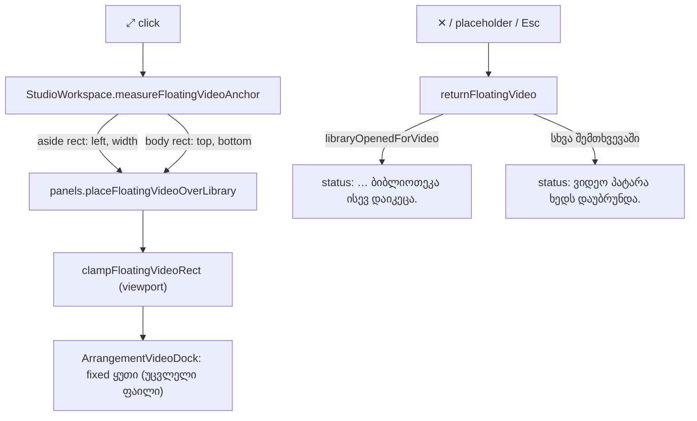

# Studio Lab — მცურავი ვიდეოს შემდგომი შესწორებები (C-R13-01..03, D-29e, round 14)

**თარიღი:** 2026-10-10
**სტატუსი:** Completed — C round 14 PASS (`tmp/studio-real-loop/c-round-14.md`): R14-P1, R14-P2, R14-S, R14-E, R14-U, R14-Doc, მიმდებარე რეგრესიები და G14-1..3. C-მ C-R13-01..03 დახურა. C-მ ორი ახალი ბაგი იპოვა, რომლებიც ღიაა: C-R14-01 (Medium) და C-R14-02 (Low) → round 15 (D-29f, doc 024).
**შეცვლილი პროექტი:** Store

## კონტექსტი

C-მ round 13-ში მცურავი ვიდეო დაადასტურა (doc 022), მაგრამ სამი Low ბაგი იპოვა:

- **C-R13-01:** D-29d-ის საწყისი placement (library.left + 8, library.top + 8) ყუთს ბიბლიოთეკის header-ზე (◀) და ძებნაზე დებდა. ძებნა find → add flow-ის შესასვლელია, ამიტომ ის საწყის მდგომარეობაში მიუწვდომელი იყო, ◀-ზე click კი ✕-ს ხვდებოდა.
- **C-R13-02:** ვიდეოს დაბრუნების შემდეგ footer-ში რჩებოდა expand-ის ტექსტი („… Esc ან ✕ აბრუნებს.“), თითქოს ვიდეო ჯერ კიდევ გაფართოებულია.
- **C-R13-03:** Export-ის dialog ფოკუსს არ იღებდა. ფოკუსი overlay-ის უკან რჩებოდა (მაგ. ✕-ზე) და Enter dialog-ის უკან ვიდეოს აბრუნებდა.

B-მ სამივე `plan.md`-ის D-29e-ში გადაწყვიტა.

## მიდგომა

### C-R13-01: placement ბიბლიოთეკის body-ში

ყუთი ახლა ბიბლიოთეკის body-ში (ხე + სია) ლაგდება, მის ქვედა კიდეზე:

- availableHeight = body.bottom − body.top − 16;
- სიგანე = max(160, min(640, library.width − 16, availableHeight × 16/9)), სიმაღლე = სიგანე × 9/16;
- left = library.left + 8; top = max(body.top + 8, body.bottom − 8 − სიმაღლე);
- შემდეგ viewport-ის არსებული clamp.

რატომ ქვედა კიდე: ძებნის ველი და სიის პირველი row-ები ზედა ნაწილშია, იქ მომხმარებელი პოულობს და ამატებს ხმას. ყუთი ფარავს მხოლოდ scroll-ირებად სიისა და ხის row-ებს და არასოდეს ფარავს control-ს, რომელიც მის დახურვას ან გადატანას სჭირდება. Preview-ის ზოლი body-ს ქვემოთაა, ამიტომ aside-ის ქვედა კიდეზე მიბმა მას დაფარავდა; body-ს ქვედა კიდე preview-ის ზედა კიდეა.

160 px-იანი მინიმუმი D-22-ის კომპაქტური ზომაა: გაფართოებული ყუთი კომპაქტურზე პატარა არასოდეს ხდება. „Separator-ს არ ფარავს“ იმიტომ მართალია, რომ ბიბლიოთეკის მინიმალური სიგანე 288-ია და placement მხოლოდ ღია ბიბლიოთეკაზე ხდება: 160 > library.width − 16 მხოლოდ 176 px-ზე ვიწრო ბიბლიოთეკაზე მოხდებოდა. მხოლოდ გადაგვარებულ შემთხვევაში (სიმაღლე > body.height − 16) ყუთი body.top + 8-ზე დგება და preview-ს შეიძლება გადაფაროს. გაზომილ შემთხვევებში ეს არ ხდება (იხ. ქვემოთ).

სიგანე არ მრგვალდება: კონტრაქტი დამრგვალებას არ ითხოვს და C ±1 px-ს იღებს. მაგ. 1280×720-ზე, ბიბლიოთეკა 480-ით, სიგანე 442.67 px-ია.

განხილული ალტერნატივები (B-ის D-29e-ში): top = header-ის ქვემოთ (ძებნას მაინც ფარავდა), ✕/⠿-ის გადატანა (◀ და ძებნა მაინც დაფარული რჩებოდა).

### C-R13-02: დაბრუნების status

პროტოტიპი დაბრუნებისას ტექსტს არ წერს, ამიტომ ყველაზე მცირე პატიოსანი ტექსტი დაემატა:

- ✕, placeholder-ის ღილაკი ან Esc (ბიბლიოთეკა უკვე ღია იყო): „ვიდეო პატარა ხედს დაუბრუნდა.“
- იგივე, როცა ბიბლიოთეკა ვიდეოსთვის დროებით გაიხსნა და ისევ დაიკეცა: „ვიდეო პატარა ხედს დაუბრუნდა; ბიბლიოთეკა ისევ დაიკეცა.“

ტექსტი იწერება მხოლოდ მაშინ, როცა ვიდეო მართლა გაფართოებული იყო. No-op დაბრუნება არაფერს წერს. ◀-ის ტექსტი („ბიბლიოთეკა დაიკეცა, ამიტომ ვიდეო პატარა ხედს დაუბრუნდა.“) უცვლელია. ▶/◀ გაფართოებული ვიდეოს გარეშე ახალ ტექსტს არ წერს. ⤢-ით დაბრუნებაც (როცა ის „ვიდეოს პატარა ხედზე დაბრუნება“-ა) იმავე დაბრუნების გზით მიდის და იმავე ტექსტს წერს.

### C-R13-03: Export-ის dialog-ის ფოკუსი

საერთო `components/ui/Modal.tsx` read-only-ა და focus management არ აქვს, ამიტომ შესწორება მხოლოდ `ArrangementExportDialog.tsx`-შია:

- **გახსნისას:** dialog იმახსოვრებს `document.activeElement`-ს და ფოკუსს „დახურვა“ ღილაკზე გადაიტანს. ეს უსაფრთხო ნაგულისხმევია: Enter dialog-ს ხურავს და render-ს არ იწყებს.
- **ღია dialog-ში:** Modal-ის children-ის შიგნით wrapper-ზე `keydown` handler-ი მხოლოდ `Tab`-ზე მოქმედებს. ბოლო ჩართულ control-ზე Tab პირველზე გადადის, პირველზე Shift+Tab — ბოლოზე. `preventDefault` მხოლოდ wrap-ისას იძახება; `stopPropagation` არასოდეს. სხვა კლავიშებს (Esc, Enter, Space) არ ეხება, ამიტომ Modal-ის `document`-ის Esc listener-ი და workspace-ის capture-phase ნიშანი (round 13) უცვლელად მუშაობს.
- **დახურვისას:** თუ დამახსოვრებული ელემენტი ჯერ კიდევ document-შია და disabled არ არის, ფოკუსი მას უბრუნდება; სხვა შემთხვევაში ფოკუსი არ იცვლება.
- **Render-ის დროს (code-review-ის H1):** WAV-ის render „დახურვა“-ს და „WAV-ის ექსპორტი“-ს თიშავს, ამიტომ ფოკუსირებული ღილაკი ფოკუსს კარგავს. Effect, რომელიც `isOpen`-სა და render-ის მდგომარეობაზე რეაგირებს, ფოკუსს wrapper-ზე (`tabIndex=-1`) ტოვებს, render-ის დასრულებისას კი „დახურვა“-ზე აბრუნებს. თუ ფოკუსი უკვე ჩართულ control-ზეა (მაგ. radio), ის არ იცვლება. თუ ფოკუსი wrapper-ზეა (მაგ. dialog-ის ტექსტზე click-ის შემდეგ), Tab პირველ control-ზე გადადის, Shift+Tab — ბოლოზე.
- Safari/macOS-ზე ღილაკი click-ით ფოკუსს არ იღებს, ამიტომ დამახსოვრებული ელემენტი შეიძლება `body` იყოს და აღდგენა არაფერს შეცვლის.

Document listener და ახალი dependency არ დამატებულა.

## არქიტექტურა



```mermaid
sequenceDiagram
  participant U as მომხმარებელი
  participant D as ArrangementExportDialog
  participant M as Modal (უცვლელი)
  U->>D: Export (isOpen = true)
  D->>D: opener = activeElement; focus(„დახურვა“)
  U->>D: Tab ბოლო control-ზე
  D->>D: preventDefault; focus(პირველი)
  U->>M: Esc (document listener)
  M->>D: onClose → isOpen = false
  D->>D: effect cleanup: opener.focus(), თუ connected და enabled
```

## გაზომვები კოდამდე (A, headless gstack browse, `127.0.0.1:5173/studio-lab`)

| Viewport | ბიბლიოთეკა | aside (top–bottom) | header | ძებნის ბლოკი | body | preview | D-29e ყუთი (l, t, w×h) | დაფარავს header/ძებნა/separator/preview-ს? |
|---|---|---|---|---|---|---|---|---|
| 1440×900 | 288 | 84–851 | 84–124 | 124–233 | 233–684 (451) | 684–851 | 8, 523, 272×153 | არა |
| 1440×900 | 480 | 84–851 | 84–124 | 124–217 | 217–700 (483) | 700–851 | 8, 431, 464×261 | არა |
| 1280×720 | 288 | 122–671 | 122–162 | 162–271 | 271–504 (233) | 504–671 | 8, 343, 272×153 | არა |
| 1280×720 | 480 | 122–671 | 122–162 | 162–255 | 255–520 (265) | 520–671 | 8, 263, 442.67×249 | არა |

- Separator aside-ის მარჯვენა 4 px-ია (283 ან 475), ყუთის მარჯვენა კიდე library.right − 8-ზეა, ამიტომ ისინი არ იკვეთება.
- Preview-ის ზოლი ყოველთვის ჩანს: ბიბლიოთეკას თავიდანვე აქვს მონიშნული ხმა, და შედეგის გარეშე ძებნისასაც preview-ის ზოლი იგივე სიმაღლით რჩება. Preview-ის გარეშე layout ამ UI-ში არ არსებობს, ამიტომ ის არ გაზომილა.
- 1280×720-ზე, ბიბლიოთეკა 480-ით, ყუთი body-ს უმეტეს ნაწილს (263–512, body 255–520) ფარავს. ეს D-29e-ს შეესაბამება, მაგრამ სიის row-ები იქ ყუთის ქვეშაა; B-სთვის დაკვირვებაა.
- გადაგვარებული 160 px-იანი შემთხვევა არცერთ გაზომვაში არ მოხდა. 1280×720 / 480 სიმაღლით არის შეზღუდული (top = body.top + 8 = body.bottom − 8 − h = 263).

## შეცვლილი ფაილები

- `app/lib/arrangement/panels.ts` — placement-ის ახალი input (`left`, `width`, `bodyTop`, `bodyBottom`) და წესი, `FLOATING_VIDEO_MIN_WIDTH_PX` (160). სხვა float ფუნქციები და კონსტანტები უცვლელია.
- `app/components/arrangement/ArrangementLibrary.tsx` — optional `bodyRef` prop, მიბმული body-ს `div`-ზე (ჩვეულებრივი prop, არა `forwardRef`).
- `app/components/arrangement/StudioWorkspace.tsx` — body-ს ref, `measureFloatingVideoAnchor` aside-ის left/width-ს და body-ს top/bottom-ს კითხულობს; ორი დაბრუნების ტექსტი (`VIDEO_RETURNED_COMPACT_MESSAGE`, `VIDEO_RETURNED_LIBRARY_RECOLLAPSED_MESSAGE`) და მათი ჩაწერა `returnFloatingVideo`-ში.
- `app/components/arrangement/ArrangementExportDialog.tsx` — ფოკუსი გახსნისას, Tab-ის wrap, wrapper-ზე მდგარი ფოკუსის Tab branch, render-ის დროს და შემდეგ refocus (ჩართულ control-ზე ფოკუსი არ იცვლება), ფოკუსის დაბრუნება დახურვისას.
- `app/lib/arrangement/__tests__/panels.test.ts` — D-29e-ის ტესტები; არსებული placement-ის ტესტების input-ის ფორმა შეიცვალა.
- `app/lib/arrangement/__tests__/floating-video.test.tsx` — rect-ების mock prototype-ის დონეზე, placement-ის assertion-ები D-29e-ზე, ახალი ტესტები.
- `app/lib/arrangement/__tests__/export-dialog-focus.test.tsx` — ახალი, dialog-ის ფოკუსის ტესტები.
- `docs/implementation/2026/quarter-IV/022-studio-lab-floating-video.md` — მხოლოდ სტატუსი და TODO.

უცვლელია: `ArrangementVideoDock.tsx`, `video-sync.ts`, `components/ui/**` (`Modal.tsx`-ის ჩათვლით), ArrangementContext.

## პრობლემები და გადაწყვეტები

- **პრობლემა:** `Math.max(160, NaN)` არის `NaN`, ამიტომ არასასრული input 160-ს კი არა, `NaN` სიგანეს მისცემდა. **გადაწყვეტა:** სიგანე 0-ია, თუ library.width, body.top ან body.bottom არასასრულია; კოორდინატს არსებული clamp 0-ზე სვამს.
- **პრობლემა:** component ტესტებში body-ს `div` ბიბლიოთეკის დაკეცვა/გახსნისას ახალი node-ია, ამიტომ ელემენტზე მიბმული `getBoundingClientRect` mock იკარგებოდა და placement გადაგვარებულ 160 px-იან შემთხვევაში ვარდებოდა. **გადაწყვეტა:** `Element.prototype.getBoundingClientRect`-ის spy, რომელიც aside-ს და body-ს (ხის მშობელს) გაზომილ 1440×900-ის rect-ებს უბრუნებს.
- **პრობლემა:** Modal-ის საკუთარი „Close“ (X) ღილაკი Modal-შია, ჩვენი wrapper-ის გარეთ, ამიტომ wrapper-ის handler-ი მას ვერ იჭერს. **გადაწყვეტა:** Tab-ის ციკლი wrapper-ის ჩართულ control-ებზეა (ფორმატის radio, „დახურვა“, „WAV-ის ექსპორტი“). X კლავიატურის ციკლში არ შედის და მხოლოდ მაუსით მუშაობს (click dialog-ს ხურავს). `showCloseButton` არ შეცვლილა, რადგან ეს ხილული control-ის ცვლილება იქნებოდა. ეს საერთო Modal-ის ხარვეზია და root/UI owner-ს გადაეცემა.

## ტესტირება

- **`panels.test.ts`:** 44/44 (37 → 44). ახალი: 160-ის კონსტანტა; მაღალი body (640-ისა და ბიბლიოთეკის სიგანის cap); დაბალი body (სიმაღლის cap, 1280×720 / 480); გადაგვარებული შემთხვევა (160, top = body.top + 8); ქვედა კიდეზე მიბმა; viewport-ის clamp; არასასრული input. სამი არსებული placement-ის ტესტის input შეიცვალა; ერთი მოსალოდნელი შედეგიც შეიცვალა: 10 px-იანი ბიბლიოთეკის სიგანე 0-ის ნაცვლად ახლა 160-ია (D-22-ის მინიმუმი). Named exception-ები `tmp/studio-real-loop/a-round-14.md`-შია.
- **`floating-video.test.tsx`:** 39/39 (28 → 39). ახალი: ყუთი body-შია და header/ძებნა/preview-ს არ კვეთს (ჩვეულებრივ და დროებითი გახსნის შემდეგ); სამივე დაბრუნების გზის ტექსტი; ⤢-ით დაბრუნების ტექსტი; დროებითი გახსნიდან დაბრუნების ტექსტი და 40 px rail; no-op და ▶/◀ ტექსტს არ წერს; ◀ ინარჩუნებს თავის ტექსტს. Placement-ის assertion-ები (top 96 → 523 და მათგან გამომდინარე) named exception-ებია.
- **`export-dialog-focus.test.tsx`:** 13/13 (ახალი). გახსნისას ფოკუსი „დახურვა“-ზეა; Tab/Shift+Tab wrap; disabled control-ის გამოტოვება; Tab-ის გარდა კლავიშები უცვლელია და Esc Modal-ს აღწევს; დახურვისას ფოკუსი opener-ს უბრუნდება; წაშლილ და disabled opener-ზე ფოკუსი არ გადადის; Enter `დახურვა`-ზე არ იბლოკება და მისი გააქტიურება export-ს არ იწყებს (jsdom Enter-ით click-ს არ ქმნის, ამიტომ click ცალკეა; რეალური Enter C-ის R14-E-შია); Space dialog-ის ღილაკზე transport-ს არ ცვლის (ეს round 13-ის კოდზეც გადის, ანუ რეგრესიის ტესტია); render-ის დროს ფოკუსი dialog-შია და დასრულებისას „დახურვა“-ს უბრუნდება; ჩართულ control-ზე ფოკუსი render-ისას არ იცვლება; wrapper-იდან Tab/Shift+Tab; Esc-ის შემდეგ ფოკუსი გაფართოებული ვიდეოს ✕-ს უბრუნდება და ვიდეო გაფართოებული რჩება.
- **Guard proof** (`tmp/studio-real-loop/a-round-14/guard-proof.txt`, საბოლოო production კოდზე; G1–G8 გაეშვა, როცა `export-dialog-focus.test.tsx`-ში ჯერ 12 ტესტი იყო, G9 — 13-ით): aside-ის rect body-ს ნაცვლად → 12 ტესტი ვარდება (body-ში ყოფნის ორივე ტესტის ჩათვლით); body.top + 8-ზე მიბმა → 18; დაბრუნების ტექსტის მოხსნა → 7; ფოკუსის გადატანის მოხსნა → 6; Tab wrap-ის მოხსნა → 2; connected/enabled შემოწმების მოხსნა → 2; ფოკუსის დაბრუნების მოხსნა → 2; refocus მხოლოდ გახსნისას → 1; wrapper-ის Tab branch-ის მოხსნა → 2; „ფოკუსს არ იპარავს“ შემოწმების მოხსნა → 1. ყოველი mutation-ის შემდეგ ფაილი აღდგა და `cmp`-ით შემოწმდა.
- **Gate-ები:** vitest 945/945 (914 + 31), `tsc` 0, Biome 0 error owned path-ებზე და `./app`-ზე (218 ძველი warning), build გავიდა.
- **A-ს browser-ის გაზომვა** (headless, `tmp/studio-real-loop/a-round-14.md`): ყუთი ყველა შემთხვევაში მოსალოდნელ rect-ზეა (Δ ≤ 0.02 px), body-შია, ◀/ძებნა/separator/preview-ის ცენტრში hit-test თავად control-ს აბრუნებს; რეალური click ◀-ზე მუშაობს; find → add გაფართოებული ვიდეოთი ერთ კლიპსა და ერთ Undo ჩანაწერს ქმნის; დაბრუნების ტექსტები სიტყვასიტყვითაა; Export-ში ფოკუსი dialog-შია, Tab/Shift+Tab ტრიალებს, WAV კლავიატურით იქმნება (RIFF PCM, 2 ch, 48 kHz, 24-bit). ეს C-ის verdict არ არის.

## TODO / შემდეგი ნაბიჯები

- C round 14: PASS — R14-P1, R14-P2, R14-S, R14-E, R14-U, R14-Doc; მიმდებარე რეგრესიები (R13-F2/F3/F4 quick, R11A-1 quick, dock-ის სწრაფი შემოწმება, RF7-P2); G14-1..3. C-R13-01..03 C-მ დახურა.
- ღიაა → round 15 (D-29f, doc 024): C-R14-01 (Medium) — გაფართოებული ყუთი ბიბლიოთეკის სიისა და ხის ქვედა row-ებს ფარავს და ისინი scroll-ით ყუთის ზემოთ ვერ ამოდის; C-R14-02 (Low) — Modal-ის X-იდან Shift+Tab Export dialog-იდან გადის.
- Root/UI owner: საერთო `components/ui/Modal.tsx`-ს focus management არ აქვს (ამ რაუნდმა მხოლოდ Studio-ს Export dialog გაასწორა). Modal-ის X ღილაკი ამ რაუნდის Studio-ს dialog-ის Tab ციკლში არ შედის (C-R14-02, round 15).
- Tech Lead: ნამდვილი `prefers-reduced-motion`-ით placement-ის შემოწმება, R11-P3m, R11-SB.
