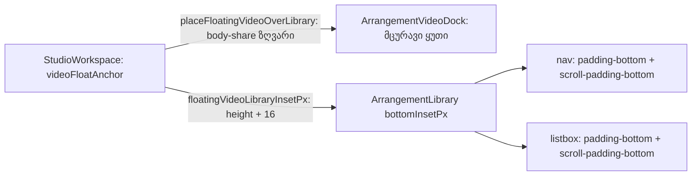
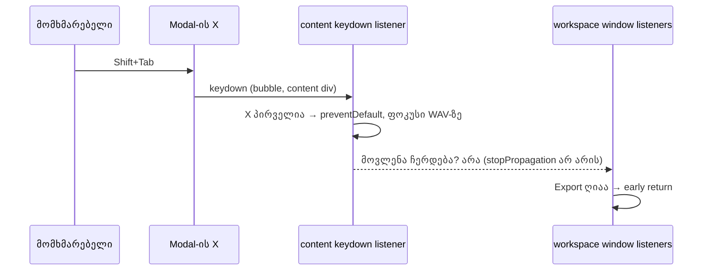

# Studio Lab — ბიბლიოთეკის row-ები გაფართოებული ვიდეოს დროს და Modal-ის X Export-ის Tab-ციკლში (C-R14-01, C-R14-02, D-29f, round 15)

**თარიღი:** 2026-10-11
**სტატუსი:** C round 15 — **FAIL** მხოლოდ R15-P3-ის სიტყვასიტყვით sub-check-ზე („inline `style` ატრიბუტი არ არის“; `c-round-15.md`). R15-P1, R15-P2, R15-E, R15-U, R15-Doc, მეზობელი რეგრესიები და G15-1..3 C-მ PASS-ად დაადასტურა; vitest 965/965. C-R14-01 და C-R14-02 C-მ დახურა (round-14-ის repro-ები აღარ მეორდება). C-R15-01 (`style=""`) B-მ მიიღო, კოდი არ იცვლება (D-29g). C-R15-02 და C-R15-03 ღიაა → round 16.
**შეცვლილი პროექტი:** Store

## კონტექსტი

C-მ round 14 დაადასტურა (doc 023), მაგრამ ორი ახალი ბაგი იპოვა:

- **C-R14-01 (Medium).** D-29e-ის ყუთი ბიბლიოთეკის body-ს ქვედა ნაწილს ფარავს. ხეს (`nav`) და სიას (`[role=listbox]`) ქვედა padding არ ჰქონდათ, ამიტომ დაფარული row-ები scroll-ით ყუთის ზემოთ ვერ ამოდიოდა. 1440×900-ზე, ბიბლიოთეკით 288, „პადი“ და „მელოდია“ სიის მაქსიმალურ scroll-ზეც ყუთის ქვეშ რჩებოდა. 1280×720-ზე, ბიბლიოთეკით 480, ყუთი body-ს 265 px-დან 249-ს ფარავდა და მაუსით find → add სრულად იბლოკებოდა.
- **C-R14-02 (Low).** საერთო `Modal.tsx` X ღილაკს content `div`-ში, children-ის წინ ხატავს. round 14-ის Tab-ციკლი children-ის wrapper-ზე იყო, ამიტომ X-იდან Shift+Tab dialog-იდან გადიოდა, Enter კი dialog-ის უკან workspace-ის control-ს რთავდა.

B-მ ორივე `plan.md`-ის D-29f-ში გადაწყვიტა. სადაც D-29f და D-29e განსხვავდება, D-29f იმარჯვებს.

## მიდგომა

### C-R14-01: ორი მექანიზმი, თითო თავის შემთხვევაზე

**(a) სიმაღლის ზღვარი (ასწორებს 1280/480-ს).** `placeFloatingVideoOverLibrary` სიგანის წესს ერთი წევრი დაემატა:

- სიგანე = max(160, min(640, library.width − 16, (body.h − 16) × 16/9, body.h × 0.5 × 16/9));
- ახალი export: `FLOATING_VIDEO_BODY_SHARE = 0.5`;
- სიმაღლე, left, top = max(body.top + 8, body.bottom − 8 − სიმაღლე), viewport-ის clamp და non-finite წესები უცვლელია.

ყუთის სიმაღლე ≤ body-ს ნახევარი, ამიტომ body-ს ზედა ნახევარი ყოველთვის row-ებისთვის რჩება. ძველი (body.h − 16) წევრი B-ის მოთხოვნით დარჩა: 32 px-ზე მაღალ ნებისმიერ body-ზე ახალი წევრი მასზე მცირეა, ხოლო არსებული გადაგვარებული და clamp-ის ტესტები თავის აზრს ინარჩუნებს.

**(b) ქვედა inset (ასწორებს 1440/288-ის ბოლო row-ებს).** ნახევრის ზღვარი მარტო საკმარისი არ არის: 1440/288-ზე ყუთი უცვლელია (272×153), ბოლო row-ები კი მის ქვეშაა. ამიტომ:

- `panels.ts`: pure helper `floatingVideoLibraryInsetPx(rect)` აბრუნებს `rect.height + 16`-ს (ყუთის ქვეშ 8 + ზემოთ 8), თუ rect არსებობს და სიმაღლე სასრული და დადებითია; სხვა შემთხვევაში 0-ს.
- `StudioWorkspace.tsx`: `isVideoExpanded ? floatingVideoLibraryInsetPx(videoFloatAnchor) : 0` გადაეცემა `ArrangementLibrary`-ს `bottomInsetPx`-ად. ახალი state, effect, გაზომვა ან listener არ არის. სანამ ყუთი placement-ს ელოდება (anchor null), inset 0-ია.
- `ArrangementLibrary.tsx`: როცა `bottomInsetPx > 0`, ხეს და სიას inline `paddingBottom` და `scrollPaddingBottom` ეძლევა. ნამდვილი padding `scrollHeight`-ს ზრდის და ყოველი row ყუთის ზემოთ ამოდის; `scroll-padding-bottom` კლავიატურით გადასვლისას (`.focus()`) focus-ირებულ row-ს ყუთის ქვეშ არ ტოვებს. Inline style აქ დაშვებულია: მნიშვნელობა runtime pixel-ია, Tailwind-ით ვერ გამოიხატება და ფერს არ ეხება.

Inset მთელი გაფართოების განმავლობაში მოქმედებს, ყუთის გადატანის შემდეგაც: ის მხოლოდ დამატებითი scroll-ის ადგილია, ეს კი ყველაზე მცირე პატიოსანი ქცევაა.

### C-R14-02: Tab-ციკლი Modal-ის content-ზე

- `ArrangementExportDialog` `Modal`-ს `useRef` object-ს გადასცემს (`Modal` forward-ებულ ref-ს content `div`-ზე სვამს; callback ref იქ არ იმუშავებდა).
- Effect `[isOpen]`-ზე: dialog-ის გახსნისას content ელემენტზე ერთი native `keydown` listener ემაგრება, cleanup კი მას ხსნის. Handler მხოლოდ Tab-ზე მუშაობს, ფოკუსირებად სიას content-იდან ითვლის (X-ის ჩათვლით) და round 14-ის წესებს იცავს: ფოკუსი სიის გარეთაა → Tab პირველზე, Shift+Tab ბოლოზე; ბოლოდან Tab → პირველი, პირველიდან Shift+Tab → ბოლო; `preventDefault` მხოლოდ ფოკუსის გადატანისას, `stopPropagation` არასოდეს.
- Wrapper-ის React `onKeyDown` მოიხსნა, რომ Tab ორჯერ არ დამუშავდეს. Wrapper-ს რჩება `ref` და `tabIndex={-1}` render-ის დროის ფოკუსისთვის.
- Effect B-ის „ფოკუსს არ ვიპარავ“ შემოწმება content-ის სიას იყენებს, ამიტომ render-ის დაწყება/დასრულება ფოკუსს X-იდან არ წაიღებს.
- ციკლი: X → radio → დახურვა → WAV-ის ექსპორტი → X; გამორთული control-ები გამოტოვებულია. გახსნისას ფოკუსი ისევ „დახურვა“-ზეა.
- **X ხილული რჩება.** `showCloseButton={false}` dialog-ის ხილულ control-ს შეცვლიდა და Tech Lead-ის თანხმობას მოითხოვდა. `Modal.tsx` read-only-ა და არ შეცვლილა; document listener და ახალი dependency არ დამატებულა.

## არქიტექტურა

## გაზომვები (კოდამდე, headless Chromium, `tmp/studio-real-loop/a-round-15/runs/measure-*.json`)

| შემთხვევა | body (top–bottom, h) | D-29f ყუთი (left, top, w × h) | inset | 160-იანი მინიმუმი | header/search/separator/preview-ს ფარავს | უმაღლესი row / თავისუფალი ზედა ნაწილი |
|---|---|---|---|---|---|---|
| 1440/288 | 233–684 (451) | 8, 523, 272×153 | 169 | არა | არა | 80.25 / 282 |
| 1440/480 | 217–700 (483) | 8, 450.5, 429.33×241.5 | 257.5 | არა | არა | 63.75 / 225.5 |
| 1280/288 | 271–504 (233) | 8, 379.5, 207.11×116.5 | 132.5 | არა | არა | 80.25 / 100.5 |
| 1280/480 | 255–520 (265) | 8, 379.5, 235.56×132.5 | 148.5 | არა | არა | 63.75 / 116.5 |

ოთხივე შემთხვევა B-ის მოსალოდნელ მნიშვნელობებს ემთხვევა; stop-ის პირობა არ დადგა.

**მექანიზმის probe (კოდამდე):** 1280/480-ზე listbox-ს inline 148.5 px `paddingBottom`/`scrollPaddingBottom` მიეცა და რეალური ArrowDown-ით სია ბოლომდე გაიარა. ყოველი focus-ირებული row-ის ქვედა კიდე ≤ 371.8-ზე გაჩერდა (= 520 − 148.5), ე.ი. Chrome `.focus()`-ზე `scroll-padding`-ს პატივს სცემს. ცოცხალი ყუთი მაშინ ჯერ კიდევ round 14-ისა იყო (top 263), ამიტომ „ყუთის ზემოთ“ D-29f-ის top 379.5-თან შედარებით დასკვნა იყო; კოდის შემდეგ ის R15-P2.4-ში უშუალოდ გაიზომა.

## შეცვლილი ფაილები

- `app/lib/arrangement/panels.ts` — `FLOATING_VIDEO_BODY_SHARE`, body-share წევრი და `floatingVideoLibraryInsetPx`.
- `app/components/arrangement/ArrangementLibrary.tsx` — `bottomInsetPx` prop და ორი პირობითი inline style.
- `app/components/arrangement/StudioWorkspace.tsx` — helper-ის import, inset-ის გამოთვლა და prop.
- `app/components/arrangement/ArrangementExportDialog.tsx` — content ref, native Tab listener, wrapper-ის `onKeyDown`-ის მოხსნა, effect B-ის სია.
- `app/lib/arrangement/__tests__/panels.test.ts`, `floating-video.test.tsx`, `export-dialog-focus.test.tsx` — ახალი ტესტები და დასახელებული გამონაკლისები.
- `docs/implementation/2026/quarter-IV/023-studio-lab-floating-video-followups.md` — მხოლოდ სტატუსი და TODO.

## პრობლემები და გადაწყვეტები

- **React ცარიელ `style=""`-ს ტოვებს.** პრობლემა: როცა `style` prop ობიექტიდან `undefined`-ზე გადადის, React თითო property-ს ასუფთავებს, მაგრამ ატრიბუტს არ შლის. ✕-ით ან Esc-ით დაბრუნების შემდეგ ხეს და სიას ცარიელი `style=""` რჩება (computed padding 4 px-ია, `scrollHeight` წინანდელია). R15-P3 სიტყვასიტყვით „inline style ატრიბუტის არარსებობას“ ითხოვს. გადაწყვეტა: კოდი არ შეიცვალა. remount (key) ფოკუსს და scroll-ს დაკარგავდა, `removeAttribute`-ის effect კი ownership-ის გარეთაა და React-ის style-ის აღრიცხვას ეწინააღმდეგება. იგივე ქცევა dock-ის ყუთზეა, რომელსაც C R13-F3-ში `style=""`-ით იღებს. ◀ → ▶-ის შემდეგ და პირველ render-ზე ატრიბუტი საერთოდ არ არის. B-მ უნდა გადაწყვიტოს, მიიღოს თუ არა `style=""` ✕/Esc გზებზე; მანამდე ეს sub-check „not ready“-ია.
- **HMR-ის შუალედური შეცდომა.** პრობლემა: primitives-ის hook-მა `StudioWorkspace.tsx`-ის import-ის edit ერთხელ დაბლოკა, გამოყენების edit-ები კი უკვე ჩაიწერა. Vite-მა ეს შუალედური ფაილი ჩატვირთა და console-ში `ReferenceError: floatingVideoLibraryInsetPx is not defined` გამოჩნდა. გადაწყვეტა: import-ის edit განმეორდა. საბოლოო fresh load-ზე console-ში მხოლოდ ცნობილი root `GET localhost:5199/api/cart` შეცდომებია.
- **Code-review-ის შენიშვნები.** ორი ტესტი Shift+Tab-ს radio-დან ამოწმებდა radio-ზე ფოკუსის გარეშე; ციკლის ტესტი მხოლოდ DOM-ის რიგს ამოწმებდა. ორივე გასწორდა. Helper-ის გადარქმევა (`…BottomInsetPx`) არ გაკეთდა, რადგან B-ის დავალება სახელს პირდაპირ ასახელებს.
- **ცნობილი ზღვრები (არ შეცვლილა).** თუ ფოკუსი `body`-ზე აღმოჩნდება (მაგ. content-ის scrollbar-ზე click), keydown content-ს არ აღწევს და პირველი Tab dialog-იდან გადის. ეს round 14-შიც ასე იყო; document listener-ის გარეშე ვერ დაიხურება. 160 px-იანი მინიმუმი 196 px-ზე დაბალ body-ზე ყუთს body-ს ნახევარზე მაღალს ხდის; გაზომილ შემთხვევებში ეს არ ხდება.

## ტესტირება

- `panels.test.ts`: 44 → 53. ახალი: მუდმივა, ოთხი გაზომილი geometry B-ის მნიშვნელობებით (±0.01) და თავისუფალი ზედა ნახევრით, მაღალი body 640/library − 16 ზღვრით, 160-იანი გადაგვარებული შემთხვევა, inset-ის helper (null, NaN, Infinity, 0, უარყოფითი, რეალური). დასახელებული გამონაკლისები: 480-იანი body 217–700 (464×261 → 429.33×241.5, top 450.5) და მოკლე body 255–520 (249 → 132.5, top 263 → 379.5).
- `floating-video.test.tsx`: 39 → 45 (inset-ის component ტესტები აქ დაემატა, ცალკე ფაილი არ შექმნილა): გაფართოებისას 169 px ორივეზე, placement-ის მოლოდინში style არ არის, drag/ისრები inset-ს არ ცვლის, ✕/Esc-ის შემდეგ inline declaration არ რჩება, ◀ → ▶-ის შემდეგ ატრიბუტი არ არის.
- `export-dialog-focus.test.tsx`: 13 → 18. დასახელებული გამონაკლისები (radio → X): ბოლოდან Tab, ცარიელი პროექტის wrap, render-ის დროს wrapper-იდან Tab, wrapper-იდან Tab. ახალი: DOM-ის რიგი და wrap მხოლოდ ბოლოებზე, C-R14-02-ის ზუსტი repro, render ფოკუსს X-იდან არ იპარავს, X-ზე მხოლოდ Tab მუშავდება, დახურვისას listener იხსნება.
- Guard proof (ოთხი დროებითი მუტაცია, `cmp`-ით აღდგენილი): body-share-ის მოხსნა, inset = 0, Tab handler wrapper-ზე, effect B wrapper-ის სიით — თითოეული შესაბამის ტესტებს ჩამოაგდებს.
- Gates: vitest 965/965, tsc 0, build OK, Biome 0 error (owned ფაილები სუფთაა).
- A-ს browser-ის გაზომვა (headless, `tmp/studio-real-loop/a-round-15.md`): ოთხივე შემთხვევაში ყუთი D-29f-ის rect-ზეა (Δ ≤ 0.02), 16:9, body-ს ნახევარზე დაბალი; ◀/ძებნა/separator/preview hit-test control-ს აბრუნებს. ყველა row (9 სია + 9 ხე) ყოველ შემთხვევაში scroll-ით მისაწვდომია. 1280/480-ზე მაუსით find → add ერთ კლიპსა და ერთ Undo-ს ქმნის. ArrowDown-ით სიის გავლისას focus-ირებული row ყუთის ზემოთაა. Export-ში X-იდან Shift+Tab ×2 → WAV → დახურვა, Enter dialog-ს ხურავს; Tab/Shift+Tab ×8 dialog-შია; კლავიატურით WAV RIFF PCM, 2 ch, 48 kHz, 24-bit. ეს C-ის verdict არ არის.

## TODO / შემდეგი ნაბიჯები

- C round 15 დასრულდა: FAIL მხოლოდ R15-P3-ის სიტყვასიტყვით ატრიბუტის შემოწმებაზე; დანარჩენი ID-ები PASS-ია (`c-round-15.md`). R15-P3 ამიერიდან იკითხება, როგორც „inline declaration-ები არ არის (`style.cssText === ''`)“ (D-29g); C მას round 16-ში R15-P3 quick-ად ხელახლა ამოწმებს.
- C-R15-01 (`style=""` ✕/Esc-ის შემდეგ) — B-მ მიიღო, კოდი არ იცვლება (D-29g).
- C-R15-02 (ღიაა → round 16): selected-clip ხაზი footer-ს +20 px-ს უმატებს, ბიბლიოთეკის body მოკლდება და დალაგებული ყუთი preview-ის ზედა 12 px-ს ფარავს. Round 16-ის გეგმა: D-29c (2)-ის footer-ის რეზერვი (pending C).
- C-R15-03 (ღიაა → round 16): Export-ის „მხოლოდ Tab“ ტესტი C-ის G6 mutation-ს ვერ იჭერს. Round 16-ის გეგმა: Enter/Space-ის ტესტი ბოლო control-ზე (pending C).
- Root/UI owner: საერთო `Modal.tsx`-ის focus management (body-ზე ფოკუსის შემთხვევის ჩათვლით).
- Tech Lead: ნამდვილი `prefers-reduced-motion`-ით შემოწმება, R11-P3m, R11-SB.
