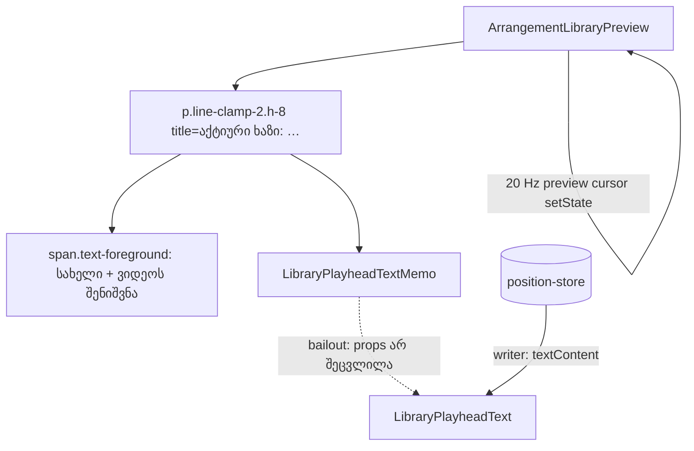

# Studio Lab — ბიბლიოთეკის preview: აქტიური ხაზის ფიქსირებული ორხაზიანი row და `LibraryPlayheadText`-ის memo (C-R16-01, M-R10-1/M2; D-29h, round 17)

**თარიღი:** 2026-10-11
**სტატუსი:** Completed — C round 17 PASS (`c-round-17.md`), ახალი ბაგის გარეშე: R17-P1, R17-P2, R17-P3, R17-M, R17-U, R17-Doc, მეზობელი რეგრესიები და G17-1..3; vitest 983/983. C-მ დახურა C-R16-01 და round-9 reviewer-ის M-R10-1/M2. ფორმულირების ორი შენიშვნა B-ისაა (D-29i): R17-P1.1-ში შინაარსის ხაზები ითვლება `rangeLines`-ით (`Range.getClientRects()`-ის განსხვავებული top-ები) და არა `round(scrollHeight / line-height)`-ით; R17-P2.3 ასე იკითხება: „ყუთში 0 sample, დანარჩენი preview-ს ან separator-ს ხვდება“. R17-T Tech Lead-თან რჩება.
**შეცვლილი პროექტი:** Store

## კონტექსტი

- **C-R16-01 (Low).** ბიბლიოთეკის preview-ში „აქტიური ხაზი: …“ ხაზი ერთ ან ორ ხაზზე იშლებოდა აქტიური ხაზის სახელისა და ბიბლიოთეკის სიგანის მიხედვით.
  - **გამეორება:** 1440×900-ზე, ბიბლიოთეკა 288-ზე, აქტიური ხაზი SFX → მუსიკა. Preview 151 → 167 px-მდე იზრდებოდა, body კი 233–680 → 233–664-მდე მოკლდებოდა.
  - **შედეგი:** ადრე დალაგებული გაფართოებული ვიდეო (bottom 672) preview-ის ზედა 8 px-ს ფარავდა. D-29d-ის მიხედვით ყუთი განლაგების შემდეგ ადგილს არ იცვლის.
- **M-R10-1/M2 (round-9 reviewer).** `LibraryPlayheadText` ყოველ render-ზე ხელახლა render-დებოდა `ArrangementLibraryPreview`-თან ერთად. ასე ხდებოდა library preview-ის cursor-ის ყოველ ნაბიჯზეც, 20 Hz-მდე. ტექსტს ისედაც position-store-ის writer წერს და React-ის render-ი მას არ სჭირდება.

## მიდგომა

### C-R16-01 — ფიქსირებული ორხაზიანი row (D-29h)

- აქტიური ხაზის `
` ზუსტად ორი ტექსტური ხაზის სიმაღლისაა (`h-8`). Tailwind-ის `text-xs`-ის line-height 16 px-ია, ანუ 2 × 16 = 32 px; ეს გაზომვით დადასტურდა. ორ ხაზს გადაცილებული ტექსტი ellipsis-ით იჭრება (`line-clamp-2`).
- `title` ატრიბუტში არის სრული ტექსტი `აქტიური ხაზი: {სახელი}{ვიდეოს შენიშვნა}`, playhead-ის დროის გარეშე.
- ხილული ტექსტი, შიდა `text-foreground` span, ` · playhead ` და playhead-ის span სიტყვასიტყვით უცვლელია. სახელი და ვიდეოს შენიშვნა ორ ლოკალურ მნიშვნელობად (`activeLaneName`, `activeLaneVideoNote`) გამოიყოფა და span-იც და `title`-იც ერთსა და იმავე მნიშვნელობებს იყენებს. ასე ისინი ერთმანეთს ვერ დაშორდება.
- **რატომ ორი ხაზი და არა ერთი `truncate`:** 288 px-ზე ვიდეოხაზის განმარტება „(აუდიო აქ არ ემატება)“ მეორე ხაზზე გადადის. ერთ ხაზზე ის ellipsis-ის ქვეშ დაიმალებოდა და მხოლოდ `title`-ში დარჩებოდა.
- **რატომ არ ხდება ყუთის ხელახალი განლაგება:** D-29d და D-29g უცვლელია. განლაგების შემდეგ ყუთი ადგილს არ იცვლის და მხოლოდ ფანჯრის resize აკეთებს ხელახალ clamp-ს. ფიქსირებული row-ის შემდეგ body აღარ არის დამოკიდებული აქტიურ ხაზზე, ამიტომ ყუთის მოძრაობა საჭირო აღარ არის. ResizeObserver, polling ან re-anchor არ დამატებულა.

### M-R10-1/M2 — `memo`

- `const LibraryPlayheadTextMemo = memo(LibraryPlayheadText)` და preview-ში memo render-დება.
- შიდა ფუნქციის სახელი `LibraryPlayheadText` რჩება. გაყინული `render-budget.test.tsx` (R9-L1) render-ებს fiber-ის ტიპის სახელით ითვლის. props-ის გარეშე `memo` React-ის simple-memo გზას იყენებს: fiber-ის `type` შიდა ფუნქციაა, ხოლო bailout-ისას `memoizedProps` იგივე ობიექტი რჩება.
- writer, `useArrangementPositionWriter`, span და საწყისი ტექსტი უცვლელია. context-ი და position-store არ შეცვლილა.

## არქიტექტურა

## გაზომვა და ფასი (კოდამდე და კოდის შემდეგ)

Line-height ყველგან 16 px-ია, font-size 12 px. ხაზების რაოდენობა კოდამდე = `offsetHeight / line-height`, კოდის შემდეგ = Range-ის `getClientRects()`-ის განსხვავებული top-ების რაოდენობა. ორივე viewport-ზე ერთნაირია:

| ბიბლიოთეკა | ვიდეო | მუსიკა | სტემები | SFX |
| --- | --- | --- | --- | --- |
| 288 | 2 | 2 | 2 | 1 |
| 384 | 2 | 1 | 1 | 1 |
| 480 | 1 | 1 | 1 | 1 |

- 288-ზე არცერთ მდგომარეობას ორზე მეტი ხაზი არ სჭირდება, ამიტომ clamp ხილულ ტექსტს არ მალავს.
- „—“ მდგომარეობა (აქტიური ხაზის გარეშე) `/studio-lab`-ში მიუწვდომელია, რადგან ერთი ხაზი ყოველთვის აქტიურია. ის component test-ით მოწმდება.

**ფასი:** preview ყველა მდგომარეობასა და სიგანეზე 167 px-ია, `
` კი 32 px. სადაც დღეს ტექსტი ერთ ხაზზე ეტევა, preview 16 px-ით იზრდება (151 → 167) და body 16 px-ით მცირდება:

| Viewport | ბიბლიოთეკა | +16 px მდგომარეობები | body ერთხაზიან მდგომარეობაში, კოდამდე → კოდის შემდეგ |
| --- | --- | --- | --- |
| 1440×900 | 288 | SFX | 233–680 (447) → 233–664 (431) |
| 1440×900 | 384 | მუსიკა, სტემები, SFX | 217–680 (463) → 217–664 (447) |
| 1440×900 | 480 | ოთხივე | 217–680 (463) → 217–664 (447) |
| 1280×720 | 288 | SFX | 271–500 (229) → 271–484 (213) |
| 1280×720 | 384 | მუსიკა, სტემები, SFX | 255–500 (245) → 255–484 (229) |
| 1280×720 | 480 | ოთხივე | 255–500 (245) → 255–484 (229) |

ორხაზიან მდგომარეობებში (+0) body უცვლელია. D-29f-ის ყუთის რიცხვები ამიტომ იცვლება მხოლოდ იქ, სადაც ⤢ ერთხაზიან მდგომარეობაში ხდებოდა. ⤢ არჩევის გარეშე ხდება:

- **1440/288:**
  - round 16-ის R16-F2 run ორხაზიან მდგომარეობაში იყო (body 233–664) და იძლეოდა 8,503 272×153, bottom 656;
  - round 17-ში ყველა მდგომარეობაში იგივე 8,503 272×153-ია, bottom 656, ანუ Δ 0;
  - round 16-ის C-R16-01 run-ში, SFX-ის ერთხაზიან მდგომარეობაში, იყო 8,519 272×153, bottom 672; ეს ახლა 8,503-ია.
- **1280/480:** ოთხივე მდგომარეობა კოდამდე ერთ ხაზზე იყო, ამიტომ ფასი აქ ყუთზეც ჩანს:
  - round 16: 8,369.5 217.77×122.48 (body 255–500);
  - round 17: 8,361.5 203.55×114.48 (body 255–484), inset 130.5 px.

**ცნობილი რისკი (R17-T):** `line-clamp-2` მესამე ხაზს მალავს. მწკრივის ბოლოს არის ` · playhead <დრო>`, რომელიც `title`-ში არ შედის. თუ ტექსტს მესამე ხაზი დასჭირდება, playhead-ის დრო ხილვადი აღარ იქნება. ეს მოხდება რეალური Windows-ის ქართული font-ით, browser-ის text resize-ით (WCAG 1.4.4) ან მომხმარებლის line-height override-ით (WCAG 1.4.12). A-ს გაზომვით ეს Chromium-ის headless font-ით 288–480 px-ზე არცერთ მდგომარეობაში არ ხდება. რეალური font-ებით შემოწმება Tech Lead-ის R17-T-ია.

clamp-ის მუშაობა იძულებითი overflow-ით შემოწმდა. 1440/288-ზე, ვიდეოხაზის მდგომარეობაში, `
`-ის სიგანე დროებით (მხოლოდ page state) 140 px გახდა:

- offsetHeight 32 დარჩა, scrollHeight 48 გახდა, Range-ით 3 ხაზი;
- preview 167 დარჩა;
- მეორე ხაზის ბოლოს ellipsis ჩანს, playhead-ის დრო კი დამალულია.

სიგანის მოხსნის შემდეგ ყველაფერი აღდგა.

## შეცვლილი ფაილები

- `app/components/arrangement/ArrangementLibraryPreview.tsx` — ფიქსირებული ორხაზიანი row, `title` და `LibraryPlayheadText`-ის memo.
- `app/lib/arrangement/__tests__/library-preview.test.tsx` — ახალი component test-ები (R17-U).
- `docs/implementation/2026/quarter-IV/025-studio-lab-panel-polish-14a.md` — მხოლოდ სტატუსი და TODO.
- `docs/implementation/2026/quarter-IV/026-studio-lab-preview-active-lane-row.md` — ეს დოკუმენტი.

## პრობლემები და გადაწყვეტები

- **პრობლემა:** ფიქსირებული სიმაღლისას `scrollHeight` ვერ იქნება `offsetHeight`-ზე ნაკლები, ამიტომ `round(scrollHeight / line-height)` ერთხაზიან მდგომარეობაშიც 2-ს აბრუნებს.
  **გადაწყვეტა:** კოდის შემდეგ ხაზების რეალური რაოდენობა Range-ის `getClientRects()`-ით (განსხვავებული top-ები) ითვლება. ის კოდამდე გაზომილ რაოდენობას ყველა მდგომარეობაში ემთხვევა. C-ს ეს მეტრიკა გადაეცემა.
- **პრობლემა:** 1280-ზე, 384/480-ზე მუსიკის ხაზს ხილულ ნაწილში ცარიელი ადგილი არ აქვს (`no-empty`), ამიტომ ცარიელ ადგილას click აქტიურ ხაზს ვერ ცვლის.
  **გადაწყვეტა:** მუსიკის მდგომარეობა კლიპის header-ზე რეალური click-ით დაყენდა.
- **პრობლემა:** browse-ის CDP allowlist-მა `Input.dispatchMouseEvent` აღარ დაუშვა.
  **გადაწყვეტა:** wave-ზე რეალური click `$B click`-ით შესრულდა, რომელიც ელემენტის ცენტრს (50 %) აჭერს.

## ტესტირება

- **Component test-ები** (`library-preview.test.tsx`, რეალური `ArrangementProvider` fake Web Audio-თი):
  - row-ს აქვს `h-8` და `line-clamp-2`; `title` ზუსტად ემთხვევა მუსიკის, ვიდეოს (შენიშვნით) და „—“ მდგომარეობებს და უდრის `textContent`-ის `·`-მდე ნაწილს; ტექსტში არის `· playhead 00:00.000`;
  - library preview-ის 12 cursor ნაბიჯზე `ArrangementLibraryPreview` ≥ 10-ჯერ render-დება, `LibraryPlayheadText` კი 0-ჯერ.
- **Guard proof:** ოთხივე mutation-ზე (კლასების მოხსნა, `title`-ის მოხსნა, memo-ს გვერდის ავლით პირდაპირი render, შიდა ფუნქციის rename) შესაბამისი ტესტი ვარდება. rename-ზე ვარდება გაყინული R9-L1 (`expected 0 to be greater than 0`). ყოველი mutation აღდგა და `cmp`-ით შემოწმდა.
- **Browser (A-ს მტკიცებულება, არა verdict):**
  - R17-P2 repro: 1440/288, 1280/480 და 1280/288. აქტიური ხაზის შეცვლისას (SFX → მუსიკა → სტემები → SFX → ვიდეო → SFX) body Δ 0 და ყუთი უცვლელია. preview-ის ზედა 12 px-ის sample-ებიდან ყუთში 0 მოხვდა. 1440/288-ზე preview-ს 210/216 sample ხვდება; დანარჩენი 6 (x = 284) ბიბლიოთეკის separator-ზე მოდის, როგორც round 16-ში.
  - R17-P3 და R17-M: 1440/288. შედეგები `a-round-17.md`-შია.
- **Gate-ები:** tsc, vitest, build, Biome — შედეგები `a-round-17.md`-შია.

## TODO / შემდეგი ნაბიჯები

- **C round 17:** შესრულდა — PASS (`c-round-17.md`); C-R16-01 და M-R10-1/M2 C-მ დახურა.
- **Tech Lead:** R17-T — ორხაზიანი row რეალური Windows-ის ქართული font-ებით (ღიაა). C-ის მონაცემით, მესამე ხაზის შემთხვევაში clamp `· playhead`-ის დროს მალავს.
- **Round 18:** polish 14b (D-29i) — `027-studio-lab-detail-panel-polish-14b.md`.
