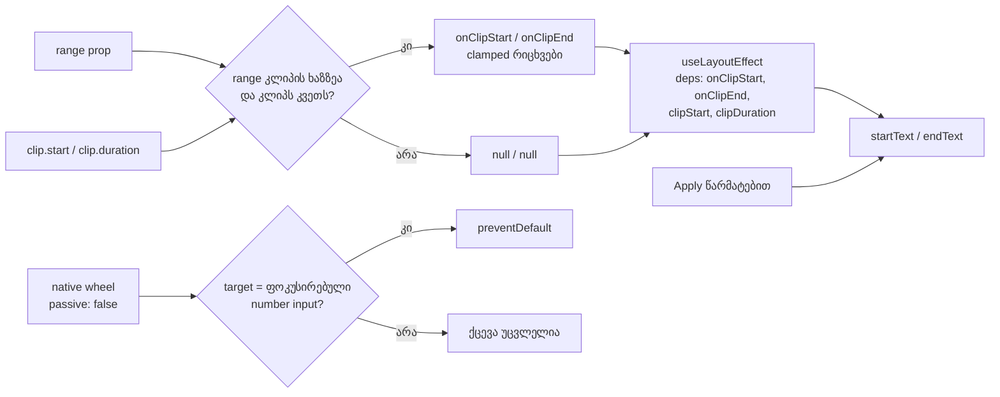

# Studio Lab — detail panel-ის polish 14b დასრულდა: L4, L11, design (b), L6 და design (d) (D-29i, D-29j; round 18–19)

**თარიღი:** 2026-10-11
**სტატუსი:** Completed — C round 18 (c-round-18.md: L4, L11, (b), L6, A PASS) და C round 19 (c-round-19.md: design (d) PASS, C-R18-01 დაიხურა)
Tech Lead-ის R19-T (label-ები რეალურ Windows Chrome-ში 1280×720-ზე) pending-ია.
- **C round 18:** L4, L11, design (b), L6 და A PASS-ია (R18-L4, R18-W, R18-B, R18-L6, R18-A, R18-Doc). Design (d) A-მ §1.4-ის წესით შეაჩერა, C-მ გაჩერება დაადასტურა და ის C-R18-01-ად (Medium) ჩაიწერა.
- **C round 19 (D-29j):** design (d) განხორციელდა: ხუთი ქართული label და info-ს სვეტი `w-56` → `w-72`. R19-D1, R19-D2, R19-A, R19-U და R19-Doc PASS-ია; C-R18-01 დაიხურა.
**შეცვლილი პროექტი:** Store

## კონტექსტი

Polish 14b აერთიანებს detail panel-ის ხუთ follow-up-ს, რომლებიც round 8-დან იყო ჩაწერილი. ხუთივე ერთ ფაილშია (`ArrangementDetailPanel.tsx`), გადაწყვეტილებები კი D-29h-სა და D-29i-შია.

- **L4 (round-9 reviewer).** Start/end ველები აკრეფილ ტექსტს კარგავდა range-ის ნებისმიერ ცვლილებაზე: ახალ object-ზე იგივე მნიშვნელობებით და სხვა ხაზის range-ზეც. ეფექტი `range`-ს მთლიან object-ზე იყო დამოკიდებული. დღეს UI-ში ასეთი გზა არ არსებობს (D-29i), ამიტომ ეს გასწორება თავდაცვითია.
- **L11 (round-8 code-reviewer).** Chrome ფოკუსირებულ number input-ზე wheel-ით მნიშვნელობას ცვლის. მომხმარებელი, რომელიც panel-ს ასქროლებს, range-ის ველს შემთხვევით შეცვლიდა.
- **Design (b) (design-philosopher).** Detail-ის range overlay `bg-foreground/60`-ით waveform-ს ფარავდა. Overlay-ის შიგნით peak-ისა და ფონის კონტრასტი გარე კონტრასტის (1 − α)-ია, ანუ α = 0.6-ზე მხოლოდ 40 % რჩებოდა.
- **L6 (round-9 reviewer).** `biome-ignore`-ის მიზეზი პროცესს ასახელებდა („B round-8 §3.1“) და არა ტექნიკურ მიზეზს.
- **Design (d) (design-philosopher).** Info-ს სვეტში ლათინური `start`/`offset` ქართულ `სიგრძე`-სთან იყო შერეული.

## მიდგომა

- **L4.** Render-ის დროს გამოითვლება ორი primitive: `onClipStart` და `onClipEnd`. ეს არის კლიპზე მოხვედრილი range-ის clamped საზღვრები, ან `null`.
  - ეფექტი დამოკიდებულია მხოლოდ `[onClipStart, onClipEnd, clipStart, clipDuration]`-ზე, და მისი body მხოლოდ ამათ იყენებს. ამიტომ Biome-ის exhaustive-deps წესი ignore-ის გარეშე კმაყოფილდება.
  - ველების ნაჩვენები მნიშვნელობები იგივეა: კლიპზე მოხვედრილი range-ის საზღვრები, სხვა შემთხვევაში კლიპის საზღვრები (`rangeInputText`).
  - **Code-reviewer-ის შედეგად დამატებული:** წარმატებული Apply-ის შემდეგ ველებში ჩაიწერება normalized მნიშვნელობა (`rangeInputText(clamped.*)`). L4-მდე ამას ეფექტი აკეთებდა, რადგან Apply ყოველთვის ახალ object-ს ქმნიდა. ამის გარეშე `1.995` ან `7.250` ველში დარჩებოდა, როცა clamped საზღვრები უცვლელია. ეს Apply-ის შემდეგ დღევანდელ ჩვენებას ინარჩუნებს. ჩავარდნილი Apply (არასწორი მნიშვნელობა ან აქტიური gesture) აკრეფილ ტექსტს არ ეხება.
  - **ალტერნატივა:** `isDirty` flag ან „ბოლო sync-ის“ ref. უარვყავით: დამატებითი state-ია, primitive dependency-ები კი იგივეს უფრო მარტივად აკეთებს.
- **L11.** Detail-ის კონტენტზე (`arrangement-detail-content`) ერთი native `wheel` listener ემატება `{ passive: false }`-ით (ერთი ref და ერთი effect). Cleanup-ზე იგივე handler იხსნება.
  - Handler `preventDefault()`-ს მხოლოდ მაშინ იძახებს, როცა target ფოკუსირებული number `HTMLInputElement`-ია.
  - **ალტერნატივები:** React-ის `onWheel` passive-ია და default-ს ვერ აჩერებს. `blur` ფოკუსს მოულოდნელად წაართმევდა. Document/window listener ზედმეტად ფართოა. სამივე უარყოფილია (D-29i).
- **Design (b).** Overlay-ის ერთი class token: `bg-foreground/60` → `bg-foreground/30`. α = 0.3 კონტრასტის 70 %-ს ტოვებს. `border-x-2 border-foreground` საზღვრად რჩება.
- **L6.** მიზეზის ახალი ტექსტი: „a focusable resize handle needs role=separator with aria-valuenow; a native `
` is a static, non-interactive separator“. Rule-ის სახელი უცვლელია. პირველი ვერსია („`
` cannot take focus“) reviewer-მა უზუსტოდ მიიჩნია, რადგან `tabindex` `
`-ზეც მუშაობს, ამიტომ ტექსტი შეიცვალა.
- **Design (d)** — მიწოდებულია round 19-ში (D-29j, `w-72`); იხ. ქვემოთ (d)-ის სექცია.

## არქიტექტურა

## გაზომვა და ფასი

> ეს round 18-ის გაჩერების ჩანაწერია (`w-56`–`w-64`); D-29j-მ ის ჩაანაცვლა (`w-72`, იხ. (d)-ის სექცია). რიცხვები ისტორიისთვის უცვლელია.

კოდამდე გაზომვა ჩატარდა `127.0.0.1:5173`-ზე, gstack browse-ით (`a-browse.json`), C-ის `lay11` განლაგებით. ახალი ტექსტი მხოლოდ page-state-ში ჩაიწერა და შემდეგ აღდგა. დეტალური ცხრილი და raw ფაილები: `tmp/studio-real-loop/a-round-18.md` §1.4 და `a-round-18/runs/`.

- **ხაზები** (`round(offsetHeight / line-height)`, line-height 16 px). დღეს single მდგომარეობაში ყველა info `
` ერთ ხაზზეა. Group-ში ჯგუფის შენიშვნა უკვე ორ ხაზზეა.
- **`დასაწყისი`-ით** ხაზს `დასაწყისი 00:00.000 · სიგრძე 00:16.000` max-content-ად **259.81 px** სჭირდება (დღეს 220.94). `w-64` 256 px-ია, ამიტომ ხაზი ორ ხაზზე გადადის `w-56`-ზეც, `w-60`-ზეც და `w-64`-ზეც.
- **`fits: true` single მდგომარეობაში ფასს მალავს.** იქ კონტენტი არ სქროლდება, მაგრამ ორი `truncate` `
` (სათაური და ხაზი) flex სვეტში იკუმშება: 16-დან 10 px-მდე 1440-ზე, და 9 px-მდე 1280-ზე. სათაური და ხაზი ვიზუალურად იჭრება.
- **Group მდგომარეობა 1440-ზე სქროლდება**, სადაც დღეს არ სქროლდება: scrollHeight 110 > clientHeight 107, ბიბლიოთეკით 288 და 480.
- **Range-ის label-ები ეტევა:** `საიდან, წმ` 64.47 px და `სადამდე, წმ` 74.13 px, 80 px-იან სვეტში.
- **Waveform-ის box** არცერთ ვარიანტში 128 px-ზე ვიწრო არ ხდება. 1280/480-ზე `w-56` 352 px-ია, `w-60` 336, `w-64` 320.
- **`w-60` class-ად ვერ შემოწმდა:** ის compiled CSS-ში არ არის, რადგან source-ში არავინ იყენებს. გაზომვა inline page-state სიგანით (224/240/256 px) ჩატარდა.
- **დაკვირვება B-სთვის:** 1280×720-ზე group მდგომარეობაში panel 122 px-ია და არა 142. Group-ის კონტენტი იქ დღესაც სქროლდება (106 > 85).

**გადაწყვეტილება — ფიქსირებული რიგით (§1.4): STOP, ეცნობა B-ს.** სამი მიზეზიდან თითოეული საკმარისია: არცერთი სიგანე არ ეტევა; single-ში სათაური და ხაზი იჭრება; group 1440-ზე ახლა სქროლდება. `w-56` და ხუთივე ტექსტი უცვლელია.

**რატომ არ შეიცვალა range-ის label-ები, თუმცა ეტევა:**
- R18-D ერთი acceptance ID-ია;
- D-29i-ის მიზეზი (სამი „დასაწყისი“ ერთ panel-ში არ განმეორდეს) მხოლოდ info-ს სვეტთან ერთად მოქმედებს;
- ნახევრად ქართული panel დაუმტკიცებელი დიზაინის მდგომარეობაა.

**დანარჩენი ფასები:**
- **L11:** როცა pointer ფოკუსირებულ range-ის ველზეა, wheel detail-ის კონტენტს აღარ ასქროლებს. სხვა ადგილებში ქცევა არ იცვლება.
- **Lane/detail overlay-ის სხვაობა:** lane-ის clip overlay `ArrangementClip.tsx`-ში `bg-foreground/60`-ზე რჩება (ფაილი გაყინულია), detail-ში კი `/30`-ია. ორივე გასწორდება, როცა `ArrangementClip.tsx` შემდეგ გაიხსნება (SRW-14 ან SRW-18), ან უფრო ადრე C-ის ან დიზაინის ბაგით.
- **Overlay-ის computed ფონი** (Chrome): `oklab(0.952495 -0.000236422 -0.00291026 / 0.6)` იყო, ახლა `oklab(0.952495 -0.000236422 -0.00291026 / 0.3)`-ია.

## Design (d) — round 19 (D-29j, C PASS (round 19))

> **შენიშვნა:** „გაზომვა და ფასი“ და „პრობლემები და გადაწყვეტები“ round 18-ის გაჩერებას ისტორიისთვის ინახავს; მიმდინარე მდგომარეობა ამ სექციაშია.

- **გადაწყვეტილება (D-29j):** info-ს სვეტი `w-56` → `w-72` (288 px) და D-29i-ის ხუთი ტექსტი:
  - info-ს სვეტში `start` → `დასაწყისი` (single და group), `offset` → `წყაროდან`;
  - range-ის label-ები `start, წმ` → `საიდან, წმ`, `end, წმ` → `სადამდე, წმ`.
- **უცვლელია:** `სიგრძე`, `ხაზი`, `ხაზები`, `DETAIL_SOURCE_UNCHANGED`, `DETAIL_GROUP_NOTE`, ორივე `aria-label`, test id-ები, R9-D3-ის ნაწილები, round 18-ის ლოგიკა და footer-ის ლათინური ტექსტი (`StudioWorkspace.tsx` გაყინულია).
- **კოდამდე გაზომვა** (`tmp/studio-real-loop/a-round-19.md` §1.4, raw: `a-round-19/runs/pre-*`). ახალი ტექსტი და inline `style.width = '288px'` მხოლოდ page-state-ში ჩაიწერა და აღდგა, რადგან `w-72` compiled CSS-ში ჯერ არ იყო:
  - single მდგომარეობა ყველგან 11111-ია (5 × 16 px). Group 1112-ია: ორ ხაზზე მხოლოდ ჯგუფის შენიშვნაა, როგორც დღეს;
  - `truncate` row-ები (სათაური, ხაზი, `ხაზები`) 16 px-ზე რჩება;
  - scrollHeight/clientHeight round 18-ის ჩანაწერს უდრის: single 107/107 (1440) და 105/105 (1280); group 107/107 (1440, panel 144) და 106/85 (1280, panel 122, D-29g-ის residual);
  - `დასაწყისი … · სიგრძე …` ხაზის max-content 259.81 px-ია, ანუ 288 px-ში 28 px რეზერვი რჩება Windows-ის Georgian font-ებისთვის;
  - range-ის label-ები 80 px-იან სვეტში ეტევა: `საიდან, წმ` 64.47 px, `სადამდე, წმ` 74.13 px.
- **ფასი:** waveform −64 px. 1440/288: 704 → 640; 1440/480: 512 → 448; 1280/288: 544 → 480; 1280/480: 352 → 288. ყველგან ≥ 128 px.
- **უარყოფილი ვარიანტები (D-29j):**
  - ორი row: +18 px, slack კი 3 px-ია;
  - უფრო მოკლე label: პროტოტიპის ლექსიკას (`დასაწყისი`) შორდება;
  - მხოლოდ range-ის label-ები: (d) ნაწილობრივი რჩება და panel ნახევრად ქართული ხდება;
  - `w-68`: მხოლოდ 12 px რეზერვი.
- **ტესტები** (`detail-panel-polish.test.tsx`-ს დაემატა 3; არსებული 13 ბაიტ-იდენტურია):
  - single: info-ს label-ები `დასაწყისი`/`სიგრძე`/`წყაროდან`, range-ის label-ები, ორივე `aria-label`, კონტენტში `start`/`offset` აღარ არის;
  - group: იგივე, `დასაწყისი`/`სიგრძე`-ით;
  - სიგანე: `arrangement-detail-content`-ის პირველი შვილის class-ში არის `w-72` და არ არის `w-56`.
- **Guard proof** (`tmp/studio-real-loop/a-round-19/guard-proof.txt`): ლათინური `start` → single (d) ტესტი ვარდება; `end, წმ` → ორივე (d) ტესტი ვარდება; `w-56` → სიგანის ტესტი ვარდება. სამივე აღდგა და `cmp`-ით შემოწმდა.
- **Round 19-ის ფაილები:** `ArrangementDetailPanel.tsx` (ექვსი ხაზი: ხუთი ტექსტი და ერთი width token), `detail-panel-polish.test.tsx` (13 → 16 ტესტი) და ეს ფაილი.
- **Round 19-ის gate-ები (A):** vitest 999/999 (996 + 3), tsc 0, Biome 0 error owned path-ებზე და `./app`-ზე, build გავიდა. დეტალები: `tmp/studio-real-loop/a-round-19.md`.
- **A-ს browser-ის მტკიცებულება კოდის შემდეგ** (verdict არა): `a-round-19/runs/post-*` და `a-round-19/shots/`.

## შეცვლილი ფაილები

- `app/components/arrangement/ArrangementDetailPanel.tsx`:
  - L4 (primitive dependency-ები და Apply-ის შემდეგ normalized ტექსტი);
  - L11 (ref, effect, native wheel listener);
  - design (b) (ერთი token);
  - L6 (მიზეზის ტექსტი).
  - round 19 (design (d)): ხუთი text node (`დასაწყისი` ×2, `წყაროდან`, `საიდან, წმ`, `სადამდე, წმ`) და ერთი width token (`w-56` → `w-72`);
  - R9-D3-ის ნაწილები (`ArrangementDetailPlayhead`, `<svg>`, waveform-ის box-ის კლასი) უცვლელია.
- `app/lib/arrangement/__tests__/detail-panel-polish.test.tsx` — ახალი: round 18-ში 13 ტესტი, round 19-ის შემდეგ 16 (+3, design (d)).
- `docs/implementation/2026/quarter-IV/026-studio-lab-preview-active-lane-row.md` — მხოლოდ სტატუსი და TODO.
- ეს ფაილი.

## პრობლემები და გადაწყვეტები

- **პრობლემა:** `w-60` class-ის swap page-state-ში სვეტს auto სიგანეზე ტოვებდა (259.81 px), რადგან Tailwind v4 მხოლოდ source-ში გამოყენებულ class-ებს აგენერირებს. → **გადაწყვეტა:** კანდიდატი სიგანეები inline `style.width`-ით გაიზომა. პირველი ცდა უარყოფილია.
- **პრობლემა:** W480-ის pass-ში მეორე real click უკვე ჯგუფში მყოფ კლიპს მოხვდა, ამიტომ ჯგუფი არჩეული დარჩა. → **გადაწყვეტა:** სტრიქონები `header` ველის მიხედვით დავალაგეთ. Raw ფაილებში W480-ის single და group სტრიქონები ადგილგაცვლილია.
- **პრობლემა:** Design (d)-ის ხაზი არცერთ დაშვებულ სიგანეში არ ეტევა. → **გადაწყვეტა:** §1.4-ის მიხედვით შევაჩერეთ და B-ს გადავეცით. ვარიანტების არჩევა (მაგ. სხვა სიტყვა, სხვა სტრუქტურა, ფართო სვეტი) B-ს გადაწყვეტილებაა.
- **პრობლემა:** Code-reviewer-მა აღმოაჩინა, რომ L4-ის შემდეგ Apply-ის შემდეგ ტექსტი normalized აღარ იყო, როცა clamped საზღვრები უცვლელია. → **გადაწყვეტა:** წარმატებულ Apply-ში ველებში clamped მნიშვნელობა იწერება. ამას ტესტი და guard mutation 6 ამოწმებს.

## ტესტირება

- **Component test-ები** (`detail-panel-polish.test.tsx`, რეალური `ArrangementProvider` და `StudioWorkspace` fake Web Audio-თი; harness `detail-panel.test.tsx`-იდან არის გადმოტანილი):
  - **L4:**
    - სხვა ხაზის range და მისი `null` აკრეფილ `3.5`-ს ინარჩუნებს;
    - იგივე range ახალ object-ად `4`-ს ინარჩუნებს;
    - ხაზზე კლიპის გარეთ მყოფი range ტექსტს ინარჩუნებს;
    - კლიპის საზღვრების ტოლი range ველებს აბრუნებს;
    - კლიპზე მოხვედრილი range-ის ცვლილება, მისი მოხსნა, nudge და trim ველებს აბრუნებს;
    - ნაწილობრივი გადაფარვა clamped საზღვრებს აჩვენებს;
    - Apply-ის შემდეგ ველებში normalized ტექსტია, ჩავარდნილი Apply კი აკრეფილ ტექსტს ინარჩუნებს.
  - **L11:**
    - ფოკუსირებულ start/end ველებზე `defaultPrevented === true`;
    - remount-ის შემდეგ (სხვა კლიპის არჩევა) ისევ `true`;
    - არაფოკუსირებულ ველზე და waveform-ზე `false`;
    - გამორთულ ველებზე `false`;
    - spy ადასტურებს, რომ რეგისტრირებულია ერთი `wheel` listener `{ passive: false }`-ით და unmount-ზე იგივე handler იხსნება.
  - **(b) და R9-D3:** overlay-ს აქვს `bg-foreground/30` და არ აქვს `/60`; waveform-ის box-ის class string-literal-ს ზუსტად უდრის.
- **Guard proof** (`tmp/studio-real-loop/a-round-18/guard-proof.txt`): ექვს mutation-ზე შესაბამისი ტესტი ვარდება, თითოეული აღდგა და `cmp`-ით შემოწმდა. Mutation-ები:
  1. deps-ში `range`;
  2. listener-ის მოხსნა;
  3. `activeElement`-ის შემოწმების მოხსნა;
  4. `passive: true`;
  5. `/60`;
  6. Apply-ის normalization-ის მოხსნა.

  Round 18-ის task-ის mutation 6 ((d) label ლათინურად) round 19-ში გაეშვა guard-ებად 6/6b/7, C-ის დამატებითი 6c–6e-ით (`c-round-19.md` §4). ეს სიის მე-6 პუნქტისგან (Apply-ის normalization) განსხვავებული mutation-ია.
- **Browser (A-ს მტკიცებულება, არა verdict; 1440×900, `lay11`, მუსიკის კლიპი):**
  - R18-B: alpha 0.3, საზღვრები 2 px / 2 px, `left` / `width` = `21.875%` / `23.4375%`;
  - R18-W: ფოკუსირებულ ველზე `defaultPrevented` true და `value` უცვლელია; blur-ის შემდეგ (real click waveform-ზე) false;
  - R18-A: ღილაკი → `მონიშვნა: 00:03.500 — 00:07.250 · მუსიკა.`; Enter → 4–5; 20/21 → invalid status და range უცვლელია; Undo-ს label უცვლელია;
  - Screenshot-ები `a-round-18/shots/`-შია.
- **Gate-ები (round 18):**
  - vitest 996/996 (983 + 13);
  - tsc 0;
  - Biome 0 error owned path-ებზე, arrangement-ის საქაღალდეებზე და `./app`-ზე (`./app`-ის 218 warning არსებული მდგომარეობაა);
  - build გავიდა.
- **Gate-ები (round 19, C):** vitest 999/999, tsc 0, Biome 0 error, build გავიდა (`c-round-19.md` §1).

## TODO / შემდეგი ნაბიჯები

- **C round 18 (დასრულდა):** R18-L4, R18-W, R18-B, R18-L6, R18-A და R18-Doc PASS-ია; R18-D → C-R18-01.
- **C round 19 (დასრულდა):** R19-D1, R19-D2, R19-A, R19-U, R19-Doc, მეზობელი რეგრესიები და G19-1..3 PASS-ია; C-R18-01 დაიხურა.
- **`ArrangementLane.tsx:661`-ის მიზეზის ტექსტი:** round 22 (milestone fix round).
- **ჩანაწერი (ამ doc-ში არ არის დაგეგმილი):** footer-ის ლათინური `start/length/source offset` და group hint-ის ლათინური `range`.
- **Tech Lead:** R19-T — detail-ის label-ები რეალურ Windows Chrome-ში 1280×720-ზე ერთ ხაზზე რჩება.
- **B (ჩანაწერი, D-29j):** 1280×720-ზე group მდგომარეობაში panel 122 px-ია (footer 89, D-29g-ის residual).
- **Tech Lead:** R18-T — რეალური wheel ფოკუსირებულ range-ის ველზე.
- **Lane overlay:** `ArrangementClip.tsx`-ის `/60` → `/30` SRW-14-თან ან SRW-18-თან.
