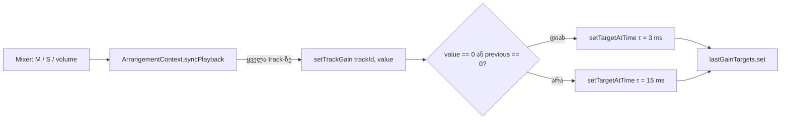

# Studio Lab — სწრაფი de-click mute (track gain 0-მდე და 0-დან)

**თარიღი:** 2026-10-11
**სტატუსი:** Completed (A; C-ის შემოწმება მოლოდინშია — round 22)
**შეცვლილი პროექტი:** Store

## კონტექსტი

C-მ round 21-ის milestone regression-ში (R3-V2) იპოვა ბაგი **C-R21-01 (Low)**: ვიდეოს ორიგინალი ხმის Mute-ის შემდეგ ხმა master-ზე დაახლოებით 120 ms-ის განმავლობაში ისევ ისმის.

- Mute beep-ამდე 40 ms-ით ადრე → beep-ის ფანჯარა master-ზე **−52.3 dBFS** (V2_2);
- Mute beep-ამდე 98 ms-ით ადრე → **−86.3 dBFS** (V2_4);
- ზღვარი არის **−80 dBFS**.

მიზეზი: `setTrackGain` ყოველ ცვლილებას, მათ შორის mute-ს, ერთი და იგივე `setTargetAtTime` time constant-ით ასრულებდა — `GAIN_TIME_CONSTANT = 0.015` (15 ms). ექსპონენციალური ramp ეცემა დაახლოებით 8.686 / 15 ≈ **0.58 dB/ms**-ით, ამიტომ beep-ის −9 dBFS-დან −80 dBFS-მდე ~120 ms სჭირდება.

**სცენარი:** მონტაჟორი ვიდეოს ათავსებს timeline-ზე, უშვებს Play-ს და ვიდეოს ორიგინალ ხმაზე აჭერს M-ს, რომ მხოლოდ მუსიკა დარჩეს. ის ელის, რომ ხმა მაშინვე გაქრება, როგორც Ableton-ში — და არა, რომ შემდეგი ბგერის დასაწყისი კიდევ გაისმება.

მომხმარებლის მოთხოვნაა Ableton-ის მსგავსი mute (FB-16): პრაქტიკულად მყისიერი, მხოლოდ მოკლე de-click-ით.

## მიდგომა

**წესი (B, D-29m):** track gain-ის ნებისმიერი გადასვლა **0-მდე ან 0-დან** (mute, unmute, solo, unsolo) იყენებს მოკლე de-click time constant-ს `MUTE_TIME_CONSTANT = 0.003` (3 ms). ორ არანულოვან მნიშვნელობას შორის volume-ის ცვლილება ინარჩუნებს 15 ms-იან smoothing-ს, რომ slider-ის გადათრევამ zipper noise არ გამოიწვიოს.

- `applySchedule` თითო track-ზე ინახავს **ბოლო gain target-ს** (`Map<trackId, number>`).
- Map ივსება graph-ის აწყობისას იმავე მნიშვნელობით, რაც `gain.value`-ში იწერება (audible → `track.volume`, სხვა შემთხვევაში 0). ასე სწორად მუშაობს track, რომელიც თავიდანვე muted იყო ან სხვა track-ის solo-მ გააჩუმა.
- `AudioParam.value`-ს წაკითხვა არ ვიყენებთ: ramp-ის შუაში ის ბოლო target-ს არ გვეუბნება.
- `setTrackGain`: თუ ახალი მნიშვნელობა 0-ია **ან** წინა target 0-ია → 3 ms, სხვა შემთხვევაში → 15 ms. შემდეგ `setTargetAtTime` და ახალი target-ის შენახვა.
- უცნობი track id — არაფერი ხდება (როგორც ადრე).
- იგივე target-ის ხელახლა გაგზავნა (`syncPlayback` ყველა track-ს ხელახლა აგზავნის) უვნებელია და ქცევას არ ცვლის.
- Volume slider-ის ზუსტად 0-მდე ჩამოწევაც მოკლე constant-ს იყენებს — სიჩუმემდე სწრაფად მისვლა mute-ის განზრახვაა. სიმეტრიულად, volume 0-დან პირველი ნაბიჯი ზემოთ (მაგ. 0 → 0.05) ასევე 3 ms-ია, რადგან წინა target 0-ია; R22-A1-ის 15 ms-იანი oracle მხოლოდ არანულოვანი → არანულოვანი გადასვლებს ეხება.

**მიღებული edge case:** unmute-ის (3 ms) შემდეგ სხვა track-ის volume-ის ცვლილება ამ track-ის იმავე target-ს ხელახლა აგზავნის (0.8 → 0.8). ეს არანულოვანი → არანულოვანია, ამიტომ ramp-ის შუა მნიშვნელობიდან 15 ms-ით გრძელდება. ramp უკვე target-თან ახლოსაა და unmute 100 ms-ზე ბევრად სწრაფი რჩება.

**უარყოფილი ალტერნატივები:**

| ვარიანტი | რატომ არა |
|---|---|
| გლობალურად τ-ის შემცირება (ყველა ცვლილებაზე 3 ms) | volume slider-ის გადათრევისას ყოველი ნაბიჯი თითქმის მყისიერი ხდება → zipper noise |
| მხოლოდ კრიტერიუმის შეცვლა (mute-ის მხარეს 120 ms-იანი ფანჯარა) | ბაგს არ ასწორებს: ~120 ms-იანი ხმის "კუდი" რჩება, Ableton-ის ქცევას არ ემთხვევა |
| `setValueAtTime` / `cancelScheduledValues` / `linearRampToValueAtTime` | hard cut კლიკს იწვევს; scheduling-ის ცვლილება უფრო ფართო და რისკიანია; ამ რაუნდში აკრძალულია |

### τ = 3 ms-ის გამოყვანა

- ექსპონენციალური ramp: დონე ეცემა 8.686 / τ dB-ით ყოველ წამში.
- τ = 3 ms → **2.9 dB 1 ms-ში** — ეს ramp-ია, არა მყისიერი წყვეტა (კლიკი).
- 0 dBFS → −80 dBFS: 80 / 8.686 · τ = 9.21 · 3 ms = **27.6 ms**.
- შედარებისთვის, τ = 15 ms-ზე იგივე 138 ms-ია.

## არქიტექტურა

Export (`renderArrangementWav`) `setTrackGain`-ს არ იძახებს, ამიტომ ცვლილება მასზე არ მოქმედებს. Video dock, scheduler და transport არ შეცვლილა.

## შეცვლილი ფაილები

- `app/lib/arrangement/graph.client.ts` — ახალი module constant `MUTE_TIME_CONSTANT`, თითო track-ის ბოლო target-ის Map (აწყობისას შევსებული) და `setTrackGain`-ის ტანი.
- `app/lib/arrangement/__tests__/graph.test.ts` — `FakeParam` იწერს `timeConstant`-საც; არსებული ტესტის მოლოდინი განახლდა; დაემატა ახალი ტესტები.
- `docs/implementation/2026/quarter-IV/028-studio-lab-mute-declick.md` — ეს დოკუმენტი.

## პრობლემები და გადაწყვეტები

- **პრობლემა:** არსებული ტესტი `setTrackGain ramps…` `sfx` track-ს იყენებდა, რომელიც fixture-ში muted-ია (seed 0). ახალი წესით 0 → 0.5 მოკლე constant-ს მიიღებს, ხოლო დავალება ამ ტესტისთვის 0.8 → 0.5 და 0.015-ს ითხოვს.
  **გადაწყვეტა:** ტესტი გადავიდა `music` track-ზე (seed 0.8), ასერცია "source-ები არ გადაიტვირთა" დარჩა. 0 → არანულოვანი შემთხვევა ცალკე seed-ტესტით ფარდება.
- **პრობლემა:** `param.value` ramp-ის შუაში ბოლო target-ს არ აჩვენებს.
  **გადაწყვეტა:** ბოლო target ცალკე Map-ში ინახება და აწყობისას ივსება.

## ტესტირება

Unit (`graph.test.ts`), ჯერ წითლად დაწერილი ძველ კოდზე — 5 ტესტი ჩავარდა (mute/unmute, ორი 0-seed შემთხვევა, track-ების დამოუკიდებლობა, 0 → 0 re-send), შემდეგ მწვანე:

- audible track: 0.8 → 0.5 → 0.015;
- mute 0.8 → 0 და unmute 0 → 0.8 → ორივე 0.003; unmute-მდე fake `gain.value` ხელით 0.0001-ზე დგება (ramp-ის შუა მნიშვნელობა), რომ ტესტმა დაიჭიროს `param.value`-ის წაკითხვა Map-ის ნაცვლად;
- seed: muted-ად აწყობილი track, პირველი 0.8 → 0.003; audible 0.8, პირველი 0.6 → 0.015; სხვა track-ის solo-თი გაჩუმებული, unsolo → 0.003;
- `sfx`-ის mute `music`-ის შემდეგ constant-ს არ ცვლის (0.015);
- იგივე target: 0.8 → 0.8 → 0.015, 0 → 0 → 0.003, უცნობი track id — exception არ არის;
- source-ებს ყველაფრის შემდეგ ზუსტად 1 `start` აქვთ, `stop` არ გამოძახებულა;
- static: `renderArrangementWav`-ის ნაწილში `setTrackGain` არ გვხვდება.

### R3-V2-ის შესწორებული mute oracle (C, round 22, R22-M1)

ძველ ტექსტს mute-ის მხარეს გარდამავალი ფანჯარა არ ჰქონდა (unmute-ს 100 ms ჰქონდა), ამიტომ იდეალური ramp-იც ჩავარდებოდა. ზღვარი −80 dBFS არ შეცვლილა.

- **გარდამავალი ფანჯარა W = 35 ms:** უარესი შემთხვევა 0 dBFS → −80 dBFS = 27.6 ms (τ = 3 ms) + ერთი 128-frame render quantum (2.7 ms) = 30.3 ms → დამრგვალებით 35 ms.
- **Oracle:** muted მდგომარეობაში ყოველი beep-ის ფანჯარა, რომელიც t_m + W-ზე ან მის შემდეგ იწყება, master-ზე **< −80 dBFS**. t_m არის mute-ის `setTargetAtTime` (target 0, τ 0.003) გამოძახების timeline-დრო.
- R22-M2 დამატებით ამოწმებს, რომ ეს ramp-ია და არა hard cut (−3 dB-დან −23 dB-მდე ≥ 3 ms).

## TODO / შემდეგი ნაბიჯები

- C: R22-M1..M3, R22-V, R22-A1..A3, R22-S, R22-U, R22-Doc და G22-1..3.
- Tech Lead: R22-T — mute/unmute-ის click-ის არარსებობა ყურით, რეალურ Chrome-ში ყურსასმენებით.
