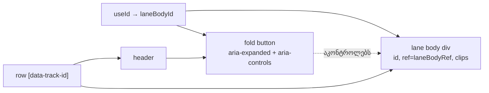

# Studio Lab — lane header-ის a11y შესწორებები (aria-controls, ring-inset, biome-ignore-ის მიზეზი)

**თარიღი:** 2026-10-11
**სტატუსი:** Completed (A; C-ის შემოწმება მოლოდინშია — round 23)
**შეცვლილი პროექტი:** Store

## კონტექსტი

A-ს round 11-ის ანგარიშმა (§7 pass 4, §9) და doc 020-მა lane header-ში სამი პატარა a11y ხარვეზი დატოვა. ახლა ისინი milestone fix რაუნდში სრულდება. ეს არის ნაწილი 1 და ეხება მხოლოდ `ArrangementLane.tsx`-ს:

1. Fold ღილაკს (`aria-expanded`) არ ჰქონდა `aria-controls`. Screen reader-ს არ შეეძლო ეთქვა, **რას** კეცავს ღილაკი.
2. ხაზის სახელის ღილაკის focus ring გარეთ იხატებოდა. დაკეცილ (36 px) და tight ხაზზე header-ს აქვს `overflow-hidden` და `pt-0`, ამიტომ ring-ის ზედა კიდე შეიძლება მოჭრილიყო.
3. სიმაღლის handle-ის `biome-ignore` კომენტარი ტექნიკური მიზეზის ნაცვლად პროცესის დოკუმენტს („B round-11 §2.2“) იმოწმებდა.

**სცენარი:** კლავიატურით მომუშავე მონტაჟორი Tab-ით გადადის ვიდეოს ხაზის fold ღილაკიდან სახელის ღილაკზე. ხაზი დაკეცილია. მან სახელის გარშემო სრული ჩარჩო უნდა დაინახოს და არა ზემოდან მოჭრილი ხაზი. Screen reader-ი fold ღილაკზე აცხადებს, რომ ის ხაზის შიგთავსს მართავს.

**B-ის შესწორება (D-29n):** round 22-ის §7-ში და D-29m-ში ამ რაუნდისთვის ეწერა „fold-ის ჩუმი უარი gesture-ის დროს“. ეს **უკვე გაკეთებულია round 16-ში** (A round-11 deviation 9, D-29c, doc 025, C round 16 PASS): `StudioWorkspace.tsx` gesture-ის დროს status-ში წერს `GESTURE_EDIT_BLOCKED_MESSAGE`-ს. ამ რაუნდში კოდი არ შეცვლილა. C მას მხოლოდ რეგრესიად ამოწმებს (R23-F2).

## მიდგომა

### `aria-controls` — target არის lane body

- `ArrangementLane` იძახებს `useId()`-ს (`laneBodyId`).
- ხაზის სხეულის `
`-ს (`laneBodyRef`, სადაც clip-ებია) ემატება `id={laneBodyId}`.
- Fold ღილაკს ემატება `aria-controls={laneBodyId}`.

**რატომ lane body:**
- Fold ცვლის სწორედ ამ ელემენტის სიმაღლეს და წყვეტს clip-ების სხეულების რენდერს.
- Fold ასევე მალავს header-ის volume-ის რიგს, მაგრამ header თავად შეიცავს ღილაკს. Control, რომელიც საკუთარ წინაპარზე მიუთითებს, აზრს კარგავს.
- Volume-ის რიგი fold-ისას unmount-დება, ამიტომ მასზე მითითება ნახევარ დროს „ჩამოკიდებული“ იქნებოდა.
- იგივე pattern-ს იყენებს დეტალების პანელი (`useId` → `contentId` მართულ შიგთავსზე).

**დეტალები:**
- Lane body ყოველთვის რენდერდება, დაკეცილიც და გაშლილიც. ამიტომ მითითება არასდროს „ჰკიდია“.
- React 18-ის `useId` ყოველ ხაზზე უნიკალურ მნიშვნელობას იძლევა. მნიშვნელობა შეიცავს `:` სიმბოლოს, ამიტომ ტესტები და C იყენებენ `document.getElementById`-ს და არა CSS selector-ს.
- სხვა არაფერი შეცვლილა: `ref`, კლასები, `style`, drop handler-ები, `data-testid`, `aria-expanded`, `aria-label`.

### `ring-inset` სახელის ღილაკზე

სახელის ღილაკის კლასში `focus-visible:ring-2`-ის შემდეგ დაემატა `focus-visible:ring-inset`. Ring ახლა ღილაკის შიგნით იხატება (`box-shadow: inset …`) და header-ის `overflow-hidden` მას ვეღარ ჭრის. ეს იგივე pattern-ია, რაც fold ღილაკსა და კომპაქტურ `＋`-ს უკვე ჰქონდათ (round 11 pass 3).

### `biome-ignore`-ის მიზეზი

Rule-ის სახელი უცვლელია: `lint/a11y/useSemanticElements`. მიზეზის ტექსტი სიტყვასიტყვით აღებულია დეტალების პანელიდან (root L6 fix, round 18): focusable resize handle-ს სჭირდება `role=separator` და `aria-valuenow`, native `
` კი სტატიკური, არაინტერაქტიული separator-ია. ეს მხოლოდ კომენტარის ცვლილებაა.

**უარყოფილი ალტერნატივები:**

| ვარიანტი | რატომ არა |
|---|---|
| `aria-controls` → მთელ row-ზე ან header-ზე | Header შეიცავს ღილაკს: control საკუთარ წინაპარს ვერ მართავს |
| `aria-controls` → lane body + volume-ის რიგი (ორი id) | Volume-ის რიგი fold-ისას ქრება და მითითება ჩამოკიდებული რჩება |
| ID-ის აწყობა `track.id`-დან | `useId` უკვე გამოიყენება კოდბაზაში და უნიკალურობას გარანტიით იძლევა, თუნდაც ორი workspace ერთ გვერდზე იყოს |
| `ring-offset` ან header-ის `overflow`-ის შეცვლა | Header-ის layout-ში უფრო ფართო ცვლილებაა; `ring-inset` უკვე მიღებული pattern-ია |

## არქიტექტურა

## შეცვლილი ფაილები

- `app/components/arrangement/ArrangementLane.tsx` — `useId` import და გამოძახება, `id` lane body-ზე, `aria-controls` fold ღილაკზე, `focus-visible:ring-inset` სახელის ღილაკზე, `biome-ignore`-ის მიზეზის ტექსტი.
- `app/lib/arrangement/__tests__/track-layout.test.tsx` — ორი ახალი `it` ბლოკი.
- `docs/implementation/2026/quarter-IV/029-studio-lab-lane-header-a11y.md` — ეს დოკუმენტი.

## პრობლემები და გადაწყვეტები

- **პრობლემა:** `useId`-ის მნიშვნელობა (`:r1:` ტიპის) CSS selector-ში არავალიდურია.
  **გადაწყვეტა:** ტესტი ელემენტს `document.getElementById`-ით პოულობს. C-ის harness-საც იგივე წესი აქვს.
- **პრობლემა:** ვიდეოს ხაზი fixture-ში ცარიელია. Clip-ების შემცველობის შემოწმება მასზე არაფერს ამოწმებს, ხოლო „row-ში, header-ის გარეთ“ სიმაღლის handle-საც მოერგება (code-reviewer, Low).
  **გადაწყვეტა:** ტესტი ყველა ხაზზე ამოწმებს, რომ target არის ზუსტად header-ის მომდევნო ელემენტი (lane body). სამ აუდიო ხაზზე ცალკე მოწმდება, რომ row-ში ერთი clip მაინც არის.
- **პრობლემა:** R23-N-ის დაკეცილი ნაწილი არ ამოწმებდა, რომ fold მართლა მოხდა (code-reviewer, Low).
  **გადაწყვეტა:** ხელახალ შემოწმებამდე ტესტი ამოწმებს `aria-expanded="false"`-ს ორივე ხაზზე.

## ტესტირება

`track-layout.test.tsx`-ში ორი ახალი ტესტი ჯერ დაიწერა **უცვლელ** კომპონენტზე და ორივე ჩავარდა: 2 failed, 31 passed.
- R23-F1: `expected '' not to be ''` — `aria-controls` არ არსებობდა;
- R23-N: `expected [...] to include 'focus-visible:ring-inset'`.

იმპლემენტაციის შემდეგ: 33/33 მწვანე.

- **R23-F1:** ოთხივე ხაზზე (video, music, stems, sfx):
  - `aria-controls` არაცარიელია, ოთხივე მნიშვნელობა უნიკალურია;
  - `getElementById` ელემენტს პოულობს იმავე row-ში, header-ის გარეთ; ეს ელემენტი header-ის მომდევნოა;
  - row-ის ყველა `[data-clip-id]` ამ ელემენტის შიგნითაა, ხოლო აუდიო ხაზებზე clip-ების რაოდენობა > 0;
  - fold-ის შემდეგ `aria-expanded="false"` და იგივე id ისევ იმავე row-ში იძებნება; unfold-ის შემდეგაც იგივე ხდება.
- **R23-N:** დაკეცილ და გაშლილ ხაზზე (მუსიკა და ვიდეო) სახელის ღილაკს აქვს `focus-visible:ring-2`, `focus-visible:ring-inset` და `focus-visible:ring-brand`.

Gate-ები (A): tsc 0, vitest 1007/1007 (1005 + 2), build OK, Biome `./app` 0 error, Biome ორ შეცვლილ ფაილზე — 0 diagnostic.

ბრაუზერში focus ring-ის ვიზუალურ შემოწმებას (computed `box-shadow` `inset`, crop) და რეგრესიებს (file/library drop, Tab-ის რიგი) C ასრულებს.

## TODO / შემდეგი ნაბიჯები

- Round 24 (ნაწილი 2):
  - Home ფოკუსირებულ `role=separator`-ზე არ უნდა იწვევდეს გლობალურ seek-ს;
  - `scroller.nextElementSibling` უნდა შეიცვალოს `forwardRef`-ით `ArrangementDetailPanel`-ზე.
- დაკეცილი ხაზის clip-ები accessibility tree-ში რჩება. `aria-expanded="false"` ამიტომ „დამალულზე“ სუსტ დაპირებას იძლევა (code-reviewer, Low; არსებული ქცევა, scope-ის გარეთ). ეს ჩანაწერია B-სთვის.
- Lane overlay-ის `/60`, footer-ის ლათინური ტექსტი და group hint-ის `range` გადადის SRW-14 / SRW-18-ში.
