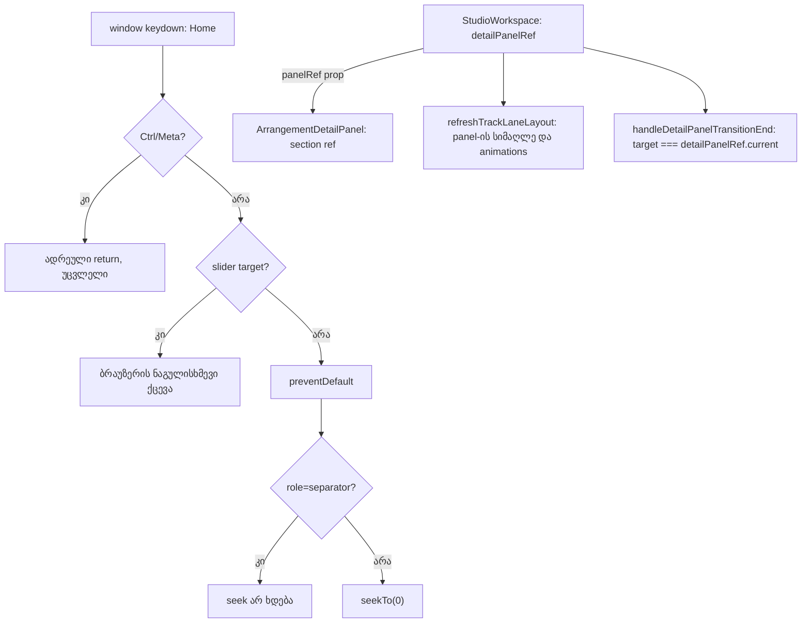

# Studio Lab — Home ფოკუსირებულ separator-ზე და detail panel-ის ცხადი ref

**თარიღი:** 2026-10-11
**სტატუსი:** Completed (A; C-ის შემოწმება მოლოდინშია — round 24)
**შეცვლილი პროექტი:** Store

## კონტექსტი

A-ს round 11-ის ანგარიშმა (§9) ორი პატარა follow-up დატოვა `StudioWorkspace.tsx`-ში. ეს არის lane header-ის a11y შესწორებების ნაწილი 2 (D-29o):

1. **Home separator-ზე თამაშის პოზიციას 0-ზე გადაიტანდა.** Window-ის keydown handler-ი Home-ზე ყველა არა-slider target-ისთვის იძახებდა `preventDefault`-ს და `seekTo(0)`-ს. სამივე separator (ხაზის სიმაღლე, detail panel-ის სიმაღლე, ბიბლიოთეკის სიგანე) მხოლოდ ისრებს ამუშავებს. ამიტომ Home ფოკუსირებულ resize handle-ზე playhead-ს 0-ზე აგდებდა, თუმცა მომხმარებელი იმ მომენტში პანელის ზომას ცვლის და არა transport-ს.
2. **Detail panel-ის ძებნა DOM-ის მეზობლობით.** `refreshTrackLaneLayout` და `handleDetailPanelTransitionEnd` panel-ს პოულობდნენ `scrollerRef.current.nextElementSibling`-ით. ეს მყიფეა: scroller-სა და panel-ს შორის ნებისმიერი ახალი ელემენტი (overlay, wrapper, portal-ის anchor) ჩუმად გატეხავდა ხაზების refit-ს detail panel-ის სიმაღლის transition-ის შემდეგ (R11-P2a) — შეცდომის გარეშე.

**სცენარი:** მონტაჟორი playhead-ს 5 წამზე აჩერებს, Tab-ით მიდის მუსიკის ხაზის სიმაღლის handle-მდე და ისრებით ზომას არეგულირებს. თითი შემთხვევით Home-ზე ეცემა. ადრე playhead 0-ზე გადახტებოდა და დაკვრისას მუსიკა თავიდან დაიწყებოდა. ახლა არაფერი იცვლება: პოზიცია, თამაშის მდგომარეობა, მონიშვნა, status და handle-ის `aria-valuenow` იგივე რჩება.

## მიდგომა

### Home-ის კონტრაქტი separator-ზე

- Focus-ი ელემენტზე, რომლის `role` არის `separator` → Home-ზე `preventDefault` **რჩება**, მაგრამ `seekTo(0)` აღარ იძახება.
- `preventDefault` იმიტომ რჩება, რომ მომხმარებლისთვის ერთადერთი ხილული ცვლილება იყოს „seek აღარ ხდება“. მის გარეშე Chrome-ის ნაგულისხმევი Home timeline-ის scroller-ს ზემოთ ასქროლავდა — ეს ახალი ქცევა იქნებოდა.
- Separator-ებს **არ** ემატება ახალი Home/End ქცევა (მაგ. „მინიმალურ ზომაზე გადასვლა“). End ისევ არ მუშავდება.
- სხვა ყველა target-ი ძველებურად მუშაობს: არა-slider, არა-separator target → `preventDefault` + `seekTo(0)`; slider (range input ან `role=slider`) → ბრაუზერის ნაგულისხმევი ქცევა. Ctrl/Meta-ის ადრეული return-ის რიგი არ შეცვლილა.
- გამოყენებულია არსებული `isSeparatorTarget` helper; ახალი helper არ დამატებულა და `isSliderTarget` უცვლელია.

### ცხადი ref `panelRef` prop-ით და არა `forwardRef`-ით

- `ArrangementDetailPanel`-ს დაემატა არასავალდებულო `panelRef?: RefObject<HTMLElement>` prop, რომელიც root `<section data-testid="arrangement-detail-panel">`-ზე `ref`-ად ჯდება. Prop-ი destructuring-შია, ამიტომ `contentProps`-ში არ ხვდება.
- `StudioWorkspace` ქმნის `detailPanelRef`-ს, გადასცემს `panelRef`-ად და ორივე წაკითხვის ადგილას იყენებს მას. `instanceof HTMLElement` შემოწმებები null-შემოწმებად იქცა — მნიშვნელობა იგივეა. `useCallback`-ის dependency-ები არ შეცვლილა (ref სტაბილურია).
- **რატომ არა `forwardRef`** (`FORWARDREF_COMPONENT.md` primitive-ის ცნობიერი გამონაკლისი):
  - `render-budget.test.tsx` (frozen) render-ებს ითვლის fake devtools hook-ით, `fiber.type.name`-ის მიხედვით **function** ტიპებისთვის. ის ამოწმებს, რომ `ArrangementDetailPanel` Play-ის კადრზე 0-ჯერ რენდერდება და მონიშვნის შეცვლისას — 0-ზე მეტჯერ. `forwardRef`-ის export-ი fiber-ის ტიპს ობიექტად აქცევს, ამ სახელით დათვლა 0 გახდებოდა და frozen ტესტი ჩავარდებოდა.
  - Inline `forwardRef(...)`-ის შემთხვევაში Biome ~250 ხაზიან სხეულს ხელახლა დააინდენტებდა და diff-ის აუდიტი შეუძლებელი გახდებოდა.
  - Codebase-ში DOM ref-ის ჩვეულებრივ prop-ად გადაცემის პრეცედენტი უკვე არსებობს: `ArrangementLibrary`-ის `asideRef` და `bodyRef`.

## არქიტექტურა

## შეცვლილი ფაილები

- `app/components/arrangement/StudioWorkspace.tsx` — Home-ის პირობა separator-ისთვის; `detailPanelRef`, მისი ორი წაკითხვა და `panelRef=` `<ArrangementDetailPanel>`-ზე. `nextElementSibling` ფაილში აღარ გვხვდება.
- `app/components/arrangement/ArrangementDetailPanel.tsx` — `RefObject` type import, `panelRef` prop interface-სა და destructuring-ში, `ref={panelRef}` root `<section>`-ზე. სხეული, hooks, markup და კლასები უცვლელია; კომპონენტი ისევ ჩვეულებრივი ფუნქციაა.
- `app/lib/arrangement/__tests__/track-layout.test.tsx` — ახალი describe ბლოკი სამი ტესტით (მხოლოდ დამატებული ხაზები).

## პრობლემები და გადაწყვეტები

- **პრობლემა:** პოზიცია `useArrangement()`-ის value-ში არ არის — ის ცალკე position store-შია. **გადაწყვეტა:** ტესტში ლოკალური probe კითხულობს `useArrangementPositionStore().getPosition()`-ს იმავე provider-იდან.
- **პრობლემა:** R24-F-ის პირველი ვერსია `createRef`-ს იყენებდა, რაც `react` import-ის არსებული ხაზის შეცვლას მოითხოვდა, ხოლო B-ის R24-S ტესტის ფაილში მხოლოდ დამატებულ ხაზებს ელის. **გადაწყვეტა:** ტესტი იყენებს ჩვეულებრივ `{ current: null }` ობიექტს (სტრუქტურულად `RefObject`-ის თავსებადი); ფაილის diff მხოლოდ დამატებებია.
- **პრობლემა:** Provider-ის ასინქრონული ჩატვირთვა R24-F-ში `act(...)`-ის გაფრთხილებას იწვევდა. **გადაწყვეტა:** render-ის შემდეგ ტესტი microtask-ებს `act`-ში ასრულებს, როგორც `mountTrackLayout`.

## ტესტირება

- **Red-first:** ახალი ტესტები ჯერ უცვლელ წყაროზე გაეშვა — R24-H (პოზიცია 0 გახდა, მოსალოდნელი 5) და R24-F (`ref.current` null) ჩავარდა, R24-HC (control) მწვანე იყო. საბოლოო ტესტების ვერსია დამატებით გაეშვა `store/`-ის გარეთ scratch ასლში dispatch-ის snapshot წყაროებზე — იგივე შედეგი. tsc ტესტის ფაილზე red ეტაპზე `panelRef`-ის უცნობი prop-ის გამო მოსალოდნელად ვარდებოდა.
- **R24-H:** პოზიცია 5-ზე; სამივე separator-ზე (მუსიკის სიმაღლე, detail, ბიბლიოთეკა) Home-ის შემდეგ პოზიცია 5 რჩება, `defaultPrevented` არის true, focus separator-ზე რჩება, `aria-valuenow` და status უცვლელია.
- **R24-HC:** body-დან და fold ღილაკიდან Home ისევ 0-ზე აბრუნებს; volume-ის range input-ზე Home seek-ს არ აკეთებს და default-ს არ აჩერებს.
- **R24-F:** `panelRef.current` არის `arrangement-detail-panel` section.
- არსებული R11-P2a refit ტესტი, `render-budget.test.tsx` და `detail-panel.test.tsx` უცვლელი და მწვანეა.
- Gates: tsc 0, vitest 1010/1010, build OK, Biome `./app` 0 error (218 warning + 1 info, round 23-ის ტოლი).

## TODO / შემდეგი ნაბიჯები

- C-R23-01 (SSR NUL bytes) ელოდება Tech Lead-ის გადაწყვეტილებას (`entry.server.tsx` ან React 19).
- `ArrangementLibrary.tsx`-ის `biome-ignore` მიზეზი ჯერ კიდევ პროცესს იმოწმებს — დაგეგმილია პირველ რაუნდში, რომელიც ამ ფაილს შეცვლის.
- შემდეგი feature რაუნდი: SRW-13 (clip gain, pan, master bus და export-ის hard-clip).
