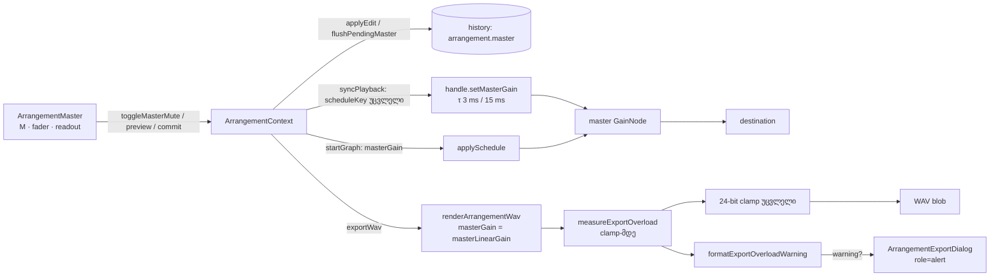

# Studio Lab — Master Volume, Master Mute და ექსპორტის გადატვირთვის გაფრთხილება

**თარიღი:** 2026-10-11
**სტატუსი:** Completed (A; C-ის შემოწმება მოლოდინშია — round 25)
**შეცვლილი პროექტი:** Store

## კონტექსტი

მომხმარებლის მოთხოვნა FB-14 (`docs/video-to-text-bugs/README.md`): „Master Volume, საერთო გათიშვა და საბოლოო დონის/გადატვირთვის კონტროლი“. Backlog-ში ეს არის SRW-13 (R13-M3, R13-M4). სამუშაო ოთხ ეტაპად იყოფა. ეს დოკუმენტი აღწერს **ეტაპ 1-ს**:

1. **Master bus:** Master Volume (dB) და Master Mute. ორივე მუშაობს ცოცხალ დაკვრაში და WAV ექსპორტში, და ორივე Undo-ს ექვემდებარება.
2. **ექსპორტის გადატვირთვის გაფრთხილება (R13-M4-ის ექსპორტის ნაწილი):** რენდერის შემდეგ ექსპორტი ზომავს პიკს clamp-მდე და clamp-ის მიერ შეცვლილი sample-ების რაოდენობას. თუ მიქსი 0 dBFS-ს გადასცდა, დიალოგი ამას ამბობს და ასახელებს, რამდენით უნდა შემცირდეს Master. აქამდე `lay11` განლაგებაზე ცნობილი hard-clip (1800 full-scale sample) ჩუმად ხდებოდა.

**სცენარი:** მონტაჟორი `lay11`-ს აწყობს (ვიდეო, მუსიკა, სტემები, SFX) და WAV-ს აექსპორტებს. დიალოგი წერს: „გადატვირთვა: პიკი +0.8 dBFS — 1800 sample შეიზღუდა 0 dBFS-ზე. შეამცირე Master მინიმუმ 0.9 dB-ით და გაიმეორე ექსპორტი.“ ის header-ში Master fader-ს −1.0 dB-ზე წევს (ორი ArrowDown) და ხელახლა აექსპორტებს. ფაილი სუფთაა, გაფრთხილება აღარ ჩანს. (რიცხვები მაგალითია; რეალურ მნიშვნელობებს C ზომავს.)

## მიდგომა

### Master-ის კონტრაქტი (D-29p)

- **მოდელი:** `Arrangement`-ს დაემატა **სავალდებულო** ველი `master: { gainDb, mute }`. ნაგულისხმევი მნიშვნელობა (`DEFAULT_ARRANGEMENT_MASTER`) არის 0 dB და mute გამორთული. `createArrangement` თითოეულ ახალ პროექტს default-ის ასლს აძლევს.
- **დიაპაზონი:** −60…+6 dB (`MASTER_GAIN_MIN_DB` / `MASTER_GAIN_MAX_DB`). Fader-ის ბიჯი 0.5 dB-ია.
- **`setMasterMix`:** gain-ს დიაპაზონში ზღუდავს და ნებისმიერი mute/gain patch-ს იღებს. თუ არაფერი შეიცვალა, **იგივე ობიექტს** აბრუნებს, ამიტომ no-op history entry-ს არ ქმნის. არა-სასრულ gain-ს (NaN) უგულებელყოფს.
- **`masterLinearGain`:** mute-ზე 0, სხვა შემთხვევაში `10^(gainDb/20)`. −6 dB ≈ 0.501187, 0 dB = 1, −60 dB = 0.001. −60 dB ძალიან ჩუმია, მაგრამ mute არ არის.
- **Readout (`formatMasterGainDb`):** ერთი ათწილადი. უარყოფითს U+2212 („−“) ნიშანი აქვს, დადებითს „+“, 0-ს ნიშანი არ აქვს: `0.0 dB`, `−6.0 dB`, `+6.0 dB`. იგივე ტექსტი გამოიყენება `aria-valuetext`-ში და ექსპორტის დიალოგის შენიშვნაში.
- **Time constant-ები (C-R21-01, doc 028):** `setMasterGain` იყენებს `setTargetAtTime`-ს `setTrackGain`-ის იმავე წესით. თუ ახალი **ან** წინა სამიზნე 0-ია, τ = 3 ms (`MUTE_TIME_CONSTANT`). სხვა შემთხვევაში τ = 15 ms (`GAIN_TIME_CONSTANT`). წინა სამიზნე graph-ის შექმნისას საწყისი `masterGain`-იდან იწყება. ამიტომ graph, რომელიც დადუმებული დაიწყო, unmute-ზეც მოკლე τ-ს იყენებს და Master Mute click-ს არ იძლევა.

### რატომ არის ველი სავალდებულო

`isSameArrangement` arrangement-ებს JSON-ით ადარებს. არასავალდებულო ველის შემთხვევაში „არ არის“ და „default“ ერთმანეთისგან განსხვავდებოდა. ეს უაზრო history entry-ებს გააჩენდა, და ყველა მკითხველს fallback დასჭირდებოდა. B-ის probe-მა (scratch ასლი) აჩვენა, რომ tsc მხოლოდ სამ ადგილს ჩავარდება, და სამივე ამ რაუნდში A-ს ეკუთვნის: `createArrangement`, `findFreeStart`-ის `projectEnd({...})` literal და `schedule.test.ts`-ის fixture. დანარჩენი ყველა კონსტრუქცია `createArrangement`-ით ან spread-ით მიდის. ამიტომ Delete Time, clipboard, duplicate და სხვა ოპერაციები `master`-ს უცვლელად ინახავს.

### Graph-ი და ცოცხალი დაკვრა

- `applySchedule` იღებს არასავალდებულო `masterGain`-ს (ხაზოვანი, default 1) და არსებული master `GainNode`-ის საწყის `gain.value`-ს აყენებს. ახალი node-ები, analyser-ები და source/clip/track wiring არ დამატებულა.
- `ScheduleHandle.setMasterGain` `disconnect()`-ის შემდეგ არაფერს აკეთებს.
- `startGraph` ახალ graph-ს `masterGain: masterLinearGain(arrangement.master)`-ით ქმნის. `syncPlayback`-ის „reschedule-ის გარეშე“ შტოში, track gain-ების შემდეგ, იძახება `handle.setMasterGain(...)`.
- `scheduleKey` ისევ მხოლოდ `[clips, loop]`-ს ჰეშავს. **Master-ის ცვლილება graph-ს არასდროს ქმნის თავიდან**: source-ები არ ჩერდება, playhead არ ხტება, loop-ის wrap არ ირღვევა.
- ვიდეოს ელემენტი ისევ muted-ია და ვიდეოს ხმა მხოლოდ graph-ით ისმის. ამიტომ Master Mute ვიდეოს ხმასაც აჩუმებს.
- Master Mute და Master Volume status-ის ტექსტს არ წერს, ისევე როგორც track Mute. მდგომარეობას `aria-pressed` და readout აჩვენებს.

### Gesture და history: პარალელური master გზა

**არჩევანი:** master-ს აქვს საკუთარი refs: `masterBeforeRef` (pending preview-მდე არსებული arrangement), `masterGestureRef` (აქტიური pointer gesture) და `flushPendingMaster` (pending preview-ს `Master Volume` entry-ად ინახავს). Track-ის გზა (`volumeBeforeRef`, `volumeGestureRef`, `flushPendingVolume`) უცვლელია. მას მხოლოდ `flushPendingMaster()`-ის გამოძახება დაემატა იმ ადგილებში, სადაც უკვე `flushPendingVolume()` იძახებოდა: `applyEdit`, `undo`, `redo` და `beginTrackVolumeGesture`. სიმეტრიულად, `beginMasterGainGesture` და ახალი master preview pending track preview-ს ჯერ ინახავს.

**რატომ არა საერთო `TrackVolumeGesture`-ის განზოგადება:** საერთო pending slot-ს ერთი label აქვს. master-ის preview flush-ისას `Volume`-ად ჩაიწერებოდა, ან track-ის კოდის შეცვლა დასჭირდებოდა. პარალელური გზით track-ის diff მხოლოდ დამატებული flush ხაზებია. ამის გამო „track Volume-ის ქცევა არ იცვლება“ ადვილად შესამოწმებელია, და ყველა არსებული ტესტი უცვლელად მწვანეა.

**სემანტიკა (track Volume-ის ზუსტი ასლი):**
- ერთი pointer drag (`beginMasterGainGesture` → რამდენიმე `previewMasterGain` → window-ის `pointerup`) → **ერთი** `Master Volume` entry.
- კლავიატურა: თითო key-up ერთ entry-ს იძლევა (`onKeyUp` → `commitMasterGain`), ისევე როგორც track Volume-ზე.
- Blur ან `pointercancel` drag-ის დროს → preview უქმდება, entry არ იქმნება. Blur gesture-ის გარეშე pending preview-ს ინახავს.
- სხვა pointer gesture-ის დროს Master Mute და Master preview უარყოფილია (`refuseEditDuringGesture`), ისევე როგორც ნებისმიერი რედაქტირება.
- Undo/Redo pending preview-ს ჯერ ინახავს (flush), შემდეგ აბრუნებს.
- `toggleMasterMute` `Master Mute` label-ით ერთ entry-ს ქმნის.
- Unmount-ისას აქტიური master gesture თავისუფლდება.
- **ინვარიანტი (asymmetry):** ახალი master preview pending track preview-ს ინახავს, მაგრამ `previewTrackVolume` pending master preview-ს არ ინახავს (track-ის გზა განზრახ უცვლელია). ორივე ერთდროულად pending ვერ იქნება: კლავიატურით მხოლოდ ერთ fader-ს აქვს focus და blur/key-up commit-ს აკეთებს, pointer-ით კი `beginTrackVolumeGesture` master-ს ჯერ ინახავს. თუ მომავალში ეს ინვარიანტი დაირღვევა, `previewTrackVolume`-საც უნდა დაემატოს `flushPendingMaster`.

### ექსპორტი

- `renderArrangementWav` offline graph-ს `masterGain: masterLinearGain(arrangement.master)`-ით აწყობს (D-02, „ექსპორტი = იგივე graph“). Master 0 dB-ზე master node-ის gain 1-ია, როგორც ადრე. ამიტომ ფაილი (frame-ები, sample-ები, header) round 24-ის იდენტური უნდა იყოს (ამას C ამოწმებს, R25-E0).
- ფუნქცია ახლა აბრუნებს `{ blob, peak, clippedSamples }`-ს. გაზომვა ხდება pure helper-ით `measureExportOverload`, clamp-ის **წინ**:
  - `peak` არის ორივე არხის ყველაზე დიდი |x|. NaN უგულებელყოფილია.
  - `clippedSamples` არის sample-ები, სადაც `x > MAX_24BIT_SAMPLE` ან `x < −1`. სწორედ მათ ცვლის clamp-ი. ზუსტად `MAX_24BIT_SAMPLE`-ზე მყოფი sample არ ითვლება.
- **Clamp უცვლელია და limiter არ არის.** 24-bit-ის clamp ისევ უბრალო clamp-ია. ექსპორტი არც normalization-ს აკეთებს და არც soft-clip-ს. ეფექტები (მათ შორის compressor/limiter) პროექტის ფარგლებს გარეთაა. გამოსავალი მომხმარებლის ხელშია: Master-ის შემცირება.
- **გაფრთხილება (`formatExportOverloadWarning`):** თუ `clippedSamples > 0`, `ArrangementExportState` იღებს არასავალდებულო `warning` ველს. ტექსტია: `გადატვირთვა: პიკი +{P} dBFS — {N} sample შეიზღუდა 0 dBFS-ზე. შეამცირე Master მინიმუმ {R} dB-ით და გაიმეორე ექსპორტი.`
  - P არის `20·log10(peak)`, ერთ ათწილადამდე დამრგვალებული (half up). R არის `max(0.1, ceil(10·dB)/10)`.
  - **კიდურა შემთხვევა:** sample, რომელიც `(MAX_24BIT_SAMPLE, 1]` შუალედშია, clamp-ს ჭრის, მაგრამ მისი dB უმნიშვნელოდ უარყოფითია. „+−0.0“-ის თავიდან ასაცილებლად P 0-ით არის შეზღუდული ქვემოდან: ასეთ შემთხვევაში გამოდის `+0.0 dBFS` და R = 0.1.
  - R-ში epsilon-ის კორექცია არ არის, ფორმულა ზუსტად B-ის სპეციფიკაციას მისდევს. Floating-point-ის გამო ზუსტ .x5 მნიშვნელობაზე P შეიძლება ქვემოთ დამრგვალდეს, ხოლო `ceil` R-ს საზღვარზე 0.1-ით გაზრდის. ზუსტად 0.1 dB-ის საზღვარზე `ceil` მარაგს არ ამატებს: შემცირებული პიკი ზუსტად 1.0-ზე დაჯდება, რაც `MAX_24BIT_SAMPLE`-ზე მეტია და გაფრთხილებას ხელახლა გამოიწვევს. რეალურ აუდიოში ეს პრაქტიკულად არ ხდება, და fader-ის 0.5 dB ბიჯი (R-ის ქვემოთ პირველი ბიჯი) ამ შემთხვევას ფარავს.
- `warning` key **არ არსებობს** ყველა სხვა მდგომარეობაში. Idle, rendering, error და გადატვირთვის გარეშე done მდგომარეობა ზუსტად `{ phase, message }`-ია. ამიტომ frozen `ArrangementContext.test.ts`-ის `toEqual({ phase: 'error', message })` მწვანე რჩება. Reset-ის ან დახურვის შემდეგ მდგომარეობა `{ phase: 'idle', message: null }`-ია.

### Master Mute ექსპორტისას: ვაფრთხილებთ და ვაგრძელებთ

R13-M3 ითხოვდა „warns/blocks“-ს. B-მ აირჩია გაფრთხილება და ექსპორტის გაგრძელება:
- დიალოგი ექსპორტამდე აჩვენებს შენიშვნას (`arrangement-export-master-mute`): „Master დადუმებულია (M) — WAV შეიქმნება {სიგრძე} სიგრძის სიჩუმით. ჩართე Master, თუ ხმა გჭირდება.“
- ექსპორტი მაინც ქმნის რეალურ, სრული სიგრძის, ნულებისგან შემდგარ WAV-ს. Done შეტყობინებას ემატება „ Master დადუმებულია — ფაილი სიჩუმეა.“

**დასაბუთება:** ეს შეესაბამება არსებულ პრეცედენტს („პროექტში ხმოვანი კლიპი არ არის — WAV შეიქმნება … სიჩუმით“). ბლოკირება ახალ disabled მდგომარეობას შექმნიდა, frozen focus ტესტი კი default მდგომარეობაში ექსპორტის ღილაკს ჩართულს მოელის. ფაილი პატიოსანია, მომხმარებელს წინასწარაც ვეუბნებით და შემდეგაც. ყალბი წარმატება არ არის.

### UI: header-ის Master ჯგუფი

- **განთავსება (B-ის გაზომვა, `b-round-24/geometry.txt`):** workspace header, title-სა და დემო badge-ს შორის. Transport-ში არა: 1280×720-ზე ის უკვე 2 რიგია (87 px), 1440×900-ზე კი მხოლოდ 25 px აქვს თავისუფალი. Master ჯგუფი იქ wrap-ს გამოიწვევდა და ყველა layout-ის ათვლის წერტილს გადაწევდა. Header 35 px სიმაღლისაა, 622 px (1280) და 782 px (1440) თავისუფალი ადგილით.
- **სიმაღლე:** header-ის უმაღლესი ელემენტი badge-ია (22 px). Master-ის M ღილაკი `h-5`-ია (20 px), fader `h-1`. Header 35 px უნდა დარჩეს (C ზომავს, R25-L).
- **სტრუქტურა:** `<fieldset aria-label="Master">` (implicit `role=group`). Biome-ის `useSemanticElements` წესი `div role="group"`-ს უარყოფს, ამიტომ semantic ელემენტი ავირჩიეთ suppression comment-ის ნაცვლად. ჯგუფში, Tab-ის რიგით: `Master` წარწერა (`aria-hidden`, რადგან ჯგუფის სახელი უკვე „Master“-ია), M ღილაკი (`aria-label="Master Mute"`, `aria-pressed`), fader (`type=range`, −60…6, ბიჯი 0.5, `aria-label="Master Volume"`, `aria-valuetext` = readout, `w-24`) და readout (`data-testid="arrangement-master-readout"`, `w-16 tabular-nums`, ფიქსირებული სიგანე).
- Master ჯგუფი და badge ერთ მარჯვენა flex ჯგუფშია. DOM-ისა და Tab-ის რიგი: `← CZABA` → `Master Mute` → `Master Volume` → transport.
- **კლავიატურა:** გლობალური keydown handler არ შეცვლილა. Home/End/Space/ისრები range input-ზე უკვე გადის ბრაუზერის ნაგულისხმევ ქცევაზე (`isSliderTarget` / `isRoleSliderTarget`), ზუსტად ისე, როგორც track Volume-ზე.
- **ტოკენები:** M ღილაკს track M-ის ვიზუალური ენა აქვს: დადუმებული `border-accent bg-accent text-background`, ჩვეულებრივი `border-outline text-muted`. გამყოფი `border-l border-outline`, fader `accent-brand`. Hardcoded ფერი არ არის.
- **Render budget:** `ArrangementMaster` მხოლოდ `useArrangement()`-ს მოიხმარს, position store-ს არა. ამიტომ Play-ის კადრზე 0-ჯერ რენდერდება.
- **Design-philosopher-ის რჩევა:** მიღებულია `h-5`, `w-24`, `w-16 tabular-nums`, U+2212 და `border-l` გამყოფი. უარყოფილია `uppercase` (CSS ცვლის `innerText`-ს „MASTER“-ად, C კი label-ის code point-ებს იწერს) და mute-ზე fader-ის `opacity-50` (მოქმედი კონტროლი disabled-ს დაემსგავსებოდა).

### ექსპორტის დიალოგი

- `master.mute` → `role="note"` შენიშვნა (`arrangement-export-master-mute`).
- `gainDb ≠ 0` → `Master: {readout} — ექსპორტში შედის.` (`arrangement-export-master-gain`). ეს პატიოსნად ამბობს „ექსპორტი = დაკვრა“.
- `exportState.warning` → `
` (`arrangement-export-overload`). Destructive ფერი არ არის, რადგან ფაილი შეიქმნა.
- ღილაკების მდგომარეობა და focus-ის ქცევა უცვლელია. ახალი ელემენტები focusable არ არის.

## არქიტექტურა

## შეცვლილი ფაილები

- `app/types/arrangement.ts`: `ArrangementMaster` ტიპი და სავალდებულო `master` ველი.
- `app/lib/arrangement/model.ts`: master-ის კონსტანტები, `setMasterMix`, `masterLinearGain`, `formatMasterGainDb`, `createArrangement`-ის default და `findFreeStart`-ის literal.
- `app/lib/arrangement/graph.client.ts`: `masterGain` option, `setMasterGain`, `measureExportOverload`, `formatExportOverloadWarning` და `renderArrangementWav`-ის ახალი დასაბრუნებელი ტიპი (`ArrangementWavResult`).
- `app/contexts/ArrangementContext.tsx`: `ArrangementExportState.warning`, master-ის value და actions, პარალელური gesture/history გზა, master gain `startGraph`/`syncPlayback`-ში, `exportWav`-ის warning და mute-ის suffix.
- `app/components/arrangement/ArrangementMaster.tsx` (ახალი): header-ის Master ჯგუფი.
- `app/components/arrangement/StudioWorkspace.tsx`: import და header-ის render (Master + badge ერთ flex ჯგუფში). სხვა არაფერი.
- `app/components/arrangement/ArrangementExportDialog.tsx`: master-mute შენიშვნა, master-gain შენიშვნა და გადატვირთვის alert.
- `app/lib/arrangement/__tests__/master.test.ts` (ახალი): მოდელი, graph და ექსპორტის მათემატიკა.
- `app/lib/arrangement/__tests__/master-ui.test.tsx` (ახალი): context, history, კომპონენტი და დიალოგი.
- `app/lib/arrangement/__tests__/schedule.test.ts`: fixture-ის ერთი `master` ხაზი.

## პრობლემები და გადაწყვეტები

- **პრობლემა:** frozen `graph.test.ts` source-ის ტექსტში ეძებს `applySchedule(ctx, planSchedule(arrangement, 0)`-ს და ამოწმებს, რომ `renderArrangementWav`-ის შემდეგ `setTrackGain` არ ჩანს. **გადაწყვეტა:** გამოძახების ფორმა უცვლელია, `masterGain` options ობიექტს დაემატა. ახალი helper-ები `renderArrangementWav`-მდეა განთავსებული.
- **პრობლემა:** საერთო pending slot master-ის preview-ს `Volume`-ად ჩაწერდა. **გადაწყვეტა:** პარალელური master refs (იხ. ზემოთ).
- **პრობლემა:** Biome-მა `div role="group"` უარყო (`useSemanticElements`). **გადაწყვეტა:** `<fieldset aria-label="Master">`. Tailwind-ის preflight fieldset-ის margin/padding/border-ს ანულებს, ამიტომ layout იგივეა.
- **პრობლემა:** `master-ui.test.tsx` შეცვლამდე ვერ ჩაიტვირთებოდა (`ArrangementMaster`-ის მოდული არ არსებობდა). **გადაწყვეტა:** red დადასტურდა scratch ასლში store-ის გარეთ, null stub-ით (A-ს ანგარიში, §2).

## ტესტირება

- `master.test.ts` (17 `it`):
  - მოდელი: default, clamp, no-op-ზე იგივე ობიექტი, ხაზოვანი gain, readout-ის ფორმატი, `deleteTime` და paste `master`-ს ინარჩუნებს, undo/redo.
  - Graph fake context-ით: საწყისი gain, τ 0.003/0.015, დადუმებული graph-ის unmute, no-op `disconnect`-ის შემდეგ.
  - ექსპორტის მათემატიკა: 1.1/3 → `+0.8 dBFS`, `3 sample`, `0.9 dB`; ზუსტად `MAX_24BIT_SAMPLE` → 0 და გაფრთხილება არ არის; უარყოფითი over-range ითვლება; `+0.0`/`0.1` კიდურა შემთხვევა; NaN.
  - `renderArrangementWav` stub-ირებული `OfflineAudioContext`-ით: offline master node-ის gain = `masterLinearGain` (−6 dB → 0.501187, 0 dB → ზუსტად 1, mute → 0); `peak`/`clippedSamples` clamp-მდე ითვლება (1.2 / 2); WAV-ის 24-bit sample-ები clamp-ის შემდეგია (8388607, −8388608, 4194304, 0).
- `master-ui.test.tsx` (18 `it`):
  - Context და history: Master Mute-ის entry და Undo/Redo; დაკვრისას ცვლილება იძახებს `setMasterGain`-ს და `applySchedule` ხელახლა არ იძახება; ახალი graph მიმდინარე gain-ით იქმნება; drag → ერთი entry; კლავიატურა და Undo-ს flush; blur-ის cancel; `pointercancel`-ის revert; სხვა pointer-ის gesture-ის დროს `beginMasterGainGesture` → `false`; unmount drag-ის შუაში window listener-ებს შლის; სხვა gesture-ის დროს უარყოფა; track Volume/Mute-ის label-ები უცვლელია.
  - ექსპორტის მდგომარეობა: warning, მის გარეშე key არ არსებობს, mute-ის suffix.
  - კომპონენტი: group, aria, readout.
  - Header-ში განთავსება და 0 render Play-ის კადრზე (frozen `render-budget.test.tsx`-ის devtools-hook მეთოდით).
  - დიალოგი: შენიშვნები, alert, დახურვა.
- Frozen `render-budget`, `export-dialog-focus`, `graph` და `ArrangementContext` ტესტები უცვლელად მწვანეა. სრული vitest: 1045/1045.

## TODO / შემდეგი ნაბიჯები

- **ეტაპი 2:** ცოცხალი level meter-ები (თითო track-ზე და Master-ზე, `AnalyserNode` master gain-ის შემდეგ), peak hold, Master-ის clip/overload ინდიკატორი, რომელიც click-მდე ანთებული რჩება (FB-14-ის ცოცხალი ნაწილი, R13-M4-ის meter-ის ნაწილი). Meter-ები React render-ის გარეშე უნდა მუშაობდეს.
- **ეტაპი 3:** FB-04, clip gain detail panel-ში (R13-M1).
- **ეტაპი 4:** FB-05, track pan (R13-M2); fader-ის click-ის UX გადაწყვეტილება; context-ის M1 (`transportRunningRef` latch) და L8 (position-store-ის შეცდომის ტექსტი).
- Tech Lead-ის ხელით შემოწმება R25-T: რეალური მაუსით Master fader-ის drag და Master Mute/unmute-ის click-ების მოსმენა ყურსასმენებით.
