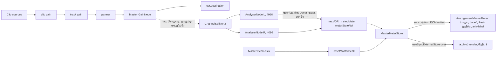

# Studio Lab — Master-ის ცოცხალი მეტრი, Peak hold და Master Peak/Clip ინდიკატორი

**თარიღი:** 2026-10-11
**სტატუსი:** Completed (A; C-ის შემოწმება მოლოდინშია — round 26)
**შეცვლილი პროექტი:** Store

## კონტექსტი

მომხმარებლის მოთხოვნა FB-14 (`docs/video-to-text-bugs/README.md`): „Master Volume, საერთო გათიშვა და საბოლოო დონის/გადატვირთვის კონტროლი“. Backlog-ში ეს არის SRW-13 (R13-M4). ეტაპ 1-მა (doc 031) დაამატა Master Volume, Master Mute და ექსპორტის გადატვირთვის გაფრთხილება. ეს დოკუმენტი აღწერს **ეტაპ 2a-ს (D-29q)**:

1. **Master-ის ცოცხალი მეტრი** header-ში: ჰორიზონტალური ზოლი −60…+6 dBFS შკალით, 0 dBFS ნიშნულით და peak-hold ხაზით.
2. **Master Peak ღილაკი:** აჩვენებს reset-ის შემდეგ გაზომილ მაქსიმალურ პიკს dBFS-ში. თუ სიგნალმა full scale გადააჭარბა, ღილაკი გადადის **Clip** მდგომარეობაში და იქ რჩება, სანამ მომხმარებელი არ დააჭერს.
3. **R26-X:** ექსპორტის დიალოგი Master-ის gain-ის შენიშვნას აღარ აჩვენებს, როცა Master დადუმებულია (ფაილი ისედაც სიჩუმეა).

**სცენარი:** მონტაჟორი `lay11`-ს 0 dB Master-ით უკრავს. 4–6 წამის მონაკვეთში მუსიკა, სტემები და SFX ერთად ჟღერს და მიქსი 0 dBFS-ს გადადის. მეტრის ზოლი წითელ ზონაში შედის, ხოლო `Master Peak` ღილაკი წითლდება და წერს `+5.0`-ს. ეკრანის მკითხველი კითხულობს: „Master Peak +5.0 dBFS — გადატვირთვა (Clip). გასასუფთავებლად დააჭირე“. მომხმარებელი Pause-ს აჭერს, Master-ს −6 dB-მდე წევს, აჭერს `Master Peak`-ს (`−∞`) და ხელახლა უკრავს. ახლა ღილაკი წერს `−1.0`-ს და წითელი აღარ არის. (რიცხვები მაგალითია; რეალურ მნიშვნელობებს C ზომავს.)

## მიდგომა

### Tap-ის პოზიცია: post-fader

მეტრი ზომავს **იმას, რაც ისმის**: სიგნალს Master-ის `GainNode`-ის შემდეგ. ამიტომ Master Volume და Master Mute მეტრზეც მოქმედებს (T12.20, „output stage“). Mute-ის შემდეგ დონე release-ის სიჩქარით ეცემა floor-მდე, ხოლო ახალი Clip აღარ ჩნდება.

### Fan-out და B-ის probe

`ApplyScheduleOptions`-ს დაემატა არასავალდებულო `tap`. როცა ის გადაეცემა, `applySchedule` უცვლელი `master.connect(ctx.destination)`-ის **გარდა** იძახებს `master.connect(tap)`-ს. როცა `tap` არ არის, wiring ზუსტად ძველია (`master`-ს ერთი output აქვს, destination).

B-ის probe-მა აჩვენა, რომ `ScheduleAudioContext`-ზე სავალდებულო `createAnalyser()` გაყინულ `graph.test.ts`-სა და `master.test.ts`-ში 28 tsc შეცდომას იძლევა. ამიტომ analyser-ს graph-ი არ ქმნის. Context-ი ქმნის მას და graph-ს ეძლევა როგორც ჩვეულებრივი node.

- `disconnect()` ახალ კოდს არ საჭიროებს: `master.disconnect()` tap-ის კავშირსაც ხსნის. ჩამოსული (retired) graph-ი, რომელიც ჯერ კიდევ ჩერდება, tap-ს კვებავს, სანამ არ გაითიშება. ეს სწორია, რადგან ის ჯერ კიდევ ისმის.
- `renderArrangementWav` tap-ს **არ** იღებს. ოფლაინ ექსპორტი უცვლელია.

### Analyser-ის guard და `fftSize`

- Tap არის `ChannelSplitterNode(2)` და მასზე მიერთებული ორი `AnalyserNode`, თითო არხზე. ისინი იქმნება ერთხელ თითო `AudioContext`-ზე (`ensureAudioContext`-ში, context-ის შექმნისას). ყველა graph, reschedule-ის ჩათვლით, ერთსა და იმავე tap-ს იყენებს.
- **რატომ splitter:** Web Audio-ს სპეციფიკაციით `AnalyserNode` შემავალ სიგნალს ანალიზამდე mono-ზე ამცირებს, 0.5·(L+R). ერთი analyser ერთ არხზე მოსულ over-ს (მაგ. L=0.3, R=1.2) ვერ დაინახავდა, ექსპორტი კი თითო არხს ცალ-ცალკე ამოწმებს. ამიტომ თითოეული არხი ცალკე იზომება, შემდეგ კი შედეგები ერთიანდება: პიკი max-ით, over OR-ით. ეს code-reviewer-ის High finding იყო.
- თუ `createAnalyser` ან `createChannelSplitter` ფუნქცია არ არის, ან რომელიმე exception-ს აგდებს, მეტრი **არააქტიურია**: exception არ ვრცელდება, დაკვრა უცვლელია და მეტრი floor-ზე რჩება. გაყინული ტესტების ყველა fake `AudioContext` სწორედ ამ გზას გადის.
- `fftSize = 4096` (`MASTER_METER_FFT_SIZE`), 48 kHz-ზე ≈ 85 ms. ამიტომ frame-ებს შორის 85 ms-მდე პაუზაზე არცერთი sample არ იკარგება.
- იკითხება მხოლოდ `getFloatTimeDomainData`. Byte ვარიანტი ±1-ზე ჭრის და ყველა over-ს დამალავდა.
- Unmount-ზე analyser-ის ref და ბუფერი იშლება, context-ი კი იხურება.

### ძველი ბუფერისგან დაცვა

Analyser-ის ბუფერი ბოლო 4096 sample-ია. Play-ის ან reset-ის დროს ამ ბუფერში შეიძლება ჯერ კიდევ ძველი აუდიო იყოს (მაგალითად, Pause-მდე გადატვირთული მონაკვეთი). Context-ი იმახსოვრებს „ახალი მონაცემების“ დაწყების დროს: Play-ზე ეს არის graph-ის `startAt`, reset-ზე `ctx.currentTime`. თითო frame-ში იზომება მხოლოდ ბუფერის ბოლო `(currentTime − freshFrom) × sampleRate` sample. ამით reset-ის შემდეგ ძველი Clip თავიდან არ ინთება.

### მეტრის მათემატიკა (`meter.ts`)

- **Over-ის პრედიკატი:** `x > MAX_24BIT_SAMPLE || x < −1`. ეს ზუსტად ის პრედიკატია, რომელსაც ექსპორტი `measureExportOverload`-ში იყენებს. `MAX_24BIT_SAMPLE` და `isOverFullScale` ახლა `meter.ts`-შია, ხოლო `graph.client.ts` მათ იქიდან იღებს (დუბლირებული literal აღარ არის). ამიტომ ცოცხალი ინდიკატორი და ექსპორტის დათვლა ერთ წესს ემყარება.
- **დონე:** block-ის პიკზე მყისიერად ადის. ქვემოთ ეცემა **20 dB/s**-ით (`METER_RELEASE_DB_PER_SECOND`), ამიტომ 0 dBFS-დან floor-მდე ≈ 3 წამია.
- **Peak hold:** უმაღლეს დონეს **1.5 s** ინახავს (`METER_PEAK_HOLD_MS`), შემდეგ დონეს მიჰყვება. ახალი, უფრო მაღალი დონე hold-ის ახალ პერიოდს იწყებს.
- **Max peak reset-ის შემდეგ:** მონოტონურია, სანამ reset არ მოხდება.
- **Over latch:** ირთვება ნებისმიერ block-ზე, რომელშიც over sample არის. მას მხოლოდ `resetMasterPeak()` თიშავს; ჩუმი block-ი არასდროს.
- **Floor:** −60 dBFS (`METER_FLOOR_DB`). ამ მნიშვნელობაზე ან ქვემოთ ყველაფერი floor-ად ჩანს (`-inf`).
- **Peak-ის ტექსტი (`formatPeakDbfs`):** ერთი ათწილადი, half up. Over-ზე ყოველთვის `+`-ით იწყება და მინიმუმ `+0.0`-ია (როგორც ექსპორტის გაფრთხილების `P`). Over-ის გარეშე `+` არასდროს ჩანს: უარყოფითი რიცხვი U+2212-ით (`−1.0`), ნულამდე დამრგვალებული `0.0`, სიჩუმე ან floor `−∞`.
- **Data ატრიბუტები:** `data-level-db` / `data-hold-db` — ერთი ათწილადი ASCII ნიშნით, ან `-inf`. ეს C-ის oracle-ია და კონტრაქტის ნაწილია.

### Stop, reset და history

- **Stop (`stopPlayback`):** იწერება ერთი floor frame (დონე და hold floor-ზე, ზოლი ცარიელია). Max peak და latch რჩება.
- **`resetMasterPeak()`** max peak-სა და latch-ს ასუფთავებს და frame-ს აქვეყნებს. ეს **არ არის** arrangement-ის ედიტი: არ იცვლება `Arrangement`, არ ჩნდება history entry, status ტექსტი არ იწერება და `scheduleKey` უცვლელია. Reset-ი დაკვრის დროსაც მუშაობს და გაზომვა `−∞`-დან თავიდან იწყება.

### 0-render მექანიზმი

- მეტრის მდგომარეობა ცხოვრობს ref-ში (`meterStateRef`) და ქვეყნდება subscribe/get store-ით (`createMasterMeterStore`). Store კომპონენტებს ცალკე context-ით მიეწოდება (`ArrangementMeterContext`, `useMasterMeterStore`), `ArrangementPositionContext`-ის მსგავსად. მთავარი context-ის value-ს მხოლოდ სტაბილური `resetMasterPeak` დაემატა.
- Sampling ხდება არსებულ `tick`-ში, თითო frame-ზე ერთხელ, scrubbing-ის early return-მდე: analyser-ის წაკითხვა → `stepMeter` → publish. `setState` per frame არ არის.
- `ArrangementMaster`-ის შიგნით ცალკე, ჩვეულებრივი სახელიანი კომპონენტი `ArrangementMasterMeter` (forwardRef/memo-ს გარეშე, რომ render-ის მთვლელმა დაინახოს) DOM-ში პირდაპირ წერს store-ის subscription-იდან (`useMasterMeterWriter`, layout effect): ზოლის cover-ის `scaleX`, hold-ის `translateX`, `data-*`, Peak-ის ტექსტი და `aria-label`.
- React-ის render-ს მხოლოდ latch-ის boolean იწვევს (`useSyncExternalStore` + `getMeterOver`). ამიტომ latch-ის თითო გადასვლაზე ხდება მაქსიმუმ ერთი render (კლასი და `data-state`), frame-ებზე კი 0.

### UI

- Tab-ის რიგი Master ჯგუფში: `Master Mute` → `Master Volume` → `Master Peak`.
- ზოლი (`aria-hidden`, 80×6 px): სტატიკური ზონები (positive −60…−6, warning −6…0, destructive 0…+6; ფარდობა 9:1:1), რომლებსაც მოძრავი `bg-outline` cover ფარავს. 0 dBFS-ის ნიშნული `border-foreground/70`-ია.
- `Master Peak` ღილაკი: `tabular-nums`, ფიქსირებული სიგანე (`w-14`). Clear მდგომარეობა არის `border-outline text-muted`, over მდგომარეობა `border-destructive bg-destructive/15 text-destructive`. Accent-ი უკვე Master Mute-ის „ჩართულ“ მდგომარეობას ნიშნავს, ამიტომ Clip-ისთვის destructive ავირჩიეთ. ფერს გარდა over-ს აჩვენებს `+` ნიშანი და accessible name-ის „გადატვირთვა (Clip)“.
- Space ღილაკზე, ისევე როგორც track-ის `M`-ზე, დაკვრას რთავს და აჩერებს (გლობალური handler). Enter/click კი reset-ია.
- Header-ის სიმაღლე უცვლელია: ახალი ელემენტები 20 px-ზე დაბალია. ჯგუფი მხოლოდ სიგანეში იზრდება (≈ 8 + 80 + 8 + 56 px).

### R26-X

ექსპორტის დიალოგში `Master: … — ექსპორტში შედის.` ჩანს მხოლოდ მაშინ, როცა `gainDb !== 0` **და** Master დადუმებული არ არის. დადუმებულ Master-ზე მხოლოდ mute-ის შენიშვნა ჩანს.

### Design-philosopher-ის რჩევა

ზონებიანი ზოლი, ერთი transform per frame, destructive Clip-ისთვის, ანიმაციისა და transition-ის გარეშე. ხილული „Clip“ წარწერა და ტექსტის 10 Hz throttle არ მივიღეთ: ღილაკის ტექსტი კონტრაქტით `formatPeakDbfs`-ის შედეგია, ხოლო max peak მონოტონურია.

## არქიტექტურა

## შეცვლილი ფაილები

- `app/lib/arrangement/meter.ts` (ახალი): over-ის საერთო პრედიკატი, `measureBlock`, `stepMeter`, floor/reset, ფორმატერები, `meterDbToFraction` და meter store.
- `app/lib/arrangement/graph.client.ts`: არასავალდებულო `tap` და fan-out connect. საერთო პრედიკატი და `MAX_24BIT_SAMPLE` ახლა `meter.ts`-დან მოდის.
- `app/contexts/ArrangementContext.tsx`: analyser (guard, `fftSize`), sampling `tick`-ში, floor frame stop-ზე, `resetMasterPeak`, ძველი ბუფერისგან დაცვა, `ArrangementMeterContext`, `useMasterMeterStore` და `useMasterMeterWriter`.
- `app/components/arrangement/ArrangementMaster.tsx`: `ArrangementMasterMeter` (ზოლი და `Master Peak` ღილაკი).
- `app/components/arrangement/ArrangementExportDialog.tsx`: R26-X-ის ერთი პირობა.
- `app/lib/arrangement/__tests__/meter.test.ts` (ახალი) და `app/lib/arrangement/__tests__/meter-ui.test.tsx` (ახალი).

## პრობლემები და გადაწყვეტები

- **პრობლემა:** სავალდებულო `createAnalyser` გაყინულ ტესტებს ტეხს (28 tsc შეცდომა). **გადაწყვეტა:** analyser-ს context-ი ქმნის guard-ით და graph-ს არასავალდებულო `tap`-ად აწვდის.
- **პრობლემა:** DOM-ში პირდაპირ ჩაწერილ ტექსტსა და ატრიბუტებს React-ის re-render-ი გადაწერდა. **გადაწყვეტა:** render-იც store-ის მიმდინარე snapshot-იდან კითხულობს. React ატრიბუტს მხოლოდ მაშინ ეხება, როცა prop შეიცვალა, ხოლო ღილაკის ერთადერთი string child `textContent` prop-ად იმართება. ამიტომ ორივე გზა ერთსა და იმავე მნიშვნელობას წერს.
- **პრობლემა:** Analyser-ის ბუფერში შეიძლება Pause-მდე დარჩენილი over sample იყოს, ამიტომ reset → Play ცრუ Clip-ს აანთებდა. **გადაწყვეტა:** `meterFreshFromRef` იზომება მხოლოდ Play-ის `startAt`-ის ან reset-ის შემდეგ მოსული sample-ები. ამას ცალკე ტესტი ამოწმებს.
- **პრობლემა:** `AnalyserNode` mono-ზე ამცირებს სიგნალს, ამიტომ ერთ არხზე მოსული over ვერ დაინახებოდა (code-reviewer, High). **გადაწყვეტა:** splitter და თითო analyser თითო არხზე.
- **ცნობილი შეზღუდვა:** sampling rAF-ზეა მიბმული. თუ frame-ებს შორის პაუზა 85 ms-ს აღემატება (დამალული tab, main-thread stall), ამ შუალედის sample-ები არ იზომება. დამალულ tab-ზე მეტრი უბრალოდ ჩერდება, როგორც დავალება მოითხოვს. სრულად უწყვეტი Clip-ისთვის საჭირო იქნება AudioWorklet (შემდეგი ეტაპი, თუ პროდუქტის მოთხოვნა გახდება).
- **პრობლემა:** render-ის მთვლელი კომპონენტს `type.name`-ით ცნობს, ხოლო forwardRef/memo wrapper-ს სახელი არ აქვს. **გადაწყვეტა:** შიდა კომპონენტი ჩვეულებრივი სახელიანი ფუნქციაა.

## ტესტირება

- **Red-first:** store-ში `meter-ui.test.tsx` 10/10 ჩავარდა, ხოლო `meter.test.ts` ვერ ჩაიტვირთა (`../meter` არ არსებობდა). Scratch ასლში (`tmp/studio-real-loop/a-round-26/scratch/`, snapshot წყაროები და stub `meter.ts` არასწორი ტანით) ჩავარდა 24/25. ერთადერთი მწვანე იყო „ოფლაინ master მხოლოდ destination-ს უკავშირდება“, რომელიც შენახვის (regression guard) ტესტია.
- **Green:** 27/27 ახალი ტესტი (`meter.test.ts` 15, `meter-ui.test.tsx` 12). Review-ის შემდეგ დაემატა სამი შემოწმება: მხოლოდ მარჯვენა არხზე მოსული over (Clip ანთებს), reschedule-ის შემდეგ იგივე tap, და reset-ის ზღვარი გაჩერებული fake clock-ით. Scratch ასლში ორივე mutation, mono და „reset-ზე freshFrom არ განახლდება“, ტესტს აგდებს.
  - სუფთა მათემატიკა: პრედიკატი და მისი გამოყენება `measureExportOverload`-ში, `measureBlock`, release, 1.5 s hold, მონოტონური max, latch და reset, floor, ფორმატერები, store.
  - Graph: `[destination, tap]` და `[destination]`; tap-ს მხოლოდ master კვებავს; ოფლაინ ექსპორტს tap არ აქვს.
  - Context და UI: −12 dBFS → `-12.0` / `−12.0` / clear; 1.5 → `+3.5` / over, რომელიც ჩუმ frame-ებსა და Pause/Play-ს უძლებს; click → `−∞`, history-ის გარეშე; ძველი ბუფერი reset-ის შემდეგ Clip-ს არ ანთებს; Pause → `-inf`; 0 render per frame და 1 latch-ზე; analyser-ის გარეშე დაკვრა მუშაობს; Tab-ის რიგი; R26-X.
- გაყინული ექვსი ტესტის ფაილი (render-budget, master-ui, master, graph, ArrangementContext, export-dialog-focus) უცვლელად მწვანეა (101/101). სრული vitest: 1072/1072. tsc 0, build OK, Biome 0 შეცდომა.
- ბრაუზერში ცოცხალ გაზომვებს (tap-თან შედარება, `lay11`, გეომეტრია, ქსელის პოლიტიკა) ამოწმებს C (round 26).

## TODO / შემდეგი ნაბიჯები

- **SRW-13 ეტაპი 2b:** track-ების მეტრები lane header-ებში. გამოიყენებს იმავე `meter.ts`-ს, თითო track-ზე ექნება tap gain-ის შემდეგ, დასჭირდება lane-ის გეომეტრიის კონტრაქტი და render per frame არ უნდა ჰქონდეს.
- **ეტაპი 3:** FB-04 clip gain (R13-M1).
- **ეტაპი 4:** FB-05 pan (R13-M2), ყველა fader-ის click UX და round-9-ის context-ის M1/L8.
- RMS/LUFS მეტრი (T12) ამ ეტაპში არ შედის. Limiter ან compressor პროექტის ფარგლებს გარეთაა; ექსპორტის clamp რჩება clamp-ად.
