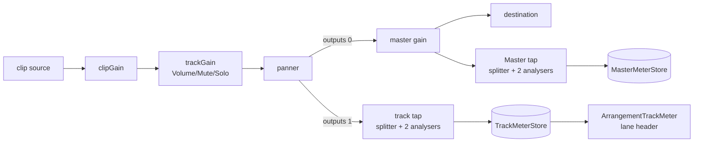

# Studio Lab — თითო ხაზის ცოცხალი მეტრი და over-ის გაფრთხილება lane header-ში

**თარიღი:** 2026-10-11
**სტატუსი:** Completed (A; C-ის შემოწმება მოლოდინშია — round 27)
**შეცვლილი პროექტი:** Store

## კონტექსტი

SRW-13 („per-track and master level meters with clip indicator“) ეტაპობრივად კეთდება. ეტაპ 2a-მ (doc 032) Master-ის მეტრი და `Master Peak`/Clip დაამატა. ეს დოკუმენტი აღწერს **ეტაპ 2b-ს (D-29r)**: ცოცხალ მეტრს **თითო ხაზზე**, lane header-ში, და თითო ხაზის over-ის (0 dBFS-ზე მეტის) latch-ს.

წყარო: `next-stage-t12/gain-volume-source.txt`:
- **T12.20** — ხაზის realtime მეტრი Track Volume-ის output stage-ზე, Peak Level-ით და clipping-ის ჩვენებით;
- **T12.22** — ხაზზე 0 dBFS-ის გადაჭარბება **გაფრთხილებაა** და არა დესტრუქციული clipping. ნამდვილი პრობლემა Main Output-ის clipping-ია;
- **T12.23** — ინდიკატორი რჩება, სანამ მომხმარებელი არ გაასუფთავებს.

RMS/LUFS ამ ეტაპში არ შედის. მეტრი მხოლოდ **ზომავს** და სიგნალს არ ცვლის.

**სცენარი:** მონტაჟორი SFX ხაზზე `Soft impact`-ს დებს და უკრავს. SFX-ის მეტრის ბოლოში ჩნდება ნარინჯისფერი (warning) კვადრატი, ხოლო `title` წერს: „SFX · Peak +0.0 dBFS — 0 dBFS-ს გადააჭარბა. გასასუფთავებლად დააჭირე Master Peak-ს“. ეკრანის მკითხველი კითხულობს „SFX: დონემ 0 dBFS-ს გადააჭარბა“. მუსიკის მეტრი თავის დონეს აჩვენებს და `clear` რჩება. მომხმარებელი Master-ს −6 dB-მდე წევს: Master აღარ ინთება, მაგრამ SFX-ის მეტრი ისევ over-ია, რადგან ის Master-მდე ზომავს. ერთი დაჭერა `Master Peak`-ზე ორივეს ასუფთავებს.

## მიდგომა

### Tap-ის პოზიცია: post-panner

თითო ხაზის tap იერთდება ხაზის **panner-ის შემდეგ**, ანუ იმ წერტილში, საიდანაც ხაზი Master-ში შედის. ეს არის T12.20-ის „Track Volume output stage“: მასში შედის ხაზის Volume, Mute და Solo gain. ეტაპ 4-ში აქ Pan-იც შევა. `trackGain`-ის შემდეგ tap განზრახ **არ** არის: Pan-ის დამატების შემდეგ ის ჩუმად არასწორი გახდებოდა.

### Fan-out-ის რიგი

`ApplyScheduleOptions`-ს დაემატა არასავალდებულო `trackTaps: ReadonlyMap<string, ScheduleAudioNode>`.
- თითო ხაზისთვის, რომელსაც tap აქვს, `applySchedule` ჯერ იძახებს უცვლელ `panner.connect(master)`-ს და **მის შემდეგ** `panner.connect(tap)`-ს. ამიტომ `panner.outputs` არის `[master, tap]` და `outputs[0]` ისევ master-ია (გაყინული `graph.test.ts` ამ ჯაჭვს `outputs[0]`-ით მიჰყვება).
- ხაზი tap-ის გარეშე და მთელი გამოძახება `trackTaps`-ის გარეშე ზუსტად ძველებურად ირთვება.
- `disconnect()` ახალ კოდს არ საჭიროებს: `panner.disconnect()` tap-ის კავშირსაც ხსნის.
- `renderArrangementWav` `trackTaps`-ს **არ** გადასცემს. ოფლაინ ექსპორტი უცვლელია.

### Guard და ღირებულება

- თითო ხაზის tap აგებულია ისევე, როგორც Master-ის: `ChannelSplitterNode(2)` და თითო არხზე ერთი `AnalyserNode`, `fftSize` 4096, მხოლოდ `getFloatTimeDomainData`.
- Tap იქმნება რეალურ `AudioContext`-ზე, **Master-ის tap-ის შემდეგ**, ერთხელ თითო ხაზზე. ის იქმნება `startGraph`-ში იმ ხაზისთვის, რომელსაც tap ჯერ არ აქვს, და შემდეგ ყველა graph, reschedule-ის ჩათვლით, იმავე tap-ს იყენებს.
- თუ Master-ის tap არ არსებობს (`createAnalyser`/`createChannelSplitter` აკლია ან exception იყო), ხაზის tap-ებიც არ იქმნება: `trackTaps` არის `undefined`, დაკვრა უცვლელია და მეტრები floor-ზე რჩება.
- **ღირებულება:** frame-ზე 5 სტერეო tap-ის წაკითხვა, ანუ 5 × 2 × 4096 float (Master და 4 ხაზი). წაკითხვის ბუფერი ერთხელ იქმნება თითო analyser-ზე, tap-ის შექმნისას. frame-ზე ახალი ბუფერი არ იქმნება.
- Unmount-ზე ხაზის tap-ების map იშლება იმავე ადგილას, სადაც Master-ის tap, და context-ი იხურება.

### თითო ხაზის state და store

- `meter.ts`-ს დაემატა `createTrackMeterStore()`. მას აქვს `getTrackMeterFrame(trackId)`, `getTrackMeterOver(trackId)`, `publishTrackMeterFrames(frames)` (ყველა ხაზი, **ერთი** შეტყობინება frame-ზე) და `subscribeTrackMeters`.
- ყოველ ხაზს **საკუთარი** state ობიექტი აქვს. ის `stepMeter`-ით იგივე წესებით ბიჯდება, როგორც Master. ამიტომ ერთი ხაზის latch მეორეზე არ გადადის.
- უცნობი ხაზის id აბრუნებს floor frame-ს და exception-ს არ აგდებს.
- სუფთა helper-ები: `floorTrackMeterFrames` (ყველა ხაზის დონე და hold floor-ზე, max და latch რჩება) და `resetTrackMeterPeaks` (ყველა ხაზის max და latch იშლება).
- Round 26-ის exports (`createMasterMeterState`, `stepMeter`, `formatPeakDbfs`, `isOverFullScale` …) არ შეცვლილა.
- Sampling ხდება არსებულ `tick`-ში, `sampleMasterMeter`-ის გვერდით. თითო ხაზზე ორივე არხი ერთიანდება max/OR-ით, მხოლოდ ახალი sample-ებით (იგივე `meterFreshFromRef` guard, რაც Master-ს აქვს). frame-ზე `setState` არ ხდება.

### Warning და არა destructive

Over-ის predicate საერთოა Master-თან და ექსპორტთან: `isOverFullScale` (sample > `MAX_24BIT_SAMPLE` ან < −1). განსხვავება მხოლოდ ჩვენებაშია:
- ხაზის over იყენებს **warning** token-ს (`bg-warning`), რადგან ის გაფრთხილებაა (T12.22). Master-ის Clip `destructive` რჩება.
- Over-ის ნიშანი **მხოლოდ ფერი არ არის**. შკალის ბოლოს, 2 px-იანი ღრიჭოს მიღმა, ჩნდება 4 px-იანი კვადრატი (`data-testid="arrangement-track-meter-over"`). ის მხოლოდ over-ის დროს არსებობს.
- ზოლი `aria-hidden`-ია. მის გვერდით, მხოლოდ over-ის დროს, იხატება `sr-only` ტექსტი „{ხაზის სახელი}: დონემ 0 dBFS-ს გადააჭარბა“. `aria-live` განზრახ არ არის, რომ რამდენიმე ხაზმა ერთდროულად არ დატვირთოს ეკრანის მკითხველი.
- `title` (hover): `clear`-ზე „{სახელი} · Peak {peak} dBFS“, `over`-ზე დამატებით „— 0 dBFS-ს გადააჭარბა. გასასუფთავებლად დააჭირე Master Peak-ს“. ის მხოლოდ ტექსტის შეცვლისას გადაიწერება.

### ერთი reset წერტილი

`resetMasterPeak()` (არსებული სახელი, რომელსაც გაყინული `ArrangementMaster.tsx` იძახებს) ახლა ასუფთავებს Master-ის latch-ს **და** ყველა ხაზის max-სა და latch-ს. ხაზზე ცალკე reset ღილაკი არ არის, ამიტომ Tab-ის რიგში ახალი გაჩერება არ ჩნდება და lane header-ის კლავიატურით ნავიგაცია უცვლელია. `Master Peak`-ის label არ შეცვლილა: ის უკვე წერს „გასასუფთავებლად დააჭირე“. ხაზის `title` კი პირდაპირ ამბობს, რომ ხაზი `Master Peak`-ით სუფთავდება.

Reset **არ** არის arrangement-ის რედაქტირება: არც `Arrangement` ველი, არც history-ის ჩანაწერი, არც სტატუსის ტექსტი და `scheduleKey` უცვლელია.

### გეომეტრია

`ArrangementTrackMeter` იხატება არსებული `arrangement-track-header`-ის **შიგნით**, ყველა სიმაღლეზე (folded 36, tight 53, regular 61, full 81). ის **absolute**-ია (`absolute inset-x-2 bottom-px h-1`) და header-ის ქვედა 6 px-იან padding ზოლში (`pb-1.5`) დგას. Header sticky-ა, ანუ უკვე positioned, ამიტომ header-ის კლასი არ შეცვლილა. მეტრი flex-ის ახალი მწკრივი არ არის, header-ის inline style-ს არ ცვლის და არცერთი control-ის rect-ს არ ეხება.

- შკალა: −60…+6 dBFS, ზონები Master-ის იგივეა (`positive`/`warning`/`destructive`, 9/1/1).
- 0 dBFS ნიშნული: `border-foreground/50`. Master-ზე ის `/70`-ია; 4 px სიმაღლეზე `/50` თეთრ hold ხაზს ნიშნულისგან არჩევს (design-philosopher).
- Hold ხაზი +6 dBFS-ზეც **სრულად** ჩანს: მისი wrapper ზოლზე 2 px-ით (`right-0.5`) ვიწროა, ამიტომ `translateX(100%)`-ზე ხაზი ზუსტად ბოლო 2 px-ს ფარავს. Master-ის 1 px-იანი შემთხვევა აქ არ მეორდება.

### 0-render მექანიზმი

- Frame იწერება store-იდან, React render-ის გარეშე: `data-level-db`, `data-hold-db`, cover-ის `scaleX` და hold-ის `translateX`. როცა დონე და hold ზუსტად იგივეა (მაგ. ჩუმი ხაზი floor-ზე), DOM-ში არაფერი იწერება (code-review L4).
- `data-peak`, `data-state` და `title` იწერება მხოლოდ მაშინ, როცა peak-ის ტექსტი ან over იცვლება.
- React render-ს იწვევს მხოლოდ over-ის boolean (`useSyncExternalStore` თითო ხაზზე). ამიტომ ხაზის latch ან reset მხოლოდ **იმ ხაზის** მეტრს არენდერებს ერთხელ. `ArrangementLane` frame-ზე 0-ჯერ რენდერდება.
- `data-state`-ს ორივე წერს: writer frame-ზე და React latch-ის render-ზე. ორივე ერთსა და იმავე გამოქვეყნებულ frame-ს კითხულობს, ამიტომ ერთმანეთს არ ეწინააღმდეგება. SSR-ში React-ის მნიშვნელობა (`clear`) იხატება (code-review L1).
- Store ცალკე context-ით მიეწოდება (`ArrangementTrackMeterContext`, `useTrackMeterStore`, `useTrackMeterWriter`) და მთავარ context value-ში არ შედის.

### Master Mute-ის ურთიერთქმედება

ხაზის მეტრები Master-ის **წინ** ზომავს. Master Mute-ისას Master-ის მეტრი floor-ზე ეცემა, ხაზის მეტრები კი მოძრაობას აგრძელებს. ეს სწორია და T12.20/T12.22-ს შეესაბამება. ასევე Master −6 dB-ზე ხაზი შეიძლება over იყოს, ხოლო Master `clear`. ხაზის Mute ან Solo მის მეტრს floor-ზე აგდებს release-ის სიჩქარით. ახალი latch არ ჩნდება, არსებული კი რჩება.

### მემკვიდრეობით მიღებული შეზღუდვა (R26-M1)

Sampling მხოლოდ `requestAnimationFrame`-ზეა, ისევე როგორც Master-ზე. ~85 ms-ზე დიდი stall-ის ან დამალული tab-ის დროს over შეიძლება გამოგრჩეს, დამალულ tab-ში კი მეტრები უბრალოდ ჩერდება. Gap-free გზა (AudioWorklet) module URL-ს საჭიროებს, `public/**` კი აკრძალულია. ეს hardening-ია ეტაპ 4-ის შემდეგ.

### ცნობილი ხარვეზი (code-review L3)

წაშლილი ხაზის tap და state ამოღებული არ ხდება: tap unmount-მდე რჩება და იკითხება. დღეს ხაზების რაოდენობა ფიქსირებულია, ამიტომ ეს უვნებელია. ამოღება დაიგეგმება მაშინ, როცა ხაზების დამატება/წაშლა გამოჩნდება.

## არქიტექტურა

## შეცვლილი ფაილები

- `app/lib/arrangement/meter.ts` — `TrackMeterStore`, `createTrackMeterStore`, `floorTrackMeterFrames`, `resetTrackMeterPeaks` (მხოლოდ დამატება)
- `app/lib/arrangement/graph.client.ts` — `trackTaps` და post-panner fan-out
- `app/contexts/ArrangementContext.tsx` — ხაზის tap-ები, sampling, floor, საერთო reset, release, ცალკე context და hook-ები
- `app/components/arrangement/ArrangementTrackMeter.tsx` — ახალი კომპონენტი
- `app/components/arrangement/ArrangementLane.tsx` — import და ერთი ელემენტი header-ში
- `app/lib/arrangement/__tests__/meter-ui.test.tsx` — ხუთი რაოდენობის ხაზი (ქვემოთ)
- `app/lib/arrangement/__tests__/track-meter.test.ts`, `track-meter-ui.test.tsx` — ახალი ტესტები

## პრობლემები და გადაწყვეტები

- **პრობლემა:** `meter-ui.test.tsx` ზუსტად 1 splitter-სა და 2 analyser-ს ამოწმებდა. ხაზის tap-ები იმავე `AudioContext`-ზე იქმნება, ამიტომ ეს ხუთი ხაზი ტყდება.
  **გადაწყვეტა:** B-ის ვიწრო amendment. მხოლოდ ხუთი `toHaveLength` გახდა ზუსტი ფორმულა: splitter-ები `1 + meterArrangement().tracks.length`, analyser-ები `2 + 2 * meterArrangement().tracks.length`. Master tap ყოველთვის პირველი იქმნება, ამიტომ Master-ის ყველა assertion (`splitters[0]`, `analysers[0..1]`, `tap`) სიტყვასიტყვით უცვლელია.
- **პრობლემა:** design-philosopher-მა `pointer-events-none` შემოგვთავაზა.
  **გადაწყვეტა:** უარყოფილია, რადგან hover `title`-ს გათიშავდა. ასევე გამოყენებულია ამოცანის sr-only ფორმულირება და არა agent-ის ვარიანტი.
- **პრობლემა:** code-reviewer L2 — reset-ის render ბიუჯეტი ტესტით არ მოწმდებოდა.
  **გადაწყვეტა:** render-ის ტესტს დაემატა `Master Peak`-ის დაჭერა: ზუსტად 1 `ArrangementTrackMeter` render და 0 `ArrangementLane`.

## ტესტირება

- ახალი `it` ბლოკი 24: `track-meter.test.ts` 13 (store, graph-ის tap-ები, ოფლაინ ექსპორტი tap-ის გარეშე) და `track-meter-ui.test.tsx` 11 (tap-ების რაოდენობა და ხელახალი გამოყენება, დამოუკიდებელი დონეები, latch, საერთო reset, Pause-ის floor, folded/Tab, render ბიუჯეტი, analyser-ის გარეშე, unmount-ის unsubscribe).
- Red-first: შეუცვლელ კოდზე 22 ტესტი ჩავარდა, scratch ასლი საჭირო არ გახდა. 4 მწვანე იყო regression guard.
- Scratch ასლში (`store/`-ის გარეთ) 6 მუტაცია (a–f), თითოეულმა ტესტი ჩააგდო.
- სრული vitest 1096/1096, tsc 0, build OK, Biome 0 error (218 warning და 1 info, round 26-ის ტოლი).
- Browser smoke `/studio-lab`-ზე (gstack browse; PASS-ის მტკიცება არ არის): მეტრები მოძრაობს, folded SFX-ის მეტრი მოძრაობს, header 35 px, მწკრივები 81×4 (1440), `Master Peak` ხაზის latch-ს ასუფთავებს, console-ში ახალი შეცდომა არ არის.

## TODO / შემდეგი ნაბიჯები

- **ეტაპი 3:** FB-04 clip gain (R13-M1). ხაზის მეტრი მას აჩვენებს.
- **ეტაპი 4:** FB-05 pan (R13-M2), fader-click UX ყველა fader-ზე, round-9 context-ის M1/L8 და Master hold ხაზი ≥ +6 dBFS-ზე.
- R26-M1 hardening (AudioWorklet) ეტაპ 4-ის შემდეგ.
- წაშლილი ხაზის tap-ის ამოღება (L3), როცა ხაზების რაოდენობა დინამიკური გახდება.
- R27-T (Tech Lead): რეალურ Chrome-ში მეტრები ყველა სიმაღლეზე იკითხება და ხაზის over Master Clip-ისგან განსხვავდება.
