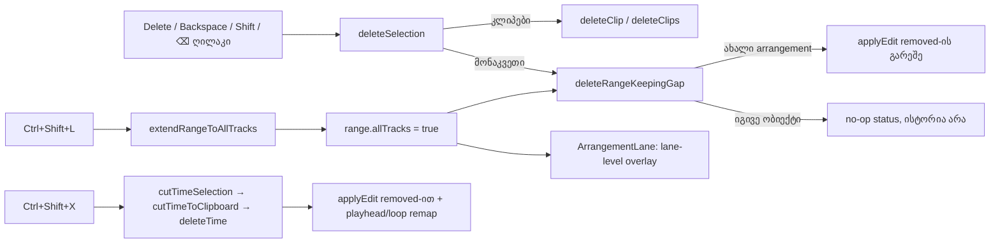

# Studio Lab — Delete ყოველთვის ტოვებს სიცარიელეს, Ctrl+Shift+L მონიშვნას ყველა ხაზზე ავრცელებს, Ctrl+Shift+X ერთადერთი დროის ამოჭრაა

**თარიღი:** 2026-10-12
**სტატუსი:** Completed (A; C-ის შემოწმება მოლოდინშია — round 28, SRW-24, D-29s; round 29, D-29t)
**შეცვლილი პროექტი:** Store

## კონტექსტი

მომხმარებლის მოთხოვნა **2026-10-11** (`docs/technical/studio-real-workspace/delete-selection-update.md`, პუნქტები 6 და 7) ცვლის ძველ შეთანხმებას „Delete მონაკვეთზე = დროის წაშლა, სიცარიელე იხურება ყველა ხაზზე“. ეს ძველი პირობა იყო R1-B5-ში, R1-B12-ში და R9-C5-ის პირველ პუნქტში. კოდში ის ასე ჩანდა:
- `deleteSelection` მონაკვეთზე იძახებდა `deleteTime`-ს და playhead-ს remap-ს უკეთებდა;
- transport-ის `⌫ წაშლა` ღილაკი და footer წერდა „დროის წაშლა — სიცარიელე დაიხურება ყველა ხაზზე“.

**ახალი კონტრაქტი:**

| მოქმედება | შედეგი |
|---|---|
| Delete ან Backspace ნებისმიერ მონიშვნაზე (მონაკვეთი, ერთი კლიპი, რამდენიმე კლიპი) | იშლება მხოლოდ მონიშნული მასალა. დრო არ იკუმშება, შემდეგი კლიპები არ ინაცვლებს და ნაწილები არ ერთდება |
| Ctrl+Shift+L | არსებული მონაკვეთი ვრცელდება ყველა ხაზზე (აუდიოც და ვიდეოც). start/end იგივე რჩება. მთლიანი პროექტი არ მოინიშნება |
| Delete/Backspace Ctrl+Shift+L-ის შემდეგ | იგივე მონაკვეთი იშლება ყველა ხაზზე. სიცარიელე რჩება, შემდეგი კლიპების start უცვლელია |
| Ctrl+Shift+X | **ერთადერთი** მოქმედება, რომელიც დროს ამოჭრის და სიცარიელეს ხურავს (Cut Time = `deleteTime`) |

ამას გარდა: Shift+Delete, Shift+Backspace და transport-ის `⌫ წაშლა` ღილაკიც სიცარიელეს ტოვებს. ტექსტურ ან რიცხვით ველში Delete/Backspace თაიმლაინს არ ეხება. მონიშვნის გარეშე Delete და Ctrl+Shift+L არაფერს შლის და არაფერს მონიშნავს.

**სცენარი:** მონტაჟორს მუსიკის კლიპი 0–10 წამზე უდევს. 3–5 წამს მონიშნავს და Delete-ს აჭერს. რჩება ორი ნაწილი, 0–3 და 5–10. მეორე ნაწილი წყაროს იმავე ადგილიდან უკრავს, საიდანაც ადრე. 12 წამზე მდგომი კლიპი ადგილზე რჩება. შემდეგ მონაკვეთს Ctrl+Shift+L-ით ყველა ხაზზე ავრცელებს და ყველა ხაზზე ჩნდება ერთი ვერტიკალური ზოლი. Delete ყველა ხაზზე 3–5-ს ასუფთავებს. თუ დროის ამოჭრა სურს, Ctrl+Shift+X-ს აჭერს და ყველაფერი 2 წამით მარცხნივ იწევს.

## მიდგომა

### Flag: `TimeRange.allTracks?: true`

`TimeRange`-ს დაემატა ერთი არასავალდებულო ველი, `allTracks?: true`. სხვა ტიპი და `Arrangement`-ის ველი არ შეცვლილა, `scheduleKey` იგივეა.
- `trackId` ისევ სავალდებულოა. ის აღნიშნავს ხაზს, სადაც მონაკვეთი დაიხატა (origin lane).
- ამის წყალობით Detail panel, ერთხაზიანი Copy/Cut/Split და `range.trackId`-ის სხვა მომხმარებლები უცვლელად მუშაობს.
- ჭდე overlay-ზე მხოლოდ origin lane-ზე იხატება.

### სუფთა ფუნქციები (`clipboard.ts`)

- `cutRangeFromArrangement` და `copyRangeToClipboard` flag-ს ითვალისწინებს. `allTracks`-ით ორივე ყველა ხაზის კლიპს ამუშავებს `[a, b)` ფანჯარაში. flag-ის გარეშე ქცევა **ზუსტად** ძველია (გაყინული `clipboard.test.ts` ამას ამოწმებს).
- ახალი `deleteRangeKeepingGap(arrangement, range)` არის Delete-ის ერთადერთი შესასვლელი. ის `cutRangeFromArrangement`-ის შედეგს აბრუნებს clipboard-ის გარეშე.
  - როცა ფანჯარაში მასალა არ არის, ის **იმავე ობიექტს** აბრუნებს. ამით context ცარიელ წაშლას ისტორიის ჩანაწერის გარეშე უარყოფს.
  - ნულოვანი სიგრძის ფანჯარაზეც (`|end − start| < CLIPBOARD_MIN_PART_SECONDS`) იმავე ობიექტს აბრუნებს. ასე Delete ფარულ Split-ად არ იქცევა (code-reviewer-ის მიგნება).
- id-ის და offset-ის წესები ძველია:
  - მარცხენა ნაწილი id-ს ინარჩუნებს, მარჯვენა ახალ id-ს იღებს;
  - მარჯვენა ნაწილის `sourceOffset` = ძველი + (b − clip.start);
  - `CLIPBOARD_MIN_PART_SECONDS`-ზე მოკლე ნაწილი იშლება.
- `cutTimeToClipboard` (Ctrl+Shift+X → `deleteTime`) **არ შეცვლილა**.

### Context (`ArrangementContext.tsx`)

- **`deleteSelection`, მონაკვეთის შტო** (ერთადერთი შეცვლილი შტო):
  - იძახებს `applyEdit(next, label)`-ს დროის რუკის (`removed`) გარეშე. playhead-ის remap არ ხდება და loop უცვლელია;
  - ჭდე არის `წაშლა მონაკვეთზე`, ხოლო ყველა ხაზზე `წაშლა მონაკვეთზე (ყველა ხაზი)`;
  - status: `⌫ წაიშალა {a} — {b} {ხაზის სახელი} ხაზზე; სიცარიელე დარჩა.` ან `… ყველა ხაზზე; სიცარიელე დარჩა.`;
  - მონაკვეთი და კლიპის არჩევა სუფთავდება.
  - დაკვრისას `applyEdit` → `syncPlayback` graph-ს თავიდან გეგმავს ერთხელ. პოზიცია არ ხტება.
- **No-op წესი:** როცა ფანჯარაში მასალა არ არის, ისტორიაში არაფერი იწერება, მონაკვეთი რჩება და status არის `მონიშნულ მონაკვეთში წასაშლელი მასალა არ არის — არაფერი შეცვლილა.`.
- ერთი და რამდენიმე კლიპის წაშლის შტოები უცვლელია: ისინიც სიცარიელეს ტოვებს.
- **`extendRangeToAllTracks()`** ახალი action-ია. ის edit არ არის: ისტორიაში არაფერი იწერება და arrangement არ იცვლება.
  - მონაკვეთის არსებობისას აყენებს flag-ს. status: `მონიშვნა ყველა ხაზზე: {a} — {b}.`
  - უკვე ყველა ხაზზე გავრცელებულ მონაკვეთზე არაფერს ცვლის და იგივე status-ს აჩვენებს.
  - მონაკვეთის გარეშე არაფერი იცვლება. status: `ყველა ხაზზე გასავრცელებლად ჯერ მონიშნე მონაკვეთი (Ctrl+Shift+L).`
  - pointer gesture-ის დროს უარს ამბობს `GESTURE_EDIT_BLOCKED_MESSAGE`-ით.
- **Split-ის უარი:** Ctrl+E ყველა ხაზის მონაკვეთზე არ სრულდება. status არის `გაყოფა ყველა ხაზის მონიშვნაზე არ სრულდება — მონიშნე მონაკვეთი ერთ ხაზზე.`; ისტორიაში არაფერი იწერება და მონაკვეთი რჩება. მომხმარებელს ეს არ უთხოვია, ხოლო Ableton-ის ქცევა შემოწმებული არ არის. ამიტომ ეს შეგნებული განსხვავებაა და არა გადადებული მოთხოვნა.
- **Copy/Cut ყველა ხაზზე:** Ctrl+C და Ctrl+X ყველა ხაზის მასალას იღებს. Ctrl+X სიცარიელეს ტოვებს. Copy-ს status ხაზის სახელის ნაცვლად წერს `ყველა ხაზი`-ს.
- **Paste-ის წესი (round 29-ით შესწორებული, D-29t):**
  - ყველა ხაზის clipboard (ყველა ხაზის Copy/Cut და Cut Time) ყოველთვის **ორიგინალ ხაზებზე** ისმება, მაშინაც, როცა მასალა მხოლოდ ერთი აუდიოხაზიდან მოვიდა. აქტიური ხაზი არ გამოიყენება;
  - ერთხაზიანი მონაკვეთის ან კლიპების clipboard, რომლის მასალაც ერთ აუდიოხაზზეა, აქტიურ აუდიოხაზზე ისმება (D-25, უცვლელი);
  - კლიპების clipboard, რომლის მასალაც რამდენიმე ხაზზეა, ორიგინალ ხაზებზე ისმება, როგორც ადრე.
  - round 28-ში ეს წინადადება არაზუსტი იყო: ყველა ხაზის clipboard, რომლის მასალაც ერთ აუდიოხაზზე იყო, აქტიურ ხაზზე ისმებოდა (C-R28-01).
- **Detail panel:** მისი range-ის ველები ყოველთვის ერთხაზიან მონაკვეთს წერს (`trackId`, flag-ის გარეშე). თუ მომხმარებელი ყველა ხაზის მონიშვნის შემდეგ ველს გამოიყენებს, მონაკვეთი ისევ ერთ ხაზზე ბრუნდება. ეს მისაღები ქცევაა.

### ღილაკები და ტექსტები

- **Ctrl/Cmd+Shift+L** → `extendRangeToAllTracks()`. **Ctrl/Cmd+L** Shift-ის გარეშე → `toggleLoopSelection()`, როგორც ადრე. `shortcutLetter` `event.code`-დან (`KeyL`) ყოველთვის `l`-ს აბრუნებს, ამიტომ Shift-იანი `L`-იც სწორად ერკვევა. gesture guard-ის სიაში `l` ორივეს ფარავს.
- Delete/Backspace, Shift-ით ან მის გარეშე, ისევ `deleteSelection()`-ს იძახებს. ტექსტურ ველში არსებული `isTypingTarget` guard მოქმედებს (`search`, `number`, `text` და სხვ.).
- **Transport-ის `⌫ წაშლა` ღილაკი** (`title` და `aria-label`):
  - მონაკვეთზე: `წაშლა მონაკვეთზე — სიცარიელე დარჩება (Delete / Backspace). დროის ამოჭრა სიცარიელის დახურვით: Ctrl+Shift+X`;
  - ყველა ხაზზე: იგივე, `მონაკვეთზე`-ს შემდეგ `ყველა ხაზზე`-თი;
  - მონაკვეთის გარეშე ტექსტი უცვლელია;
  - disabled-ის ლოგიკა უცვლელია.
- **Footer-ის მინიშნება:** `… Ctrl+C / X / V · Ctrl+Shift+X (Cut Time) · Ctrl+Shift+L · Ctrl+L · Ctrl+A · Delete / Backspace · …`. design-philosopher-ის რჩევით განმარტებები tooltip-ებშია და footer მოკლე დარჩა, რომ 1280/1440-ზე ხაზი არ გადაიტანოს.
- **მონიშვნის მინიშნება footer-ში** (`arrangement-delete-hint`): ძველი, ახლა უკვე მცდარი „Delete = დროის წაშლა, სიცარიელე დაიხურება ყველა ხაზზე“ შეიცვალა ტექსტით `Delete = წაშლა, სიცარიელე რჩება · Ctrl+Shift+X = Cut Time`. ეს B-ის ჩამონათვალს გარეთაა (A-ს გადახრა, `a-round-28.md`). მცდარი ტექსტის დატოვება მომხმარებლის მოთხოვნას ეწინააღმდეგებოდა.

### ყველა ხაზის overlay (`ArrangementLane.tsx`)

- flag-ის არსებობისას თითო ხაზი ხატავს **ერთ** lane-level overlay-ს `[start, end)`-ზე. ის ცარიელ მონაკვეთებზეც ჩანს.
  - ატრიბუტები: `data-testid="arrangement-lane-range"`, `data-range-start`/`data-range-end` (3 ათწილადით), `aria-hidden="true"` და `pointer-events-none`;
  - token-ები clip-ის range overlay-სგანაა (`border-x-2 border-foreground bg-foreground/60`). inline style მხოლოდ `left`/`width`-ია, როგორც ghost-ებზე;
  - `z-10` და DOM-ში კლიპების შემდეგ: არჩეულ კლიპზე მაღლაა, sticky header-ის (`z-20`) ქვემოთ.
- ამ მდგომარეობაში ხაზი კლიპებს `range={null}`-ს გადასცემს, ამიტომ ორმაგი overlay არ ჩნდება.
- ჭდე `{a} – {b} · {len} წმ · ყველა ხაზი` ერთხელ იხატება, origin lane-ზე (`range.trackId`).
- flag-ის გარეშე ყველაფერი ძველებურადაა. header, track meter, რიგების სიმაღლე და scroller არ შეცვლილა.
- overlay იცვლება მხოლოდ მონაკვეთის შეცვლისას. `ArrangementLane` Play-ის frame-ზე ისევ 0-ჯერ რენდერდება (`render-budget.test.tsx` მწვანეა).

## არქიტექტურა

## შეცვლილი ფაილები

- `app/types/arrangement.ts` — `TimeRange.allTracks?: true`.
- `app/lib/arrangement/clipboard.ts` — flag-ი `cutRangeFromArrangement`/`copyRangeToClipboard`-ში და ახალი `deleteRangeKeepingGap`. `cutTimeToClipboard` უცვლელია.
- `app/contexts/ArrangementContext.tsx` — `deleteSelection`-ის მონაკვეთის შტო, `extendRangeToAllTracks`, Split-ის უარი, Copy-ს status. გამოუყენებელი `deleteTime` import წაიშალა.
- `app/components/arrangement/StudioWorkspace.tsx` — Ctrl+Shift+L-ის შტო, footer-ის shortcut-ების მინიშნება და `arrangement-delete-hint`-ის ტექსტი.
- `app/components/arrangement/ArrangementTransport.tsx` — `⌫ წაშლა`-ს `title`/`aria-label`.
- `app/components/arrangement/ArrangementLane.tsx` — lane-level overlay და `clipRange`-ის პირობა.
- `app/lib/arrangement/__tests__/ArrangementContext.test.ts` — მხოლოდ ხაზი 567: `'დროის წაშლა'` → `'წაშლა მონაკვეთზე'`.
- `app/lib/arrangement/__tests__/delete-selection.test.ts` — ახალი, სუფთა ფუნქციების ტესტები.
- `app/lib/arrangement/__tests__/delete-selection-ui.test.tsx` — ახალი, provider-ის, ღილაკებისა და ხაზების ტესტები.

## Ableton-ის წყარო და შესაბამისობა

წყარო: **Ableton Live 12 Reference Manual**. B-მ ის 2026-10-12 13:25 +04:00-ზე გადაამოწმა gstack `/browse`-ით (`tmp/studio-real-loop/b-round-27/ableton-*-20261012.txt`):
- <https://www.ableton.com/en/live-manual/12/arrangement-view/> §6.9 და §6.11;
- <https://www.ableton.com/en/live-manual/12/live-keyboard-shortcuts/> §42.5, §42.8 და §42.16 (B-მ შენახული ტექსტი round 29-ისთვის 2026-10-12-ს ხელახლა გადაამოწმა).

ვიდეო არ გამოყენებულა. სტატუსები B-ის წინასწარი შეფასებაა. საბოლოო ვერდიქტს C წერს და ტესტის PASS შესაბამისობას თავისთავად არ ადასტურებს.

| ქცევა | წყარო | იქ დადასტურებული | CZABA-ს გადაწყვეტილება | სტატუსი |
|---|---|---|---|---|
| Delete მონაკვეთზე სიცარიელეს ტოვებს | §6.11; §42.5 | სტანდარტული ბრძანებები მხოლოდ მონიშვნას ეხება; „… Time“ ვარიანტები დროს ხურავს | იგივე (მომხმარებლის მოთხოვნა) | დადასტურებული |
| Backspace = Delete | §42.5 მხოლოდ „Delete“-ს ასახელებს | Windows-ის Backspace არ არის დადასტურებული | მომხმარებლის მოთხოვნა | დაუდასტურებელი |
| Delete Time / Cut Time ყველა ხაზზე ხურავს სიცარიელეს | §6.11 | დადასტურებულია | Ctrl+Shift+X ერთადერთი დროის ამოჭრაა; ცალკე Delete Time არ არის | შეგნებული განსხვავება |
| Shift = „Time Across All Tracks“ | §42.5 | დადასტურებულია როგორც modifier-ის წესი; Shift+Delete ცალკე არ ჩანს | Shift+Delete/Backspace სიცარიელეს ტოვებს (მომხმარებლის წესი უპირატესია); Ctrl+Shift+X წესს შეესაბამება | შეგნებული განსხვავება |
| მონიშვნის გაფართოება ხაზებზე | §6.9: Shift+click აფართოებს ხაზებზეც | დადასტურებულია (Shift+click / Shift+arrows) | Ctrl+Shift+L ერთ ნაბიჯში ყველა ხაზზე; Shift+click ამ რაუნდში არ არის | შეგნებული განსხვავება |
| Ctrl+Shift+L | §42.8; §42.16 | დადასტურებულია: Live-ში ეს არის „Select Material in Loop“ / „Select Loop Brace Contents“ | CZABA-ში არსებულ მონაკვეთს ყველა ხაზზე ავრცელებს (მომხმარებლის მოთხოვნა). round 27-ის ჩანაწერი „არსებობა არ შემოწმებულა“ B-ის შეცდომა იყო და round 29-ში გასწორდა | შეგნებული განსხვავება |
| Split მრავალხაზიან მონიშვნაზე | შემოწმებული არ არის | დაუდასტურებელი | უარი status-ით | შეგნებული განსხვავება |
| ყველა ხაზის მონიშვნიდან აღებული მასალის Paste | §6.9; §6.11 | დაუდასტურებელი: წყარო არ ამბობს, რომელ ხაზზე ისმება ჩვეულებრივი Paste | ორიგინალ ხაზებზე (მომხმარებლის ვერტიკალური მონიშვნის მოთხოვნა; D-25 შესწორდა) | დაუდასტურებელი |
| Paste Cut Time-ის შემდეგ | §6.11; §42.16 (Cut Time = Ctrl+Shift+X, Paste Time = Ctrl+Shift+V) | Cut Time დადასტურებულია; Paste Time ცალკე, დროის ჩამსმელი ბრძანებაა | Ctrl+V კლიპებს ორიგინალ ხაზებზე სვამს და დროს არ ამატებს; Paste Time არ არის (არ მოთხოვნილა) | შეგნებული განსხვავება |
| Cut Time, როცა შესაცვლელი არაფერია | — | დაუდასტურებელი: წყარო ამას არ აღწერს | no-op პატიოსანი status-ით | დაუდასტურებელი |
| Delete Time-ის shortcut | §42.16: Ctrl+Shift+Delete | დადასტურებულია | CZABA-ში მასზე არაფერია მიბმული; დროს მხოლოდ Ctrl+Shift+X ხურავს (მომხმარებლის მოთხოვნა) | შეგნებული განსხვავება |

## პრობლემები და გადაწყვეტები

- **პრობლემა:** `deleteSelection`-ს ხაზის სახელი სჭირდება, მაგრამ `trackLabel` ფაილში მის შემდეგ არის გამოცხადებული. deps-ში ჩასმა render-ზე TDZ შეცდომას გამოიწვევდა. **გადაწყვეტა:** სახელის lookup ადგილზევეა, `arrangement.tracks`-იდან. არსებული გამოცხადებების რიგი არ შეცვლილა.
- **პრობლემა:** overlay-ის `/60` ფონი მთელი ხაზის სიმაღლეზე მძიმეა (design-philosopher-მა `/20` შემოგვთავაზა). **გადაწყვეტა:** B-ის მოთხოვნით clip overlay-ის token-ები უცვლელად გამოვიყენეთ. „lane overlay `/60`“ B-ის მომდევნო სიაში უკვე წერია და იქ განიხილება.
- **პრობლემა:** B-ის მაგალითი footer-ის ტექსტისთვის (ქართული განმარტებებით) 1280-ზე სავარაუდოდ ორ ხაზად გადავიდოდა და R28-UI-ის geometry oracle-ს დაარღვევდა. **გადაწყვეტა:** footer-ში მხოლოდ ღილაკების სახელებია, `(Cut Time)`-ის ჩათვლით. განმარტებები tooltip-შია.
- **პრობლემა:** პირველ red-run-ში ერთი ტესტის fixture-ს ვიდეოხაზი აკლდა (`createArrangement`-ს ზუსტად ერთი ვიდეოხაზი სჭირდება). **გადაწყვეტა:** fixture გასწორდა. იმპლემენტაცია ამას არ შეხებია.

## ტესტირება

- 23 ახალი `it` (10 სუფთა + 13 provider/UI).
  - Red-first: snapshot-ის წყაროზე 20 ჩავარდა. დანარჩენი ორი (Ctrl+Shift+X და ტექსტურ ველებში წერა) regression guard-ია და snapshot-ზეც მწვანეა.
  - ამას დაემატა ხაზ 567-ის ცვლილება, რომელიც snapshot-ზე წითელია.
  - code-reviewer-ის შემდეგ დაემატა zero-width ფანჯრის ტესტი. მისი red-ის მტკიცებულება mutation `g`-ია (scratch copy).
- Mutation-ები scratch copy-ში (`store/`-ის გარეთ): a, b, c, d, e2, f და g თითოეულს ტესტი ჩავარდნით იჭერს. `e` (no-op → `applyEdit` იმავე შინაარსით) ეკვივალენტურია, რადგან `commitHistory` იდენტურ arrangement-ს ისტორიაში არ წერს.
- `npx vitest run`: 65 ფაილი, 1119 ტესტი, 0 ჩავარდნა (1096 + 23).
- გაყინული ტესტები (`clipboard`, `model`, `loop`, `selection`, `gesture-guard`, `render-budget`, `track-layout`, `track-meter-ui`) მწვანეა და უცვლელი.
- `npx tsc --noEmit` 0; `npm run build` წარმატებულია; `npx biome check ./app` — 0 შეცდომა, 218 warning და 1 info (round 27-ის ტოლი).
- დეტალური გამოტანა: `tmp/studio-real-loop/a-round-28.md`.

## Round 29 — ყველა ხაზის clipboard, Cut Time-ის no-op და footer (2026-10-12)

**სტატუსი:** Completed (A; C-ის შემოწმება მოლოდინშია — round 29, D-29t). **ბაგები:** C-R28-01, C-R28-02, A-R28-REVIEW-4.

### კონტექსტი

- **C-R28-01:** ყველა ხაზის მონაკვეთიდან Ctrl+X/Ctrl+C-ით აღებული მასალა, თუ ის მხოლოდ ერთ აუდიოხაზზე იყო, Ctrl+V-ზე **აქტიურ** ხაზზე ჯდებოდა. მიზეზი: `planClipboardPaste`-ის D-25 წესი („ერთი აუდიოხაზის clipboard → აქტიური ხაზი“) clipboard-ის წარმომავლობას ვერ ხედავდა. იგივე ხდებოდა Cut Time-ის clipboard-ზე, როცა მასალა ერთ ხაზზე იყო.
- **C-R28-02:** Ctrl+Shift+X ნულოვანი სიგრძის ფანჯარაზე (ან ფანჯარაზე, რომლის შემდეგ არაფერია) წერდა `სიცარიელე დაიხურა ყველა ხაზზე`-ს, თუმცა არაფერი შეცვლილა. ამასთან მონაკვეთს შლიდა და გაჩერებულ playhead-ს remap-ს უკეთებდა.
- **A-R28-REVIEW-4:** ყველა ხაზის მდგომარეობა მხოლოდ დროებით status-ში ჩანდა. overlay `aria-hidden`-ია, ხოლო footer-ის `arrangement-range` ხაზი მას არ ასახელებდა.

### მიდგომა

- **Clipboard-ის წარმომავლობა:** `ArrangementClipboard`-ს დაემატა ერთი არასავალდებულო ველი `allTracks?: true` („აღებულია ყველა ხაზის დროის მონიშვნიდან“). ის **მხოლოდ მაშინ არსებობს, როცა true-ა**; `false`/`undefined` არასდროს იწერება, ამიტომ გაყინული `toEqual` შედარებები უცვლელად მწვანეა.
  - `copyRangeToClipboard` ველს სვამს, როცა `range.allTracks` არსებობს. სხვა შემთხვევაში შედეგი ზუსტად ძველია.
  - `planClipboardPaste`: flag-იან clipboard-ზე აქტიური ხაზის წესი არ მოქმედებს. ყველა ნაწილი `item.trackId`-ზე ჯდება, plan-ის `trackId` არის `null`. უარის წესები (`empty`, `missing`, `overlap`), `at`-ის clamp და id-ები უცვლელია. `lane-kind` flag-იან clipboard-ზე პრაქტიკულად ვერ დადგება, რადგან ნაწილი თავის ხაზზე ბრუნდება; წაშლილი ხაზი `missing`-ს იძლევა.
  - `cutTimeToClipboard`, `copyClipsToClipboard` და `cutRangeFromArrangement` **არ შეცვლილა**.
- **Cut Time (`cutTimeSelection`):** ჯერ `applyEdit` სრულდება, clipboard-ი მხოლოდ მის შემდეგ იცვლება.
  - **no-op** = `applyEdit` აბრუნებს `false`-ს, ანუ arrangement (კლიპები და loop) არ შეიცვალა. ეს ხდება ნულოვანი სიგრძის ფანჯარაზე და ფანჯარაზე, რომლის დროსაც და შემდეგაც კლიპი არ არის და loop არ იცვლება. ასეთ დროს ისტორიაში არაფერი იწერება, clipboard, playhead, მონაკვეთი და მონიშვნა უცვლელია. status: `Cut Time {a} — {b}: ამოსაჭრელი დრო არ არის — არაფერი შეცვლილა, ბუფერი არ შეცვლილა.`
  - **არა no-op:** ჩუმი ფანჯარა, რომლის შემდეგაც კლიპია, დროს ისევ ხურავს: ერთი ისტორიის ჩანაწერი `Cut Time`, შემდეგი კლიპები მარცხნივ იწევს, გაჩერებული playhead remap-დება, ხოლო status არის ძველი: `… მონაკვეთში ხმა არ იყო, ბუფერი არ შეცვლილა; სიცარიელე დაიხურა ყველა ხაზზე.`
  - მასალის არსებობისას clipboard = `{ ...result.clipboard, allTracks: true }`, რადგან Cut Time ყოველთვის ყველა ხაზზე მოქმედებს.
  - შენიშვნა (code-reviewer, Low, არსებული ქცევა): თუ Volume/Master fader-ის preview ჯერ ჩაუწერელია, `applyEdit` მას ჯერ ცალკე ჩანაწერად აფიქსირებს. ამ დროს no-op Cut Time-ის შემდეგ `undoLabel` ამ fader-ის ჩანაწერს აჩვენებს. Cut Time-ის status მაინც სწორია, ხოლო Undo სწორედ fader-ის ჩანაწერს აბრუნებს. ასე იქცევა ყველა `applyEdit`-ის გამომძახებელი; ამ რაუნდში არ იცვლება.
  - no-op-ის გამოცნობა `applyEdit`-ის დაბრუნებულ მნიშვნელობაზეა და არა ობიექტის იდენტობაზე: `deleteTime` ნებისმიერ არანულოვან ფანჯარაზე ახალ ობიექტს აბრუნებს, ხოლო `commitHistory` შინაარსს ადარებს.
- **Footer:** ყველა ხაზის მონაკვეთისას `arrangement-range` ხაზში სიგრძის შემდეგ ჩნდება `ყველა ხაზი ·` (`data-testid="arrangement-range-all-lanes"`, ახალი ფერის გარეშე). მაგალითი: `მონიშვნა: 00:03.000 — 00:05.000 · სიგრძე 00:02.000 · ყველა ხაზი · Delete = წაშლა, სიცარიელე რჩება · Ctrl+Shift+X = Cut Time`. flag-ის გარეშე ტექსტი უცვლელია.
- `pasteClipboard` არ შეცვლილა: ყველა ხაზის Paste-ის status არის `ჩასმა (n): {t}-ზე.` ხაზის სახელის გარეშე.
- **არ შედის:** Paste Time (Live-ის Ctrl+Shift+V) — მომხმარებელს არ უთხოვია (შეგნებული განსხვავება). Split-ის ღილაკი ყველა ხაზის მონაკვეთზე ჩართული რჩება და დაჭერისას status-ით უარს ამბობს (A-R28 review finding 5 მიღებულია, არ იცვლება).

### შეცვლილი ფაილები (round 29)

- `app/lib/arrangement/clipboard.ts` — `ArrangementClipboard.allTracks?: true`, flag-ი `copyRangeToClipboard`-ში, `planClipboardPaste`-ის მარშრუტის პირობა.
- `app/contexts/ArrangementContext.tsx` — მხოლოდ `cutTimeSelection`.
- `app/components/arrangement/StudioWorkspace.tsx` — მხოლოდ `arrangement-range` პარაგრაფი.
- `app/lib/arrangement/__tests__/all-lane-clipboard.test.tsx` — ახალი.

### ტესტირება (round 29)

- `all-lane-clipboard.test.tsx`: 14 ახალი `it` (4 სუფთა, 8 provider, 2 UI).
  - Red-first snapshot-ის წყაროზე: 13-დან 8 ჩავარდა. 5 regression guard-ია და snapshot-ზეც მწვანეა: D-25 (სუფთა და provider), flag-ის არარსებობა ერთხაზიან clipboard-ზე, ჩუმი ფანჯარა შემდეგი კლიპით და ერთხაზიანი footer.
  - მე-14 ტესტი (Undo no-op-ის შემდეგ) code-reviewer-ის რჩევით დაემატა. ის regression guard-ია.
  - იმპლემენტაციის შემდეგ 14/14 მწვანეა.
- გაყინული ტესტები უცვლელია და მწვანე (`clipboard`, `ArrangementContext`, `delete-selection`, `delete-selection-ui`, `detail-panel`, `gesture-guard`, `render-budget`).
- დეტალური გამოტანა: `tmp/studio-real-loop/a-round-29.md`.

## TODO / შემდეგი ნაბიჯები

- C round 29: R29-PA…R29-Doc და G29 რეალურ Studio-ში; Tech Lead R28-T გაფართოებულია (Ctrl+Shift+L, Ctrl+X, Ctrl+V სხვა აქტიურ ხაზზე → მასალა თავის ხაზზე ბრუნდება).
- C round 28: R28-DA…R28-Doc და G28 შესრულდა (`c-round-28.md`); ღია დარჩა C-R28-01 და C-R28-02, რომლებიც round 29-მა მოიცვა.
- Tech Lead R28-T: ნამდვილ Chrome-ში შესამოწმებელია, რომ Windows-ზე Ctrl+Shift+L-ს ბრაუზერი არ იჭერს და რომ overlay იკითხება.
- გადადებული: overlay-ის `/60` წაკითხვადობა, Shift+click-ით გაფართოება, Split ყველა ხაზზე (თუ მომხმარებელი მოითხოვს).

## შენიშვნა (2026-10-15, round 45): UI-დან მიუღწეველი Cut Time-ის გზები

round 29-ის ორი შემთხვევა — **არანულოვანი no-op** Cut Time (ფანჯარა, რომლის დროსაც და შემდეგაც კლიპი არ არის) და **„ჩუმი ფანჯარა შემდეგი კლიპით“** — მხოლოდ კოდის გზებია. UI-ში მონაკვეთი ყოველთვის კლიპის საზღვრებშია:
- დეტალების პანელი კლიპის გარეთ მონაკვეთს უარყოფს (`მონაკვეთი კლიპის საზღვრებში უნდა იყოს…`);
- clip range gesture კლიპის საზღვარზე იჭრება (მაგ. 25→30 ხდება 25–26).

ამ გზებს ფარავს provider ტესტები (`all-lane-clipboard.test.tsx`) და C round 29-ის mutation (d). ბრაუზერის გზა მათ ვერ აღწევს, ამიტომ ბრაუზერში ისინი **not run**-ია და PASS არ არის. ბაგი არ არის. წყარო: `tmp/studio-real-loop/c-round-29.md` §4 (`no-4041.txt`, `ne-range-beyond.txt`) და §6.
