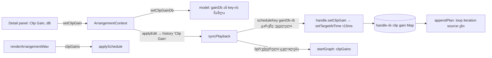

# Studio Lab — Clip Gain ერთ აუდიო კლიპზე, ხაზის Volume-ისგან ცალკე

**თარიღი:** 2026-10-12
**სტატუსი:** Completed — C PASS (round 30, `c-round-30.md`; SRW-13 ეტაპი 3, D-29u)
**შეცვლილი პროექტი:** Store

## კონტექსტი

მომხმარებლის მოთხოვნა **FB-04**: „Clip Gain, ტრეკის Volume-ისგან ცალკე“. მიღების კრიტერიუმი **R13-M1**: ერთ კლიპზე +6 dB, ხაზის Volume უცვლელია → playback-შიც და ექსპორტშიც მხოლოდ ეს კლიპი ხმამაღლა ისმის, +6 dB ±0.2.

ამ ცვლილებამდე თითო კლიპის source-ს graph-ში უკვე ჰქონდა საკუთარი `clipGain` GainNode, მაგრამ მისი მნიშვნელობა ყოველთვის 1 იყო. Clip-ის დონის ხმის რეგულირება არ არსებობდა.

**კონტრაქტი:**

| მოქმედება | შედეგი |
|---|---|
| ერთი აუდიო კლიპის არჩევა, დეტალების პანელში **Clip Gain, dB**-ში dB-ის ჩაწერა, Enter (ან ველიდან გასვლა) | ამ კლიპის დონე იცვლება ამდენი dB-ით playback-შიც და WAV ექსპორტშიც. ხაზის Volume, სხვა კლიპები, Master და წყარო ფაილი უცვლელია. ისტორიაში ერთი ჩანაწერია: `Clip Gain` |
| ცვლილება დაკვრის დროს | დონე რბილად იცვლება (τ 15 ms). არ ხდება restart, ნახტომი, გაჩერება ან reschedule. ცვლილება loop-ის მომდევნო გამეორებებზეც ვრცელდება |
| **0 dB** (reset) | gain ბრუნდება 0 dB-ზე, ერთი ჩანაწერით. კლიპს `gainDb` ველი აღარ აქვს და არასოდეს შეცვლილი კლიპის იდენტურია |
| Undo / Redo | gain ზუსტად აღდგება ან ხელახლა ედება, დაკვრის დროსაც |
| Split, Duplicate, trim, move, Delete Time (Ctrl+Shift+X), Delete სიცარიელით, Cut/Copy/Paste კლიპის ან მისი მონაკვეთის | ყოველი მიღებული ნაწილი ან ასლი gain-ს ინარჩუნებს |
| ჯგუფი, ვიდეოკლიპი ან არაფერი არჩეული | ველი და reset გათიშულია, მიზეზის ტექსტით |
| Escape ველში | ტექსტი ბრუნდება, არაფერი ინახება |
| −60…+24 dB-ის გარეთ მნიშვნელობა | იჭრება დიაპაზონამდე. status აჩვენებს შენახულ მნიშვნელობას |

**სცენარი:** მონტაჟორს მუსიკის ხაზზე ორი ნაწილი აქვს, A (7–15) და B (15–23). B-ს ირჩევს, Clip Gain-ში წერს `6`-ს და Enter-ს აჭერს. status წერს „Clip Gain: ღამის პულსი · სრული მიქსი — +6.0 dB.“, ხოლო Undo ღილაკზე ჩნდება „Clip Gain“. B ახლა 6 dB-ით ხმამაღლა ისმის, A კი უცვლელად. ხაზის Volume ფეიდერი ადგილიდან არ დაძრულა. ექსპორტის შემდეგ WAV-შიც ზუსტად B-ის ფანჯარაა 1.995-ჯერ ხმამაღლა.

## მიდგომა

### მონაცემების წესი

- `ArrangementClip`-ს დაემატა ერთი არასავალდებულო ველი, `gainDb?: number`. ის არსებობს **მხოლოდ მაშინ, როცა არ არის ნული**. კოდი არასოდეს წერს `gainDb: 0`-ს ან `gainDb: undefined`-ს. ამიტომ gain-ის არმქონე კლიპი, clipboard-ის item და JSON byte-ით იგივეა, რაც ამ ცვლილებამდე.
- დიაპაზონია `CLIP_GAIN_MIN_DB = −60`…`CLIP_GAIN_MAX_DB = +24`. ჯერ ხდება clamp, მერე დამრგვალება 0.1 dB-მდე (`normalizeClipGainDb`). `−0` ნორმალიზდება `0`-ად.
- `setClipGainDb(arrangement, clipId, gainDb)` **იგივე ობიექტს** აბრუნებს, თუ: კლიპი უცნობია, მისი ხაზი `audio` არ არის, მნიშვნელობა სასრული არ არის, ან შენახული მნიშვნელობა არ იცვლება. 0 შედეგზე ველი **იშლება**. სხვა ველები არ იცვლება.
- `clipLinearGain(clip)` = `10^(gainDb/20)`, ველის გარეშე 1. `clipLinearGains(arrangement)` Map-ში მხოლოდ ველის მქონე კლიპები ხვდება.
- Split, duplicate, trim, move, `deleteTime` და clipboard-ის `cutRangeFromArrangement` კლიპს `...clip` spread-ით აკოპირებენ, ამიტომ ველი ცვლილების გარეშე გადადის. ეს ფუნქციები არ შეცვლილა.

### Graph: `clipGains` და `setClipGain`

- `ApplyScheduleOptions.clipGains` (clipId → linear) handle-ის შიდა Map-ს თესავს. `startPlan` თითო source-ის არსებულ `clipGain` კვანძს ამ Map-ის მნიშვნელობას აძლევს (ან 1-ს). **ახალი კვანძი არ ემატება**: gain node-ების რაოდენობა იგივეა (`graph.test.ts`-ის მთვლელი).
- `ScheduleHandle.setClipGain(clipId, value)` ჩუმად არაფერს აკეთებს, თუ handle გათიშულია ან მნიშვნელობა შენახულის ტოლია (ნაგულისხმევი 1). სხვა შემთხვევაში ინახავს მნიშვნელობას და `setTargetAtTime(value, now, 0.015)`-ს იძახებს ამ კლიპის ყველა ცოცხალ (`ended` არა) source-ზე.
- loop-ის მომდევნო გამეორებების source-ები `appendPlan`-ით ემატება და იმავე Map-ს კითხულობენ. ამიტომ ახალი gain ვრცელდება შემდეგ iteration-ებზეც.
- `renderArrangementWav` გადასცემს `clipGains: clipLinearGains(arrangement)`-ს იმავე `applySchedule(ctx, planSchedule(arrangement, 0), …)`-ში. ექსპორტის სხვა ნაწილი არ შეცვლილა: clamp რჩება, normalize ან limiter არ არის.

### რატომ არ ხდება reschedule

`scheduleKey` (`JSON.stringify([clips, loop])`) ახლა replacer-ით `gainDb`-ს უგულებელყოფს. ამიტომ მხოლოდ gain-ის ცვლილებისას `syncPlayback` reschedule-ის შტოში არ შედის. არა-reschedule შტოში, ხაზების gain-ისა და Master-ის შემდეგ, თითო კლიპზე იძახებს `handle.setClipGain(clip.id, clipLinearGain(clip))`-ს. handle უცვლელ მნიშვნელობას უგულებელყოფს, ამიტომ fader-ის preview frame-ზე ეს მხოლოდ Map lookup-ებია. Undo/Redo იმავე გზით მიდის (`restoreHistory → syncPlayback`).

`startGraph` ახალ graph-ს `clipGains: clipLinearGains(arrangement)`-ით ქმნის, ამიტომ play, seek და სტრუქტურული reschedule მიმდინარე gain-ით იწყება.

### Context-ის მოქმედება

`setClipGain(clipId, gainDb): boolean`: drag-ის დროს (`refuseEditDuringGesture`) აბრუნებს `false`-ს status-ით `GESTURE_EDIT_BLOCKED_MESSAGE`. სხვა შემთხვევაში აბრუნებს `applyEdit(setClipGainDb(present, …), 'Clip Gain')`-ს. `applyEdit` ჯერ მოლოდინში მყოფ Volume/Master preview-ს ცალკე ჩანაწერად ინახავს: Undo ღილაკზე ზემოთ `Clip Gain` ჩანს, მის ქვემოთ `Volume`.

### Clipboard

`ArrangementClipboardItem.gainDb?` არსებობს მხოლოდ მაშინ, როცა წყარო კლიპს აქვს. `materialInWindow`-ი (range copy, Cut, Cut Time) და `copyClipsToClipboard` მას აკოპირებენ, ხოლო `planClipboardPaste` ჩასმულ კლიპზე წერს. gain-ის გარეშე ყველა გამოსავალი byte-ით იგივეა. Routing-ის წესი (D-25/D-29t), უარის მიზეზები, overlap და `at` clamp არ შეცვლილა.

### UI (დეტალების პანელი)

ოთხი სვეტი: info (`w-72`), waveform, range (`w-44`) და ახალი **Clip Gain** (`w-32`, `data-testid="arrangement-detail-clip-gain"`):
- `Clip Gain, dB` რიცხვითი ველი: step 0.1, min −60, max 24, `aria-label="Clip Gain (dB)"`;
- `0 dB` ღილაკი, `aria-label="Clip Gain-ის განულება (0 dB)"`. gain-ის გარეშე გათიშულია;
- მიზეზის `
` საკუთარი `useId`-ით, ველთან დაკავშირებული `aria-describedby`-ით.

| შემთხვევა | მიზეზი |
|---|---|
| არაფერი არჩეული | `ჯერ აირჩიე კლიპი` |
| ჯგუფი | `Clip Gain ერთ აუდიო კლიპზე ისმება — აირჩიე ერთი` |
| ვიდეოკლიპი | `ვიდეო კლიპს Clip Gain არ აქვს — ხმა: ხაზის Volume/Mute` |

**Commit** (Enter, ან blur, როცა ტექსტი მიმდინარე მნიშვნელობისგან განსხვავდება):
1. drag-ის დროს → `GESTURE_EDIT_BLOCKED_MESSAGE`, ტექსტი ბრუნდება;
2. ცარიელი ან არარიცხვითი → `Clip Gain: შეიყვანე რიცხვი dB-ში (−60…+24).`, ტექსტი ბრუნდება;
3. სხვა შემთხვევაში `setClipGain`: `true` → `Clip Gain: {სათაური} — {+6.0 dB}.` (შენახული, clamp-ით და დამრგვალებით: `30` → `+24.0 dB`); `false` Enter-ზე → `Clip Gain უცვლელია: {…}.`, blur-ზე არაფერი.

Escape ტექსტს მიმდინარე მნიშვნელობაზე აბრუნებს. ამის შემდეგ blur ტექსტს თანხვედრილად ხედავს და არაფერს ინახავს. რიცხვითი ველი workspace-ისთვის typing target-ია, ამიტომ Delete/Backspace/Ctrl+Z ველიდან თაიმლაინამდე არ აღწევს.

**შეურჩეველი ტექსტი და მონიშვნის ცვლილება (B-ის გადაწყვეტილება):** კონტენტი ყოველ მონიშვნის ცვლილებაზე ხელახლა mount-დება (`key`). შეურჩეველი ტექსტი იკარგება: არც commit, არც ჩანაწერი, არც status. თუ unmount-ისას ბრაუზერი blur-ს გამოიწვევს, commit არ მოხდება. ამას იცავს mount-ის ref, რომელსაც `useLayoutEffect`-ის cleanup თიშავს DOM-ის მოხსნამდე.

ტერმინოლოგია: მხოლოდ **Clip Gain**. „input“, „sensitivity“, „მგრძნობელობა“ და „trim“ UI-ში gain-ისთვის არ გამოიყენება.

## არქიტექტურა

Signal chain უცვლელია: source → **clipGain** → trackGain → panner → master → destination.

## შეცვლილი ფაილები

- `app/types/arrangement.ts` — `ArrangementClip.gainDb?`.
- `app/lib/arrangement/model.ts` — `CLIP_GAIN_MIN_DB`, `CLIP_GAIN_MAX_DB`, `normalizeClipGainDb`, `setClipGainDb`, `clipLinearGain`, `clipLinearGains`.
- `app/lib/arrangement/graph.client.ts` — `clipGains` option, `setClipGain` handle-ზე, `clipId` source state-ში, ექსპორტის `clipGains`.
- `app/lib/arrangement/clipboard.ts` — `gainDb`-ის გადატანა copy/cut/paste-ში.
- `app/contexts/ArrangementContext.tsx` — `scheduleKey` replacer, `startGraph`/`syncPlayback`, ახალი `setClipGain` მოქმედება.
- `app/components/arrangement/ArrangementDetailPanel.tsx` — Clip Gain სვეტი.
- `app/components/arrangement/StudioWorkspace.tsx` — ერთი prop.
- `app/lib/arrangement/__tests__/detail-panel-polish.test.tsx` — ორი selector (იხ. ქვემოთ).
- `app/lib/arrangement/__tests__/clip-gain.test.tsx` — ახალი ტესტები.

## პრობლემები და გადაწყვეტები

**Problem:** frozen `detail-panel-polish.test.tsx`-ის ორი ტესტი (`detailLabelTexts`) კონტენტის **ყველა** `label`-სა და `input`-ს აგროვებდა და ზუსტად range-ის ორ ველს ელოდა. მეოთხე სვეტი ამ სიებს გაზრდიდა.
**Solution:** B-ის §2.7 amendment. მხოლოდ ორ query-ში გამოირიცხა `[data-testid="arrangement-detail-clip-gain"]`-ის შთამომავლები. მოლოდინის ხაზები byte-ით უცვლელია.

**Problem:** `ArrangementDetailPanel`-ს standalone რენდერავს ორი frozen ტესტი, `detail-panel.test.tsx:627` და `track-layout.test.tsx:1154`. სავალდებულო `setClipGain` prop-ზე `tsc` ორ შეცდომას იძლეოდა (TS2741).
**Solution (A-ის deviation, B-სთვის):** prop გახდა არასავალდებულო (`setClipGain?:`). `StudioWorkspace` მას ყოველთვის გადასცემს, ამიტომ production ქცევა არ იცვლება. prop-ის გარეშე commit `false`-ს აბრუნებს. frozen ტესტები არ შეცვლილა.

**Problem:** `0 dB`-ზე pointer click-ს, როცა ველში შეუნახავი ტექსტი იყო, ჯერ blur მოჰყვებოდა (typed მნიშვნელობის commit), შემდეგ კი reset — ორი ჩანაწერი. გამორთული reset-იც კი შეიძლებოდა ჩართულიყო blur-ის commit-ის შემდეგ.
**Solution:** reset-ის `mousedown` default-ი იბლოკება, ამიტომ focus ველში რჩება. Dirty ტექსტი იკარგება და რჩება ერთი ჩანაწერი. `false` დაბრუნებისას ველი შენახულ მნიშვნელობას აჩვენებს.

**Problem:** `0` dB-ზე ველის დატოვება JSON-ს შეცვლიდა (`gainDb: 0`) და Undo ცარიელ ჩანაწერს შექმნიდა.
**Solution:** ნულზე key იშლება destructuring-ით. `isSameArrangement` (JSON) ამიტომ never-changed კლიპს ემთხვევა.

## ტესტირება

`clip-gain.test.tsx` — 28 `it`. Red-first შემოწმდა snapshot-ის წყაროებზე, როცა ფაილში 26 იყო (25 წითელი, 1 guard მწვანე by design); 2 UI ტესტი code review-ის შემდეგ დაემატა:
- **model (5):** მხოლოდ ერთი კლიპი იცვლება; 0 შლის key-ს; clamp/rounding/same-object; split/duplicate/deleteTime/trim/move ინარჩუნებს; linear conversion.
- **graph (4):** `clipGains` seeding და node-ების რაოდენობა; `setClipGain` მხოლოდ ცოცხალ source-ებზე, განმეორებული მნიშვნელობა call-ს არ იწვევს; appended source შენახულ მნიშვნელობას იღებს, disconnect-ის შემდეგ არაფერი; ექსპორტის source scan.
- **clipboard (2):** copy/range/Cut Time/paste-ის carry; gain-ის გარეშე own `gainDb` არ არის.
- **provider (6):** ერთი `Clip Gain` ჩანაწერი + Undo/Redo; უცვლელი/ვიდეო → false; `startGraph`-ის `clipGains`; დაკვრისას reschedule არ ხდება და `setTargetAtTime` ხვდება B-ის კვანძს (Undo-ც); drag-ის უარი; Volume flush-ის თანმიმდევრობა.
- **UI (11):** 0 dB dirty ტექსტით (focus ველში რჩება, ერთი ჩანაწერი); blur უცვლელი ტექსტით status-ის გარეშე; Enter commit; Escape+blur / blur commit; უცვლელი, ცარიელი, 30/−100; 0 dB reset; სამი გათიშული მიზეზი + `aria-describedby`; Delete/Backspace ველში; dirty ტექსტი + მონიშვნის ცვლილება; drag-ის დროს commit/reset; ტერმინოლოგია.

Gates (A): `tsc` 0, vitest 1161/1161 (1133 + 28), build წარმატებული, Biome `./app` 0 error (218 warning + 1 info, round 29-ის ტოლი). დეტალები: `tmp/studio-real-loop/a-round-30.md`.

## Ableton-თან კავშირი

წყარო: Ableton Live 12 Reference Manual, B-მ ჩამოტვირთა 2026-10-12-ს (`tmp/studio-real-loop/b-round-29/`). ვიდეო არ გამოყენებულა.

| ქცევა | წყარო | იქ დადასტურებული | CZABA-ს გადაწყვეტილება | სტატუსი |
|---|---|---|---|---|
| კლიპის gain dB-ში, კლიპის თვისებებში | §8.4.7 Clip Gain and Pitch | დადასტურებული | რიცხვითი dB ველი დეტალების პანელში. slider ამ რაუნდში არ არის (T12.8/T12.9) | შეგნებული განსხვავება (slider) |
| Clip gain ხაზის Volume-ისგან ცალკეა | §8.4.7 კლიპის თვისებას ასახელებს; ხაზის signal flow ტექსტში არ არის | დაუდასტურებელი | per-clip `clipGain` node ხაზის gain-მდე | დაუდასტურებელი |
| რამდენიმე კლიპის მონიშვნა მნიშვნელობების დიაპაზონს აჩვენებს | §8.4.7, §8.13 | დადასტურებული | ჯგუფზე გათიშულია მიზეზით (T12.7 მოგვიანებით) | შეგნებული განსხვავება |
| Waveform zoom gain არ არის | Arrangement View, Waveform Vertical Zoom | დადასტურებული | CZABA-ს zoom არ აქვს; waveform gain-ს არ მიჰყვება (T12.19) | არ ეხება |
| Gain-ის საზღვრები | — | ტექსტში არ არის | −60…+24 dB, 0.1 dB | დაუდასტურებელი |
| 0 dB-ზე დაბრუნება | — | ტექსტში არ არის | `0 dB` ღილაკი | დაუდასტურებელი |
| gain ინახება split/duplicate/paste-ზე | — | ტექსტში არ არის | ინახება (მონაცემთა მთლიანობა) | დაუდასტურებელი |

საბოლოო შესაბამისობის ვერდიქტი C-ისაა. ტესტის PASS Ableton-თან ანალოგიურობას არ ადასტურებს.

## TODO / შემდეგი ნაბიჯები

T12-ის რიგში (ამ რაუნდის FB-04 scope-ში არ შედის):
- gain slider live drag preview-ით, fine (Shift) drag-ით და double-click reset-ით (T12.8/T12.9);
- რამდენიმე კლიპის ფარდობითი gain-ის რედაქტირება (T12.7; Live 12 §8.13);
- waveform-ის სიმაღლე clip gain-ს მიჰყვება (T12.19);
- clip gain envelope (T12.10).

ასევე: FB-05 pan და fader-click UX (ეტაპი 4, round 31), A-R29-REVIEW-1.

## შენიშვნა (2026-10-15, round 45): `0 dB` dirty ტექსტით — pointer/keyboard ასიმეტრია

როცა Clip Gain-ის ველში შეუნახავი (dirty) ტექსტია და მომხმარებელი `0 dB`-ს აჭერს, შედეგი შეყვანის გზაზეა დამოკიდებული:
- **mouse click:** reset-ის `mousedown` focus-ს ველში ტოვებს, ამიტომ dirty ტექსტი იკარგება და ისტორიაში **1** ჩანაწერია (reset);
- **Tab → reset → Enter:** Tab ჯერ ველიდან გადის, blur აკრეფილ მნიშვნელობას ინახავს, შემდეგ reset სრულდება — **2** ჩანაწერი.

ეს კონტრაქტით მიღებული ქცევაა და ბაგი არ არის. წყარო: `tmp/studio-real-loop/a-round-30.md` §6.2a, `tmp/studio-real-loop/c-round-30.md` §10 (C ბრაუზერში ცალკე არ გაუზომავს).
