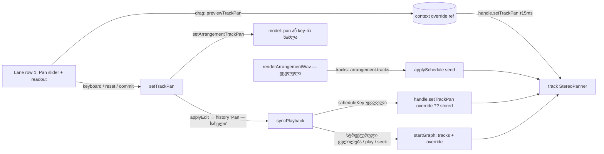

# Studio Lab — ხაზის Pan აუდიო ხაზებზე (live, loop და ექსპორტი)

**თარიღი:** 2026-10-13
**სტატუსი:** Completed (A; rounds 31–34 და 36 C-მ შეამოწმა; round 37-ის ბაგფიქსი — D-29z2, C-R36-01 — C round 37 PASS, `c-round-37.md`)
**შეცვლილი პროექტი:** Store

## კონტექსტი

მომხმარებლის მოთხოვნა **FB-05**: „მარცხენა/მარჯვენა Pan კონტროლი“ (`docs/video-to-text-bugs/README.md`, `1.mp4` 03:39–03:47). მიღების კრიტერიუმი **R13-M2**: ხაზის Pan სრულად მარცხნივ → ექსპორტში ამ ხაზის მარჯვენა არხი ≈ ჩუმია.

ამ ცვლილებამდე graph-ში თითო ხაზს უკვე ჰქონდა `StereoPannerNode`, მაგრამ მისი `pan` ყოველთვის 0 იყო. ხაზის stereo პოზიციის მართვა არ არსებობდა.

**კონტრაქტი:**

| მოქმედება | შედეგი |
|---|---|
| აუდიო ხაზის header-ში (პირველი სტრიქონი, სახელის მარჯვნივ) **Pan** slider-ის გადათრევა | ხაზის stereo პოზიცია **live** იცვლება გადათრევისას — restart, ნახტომი ან reschedule არ ხდება. ხელის აშვებისას ისტორიაში **ერთი** ჩანაწერია: `Pan — {ხაზის სახელი}`. readout აჩვენებს `C`, `NL` ან `NR` (N = 1…50) |
| ისრები / PageUp / PageDown / Home / End ფოკუსირებულ Pan-ზე | ყოველი მნიშვნელობის ცვლილება მაშინვე **ერთი** ჩანაწერია (Volume-ის დღევანდელი ქცევის ტოლი; coalescing ეტაპი 4b-შია) |
| readout-ზე დაჭერა (`25L` და ა.შ.) | Pan ბრუნდება **C**-ზე ერთი ჩანაწერით. C-ზე readout ღილაკი გათიშულია |
| Pan სრულად მარცხნივ (`50L`) | playback-შიც და WAV ექსპორტშიც ამ ხაზის მარჯვენა არხის წვლილი ჩუმია, მარცხენა კი W3C StereoPanner-ის ფორმულას მიჰყვება. სხვა ხაზები, Volume, Master და კლიპები უცვლელია |
| Pan-ის C-ზე დაბრუნება | ხაზს `pan` ველი **აღარ აქვს** — იგივეა, რაც არასოდეს შეცვლილი ხაზი. ექსპორტი pan-ის რედაქტირებამდე გაკეთებულის ტოლია |
| Undo / Redo | pan ზუსტად აღდგება ან ხელახლა ედება, დაკვრის დროსაც live |
| blur ან pointercancel გადათრევისას | ბრუნდება შენახული pan, ჩანაწერის გარეშე (Volume D-30-ის მსგავსად) |
| მეორე pointer pan-ის გადათრევისას | კლიპს ვერ გადაათრევს; პირიქითაც (`claimPointerGesture`) |
| ვიდეოხაზი; ნებისმიერი დაკეცილი ხაზი | Pan არ ჩანს (ვიდეო — შეგნებული გამარტივება; დაკეცილი — Volume-ის მსგავსად) |
| loop-ის დაკვრა | Pan ყველა გამეორებაზე რჩება, დამატებითი start-ების გარეშე |

**სცენარი:** მონტაჟორს მუსიკის ხაზზე `სრული მიქსი` აქვს. დაკვრისას Pan-ს მარცხნივ ბოლომდე ათრევს. ხმა გადათრევისთანავე მარცხენა ყურში გადადის, დაკვრა არ წყდება. ხელის აშვების შემდეგ readout-ზე `50L` წერია, Undo ღილაკზე კი `Pan — მუსიკა`. ექსპორტის WAV-ში მუსიკა მხოლოდ მარცხენა არხშია. `50L`-ზე დაჭერით Pan ბრუნდება `C`-ზე, ექსპორტი კი რედაქტირებამდე გაკეთებულს byte-ით ემთხვევა.

## მიდგომა

### მონაცემების წესი

- `ArrangementTrack`-ს დაემატა ერთი არასავალდებულო ველი, `pan?: number` (−1…+1). ის არსებობს **მხოლოდ მაშინ, როცა ნული არ არის**. კოდი არასოდეს წერს `pan: 0`-ს ან `pan: undefined`-ს, ამიტომ pan-ის გარეშე ხაზი და მთელი arrangement-ის JSON byte-ით იგივეა, რაც ამ ცვლილებამდე.
- ბიჯი 1/50-ია (`TRACK_PAN_STEPS = 50` თითო მხარეს). `normalizeTrackPan` ჯერ −1…+1-მდე იჭრება, მერე `Math.round(p * 50) / 50`-ით მრგვალდება, `−0` კი `0`-ად ნორმალიზდება.
- `setArrangementTrackPan(arrangement, trackId, pan)` **იგივე ობიექტს** აბრუნებს, თუ: ხაზი უცნობია, ხაზი `audio` არ არის, მნიშვნელობა სასრული არ არის, ან შენახული მნიშვნელობა არ იცვლება. 0 შედეგზე key **იშლება**. სხვა ველები და სხვა ხაზები უცვლელია.
  - სახელი განზრახ განსხვავდება context-ის `setTrackPan` მოქმედებისგან (Clip Gain-ის პრეცედენტი: `setClipGainDb` / `setClipGain`), რომ provider-ში სახელები ერთმანეთს არ დაფარავდეს და grep ერთმნიშვნელოვანი იყოს.
- `trackPanValue(track)` = `track.pan ?? 0`. `formatTrackPan(pan)`: `C` 0-ზე, სხვა შემთხვევაში `{N}L` ან `{N}R`, სადაც N = `Math.round(pan * 50)`-ის მოდული.
- `setTrackMix` (Volume/Mute) არ შეცვლილა.

### Graph: არსებული panner და `setTrackPan`

- `applySchedule` თითო ხაზზე უკვე ქმნიდა `StereoPannerNode`-ს. ახლა მისი საწყისი `pan.value` = `clampPan(track.pan ?? 0)` (არასასრული მნიშვნელობა → 0, რადგან `initialArrangement` prop-ია და NaN რეალურ `AudioParam`-ზე exception-ს იწვევს). panner-ები ინახება Map-ში ხაზის id-ით, `disconnect()` კი ყველას თიშავს, როგორც ადრე.
- `ScheduleHandle.setTrackPan(trackId, value)` ჩუმად არაფერს აკეთებს, თუ handle გათიშულია, ხაზი უცნობია ან მნიშვნელობა შენახული target-ის ტოლია (ნაგულისხმევად საწყისი მნიშვნელობა). სხვა შემთხვევაში ინახავს მნიშვნელობას და იძახებს `panner.pan.setTargetAtTime(value, ctx.currentTime, 0.015)`-ს.
- შენახული target არის JS-ის რიცხვი, არა `AudioParam.value`-ის წაკითხვა. `AudioParam` float32-ია, ამიტომ წაკითხული 0.34 ≠ 0.34 და შედარება ყოველ sync-ზე ზედმეტ ramp-ს გამოიწვევდა.
- **ახალი კვანძი, ახალი option და ახალი `create*` call არ ემატება.** `startPlan`, `appendPlan`, taps, meters, master და mute-ის time constant-ები არ შეცვლილა.

### რატომ არ ხდება reschedule

`scheduleKey` მხოლოდ clips + loop-ს შეიცავს, ამიტომ მხოლოდ pan-ის ცვლილება `syncPlayback`-ს reschedule-ის შტოში არ შეიყვანს. არა-reschedule შტოში, ხაზების gain-ის შემდეგ, თითო ხაზზე იძახება `handle.setTrackPan(track.id, override ?? trackPanValue(track))`. handle უცვლელ მნიშვნელობას უგულებელყოფს, ამიტომ სხვა რედაქტირებებზე (Volume preview, Mute, Clip Gain) ეს მხოლოდ Map lookup-ებია და panner-ზე call არ ხდება. Undo/Redo იმავე გზით მიდის (`restoreHistory → syncPlayback`).

loop-ის მომდევნო გამეორებები `appendPlan`-ით ემატება იმავე ხაზის gain → panner ჯაჭვს. ამიტომ pan ყველა iteration-ზე რჩება wrap-ზე დამატებითი `setTargetAtTime`-ის გარეშე.

### ექსპორტი

`renderArrangementWav` **byte-ით უცვლელია**. ის უკვე გადასცემს `tracks: arrangement.tracks`-ს იმავე `applySchedule(ctx, planSchedule(arrangement, 0), …)`-ში, ამიტომ pan ექსპორტში იმავე seed-ით ხვდება, რითაც live graph-ში. C-ზე დაბრუნებული ხაზი `pan` ველის გარეშეა, ამიტომ ექსპორტი pan-მდელს ემთხვევა.

### Preview override (არა მესამე pending მანქანა)

გადათრევისას context ინახავს **audio-only override-ს** ref-ში: `{ trackId, value }`. ის:
- `previewTrackPan`-ით იწერება (მხოლოდ ამ ხაზის აქტიური pan gesture-ის დროს; clamp და დამრგვალება როგორც მოდელში) და მაშინვე `handle.setTrackPan`-ით live graph-ს მიეწოდება;
- **არასოდეს წერს `history.present`-ს და ისტორიას**;
- ითვალისწინება `startGraph`-ში (ახალი graph-ის `tracks`-ში მხოლოდ ამ ხაზს ედება override, ამიტომ ახალი panner პირდაპირ ამ მნიშვნელობით იწყება, ramp-ის გარეშე) და `syncPlayback`-ის არა-reschedule შტოში. ამიტომ reschedule გადათრევისას (მაგ. Space ან seek) გადათრეულ pan-ს ინარჩუნებს.

მოქმედებები (`ArrangementContext`):
- `setTrackPan(trackId, pan): boolean` — თუ **ნებისმიერი** pointer gesture მიმდინარეობს (ამ ხაზის pan gesture-იც), `refuseEditDuringGesture()` (status `GESTURE_EDIT_BLOCKED_MESSAGE`) და `false`. ეს B-ის §2.3-ზე მკაცრია (code review): მეორე pointer-ით reset-ზე დაჭერა გადათრევისას სხვაგვარად ორ ჩანაწერს გააკეთებდა. `commitTrackPan` gesture-ს ჯერ ათავისუფლებს და მხოლოდ მერე იძახებს `setTrackPan`-ს, ამიტომ commit არ იბლოკება. სხვა შემთხვევაში `applyEdit(setArrangementTrackPan(present, …), 'Pan — {სახელი}')`. `applyEdit` ჯერ მოლოდინში მყოფ Volume/Master preview-ს ინახავს.
- `beginTrackPanGesture(trackId, pointerId): boolean` — `claimPointerGesture`-ით იკავებს pointer-ს (უარზე `false`), ჯერ Volume/Master preview-ს ინახავს, window `pointerup` ამავე id-ით → commit, `pointercancel` → cancel. claim-ის abort (window blur ან იგივე pointer-ის ახალი claim) override-ს შლის და შენახულ pan-ს graph-ს უბრუნებს.
- `commitTrackPan(trackId)` — gesture-ს ამთავრებს, override-ს შლის, მერე `setTrackPan(trackId, override)`: ერთი ჩანაწერი ან არცერთი, თუ მნიშვნელობა არ შეცვლილა. **no-op**, თუ ამ ხაზის pan gesture აქტიური არ არის — element-ის `pointerup`, `lostpointercapture` და window-ის `pointerup` სამივე იძახებს მას, მაგრამ commit მხოლოდ ერთხელ ხდება.
- `cancelTrackPan(trackId)` — gesture-ს ამთავრებს, override-ს შლის და შენახულ pan-ს handle-ს უბრუნებს. ჩანაწერი არ არის. no-op აქტიური gesture-ის გარეშე.
- provider-ის unmount-ზე აქტიური pan gesture თავისუფლდება Volume-ის gesture-ების მსგავსად.

**რატომ არა Volume-ის მანქანის მესამე ასლი (B, D-29v):** Volume/Master preview `present`-ის snapshot-ს იღებს და `present`-ს ყოველ frame-ზე წერს. მესამე ასლს Volume-თან და Master-თან flush-ის თანმიმდევრობის მართვა დასჭირდებოდა. round 30-ის review-მ იქ თანმიმდევრობის ხარვეზი იპოვა, A-R29-REVIEW-1 კი იმავე დიზაინის label-ის გაჟონვაა. ისტორიას რომ არ ეხება, ისეთ preview-ს არცერთი ეს პრობლემა არ აქვს.

### UI (ხაზის header-ის პირველი სტრიქონი)

მხოლოდ **აუდიო, დაუკეცავ** ხაზზე, პირველ სტრიქონში, სახელის ღილაკის შემდეგ, ორი ელემენტი. DOM-ის რიგი: fold → სახელი → Pan → readout. ვიდეოს შტო აუდიოზე არ რენდერდება.

1. **Slider:** `type="range"`, min −50, max 50, step 1. მნიშვნელობა = `Math.round(displayPan * 50)`, სადაც `displayPan` ხაზის **ლოკალური draft** state-ია გადათრევისას, სხვა დროს შენახული pan. `aria-label="Pan — {სახელი}"`, `aria-valuetext` = readout-ის ტექსტი, `data-testid="arrangement-track-pan"`, კლასები `h-1 w-12 shrink-0 accent-brand` + Volume-ის focus-visible კლასები.
   - **ლოკალური draft რატომ:** controlled range, რომლის `change` state-ს არ ცვლის, უკან ხტება. context-ის override ref-ია და re-render-ს არ იწვევს (render budget), ამიტომ ხილულ მნიშვნელობას ხაზის `useState` ატარებს.
   - `onPointerDown` (მთავარი ღილაკი, `buttons !== 0`) → `beginTrackPanGesture`; წარმატებისას ხაზი თავის window `pointerup`/`pointercancel` listener-ს ამატებს, რომელიც draft-ს შლის — ესაა გზა, როცა gesture-ს context ამთავრებს element-ის event-ის გარეშე.
   - `onChange`: ხაზის აქტიურ გადათრევაში → draft + `previewTrackPan`; სხვა შემთხვევაში (კლავიატურა ან AT) → მაშინვე `setTrackPan`.
   - `onPointerUp`, `onLostPointerCapture` → `commitTrackPan` + draft-ის წაშლა; სხვა `pointerId`-ის event იგნორდება (მეორე თითის აშვება პირველის გადათრევას ვეღარ ამთავრებს).
   - `onBlur` → აქტიურ გადათრევაში `cancelTrackPan` + draft-ის წაშლა.
   - `onKeyDown` → მხოლოდ Delete/Backspace-ზე `stopPropagation` (იხ. „პრობლემები“). Space და Home window-მდე აღწევს.
2. **Readout / reset ღილაკი:** ტექსტი = `formatTrackPan(displayPan)`, `aria-label="Pan-ის ცენტრში დაბრუნება — {სახელი}"`, `title="Pan → C"`, `data-testid="arrangement-track-pan-reset"`, გათიშულია, როცა **შენახული** pan 0-ია. დაჭერა → `setTrackPan(id, 0)`; წარმატებისას focus გადადის Pan slider-ზე, რადგან გათიშული ღილაკი კლავიატურის მომხმარებელს focus-ს `<body>`-ზე დაუკარგავდა. კლასები: `w-7 shrink-0 rounded-sm text-right text-xs tabular-nums text-muted enabled:hover:text-foreground` + focus-visible. ახალი ფერი ან token არ დამატებულა.

UI-ში წარწერა მხოლოდ **Pan**-ია; „balance“ არსად გამოიყენება.

**გეომეტრია (B-ის probe, `b-round-30/geo-*.json`):** header-ის შიდა სიგანე 203 რჩება. პირველი სტრიქონი ერთ ხაზად რჩება: slider 48 px + readout 28 px + ორი `gap-1` = 84 px, ასე რომ სახელს ≈ 98 px რჩება და ოთხი დემო სახელი (≤ 61 px) არ იჭრება. ` · აქტიური` სუფიქსი შეიძლება ellipsis-ით მოიჭრას; აქტიური ხაზი მაინც ჩანს brand მარცხენა border-ითა და `aria-pressed`-ით. მეორე სტრიქონი (M, S, Volume, %) byte-ით უცვლელია, Volume 107 px რჩება, მეტრის პოზიცია, fold, height handle და density-ის ზღვრები არ შეცვლილა. საბოლოო გაზომვა C-ისაა (R31-PUI).

**Tab-ის რიგი music header-ში:** fold → სახელი → Pan → readout → M → S → Volume. C-ზე readout გათიშულია და Tab-ით გამოტოვდება.

**R24-HC შენიშვნა:** frozen ტესტი `track-layout.test.tsx` (R24-HC) იღებს `[data-track-id="music"] input[type="range"]`-ის **პირველ** შედეგს. Pan პირველ სტრიქონშია, ამიტომ ეს ტესტი ახლა **Pan slider-ს** ამოწმებს და არა Volume-ს. ის უცვლელად მწვანეა: Home ფოკუსირებულ ნებისმიერ range-ზე ბრაუზერს რჩება (`isSliderTarget`). B ამას იღებს. სხვა frozen ტესტი „პირველი range = Volume“-ზე არ არის დამოკიდებული.

### Pan-ის კანონი (CZABA-ს ძრავის ქცევა)

CZABA იყენებს Web Audio-ს `StereoPannerNode`-ს, W3C-ის ალგორითმით. ეს **CZABA-ს ძრავის ქცევაა** და არა Ableton Live-ის შიდა იმპლემენტაცია.

- **Mono შემავალი:** x = (pan + 1) / 2; L = cos(x·π/2)·in, R = sin(x·π/2)·in. C-ზე L = R = 0.70711·in (equal-power).
- **Stereo შემავალი, pan ≤ 0:** x = pan + 1; L = inL + cos(x·π/2)·inR, R = sin(x·π/2)·inR.
- **Stereo შემავალი, pan > 0:** x = pan; L = cos(x·π/2)·inL, R = inR + sin(x·π/2)·inL.
- C-ზე stereo წყარო უცვლელად გადის. `50L`-ზე stereo: L = inL + inR, R = 0. `25L`-ზე (pan −0.5): L = inL + 0.70711·inR, R = 0.70711·inR.
- `50L`-ზე ხაზის **track meter**-ის მარცხენა არხი L+R-ს იღებს (+6 dB-მდე) და შეიძლება over-0 გაფრთხილება აანთოს, რადგან track meter Master-მდეა. ეს მოსალოდნელია, ბაგი არ არის.

## არქიტექტურა

Signal chain უცვლელია: source → clipGain → trackGain → **panner** → master → destination (track tap — panner-ის შემდეგ).

## შეცვლილი ფაილები

- `app/types/arrangement.ts` — `ArrangementTrack.pan?`.
- `app/lib/arrangement/model.ts` — `TRACK_PAN_STEPS`, `normalizeTrackPan`, `trackPanValue`, `setArrangementTrackPan`, `formatTrackPan`.
- `app/lib/arrangement/graph.client.ts` — `clampPan`, panner-ები id-ით, საწყისი pan, `ScheduleHandle.setTrackPan`.
- `app/contexts/ArrangementContext.tsx` — override ref, `startGraph`/`syncPlayback`, ხუთი ახალი მოქმედება, unmount-ის release.
- `app/components/arrangement/ArrangementLane.tsx` — Pan slider და readout პირველ სტრიქონში, ლოკალური draft.
- `app/lib/arrangement/__tests__/track-pan.test.tsx` — ახალი ტესტები.

## პრობლემები და გადაწყვეტები

**Problem:** `StudioWorkspace`-ის window keydown-ის Delete/Backspace შტოს slider-ის guard არ აქვს, `isTypingTarget` კი `range`-ს არ თვლის. ფოკუსირებულ Pan-ზე Delete მონიშნულ კლიპს წაშლიდა. `StudioWorkspace.tsx` ამ რაუნდში frozen-ია.
**Solution (A-ის deviation, B-სთვის):** Pan slider-ის `onKeyDown` მხოლოდ Delete/Backspace-ზე `stopPropagation`-ს იძახებს. React root-ზე აკეთებს delegation-ს, ამიტომ window listener ამ event-ს ვეღარ ხედავს. Space (play/stop) და Home (ბრაუზერს რჩება) არ ჩერდება. **იგივე ხარვეზი Volume slider-საც აქვს** (row 2, byte-ით უცვლელი) — B-ის მომდევნო დავალებისთვის.

**Problem:** controlled range, რომლის `change` state-ს არ ცვლის, უკან ხტება, context-ის override კი ref-ია.
**Solution:** ხილულ მნიშვნელობას ხაზის ლოკალური draft ატარებს, რომელიც commit-ზე, cancel-ზე, blur-ზე და window-ის `pointerup`/`pointercancel`-ზე იშლება.

**Problem:** `AudioParam.value` float32-ია; მისი წაკითხვა და JS-ის რიცხვთან შედარება ყოველ sync-ზე ზედმეტ `setTargetAtTime`-ს მისცემდა.
**Solution:** handle თავის target-ს JS-ის რიცხვად ინახავს (`lastPanTargets`) და შედარებაც მასთან ხდება.

**Problem:** მოდელის ფუნქცია და context-ის მოქმედება ორივე `setTrackPan` იქნებოდა და provider-ში ერთმანეთს დაფარავდა.
**Solution:** მოდელის ფუნქციას ჰქვია `setArrangementTrackPan`.

## ტესტირება

`track-pan.test.tsx` — 26 `it`. Red-first შემოწმდა snapshot-ის წყაროებზე in place (vitest-ში დაკარგული export `undefined`-ია): **26/26 წითელი** (`setArrangementTrackPan is not a function`, `handle.setTrackPan is not a function`, `result.current.setTrackPan`/`beginTrackPanGesture is not a function`, panner seed `[0, 0, 0]`, source scan, `pan slider missing`, row 1-ში 2 ელემენტი 4-ის ნაცვლად).
- **model (5):** მხოლოდ ერთი ხაზი იცვლება, Volume 0.6 უცვლელია; 0 შლის key-ს და arrangement JSON-ით never-changed-ს ემთხვევა; clamp ±2 → ±1, 0.333 → 0.34, −0.001 → key-ის გარეშე; same-object NaN/Infinity/უცნობ id/ვიდეო/უცვლელ მნიშვნელობაზე; `C`/`50L`/`50R`/`1L`/`25L`.
- **graph (4):** `pan: −1` seed მხოლოდ ამ panner-ზე, node-ების რაოდენობა უცვლელი; `setTrackPan` მხოლოდ ამ panner-ზე τ 0.015-ით, განმეორებული მნიშვნელობა call-ს არ იძლევა; უცნობი ხაზი და disconnect → არაფერი; ექსპორტის source scan (`applySchedule(ctx, planSchedule(arrangement, 0)`, `tracks: arrangement.tracks,`, `setTrackPan`-ისა და `pan`-ის არარსებობა).
- **provider (8):** ერთი `Pan — მუსიკა` ჩანაწერი + Undo/Redo, უცვლელი და ვიდეო → `false`; დაკვრისას reschedule არ ხდება, `setTargetAtTime` მხოლოდ music panner-ზე, Undo/Redo-ც; `startGraph` შენახული pan-ით; begin → სამი preview: `present` და Undo label უცვლელი → commit ერთი ჩანაწერი, მეორე commit no-op; cancel → ჩანაწერის გარეშე, panner-ს შენახული მნიშვნელობა უბრუნდება; window pointercancel/pointerup; reschedule preview-ის დროს ახალ panner-ს override-ით იწყებს; უარი clip drag-ის დროს, `setTrackPan`-ის უარი ამავე ხაზის pan gesture-ის დროსაც, და pan gesture მეორე claim-ს ბლოკავს.
- **graph-ის დამატება:** `pan: NaN` → seed 0.
- **UI (9):** ჩვენება აუდიოზე, არა ვიდეოზე და დაკეცილზე, „balance“ არ არის; row 1-ის რიგი; pointer drag — გადათრევისას slider და readout draft-ს მიჰყვება, ისტორია უცვლელია, სხვა `pointerId`-ის აშვება იგნორდება, აშვებაზე (და შემდგომ `lostpointercapture`-ზე) ერთი ჩანაწერი `30L`; კლავიატურა — ყოველი ცვლილება ერთი ჩანაწერი; readout-ზე დაჭერა → C, გათიშული, focus slider-ზე გადადის; blur გადათრევისას → ჩანაწერის გარეშე; window pointercancel draft-ს შლის; Delete/Backspace კლიპს არ შლის; Space play/stop.

Gates (A): `tsc` 0, vitest 1193/1193 (1167 + 26), build წარმატებული, Biome `./app` — მხოლოდ 2 baseline CRLF format error (`auth.ts`, `auth-bugs.test.ts`, root-ის), 218 warning + 1 info, A-ის ფაილებში 0. დეტალები: `tmp/studio-real-loop/a-round-31.md`.

## Ableton-თან კავშირი

წყარო: **Ableton Live 12 Reference Manual**, თავი 18 „Mixing“, §18.1 „The Live Mixer“ (<https://www.ableton.com/en/live-manual/12/mixing/>). B-მ ჩამოტვირთა gstack `/browse`-ით 2026-10-12-ს (`tmp/studio-real-loop/b-round-29/ableton-mixing-20261012.txt`), ხელახლა წაიკითხა 2026-10-13-ს. ვიდეო არ გამოყენებულა. Audio Fact Sheet არ ჩამოტვირთულა.

| ქცევა | წყარო | იქ დადასტურებული | CZABA-ს გადაწყვეტილება | სტატუსი |
|---|---|---|---|---|
| ხაზის Pan stereo ველში პოზიციონირებს | §18.1 | დადასტურებული | Pan slider თითო აუდიო ხაზის header-ში (Track Controls-ის ანალოგი) | დადასტურებული |
| სრული pan ერთ მხარეს მოპირდაპირე არხს აჩუმებს | §18.1 („decreasing the volume of the opposite channel“) | მიმართულებით დადასტურებული; უკიდურეს წერტილში რაოდენობა არ წერია | `50L`-ზე მარჯვენა არხი ≤ 1 LSB | დადასტურებული (მიმართულება) |
| Pan-ის კანონი: რა ემართება მოპირდაპირე არხის შინაარსს | §18.1 მიუთითებს Audio Fact Sheet-ზე (არ ჩამოტვირთულა) | დაუდასტურებელი | W3C `StereoPannerNode` (stereo-ზე შორეული არხი ახლოს ერთვება equal-power gain-ით). CZABA-ს ძრავის არჩევანია, Live-ისად არ წარმოდგება | დაუდასტურებელი |
| ნაგულისხმევზე დაბრუნება | §18.1 double-click | დადასტურებული | readout-ზე დაჭერა → C; slider-ის double-click ეტაპი 4b-შია | შეგნებული განსხვავება |
| რამდენიმე ხაზის ერთობლივი pan | §18.1 | დადასტურებული | CZABA-ს ხაზების multi-select არ აქვს | შეგნებული განსხვავება |
| Split Stereo Pan Mode | §18.1 | დადასტურებული | არ არის (არ მოთხოვნილა) | შეგნებული განსხვავება |
| Pan ყველა ხაზს აქვს | §18.1 (თითო ხაზზე) | აუდიო ხაზებისთვის დადასტურებული | ვიდეოხაზს Pan არ აქვს | შეგნებული განსხვავება |
| ჩვენების ფორმატი `C`/`50L`/`50R`, დიაპაზონი ±50 | — | ჩამოტვირთულ ტექსტში არ არის | CZABA-ს ჩვენების გადაწყვეტილება | დაუდასტურებელი |

საბოლოო შესაბამისობის ვერდიქტი C-ისაა. ტესტის PASS Ableton-თან ანალოგიურობას არ ადასტურებს.

## TODO / შემდეგი ნაბიჯები

ამ რაუნდში არ შედის (თითოეული რიგშია, FB-05-ის scope-იდან არ არის გადადებული):
- slider-ის double-click reset, ნახტომის გარეშე fader, Shift fine drag და კლავიშების coalescing (ეტაპი 4b, ყველა fader-ისთვის);
- რამდენიმე ხაზის ერთობლივი pan (Live §18.1; CZABA-ს ხაზების multi-select არ აქვს);
- Split Stereo Pan Mode (Live §18.1; არ მოთხოვნილა);
- pan automation (FB-06 კლიპის volume-ია; pan envelope არ არის);
- ვიდეოხაზის pan;
- C-R30-01 და DOC035-NOTES (polish რაუნდი).

ასევე B-სთვის: Volume slider-ზე Delete/Backspace მონიშნულ კლიპს შლის (იგივე ხარვეზი, რაც Pan-ზე აქ გამოსწორდა).

## Round 32 — fader-ის კლავიშები და blur-ის შემდეგ drag

**თარიღი:** 2026-10-13 · **გადაწყვეტილება:** D-29w · **C-ის ID-ები:** R32-DK, R32-BC, R32-K, R32-S, R32-U, R32-Doc

### C-R31-02 — Delete/Backspace fader-ზე (Medium)

სცენარი: მომხმარებელმა SFX კლიპი მონიშნა, შემდეგ მუსიკის Volume slider-ს დააჭირა და Delete დააჭირა. ადრე workspace-ის window `keydown` handler-ი Delete/Backspace-ზე `deleteSelection()`-ს იძახებდა და კლიპი იშლებოდა (Undo-თი ბრუნდებოდა).

ახლა `StudioWorkspace.tsx`-ის Delete/Backspace branch-ში, `preventDefault`-მდე, მოწმდება ახალი ლოკალური predicate `isRangeInputTarget` (`HTMLInputElement` + `type === 'range'`). თუ focus native range input-ზეა, handler-ი უბრალოდ ბრუნდება: timeline-ზე არაფერი იცვლება, history entry და status არ ჩნდება, `preventDefault` არ ხდება.

- **დაცული ელემენტები:** ხაზის Volume, ხაზის Pan, Master Volume და Zoom — ყველა native `input[type="range"]`.
- **განზრახ დაუცველი:** `role="slider"` ელემენტები — playhead handle, overview და ბიბლიოთეკის preview scrubber. ისინი timeline/ნავიგაციის ობიექტებია. Playhead-ის გადაწევის შემდეგ Delete-მა მონიშვნა უნდა წაშალოს (SRW-24). ამიტომ `isSliderTarget` აქ არ გამოიყენება.
- **უცვლელია:** სხვა pointer gesture-ის დროს Delete კვლავ gesture-blocked branch-ში ხვდება და იგივე status-ს აჩვენებს. ეს branch ახალ შემოწმებამდე სრულდება.
- **Deviation 1 მოიხსნა:** round 31-ის Pan `onKeyDown` (`handlePanKeyDown`, Delete/Backspace-ის `stopPropagation`) წაიშალა. ის იმ დროს გაყინული `StudioWorkspace.tsx`-ის გამო იყო საჭირო. ახლა Pan-ს მხოლოდ workspace-ის guard იცავს, ამიტომ `track-pan.test.tsx`-ის Delete ტესტი ამ guard-ის რეგრესიის oracle-ია.

### C-R31-01 — blur Pan drag-ის დროს და იგივე pointer (Low)

სცენარი: მომხმარებელი Pan-ს pointer-ით სწევს, focus იკარგება (`blur`), ღილაკი კი ჯერ კიდევ დაჭერილია და range `input`-ს აგზავნის. ადრე `handlePanBlur` drag-ის refs-ს ასუფთავებდა, ამიტომ ყოველი შემდეგი `input` keyboard branch-ში ხვდებოდა და ცალკე `Pan` entry-ს ქმნიდა.

წესი („ignore“, არა „coalesce“):
- `handlePanBlur` აქტიური drag-ის დროს ჯერ ინახავს drag-ის pointer id-ს და `suppressPanPointerAfterBlur`-ით ჩართავს suppression-ს, შემდეგ ძველებურად აუქმებს gesture-ს (`cancelTrackPan`, entry არ იქმნება).
- სანამ suppression ჩართულია, `handlePanChange` არაფერს აკეთებს: არც draft, არც `previewTrackPan`, არც `setTrackPan`. React controlled value-ს შენახულ pan-ზე აბრუნებს.
- suppression ითიშება იმავე pointer id-ის window `pointerup`/`pointercancel`-ზე, ან ახალ **წარმატებულ** Pan `pointerdown`-ზე (`beginTrackPanGesture` → `true`). წარუმატებელი pointerdown suppression-ს არ თიშავს.
- window listener-ების cleanup ref-შია (`panBlurSuppressionCleanupRef`) და lane-ის unmount effect-ი შლის მათ.

დარჩენილი რისკი (B-ს გადაწყვეტილებისთვის, კოდი არ შეცვლილა): თუ ღილაკი ფანჯრის გარეთ გათავისუფლდა და ფანჯარამ ამ pointer-ის `pointerup`/`pointercancel` არ მიიღო, suppression ჩართული რჩება იმავე pointer id-ის შემდეგ `pointerup`/`pointercancel`-მდე (mouse-ის id ჩვეულებრივ მუდმივია, ამიტომ ნებისმიერი click ხსნის) ან წარმატებულ Pan `pointerdown`-მდე. touch/pen-ის id შეიძლება აღარ განმეორდეს. ამ დროს Pan-ის კლავიშით ცვლილებაც იგნორირდება, status-ის გარეშე. სხვა pointer id-ის `pointerup` და უარყოფილი `pointerdown` suppression-ს განზრახ არ თიშავს.

Volume ინარჩუნებს დღევანდელ ქცევას: იგივე blur-continue თანმიმდევრობა release-ზე ზუსტად ერთ `Volume` entry-ს ქმნის. ამას reference ტესტი აფიქსირებს; ცვლილება ეტაპი 4b-ის გადაწყვეტილებაა.

### R31-U-GAP-B2 — `syncPlayback`-ის override term

`ArrangementContext.tsx` არ შეცვლილა. `syncPlayback`-ის ყველა გამოძახება შემოწმდა. დასკვნა ორ ნაწილად:
- **non-reschedule sync აქტიური gesture-ის დროს არსებობს:** `revertTrackVolumePreview`/`revertMasterGainPreview` სრულდება Volume/Master gesture-ის cancel-ში ან `claimPointerGesture`-ის abort-ში, `release`-მდე (count > 0). ამ დროს Pan gesture აქტიური არ არის.
- **non-reschedule sync, როცა `panOverrideRef` დაყენებულია, ვერ ხერხდება:** override მხოლოდ აქტიური Pan gesture-ის დროს არსებობს. `claimPointerGesture` სხვა pointer-ს უარს ეუბნება, იმავე pointer-ის claim კი Pan-ის abort-ით override-ს ჯერ ასუფთავებს. Pan gesture-ის დროს edit-ები `refuseEditDuringGesture`-ით, Undo/Redo კი gesture-ის შემოწმებით იბლოკება. დარჩენილი გზები (`stepLoopRange`, loop-ის tick resync, ვიდეოს decode) reschedule-ს იწვევს, ხოლო `startGraph` override-ს პატივს სცემს.

ამიტომ term-ი დღეს მიუწვდომელია, მაგრამ რჩება დამცავად: მომავალი non-reschedule sync (ეტაპი 4b-ის coalesced commit, SRW-18) drag-ის შუაში live pan-ს უკან არ დააბრუნებს.

### ტესტები

TODO-ს ბოლო შენიშვნა („Volume slider-ზე Delete/Backspace მონიშნულ კლიპს შლის“) ამ რაუნდით დაიხურა (C-R31-02).

ახალი ფაილი: `app/lib/arrangement/__tests__/fader-guards.test.tsx` (19 `it`, რეალური `StudioWorkspace` + provider; ბოლო ორი code-review-ის შემდეგ დაემატა). ტესტები დაიწერა red-first: snapshot წყაროზე 9 ჩავარდა (Volume/SFX Volume/Master/Zoom-ის Delete, window-listener-ის ტესტი და blur-continue-ის 4 ტესტი). Pan-ის Delete ტესტი snapshot-ზეც მწვანე იყო, რადგან იქ deviation 1 ჯერ კიდევ მუშაობდა.
- Delete guard: ხუთი range control, `document.body`-ის positive control, playhead-ის (`role="slider"`) narrow-guard კონტრაქტი, window listener, gesture-blocked branch;
- Pan blur-continue: entry, live push და შენახული მნიშვნელობა არ იცვლება; release/pointercancel-ის შემდეგ ახალი drag და კლავიში თითო entry-ს ქმნის; ახალი pointer id 42 suppression-ს თიშავს; სხვა pointer-ის `pointerup` და უარყოფილი `pointerdown` მას არ თიშავს; unmount window listener-ებს შლის;
- Volume reference: ერთი `Volume` entry;
- coverage: Home Volume-ზე და Master-ზე seek-ს არ აკეთებს; pending Volume/Master preview Pan gesture-მდე commit-დება.

### Ableton-თან კავშირი

წყარო: Ableton Live 12 Reference Manual §18.1 „The Live Mixer“ (B-ის ჩანაწერი `b-round-29/ableton-mixing-20261012.txt`). ის Pan/Volume-სა და double-click reset-ს აღწერს. **Delete/Backspace-ზე focused mixer control-ზე და focus-ის დაკარგვის შემდეგ pointer-ის ქცევაზე არაფერს ამბობს.** ამიტომ ამ რაუნდის სამივე ქცევა Ableton-თან **დაუდასტურებელია**: ეს CZABA-ს მოთხოვნებია (C-R31-02, SRW-24 და round 31-ის cancel კონტრაქტი), არა Ableton-ის დადასტურებული ქცევა. Double-click reset ეტაპ 4b-ში რჩება.

## Round 33 — timeline-ზე click fader-იდან focus-ს აშორებს

**გადაწყვეტილება:** D-29x (B, `b-round-32.md`). **ბაგი:** C-R32-01 (Medium).

### ბაგი

ნაბიჯები (C, რეალური click-ები): click მუსიკის Volume fader-ზე → click SFX კლიპის header-ზე (კლიპი მოინიშნება) → Delete ან Backspace. შედეგი: არაფერი — არც წაშლა, არც history entry, არც status. იგივე ხდება ცარიელ lane-ზე click-ის შემდეგ.

მიზეზი:
- timeline-ის `pointerdown` handler-ები `event.preventDefault()`-ს იძახებენ: კლიპის `beginGesture`, lane-ის ფონი (`handleLaneBackgroundPointerDown`), ruler-ის `handlePointerDown`, ხაზის სიმაღლის handle. ამიტომ ბრაუზერი focus-ს არ გადაიტანს.
- კლიპის root და lane-ის body focusable არ არის (`tabIndex` არ აქვთ).
- `document.activeElement` fader-ზე რჩება და round 32-ის `isRangeInputTarget(event.target)` guard Delete-ს ყლაპავს.

round 32-ის ტესტებმა ეს ვერ დაინახა, რადგან focus-ს პირდაპირ `control.focus()`-ით აყენებდნენ და კლავიშს focused fader-ზე უშვებდნენ; fader → timeline click → კლავიშის თანმიმდევრობა არ იყო.

playhead-ი და loop brace pointerdown-ის შემდეგ თავად იღებენ focus-ს (`event.currentTarget.focus()`, `braceRef.current?.focus()`), ამიტომ მათზე bug არ ჩანდა.

### წესი

`StudioWorkspace.tsx`-ში timeline scroller-ს (`data-testid="arrangement-timeline-scroller"`) აქვს ერთი capture-phase handler: `releaseFaderFocusOnTimelinePointerDown` (`onPointerDownCapture`). ის `blur()`-ს იძახებს focused ელემენტზე, თუ სამივე პირობა სრულდება:
1. `ownerDocument.activeElement` native range input-ია (`isRangeInputTarget`): ხაზის Volume, ხაზის Pan, Master Volume ან Zoom;
2. `pointerdown`-ის target თავად native range input **არ არის** — fader-ზე (იგივეზე ან სხვაზე) დაჭერა ძველებურად ბრაუზერისა და fader-ის handler-ების საქმეა;
3. pointer gesture აქტიური **არ არის** (`isPointerGestureActive()`): მეორე pointer-ს `claimPointerGesture` მაინც უარს ეუბნება, blur კი გაშვებულ Pan drag-ს (`handlePanBlur`) ან Volume drag-ს (`blurTrackVolume` → `cancelTrackVolumeGesture`) გააუქმებდა.

სხვა არაფერი: არც `preventDefault`, არც `stopPropagation`, არც სხვა ელემენტზე focus, არც status. შედეგი იგივეა, რასაც ბრაუზერი `preventDefault`-ის გარეშე გააკეთებდა: focus `document.body`-ზე გადადის და კლავიშები workspace-ს ისე აღწევს, როგორც body focus-ისას.

capture phase კლიპის `stopPropagation`-მდე და ნებისმიერ `claimPointerGesture`-მდე სრულდება, ამიტომ ერთი handler ფარავს კლიპის header-ს, body-ს, trim handle-ებს, lane-ის ფონს, ruler-ს, loop brace-ის რიგს და lane-ის header-ს. `ArrangementClip.tsx`, `ArrangementRuler.tsx` და `ArrangementLane.tsx` არ შეცვლილა.

ღილაკის ნომერი (`button`) არ მოწმდება: მარჯვენა და შუა ღილაკიც ათავისუფლებს focus-ს, როგორც ბრაუზერი native click-ზე.

**დარჩენილი განსხვავებები ბრაუზერის ქცევისგან (code-review, Low; B-ის გადასაწყვეტი):**
- scroller-ის საკუთარ scrollbar-ზე დაჭერა (`target === scroller`) fader-ს blur-ს უკეთებს, თუმცა ბრაუზერი scrollbar-ის click-ზე focus-ს არ ცვლის;
- touch-ით timeline-ის scroll-ი `pointerdown`-ზევე ათავისუფლებს focus-ს (ბრაუზერი მხოლოდ tap-ზე ცვლის). შედეგი: pending preview ადრე commit-დება.

**არ ფარავს (ამ რაუნდში განზრახ):**
- scroller-ის გარეთ `pointerdown`: ბიბლიოთეკა, detail panel, overview, header, transport;
- focused **ტექსტური** ველი (ბიბლიოთეკის ძიება, Clip Gain) და შემდეგ timeline click — ეს B-ის დაკვირვებაა **FOCUS-TEXT-STALE** (კოდის წაკითხვით). Clip Gain-ის blur მის მნიშვნელობას commit-ს უკეთებს, რაც ცალკე კონტრაქტია. C ამ რაუნდში მხოლოდ აღრიცხავს; დადასტურების შემთხვევაში B ცალკე ბაგად დაგეგმავს.

### pending commit-ის რიგი და სხვა კლავიშები

- თუ blur-ის მომენტში Volume-ს ან Master-ს pending კლავიატურის preview აქვს (`change` keyup-ის გარეშე), მისი არსებული `onBlur` (`blurTrackVolume` / `blurMasterGain`) ზუსტად ერთ entry-ს წერს (`Volume` / `Master Volume`). ეს ხდება **მანამ**, სანამ დაჭერილი ელემენტის gesture pointer-ს დაიკავებს, ამიტომ commit "edit during gesture"-ად არ უარიყოფა. Delete შემდეგ საკუთარ `კლიპის წაშლა` entry-ს ამატებს.
- იგივე მიზეზით (fader-ზე დარჩენილი focus და `!isSliderTarget(event.target)`) fader → კლიპის click-ის შემდეგ არ მუშაობდა ArrowLeft/ArrowRight (nudge), Enter (წყაროს დამატება) და Home (seek). იგივე ცვლილებით ისინიც body focus-ის ქცევას უბრუნდებიან.
- Delete/Backspace, როცა fader-ს **ნამდვილად** აქვს focus (click-ის გარეშე), ძველებურად არაფერს ცვლის (round 32).

### გადაწყვეტილება 5 და round 32-ის შესწორება

- **A-R32-REVIEW-1** (Low) ეტაპ 4b-ში (round 34) გადადის: C-მ აჩვენა, რომ trusted mouse `pointerup` (id 1) suppression-ს ხსნის; touch/pen-ს ბრაუზერი `pointercancel`-ს უგზავნის. suppression-ის გახსნის ცვლილება round 32-ის §0 კონტრაქტს შეცვლიდა, 4b კი ამ handler-ებს ისედაც გადააკეთებს.
- **mutation (d)-ის ფორმულირების შესწორება:** round 32-ის ანგარიშში ეწერა, რომ pointerup-ის clear-ს „fresh drag after release“ ტესტი იცავს. ეს არასწორია: ის ტესტი ახალი წარმატებული `pointerdown`-ით მთავრდება, რომელიც suppression-ს ისედაც თიშავს. pointerup-ის clear-ს იცავს „a pointerup of another pointer and a refused pointerdown keep the suppression“ ტესტის ბოლო ნაწილი (window `pointerup` id 41 → კლავიშის `change` → entry), pointercancel-ის clear-ს კი „after a pointercancel … one keyboard-style change“ ტესტი (C round 32 §R32-U).

### ტესტები

`fader-guards.test.tsx`-ს დაემატა ერთი `describe` — „a timeline pointerdown releases fader focus (C-R32-01)“, 18 `it` (13 B-ის §2.3-დან + 3 self-check + 2 code-review-ის შემდეგ). არსებული 19 `it` byte-identical-ია. კლავიში იგზავნება `document.activeElement`-ზე (ან `document.body`-ზე), რომ ტესტი რეალურ focus-ს ამოწმებდეს.
- fader → კლიპის header → Delete: მუსიკის Volume, Pan, Master, Zoom — კლიპი იშლება, რჩება სიცარიელე, ერთი entry;
- Volume → ცარიელი SFX lane → კლიპის header → Delete;
- Volume → კლიპის body (`range` gesture) და Volume → ruler click: focus იხსნება; ruler click მონიშვნას ინარჩუნებს და Delete კლიპს შლის;
- pending Volume preview → კლიპის header: `Volume` entry `pointerdown`-ისთანავე, შემდეგ Delete → `კლიპის წაშლა`;
- Volume → კლიპის header → ArrowRight: nudge 0.1 წმ, ერთი entry;
- გამონაკლისები: pointerdown იმავე Volume-ზე focus-ს ინარჩუნებს; Pan drag-ის დროს (id 41) კლიპზე pointerdown (id 42) Pan-ს არ აშორებს და window `pointerup` id 41 ერთ `Pan — მუსიკა` entry-ს წერს; Pan-ის უბრალო blur suppression-ს არ ქმნის;
- round 32-ის რეგრესია: Delete/Backspace focused Volume-ზე click-ის გარეშე არაფერს ცვლის;
- self-check: კლიპის drag Volume-ის focus-ით გადაადგილებს და ერთ entry-ს წერს; SFX Volume-ის drag მუსიკის Volume-ის focus-ით ერთ `Volume` entry-ს წერს; ბიბლიოთეკის ძიებაში Backspace ტექსტურ ველს რჩება;
- code-review: pending Master preview → კლიპის header → `Master Volume` entry, შემდეგ Delete; Pan-ის readout reset `pointerdown`-ზე Pan-ს blur-ს უკეთებს, click-ზე C-ზე აბრუნებს ერთი entry-ით და slider-ს ისევ focus-ს აძლევს.

jsdom `pointerdown`-ზე focus-ს არასდროს გადაიტანს, ამიტომ ტესტები ამოწმებს, რომ handler blur-ს აკეთებს. რომ რეალურ ბრაუზერში მიზეზი `preventDefault` იყო, ეს C-ის რეალური click-ების რეპროდუქციით დასტურდება (`c-round-32/runs/dk-focus-retention.txt`).

red-first: snapshot-ის `StudioWorkspace.tsx`-ზე 13 ახალი ტესტიდან 10 ჩავარდა (შემთხვევები 1–6 და Pan-ის suppression-ის ტესტი, რომელიც focus-ის მოხსნასაც ამოწმებს); იმავე Volume-ზე pointerdown, Pan drag-ის გამონაკლისი და round 32-ის რეგრესია snapshot-ზეც მწვანე იყო (გამონაკლისებს და რეგრესიას აფიქსირებენ). self-check-ის 3 და code-review-ის 2 ტესტი იმპლემენტაციის შემდეგ დაემატა და snapshot-ზე არ გაშვებულა.

C-ის შემოწმება: R33-FT, R33-KO, R33-G, R33-K, R33-S, R33-U, R33-Doc.

### Ableton-თან კავშირი

წყარო იგივეა: Live 12 Reference Manual §18.1 „The Live Mixer“ (`b-round-29/ableton-mixing-20261012.txt`). ის **არაფერს ამბობს** იმაზე, რომელი ხედი იღებს კლავიშებს კლიპზე click-ის შემდეგ, ან mixer control-ის focus-ზე. ამიტომ სამივე ქცევა — timeline click fader-იდან edit context-ს აშორებს, pending ცვლილება focus-ის დაკარგვისას commit-დება, focused fader-ზე Delete timeline-ს არ ეხება — Ableton-თან **დაუდასტურებელია** და CZABA-ს მოთხოვნებია (C-R32-01 / SRW-24, არსებული `onBlur` commit, round 32). Pan/Volume-ის double-click reset (§18.1, დადასტურებული) ეტაპ 4b-ში რჩება.

## Round 34 — timeline-ზე click ტექსტურ ველსაც ათავისუფლებს

**გადაწყვეტილება:** D-29y (B, `b-round-33.md`). **ბაგები:** FOCUS-TEXT-STALE (Medium), CLIP-GAIN-CLICK-DISCARD (Medium), A-R33-REVIEW-SCROLLBAR (Low).

### ბაგები

- **FOCUS-TEXT-STALE (C-მ დაადასტურა, `c-round-33/runs/rec-text-stale.txt` REC-1):** მომხმარებელი ბიბლიოთეკის ძიებაში წერს `ab`-ს, აჭერს `Soft impact` კლიპის header-ს (კლიპი ინიშნება) და აჭერს Delete-ს, შემდეგ Backspace-ს. Delete კლიპს არ შლის. Backspace კი ფარულად ასწორებს ძიების ტექსტს (`ab` → `a`), ამიტომ ბიბლიოთეკის ფილტრი იცვლება. status არ ჩნდება. მიზეზი იგივეა, რაც C-R32-01-ის: timeline-ის `pointerdown`-ები `preventDefault()`-ს იძახებს, ამიტომ focus ველში რჩება, keydown handler-ი კი `isTypingTarget(event.target)`-ზე ადრე ბრუნდება. round 33-ის capture handler-ი მხოლოდ native range-ს ათავისუფლებდა.
- **CLIP-GAIN-CLICK-DISCARD (C-ის REC-2):** SFX კლიპი მონიშნულია, Clip Gain-ში აკრეფილია `3` (Enter-ის გარეშე) და მომხმარებელი მუსიკის კლიპის header-ს აჭერს. აკრეფილი `3` ჩუმად იკარგება: `Clip Gain` entry არ იწერება და status არ ჩნდება. მიზეზი: `ArrangementDetailContent` მონიშნული კლიპის id-ითაა keyed (`ArrangementDetailPanel.tsx:801`). კლიპის `pointerdown` მონიშვნას ცვლის, React content-ს თავიდან ამონტაჟებს და focused input ქრება. წაშლილ ელემენტზე `blur` არ ხდება, `commitClipGain` კი `isContentMountedRef`-ის false მნიშვნელობისას ადრე ბრუნდება. ეს არღვევს round 30-ის კონტრაქტს (D-29u: Enter/blur-ზე commit = ერთი `Clip Gain` entry).
- **A-R33-REVIEW-SCROLLBAR (code-review-ის დაკვირვება, ბრაუზერში არ რეპროდუცირებულა):** scroller-ის საკუთარ scrollbar-ზე `pointerdown` (`event.target === scroller`) fader-ს blur-ს უკეთებდა. FOCUS-TEXT-STALE-ის გამოსწორების შემდეგ იგივე ძიების ველსაც შეეხებოდა: ძიების ტექსტი → scrollbar-ის drag → Backspace შეცდომის გასასწორებლად → მონიშნული კლიპი წაიშლებოდა.

### რატომ ასწორებს ერთი capture blur ორივე ბაგს

capture handler-ი (`releaseEditFocusOnTimelinePointerDown`, ადრე `releaseFaderFocusOnTimelinePointerDown`) scroller-ის `onPointerDownCapture`-ზეა. ის კლიპის `beginGesture`-მდე სრულდება, ანუ მანამ, სანამ კლიპი pointer-ს დაიკავებს და მონიშვნას შეცვლის. `focused.blur()` Clip Gain-ის არსებულ `onBlur`-ს სინქრონულად იძახებს: `commitClipGain('blur')` ჯერ კიდევ ძველი `selection`-ით (SFX) მუშაობს, content კი ჯერ არ არის ჩამოხსნილი. `setClipGain` → `applyEdit` → `updateHistory` `historyRef`-ს სინქრონულად წერს, ამიტომ კლიპის gesture-ის `before = getArrangement()` უკვე ახალ gain-ს შეიცავს და შემდეგი move მას არ გადაწერს. `ArrangementDetailPanel.tsx` არ შეცვლილა.

### წესი

focused ელემენტს blur ხდება, როცა **ოთხივე** პირობა სრულდება:
1. ის `HTMLElement`-ია და `isRangeInputTarget(focused) || isTypingTarget(focused)` (track Volume, Pan, Master, Zoom; ბიბლიოთეკის ძიება, Clip Gain, detail start/end, ნებისმიერი text/number input, textarea, select, contentEditable);
2. `!isRangeInputTarget(event.target)`;
3. `!isScrollerGutterPointer(event)`;
4. `!workspaceRef.current.isPointerGestureActive()`.

`isScrollerGutterPointer` ახალი module-level helper-ია. როცა `event.target` scroller-ის შთამომავალია, ის false-ს აბრუნებს. როცა `event.target === event.currentTarget`, წერტილს padding box-ის მიმართ ითვლის (`clientX − rect.left − clientLeft`, `clientY − rect.top − clientTop`) და gutter-ად თვლის `x ≥ clientWidth || y ≥ clientHeight`-ს. CSSOM-ის client box scrollbar-ს არ შეიცავს, scroller-ს კი `scrollbar-gutter: stable` აქვს (`studio-scrollbar.ts`). ამიტომ client box-ის გარეთ წერტილი scrollbar-ის წერტილია.

- scroller-ის ცარიელ ადგილზე (ბოლო lane-ის ქვემოთ, თუ ასეთი არსებობს), client box-ის შიგნით, blur ძველებურად ხდება. მთელი `target === scroller`-ის გამორიცხვა იქ C-R32-01-ს დააბრუნებდა.
- `preventDefault`, `stopPropagation`, focus-ის სხვაგან გადატანა და status არ ემატება. `isTypingTarget`, `isSliderTarget`, `isRangeInputTarget`, keydown handler-ი და round 32-ის guard byte-identical-ია.
- jsdom-ში layout არ არის (`clientWidth === 0`), ამიტომ stub-ის გარეშე scroller-ზე **ნებისმიერი** `pointerdown`, რომლის target-იც თავად scroller-ია, gutter-ად ითვლება. არსებული ტესტები scroller-ს პირდაპირ არ აჭერენ. gutter-ის ტესტები `getBoundingClientRect`-ს, `clientWidth/Height`-ს და `clientLeft/Top`-ს ელემენტის instance-ზე stub-ავენ.

### შედეგი მომხმარებლისთვის

- ძიება → კლიპის header → Delete/Backspace: კლიპი იშლება (ერთი `კლიპის წაშლა`, სიცარიელე), ძიების ტექსტი და ფილტრი უცვლელია.
- Clip Gain-ში აკრეფილი მნიშვნელობა → სხვა კლიპზე, იმავე კლიპზე ან ცარიელ lane-ზე click: მნიშვნელობა commit-დება **იმ კლიპზე, რომლისთვისაც აიკრიფა**, ზუსტად ისე, როგორც Tab-blur-ისას (ერთი `Clip Gain` entry; უცვლელ ტექსტზე 0 entry; არასწორ ტექსტზე არსებული invalid status და 0 entry). entry კლიკის gesture-მდე და მონიშვნის ცვლილებამდე იწერება.
- detail start/end ველი → timeline click: focus იხსნება, აკრეფილი range არ გამოიყენება (Enter ან „მონიშვნა“ ღილაკი ძველებურად საჭიროა).
- scroller-ის გარეთ `pointerdown` (ბიბლიოთეკა, detail panel, overview, header, transport) უცვლელია.
- ტექსტურ ველს **ნამდვილად** აქვს focus (click-ის გარეშე): workspace კლავიშებს ძველებურად უგულებელყოფს და Backspace ტექსტს ასწორებს.

### B-ის გადაწყვეტილებები (D-29y)

- **2 — commit და არა discard:** round 30-ის კონტრაქტით blur commit-ს აკეთებს. აკრეფილი მნიშვნელობის ჩუმად დაკარგვა ბაგია. commit იმ კლიპზე, რომლისთვისაც აიკრიფა, ყველაზე მცირე და გამჭვირვალე ქცევაა. ახალი commit-ის გზა ან unmount-ის flush არ დამატებულა.
- **4 — scroller-ის გარეთ click უცვლელია (C-ის `rec-outside.txt`):** ბიბლიოთეკის item-ზე click-ის შემდეგ focus ამ ღილაკზეა და Delete მონიშნულ timeline კლიპს შლის. B ამას იღებს: ბიბლიოთეკას delete ქმედება არ აქვს.
- **5 — A-R33-REVIEW-TOUCH Low-ად რჩება და ეტაპ 4b-ში (round 35) გადადის:** touch-ით timeline-ის scroll-ი `pointerdown`-ზე fader-ს blur-ს უკეთებს და pending კლავიატურის preview ადრე commit-დება. მონაცემი არ იკარგება, C trusted touch-ს ვერ ქმნის, 4b კი fader-ის gesture machine-ს ისედაც გადააკეთებს.
- **6 — ახალი რისკი ღიად:** ძიებაში წერა → კლიპზე click → Backspace ახლა კლიპს შლის (undo-ს ექვემდებარება, ერთი entry, სიცარიელე). ეს ბრაუზერის ქცევაა `preventDefault`-ის გარეშე და შეესაბამება round 33-ს და SRW-24-ს. Tech Lead ამას რეალური მაუსით ამოწმებს (**R34-T**).

### round 33-ის residual სიის შესწორება

round 33-ის სექციაში ჩამოთვლილი პირველი residual (scroller-ის scrollbar-ზე დაჭერა fader-ს blur-ს უკეთებს) ახლა **დამუშავებულია** gutter-ის წესით. round 33-ის ტექსტი არ შეცვლილა. A-R33-REVIEW-SCROLLBAR code-review-ის დაკვირვებაა და ბრაუზერში **არ რეპროდუცირებულა** (headless 10 px-იან ვერტიკალურ gutter-ს იტოვებს, მაგრამ scrollbar-ს მალავს და gutter-ში hit-test შვილ ელემენტებს აღწევს; ჰორიზონტალური scrollbar 0 px-ია — C round 34). ამიტომ gutter-ის წესი პრევენციულია, რეალური შემოწმება კი Tech Lead-ის R34-T-ია. touch-ის residual (A-R33-REVIEW-TOUCH) ღიად რჩება (გადაწყვეტილება 5) და ამ რაუნდიდან ფართოვდება: touch-ით timeline-ის scroll-ი `pointerdown`-ზე ტექსტურ ველსაც ათავისუფლებს. ძიების focus იკარგება (tablet-ზე ეკრანის კლავიატურა იკეცება), Clip Gain-ში აკრეფილი მნიშვნელობა კი scroll-ის დაწყებისას commit-დება.

**დამატებითი residual-ები (A-ის code-review, round 34):**
- **overlay scrollbar:** client box-ის წესი მხოლოდ classic scrollbar-ზე მუშაობს. Chromium აქ classic-ს ხატავს, რადგან `::-webkit-scrollbar` სტილიზებულია. Firefox-ს macOS-ზე და Windows 11-ზე overlay scrollbar-ების ჩართვისას 0 px overlay scrollbar აქვს. თუ იქ scrollbar-ზე დაჭერა content-ს `pointerdown`-ად მიაღწევს, ძიების focus მოიხსნება. ამიტომ R34-T(3) Firefox-შიც ღირს შესამოწმებლად.
- **RTL:** RTL-ში ვერტიკალური scrollbar მარცხნივაა (`x < 0`) და წესი მას gutter-ად არ თვლის. UI LTR-ია, ამიტომ ეს მხოლოდ hardening-ია.
- **range target-ზე click Clip Gain-ის აკრეფილი ტექსტით:** კონტრაქტის მიხედვით (range target → ახალი კოდი blur-ს არ აკეთებს) focus-ს ბრაუზერი თავად გადაიტანს Volume/Pan-ზე მას შემდეგ, რაც მათი gesture pointer-ს დაიკავებს. ამიტომ `commitClipGain` „edit during gesture“ status-ს აჩენს და ძველ ტექსტს აბრუნებს. ეს კოდის წაკითხვით დადგენილი ხარვეზია, ბრაუზერში არ შემოწმებულა; გადაწყვეტა B-ს ეკუთვნის (A-R34-REVIEW-1).

### ტესტები

`fader-guards.test.tsx`-ს ბოლოს დაემატა ერთი `describe` — „a timeline pointerdown releases text-field focus (FOCUS-TEXT-STALE, CLIP-GAIN-CLICK-DISCARD; D-29y)“. მასში 17 `it`-ია: 13 B-ის §2.3-დან (შემთხვევები 1 და 2 ერთი ციკლითაა დაწერილი, Delete/Backspace), 2 self-check და 2 code-review-ის შემდეგ (gutter-ის ზღვარი border-ის გამოკლებით, x = 499 / 500 და y = 299 / 300; Pan drag-ის დროს header pointerdown ძიების focus-ს ინარჩუნებს). ფაილში სულ 54 ტესტია (37 + 17). code-review-ის 2 ტესტი იმპლემენტაციის შემდეგ დაემატა და snapshot-ზე არ გაშვებულა. არსებული 37 ტესტი და მათი helper-ები byte-identical-ია: ფაილის პირველი 901 ხაზი snapshot-ს ემთხვევა. ახალ `describe`-ს საკუთარი local helper-ები აქვს (`editParts`, `clickClip`, `pressOnActive`, `stubScrollerGeometry`, `typeInSearch`, `typeClipGain`).
- ძიება `ab` → SFX header → Delete და Backspace: კლიპი იშლება, ძიების მნიშვნელობა და ბიბლიოთეკის item-ების რაოდენობა უცვლელია;
- ძიება → ცარიელი SFX lane: focus იხსნება;
- Clip Gain `3` → მუსიკის header: `pointerdown`-ისთანავე `Clip Gain` entry, SFX `gainDb = 3`, მუსიკა მონიშნულია; Delete → მუსიკა იშლება;
- Clip Gain `3` → იგივე SFX header და → ცარიელი lane: ერთი `Clip Gain` entry;
- Clip Gain უცვლელი ტექსტით (`0.0`) → 0 entry;
- Clip Gain ცარიელი ტექსტით (ცარიელი სტრიქონი: jsdom-ის `type=number` არარიცხვით ტექსტს ცარიელ სტრიქონად აქცევს) → click იძლევა იმავე status-ს და history-ს, რასაც იმავე ტექსტის უბრალო `blur` (invalid status, 0 entry);
- detail start `4.5` Enter-ის გარეშე → header click: focus იხსნება, entry არ იწერება, range არ იცვლება;
- gutter (`x ≥ clientWidth`): ძიება და მუსიკის Volume focus-ს ინარჩუნებენ (Volume-ზე `y ≥ clientHeight`-ის წერტილიც მოწმდება);
- scroller-ის client box-ის შიგნით: ძიების focus იხსნება;
- რეგრესია: ძიება `ab`, click-ის გარეშე Backspace/Delete → keydown-ის default არ იბლოკება, focus და arrangement უცვლელია. ტექსტის რეალურ ცვლილებას jsdom ვერ აჩვენებს; ის not-prevented-იდან გამომდინარეობს;
- self-check: კლიპის drag ძიების focus-ით გადაადგილებს და ერთ entry-ს წერს; Clip Gain `3` → იმავე SFX კლიპის drag: gain 3 რჩება, history-ში `Clip Gain` + move.

history-ის რიგი: ტესტების `undoChainLabels` ჯაჭვს ახლიდან ძველისკენ აბრუნებს (`[კლიპის წაშლა, Clip Gain]`). ეს იგივეა, რაც დავალების ქრონოლოგიური tail `[Clip Gain, კლიპის წაშლა]`.

red-first: snapshot-ის `StudioWorkspace.tsx`-ზე (sha `be01135c`) ჩავარდა შემთხვევები 1–6, 8, 9, 11, 12 და self-check: drag ძიების focus-ით. მწვანე იყო 7 (უცვლელი ტექსტი), 10 (gutter ძიებით: ძველი კოდი ტექსტურ ველს საერთოდ არ ეხებოდა) და 13 (რეგრესია). Clip Gain-ის drag-ის self-check-ის პირველი ვერსია snapshot-ზე ჩავარდა. შემდეგ ის გადაკეთდა: მუსიკის კლიპის ნაცვლად იმავე SFX კლიპის drag, რადგან jsdom-ში layout არ არის და მუსიკის კლიპი სხვა lane-ზე გადადიოდა. გადაკეთებული ვერსია snapshot-ზე აღარ გაშვებულა.

C-ის შემოწმება: R34-TS, R34-CG, R34-SB, R34-R33, R34-K, R34-S, R34-U, R34-Doc; Tech Lead: R34-T.

### Ableton-თან კავშირი

წყარო იგივეა: Live 12 Reference Manual §18.1 „The Live Mixer“ (`b-round-29/ableton-mixing-20261012.txt`, gstack `/browse`, 2026-10-12). ის არაფერს ამბობს Arrangement-ში click-ის შემდეგ კლავიატურის focus-ზე, Browser-ის ძიების ველზე ან იმაზე, როდის commit-დება value box-ში აკრეფილი მნიშვნელობა. ვიდეო არ გამოყენებულა და ახალი წყარო არ დათვალიერებულა. ამიტომ სამივე ქცევა Ableton-თან **დაუდასტურებელია** და CZABA-ს მოთხოვნაა:
- timeline click ტექსტური ველიდან edit context-ს აშორებს (FOCUS-TEXT-STALE, SRW-24);
- value box-ში აკრეფილი მნიშვნელობა სხვაგან click-ზე commit-დება (round 30, D-29u);
- scrollbar-ზე click ველს focus-ს არ ართმევს (ბრაუზერის native ქცევა).

Pan/Volume-ის double-click reset (§18.1, დადასტურებული) ეტაპ 4b-ში (round 35) რჩება.

## Round 35–36 — range-ზე დაჭერამდე ტექსტური ველი თავისუფლდება

**გადაწყვეტილებები:** D-29z (კონტრაქტი) და D-29z1 (B-ის განჩინება, `b-round-35.md`). **ბაგები:** C-R34-01 (Medium), C-R34-02 (Low, doc).

### ბაგი (C-R34-01)

- **ნაბიჯები:** SFX კლიპი მონიშნულია, Clip Gain-ში აკრეფილია `3` (Enter-ის გარეშე) და მომხმარებელი რეალურად აჭერს მუსიკის Volume-ს, Pan-ს, Master Volume-ს ან ვიდეოს Volume-ს. აკრეფილი `3` იკარგება და ჩნდება status „რედაქტირება drag-ის დროს არ მუშაობს — ჯერ ხელი აუშვი.“ (`c-round-35/runs/cr-baseline-1440.txt`, 1280×720-ზეც). Zoom-ზე დაჭერა მნიშვნელობას commit-ს უკეთებს.
- **მიზეზი:** native range-ის `onPointerDown` (`beginTrackVolumeGesture`, `beginTrackPanGesture`, `beginMasterGainGesture`) pointer-ს `pointerdown`-ზევე იკავებს. ამის შემდეგ ბრაუზერი focus-ს natively გადაიტანს range-ზე, Clip Gain-ის `onBlur` → `commitClipGain('blur')` კი gesture-ს აქტიურს ხედავს და edit-ს უარყოფს. Zoom gesture-ს არ იკავებს, ამიტომ იქ commit ხდებოდა.
- **რატომ მხოლოდ native range:** ყველა სხვა gesture owner `pointerdown`-ზე `preventDefault()`-ს იძახებს, ამიტომ focus არ გადადის და blur-ის refusal არ ხდება: კლიპი, loop brace, Overview, VideoDock, detail divider, lane-ის სიმაღლის handle და **lane-background marquee** (`handleLaneBackgroundPointerDown`). marquee scroller-ის შიგნითაა და round 34-ის capture handler-ი ველს claim-მდე ათავისუფლებს, ამიტომ ის დაკარგვის გზა არ არის. track Volume/Pan და Master native range-ებია `preventDefault`-ის გარეშე — ერთადერთი დაკარგვის გზა.
- round 34-ის სექციაში (residual-ების სიაში) ეწერა, რომ A-R34-REVIEW-1 „ბრაუზერში არ შემოწმებულა“. ეს მოძველებულია: C-მ ის რეალური click-ებით დაადასტურა, როგორც C-R34-01 (round 34–35). ძველი ტექსტი არ შეცვლილა.

### წესი

`StudioWorkspace.tsx`-ის root `studio-container` div-ს დაემატა `onPointerDownCapture={releaseTypingFocusBeforeRangePointerDown}`. focused ელემენტს blur ხდება, როცა **სამივე** პირობა სრულდება:
1. focused ელემენტი `HTMLElement`-ია და `isTypingTarget(focused)` (Clip Gain, ბიბლიოთეკის ძიება, detail start/end, ნებისმიერი text/number input, textarea, select, contentEditable);
2. `isRangeInputTarget(event.target)` — native range workspace-ის ნებისმიერ ადგილას (track Volume, track Pan, ვიდეოს Volume, Master Volume, Zoom);
3. `!workspaceRef.current.isPointerGestureActive()`.

- **capture-ის რიგი:** root-ის capture scroller-ის capture-მდე და range-ის საკუთარ `onPointerDown`-მდე სრულდება. როცა root blur-ს აკეთებს, `activeElement` ხდება `document.body` და round 34-ის handler-ი (`releaseEditFocusOnTimelinePointerDown`) აღარაფერს აკეთებს. range target-ზე ის ისედაც არაფერს აკეთებს (`!isRangeInputTarget(event.target)`). round 34-ის handler-ი byte-identical-ია.
- `focused.blur()` Clip Gain-ის არსებულ `onBlur`-ს სინქრონულად იძახებს, gesture ჯერ აქტიური არ არის და `commitClipGain('blur')` ერთ `Clip Gain` entry-ს წერს. ამის შემდეგ range ჩვეულებრივ იკავებს gesture-ს და საკუთარ entry-ს წერს.
- **უცვლელია:** focused range (არა ტექსტური ველი) და სხვა range-ზე დაჭერა — ეტაპი 4b; ტექსტური ველი და scroller-ის გარეთ არა-range ელემენტზე დაჭერა (ბიბლიოთეკა, detail-ის ფონი, header, transport-ის ღილაკი, overview) — D-29y-ის გადაწყვეტილება 4; scroller-ის შიგნით ყველაფერი, რასაც round 34 ამუშავებს.

### შედეგი მომხმარებლისთვის

- Clip Gain `3` → მუსიკის Volume: SFX-ის `gainDb = 3`, history-ის ქრონოლოგიური tail `[Clip Gain, Volume]`, blocked status არ ჩნდება. fader ძველებურად click-ის წერტილზე ხტება (native; no-jump click ეტაპ 4b-შია). ორი Undo: ჯერ Volume, შემდეგ Clip Gain.
- იგივე Master Volume-ზე და ვიდეოს Volume-ზე: `[Clip Gain, Master Volume]` / `[Clip Gain, <ვიდეოს Volume-ის label>]`.
- მუსიკის Pan: SFX `gainDb = 3` და +1 `Clip Gain`. Pan-ის entry მხოლოდ მაშინ ემატება, თუ დაჭერა Pan-ის მნიშვნელობას ცვლის. რეალური click ცენტრში (0 → 0) Pan-ის entry-ს არ წერს (D-29z1). jsdom-ის შემთხვევა 2 `change`-ს იძახებს, ამიტომ იქ Pan-ის entry არსებობს.
- Zoom: +1 `Clip Gain` (ეს უკვე ადრეც მუშაობდა; რეგრესიის რიგია). Zoom entry-ს არ წერს.
- უცვლელი ტექსტი: 0 `Clip Gain` entry. არასწორი ტექსტი: იგივე, რაც უბრალო blur-ისას (არსებული invalid status, 0 entry).
- detail start/end Enter-ის გარეშე → range: focus იხსნება, range არ გამოიყენება (Enter ან „მონიშვნა“ ღილაკი ძველებურად საჭიროა).
- ძიება `ab` → range: focus ძიებიდან გადის (რეალური ბრაუზერი ამას natively ისედაც აკეთებს, C round 35), ტექსტი და ფილტრი უცვლელია.

### B-ის გადაწყვეტილებები (D-29z)

1. **ცალკე root-level capture handler.** round 34-ის scroller handler-ი არ შეცვლილა. Master scroller-ის გარეთაა (header-ში), Zoom — transport-ში, ამიტომ მხოლოდ scroller-ის გამოსწორება Master-ს გაფუჭებულს დატოვებდა.
2. **მხოლოდ ტექსტური ველები და მხოლოდ range target-ები.** focused range-ები ეტაპ 4b-ს ეკუთვნის; scroller-ის გარეთ არა-range target-ები D-29y-ის გადაწყვეტილება 4-ით რჩება.
3. **commit და არა discard** (D-29u). `ArrangementDetailPanel.tsx` არ შეცვლილა.
4. **fader-ის ნახტომი რჩება** (native; no-jump ეტაპ 4b-შია). **4b-მ ეს root capture უნდა შეინარჩუნოს:** თუ 4b range-ის `pointerdown`-ს `preventDefault`-ს დაუმატებს, ეს handler ერთადერთი გზა დარჩება, რომ ტექსტური ველი range-ის gesture-მდე გათავისუფლდეს.
5. **არც status, არც focus-ის გადატანა, არც `preventDefault`/`stopPropagation`, არც `event.button`-ის ფილტრი.**

### Round 35-ის გაჩერება და D-29z1-ის განჩინება

round 35-ში A გაჩერდა §1.4-ის stop პირობაზე და `store/`-ში არაფერი შეცვალა: handler-ით ერთი frozen ტესტი ჩავარდა — `fader-guards.test.tsx`, „review: during an active Pan drag a clip header pointerdown keeps the search focus“, ხაზი `expect(document.activeElement).toBe(search)` Pan-ის `pointerdown`-ის შემდეგ. C-მ საკუთარ scratch-ში იგივე დაადასტურა (`app/lib/arrangement`: 1 failed).

B-ის განჩინებით (D-29z1) ტესტი **ზუსტად სამ ხაზში** შეიცვალა: სათაური გახდა „review: during an active Pan drag a clip header pointerdown edits nothing; the Pan press itself released the search (D-29z)“, ორი `toBe(search)` კი — `not.toBe(search)`. **რატომ:** ძველი assertion აღწერდა მდგომარეობას, რომელიც მხოლოდ jsdom-ში არსებობს (jsdom `pointerdown`-ზე focus-ს არასდროს გადაიტანს). რეალურ ბრაუზერში Pan-ზე ან Master-ზე რეალური click ძიებიდან focus-ს natively ისედაც აშორებს (`c-round-35/runs/cr-baseline-1440.txt`, ბოლო ორი ბლოკი: `activeElement` = `Pan — მუსიკა` / `Master Volume`, ძიება `ab`). ტესტის ღირებულება რჩება: აქტიური Pan gesture-ის დროს კლიპის header-ზე დაჭერა არაფერს ცვლის და ძიების ტექსტი `ab` რჩება. intent „gesture აქტიურია → ტექსტური ველი focus-ს ინარჩუნებს“ ახლა ახალ შემთხვევა 10-შია, რეალისტური owner-ით, რომელიც `preventDefault`-ს იძახებს (detail separator). შემთხვევა 10 ამოწმებს, რომ **ახალი handler** gesture-ის დროს blur-ს არ აკეთებს და id 42-ზე entry არ იწერება. მისი focus-ის assertion-ი (Clip Gain focus-ს ინარჩუნებს) და შემდგომი blur-commit კი მხოლოდ jsdom-ში მოქმედებს: separator-ის `preventDefault` მხოლოდ pointer 41-ს ეხება, Master-ის მეორე pointer-ის (id 42) `pointerdown`-ს კი `preventDefault` არ აქვს. ამიტომ რეალურ ბრაუზერში focus natively გადადის Master-ზე, `commitClipGain('blur')` აქტიურ gesture-ს ხედავს და აკრეფილი მნიშვნელობა იკარგება blocked status-ით. ეს კოდის წაკითხვით დადგენილია (code-review, round 36), C-მ round 36-ში ბრაუზერში გაიმეორა (C-R36-01, `c-round-36/runs/ot.txt` OT-5b), round 37-ში გასწორდა (D-29z2) და მხოლოდ ორი ერთდროული pointer-ით (multi-touch) მიიღწევა. ეს multi-pointer დაკარგვის გზა round 36-მდეც არსებობდა, D-29z-ის რიგით („gesture აქტიურია → ახალი კოდი blur-ს არ აკეთებს“) round 36-ში უცვლელი დარჩა (A-R36-REVIEW-1) და round 37-ში D-29z2-ით დაიხურა (იხ. „Round 37“ სექცია; C round 37 PASS, `c-round-37.md`). ვარიანტი 2 (ძიების ველის გამორიცხვა) უარყოფილია: ის D-29z-ის საკუთარ რიგს და ბრაუზერის რეალურ ქცევას ეწინააღმდეგება.

### C-R34-02 — round 34-ის ტექსტის შესწორება

round 34-ის სექციაში ჩანაწერი „headless-ში scrollbar 0 px-ია“ არაზუსტი იყო. C round 34-ის გაზომვით (`c-round-34/runs/sb-geometry.txt`) headless 10 px-იან ვერტიკალურ gutter-ს იტოვებს (`offsetWidth − clientWidth = 10`), მაგრამ scrollbar-ს არ ხატავს და gutter-ში hit-test შვილ ელემენტებს აღწევს; ჰორიზონტალური scrollbar 0 px-ია. ეს ფრჩხილი ადგილზე შესწორდა, სხვა ძველი ტექსტი არ შეცვლილა.

### ტესტები

`fader-guards.test.tsx`-ს გარე `describe`-ის ბოლოს დაემატა ერთი `describe` — „a range pointerdown first releases a focused text field (C-R34-01; D-29z)“, 12 `it`-ით (local helper-ები: `inputByTestId`, `videoVolume`, `libraryCount`, `typeGain`, `gainOfSfx`, `expectCommittedAtPress`):
1. Clip Gain `3` → მუსიკის Volume: `pointerdown`-ისთანავე +1 `Clip Gain`, SFX 3, ველი თავისუფალია, blocked status არ არის; `change` + `pointerUp` → `[Volume…, Clip Gain]` (ახლიდან ძველისკენ); ორი Undo ორივეს აბრუნებს;
2. → მუსიკის Pan (jsdom `change`-ს იძახებს, ამიტომ Pan-ის entry-ც);
3. → Master (scroller-ის გარეთ);
4. → ვიდეოს Volume;
5. → Zoom: +1 `Clip Gain`, blocked status არ არის;
6. უცვლელი `0.0` → Volume: ველი თავისუფლდება, 0 `Clip Gain`;
7. ცარიელი ტექსტი → Master = უბრალო blur-ის საკონტროლო შედეგი (status და history);
8. detail start → Master: თავისუფლდება, entry არ იწერება, range არ გამოიყენება;
9. ძიება `ab` → Master: თავისუფლდება, `ab` და item-ების რაოდენობა უცვლელია;
10. must-not, gesture აქტიურია: detail separator id 41, Master id 42 → ახალი handler blur-ს არ აკეთებს, id 42-ზე entry არ იწერება (focus-ის შენარჩუნება მხოლოდ jsdom-შია; რეალური ბრაუზერი იხ. ზემოთ, A-R36-REVIEW-1);
11. გადაწყვეტილება 4: ძიება → ბიბლიოთეკის `[role="option"]` → blur არ ხდება;
12. must-not: focused მუსიკის Volume → Master → blur არ ხდება.

red-first (`store/`-ში, snapshot-ის `StudioWorkspace.tsx`-ზე, sha `b64a2cf6`): `9 failed | 57 passed (66)` — შემთხვევები 1–9 წითელი, 10–12 მწვანე. handler-ის შემდეგ, განჩინების ცვლილებამდე: `1 failed | 65 passed (66)` — მხოლოდ frozen ტესტი ხაზზე 1265. სამი ხაზის ცვლილების შემდეგ: 66/66. დანარჩენი 53 არსებული ტესტი და მათი helper-ები byte-identical-ია.

C-ის შემოწმება: R36-CR, R36-OT, R36-CL, R36-R34, R36-K, R36-S, R36-U, R36-Doc; Tech Lead: R35-T.

### Ableton-თან კავშირი

წყარო იგივეა: Live 12 Reference Manual §18.1 „The Live Mixer“ (`b-round-29/ableton-mixing-20261012.txt`, gstack `/browse`, 2026-10-12). ის აღწერს mixer-ის control-ებს და double-click reset-ს, მაგრამ **არაფერს ამბობს** იმაზე, როდის commit-დება value box-ში აკრეფილი მნიშვნელობა ან რა ემართება მას, როცა მომხმარებელი სხვა fader-ს აჭერს. ვიდეო არ გამოყენებულა და ახალი წყარო არ დათვალიერებულა. ამიტომ:
- აკრეფილი მნიშვნელობის commit fader-ზე დაჭერისას — Ableton-თან **დაუდასტურებელია**; CZABA-ს მოთხოვნაა (round 30-ის კონტრაქტი, D-29u);
- ტექსტური ველიდან focus-ის გასვლა fader-ზე დაჭერისას — **დაუდასტურებელია**; ბრაუზერის native ქცევაა, D-29z1 ტესტებს მას უთანხმებს;
- fader-ის ნახტომი click-ის წერტილზე — §18.1 არ აღწერს, **დაუდასტურებელია**; no-jump ეტაპ 4b-შია;
- Pan/Volume-ის double-click reset (§18.1, **დადასტურებული**) ეტაპ 4b-1-ში (round 38) განხორციელდა (C round 38 PASS, `c-round-38.md`).

## Round 37 — სხვა gesture-ის დროს blur Clip Gain-ის ტექსტს აღარ შლის

### C-R36-01 — ნაბიჯები და მიზეზი

C-მ round 36-ში (`c-round-36/runs/ot.txt`, ბლოკი OT-5b) ბრაუზერში გაიმეორა A-R36-REVIEW-1:
1. SFX არჩეულია, Clip Gain-ში აკრეფილია `3` (Enter-ის გარეშე);
2. detail separator-ზე synthetic `pointerdown` id 41 gesture-ს იწყებს (`preventDefault`-ით);
3. Master Volume-ზე რეალური click (მეორე pointer). root capture gesture-ის დროს არაფერს აკეთებს (D-29z, მეორე რიგი), ბრაუზერი კი focus-ს natively გადაიტანს Master-ზე;
4. `commitClipGain('blur')` აქტიურ gesture-ს ხედავს, წერს blocked status-ს და ტექსტს `0.0`-ზე აბრუნებს. აკრეფილი `3` იკარგება და `pointerup` 41-ის შემდეგაც აღარ ჩანს.

მიზეზი: `ArrangementDetailPanel.tsx`-ის `commitClipGain`-ში gesture-ის შტო (`isPointerGestureActive()`) `setClipGainText(currentText)`-ს უპირობოდ იძახებდა — როგორც Enter-ზე, ისე blur-ზე. Enter ნებაყოფლობითია და ველი focus-ს ინარჩუნებს; blur კი ამ სცენარში იძულებითია (focus სხვა pointer-მა წაიღო), ამიტომ reset მომხმარებლის შეყვანის ერთადერთ ასლს შლიდა. გზა მხოლოდ ორი ერთდროული pointer-ით (multi-touch, pen + mouse) მიიღწევა, მაგრამ მომხმარებლის შეყვანის დაკარგვაა (Medium).

### კონტრაქტი (D-29z2)

D-29u-ის Clip Gain-ის კონტრაქტის ერთი რიგი შეიცვალა; დანარჩენი უცვლელია.

| ქმედება | შედეგი |
|---|---|
| Clip Gain-ში აკრეფილი ტექსტი შენახულისგან განსხვავდება, pointer gesture აქტიურია და ველი **blur**-დება | status `GESTURE_EDIT_BLOCKED_MESSAGE`, entry არ იწერება, კლიპი უცვლელია, **ტექსტი ველში რჩება** (ახალი) |
| იგივე gesture-ის დასრულების შემდეგ: ველში ისევ focus + **Enter**, ან blur gesture-ის გარეშე | ჩვეული commit: +1 `Clip Gain`, status `Clip Gain: {title} — {±x.x dB}.`, ველში ნორმალიზებული მნიშვნელობა; არავალიდური ტექსტი — არსებული invalid status და reset |
| იგივე, მაგრამ commit-მდე **სხვა კლიპი აირჩევა** | ტექსტი entry-ის გარეშე იკარგება (D-29u-ის selection-ის წესი, უცვლელი); blocked status focus-ის წასვლისას უკვე ჩანდა |
| gesture-ის დროს **Enter** | უცვლელი: blocked status, ტექსტი შენახულ მნიშვნელობაზე ბრუნდება, entry არ იწერება |
| gesture-ის დროს blur ტექსტით, რომელიც ზუსტად ემთხვევა ნაჩვენებ მნიშვნელობას | უცვლელი: early return, არც status, არც entry. შედარება ტექსტურია: ნორმალიზებულად ტოლი, მაგრამ განსხვავებული ტექსტი (მაგ. `3.00` შენახულ `3.0`-ზე) early return-ს ვერ გაივლის, gesture-ის დროს blocked status-ს აჩვენებს და ტექსტი რჩება; gesture-ის შემდეგ მისი commit არაფერს ცვლის |
| ნებისმიერი blur ან Enter gesture-ის გარეშე; 0 dB reset gesture-ის დროს; სხვა უარყოფილი რედაქტირებები | უცვლელი |

### გადაწყვეტილებები

1. **Locus A, მხოლოდ ერთი შტო.** gesture-ის შტოში status რჩება, reset კი მხოლოდ `trigger === 'enter'`-ზე ხდება. ფაილში სხვა არაფერი შეცვლილა: ახალი export, prop ან სხვა შტო არ დამატებულა.
2. **უარყოფილი B:** root capture-ში range-ის `pointerdown`-ზე `preventDefault` აქტიური gesture-ის დროს. ის D-29z-ის მე-5 გადაწყვეტილებას შეცვლიდა და მეორე pointer-ის ყველა range-press-ს (Zoom-ის ჩათვლით) ჩაახშობდა. ეტაპ 4b-ის no-jump click-მა `preventDefault` შეიძლება მაინც დაამატოს.
3. **უარყოფილი C:** gesture-ის დასრულებისას ავტომატური commit. ის ახალ context API-ს მოითხოვდა `ArrangementContext.tsx`-ში, `StudioWorkspace.tsx`-სა და panel-ში მხოლოდ multi-pointer გზისთვის — პრობლემაზე დიდი ცვლილებაა.
4. **gesture-ის შემდეგ დარჩენილი blocked status** აქ არ შეცვლილა; ის C-R31-INFO-REFUSAL-STATUS-ია და ეტაპ 4b-ს ეკუთვნის.
5. **ტესტის nit-ები (A-R36-TEST-NITS)** მხოლოდ დამატებითია: შემთხვევა 7 invalid status-ის ლიტერალს ამოწმებს, შემთხვევა 8 — `start.value`-ს. ხაზი 1272 (D-29z1) უცვლელია.

### Enter-ისა და blur-ის ასიმეტრია

Enter-ზე მომხმარებელი ველშია და უარს ხედავს — reset უსაფრთხოა, რადგან იგივე მომხმარებელი ახლავე ხელახლა აკრეფს. blur-ზე focus სხვა pointer-მა წაიღო, მომხმარებელს ტექსტი არ დაუთმია და reset მის შეყვანას ჩუმად წაშლიდა. ამიტომ blur-ზე ტექსტი რჩება, commit კი gesture-ის შემდეგ ჩვეული Enter-ით ან blur-ით ხდება.

### შეზღუდვა

ველში დარჩენილი ტექსტი commit-მდე სხვა კლიპის არჩევისას იკარგება: detail content-ი კლიპზე `key`-ით remount-დება (`ArrangementDetailPanel.tsx`, `key={selection?.clip.id ?? …}`), ამიტომ ორი კლიპი gain-ის გარეშეც ახალ state-ს იღებს. ეს D-29u-ის selection-ის წესია (`clip-gain.test.tsx`, „dirty text discarded on a selection change“) და შეგნებულად არ შეცვლილა.

დარჩენილ ტექსტს dirty-ნიშანი არ აქვს და ველი focus-ის გარეშეა, ამიტომ ის commit-ს ჰგავს, თუმცა არ არის. round 34-ის root capture მხოლოდ focused ველს ათავისუფლებს, ამიტომ შემდეგი fader-ზე დაჭერა მას არ commit-ავს; commit ხდება მხოლოდ ველში შემდეგ focus-სა და Enter/blur-ზე. panel-ის ჩაკეცვა ტექსტს არ შლის (`hidden`, unmount არა).

Round 35–36-ის სექციაში A-R36-REVIEW-1-ის წინადადების ბოლო („…ღიად რჩება …; შესაძლოა ეტაპი 4b“) round 37-მდე მდგომარეობას აღწერს; ეს სექცია მას ანაცვლებს: დაკარგვის გზა D-29z2-ით დახურულია.

### ტესტები

`fader-guards.test.tsx`, round 36-ის describe-ის („a range pointerdown first releases a focused text field (C-R34-01; D-29z)“) ბოლოს დაემატა ჩადგმული describe „C-R36-01: a blur during another pointer gesture keeps the typed Clip Gain text (D-29z2)“ ხუთი `it`-ით. gesture — detail separator id 41, დასრულება — window `pointerup` 41:
- N1: `3` → gesture → blur → ველი `3`, blocked status, entry არ არის → release → `3` რჩება → focus + Enter → SFX 3, status `Clip Gain: Hit — +3.0 dB.`, ველი `3.0`, ერთი `Clip Gain`;
- N2: `3` → gesture → Master `pointerdown` id 42 → blur (ბრაუზერის native focus-გადატანის ნაცვლად; jsdom ამას არ აკეთებს) → ველი `3`, blocked status, Master და history უცვლელი → Master `pointerUp` 42 → release → focus + blur → SFX 3, ერთი `Clip Gain`;
- N3: ცარიელი ტექსტი → gesture → blur → ველი `''`, blocked status (gesture-ის შემოწმება parse-მდეა) → release → Enter → invalid status, ველი `0.0`, entry არ არის;
- N4 (must-not): `3` → gesture → Enter → blocked status, ველი `0.0`, entry არ არის;
- N5 (must-not, შეზღუდვა): `3` → gesture → blur → release → `selectClip('m1')` → `selectClip('s1')` → ველი `0.0`, SFX gain-ის გარეშე, entry არ არის.

pin-ები: შემთხვევა 7 — `expect(blurStatus).toBe('Clip Gain: შეიყვანე რიცხვი dB-ში (−60…+24).')`; შემთხვევა 8 — `expect(start.value).toBe('4.5')` ორივე `range`-ის შემოწმების შემდეგ. სხვა არსებული ხაზი არ შეცვლილა.

red-first (`store/`-ში, snapshot-ის `ArrangementDetailPanel.tsx`-ზე, sha `60d24bb0`): `3 failed | 68 passed (71)` — წითელია მხოლოდ N1–N3 (ველში `0.0`); N4, N5, ორივე pin და ყველა სხვა ტესტი მწვანეა. შტოს ცვლილების შემდეგ: 71/71; სრული vitest — 1264.

C-ის შემოწმება: R37-PG, R37-MN, R37-CR, R37-K, R37-S, R37-U, R37-Doc, G37-1..3; Tech Lead-ს სურვილისამებრ — C-R36-01-ის რეალური ორ-pointer-იანი ტესტი touch მოწყობილობაზე.

### Ableton-თან კავშირი

წყარო იგივეა: Live 12 Reference Manual §18.1 „The Live Mixer“ (`b-round-29/ableton-mixing-20261012.txt`, gstack `/browse`, 2026-10-12). ის არაფერს ამბობს value box-ში აკრეფილ, ჯერ commit-ის გარეშე მნიშვნელობაზე, როცა focus-ს სხვა drag-ის დროს სხვა pointer წაიღებს. ვიდეო არ გამოყენებულა, ახალი წყარო არ დათვალიერებულა. ამიტომ:
- აკრეფილი ტექსტის შენარჩუნება ასეთ blur-ზე — Ableton-თან **დაუდასტურებელია**; CZABA-ს მოთხოვნაა (D-29z2, D-29u-ის სული);
- Enter-ის უარყოფა და reset სხვა drag-ის დროს — **დაუდასტურებელია**; CZABA-ს კონტრაქტია round 30-იდან (gesture guard), უცვლელი;
- Pan/Volume-ის double-click reset — §18.1, **დადასტურებული**; ეტაპი 4b (round 38).
