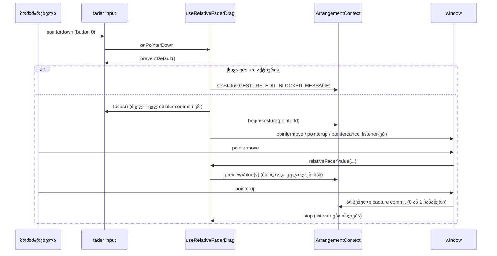

# Studio Lab — fader-ზე დაჭერა აღარ ხტება, drag ფარდობითია, ორმაგი click აბრუნებს default-ზე

**თარიღი:** 2026-10-13
**სტატუსი:** Completed. Round 38 C PASS (c-round-38.md); Tech Lead R38-T ღიაა.
**შეცვლილი პროექტი:** Store

## კონტექსტი

მიქშერის ყველა fader (ხაზის Volume, აუდიო ხაზის Pan, Master Volume) ჩვეულებრივი `<input type="range">`-ია. browser-ში მასზე დაჭერისას მნიშვნელობა **ხტება** დაჭერის წერტილზე. C-მ ეს გაზომა:
- Master-ის ცენტრზე რეალური click → **−27 dB** (`c-round-37.md` CR-2);
- ხაზის Volume-ის ცენტრზე → **50 %** (`c-round-37/runs/crk.txt` CR-1).

ყოველი ასეთი click ისტორიაშიც წერდა ჩანაწერს. მომხმარებელი, რომელსაც მხოლოდ fader-ის ფოკუსირება ან დაჭერა უნდოდა, მიქსს ცვლიდა.

## კონტრაქტი (D-29z3)

| მოქმედება | შედეგი |
|---|---|
| მარცხენა ღილაკით დაჭერა fader-ზე (input-ის ნებისმიერ წერტილზე) და აშვება ჰორიზონტალური მოძრაობის გარეშე | მნიშვნელობა **უცვლელია**, ისტორიაში **0** ჩანაწერია, fader-ს კი **ფოკუსი აქვს**: ისრები მუშაობს, Delete/Backspace მასზე no-op რჩება (round 32–33). `pointerdown`-ზე `preventDefault()` გამოიძახება |
| დაჭერა, ჰორიზონტალური drag, აშვება | **ფარდობითი:** `value = snap(clamp(startValue + Δx · (max − min) / renderedWidth))`. `startValue` დაჭერის მომენტში შენახული მნიშვნელობაა. `Δx` = pointer-ის x − დაჭერის x. `renderedWidth` = input-ის `getBoundingClientRect().width`. `snap` input-ის `step`-ზე ამრგვალებს. ვერტიკალური მოძრაობა არაფერს ცვლის. preview **არსებული** ფუნქციებით მიდის (`previewTrackVolume`, `previewMasterGain`, Pan-ის draft + `previewTrackPan`), ამიტომ ხმა drag-ის დროს live იცვლება. აშვება = **ერთი** ჩანაწერი: `Volume`, `Master Volume` ან `Pan — {name}`. თუ საბოლოო მნიშვნელობა `startValue`-ის ტოლია, ჩანაწერი **0**-ია |
| `renderedWidth` ≤ 0 ან არასასრული | ცვლილება არ ხდება, 0 ჩანაწერი |
| blur ან `pointercancel` drag-ის დროს | **უცვლელი**: მნიშვნელობა შენახულზე ბრუნდება, ჩანაწერის გარეშე (არსებული გზები). იმავე pointer-ის შემდეგი `pointermove` **არაფერს** ცვლის: preview არ ხდება და არ რჩება pending მნიშვნელობა, რომელსაც მომდევნო blur დააკომიტებდა |
| დაჭერა, როცა **სხვა** pointer gesture აქტიურია (`isPointerGestureActive()` true) | `pointerdown`-ზე `preventDefault()` გამოიძახება. მნიშვნელობა, ფოკუსი და ისტორია **უცვლელია**. სტატუსი = `GESTURE_EDIT_BLOCKED_MESSAGE` (იგივე ტექსტი, რასაც დღეს უარყოფილი native `change` აჩვენებს). იმავე pointer-ის შემდეგი `pointermove` არაფერს ცვლის |
| **ორმაგი click** fader-ზე (`dblclick`) | default-ზე დაბრუნება: Volume **1** (100 %), Master **0** dB, Pan **0** (`C`). **ერთი** ჩანაწერი არსებული label-ით, არსებული API-ებით: Pan `setTrackPan(id, 0)`; Volume `previewTrackVolume(id, 1)` + `commitTrackVolume(id)`; Master `previewMasterGain(0)` + `commitMasterGain()`. ორმაგი click-ის ორი დაჭერა ჩანაწერს **არ** ამატებს |
| ორმაგი click უკვე default-ზე მყოფ fader-ზე | **0** ჩანაწერი, სტატუსი უცვლელია |
| ორმაგი click სხვა pointer gesture-ის დროს | არსებული უარი: სტატუსი `GESTURE_EDIT_BLOCKED_MESSAGE`, 0 ჩანაწერი |
| კლავიატურა ფოკუსირებულ fader-ზე (ისრები, Home/End, PageUp/PageDown) | **უცვლელი.** `onChange` + `onKeyUp` commit თითო კლავიშზე ერთ ჩანაწერს წერს (FADER-KEY-ENTRIES ეტაპი 4b-2-შია) |
| Pan readout ღილაკი (`Pan → C`), Mute, Solo, Master Mute, Clip Gain, separator-ები, ხაზის სიმაღლის drag | **უცვლელი** |
| ფოკუსირებული ტექსტური ველი (Clip Gain, ძიება, detail start/end), შემდეგ დაჭერა fader-ზე | **რიგი უცვლელია** (round 36-ის root capture): ველი ჯერ თავისუფლდება (blur commit), fader-ის gesture მერე იწყება. ამის შემდეგ ფოკუსი fader-ზეა. დაჭერა არ ხტება, ამიტომ fader **საკუთარ** ჩანაწერს არ წერს |
| Touch/pen | სამივე სახის fader-ს აქვს `touch-none` (Tailwind `touch-action: none`), ამიტომ touch-ით drag fader-ს მართავს და გვერდს არ ასქროლავს. Zoom-ს ეს class არ აქვს |

**fader-ები:** თითო ხაზის `Volume — {label}` (აუდიო ხაზები **და** ვიდეოხაზის `Volume — ვიდეოს ორიგინალი ხმა`), `Pan — {name}` (აუდიო ხაზები) და `Master Volume`. transport-ის `Zoom (px/წმ)` fader **არ** არის: ის ნავიგაციაა და native რჩება, ნახტომის ჩათვლით.

**სცენარი:** მონტაჟორი Master-ს უბრალოდ ფოკუსის მისაცემად აწვება. მიქსი აღარ ეცემა −27 dB-მდე და Undo-ს სიაში არაფერი ემატება. შემდეგ იგივე fader-ს მარცხნივ ათრევს. ხმა მოძრაობასთან ერთად ჩუმდება, აშვების შემდეგ კი ისტორიაში ერთი `Master Volume` ჩანაწერია. ორმაგი click Master-ს 0 dB-ზე აბრუნებს.

## მიდგომა

### მექანიზმი და B-ის probe

თითო fader-ის `onPointerDown` მარცხენა ღილაკის დაჭერაზე (`button === 0`) იძახებს `event.preventDefault()`-ს, gesture-ის მიღების მიუხედავად. შემდეგ:
- თუ gesture აქტიური არ არის: `currentTarget.focus()`, მერე არსებული gesture-ის დაწყება. რიგი ასეთია, რომ წინა ფოკუსირებული ელემენტის blur handler-ები მაშინ შესრულდეს, როცა gesture ჯერ აქტიური არ არის;
- სხვა შემთხვევაში: უარის სტატუსი და მეტი არაფერი.

drag-ის მოძრაობა `window`-ის `pointermove`-იდან მოდის, `pointerId`-ით გაფილტრული. `setPointerCapture` არ გამოიძახება: jsdom-ს ის არ აქვს და საჭიროც არ არის, რადგან window-ის listener ელემენტის გარეთაც იღებს მოძრაობას.

B-ის probe (`b-round-37/probe-pointerdown.txt`, live `/studio-lab`, წყაროს ცვლილების გარეშე):
- Master-ის `pointerdown`-ზე capture listener-ით `preventDefault()` → რეალური `$B click` მნიშვნელობას `0`-ზე ტოვებს. event-ები: `pointerdown, pointerup, click`. არ არის `mousedown`/`input`/`change` და native focus (`activeElement` BODY);
- listener-ის გარეშე: მნიშვნელობა `−27`-ზე გადადის, Master ფოკუსს იღებს, event-ები კი ასეთია: `pointerdown, mousedown, input, focus, pointerup, mouseup, change, click`.

ანუ `preventDefault` ხსნის native ნახტომს, მაგრამ native focus-საც აუქმებს. ამიტომ ფოკუსს ახლა კოდი ანიჭებს ცალსახად.

### რატომ რჩება `onChange`

`onChange` **ზუსტად** ისეთივე რჩება. ის ემსახურება კლავიატურას და frozen ტესტებს, რომლებიც drag-ს `pointerDown` + `fireEvent.change`-ით აღწერენ (fader-guards 44, gesture-guard 11, track-pan 10 გამოძახება). prevented `pointerdown`-ის შემდეგ რეალური browser დაჭერისას native `input`/`change`-ს არ აგზავნის, ამიტომ `onChange` ახლა მხოლოდ კლავიატურიდან მოდის.

### ფოკუსის გადაწყვეტილება და frozen ტესტის 3 ხაზი

რეალურ Chrome-ში დაჭერილი range ფოკუსს ყოველთვის იღებდა (C rounds 36/37, B probe P2). jsdom-ში `fireEvent.pointerDown` ფოკუსს არ ცვლის, ამიტომ ორი ძველი assertion jsdom-ის კერძო მდგომარეობას აფიქსირებდა. B-მ `fader-guards.test.tsx`-ში ზუსტად ამ 3 ხაზის შეცვლა დაუშვა, A-მ კი შეცვალა:
- l.840: `toBe(controls.musicVolume())` → `toBe(sfxVolume)`. SFX Volume-ზე დაჭერა ფოკუსს SFX-ზე გადაიტანს;
- l.1597: სათაური `'must-not: a focused music Volume keeps its focus when Master is pressed'` → `'a focused music Volume: a Master press moves the focus to Master and leaves the music Volume value unchanged (D-29z3)'`;
- l.1602: `toBe(volume)` → `toBe(controls.master())`.

მუსიკის Volume-ის მნიშვნელობა (0.6) კვლავ მოწმდება l.1604-ზე. `diff` აჩვენებს 3 `-` და 3 `+` ხაზს. სხვა frozen ტესტი არ შეცვლილა.

### Drag-ის ფორმულა და ნორმალიზაცია

`relativeFaderValue({ startValue, deltaPx, widthPx, min, max, step })` (`app/lib/arrangement/fader.ts`, სუფთა ფუნქცია):
- თუ რომელიმე შემავალი არასასრულია, `deltaPx = 0` (ვერტიკალური მოძრაობა off-grid მნიშვნელობასაც არ ცვლის), `widthPx ≤ 0`, `step ≤ 0` ან `max ≤ min`, აბრუნებს `startValue`-ს;
- სხვა შემთხვევაში: `raw = startValue + deltaPx · (max − min) / widthPx` → `snapped = min + round((raw − min) / step) · step` → `clamp(min, max)`;
- **ნორმალიზაცია:** `Number.parseFloat(value.toPrecision(12))`. ის step-ის ათობითი ნიშნების რაოდენობაზე არ არის დამოკიდებული. 12 მნიშვნელოვანი ციფრი float-ის ხმაურს აშორებს (`0.35000000000000003` → `0.35`, `0.7500000000000001` → `0.75`), fader-ის რეალურ ბიჯებს კი (0.01, 0.5, 1) არ ეხება. ის ასევე `−0`-ს `0`-ად აქცევს.

hook-ი (`app/hooks/useRelativeFaderDrag.ts`) `preview`-ს მხოლოდ მაშინ იძახებს, როცა ახალი მნიშვნელობა ბოლო preview-ისგან განსხვავდება (პირველ მოძრაობაზე — `startValue`-ისგან). ამიტომ ქვე-ბიჯური მოძრაობა და ნულოვანი სიგანე preview-ს საერთოდ არ იწვევს.

### Hook-ის სიგნატურა

`useRelativeFaderDrag({ min, max, step, readStoredValue, isPointerGestureActive, beginGesture, previewValue, refuseGesture })` აბრუნებს `onPointerDown` handler-ს.
- `readStoredValue` შენახულ მნიშვნელობას `getArrangement()`-დან კითხულობს gesture-ის დაწყების შემდეგ (Pan-ისთვის ბიჯებში: `round(pan · 50)`);
- `beginGesture` = არსებული `beginTrackVolumeGesture(id, pointerId)` / `beginMasterGainGesture(pointerId)` / Pan-ის `beginPanPointerDrag(pointerId)` (ყოფილი `handlePanPointerDown`-ის ტანი, ახლა boolean-ს აბრუნებს);
- `refuseGesture` = `setStatus(GESTURE_EDIT_BLOCKED_MESSAGE)`.

drag **სამუდამოდ ჩერდება** (listener-ები იშლება, ამ დაჭერისთვის preview აღარ ხდება) fader-ის საკუთარ native `blur`-ზე და იმავე pointer-ის `pointerup` / `pointercancel`-ზე. ის ასევე ჩერდება window-ის `blur`-ზე (ფანჯრის დატოვება; context-ის claim იგივე მომენტში gesture-ს აუქმებს), unmount-ზე და ახალ დაჭერაზე. `optionsRef` render-ში კი არა, effect-ში ახლდება. ერთი render-ით დაგვიანებული options აქ ქცევას ვერ ცვლის: ყველა option მხოლოდ სტაბილურ მნიშვნელობებს იჭერს (`track.id`, context-ის callback-ები, `setPanDraft`, `getArrangement`). შეჩერების გადაწყვეტილება `isPointerGestureActive()`-ის polling-ით **არ** მიიღება: გლობალური flag შეიძლება სხვა pointer-ისთვის ისევ true იყოს, fader-ის საკუთარი gesture-ის getter კი context-ს არ აქვს.

### ორმაგი click

- Volume: `previewTrackVolume(id, 1)` + `commitTrackVolume(id)`;
- Master: `previewMasterGain(0)` + `commitMasterGain()`;
- Pan: `setTrackPan(id, 0)`. დამატებითი refocus არ ხდება: ფოკუსი წინა დაჭერამ უკვე მიანიჭა.

API-ები **პირობის გარეშე** იძახება:
- **default-ზე:** `setMasterMix` 0 dB-ზე იგივე ობიექტს აბრუნებს; `commitHistory` ტოლ Volume snapshot-ს აგდებს (`model.ts` l.603); `applyEdit` Pan 0-ზე `false`-ს აბრუნებს. შედეგი: ერთი ზედმეტი re-render, 0 ჩანაწერი, სტატუსი უცვლელი;
- **სხვა gesture-ის დროს:** `previewTrackVolume`, `previewMasterGain` და `setTrackPan` თავადვე `refuseEditDuringGesture`-ით უარს ამბობენ და blocked სტატუსს წერენ.

**შემოწმების საზღვარი:** headless gstack-ს `dblclick` ბრძანება არ აქვს, CDP-ის `Input.dispatchMouseEvent` კი allowlist-ში არ არის. რეალური ორმაგი click (prevented `pointerdown`-ის შემდეგ Chrome `dblclick`-ს აგზავნის თუ არა) Tech Lead-ის R38-T რიგია. vitest და C სინთეზურ `dblclick`-ს ამოწმებენ.

### Touch

`touch-none` სამივე სახის fader-ს დაემატა, Zoom-ს არა. რეალური touch მოწყობილობაზე შემოწმება (გვერდი არ ისქროლება) Tech Lead-ის R38-T რიგია.

### უარყოფილი ალტერნატივები

- **(a)** native ნახტომის კომპენსაცია პირველ `change`-ზე: არღვევს frozen `pointerDown` + `change` ტესტებს;
- **(b)** მხოლოდ `mousedown`-ის prevent: touch/pen-ს არ ფარავს, probe კი აჩვენებს, რომ `pointerdown` საკმარისია;
- **(c)** custom `role="slider"` ელემენტი native range-ის ნაცვლად: მოითხოვს a11y-სა და ყველა selector-ის გადაწერას, რაც ბევრად დიდი ცვლილებაა;
- **(d)** `preventDefault` root capture-ში: Zoom-საც შეეხებოდა და D-29z-ის მე-5 გადაწყვეტილებას შეცვლიდა.

## არქიტექტურა

## შეცვლილი ფაილები

- `app/lib/arrangement/fader.ts` (ახალი): სუფთა `relativeFaderValue`;
- `app/hooks/useRelativeFaderDrag.ts` (ახალი): დაჭერის, მოძრაობისა და დასრულების wiring სამივე fader-ისთვის. `app/hooks/index.ts`-დან export **არ** ხდება (frozen), import პირდაპირ path-ით;
- `app/components/arrangement/ArrangementLane.tsx`: Volume და Pan input-ები hook-ზე, `onDoubleClick`, `touch-none`, `handlePanPointerDown`-ის ტანი → `beginPanPointerDrag` (boolean). `suppressPanPointerAfterBlur`, `handlePanChange`, `handlePanPointerEnd`, `handlePanBlur` და readout ღილაკი უცვლელია;
- `app/components/arrangement/ArrangementMaster.tsx`: Master Volume input hook-ზე, `onDoubleClick`, `touch-none`;
- `app/lib/arrangement/__tests__/fader-click.test.tsx` (ახალი): 26 ტესტი;
- `app/lib/arrangement/__tests__/fader-guards.test.tsx`: მხოლოდ D-29z3-ის 3 ხაზი;
- ეს დოკუმენტი.

`ArrangementContext.tsx` **არ** შეცვლილა: ყველა საჭირო API უკვე არსებობს.

## პრობლემები და გადაწყვეტები

- **პრობლემა:** `preventDefault` native focus-საც აუქმებს. **გადაწყვეტა:** ცალსახა `focus()` `begin`-მდე. ამ რიგით წინა ველის ან fader-ის blur commit gesture-ის გარეშე სრულდება და, მაგალითად, Clip Gain-ის აკრეფილი `3` დაჭერამდე ინახება.
- **პრობლემა:** blur ან cancel-ის შემდეგ `previewTrackVolume` / `previewMasterGain` gesture-ის გარეშე ახალ pending preview-ს შექმნიდა (`volumeBeforeRef` / `masterBeforeRef`), რომელსაც შემდეგი blur დააკომიტებდა. **გადაწყვეტა:** hook ჩერდება fader-ის native `blur`-ზე და `pointercancel`-ზე და ამ დაჭერისთვის preview-ს აღარ იძახებს (ტესტები F8, F9/F9b).
- **პრობლემა:** `onBlur` byte-ით უცვლელი უნდა დარჩეს. **გადაწყვეტა:** hook ცალკე native `blur` listener-ს ამატებს და `stopDrag`-ში შლის. React-ის `onBlur` (არსებული cancel გზა) ჩვეულებრივ სრულდება.
- **პრობლემა:** Pan-ის preview history-ს არ ცვლის, მხოლოდ draft-სა და audio handle-ს. **გადაწყვეტა:** hook-ის `previewValue` Pan-ისთვის `setPanDraft` + `previewTrackPan`-ს იძახებს, ზუსტად ისე, როგორც `handlePanChange`-ის gesture-ის განშტოება. აშვება და cancel არსებული გზებით მიდის.

## ტესტირება

**Red (ძველ კოდზე, `fader.ts` stub-ით, რომელიც `startValue`-ს აბრუნებს):** `fader-click` 20/22 წითელი + `fader-guards`-ის ზუსტად 2 შესწორებული ტესტი. სულ 22 failed / 71 passed (93). ძველ კოდზე მწვანე იყო:
- P5: guard-ებს stub აკმაყოფილებს;
- D4: must-not.

F8 და F9/F9b ძველ კოდზე მხოლოდ იმიტომ იყო წითელი, რომ drag-ის წინაპირობა (0.35) არ სრულდებოდა.

**Green:** `fader-click` 26/26, `fader-guards` 71/71. frozen `gesture-guard`, `track-pan`, `master-ui`, `clip-gain`, `meter-ui`, `track-meter-ui`, `track-layout`, `render-budget`, `delete-selection-ui` და `ArrangementContext.test.ts` → 191/191. სრული vitest: **70 ფაილი, 1290/1290** (1264 + 26). `tsc` 0, build ✓, `npm run verify` exit 0. Biome `./app`: მხოლოდ 2 baseline CRLF შეცდომა (root-ის auth ფაილები), 218 warning.

| # | შემოწმება |
|---|---|
| P1–P5 | ფორმულა, clamp, Master −12 dB, Pan ბიჯები, guard-ები და ქვე-ბიჯური snap |
| F1 | დაჭერა მოძრაობის გარეშე: `pointerDown` აბრუნებს `false`-ს, 0.6 უცვლელია, 0 ჩანაწერი, ფოკუსი fader-ზეა |
| F2 / F3 | −25 px → 0.35 და ერთი `Volume`, undo → 0.6; უკან დაბრუნება → 0 ჩანაწერი |
| F4 / F5 / F6 | Master −12 dB; Pan `10R` preview history-ის ცვლილების გარეშე, შემდეგ 0.2; ვიდეოს Volume |
| F7 | separator 41-ის დროს დაჭერა: blocked სტატუსი, ფოკუსი და მნიშვნელობა უცვლელია |
| F8 / F9 / F9b | cancel და blur აღადგენს მნიშვნელობას; შემდგომი move, blur commit და release არაფერს ცვლის |
| D1–D6 | ორმაგი click: Volume / Master / Pan reset; default-ზე 0; gesture-ის დროს უარი; სრული მიმდევრობა = +1 |
| T1 | `touch-none` fader-ებზეა, Zoom-ზე არა; Zoom-ის `pointerDown` prevented არ არის |
| R1 | Clip Gain `3` → Volume-ზე დაჭერა: მხოლოდ `[Clip Gain]`, ფოკუსი Volume-ზე |
| P6 + 3 must-not (review-ის შემდეგ) | off-grid snap და ნულოვანი Δ; უცხო pointer და ვერტიკალური მოძრაობა; არა-მარცხენა ღილაკი; unmount drag-ის დროს შლის window listener-ს |

**Browser smoke (A, ერთი გაშვება, PASS-ის მტკიცება არ არის):**
- რეალური `$B click` Master-ზე → `0`, ფოკუსი Master-ზე;
- რეალური click მუსიკის Volume-ზე → `1`;
- Undo გათიშულია.

C-ის IDs: R38-PG, R38-DR, R38-DC, R38-MN, R38-CR, R38-K, R38-S, R38-U, R38-Doc, G38-1…3. რეალური ორმაგი click და touch: Tech Lead-ის R38-T.

## Ableton-თან კავშირი

წყარო: Live 12 Reference Manual, gstack `/browse`-ით:
- §18.1 „The Live Mixer“ — https://www.ableton.com/en/live-manual/12/mixing/ (2026-10-12);
- §42.4 და §42.6 — https://www.ableton.com/en/live-manual/12/live-keyboard-shortcuts/ (2026-10-13).

ვიდეო არ გამოყენებულა.

| ქცევა | Ableton-ის წყარო | იქ დადასტურებული | CZABA-ს გადაწყვეტილება / განსხვავება | C-ის შემოწმება |
|---|---|---|---|---|
| Pan-ზე ორმაგი click default-ზე აბრუნებს | §18.1: "Double-clicking the Pan control resets it to its default value." | **დადასტურებული** | Pan `dblclick` → `C`, ერთი ჩანაწერი | R38-DC DC-P |
| Volume / Master-ზე ორმაგი click აბრუნებს | §42.4 "Reset Parameter Value — Delete or double-click" (device-ის პარამეტრები); §18.1 მხოლოდ Pan-ს ასახელებს | მიქშერის Volume / Main-ისთვის **დაუდასტურებელი** | CZABA იგივე reset-ს Volume-ზე (100 %) და Master-ზე (0 dB) იყენებს, მომხმარებლის მოთხოვნილი fader UX-ით (plan 4b) | DC-V, DC-M, DC-VID |
| fader-ზე click არ ხტება; drag ფარდობითია | §18.1-ში, Live Concepts-სა და §42-ში ტექსტი ვერ მოიძებნა | **დაუდასტურებელი** | CZABA-ს მოთხოვნა (C round 22 §5; plan 4b) | R38-PG, R38-DR |
| Delete მონიშნულ კონტროლზე default-ზე აბრუნებს | §42.6 "Return to Default — Delete" | **დადასტურებული** | **შეგნებული განსხვავება:** Delete ფოკუსირებულ fader-ზე no-op რჩება (`StudioWorkspace.tsx` l.1182; round 32–33-ის კონტრაქტი). ამ round-ში არ კეთდება | PG-DEL |
| Shift = უფრო წვრილი გარჩევადობა drag-ისას | §42.6 "Finer Resolution When Dragging — Shift" | **დადასტურებული** | ამ round-ში არა (T12.9) | — |

დაუდასტურებელ რიგებზე არ ითქმის „Ableton-შიც ასე მუშაობს“.

## Code review (round 38)

`code-reviewer` agent-მა High ვერ იპოვა. გადაწყვეტილებები:
- **Low — ref-ის ჩაწერა render-ში:** გასწორდა, `optionsRef` effect-ში ახლდება;
- **Low — window blur:** გასწორდა, hook window-ის `blur`-ზეც ჩერდება;
- **Nit — vertical move off-grid მნიშვნელობიდან:** გასწორდა, `deltaPx = 0` → `startValue`;
- **Nit — ტესტების mutation-დაფარვა:** დაემატა P6 და 3 must-not ტესტი (უცხო pointer, ვერტიკალური მოძრაობა, არა-მარცხენა ღილაკი, unmount);
- **Medium (დაუდასტურებელი) — touch:** reviewer-ის მეხსიერებით Chromium-ის range `touchstart`/`touchmove`-ზე native-ად შეიძლება ისევ ხტებოდეს, რადგან `pointerdown`-ის `preventDefault` touch event-ებს არ აჩერებს. jsdom და C-ის სინთეზური run-ები ამას ვერ ხედავს. გამოსწორება (non-passive `touchstart` + `preventDefault`) კონტრაქტის ცვლილებაა, ამიტომ არ გაკეთებულა: B / Tech Lead R38-T;
- **არ მიღებულა:** `isPointerGestureActive()` / `buttons === 0`-ით შეჩერება `pointermove`-ში. კონტრაქტი polling-ს კრძალავს, სინთეზურ move-ებს კი `buttons` 0 აქვთ;
- **4b-2 მასალა:** `previewTrackVolume`-ს identity short-circuit არ აქვს (context frozen), ამიტომ default-ზე ორმაგი click ერთ ზედმეტ render-ს იწვევს.

## TODO / შემდეგი ნაბიჯები

- **ეტაპი 4b-2 (round 39+, თითო round-ში მაქსიმუმ სამი დაკავშირებული ბაგი):**
  - FADER-KEY-ENTRIES, A-R29-REVIEW-1 და pending commit-ის რიგი;
  - ძველი უარის სტატუსი C-R37-01-თან ერთად, A-R31-REVIEW-2;
  - A-R32-REVIEW-1 + CP-R37-PAN-KEY-LOCK, A-R33-REVIEW-TOUCH, MASTER-HOLD-TICK-EDGE;
  - CP-R37-DRAG-ENTRIES, A-R37-TEST-HARDENING.
- 4b-2 ჯგუფი 1 (უარის სტატუსის დაბრუნება, Clip Gain-ის შეუნახავი მარკერი, pending preview-ების რიგი): D-29z4, [doc 038](038-studio-lab-pending-status.md).
- Shift-ით წვრილი drag (T12.9) და Delete-to-default (Live §42.6, შეგნებული განსხვავება).
- Tech Lead R38-T: რეალური მაუსით click არ ხტება, drag გლუვია, რეალური ორმაგი click სამივე fader-ს აბრუნებს. touch მოწყობილობაზე fader-ის drag გვერდს არ ასქროლავს.
