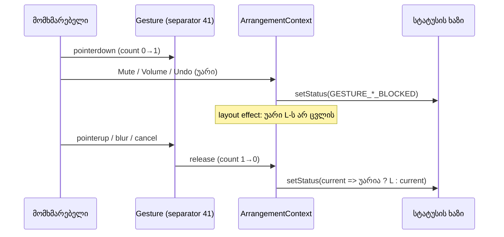
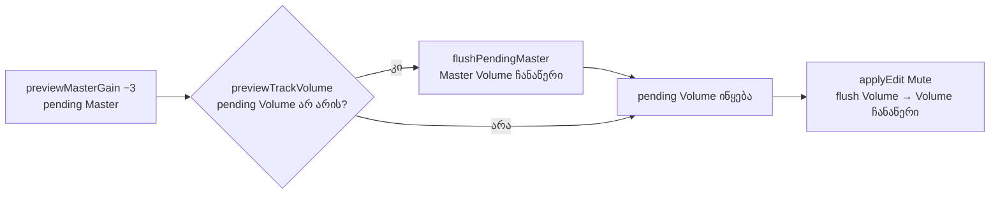

# Studio Lab — უარის სტატუსი gesture-ის შემდეგ ბრუნდება, შეუნახავ Clip Gain-ს ნიშანი აქვს, pending preview-ები რიგით ინახება

**თარიღი:** 2026-10-14
**სტატუსი:** Round 40 C PASS (D-29z5); Round 41 — D-29z6 (C-R40-01).
**შეცვლილი პროექტი:** Store

## კონტექსტი

ეს round სამ დაკავშირებულ ბაგს ასწორებს. სამივე pending state-ს და სტატუსის ხაზს ეხება. გადაწყვეტილება: **D-29z4** (`docs/technical/studio-real-workspace/plan.md`), დასაბუთება: `b-round-38.md`.

1. **ძველი უარის სტატუსი (C-R37-01 ნაწილი 2, C-R31-INFO-REFUSAL-STATUS).** სხვა drag-ის დროს მოქმედებაზე უარი ხაზზე წერს `რედაქტირება drag-ის დროს არ მუშაობს — ჯერ ხელი აუშვი.` (ან Undo/Redo-ს ვარიანტს). ხელის აშვების შემდეგ ეს ტექსტი რჩებოდა, მომდევნო წარმატებული მოქმედების შემდეგაც კი.
   - C round 37 (`c-round-37/runs/kept.txt`): KEPT-2-ში music Volume-ზე რეალურმა click-მა `Volume` ჩაწერა, ხაზზე კი ისევ blocked ეწერა.
   - C round 38 (`c-round-38.md` §6–§7): DC-G-სა და MN-G-ის შემდეგ blocked სტატუსი შემდეგ ნაბიჯებშიც ჩანდა.
2. **შეუნახავი Clip Gain-ის ტექსტი შენახულს ჰგავდა (C-R37-01 ნაწილი 1).** D-29z2-ის მიხედვით, სხვა gesture-ის დროს blur-ზე აკრეფილი ტექსტი რჩება, მაგრამ არ ინახება. KEPT-1-ში ველზე `3` ეწერა ყოველგვარი ნიშნის გარეშე, შენახული მნიშვნელობა კი ისევ დაუყენებელი იყო.
3. **pending preview-ების რიგი (PENDING-COMMIT-ORDER, `checkpoint-oct13-review.md` #5).** `previewTrackVolume` ძველ pending Master preview-ს წინასწარ არ ინახავდა. მომდევნო `applyEdit` ჯერ Volume-ს წერდა, მერე Master-ს. B-მ მიმდინარე კოდზე scratch ასლში დაამტკიცა (`b-round-38/probe-order.test.snippet`): Master −3 → Volume 0.5 → Mute → Undo ×3, შედეგად Master −3-ზე რჩებოდა, 0-ის ნაცვლად.

C-R37-01-ის მე-3 ნაწილი (შენარჩუნებული ტექსტი ინახება მაშინ, როცა მომხმარებელი დაადასტურებს, მათ შორის შუალედური რედაქტირებების შემდეგ) **მიღებულია** და არ შეცვლილა. ახლა ის ხილულია, რადგან ნიშანი აქვს.

## კონტრაქტი (D-29z4)

### სტატუსის ხაზი

*უარის სტატუსი* = `GESTURE_EDIT_BLOCKED_MESSAGE` ან `GESTURE_UNDO_BLOCKED_MESSAGE`.

| სიტუაცია | შედეგი |
|---|---|
| ჩანს (state-ში ჩაწერილია) ნებისმიერი არა-უარის სტატუსი | ინახება, როგორც **ბოლო არა-უარის სტატუსი** L |
| ჩანს უარი | უცვლელია: მაშინვე ჩანს, L არ იცვლება |
| მეორე უარი (ნებისმიერი სახის) | ხაზზე ეს უარია, L უცვლელია |
| pointer gesture-ების რაოდენობა **0**-ს უბრუნდება (commit, cancel, abort, window blur ან ნებისმიერი `release`) და მიმდინარე სტატუსი უარია | სტატუსი ხდება **L**, ზუსტად ისე, როგორც იყო |
| რაოდენობა 0-ს უბრუნდება, მიმდინარე სტატუსი კი უარი აღარ არის (უარის შემდეგ T დაიწერა) | **T** რჩება |
| უარი → T → მეორე უარი → აშვება | სტატუსი ხდება **T** |
| რაოდენობა 2-დან 1-ზე ჩადის | ცვლილება არ არის, უარი რჩება, სანამ რომელიმე gesture აქტიურია |
| gesture იწყება და მთავრდება უარის გარეშე | სტატუსი არ იცვლება |
| უარი, როცა gesture აქტიური არ არის | დღეს მიუღწეველია: უარის ყველა წერტილი ჯერ რაოდენობას ამოწმებს. იხ. „პრობლემები“ |

- მექანიზმი სტატუსს ცარიელ სტრიქონად არასდროს აყენებს.
- გამოქვეყნებული `setStatus: (message: string) => void` უცვლელია.
- უარის ყველა წერტილი სტატუსს context-ის `setStatus`-ით წერს: context-ის `refuseEditDuringGesture`, `undo`/`redo`, Lane/Master `refuseFaderPress`, detail panel (range Apply, Clip Gain Enter/blur, 0 dB) და `StudioWorkspace` (2 ადგილი). ამიტომ call site-ებს შეხება არ დასჭირდა.

### შეუნახავი Clip Gain-ის ნიშანი

| სიტუაცია | შედეგი |
|---|---|
| ველი ჩართულია და მისი **raw** ტექსტი ≠ შენახული მნიშვნელობის ტექსტი (იგივე შედარება, რასაც blur-ის early return იყენებს) | input-ს აქვს `data-pending="true"`, `border-warning` ჩარჩო `border-outline`-ის ნაცვლად და `aria-describedby` ნიშნის ტექსტზე. `0 dB` ღილაკის რიგში ჩანს `შეუნახავია` (`data-testid="arrangement-detail-clip-gain-pending"`); დანარჩენი ტექსტი `sr-only`-შია და `title`-ში, ამიტომ `textContent` და აღწერა სრული სტრიქონია `შეუნახავია — Enter ინახავს, Esc აბრუნებს` (round 40, D-29z5) |
| ტექსტი შენახულს ემთხვევა, ან ველი გამორთულია | `data-pending` და ნიშანი არ არის; `aria-describedby` როგორც ადრე (გამორთვის მიზეზი ან არაფერი) |
| Enter, Escape, 0 dB, gesture-ის დროს უარყოფილი Enter, blur, რომელიც ინახავს ან აბრუნებს | ნიშანი ტექსტს მიჰყვება და ქრება ზუსტად მაშინ, როცა ტექსტი ისევ შენახულს ემთხვევა |
| blur სხვა gesture-ის დროს (D-29z2-ის შენარჩუნებული ტექსტი) | ტექსტი რჩება, ამიტომ **ნიშანიც რჩება** (C-R37-01-ის გამოსწორება) |
| სხვა კლიპის არჩევა | content თავიდან mount-დება (`key` = კლიპის id), ტექსტი და ნიშანი ქრება (უცვლელი ქცევა) |

### pending preview-ების რიგი

`previewTrackVolume` ახალი pending Volume preview-ის **დაწყების** წინ (როცა pending Volume ჯერ არ არის) ჯერ ძველ pending Master preview-ს ინახავს (`flushPendingMaster`). ეს იგივე წესია, რასაც `previewMasterGain` უკვე იყენებს Volume-ისთვის. flush უარის შემოწმების შემდეგ ხდება, ამიტომ უარყოფილი preview არაფერს ინახავს. გაგრძელებული Volume preview flush-ს არ აკეთებს.

## მიდგომა

- **სტატუსი:** context-ში `status` state-ის `useState` ხაზი უცვლელია. ერთი ref ინახავს ბოლო არა-უარის სტატუსს. ერთი `useLayoutEffect([status])` მას ყოველ ჩაწერილ არა-უარის მნიშვნელობაზე ანახლებს. `beginPointerGesture`-ის `release`-ში, როცა რაოდენობა 0 ხდება, `setStatus` functional updater-ით გამოიძახება: თუ მიმდინარე (რიგში მდგარის ჩათვლით) სტატუსი უარია, ბრუნდება ref-ის მნიშვნელობა, სხვა შემთხვევაში უცვლელი რჩება. functional ფორმა იმავე batch-ში რიგში დამდგარ უარსაც და ახალ სტატუსსაც სწორად ხედავს (S1-same-act, S3-same-act).
- **`setStatus` wrapper-ში არ გახვეულა.** `useCallback` wrapper Biome-ისთვის სტაბილური setter აღარ არის. B-ის probe-მა აჩვენა ≈27 ახალი `useExhaustiveDependencies` გაფრთხილება და ~15 deps მასივის შეცვლის საჭიროება scope-ის გარეთ.
- **ნიშანი:** `ArrangementDetailPanel`-ში ერთი `useId`, ერთი გამოთვლილი `isClipGainPending`, input-ის სამი ატრიბუტი და ერთი `
`. ფერი მხოლოდ design token-ებით: `border-warning`, `text-warning` (`--color-warning` #f59e0b მუქ `surface`-ზე საკმარის კონტრასტს იძლევა, `text-dim` fallback საჭირო არ გახდა). `cn` (twMerge) `border-outline`-ს `border-warning`-ით ცვლის, `border` სისქე კი რჩება.
- **რიგი:** `previewTrackVolume`-ში ერთი პირობითი `flushPendingMaster()` `historyRef.current`-ის აღებამდე. მისი deps-ში დაემატა `flushPendingMaster`. flush `historyRef`-ს სინქრონულად ანახლებს, ამიტომ Volume preview უკვე შენახულ Master ჩანაწერზე შენდება.

### უარყოფილი ალტერნატივები

- **(a) უარის გასუფთავება ნებისმიერ წარმატებულ ისტორიის ჩანაწერზე:** Volume-ის drag სტატუსს არ წერს, ამიტომ ხაზი ან ცარიელი დარჩებოდა, ან ძველი ტექსტით.
- **(b) აღდგენა timeout-ის შემდეგ:** დროზეა დამოკიდებული, მომხმარებელი კი შეიძლება ისევ drag-ს აკეთებდეს.
- **(c) შენარჩუნებული Clip Gain ტექსტის ავტომატური შენახვა შემდეგ რედაქტირებაზე:** D-29z2-ს ცვლის და წერს მნიშვნელობას, რომელიც მომხმარებელს არ დაუდასტურებია.
- **(d) modal ან toast შეუნახავ ტექსტზე:** ზედმეტად მძიმეა.

### Layout-ის გადაწყვეტილება: ხილული ტექსტი

**Round 39 (D-29z4), ჩანაცვლებულია ქვემოთ, Round 40-ით:** არჩეული იყო **ხილული ტექსტის** ვარიანტი, არა `sr-only` + `title`. მიზეზი:
- detail panel-ის გარე `section`-ის სიმაღლე `style={{ height }}`-ით არის ფიქსირებული (resizable `size`-იდან), content-იდან არ გამოითვლება;
- content-ს აქვს `overflow-y-auto`, ამიტომ `w-32` სვეტში სამ ხაზად გადატანილი ნიშანი გარე სიმაღლეს ვერ ზრდის;
- ნიშანი გამორთვის მიზეზის ადგილს იყენებს: ორივე ერთად ვერ გამოჩნდება, რადგან `isClipGainPending` მოითხოვს `clipGainReason === null`-ს.

გაზომვა (A-ს browser smoke, 1440×900, ერთი run, PASS-ად არ ითვლება; `tmp/studio-real-loop/a-round-39/browser-smoke.txt`):
- გარე panel 144 px და პირველი ხაზის top 235 px — `3`-ის აკრეფამდე და შემდეგ უცვლელია (±0);
- ჩარჩოს ფერი `rgb(245, 158, 11)` (`--color-warning`), Enter-ის შემდეგ `rgb(48, 53, 65)`;
- **content-ის შიდა overflow:** `scrollHeight` 107 → 122, `clientHeight` 107. 144 px-იან ნაგულისხმევ გახსნილ სიმაღლეზე ნიშნის მესამე ხაზი („აბრუნებს“) ჩამოჭრილია და content-ში scroll ჩნდება. იხ. „პრობლემები“.

1280×720-ზე საბოლოო გაზომვა C-ისაა (PM-1, PM-1280).

**Round 40 (D-29z5) — ახალი განლაგება.** C-მ round 39-ში ჩამოჭრა დაადასტურა (C-R39-01), ამიტომ ნიშანი `0 dB` ღილაკის გვერდით, ერთ ხაზზე გადავიდა. ხილულია მხოლოდ `შეუნახავია`, დანარჩენი ტექსტი `sr-only`-შია და `title`-ში. B-ის გაზომვა (`b-round-39/measure-1440.txt`): slot 128 px, ღილაკი 44.2 px, `შეუნახავია` 69.8 px, სრული ტექსტი 257.5 px. ღილაკი + gap + ნიშანი = 118 ≤ 128. A-ს smoke (`a-round-40/smoke-1440-*.json`, ერთი run, PASS არ არის):
- 1440×900: `scrollHeight`/`clientHeight` 107/107 ნიშნამდეც და ნიშნის შემდეგაც; ნიშნის `
` 69.8 × 16 px, `scrollWidth` 70 = `clientWidth` 70; ღილაკის top 776, ნიშნის top 780 (ერთ რიგშია); focus-ზე `box-shadow` `rgb(245, 158, 11)`, Enter-ის შემდეგ `rgb(18, 217, 200)`;
- 1280×720 (viewport შეიცვალა იმავე სესიაში, ახლიდან ჩატვირთვის გარეშე): 105/105 ნიშნამდე და შემდეგ, ნიშანი 69.8 × 16, `scrollWidth` = `clientWidth` 70.

## არქიტექტურა

## შეცვლილი ფაილები

- `app/contexts/ArrangementContext.tsx` — ბოლო არა-უარის სტატუსის ref და layout effect; აღდგენა `beginPointerGesture`-ის release-ში, როცა რაოდენობა 0 ხდება; `previewTrackVolume`-ში pending Master-ის flush და deps.
- `app/components/arrangement/ArrangementDetailPanel.tsx` — Clip Gain ველის შეუნახავი ნიშანი (`useId`, `isClipGainPending`, `data-pending`, ჩარჩოს კლასი, `aria-describedby`, ნიშნის `
`).
- `app/lib/arrangement/__tests__/pending-status.test.tsx` — ახალი: 22 ტესტი (S1–S9 + 2 same-act, PM1–PM6, PO1–PO4).
- `docs/implementation/2026/quarter-IV/037-studio-lab-fader-click.md` — სტატუსის ხაზი და ერთი TODO ხაზი.
- ეს დოკუმენტი.

## პრობლემები და გადაწყვეტები

- **პრობლემა:** `setStatus`-ის wrapper ყველა consumer-ის deps-ს არღვევდა (B probe). → **გადაწყვეტა:** raw setter უცვლელია, აღდგენა ერთ ადგილას, release-ში functional updater-ით.
- **პრობლემა:** უარი და ახალი სტატუსი შეიძლება release-თან ერთ batch-ში აღმოჩნდეს. → **გადაწყვეტა:** functional updater რიგში მდგარ მნიშვნელობას ხედავს. ორივე შემთხვევა ტესტითაა დაფიქსირებული (S1-same-act, S3-same-act). review-მ აჩვენა, რომ S3 ცალკე mutation (b)-ს ვერ იჭერს. ამიტომ დაემატა S3-same-act.
- **ცნობილი ზღვარი (მიღებულია, D-29z4):** `claimPointerGesture`-ის იმავე pointer-ით ხელახალი claim ჯერ ძველ gesture-ს ათავისუფლებს და მერე ითვლის ახალს. რაოდენობა წამიერად 0-ს ეხება და აღდგენა ამ გადაცემისას ხდება. უვნებელია: უარის პირობა მართლაც დასრულდა.
- **ცნობილი ზღვარი (დღეს მიუღწეველი):** ref მხოლოდ *ჩაწერილ* არა-უარის სტატუსს იმახსოვრებს. თუ ერთ batch-ში მოხდება `setStatus('Z')`, უარი და release, აღდგება წინა L და არა `Z`. დღეს ასეთი გზა არ არსებობს: არცერთი handler ერთ event-ში ახალ სტატუსს და მერე უარს არ წერს, claim-ის window `pointerup` კი release-ს ერთი tick-ით აყოვნებს.
- **ცნობილი ზღვარი (დღეს მიუღწეველი):** თუ უარი ოდესმე gesture-ის გარეშე დაიწერება, შემდეგი gesture-ის release მას აღადგენს. დღეს უარის ყველა წერტილი ჯერ `gestureCountRef`-ს ამოწმებს.
- **პრობლემა (C-R39-01):** 144 px-იან ნაგულისხმევ სიმაღლეზე ნიშნის ტექსტი `w-32` სვეტში სამ ხაზად იშლებოდა და მესამე ხაზი content-ის შიდა scroll-ის ქვეშ ექცეოდა. focus-ზე teal ring ნარინჯისფერ ჩარჩოს ფარავდა. → **გადაწყვეტა (round 40, D-29z5):** ნიშანი `0 dB` ღილაკის რიგშია, ხილულია ერთი სიტყვა `შეუნახავია` (`truncate min-w-0`), სრული ტექსტი `sr-only`-შია და `title`-ში. pending-ის დროს ring არის `focus-visible:ring-warning`. სიმაღლე არ იზრდება (იხ. „Round 40“).
- **შენიშვნა:** `useLayoutEffect` SSR-ზე React 18-ის dev გაფრთხილებას იძლევა. იგივე კლასის გამოძახებები უკვე არის `StudioWorkspace`-სა და `ArrangementDetailPanel`-ში. B-მ `useLayoutEffect` პირდაპირ დაასახელა, ამიტომ არ შეცვლილა (B-ის follow-up).
- **შენიშვნა:** ნიშანი `aria-describedby`-თ focus-ზე იკითხება. live region (`role="status"`) კონტრაქტში არ არის და არ დამატებულა (B-ის follow-up).

## ტესტირება

`pending-status.test.tsx`, red-first:

| ტესტი | ძველ კოდზე (snapshot) | ახალზე |
|---|---|---|
| S1, S2, S1-same-act, S4, S5, S5b, S7, S8, S9 | red | green |
| PM1, PM2, PM3, PM4, PM6 | red | green |
| PO1 | red (Master −3 რჩება, label-ების რიგი Mute, Master Volume, Volume) | green |
| S3, S3-same-act, S6, PM5, PO2, PO3, PO4 | green (must-not) | green |

- საბოლოო red run (snapshot წყარო scratch ასლში, `store/`-ის გარეთ): 15 red / 7 green (`a-round-39/red-run-final-raw.txt`). პირველი run 19 ტესტზე, `store/`-ში ცვლილებამდე: 14 red / 5 green (`a-round-39/red-run.txt`).
- Mutation-ები scratch ასლში (`a-round-39/mutations.txt`): (a) S1, S2, S1-same-act, S4, S5, S5b, S7, S8, S9; (b) S3-same-act; (b2, მიახლოებითი ემულაცია) S5b; (c) S4; (d) S2, S5; (e) S9, PM1–PM4, PM6; (f) PM1–PM4, PM6; (g) PO1; (h, flush უარის შემოწმებამდე) PO4.
- frozen suite-ები, tsc, სრული vitest, build და Biome: იხ. `tmp/studio-real-loop/a-round-39.md`.

C-ის ID-ები: R39-ST (ST-1..6, ST-1280), R39-PM (PM-1..3, PM-KEPT, PM-RAW, PM-VID, PM-1280), R39-PO (მხოლოდ unit), R39-MN, R39-CR, R39-K, R39-S, R39-U, R39-Doc, G39-1..3.

## Ableton-თან კავშირი

წყაროები: Live 12 Reference Manual, gstack `/browse`-ით (B):
- §5.4.2 „Accessing a Set's Undo History“ — https://www.ableton.com/en/live-manual/12/managing-files-and-sets/ , 2026-10-14 (`b-round-38/ableton-managing-files-and-sets-20261014.txt`);
- §3.2 „The Status Bar“ — https://www.ableton.com/en/live-manual/12/live-concepts/ , 2026-10-13 (`b-round-37/ableton-live-concepts-20261013.txt`).

ვიდეო არ გამოყენებულა.

| ქცევა | Ableton-ის წყარო | იქ დადასტურებული | CZABA-ს გადაწყვეტილება / განსხვავება | C-ის შემოწმება |
|---|---|---|---|---|
| ისტორიის ჩანაწერები მოქმედებების რიგს მიჰყვება | §5.4.2: "you will see all the actions in the order they occurred, with the newest at the top" | **დადასტურებული**, როგორც პრინციპი | pending Master preview ახალ Volume preview-მდე ინახება, ამიტომ Undo მათ რიგით აბრუნებს | R39-PO (მხოლოდ unit) |
| დროებითი უარის შეტყობინება პირობის დასრულებისას ქრება | §3.2: "The Status Bar displays useful information like error messages…"; როდის ქრება, არ წერია | **დაუდასტურებელი** | CZABA-ს გადაწყვეტილება: ბოლო gesture-ის დასრულებისას წინა სტატუსი ბრუნდება | R39-ST |
| შეუნახავი value-box-ის ტექსტი მონიშნულია | წყაროში ტექსტი ვერ მოიძებნა | **დაუდასტურებელი** | CZABA-ს მოთხოვნა (C-R37-01) | R39-PM |

დაუდასტურებელ სტრიქონებზე არ ვამბობთ, რომ Ableton ასე მუშაობს.

## Round 40 — detail panel-ის ჩატევა (D-29z5)

### ბაგები

- **C-R39-01 (Low):** 144 px-ზე ნიშანი სამ ხაზად იშლებოდა (48 px). content-ის scroller (`clientHeight` 107, `scrollHeight` 122) მესამე ხაზს 15 px-ით ჭრიდა 1440×900-ზეც და 1280×720-ზეც. focus-ზე teal ring ნარინჯისფერ ჩარჩოს ფარავდა.
- **C-R30-01 (Low, ძველი):** 1280×720-ზე, გახსნილ panel-სა და ნაჩვენებ range-ზე, content box 85 px-ია. info სვეტის `truncate` ხაზებს flex-ში min-height 0 ჰქონდათ, ამიტომ იკუმშებოდნენ და ერთმანეთს ფარავდნენ. scroll არ ჩნდებოდა.
- **DETAIL-REASON-FIT (Low, მხოლოდ გაზომვა):** Clip Gain-ის გამორთვის მიზეზები გრძელია (ვიდეო 345.5 px, ჯგუფი 320.6 px) და 128 px slot-ში სამ ხაზად იშლება. ამ round-ში კოდი არ შეცვლილა (უარყოფილი f). C ზომავს (R40-RS).

### კონტრაქტი

- `0 dB` ღილაკი და ნიშანი ერთ რიგშია: `div` კლასით `flex items-center gap-1`. ღილაკის ატრიბუტები, handler-ები და `data-testid` უცვლელია.
- ნიშნის `
`: `min-w-0 truncate text-warning`, პირველი შვილი ტექსტია `შეუნახავია`, შემდეგ `` ტექსტით ` — Enter ინახავს, Esc აბრუნებს`. `textContent` და `aria-describedby`-ის ტექსტი round 39-ისას ემთხვევა. `title` = სრული ტექსტი.
- input-ის `title`: `clipGainReason ?? (isClipGainPending ? სრული ტექსტი : undefined)`.
- pending-ის დროს input-ის კლასია `border-warning focus-visible:ring-warning`, იმავე `cn(…)`-ში. twMerge `border-outline`-ს და `focus-visible:ring-brand`-ს აგდებს.
- ტექსტები module-level კონსტანტებშია (`DETAIL_CLIP_GAIN_PENDING_FULL_TEXT`, `DETAIL_CLIP_GAIN_PENDING_LABEL`). `sr-only` ნაწილი `FULL.slice(LABEL.length)`-ით მიიღება, ამიტომ JSX whitespace-ის trimming წინა space-ს ვერ დაკარგავს.
- info სვეტის სამ `truncate` `
`-ს (სათაური, `ხაზი …`, ჯგუფის `ხაზები …`) დაემატა `shrink-0`. თუ სვეტი box-ზე მაღალია, არსებული `overflow-y-auto` scroll-ს აჩენს.
- გამორთვის მიზეზების `
`-ები, `DETAIL_PANEL_DEFAULT_HEIGHT_PX`, `openHeightCap` და lane auto-fit უცვლელია.

### უარყოფილი ვარიანტები

- **(a)** მინიშნების შემოკლება ინფორმაციის წაშლით: მინიშნება `sr-only`-სა და `title`-ში რჩება.
- **(b)** slot-ის გაფართოება: სრული ტექსტი 257.5 px-ია, ერთ ხაზზე `w-44`-შიც ვერ ეტევა, მეზობლები კი დავიწროვდებოდა.
- **(c)** ნაგულისხმევი სიმაღლის გაზრდა: timeline-ს ადგილს ართმევს და D-29j-ის გაზომვებს ცვლის.
- **(d)** მხოლოდ `sr-only`: მხედველობის მქონე მომხმარებელი ნიშანს ვეღარ დაინახავდა.
- **(e)** `aria-live`: ყოველ ღილაკზე დაჭერისას გამოცხადდებოდა (MARKER-LIVE-REGION, უარყოფილია).
- **(f)** `truncate` გამორთვის მიზეზებზე: input-ები გამორთულია, ამიტომ keyboard-ისა და touch-ის მომხმარებელი სრულ მიზეზს ვერ მიაღწევდა.

### ფაილები

- `app/components/arrangement/ArrangementDetailPanel.tsx` — ნიშნის კონსტანტები და markup, input-ის `title` და pending კლასები, `shrink-0` info სვეტის სამ ხაზზე.
- `app/lib/arrangement/__tests__/detail-panel-fit.test.tsx` — ახალი, 7 ტესტი.
- ეს დოკუმენტი.

### ტესტები (red-first)

jsdom-ში layout არ არის, ამიტომ ტესტები მხოლოდ markup-ის კონტრაქტს ამოწმებს. გეომეტრიის მტკიცებულება C-ის browser run-ია.

| ტესტი | ძველ კოდზე | ახალზე |
|---|---|---|
| F1 ნიშნის markup (ტექსტის კვანძი, `sr-only`, `title`, `truncate min-w-0`) | red | green |
| F2 ნიშანი და `0 dB` ერთ flex რიგში | red | green |
| F3 input-ის `title` მხოლოდ pending-ზე (Enter, Escape) | red | green |
| F4 ring: pending — warning, სხვა შემთხვევაში brand | red | green |
| F5 must-not: მიზეზის ხაზები მთლიანია, `truncate`-ისა და `title`-ის გარეშე | green | green |
| F8 info ხაზებზე `shrink-0` (კლიპი, ჯგუფი) | red | green |
| F9 must-not: `0 dB` pending მნიშვნელობიდან | green | green |

red run: `tmp/studio-real-loop/a-round-40/red-run.txt` (5 red / 2 green); green: `a-round-40/green-run.txt` (7/7). `pending-status.test.tsx` (22) უცვლელად მწვანეა.

### C-ის ID-ები

R40-PM (PM-1, PM-1280, PM-2, PM-3, PM-KEPT-TAB, PM-RAW, PM-RESET, PM-TAB, PM-R30), R40-RS (მხოლოდ ჩანაწერი), R40-INFO, R40-MN, R40-CR, R40-K, R40-S, R40-U, R40-Doc, G40-1..3.

### Ableton-თან კავშირი

ახალი ქცევა არ არის. წყარო round 39-ისაა: Live 12 Reference Manual §3.2 „The Status Bar“ (https://www.ableton.com/en/live-manual/12/live-concepts/ , 2026-10-13). ახალი browsing და ვიდეო არ ყოფილა.

| ქცევა | Ableton-ის წყარო | იქ დადასტურებული | CZABA-ს გადაწყვეტილება / განსხვავება | C-ის შემოწმება |
|---|---|---|---|---|
| შეუნახავი value-box-ის ტექსტი მონიშნულია | წყარო ვერ მოიძებნა | **დაუდასტურებელი** | CZABA-ს მოთხოვნა (C-R37-01 / C-R39-01); round 40 მხოლოდ ჩატევას ცვლის | R40-PM |
| მინიშნება ერთ ხილულ სიტყვამდე მოკლდება, სრული ტექსტი hover-ზე და screen reader-ისთვის | არ არის | **არ ეხება** (CZABA-ს layout) | CZABA-ს layout-ის გადაწყვეტილება D-29z5 | R40-PM |
| info ხაზები ერთმანეთს არ ფარავს, panel scroll-დება | არ არის | **არ ეხება** | CZABA-ს layout fix (C-R30-01) | R40-INFO |

## Round 41 — გამორთული ველების მიზეზი ყოველთვის ჩანს (D-29z6)

### ბაგი

**C-R40-01 (Low, C-ის მტკიცებულება, ძველი layout):** გამორთვის მიზეზის `
` თავისი სვეტის ხილულ ნაწილს სცდებოდა. content იმოძრავებდა, მაგრამ scrollbar არ ჩანდა, ამიტომ ნაგულისხმევ ხედში მიზეზის ბოლო (`ხაზის Volume/Mute`) უხილავი იყო (`c-round-40/shots/rs-vid-1440-crop.png`). C-ის გაზომვა (fresh load):

| მდგომარეობა | panel / scroller client | Clip Gain მიზეზი ჩამოჭრილი | range მიზეზი ჩამოჭრილი |
|---|---|---|---|
| ვიდეო, 1440 | 144 / 107 | **21 px** (3 ხაზი, 48 px) | — |
| ვიდეო, 1280 | 142 / 105 | **23 px** | — |
| ჯგუფი (REAL Ctrl+A), 1440 | 144 / 107 | **21 px** | 0 |
| ჯგუფი, 1280 | **122** / 85 | **43 px** | **21 px** |
| ვიდეო, 120 px მინიმუმი, 1440 | 120 / 83 | **45 px** | — |
| არაფერი, 1440 და 1280 | 144/107, 142/105 | 0 (1 ხაზი) | 0 (1 ხაზი) |

### B-ის გაზომვა და ჩატევის შემოწმება

B-ის გაზომვა (gstack `/browse`, 1440×900, ნაგულისხმევი სიმაღლე, არაფერია არჩეული; `b-round-40/measure-none-1440.txt`): panel / scroller 144 / 107; info სვეტი 288 × 91; **შუა box** (არაფრის/ჯგუფის დროს ცარიელი, კლიპისას waveform-ის box) 500 × 91; range სვეტი 176 × 91; Clip Gain სვეტი 128 × 91. nowrap სიგანეები: ვიდეოს მიზეზი 345.5, ჯგუფის Clip Gain 320.6, ჯგუფის range 256.3, არაფრის 114.4, ვიდეოს placeholder 180.8 px. 1280-ზე შუა box ≈ 340 px.

- ჯგუფი 1280-ზე, 10 px gutter-ით: box ≈ 330, შიგნით ≈ 312. range მიზეზი 1 ხაზია, Clip Gain-ისა 2. ჯამი 8 + 16 + 2 + 32 = **58 ≤ 69** px ხილული.
- ვიდეო 1280-ზე და 120 px-ზე: placeholder 16 + gap 4 + მიზეზი 32 = **52 ≤ 67** px.
- 1440-ზე ყოველი მიზეზი ერთ ხაზზეა.

სვეტში მიზეზი ვერ ეტევა: 1280 ჯგუფის მდგომარეობაში `
` სვეტში ≈ 80 px-ზე იწყება, სვეტის ხილული ნაწილი კი 77 px-ია. ერთხაზიანი მიზეზიც ≈ 11 px-ით იჭრება (120 px-ზე ≈ 13 px).

### კონტრაქტი

მდგომარეობები `ArrangementDetailContentInner`-ისაა: **ჯგუფი** = `!clip && group`, **ვიდეო** = `clip && selection.isVideo`, **არაფერი** = `!clip && !group`, **აუდიო** = `clip && !selection.isVideo`.

| მდგომარეობა | range მიზეზი (`arrangement-detail-reason`) | Clip Gain მიზეზი (`arrangement-detail-clip-gain-reason`) |
|---|---|---|
| ჯგუფი | შუა box-ში, პირველი | შუა box-ში, range მიზეზის შემდეგ |
| ვიდეო | არ არის (კლიპი არჩეულია) | waveform box-ში (`arrangement-detail-waveform`), placeholder-ის ქვემოთ, ერთ ცენტრირებულ სვეტში |
| არაფერი | უცვლელი: range სვეტში, `მონიშვნა`-ს შემდეგ | უცვლელი: Clip Gain სვეტში, `0 dB` რიგის შემდეგ |
| აუდიო | არ არის | არ არის; waveform, overlay, playhead და ნიშანი უცვლელია |

- შუა box ინარჩუნებს კლასებს და ემატება `flex flex-col gap-0.5 px-2 py-1`. არაფრის დროს ცარიელია.
- `ArrangementDetailWaveform`-ს აქვს ერთი არასავალდებულო prop `videoClipGainReason`. ვიდეოს შტოში ერთი absolute ფენაა (`absolute inset-0 flex flex-col items-center justify-center gap-1 bg-elevated px-2 text-center`): ჯერ `
` ზუსტი ტექსტით `ვიდეოკლიპი · ტალღა არ ჩანს`, შემდეგ მიზეზი. მიზეზი placeholder-ის შიგნით არ არის. waveform box-ის `className` უცვლელია.
- ორივე მიზეზის `
` ერთხელ იქმნება და მდგომარეობის მიხედვით თავსდება. `id`, `data-testid`, `className="text-dim"` და ტექსტი უცვლელია; `truncate`, `title` ან ახალი ატრიბუტი არ დამატებულა.
- input-ების და ღილაკების `disabled`, `title`, `aria-describedby`, Tab-ის რიგი, `0 dB` რიგი და ნიშანი, range Apply, info სვეტი, `key` remount და wheel handler უცვლელია.
- **Scroller:** `arrangement-detail-content` იყენებს `cn('flex min-h-0 flex-1 gap-3 overflow-y-auto px-3 py-2', STUDIO_SCROLLBAR_CLASS)`-ს (`./studio-scrollbar`, იგივე, რასაც Library და Workspace იყენებს). `[scrollbar-gutter:stable]` ყველა მდგომარეობაში 10 px-ს იტოვებს: `shrink-0` სვეტები ინარჩუნებს სიგანეს (288 / 176 / 128), `flex-1` შუა box 10 px-ით ვიწროვდება, არჩევის ცვლილება layout-ს აღარ ძრავს. panel-ის სიმაღლე და ხაზების გეომეტრია უცვლელია.

### რატომ რჩება „არაფერი“ სვეტებში

- ორივე მიზეზი ერთ ხაზზეა და ნაგულისხმევ სიმაღლეებზე ეტევა (C RS-NONE: 0 px). info სვეტის პირველი ხაზი, `აირჩიე კლიპი, რომ დეტალები ნახო`, იგივე ინსტრუქციას ყოველთვის ზემოთ აჩვენებს.
- შუა box-ში `ჯერ აირჩიე კლიპი` ორჯერ მხოლოდ გაიმეორებდა მას.

### უარყოფილი ვარიანტები (D-29z6)

- **(a)** მოკლე მიზეზები: frozen ტესტები ტექსტს აფიქსირებს, 1280 ჯგუფში კი ერთი ხაზიც ვერ ეტევა.
- **(b)** `truncate` + `title` (D-29z5 f): keyboard-ისა და touch-ის მომხმარებელს მიზეზს უმალავს.
- **(c)** მიზეზი გამორთული ღილაკის ზემოთ, იმავე სვეტში: 1280 ჯგუფში მაინც 15 px იჭრება.
- **(d)** ფიქსირებული მიზეზის რიგი scroller-ის ზემოთ ან ქვემოთ: 85 px-იან scroller-ს 16+ px-ს ართმევს.
- **(e)** panel-ის header: სათაურს ეჯიბრება და დაკეცილ panel-შიც ჩანს.
- **(f)** ნაგულისხმევი სიმაღლის გაზრდა (D-29j).
- **(g)** მხოლოდ scrollbar: headless Chromium scrollbar-ს არ ხატავს (`c-round-4.md` R23-1), ვიდეოს მდგომარეობაში კი ჩართული range input-ების გამო scroller keyboard-ით არ იმოძრავებს.

### ფაილები

- `app/components/arrangement/ArrangementDetailPanel.tsx` — `STUDIO_SCROLLBAR_CLASS`-ის import და scroller-ის `cn(…)`; `videoClipGainReason` prop და ვიდეოს ფენა; მიზეზების `
`-ების განთავსება მდგომარეობით; შუა box-ის კლასები.
- `app/lib/arrangement/__tests__/detail-panel-reason.test.tsx` — ახალი, 6 ტესტი.
- ეს დოკუმენტი.

### ტესტები (red-first)

jsdom-ში layout არ არის, ამიტომ ტესტები განთავსების კონტრაქტს ამოწმებს. გეომეტრიის მტკიცებულება C-ის browser run-ია.

| ტესტი | ძველ კოდზე | ახალზე |
|---|---|---|
| RF1 ჯგუფი: ორივე მიზეზი შუა box-ში, რიგით, სვეტების გარეთ, `aria-describedby` უცვლელი | red | green |
| RF2 ვიდეო: მიზეზი waveform box-ში, placeholder-ის შემდეგ და მის გარეთ, ერთი მშობელი | red | green |
| RF3 must-not: არაფერი — მიზეზები სვეტებში, შუა box ცარიელი | green | green |
| RF4 must-not: აუდიო — მიზეზი არ არის, waveform-ში `p` არ არის, ნიშანი `0 dB` რიგში | green | green |
| RF5 scroller-ს აქვს `STUDIO_SCROLLBAR_CLASS`-ის ყველა token და `overflow-y-auto` | red | green |
| RF6 must-not: ხილული მიზეზი `text-dim`, `title`-ის გარეშე, მთლიანი (ჯგუფი, ვიდეო) | green | green |

red run: `tmp/studio-real-loop/a-round-41/red-run.txt` (3 red / 3 green); green: `a-round-41/green-run.txt` (6/6). `detail-panel-fit` (7), `pending-status` (22), `clip-gain` (28), `detail-panel` (24) და `detail-panel-polish` (16) უცვლელად მწვანეა.

### C-ის ID-ები

R41-RV (RV-VID-1440, RV-VID-1280, RV-GRP-1440, RV-GRP-1280, RV-MIN, RV-SWITCH), R41-SB (SB-1..3, SB-4 მხოლოდ ჩანაწერი), R41-NONE, R41-PM, R41-MN, R41-K, R41-S, R41-U, R41-Doc, G41-1..3.

### Ableton-თან კავშირი

ახალი ქცევა არ არის; ახალი browsing და ვიდეო არ ყოფილა. სტატუსის ხაზის წყარო round 39–40-ისაა: Live 12 Reference Manual §3.2, https://www.ableton.com/en/live-manual/12/live-concepts/ , 2026-10-13 (`b-round-37/ableton-live-concepts-20261013.txt`).

| ქცევა | Ableton-ის წყარო | იქ დადასტურებული | CZABA-ს გადაწყვეტილება / განსხვავება | C-ის შემოწმება |
|---|---|---|---|---|
| გამორთული ველის მიზეზი panel-ის თავისუფალ ადგილას ჩანს, არა ველის ქვემოთ | არ არის | **არ ეხება** (CZABA-ს layout) | CZABA-ს layout-ის გადაწყვეტილება D-29z6 (C-R40-01) | R41-RV |
| დეტალების content Studio-ს თხელ scrollbar-ს და სტაბილურ gutter-ს იყენებს | არ არის | **არ ეხება** | CZABA-ს მომხმარებლის მოთხოვნა, 2026-10-07 (ერთნაირი scrollbar-ები) | R41-SB |

„არ ეხება“ სტრიქონებზე არ ვამბობთ, რომ Ableton ასე მუშაობს.

## TODO / შემდეგი ნაბიჯები

- **C-R40-01 — Round 41 (D-29z6).** მზადაა მხოლოდ C-ის PASS-ის შემდეგ.
- **ჯგუფი 2 (round 42, მხოლოდ Pan / Lane):** A-R32-REVIEW-1 + CP-R37-PAN-KEY-LOCK, A-R31-REVIEW-2 + CP-R37-DRAG-ENTRIES.
- **ჯგუფი 3 (round 43):** FADER-KEY-ENTRIES, A-R29-REVIEW-1, A-R33-REVIEW-TOUCH.
- **ჯგუფი 4 (round 44):** MASTER-HOLD-TICK-EDGE, A-R37-TEST-HARDENING + A-R38-TEST-ORDER.
- 4c: round-9 M1/L8, PREVIEW-VOLUME-IDENTITY.
- polish: SSR-LAYOUT-EFFECT-WARN (SSR-უსაფრთხო layout effect სტატუსის ref-ისთვის), DOC035-NOTES და სხვა docs შენიშვნები, EXPORT-DIALOG-FOCUS-RESTORE.
- Tech Lead: R38-T (მათ შორის A-R38-REVIEW-TOUCH); R23-1 — დეტალების scroller-ის scrollbar-ის ვიზუალი (1280×720, ჯგუფის მდგომარეობა), რადგან headless Chromium მას არ ხატავს.
