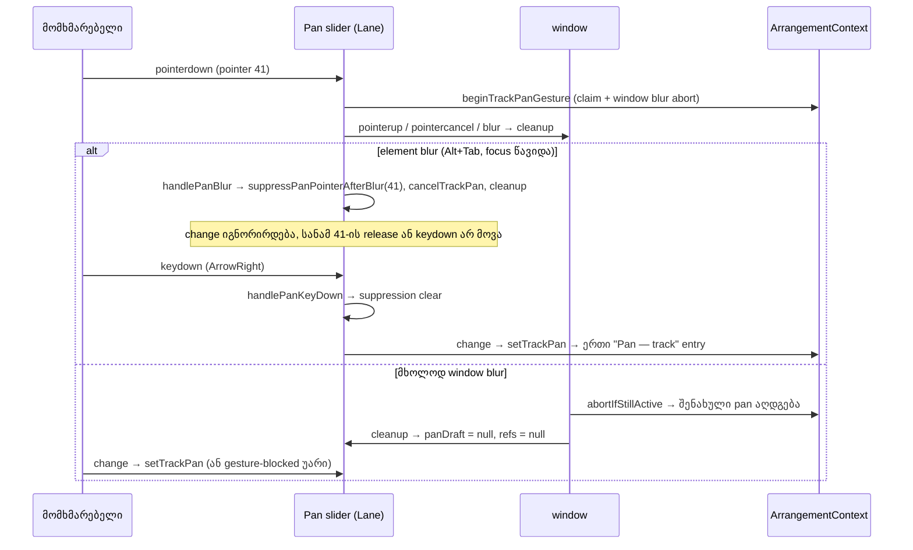

# Studio Lab — Pan-ის აღდგენა დაკარგული release-ის შემდეგ (keyboard unlock) და Lane-ის drag bookkeeping-ის დასრულება window blur-ზე

**თარიღი:** 2026-10-14
**სტატუსი:** Round 42 — D-29z7; C-ის შემოწმებას ელოდება
**შეცვლილი პროექტი:** Store

## კონტექსტი

Round 42 არის SRW-13-ის 4b-2 ეტაპის მე-2 ჯგუფი. გადაწყვეტილება: **D-29z7** (`docs/technical/studio-real-workspace/plan.md`), დასაბუთება: `b-round-41.md`. ორივე წყვილს ერთი მიზეზი აქვს: Lane-ის Pan bookkeeping მხოლოდ drag pointer-ის `pointerup`/`pointercancel`-ზე სრულდებოდა, ამიტომ დაკარგული release მას გაჭედილს ტოვებდა.

1. **A-R32-REVIEW-1 + CP-R37-PAN-KEY-LOCK (Low).** `handlePanBlur` drag pointer-ზე blur suppression-ს რთავს (`suppressPanPointerAfterBlur`). ის მხოლოდ ამავე pointer-ის `window` `pointerup`/`pointercancel`-ზე ან Pan-ზე ახალ დაჭერაზე მთავრდებოდა. სანამ ჩართულია, `handlePanChange` **ყველა** ცვლილებას აგდებს, arrow-ების ჩათვლით. რეალური გზა: Pan drag → Alt+Tab (Chrome slider-ს blur-ს უკეთებს) → ღილაკი ფანჯრის გარეთ აუშვა, ამ pointer-ის `pointerup` არ მოვიდა → ფანჯარაში დაბრუნებისას Pan-ის keyboard მკვდარია, სანამ მომხმარებელი slider-ს ისევ არ დააჭერს.
2. **A-R31-REVIEW-2 + CP-R37-DRAG-ENTRIES (Low / info).** `beginPanPointerDrag` Lane-ის bookkeeping-ს (`panDragCleanupRef`, `panDragPointerRef`, `panDraft`) მხოლოდ ამ pointer-ის `pointerup`/`pointercancel`-ზე ასრულებდა. `claimPointerGesture` (ArrangementContext) `window` `blur`-ზე Pan gesture-ს წყვეტს და შენახულ pan-ს აღადგენს, მაგრამ Lane draft-სა და cleanup ref-ს ინარჩუნებდა. შედეგები:
   - slider ძველ draft მნიშვნელობას აჩვენებდა;
   - `handlePanChange` draft-ს **გლობალურ** `isPointerGestureActive()`-ზე ამოწმებს, ამიტომ ნებისმიერი სხვა gesture-ის დროს Pan-ის keyboard ცვლილება მხოლოდ ვიზუალურ draft-ად რჩებოდა და არასოდეს იწერებოდა.

## მიდგომა

### კონტრაქტი A — keydown ხსნის Pan blur suppression-ს

- Pan `<input type="range">`-ს (`data-testid="arrangement-track-pan"`) ემატება `onKeyDown={handlePanKeyDown}`. Handler მხოლოდ `panBlurSuppressionCleanupRef.current?.()`-ს იძახებს.
- არც `preventDefault`, არც `stopPropagation`: Delete/Backspace/Space ისევ აღწევს `window` listener-ებამდე.
- keydown ბრაუზერის `input`/`change`-მდე ხდება, ამიტომ იგივე arrow press გამოიყენება: ერთი `Pan — <track>` entry მნიშვნელობის შემცვლელ თითო კლავიშზე, არსებული `setTrackPan` გზით.
- სხვა ელემენტზე keydown suppression-ს არ ხსნის (handler მხოლოდ input-ზეა, შვილი ელემენტები არ აქვს).
- `change` keydown-ის გარეშე suppression-ის დროს ისევ იგნორირდება (C-R31-01, `fader-guards`).
- keydown-ის შემდეგ ძველი pointer-ის დაგვიანებული `pointerup`/`pointercancel` არაფერს წერს.

### კონტრაქტი B — Lane-ის Pan bookkeeping `window` `blur`-ზეც სრულდება

- `beginPanPointerDrag` `pointerup`/`pointercancel`-ის გვერდით ამატებს `window` `blur` listener-ს, რომელიც პირდაპირ `cleanup`-ია. `cleanup` სამივე listener-ს შლის.
- `cleanup`-ის ტანი უცვლელია: refs-ს ანულებს მხოლოდ მაშინ, თუ ისინი ჯერ კიდევ მას ეკუთვნის, და `panDraft`-ს `null`-ზე აყენებს.
- შედეგი: window blur-ის შემდეგ slider და reset ღილაკი **შენახულ** pan-ს აჩვენებს, entry არ არის, `isPointerGestureActive()` false-ია. მომდევნო keyboard ცვლილება `setTrackPan`-ზე გადის: სხვა gesture-ის გარეშე ერთი entry, სხვა gesture-ის დროს კი არსებული უარი (`GESTURE_EDIT_BLOCKED_MESSAGE`). ვიზუალური draft აღარ რჩება.
- window blur suppression-ს არც რთავს და არც ხსნის. `handlePanBlur` უცვლელია.

### უარყოფილი ვარიანტები (D-29z7)

- **(a) suppression-ის მოხსნა `focus`-ზე.** დაჭერა თავად აფოკუსებს slider-ს (`useRelativeFaderDrag` → `fader.focus()`), ამიტომ focus keyboard-ის განზრახვის მტკიცებულება არ არის.
- **(b) suppression-ის მოხსნა `window` `blur`-ზე.** Chrome Alt+Tab-ზე slider-ს blur-ს უკეთებს, როცა ღილაკი შეიძლება ჯერ კიდევ დაჭერილია. C-R31-01-ის გარანტია დაჭერილი pointer-ისთვის დაიკარგებოდა. ხილულ ჩაკეტვას keydown ფარავს.
- **(c) draft-ის შემოწმება context-ის "ეს ჩემი Pan gesture-ია" API-ით.** საჭიროებს ახალ `ArrangementContext` export-ს (გაყინული ფაილი, მეტი ზედაპირი). Lane-ის bookkeeping-ის დასრულება context-ის იმავე abort trigger-ით stale state-ს მხოლოდ Lane-ის ცვლილებით აშორებს.
- **(d) keydown-ის ფილტრი კლავიშის მიხედვით.** არა-მნიშვნელობის კლავიშები `change`-ს არ იწვევს, ამიტომ ნებისმიერ keydown-ზე მოხსნა ყველაზე მცირე პატიოსანი წესია.

### მიღებული საზღვრული შემთხვევა

თუ მომხმარებელი blur-ის შემდეგ კლავიშს აჭერს, **სანამ ფიზიკურად იმავე pointer-ს ისევ უჭირავს**, suppression მთავრდება და ამ pointer-ის შემდგომი native thumb `change` `setTrackPan`-ით ჩაიწერება (თითო ცალკე entry). Mouse press `preventDefault`-ით მუშავდება (round 38), ამიტომ mouse-ით native thumb drag აღარ ხდება. Headless-ში არ მეორდება; ახალი ID არ არის. code-reviewer-მაც იგივე აღნიშნა (Low): Shift/Ctrl/Escape/Tab-იც ხსნის suppression-ს. ეს კონტრაქტის (d) პუნქტით მიღებულია.

## არქიტექტურა

## შეცვლილი ფაილები

| ფაილი | დანიშნულება |
|---|---|
| `app/components/arrangement/ArrangementLane.tsx` | `beginPanPointerDrag`-ში `window` `blur` listener-ის დამატება/მოხსნა; ახალი `handlePanKeyDown` და `onKeyDown` Pan slider-ზე |
| `app/lib/arrangement/__tests__/pan-release-recovery.test.tsx` | ახალი: PK1–PK4, RW1–RW4 |
| `docs/implementation/2026/quarter-IV/039-studio-lab-pan-release-recovery.md` | ეს დოკუმენტი |

`useRelativeFaderDrag.ts`, `ArrangementContext.tsx`, Volume/Master fader-ები, Pan reset ღილაკი, `onDoubleClick`, slider-ის ატრიბუტები და კლასები უცვლელია. Doc 036 გაყინულია.

## პრობლემები და გადაწყვეტები

- **პრობლემა:** B-ის PK4 და §4.3 REG-DEL ელოდა, რომ Pan-ზე ფოკუსით Delete SFX კლიპს წაშლიდა. **გადაწყვეტა:** გაყინული კოდი (`StudioWorkspace.tsx`-ის window keydown handler range input-ზე Delete/Backspace-ს აბრუნებს) და გაყინული ტესტები (`fader-guards` "keep the selected clip", `track-pan` "do not delete the selected clip") საპირისპიროს ადასტურებს (C-R31-02). PK4 დაიწერა გაყინული კონტრაქტით: window listener Delete-ს `defaultPrevented: false`-ით იღებს, კლიპი და მონიშვნა რჩება, Pan entry არ არის. B/C-მ REG-DEL უნდა გაასწოროს.
- **პრობლემა:** code-reviewer-მა აღნიშნა, რომ `cleanup`-ში blur listener-ის მოხსნა და window blur-ის შემდეგ დაგვიანებული `pointerup` არ იყო დაფარული. **გადაწყვეტა:** RW3-ს დაემატა შემოწმება, რომ drag-ის დროს დამატებული ყველა `window` `blur` listener `pointerup`-ის შემდეგ მოიხსნა; RW1-ს — დაგვიანებული `pointerup` 41 არაფერს წერს. ახალი `it` არ დამატებულა.

## ტესტირება

`pan-release-recovery.test.tsx`, ძველ კოდზე (red) და ახალზე (green):

| ID | შემთხვევა | ძველი კოდი | ახალი კოდი |
|---|---|---|---|
| PK1 | element blur-ის შემდეგ ArrowRight Pan-ზე → `change` 5 → pan 0.1, ერთი entry | red (`expected +0 to be 0.1`) | green |
| PK2 | keydown music Volume-ზე suppression-ს არ ხსნის | green | green |
| PK3 | keyboard entry-ის შემდეგ 41-ის `pointerup`/`pointercancel` არაფერს წერს | red (PK1-ის ნაბიჯი) | green |
| PK4 | Delete suppressed Pan-ზე window-ს აღწევს `prevented: false`-ით, კლიპი რჩება | green | green |
| RW1 | მხოლოდ window blur: slider `0`, reset `C`, entry არ არის | red (`'-10'`) | green |
| RW2 | window blur-ის შემდეგ სხვა gesture-ის დროს `change` → უარი, draft არ არის; release-ის შემდეგ ერთი entry | red (`'5'`) | green |
| RW3 | დასრულებული drag-ის შემდეგ window blur არაფერს ცვლის | green | green |
| RW4 | window blur suppression-ს არ რთავს: `change` 3 → 0.06, ერთი entry | green | green |

- გაყინული suite-ები (`fader-guards`, `track-pan`, `fader-click`, `gesture-guard`, `track-layout`, `delete-selection-ui`, `pending-status`, `clip-gain`, `ArrangementContext.test.ts`) და ახალი ფაილი: 10 ფაილი, 270/270.
- სრული `npx vitest run`: 74 ფაილი, 1333/1333. `tsc --noEmit` 0. Biome `./app`: მხოლოდ 2 საბაზისო CRLF შეცდომა auth ფაილებზე, 218 warning, 1 info; შეცვლილ ფაილებზე 0.
- C-ის ID-ები: R42-PK, R42-RW, R42-REG, R42-S, R42-U, R42-Doc, G42-1..3.

## Ableton-ის წყარო და შესაბამისობა

ახალი Live-ის ქცევა არ კოპირდება. ერთადერთი ციტირებული წყარო round 37-ის ჩანაწერია: Live 12 Reference Manual §3.2, https://www.ableton.com/en/live-manual/12/live-concepts/, აღებული 2026-10-13, `b-round-37/ableton-live-concepts-20261013.txt`.

| ქცევა | Ableton-ის წყარო | იქ დადასტურებული | CZABA-ს გადაწყვეტილება / განსხვავება | C-ის შემოწმება |
|---|---|---|---|---|
| შეწყვეტილი mouse drag-ის შემდეგ (focus დაიკარგა, release ფანჯრის გარეთ) Pan-ის keyboard მომდევნო კლავიშზე ისევ მუშაობს | არ არის | **არ ეხება** (CZABA-ს web slider-ის input robustness) | D-29z7 A | R42-PK |
| Pan drag-ის დროს window blur drag-ს წყვეტს და შენახულ მნიშვნელობას აჩვენებს | არ არის | **არ ეხება** | D-29z7 B; არსებული gesture-abort წესი (D-29w) | R42-RW |

## TODO / შემდეგი ნაბიჯები

- **C-R41-01** — Tech Lead-ის კითხვა (TL-Q-VIEWPORT): 1280-ზე ვიწრო სიგანეები scope-შია თუ არა; თუ კი, group 3-მდე.
- **PK4 / REG-DEL** — B/C-მ მოსალოდნელი შედეგი გაყინულ C-R31-02 კონტრაქტს უნდა მიუსადაგოს.
- **Round 43 (group 3):** FADER-KEY-ENTRIES, A-R29-REVIEW-1, A-R33-REVIEW-TOUCH.
- **Round 44 (group 4):** MASTER-HOLD-TICK-EDGE, A-R37-TEST-HARDENING + A-R38-TEST-ORDER.
- **შემდეგ:** 4c (round-9 M1/L8, PREVIEW-VOLUME-IDENTITY) და polish.
- Tech Lead-ის R31-T-ს ემატება ნაბიჯი: რეალური mouse Pan drag → Alt+Tab დაჭერილით → release → დაბრუნება → ArrowRight Pan-ს ამოძრავებს.
