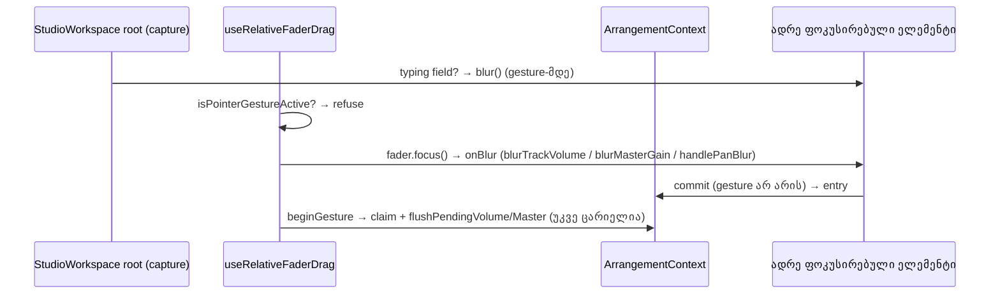

# Studio Lab — Master hold tick სკალის თავში მეტრის შიგნით რჩება; fader-ის focus-ის რიგისა და Clip Gain blur-ის ტესტების გამკაცრება

**თარიღი:** 2026-10-14
**სტატუსი:** Round 43 — D-29z8; C-ის შემოწმებას ელოდება
**შეცვლილი პროექტი:** Store

## კონტექსტი

Round 43 არის SRW-13-ის 4b-2 ეტაპის მე-4 ჯგუფი (D-29z8, დასაბუთება: `b-round-42.md`). სამი Low პუნქტი:

1. **MASTER-HOLD-TICK-EDGE (C round 26 §9).** `ArrangementMaster.tsx`-ის `writeMeter` hold layer-ს (`absolute inset-0`) წერდა `translateX(f × 100%)`-ს, სადაც `f = meterDbToFraction(holdDb)`. შიგნით tick არის `absolute inset-y-0 left-0 -ml-px w-0.5`, ანუ პოზიციის გარშემო −1…+1 px. მეტრის ყუთი `relative h-1.5 w-20 overflow-hidden rounded-full` არის, 80 px. `holdDb ≥ +6`-ზე (f = 1) tick 79…81 px-ზე იყო და მხოლოდ 1 px ჩანდა. Track meter-ს ეს პრობლემა არ აქვს: მისი hold layer `right-0.5`-ზე მთავრდება და tick-ს `-ml-px` არ აქვს (C round 27).
2. **A-R38-TEST-ORDER (test-only).** `useRelativeFaderDrag.ts` ჯერ `fader.focus()`-ს იძახებს (l.41), შემდეგ `beginGesture(pointerId)`-ს (l.44). C-ის round 38-ის მუტაცია (i), რომელიც ამ ორს ადგილს უცვლის, 97/97-ზე გადარჩა.
3. **A-R37-TEST-HARDENING (test-only).** `fader-guards.test.tsx`-ის describe `C-R36-01`-ში:
   - N5-ს არ ჰქონდა pin, რომ release-ის შემდეგ და selection-ის ცვლილებამდე `"3"` ჯერ კიდევ ინახება;
   - N1/N2 იყენებდა `fireEvent.blur(field)`-ს, რომელიც `document.activeElement`-ს არ ცვლის, ამიტომ შემდეგი `field.focus()` არაფერს აკეთებდა.

**მე-3 ჯგუფი კოდის გარეშე (D-29z8):**
- FADER-KEY-ENTRIES მიღებულია: Volume და Master `keyup`-ზე იწერება, Pan თითო ცვლილების კლავიშზე ერთ entry-ს წერს (D-29v).
- A-R29-REVIEW-1 მიღებულია: pending Volume/Master preview ნამდვილი, ჯერ ჩაუწერელი ცვლილებაა და `applyEdit` მას შემდეგ edit-მდე წერს.
- A-R33-REVIEW-TOUCH Tech Lead-ს გადაეცა (R38-T).

## მიდგომა

### Hold tick-ის გეომეტრია

**წესი (§0.1):**
- `holdDb ≥ +6`-ზე მთელი 2 px tick ყუთის შიგნითაა.
- `holdDb ≤ +5`-ზე tick-ის ცენტრი ძველ ადგილზე რჩება, `f × W`.
- +5…+6-ს შორის tick ყუთს არ ტოვებს და `holdDb`-ის ზრდისას მარცხნივ არ მოძრაობს.

**არჩეული ფორმა:**
- `holdDb > +5 dB` (`METER_CEILING_DB − 1`): `writeMeter` წერს `translateX(calc(100% - 1px))`-ს. tick-ის ცენტრი არის W − 1 = 79 px, tick კი 78…80 px-ზეა.
- სხვა შემთხვევაში იწერება უცვლელი `translateX(f × 100%)`.
- `translateX`-ის პროცენტი hold layer-ის საკუთარი სიგანიდან ითვლება (`inset-0` = W), ამიტომ layout read საჭირო არ არის. Per-frame write path იგივეა.
- ორი local const დაემატა (`MASTER_HOLD_CLAMP_FROM_DB`, `MASTER_HOLD_TOP_TRANSFORM`), export-ის გარეშე.

**რატომ ეს ფორმა:**
- **CSS `min()`/`clamp()` უარყოფილია.** `translateX(min(X%, calc(100% - 1px)))` ბრაუზერში უწყვეტი იქნებოდა, მაგრამ jsdom (`cssstyle`) ასეთ `transform`-ს მთლიანად აგდებს: `style.transform === ""`. ეს გადამოწმდა `node -e` probe-ით. ტესტი ამ მნიშვნელობას ვერ წაიკითხავდა. `calc()` და ჩვეულებრივი `%` jsdom-ში ინახება.
- **Wrapper inset (`right-px`, `left-px right-px`, track meter-ის `right-0.5` `-ml-px`-ის გარეშე) უარყოფილია.** მასშტაბს მთელ დიაპაზონზე ცვლის: 0 dBFS-ზე tick 0.8–1.8 px-ით გადაიწევდა, რაც წესი 2-ის 0.5 px ტოლერანსს არღვევს.
- **JS clamp ფიქსირებული W-ით უარყოფილია.** სჭირდება ან 80 px-ის hardcode, ან layout read.

**წესების შემოწმება (W = 80):**
- +5 dB-ზე ცენტრი = 65/66 × 80 ≈ 78.79 px, tick-ის მარჯვენა კიდე 79.79 ≤ 80 (საკმარისია W ≥ 66 px).
- +5-ის ზემოთ ცენტრი ნახტომით 79 px-ზე გადადის (+0.21 px, მარჯვნივ). +6-მდე იქვე რჩება და მარცხნივ არ მოძრაობს.
- 0 dBFS-ზე ცენტრი = 60/66 × W, ანუ ზუსტად ძველი პოზიცია. 0 dBFS-ის ნიშანი (`border-l`, W-ის 10/11-ზე) იგივე წერტილშია.
- Float32 სიგნალისთვის +6 dB პრაქტიკულად 5.9999997 dB-ია. ამიტომ ზღვარი `> +5`-ზეა და არა `≥ +6`-ზე.
- გეომეტრია 16 px root font-ს ეყრდნობა: `w-20` და `w-0.5` rem-ით იზრდება, `1px` და `-ml-px` კი ფიქსირებულია. სხვა root font-ზე tick 2 px-ზე განიერი ხდება და მარჯვენა კიდე პიქსელის ნაწილით შეიძლება მოიჭრას (code-reviewer, Info).
- ზღვრის monotonic-ობა W ≥ 66 px-ს მოითხოვს. დღეს ეს სრულდება (`w-20`), მაგრამ ტესტით დაცული არ არის (code-reviewer, Low). მეტრის შემცირებისას ზღვარი უნდა გადაიხედოს.
- ზუსტად +5.0 dB-ის (`>` vs `≥`) pin არ არის: float32 სიგნალით ზუსტი +5.0 ვერ მიიღება, პირდაპირი `writeMeter` ტესტი კი ახალ export-ს მოითხოვს (code-reviewer, Low; გადადებულია).

**უცვლელი:** visibility (floor-ზე დამალული), `data-level-db`/`data-hold-db`, level cover, მეტრის ზომა 80 × 6 px, Peak ღილაკი და `ArrangementTrackMeter.tsx`.

**მიღებული:** `rounded-full` (3 px radius) ყოველ ბოლოში ბოლო 3 px-ზე tick-ს ვერტიკალურად ჭრის. ზოლი იქ სრულად წითელია. ახალი ID არ არის.

### A-R38 — focus-ისა და gesture-ის რიგი

ხუთი სცენარი გაეშვა ორივე რიგით: მიმდინარე hook-ით და scratch ასლში მუტაცია (i)-ით. Scratch: `tmp/studio-real-loop/a-round-43/scratch`, `store/`-ის გარეთ. თითო ტესტი press-ისა და release-ის შემდეგ ამოწმებს:
- undo chain-ს;
- status-ს;
- `document.activeElement`-ს;
- შენახულ მნიშვნელობებს: music/SFX Volume, Master dB, music Pan, SFX Clip Gain.

| შემთხვევა | მოქმედება | მიმდინარე რიგი | (i) | სხვაობა |
|---|---|---|---|---|
| S1 | Clip Gain "3" (SFX) → music Volume press | press-ზე `Clip Gain` +3, focus Volume-ზე, blocked status არ არის | იგივე | არა |
| S2 | music Volume ArrowLeft + change, keyUp-ის გარეშე → SFX Volume press | ერთი `Volume` | იგივე | არა |
| S3 | Master ArrowLeft + change → music Volume press | ერთი `Master Volume` | იგივე | არა |
| S4 | music Pan key step → music Volume press | მხოლოდ `Pan — მუსიკა` | იგივე | არა |
| S5 | music Volume pending preview → Master press | ერთი `Volume` | იგივე | არა |

**შედეგი: დღეს დაკვირვებადი სხვაობა არ არის.** ხუთივე სცენარი ახალ ფაილში must-not pin-ად დარჩა, ორივე რიგზე მწვანე. ეს pin-ები კონტრაქტს იცავს, მაგრამ რიგის შეცვლას **ვერ** აღმოაჩენს: მუტაცია (i) მათზე გადარჩება. ეკვივალენტობის მტკიცებულებაა scratch-ის გაშვება და ქვემოთ მოცემული არგუმენტი.

**რატომ არის ორი რიგი ეკვივალენტური:**
- **S1:** workspace root-ის capture handler (`StudioWorkspace.tsx` l.911–924, მიბმულია l.1334-ზე) fader-ის handler-მდე ეშვება. თუ fokus typing field-ზეა, target range input-ია და gesture არ მიდის, ის field-ს `blur()`-ს უკეთებს. ამიტომ `commitClipGain('blur')` (`ArrangementDetailPanel.tsx` l.337, onBlur l.535) gesture-ის გარეშე ეშვება, hook-ის რიგის მიუხედავად.
  - დიაგნოსტიკა (scratch, C-ის მუტაცია არ არის): (i) + root capture-ის მოცილება → S1 წითელია, `expected null to be 'Clip Gain'`. blur gesture-ის დროს ხვდება: blocked status, ტექსტი რჩება.
  - capture-ის მოცილება მიმდინარე hook-ით → 5/5 მწვანე.
  - ე.ი. S1-ის ეკვივალენტობას root capture უზრუნველყოფს.
- **S2/S5 (Volume pending):**
  - მიმდინარე რიგი: `focus()` → ძველ Volume-ზე `blurTrackVolume` (l.2173), gesture არ არის → `commitTrackVolume` (l.2096) → `applyEdit` (l.954) წერს `Volume`-ს.
  - (i) რიგი: `beginTrackVolumeGesture` (l.2126) / `beginMasterGainGesture` (l.2372) claim-ის შემდეგ `flushPendingVolume`-ს იძახებს (l.2150 / l.2396, განმარტება l.928) და იგივე `Volume` entry-ს წერს.
  - შემდეგ `focus()` → `blurTrackVolume`. სხვა track-ის gesture-ზე არაფერს აკეთებს; Master gesture-ზე `commitTrackVolume` `gestureCountRef.current > 0`-ზე ჩერდება (l.2100).
- **S3 (Master pending):**
  - მიმდინარე რიგი: `blurMasterGain` (l.2418) → `commitMasterGain` (l.2347) წერს `Master Volume`-ს.
  - (i) რიგი: `beginTrackVolumeGesture`-ის `flushPendingMaster` (l.2151, განმარტება l.941) წერს `Master Volume`-ს. შემდეგ `commitMasterGain` gesture-ის გარეშე და `gestureCount > 0`-ზე ჩერდება (l.2349).
- **S4:** `handlePanBlur` (`ArrangementLane.tsx` l.370) მოქმედებს მხოლოდ Pan drag-ის დროს (`panDragCleanupRef`). key step-ის შემდეგ ის no-op-ია ორივე რიგში.
- **Claim-ის უარი:** `claimPointerGesture` (l.1340) უარს მხოლოდ მაშინ ამბობს, როცა სხვა gesture აქტიურია. ამ დროს hook უკვე l.36-ზე ჩერდება (`isPointerGestureActive`, l.1391), `focus()`-მდე. ამიტომ "claim-ის უარი focus-ის გარეშე" დღეს მიუწვდომელია.
- **შიდა, არა მომხმარებლისთვის ხილული, ასიმეტრია:** blur-გზა `applyEdit`-ით `syncPlayback`-საც იძახებს, flush-გზა კი არა. preview უკვე synced-ია, ამიტომ graph-ისა და history-ის შედეგი იგივეა.

### A-R37 — ცვლილებები `C-R36-01` describe-ში

- **N1, N2:** blur gesture-ის დროს `fireEvent.blur(field)`-ის ნაცვლად `act(() => { field.blur(); })` ეშვება. დაემატა:
  - `document.activeElement !== field` blur-ის შემდეგ;
  - `document.activeElement === field` `field.focus()`-ის შემდეგ.
- **N2:** მეორე pointer-ის (42) Master press რიგში დარჩა. დაემატა pin, რომ ის focus-ს **არ** ცვლის: gesture აქტიურია, ამიტომ hook უარს `focus()`-მდე ამბობს.
- **N5:** release-ის შემდეგ და პირველ `selectClip`-მდე დაემატა `field.value === '3'` და `undoLabel === null`.
- ყველა არსებული `expect` იგივე მოსალოდნელი მნიშვნელობით დარჩა. სხვა `it`, describe ან helper არ შეცვლილა.

## არქიტექტურა

## შეცვლილი ფაილები

- `app/components/arrangement/ArrangementMaster.tsx`: hold layer-ის transform-ის ჩაწერა `writeMeter`-ში (+5 dB-ის ზემოთ `calc(100% - 1px)`), `METER_CEILING_DB` import და ორი local const.
- `app/lib/arrangement/__tests__/master-hold-tick.test.tsx` (ახალი): HT1–HT3, სტრუქტურული pin-ები დაწერილ style-ზე.
- `app/lib/arrangement/__tests__/fader-focus-order.test.tsx` (ახალი): S1–S5 must-not pin-ები.
- `app/lib/arrangement/__tests__/fader-guards.test.tsx`: მხოლოდ `C-R36-01` describe (N1, N2, N5).
- ეს დოკუმენტი.

## პრობლემები და გადაწყვეტები

- **პრობლემა:** jsdom `transform`-ში `min()`/`clamp()`-ს აგდებს, ამიტომ ტესტი clamp-ს ვერ წაიკითხავდა.
  **გადაწყვეტა:** +5 dB-ის ზემოთ წერია `translateX(calc(100% - 1px))`, რომელსაც jsdom ინახავს.
- **პრობლემა:** float32 sample-ის გამო −12 dB-ზე პროცენტი `72.72727234…` გამოდის და არა `72.72727272…`. +6 dB კი 5.9999997 dB-ია.
  **გადაწყვეტა:** HT2/HT3 პროცენტს regex-ით კითხულობს და `toBeCloseTo(…, 4)`-ით ადარებს. ეს 0.5 px-ზე გაცილებით მკაცრია და `translateX(N%)` ფორმას მაინც მოითხოვს. clamp-ის ზღვარი `> +5`-ზეა.
- **პრობლემა:** scratch ასლი `node_modules`-ს ვერ პოულობდა: `vitest/config` unresolved.
  **გადაწყვეტა:** `scratch/node_modules` არის directory junction `store/node_modules`-ზე. ეს install არ არის. junction იშლება მხოლოდ `rmdir`-ით, `rm -rf`-ით არა.

## ტესტირება

- **Red run (`a-round-43/red-run.txt`):** HT2/HT3 ჯერ დაიწერა და snapshot-ის `ArrangementMaster.tsx`-ზე მწვანე იყო. შემდეგ დაემატა HT1 → HT1 წითელი (`translateX(99.99999967176774%)`), HT2/HT3 მწვანე.
- **Green run (`green-run.txt`):** §4.7-ის 12 ფაილი, 227/227. სრული vitest 76 ფაილი, 1341/1341 (1333 + 8 ახალი `it`).
- **Order table (`order-table.txt`):** მიმდინარე hook-ი და (i) — 76/76 (`fader-focus-order` + `fader-guards`). დიაგნოსტიკა (i) + root capture-ის გარეშე: S1 წითელია.
- **R4 მუტაცია (`r37-mutation.txt`):** blur gesture-ის დროს ტექსტს აბრუნებს.
  - ახალ ფაილზე: N1 l.1630-ზე, N2 l.1658-ზე, N3 l.1679-ზე და N5 **ახალ pin-ზე l.1711** ჩავარდა.
  - snapshot-ის ტესტზე (`r37-mutation-snapshot.txt`) N5 გადარჩა: 3 წითელი.
- **HT მუტაციები:** (b) clamp ყველა დონეზე → HT1–HT3 წითელი. (c) visibility ყოველთვის `visible` → HT3 წითელი. hold layer-ის `inset-0` → `inset-y-0 left-0 right-px` (wrapper inset; transform-ის სტრიქონი უცვლელია) → HT2 წითელი, class pin-ზე.
- **C-ის ID-ები:** R43-HT (ბრაუზერის გეომეტრია), R43-U, R43-REG, R43-S, R43-Doc, G43-1..3.

## Ableton-ის წყარო

| ქცევა | Ableton-ის წყარო | იქ დადასტურებული | CZABA-ს გადაწყვეტილება | C-ის შემოწმება |
|---|---|---|---|---|
| Master peak-hold tick სკალის თავში სრულად ჩანს | არ არის | არ ეხება (CZABA-ს მეტრის გეომეტრია, round 26) | D-29z8 (§0.1) | R43-HT |
| Fader-ზე დაჭერა drag gesture-მდე აფოკუსებს fader-ს | არ არის | არ ეხება (D-29z/D-29z3) | test-only | R43-U |
| სხვა gesture-ის დროს აკრეფილი Clip Gain release-მდე ინახება | არ არის | არ ეხება (D-29z2) | test-only | R43-U |

## TODO / შემდეგი ნაბიჯები

- Round 44 (4c): R9-REVIEWER-M1-L8 და PREVIEW-VOLUME-IDENTITY (`ArrangementContext.tsx`).
- Round 45 (polish): SSR-LAYOUT-EFFECT-WARN, EXPORT-DIALOG-FOCUS-RESTORE, LIB-SEP-REASON და doc-ის შენიშვნები.
- შემდეგ: SRW-14 (FB-13 Grid/Snap, stage 1).
