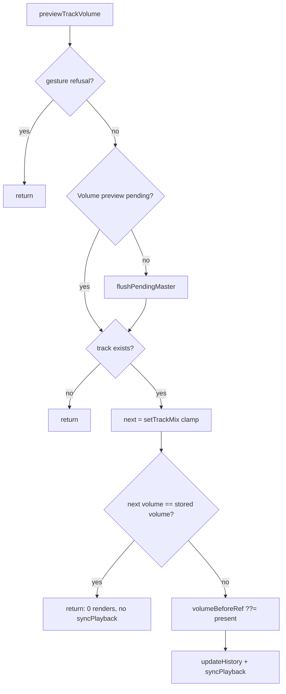

# Studio Lab — `ArrangementContext`-ის სისუფთავე: მკვდარი transport latch, position store-ის შეცდომის ტექსტი და Volume preview, რომელიც არაფერს ცვლის

**თარიღი:** 2026-10-15
**სტატუსი:** Round 44 — D-29z9; C-ის შემოწმებას ელოდება
**შეცვლილი პროექტი:** Store

## კონტექსტი

Round 44 არის SRW-13-ის 4c ეტაპი (D-29z9, დასაბუთება: `b-round-43.md`). ორი Low პუნქტი და ერთი info პუნქტი, სამივე `app/contexts/ArrangementContext.tsx`-ში. ახალი ფუნქცია, UI-ის ან მოდელის ცვლილება არ არის.

| ID | Severity | მდგომარეობა `2c0f800`-ზე |
|---|---|---|
| **R9-REVIEWER-M1** | Low | `transportRunningRef` (l.532) იწერებოდა `markTransportRunning`-ით (l.564–566). ის გამოიძახებოდა `stopPlayback`-ში (l.757), `pumpPlaybackAudio`-ში (l.836–838) და `togglePlayback`-ში (l.1032). ერთადერთი წამკითხველი იყო l.836-ის guard, რომელიც მხოლოდ იმას წყვეტდა, ხელახლა გამოეძახებინა თუ არა `markTransportRunning(true)`. მნიშვნელობას არაფერი იყენებდა. |
| **R9-REVIEWER-L8** | Low | `useArrangementPositionStore` (l.2795–2801) აგდებდა `'useArrangementPosition must be used within an ArrangementProvider'`-ს, ანუ სხვა hook-ის სახელს. |
| **PREVIEW-VOLUME-IDENTITY** | info | `previewTrackVolume` (l.2068–2085) ყოველთვის იძახებდა `updateHistory`-სა და `syncPlayback`-ს, მაშინაც, როცა მნიშვნელობა არ იცვლებოდა. `setTrackMix` (`model.ts` l.439) ყოველთვის ახალ object-ს აბრუნებს. 100 %-ზე მყოფ Volume-ზე double-click (`resetTrackVolume`, Lane l.342–345) ხარჯავდა ერთ provider render-სა და ორ `syncPlayback`-ს და 0 entry-ს წერდა. `previewMasterGain` (l.2316–2336) უკვე ბრუნდება ადრე, როცა `setMasterMix` იმავე object-ს აბრუნებს (l.2326). |

**Round 43-ის გადაწყვეტილებები (B, კოდის გარეშე):** TASK-R43-HTZERO დაიხურა ტექსტის დაზუსტებით: ≈ 0 dBFS-ის fixture-ებში ვიდეოს Mute ჩართულია. A-R43-EXACT-5DB მიღებულია (Δ 0.21 px ≤ 0.5). A-R43-REVIEW-W66 მიღებულია watch-პირობით: Master meter-ის სიგანის ნებისმიერ ცვლილებაზე R43-HT ხელახლა იზომება. A-R43-REVIEW-ROOTFONT მიღებულია (info). ROOT-ROUND42-CHECKPOINT-RECORD დაიხურა, ღია დარჩა ROOT-ROUND43-CHECKPOINT-RECORD.

## მიდგომა

### R9-REVIEWER-M1 — წაშლა, არა rename

- წაიშალა `transportRunningRef`, `markTransportRunning`, მისი სამი გამოძახება და `stopPlayback`-ის, `pumpPlaybackAudio`-სა და `togglePlayback`-ის `useCallback` dependency-ებიდან `markTransportRunning`.
- `pumpPlaybackAudio`-ში guard-ის წაშლის შემდეგ `const ctx` აღარავინ იყენებდა და ისიც წაიშალა. დანარჩენი იგივე რიგით დარჩა: `isPlayingRef` return → `fillLoopIterations()` → `resyncLoopRef.current()` → `releaseRetiredGraphs(false)`.
- `anchorRef.current.holdUntil` და მისი სხვა გამოყენებები (`getPlaybackClock`, l.647 და სხვ.) უცვლელია.
- **რატომ წაშლა:** rename დატოვებდა კოდს, რომელსაც არაფერი კითხულობს. ყველაზე პატარა პატიოსანი ცვლილება წაშლაა.

**Round 9-ის ჩანაწერთან შეჯერება** (`a-round-9.md` §7: „reviewer #2 later confirmed the ref works as a latch and is not dead“):
- **Round 8-ში** (`08b9e53^`) ref-ი dedupe guard იყო: `markTransportRunning` ref-ს ამოწმებდა და მხოლოდ ცვლილებისას იძახებდა `setIsTransportRunning(next)`-ს. state `isTransportRunning` context value-ში გადიოდა (type l.182, value l.1930, deps l.2006). მაშინ ref-ის მნიშვნელობა ნამდვილად რაღაცას აკონტროლებდა: React state-ის განახლებას. `app/`-ში context-ის გარეთ `isTransportRunning`-ს არცერთი კომპონენტი არ კითხულობდა (`git grep` `08b9e53^`-ზე).
- **Round 9-მა** state და context-ის ველი წაშალა (R9-L2, context value უცვლელი რჩება start hold-ის გათავისუფლებისას), ref და მისი setter კი დატოვა, რადგან დავალება ამას მოითხოვდა. ამის შემდეგ ref-ი „latch“-ად მუშაობდა იმ აზრით, რომ მისი მნიშვნელობა სწორად იცვლებოდა. თუმცა ეს მნიშვნელობა უკვე მხოლოდ თავის guard-ს აწვდიდა.
- **`2c0f800`-ზე** ref-ის ერთადერთი წამკითხველი იყო l.836-ის `!transportRunningRef.current`. ეს guard მხოლოდ `markTransportRunning(true)`-ს აკონტროლებდა, ეს უკანასკნელი კი მხოლოდ ref-ში წერდა. გამოსავალი არცერთ შტოში არ იყო. `grep -rn "transportRunning\|markTransportRunning" app/` ცვლილებამდე 10 დამთხვევას პოულობდა, ყველას `ArrangementContext.tsx`-ში: l.532, 564, 565, 757, 772, 836, 837, 843, 1032, 1045. ცვლილების შემდეგ — 0.

### R9-REVIEWER-L8 — შეცდომის ტექსტი

`useArrangementPositionStore` ახლა აგდებს `'useArrangementPositionStore must be used within an ArrangementProvider'`-ს. `useArrangementPosition` და `useArrangementPositionWriter` ისევ მას იძახებენ, ამიტომ მათი შეცდომა ასახელებს store hook-ს, რომელიც რეალურად ჩავარდა. ფაილის სხვა `must be used within` ტექსტები უკვე სწორი იყო და უცვლელია. `app/lib`-სა და `app/components`-ში ამ ტექსტს არცერთი ტესტი არ ამოწმებდა.

### PREVIEW-VOLUME-IDENTITY — identity check

`previewTrackVolume(trackId, volume)` ახლა ბრუნდება `updateHistory`-ის, `syncPlayback`-ისა და `volumeBeforeRef`-ის დაყენების გარეშე, როცა:
- `historyRef.current.present`-ში `trackId` track-ი არ არსებობს (ცალკე, ცხადი return);
- ან `setTrackMix(...)`-ის შედეგში ამ track-ის `volume` ემთხვევა შენახულს.

**რიგი** (`previewMasterGain`-ის სარკე):
1. gesture refusal check (უცვლელი);
2. `flushPendingMaster()`, თუ Volume preview არ ელოდება (უცვლელი). ის identity check-მდე სრულდება, როგორც `flushPendingVolume` `previewMasterGain`-ში;
3. **identity check (ახალი);**
4. მხოლოდ ამის შემდეგ: `volumeBeforeRef` (თუ ცარიელია), `updateHistory`, `syncPlayback`.

**Clamp:** შედარება ხდება `setTrackMix`-ის შედეგთან, არა raw არგუმენტთან. `setTrackMix` თავად აკეთებს `[0, 1]` clamp-ს, ამიტომ 1.5 → 1 იგივე მნიშვნელობად ითვლება. ახალი helper ან ცალკე clamp-ის ასლი საჭირო არ გახდა.

**შედარება ხდება `present`-თან, არა `volumeBeforeRef`-თან.** თუ preview უკვე ელოდება და მომხმარებელი gesture-მდე არსებულ მნიშვნელობას დაუბრუნდება, `present` ისევ იცვლება. commit შემდეგ 0 entry-ს წერს `commitHistory`-ის მეშვეობით (PV8).

**რატომ `model.ts` უცვლელი:** `setTrackMix`-ს Mute toggle-იც იყენებს (l.2048). info პუნქტისთვის model-ის გახსნა საჭირო არ არის; ცვლილება მხოლოდ context-შია. ახალი export ან helper ფაილი არ დამატებულა.

## არქიტექტურა

## შეცვლილი ფაილები

- `app/contexts/ArrangementContext.tsx` — latch-ის წაშლა, L8 ტექსტი, identity return `previewTrackVolume`-ში.
- `app/lib/arrangement/__tests__/context-hygiene.test.tsx` — ახალი: PV1–PV8, L8a, L8b. Fake audio და provider-ის set-up `pending-status.test.tsx`-იდანაა გადმოწერილი, fiber `renderLog` კი `master-ui.test.tsx`-იდან (copy და არა import).
- `docs/implementation/2026/quarter-IV/041-studio-lab-context-hygiene.md` — ეს დოკუმენტი.

## პრობლემები და გადაწყვეტები

- **პრობლემა:** PV4 (UI double-click 100 %-ზე) snapshot-ზე მწვანე გამოვიდა მხოლოდ consumer render-ის დათვლით. `resetTrackVolume` preview-სა და commit-ს ერთ event-ში იძახებს. `commitHistory` თანაბარ snapshot-ზე ორიგინალ `present` object-ს აბრუნებს, ამიტომ memoized context value იგივე რჩება და consumer-ი არ re-render-დება. ფუჭად იხარჯებოდა provider-ის ერთი render და ორი `syncPlayback`.
  **გადაწყვეტა:** PV4-ს დაემატა provider render-ის pin (`ArrangementProvider` = 0). ის იყენებს `master-ui.test.tsx`-იდან გადმოწერილ fiber `renderLog`-ს. Consumer-ის pin (0) დარჩა. შეიცვალა მხოლოდ ტესტი, კოდი — არა. ამის შემდეგ PV4 snapshot-ზე წითელია (`expected 1 to be +0`).
- **პრობლემა:** მუტაცია (f) „missing track-ზე short-circuit არ ხდება“ guard-ის უბრალო წაშლით გადარჩებოდა, რადგან `undefined === undefined` მაინც return-ს იძლევა.
  **გადაწყვეტა:** კოდში missing track-ის return ცხადი და ცალკეა (§0.3). მუტაცია (f) ჩამოყალიბდა როგორც `stored && …` შედარება guard-ის გარეშე, ანუ missing track-ზე preview გრძელდება. PV3 მას იჭერს.
- **პრობლემა:** Biome-მა ტესტში `createElement(..., { children })`-ზე `noChildrenProp` შეცდომა მისცა.
  **გადაწყვეტა:** error boundary-ს children JSX-ით გადაეცემა.

## ტესტირება

**Red run** (snapshot `91fa12d6` = HEAD, `a-round-44/red-run.txt`): PV1, PV2, PV3, PV4 (`expected 1 to be +0`) და L8a (`expected 'useArrangementPosition must be used w…' to be 'useArrangementPositionStore must be u…'`) წითელია. PV5–PV8 და L8b მწვანეა.

**Green run** (`a-round-44/green-run.txt`): 10/10.

**მუტაციები** (scratch, `store/`-ის გარეთ, `a-round-44/mutations.txt`):

| # | მუტაცია | დაიჭირა |
|---|---|---|
| (a) | snapshot | PV1, PV2, PV3, PV4, L8a |
| (b) | identity check `flushPendingMaster()`-მდე | PV7 |
| (c) | raw არგუმენტის შედარება | PV2 |
| (d) | L8 ტექსტის დაბრუნება | L8a |
| (e) | return, როცა ახალი მნიშვნელობა `volumeBeforeRef`-ის volume-ს ემთხვევა | PV8 |
| (f) | missing track-ზე short-circuit არ ხდება | PV3 |
| control | მიმდინარე ფაილი | 10/10 |

**Gates:** tsc 0; frozen suites 15 ფაილი / 287 ტესტი; სრული vitest 77 ფაილი / 1351 ტესტი (1341 + 10); build; `npm run verify` exit 0; Biome `./app`-ზე მხოლოდ 2 baseline CRLF შეცდომაა (auth ფაილები), 218 warning და 1 info, შეცვლილ ფაილებზე 0.

**C-ის ID-ები:** R44-S, R44-U, R44-TR, R44-REG, R44-Doc, G44-1..3.

### Ableton-ის წყარო და შესაბამისობა

| ქცევა | Ableton-ის წყარო | იქ დადასტურებული | CZABA-ს გადაწყვეტილება / განსხვავება | C-ის შემოწმება |
|---|---|---|---|---|
| transport-ის შიდა flag, რომელსაც არაფერი კითხულობს, წაიშალა | არ არის | **არ ეხება** (CZABA scheduler-ის შიდა დეტალი; Live-ის იმპლემენტაციად არ წარმოჩნდება) | D-29z9 §0.1 | R44-S, R44-TR |
| position store hook-ის შეცდომა სწორ hook-ს ასახელებს | არ არის | **არ ეხება** (დეველოპერის შეცდომის ტექსტი) | D-29z9 §0.2 | R44-U |
| Volume-ზე double-click default-ზე არაფერს წერს და სამუშაოს არ აკეთებს | არ არის | **არ ეხება** (CZABA-ს render budget; 0 entry-ის ქცევა round 38-იდან უცვლელია) | D-29z9 §0.3 | R44-U, R44-REG |

## TODO / შემდეგი ნაბიჯები

- **Round 45 — polish:** SSR-LAYOUT-EFFECT-WARN, EXPORT-DIALOG-FOCUS-RESTORE, LIB-SEP-REASON და doc-ის შენიშვნები (DOC035-NOTES, DOC034-UNREACHABLE-NOTE, DOC036-R37-TAIL, DOC036-ROUND-REF, DOC015-DELETE-GAP-NOTE).
- **შემდეგ:** SRW-14 ეტაპი 1 (FB-13: grid model, Snap on/off, divisions; ჯერ clip move).
