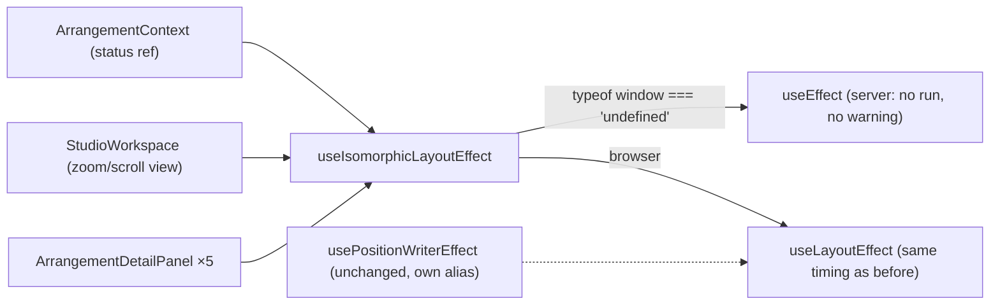

# Studio Lab — SSR-ზე `useLayoutEffect`-ის გაფრთხილებები აღარ არის; ბიბლიოთეკის `biome-ignore`-ს ტექნიკური მიზეზი აქვს

**თარიღი:** 2026-10-15
**სტატუსი:** Completed — Round 45 C PASS (`c-round-45.md`), commit `8b9c813`; D-29z10
**შეცვლილი პროექტი:** Store

## კონტექსტი

**SSR-LAYOUT-EFFECT-WARN.** B-ის გაზომვით (`tmp/studio-real-loop/b-round-44/ssr-warn-sample.txt`) `/studio-lab`-ის ერთი მოთხოვნა dev server-ის stderr-ში ზუსტად **7** ხაზს ამატებდა: `Warning: useLayoutEffect does nothing on the server …`. React-ის server renderer ამას ყოველ `useLayoutEffect`-ზე წერს, რადგან სერვერზე layout effect არ სრულდება. გაფრთხილებები 7 bare call-იდან მოდიოდა:

| # | კომპონენტი (პირველი frame) | ადგილი |
|---|---|---|
| 1 | `ArrangementProvider` | `ArrangementContext.tsx` — `lastNonRefusalStatusRef` status-თან სინქრონში |
| 2 | `StudioWorkspace` | `StudioWorkspace.tsx` — pending zoom/scroll view `pxPerSecond`-ის ცვლილების შემდეგ |
| 3–4 | `ArrangementDetailPanel` | საწყისი ღია/დახურული გადაწყვეტილება; cap-resize-ის აღრიცხვა |
| 5–7 | `ArrangementDetailContentInner` | start/end ტექსტი; content-mounted ref; Clip Gain-ის ტექსტი |

`ArrangementContext.tsx`-ში position writer-ებს უკვე ჰქონდათ isomorphic alias (`usePositionWriterEffect`) და ისინი არ აფრთხილებდნენ.

**LIB-SEP-REASON.** `ArrangementLibrary.tsx`-ის separator-ზე `biome-ignore lint/a11y/useSemanticElements`-ის მიზეზი პროცესს ასახელებდა (დავალების სექციას), არა ტექნიკურ მიზეზს.

## მიდგომა

- **ერთი საერთო hook, არა შვიდი ლოკალური alias.** ახალი `app/hooks/useIsomorphicLayoutEffect.ts` სერვერზე `useEffect`-ს, ბრაუზერში `useLayoutEffect`-ს ირჩევს — იგივე გამოსახულებით, რაც `usePositionWriterEffect`-ს აქვს. 7 ადგილი 3 ფაილშია, ამიტომ ეს ერთჯერადი abstraction არ არის; server/client-ის არჩევა ერთ ადგილზეა. მომხმარებლები hook-ს პირდაპირი ბილიკით იღებენ (`~/hooks/useIsomorphicLayoutEffect`), `useRelativeFaderDrag`-ის მსგავსად. `app/hooks/index.ts` არ შეცვლილა — დავალება აქ `prompts/new-hook.md`-ის barrel-export და JSDoc პუნქტებს გადაფარავს (no comments; precedent).
- **7 ადგილზე იცვლება მხოლოდ იდენტიფიკატორი.** callback-ები და dependency array-ები ბაიტ-იდენტურია. `StudioWorkspace.tsx`-სა და `ArrangementDetailPanel.tsx`-ში `useLayoutEffect` `react`-ის import-იდან ამოვიდა; `ArrangementContext.tsx`-ში რჩება, რადგან მას `usePositionWriterEffect` იყენებს.
- **`usePositionWriterEffect` ხელშეუხებელია.** playhead-ისა და meter-ის writer-ები ყველაზე მგრძნობიარე ნაწილია და rename-ის გამო მათი ხელახალი შემოწმება არ ღირს. ერთ ფაილში ორი იდენტური გამოსახულება შეგნებულია (D-29z10, non-goal).
- **კლიენტის timing არ იცვლება.** ბრაუზერში `typeof window !== 'undefined'`, ამიტომ ყველა ადგილი ისევ layout effect-ია იგივე დროით. სერვერზე არცერთი effect არ სრულდება — ცვლილება მხოლოდ გაფრთხილებას აშორებს. hook-ების რაოდენობა და რიგი სერვერზე და კლიენტზე ერთნაირია, ამიტომ hydration-ზე გავლენა არ აქვს.
- **ბიბლიოთეკის separator:** suppression იგივეა (`lint/a11y/useSemanticElements`), შეიცვალა მხოლოდ მიზეზის ტექსტი: focusable resize handle-ს `role=separator` და `aria-valuenow` სჭირდება, native `
` კი სტატიკური, არაინტერაქტიული separator-ია (იგივე ფორმულირება, რაც დეტალების პანელის separator-ს აქვს). separator-ის ატრიბუტები, handler-ები და კლასები უცვლელია.
- **ტესტს node environment სჭირდება.** `vitest.config.ts` მხოლოდ jsdom-ია და გაყინულია. jsdom-ში `window` არსებობს, hook `useLayoutEffect`-ს ირჩევს და server renderer ყოველთვის გააფრთხილებდა — jsdom-ის SSR ტესტი ვერასდროს გამწვანდებოდა. ამიტომ ახალი SSR ტესტის პირველი ხაზი vitest-ის pragma-ა (`@vitest-environment node`) — round 45-ის ვიწრო ნებართვა (`backlog.narrow_grants`), იმავე კლასის, რაც `biome-ignore`. ამ ფაილში `window` განუსაზღვრელია, როგორც რეალურ dev SSR-ში.

## არქიტექტურა

## შეცვლილი ფაილები

- `app/hooks/useIsomorphicLayoutEffect.ts` — ახალი; ერთი export.
- `app/contexts/ArrangementContext.tsx` — status-ის ref-ის ადგილი და import.
- `app/components/arrangement/StudioWorkspace.tsx` — zoom/scroll-ის ადგილი და import-ები.
- `app/components/arrangement/ArrangementDetailPanel.tsx` — 5 ადგილი და import-ები.
- `app/components/arrangement/ArrangementLibrary.tsx` — მხოლოდ `biome-ignore`-ის მიზეზის ტექსტი.
- `app/lib/arrangement/__tests__/ssr-layout-effect.test.tsx` — ახალი; node environment-ის SSR ტესტი.
- `app/hooks/__tests__/useIsomorphicLayoutEffect.test.ts` — ახალი; jsdom-ის hook ტესტი.
- `docs/implementation/2026/quarter-IV/015-…`, `034-…`, `035-…`, `036-…` — ხუთი doc შენიშვნა (ქვემოთ).

## პრობლემები და გადაწყვეტები

- **Problem:** jsdom-ში `window` არსებობს, ამიტომ SSR-ის გაფრთხილება ტესტში ყოველთვის ჩნდებოდა. → **Solution:** SSR ტესტი node environment-ში (pragma; ვიწრო ნებართვა). SSR3 ამოწმებს, რომ `window` მართლა განუსაზღვრელია — pragma-ს წაშლა ტესტს ჩააგდებს.
- **Problem:** mutation-ის სკრიპტში bash-ის (MSYS) path conversion-მა `// @vitest-environment node` არგუმენტი დაამახინჯა და ფაილი ვეღარ დაკომპილირდა. → **Solution:** `MSYS_NO_PATHCONV=1`; mutation (e) ხელახლა გაეშვა და სწორად ჩავარდა SSR3-ზე (და SSR1-ზე).
- **Problem:** ISO2-ში mutation „hook ყოველთვის `useEffect`“ შეიძლებოდა გადარჩენილიყო, თუ passive effect layout-ის შემდეგ იქნებოდა გამოცხადებული. → **Solution:** sibling `useEffect` hook-მდე ცხადდება; ორივე passive-ის შემთხვევაში ის პირველი სრულდება და ტესტი ვარდება.

## ტესტირება

- **Red** (ხელშეუხებელი წყაროები, snapshot-ის sha-ები დადასტურებული): SSR1 ჩავარდა ზუსტად **7** გაფრთხილებით — `ArrangementProvider`, `StudioWorkspace`, `ArrangementDetailPanel` ×2, `ArrangementDetailContentInner` ×3; SSR2/SSR3 მწვანე; ISO1/ISO2 — module missing. **Green:** 5/5. code-reviewer-ის რჩევით შემდეგ დაემატა **SSR4** — positive control: bare `useLayoutEffect`-იანი probe კომპონენტი ზუსტად ერთ გაფრთხილებას იძლევა (`ServerLayoutEffectProbe` frame-ით). ის გაფრთხილების ტექსტსა და frame-ის ამოღებას ამაგრებს (React-ის განახლებისას SSR1 ცარიელად ვერ გამწვანდება). SSR4 snapshot-ზეც მწვანეა (regression guard), საბოლოო green 6/6.
- **Mutation-ები** (scratch ასლი `store/`-ის გარეთ): (a) hook ყოველთვის `useLayoutEffect` → SSR1 (7); (b) ყოველთვის `useEffect` → ISO1, ISO2; (c) DetailPanel-ის cap-resize ადგილი bare → SSR1 (ზუსტად 1, `ArrangementDetailPanel`); (d) შებრუნებული პირობა → SSR1, ISO1, ISO2; (e) pragma წაშლილი → SSR3, SSR1.
- დეტალები და gates: `tmp/studio-real-loop/a-round-45.md`, `a-round-45/`.
- C-ის ID-ები: R45-S, R45-U, R45-SSR, R45-REG, R45-Doc, G45-1…G45-3.

## Ableton-თან კავშირი

ამ რაუნდში Live-ის ქცევა არ მონაწილეობს; ახალი წყარო და ვიდეო არ გამოყენებულა.

| ქცევა | Ableton-ის წყარო | იქ დადასტურებული | CZABA-ს გადაწყვეტილება / განსხვავება | C-ის შემოწმება |
|---|---|---|---|---|
| Server rendering layout effect-ს არ ირჩევს | არ არის | **არ ეხება** (React SSR CZABA-ს web stack-შია; Live-ის ქცევად არ წარმოჩნდება) | D-29z10 §0.1 | R45-U, R45-SSR, R45-REG |
| Lint suppression-ს ტექნიკური მიზეზი აქვს | არ არის | **არ ეხება** (developer hygiene) | D-29z10 §0.2 | R45-S |
| Doc-ები Delete/სიცარიელეს, Cut Time-ს, Clip Gain-სა და Pan-ს ზუსტად აღწერს | ახალი არ არის (ქცევების წყაროები doc 015/034/035/036-სა და `delete-selection-update.md`-შია) | **არ ეხება** შენიშვნებისთვის; ქცევები წინა ვერდიქტებს ინარჩუნებს | D-29z10 §0.3 | R45-Doc |

## Doc შენიშვნები (თავიანთ doc-ებში)

- **DOC036-ROUND-REF** — doc 036: double-click reset ეტაპ 4b-1-ში (round 38) განხორციელდა (C round 38 PASS).
- **DOC036-R37-TAIL** — doc 036: A-R36-REVIEW-1-ის გზა round 37-ში D-29z2-ით დაიხურა.
- **DOC035-NOTES** — doc 035: სტატუსი C PASS (round 30); სცენარის status ზუსტი სათაურით (`ღამის პულსი · სრული მიქსი`); ახალი შენიშვნა `0 dB`-ის pointer/keyboard ასიმეტრიაზე.
- **DOC034-UNREACHABLE-NOTE** — doc 034: არანულოვანი no-op Cut Time და „ჩუმი ფანჯარა შემდეგი კლიპით“ UI-დან მიუღწეველია.
- **DOC015-DELETE-GAP-NOTE** — doc 015: Delete სიცარიელეს ტოვებს, Ctrl+Shift+X დროს ამოჭრის, Ctrl+Shift+L ყველა ხაზზე ავრცელებს.

## TODO / შემდეგი ნაბიჯები

- round 46: EXPORT-DIALOG-FOCUS-RESTORE (opener-ის დაჭერა layout ფაზაში, ახალი `useIsomorphicLayoutEffect`-ით; focusable filter `[hidden]`-ს გამოტოვებს).
- round 47: SRW-14 ეტაპი 1 (FB-13) — grid model, Snap on/off, divisions, ჯერ clip move.
