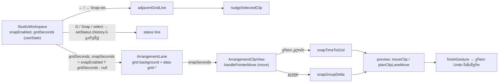

# Studio Lab — წამების ბადე, Snap ჩართვა/გამორთვა (ღილაკი + G), დანაყოფის არჩევა, ბადის ხაზები და კლიპის გადატანის snap (SRW-14 ეტაპი 1)

**თარიღი:** 2026-10-16
**სტატუსი:** Completed — Round 47 C behaviour PASS, Round 48 C PASS (`c-round-47.md`, `c-round-48.md`), commits `08b6a5e`, `05e1bc0`; D-29z12, D-29z13
**შეცვლილი პროექტი:** Store

## კონტექსტი

**FB-13** (`docs/video-to-text-bugs/README.md`, ჩანაწერი `2.srt`, 05:16–07:53): timeline-ს ბადე არ ჰქონდა. მომხმარებელს სურს ბადის დანაყოფის არჩევა, Snap-ის ჩართვა/გამორთვა და ისიც, რომ თავისუფალი გადაადგილება დარჩეს („უნდა გვქონდეს ორნაირი“). კლიპის გადაადგილება და დაკვრის პოზიცია არჩეულ ბადეს თანმიმდევრულად უნდა მიჰყვეს; ბადის ასარჩევად ღილაკი/მენიუ და თავისუფალ რეჟიმზე გადასართავი shortcut.

- **რატომ წამები და არა 1/4, 1/8 …** მომხმარებლის დანაყოფები მუსიკალურია და tempo-ს საჭიროებს. tempo SRW-15-ის საქმეა და იქ მოქმედებს წესი: **BPM-ს მომხმარებელი შეიყვანს; 120 ჩუმად არასდროს ივარაუდება.** ამიტომ ეტაპი 1 წამების დანაყოფებს იყენებს (10, 5, 2, 1, 0.5, 0.25, 0.1 წმ). ყველა მნიშვნელობა მილიწამების მთელი რიცხვია — მოდელი ყოველ დროს 1 ms-მდე ამრგვალებს, 1/16 ან 1/32 წამი დამრგვალების შემდეგ ბადიდან გადავიდოდა.
- **რატომ იწყება Snap გამორთული.** დღევანდელი თავისუფალი ქცევა და ყველა არსებული ტესტი უცვლელი რჩება; Snap ჩაირთვება მხოლოდ მომხმარებლის ქმედებით.

## მიდგომა

- **Grid model** — ახალი სუფთა მოდული `app/lib/arrangement/grid.ts` (React-ისა და DOM-ის გარეშე): დანაყოფების სია, default (1 წმ), ხაზების მინიმალური დაშორება (6 px), უახლოეს ხაზზე snap (თანაბარ მანძილზე — **მომდევნო** ხაზი, შედეგი ≥ 0, 1 ms), შემდეგი/წინა ხაზი (nudge-ისთვის; 0-მდე ხაზი არ არსებობს → `null`), ჯგუფის delta, ხაზების ხილვადობა და დანაყოფის წარწერა (`1 წმ`). snap მილიწამების მთელ რიცხვებზე ითვლება: დრო და ბიჯი ჯერ 1 ms-მდე მრგვალდება (ისევე, როგორც Snap-ის გარეშე გადატანა), შემდეგ ხაზის ინდექსი მთელი რიცხვების გაყოფით გამოითვლება — ასე binary floating point-ი თანაბარ მანძილს (მაგ. 0.15 წმ 0.1-იან ბადეზე) ადრეულ ხაზზე ვეღარ ჩამოაგდებს.
- **State `StudioWorkspace`-შია, არა context-სა და history-ში.** `snapEnabled` (საწყისი `false`) და `gridSeconds` (საწყისი 1) ჩვეულებრივი `useState`-ია, როგორც `followMode`. ეს view/edit preference-ია: არ არის `Arrangement`-ში, Undo/Redo-ში, clipboard-ში და არ ინახება — reload იწყება Snap გამორთულით, 1 წმ-ით. `ArrangementContext.tsx` და context-ის API არ შეცვლილა. keyboard handler-ი მიმდინარე მნიშვნელობებს ref-ებით კითხულობს, ამიტომ listener-ის ხელახალი რეგისტრაცია Snap-ის ყოველ ცვლილებაზე არ ხდება.
- **Control-ის ადგილი — ruler-ის sticky header cell.** B-ის გაზომვით 1440×900-ზე transport toolbar ერთი რიგია (49 px) და `↻ Loop`-სა და მარჯვენა ჯგუფს შორის მხოლოდ 25 px რჩება; 1280×720-ზე უკვე ორ რიგადაა (87 px). Snap toolbar-ში ახალ რიგს დაამატებდა. ამიტომ control ჩაჯდა timeline-ის ზედა-მარცხენა უჯრაში (224 × 28 px), ruler-ის გვერდით: `Snap` toggle ღილაკი (`aria-pressed`, `aria-keyshortcuts="G"`, ჩართულ მდგომარეობაში Loop-ის token-ები `border-accent bg-accent/20 text-accent`) და native `<select>` (`ბადის დანაყოფი`). ორივე იმავე 224 px სვეტის lane header-ის M/S ღილაკებს ემთხვევა: სიმაღლე `h-6` (24 px), გამორთული ღილაკი `text-muted hover:text-foreground`, focus `ring-2 ring-brand`. select-ის მნიშვნელობა მიიღება მხოლოდ მაშინ, თუ ის 7 დანაყოფიდან ერთ-ერთია; სხვა მნიშვნელობა (მაგ. ცარიელი) არაფერს ცვლის. `ArrangementTransport.tsx` ბაიტ-იდენტურია; toolbar-ის სიმაღლე 49 / 87 px რჩება.
- **ტექსტი `ხაზები` წაიშალა.** გაზომვით (REAL ბრაუზერი, 1440×900) ტექსტი ჩაეტეოდა (ღილაკი 42.9 + select 73 + ტექსტი 36.9 + gap/padding ≈ 185 px < 224 px), მაგრამ grid select-ის გვერდით სიტყვა „ხაზები“ ბადის ხაზების წარწერად იკითხება და ორაზროვანია; ხაზებს lane header-ები ასახელებს.
- **G და არა Ctrl+4.** მომხმარებელმა „Ctrl + 4“ ახსენა (Live 6.10/42.13), მაგრამ Chrome და Edge Windows-ზე Ctrl+1…Ctrl+9-ს tab-ების გადასართავად იტოვებენ და გვერდი მათ საიმედოდ ვერ იღებს. ნაყიდ CZABA Studio-ში G უკვე „Toggle Snap Grid“-ია. **განზრახ განსხვავება.** G მუშავდება არსებული window `keydown` handler-ში `modifier`-ის early return-ის **შემდეგ** (Ctrl+G არაფერს აკეთებს — SRW-17-ის ჯგუფებისთვის დაცულია), layout-დამოუკიდებლად (`KeyG`), Alt/Shift-ის და auto-repeat-ის გარეშე; ტექსტურ ველში, select-ში და ღია Export dialog-ში handler-ი უკვე ადრე ჩერდება. G **არ** არის gesture-ის დროს დაბლოკილი edit-ების სიაში: Snap edit არ არის და history-ს არ წერს; drag-ის დროს ის **მომდევნო** `pointermove`-ზე მოქმედებს და drag ისევ ერთ Undo ჩანაწერად სრულდება.
- **ხაზები ორივე Snap მდგომარეობაში.** ყოველი lane body (audio, video, დაკეცილიც) ხაზებს ხატავს ყოველ `gridSeconds`-ზე 0-დან — ერთი background layer-ით (repeating gradient, ფერი design token `--color-outline-light`, ბიჯი `gridSeconds × pxPerSecond` px), თითო ხაზზე DOM node-ის გარეშე. ხაზები clip-ებს, ghost-ებს და range overlay-ს მიღმაა და pointer event-ს არ იღებს. თავისუფალ რეჟიმშიც ჩანს (მომხმარებელი, 06:41: ხაზები არის, მაგრამ არაფერი ეკვრის). 6 px-ზე მჭიდრო ბადე იმალება (`data-grid-lines="hidden"`, select-ის `title` ამას ხსნის), Snap კი მაინც მუშაობს. `gridSeconds` არჩევითი prop-ია default-ის გარეშე: lane, რომელსაც ის არ გადაეცემა (მაგ. გაყინული `gesture-guard` harness), ძველებურად იხატება — ხაზების და `data-grid-*` ატრიბუტების გარეშე.
- **Scope — მხოლოდ კლიპის გადატანა.** ერთი კლიპი იმავე ხაზზე: დასაწყისი უახლოეს ხაზზე; მეზობელთან გადაფარვა → არსებული blocked სტატუსი და კლიპი ბოლო ნაჩვენებ (ბადის) ადგილას რჩება, სხვა თავისუფალი ხაზი არ იძებნება. trim, clip body-ის range gesture, `finishGesture`, ტექსტები და drag threshold უცვლელია. დანარჩენი ეტაპები ჩამოთვლილია TODO-ში.
- **ჯგუფის anchor-ის წესი.** ჯგუფში ბადეზე ჯდება **ხელში აღებული** კლიპი; დანარჩენები offset-ს ინარჩუნებენ. თუ ბადის delta იმავე ხაზების საზღვრებს სცდება, იღება საზღვრებში მოთავსებული ბადის delta, რომელიც 0-სა და snapped delta-ს შორისაა და მასთან უახლოესია; ასეთი თუ არ არის — 0 (ჯგუფი drag-ის საწინააღმდეგოდ არასდროს ხტება).
- **სხვა ხაზზე გადატანა.** `planClipLaneMove`-ს გადაეცემა snapped delta, ამიტომ ghost-ები ბადის დასაწყისს აჩვენებს. ჯგუფისთვის გადაეცემა snapped delta **იმავე ხაზების საზღვრების გარეშე** — ზუსტად ისე, როგორც Snap-ის გარეშე გადაეცემა შეუზღუდავი delta (სხვა ხაზზე იმავე ხაზის მეზობლები არ ბლოკავს; გადაფარვას `planClipLaneMove` ამოწმებს). უარის ghost-ი, როგორც ადრე, საზღვრებში მოქცეულ delta-ს აჩვენებს. B-მ ეს სტრუქტურა მიიღო (D-29z13, A-R47-GROUP-LANE-DELTA): Snap-ის გარეშეც იგივე ჯგუფური გადატანა ხაზს არ იცვლის, ამიტომ შემოსაზღვრული delta-ს გადაცემა Snap-ის ჩართვისას ხაზის შეცვლას დაუშვებდა იქ, სადაც თავისუფალი რეჟიმი უარს ამბობს. უარის ტექსტი და უარყოფილი ghost-ების ადგილი ცალკე Low საკითხია (GROUP-LANE-REFUSAL-TEXT, ეტაპი 2).
- **Nudge-ის წესი.** Snap ჩართულისას ←/→ ძირითად (ბოლოს მონიშნულ) კლიპს მომდევნო/წინა ბადის ხაზზე გადააქვს; anchor-ის დასაწყისი იკითხება ცოცხალი history-დან (`getArrangement()`), არა render-ის snapshot-იდან, ამიტომ re-render-მდე ორი სწრაფი დაჭერა ორ ხაზს გადადის (`nudgeSelectedClip`-ის არსებული ჯგუფის/ერთი კლიპის ლოგიკით და blocked ტექსტებით); 0-ზე მყოფი კლიპი ← -ზე history-ს არ წერს და სტატუსია `ჩაჩოჩება დაბლოკილია — დროის დასაწყისი.` Snap გამორთულისას — ძველებურად ±0.1 წმ.
- **Shift-ის პრიორიტეტი.** Shift (time lock) Snap-ზე მაღლაა: delta = 0, snap არ ხდება, კლიპი დროს ინარჩუნებს.
- **გადაყოლილი ერთხაზიანი ცვლილება.** clip-ის range overlay `bg-foreground/60` → `bg-foreground/30` (plan.md l.395, D-29i design (b)).

## არქიტექტურა

## შეცვლილი ფაილები

- `app/lib/arrangement/grid.ts` — ახალი; grid model (§0.1-ის exports).
- `app/components/arrangement/StudioWorkspace.tsx` — Snap/grid state, header cell-ის control, G shortcut, nudge-ის Snap განშტოება, props lane-ებისთვის.
- `app/components/arrangement/ArrangementLane.tsx` — ორი არჩევითი prop, lane body-ის grid background და `data-grid-*`, `snapSeconds` clip-ებისთვის.
- `app/components/arrangement/ArrangementClip.tsx` — არჩევითი `snapSeconds`, `data-clip-start`, move-ის snap, range overlay `/30`.
- `app/lib/arrangement/__tests__/grid.test.ts` — ახალი (GM1–GM4; 12 ტესტი, მათ შორის თანაბარი მანძილის შემთხვევები და მილიწამების reference 0–120 წმ).
- `app/lib/arrangement/__tests__/grid-snap-ui.test.tsx` — ახალი (GS1–GS16, GS5b, GS6b, GS8b, GS8c; 20 ტესტი).
- `app/lib/arrangement/__tests__/render-budget.test.tsx` — R47-AM1: მხოლოდ `within` import და l.309-ის assertion ბიბლიოთეკის listbox-ზე შეზღუდული (2 hunk).
- `docs/implementation/2026/quarter-IV/043-studio-lab-export-dialog-focus-restore.md` — მხოლოდ l.4 (DOC043-STATUS-LINE).
- ეს doc.

## პრობლემები და გადაწყვეტები

- **Problem:** native select-ის 7 `option` render-budget-ის გაყინულ assertion-ს (`getAllByRole('option')` = 2) არღვევდა (9). → **Solution:** A-მ გაყინული ფაილი არ შეცვალა და კონფლიქტი B-ს გადასცა (B-EXPECT-R47-RB); B-ის R47-AM1-ით assertion ბიბლიოთეკის listbox-ით (`ხმები`) შეიზღუდა და ისევ ზუსტად 2-ს ამოწმებს. 7 დანაყოფს GS1 ამოწმებს.
- **Problem:** ჯგუფის cross-lane გადატანისთვის task-ის ტექსტი იმავე ხაზების საზღვრებიან `snapGroupDelta`-ს ასახელებს, Snap-ის გარეშე კი cross-lane-ს შეუზღუდავი delta გადაეცემა. → **Solution:** Snap-ით გადაეცემა შეუზღუდავი snapped delta (Snap-off-ის სიმეტრიულად); საზღვრებიანი მნიშვნელობა რჩება უარის ghost-ში. A-ს deviation-ად ჩაწერილია B-სთვის (`a-round-47.md`).
- **Problem:** Windows-იდან გადმოტანილ ფაილებს executable mode (100755) მიეცა და `git diff` mode-ის ცვლილებას აჩვენებდა. → **Solution:** mode 100644-ზე დაბრუნდა; შინაარსი უცვლელია.
- **Problem:** `ხაზები` ტექსტის დატოვება/წაშლა. → **Solution:** იხ. მიდგომა — ჩაეტეოდა, მაგრამ ორაზროვნების გამო წაიშალა.

**root-ის review-ს შემდეგი fix pass** (`tmp/claude-cloud-r47-quarantine/tmp/studio-real-loop/root-r47-review-findings.md`):

- **Problem (F2):** `Math.floor(time / step + 0.5)` binary floating point-ში თანაბარ მანძილს ქვემოთ აგდებდა: `snapTimeToGrid(0.15, 0.1)` = 0.1 (უნდა 0.2), `0.35` → 0.3; ჯგუფში `5.6 − 2.6` → 2 ნაცვლად 4-ისა. სრულმა გადამოწმებამ (0–300 წმ ყოველი ms, 7 დანაყოფი) 995 არასწორი snap და 306 არასწორი ჯგუფის delta აჩვენა; `adjacentGridLine` სწორი იყო. → **Solution:** snap მილიწამების მთელ რიცხვებზე; გადამოწმება შემდეგ — 0 / 0 / 0. seeded ტესტის ზღვარი `step/2`-ს ემატება 0.5 ms (ms-მდე დამრგვალება).
- **Problem (F3):** nudge-ის anchor render-ის snapshot-იდან იკითხებოდა, nudge კი ცოცხალ history-ზე მოქმედებს → re-render-მდე მეორე დაჭერამ 8.7 მისცა (ბადის გარეთ, ან მეზობელთან დაიბლოკა). → **Solution:** `current.getArrangement()`.
- **Problem (F4):** `ArrangementLane`-ის `gridSeconds` default 1 იყო, ამიტომ prop-ის გარეშე გამოძახებაც ხაზებს და `data-grid-*`-ს ხატავდა. → **Solution:** default არ არის; prop-ის გარეშე lane უცვლელია.
- **Problem (F6):** `Number(event.target.value)` ნებისმიერ მნიშვნელობას იღებდა (ცარიელი → 0 → ნულოვანი ბიჯი). → **Solution:** მნიშვნელობა `GRID_DIVISIONS_SECONDS`-ში იძებნება; სხვა შემთხვევაში არაფერი იცვლება. doc-ში ჩანაწერის სახელი `2.srt`-ზე გასწორდა.
- **Problem (design):** Snap ღილაკი და select (20 px, `ring-1`, ღილაკი `text-foreground`) lane header-ის M/S ღილაკებს (24 px, `ring-2`, `text-muted`) არ ემთხვეოდა. → **Solution:** design-philosopher-ის ზუსტი კლასები; ხელახალი გაზომვა: cell 224 × 28, ღილაკი 42.9 × 24, select 73 × 24, toolbar 49 / 87 px.

## ტესტირება

- **Red** (ხელშეუხებელი HEAD-ის scratch ასლი `store/`-ის გარეთ): `grid.test.ts` — მოდული არ არსებობს; `grid-snap-ui` — GS1, GS3–GS6, GS8–GS13 წითელი, GS2, GS7, GS14 მწვანე (GS7: Shift-ის time lock უკვე არსებობდა და snapshot-ზე Snap არ არის; მას mutation (d) ამოწმებს). **Green:** 22/22 ახალი ტესტი.
- **Fix pass red → green:** ახალი GM1/GM3 შემთხვევები fix-მდე წითელია (3 failed: თანაბარი მანძილი, ms reference, ჯგუფის თანაბარი მანძილი); GS15 (F4), GS8c (F3: 8.7 ნაცვლად 9-ისა) და GS16 (select: `0` ნაცვლად `1`-ისა) fix-მდე წითელია. GS5b, GS6b, GS8b არსებულ კოდზე მწვანეა და mutation-ებს იჭერს. fix-ის შემდეგ: 32/32 (grid 12 + grid-snap-ui 20).
- **Mutation-ები** (scratch ასლი): (a) single move snap-ის გარეშე → GS3, GS4, GS6, GS10, GS12, GS13; (b) ჯგუფი raw delta-თი → GS5; (c) cross-lane delta snap-ის გარეშე → GS6; (d) Shift აღარ იმარჯვებს → GS7; (e) nudge Snap-ს ვერ ხედავს → GS8, GS9; (f) G auto-repeat-ზე → GS11; (g) tie ადრეულ ხაზზე → GM1; (h) 6 px-ის შემოწმება მოხსნილი → GM4, GS10; (i) G modifier-ის early return-მდე → GS11; C-ის (j) → GM3, GS5b; (k) → GS1, GS15; (l) ბიბლიოთეკის `slice(1)` → render-budget-ის პირველი ტესტი. **Fix pass:** (m1a) ჯგუფის cross-lane delta raw → GS6b; (m1b) ჯგუფის cross-lane delta = საზღვრებიანი `allowed` (§0.4-ის სიტყვასიტყვითი ფორმა) → GS6b; (m2) ჯგუფი უსასრულო საზღვრებით → GS5b; (m3) nudge-ის anchor = `selectedClipIds[0]` → GS8b; (m4) anchor render-ის snapshot-იდან → GS8c; (m5) lane-ის default 1 → GS15; (m6) select-ის შემოწმება მოხსნილი → GS16; (m7) float snap → GM1, GM3. ყველა mutation მოკლულია.
- გაყინული suite-ები (18 ფაილი) 423/423; სრული vitest 82 ფაილი / 1396 ტესტი (1364 + 32); tsc 0; build; Biome: ახალ/შეცვლილ ფაილებში 0 diagnostic.
- REAL smoke (Playwright, 1440×900 და 1280×720): cell 224 × 28, Snap 42.9 × 24, select 73 × 24 (= lane-ის M ღილაკის 24 px), toolbar 49 / 87 px, G → `data-snap="on"`; პირველ რაუნდში `Soft impact`-ის REAL-mouse drag +50 px → `1.000`.
- C-ის ID-ები: R47-S, R47-U, R47-UI, R47-SNAP, R47-NUDGE, R47-LINES, R47-AUDIO, R47-REG, R47-Doc, G47-1…G47-3. დეტალები: `tmp/studio-real-loop/a-round-47.md`, `a-round-47/`.

## Ableton-თან კავშირი

წყარო: Live 12 Reference Manual, თავი 6, **6.7**, **6.9**, **6.10** (B-მ ამოიღო 2026-10-16, `b-round-46/ableton-6.7-6.10-20261016.txt`) და shortcut-ები 42.5/42.13 (`b-round-37/…-20261013.txt`). ვიდეო არ ყურებულა, Live არ გამოყენებულა. A-ს ქცევითი ექსპერიმენტები: `tmp/studio-real-loop/a-round-47/ableton-experiments.md`.

| ქცევა | Ableton-ის წყარო | იქ დადასტურებული | CZABA-ს გადაწყვეტილება / განსხვავება | C-ის შემოწმება |
|---|---|---|---|---|
| კლიპის გადატანა ბადის ხაზებზე ჯდება | 6.10 „the cursor will snap to grid lines“; 6.7 „Clips snap to the editing grid“ | **დადასტურებული** (ტექსტი) | იგივე, Snap ჩართულისას; კლიპის დასაწყისი ხაზზე ჯდება (off-grid კლიპის offset-ის შენარჩუნება Live-ში — დაუდასტურებელი ჰიპოთეზა) | R47-SNAP |
| ბადე = song tempo-ს მეტრის დანაყოფები | 6.10 | **დადასტურებული** | **განზრახ განსხვავება SRW-15-მდე:** წამები (10 … 0.1 წმ), რადგან BPM-ს მომხმარებელი ჯერ არ შეიყვანს | R47-UI, GM1 |
| Snap on/off, Ctrl+4 | 6.10; 42.13 „Snap to Grid Ctrl 4“ | **დადასტურებული** | toggle არის; shortcut **G** (Chrome/Edge Ctrl+1…9-ს იტოვებს; ნაყიდ Studio-ში G) — განზრახ განსხვავება | UI-3, UI-4, GS11 |
| ბადის ბიჯი ჩანს „above the time ruler in the lower right corner“ | 6.10 | **დადასტურებული** | select ruler-ის header cell-შია — **ზედა-მარცხენა** კუთხე, CZABA-ს ზედა ruler-ის გვერდით (პოზიციის განზრახ განსხვავება) | UI-1 |
| zoom-adaptive vs fixed (Ctrl+5), narrow/widen (Ctrl+1/2), triplets (Ctrl+3) | 6.10 | **დადასტურებული** | **განზრახ გამარტივება:** ფიქსირებული დანაყოფი; < 6 px ხაზები იმალება; narrow/widen → ეტაპი 4; triplets → მუსიკალურ დანაყოფებთან (SRW-15-ის შემდეგ) | LN-2 |
| დანაყოფი lane-ების context menu-დან | 6.10 | **დადასტურებული** | ახლა select; right-click menu → ეტაპი 4 | — |
| Alt action-ის დროს snap-ს გვერდს უვლის (ან გამორთულს რთავს) | 6.10; 42.5 | **დადასტურებული** | ეტაპი 2 (ამ რაუნდში Alt+drag ჩვეულებრივ snap-ს აკეთებს) | — |
| სხვა კლიპების კიდეებზე და locator-ებზე snap | 6.7 | **დადასტურებული** | ეტაპი 4 (კიდეები); locator-ები SRW-16-თან | — |
| ისრები მონიშნულს აჩოჩებს | 6.9 | **დადასტურებული** (nudge არსებობს) | Snap-ით — მომდევნო/წინა ხაზზე; **Live-ის ბიჯი ტექსტში არ წერია → დაუდასტურებელი**, CZABA-ს გადაწყვეტილება | R47-NUDGE |
| Snap-ის გამორთვისას ხაზები რჩება | 6.10 მხოლოდ „the cursor does not snap“ | **დაუდასტურებელი** | მომხმარებლის მოთხოვნით ხაზები თავისუფალ რეჟიმშიც ჩანს | LN-3 |
| Snap/grid-ის პარამეტრები Undo-ში არ შედის | არ მოიძებნა | **დაუდასტურებელი** | CZABA-ს გადაწყვეტილება: view preference, history-ს გარეთ | GS3, UI-3 |
| Snap გამორთულით იწყება | არ მოიძებნა | **დაუდასტურებელი** | CZABA-ს გადაწყვეტილება: დღევანდელი თავისუფალი ქცევა რჩება | UI-1 |

## TODO / შემდეგი ნაბიჯები

- **ეტაპი 2 (round 49):** trim-ის კიდეები, დროის მონაკვეთის მონიშვნა (clip body + lane-ის ფონი), range overlay; Alt-ის მომენტალური bypass (6.10).
- **ეტაპი 3:** playhead/insert marker (ruler-ზე click/drag), paste-ის პოზიცია, ბიბლიოთეკიდან drop-ის ghost, loop brace.
- **ეტაპი 4:** კლიპის კიდეებზე snap (6.7), lane-ებზე right-click დანაყოფის მენიუ (მომხმარებელი, 07:00), narrow/widen keyboard-ით.
- **ეტაპი 5 (SRW-15-ის BPM-ის შემდეგ):** მუსიკალური დანაყოფები (bar, 1/2 … 1/32), R14-G1 („1/4 120 BPM-ზე → 0.5 წმ-ის ჯერადები“), bars/beats ruler.
- **ეტაპი 2-ს თან ერთვის:** GROUP-LANE-REFUSAL-TEXT (ჯგუფის უარის ტექსტი და ghost-ების ადგილი) და lane-ის „ყველა ხაზის“ range overlay-ის `bg-foreground/60` → `/30` (`ArrangementLane.tsx`, LANE-RANGE-OVERLAY-60).
- B-სთვის: ჯგუფის cross-lane delta-ს deviation (D1) B-მ D-29z13-ით მიიღო; Ableton-ის ცხრილის „lower right corner“ დაზუსტება; F1 (აბსოლუტური snap 3 px-იან threshold-ის შემდეგ შეიძლება შორს გადახტეს); video clip-ის გამჭვირვალე ფონი, რომლის მიღმაც ბადის ხაზები ჩანს.
