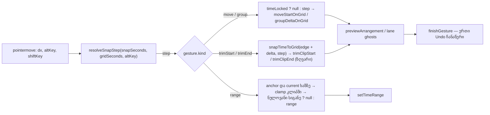

# Studio Lab — Snap trim-ის კიდეებზე და კლიპის შიგნით დროის მონიშვნაზე, Alt-ის მომენტალური bypass/ჩართვა (SRW-14 ეტაპი 2)

**თარიღი:** 2026-10-16
**სტატუსი:** Round 49 — D-29z14; C PASS (2026-10-17); ქვემოთ ჩამოთვლილი ტესტის ხარვეზები და ხელით შემოწმებები ღიაა
**შეცვლილი პროექტი:** Store

## კონტექსტი

FB-13 (მომხმარებლის ჩანაწერი `2.srt` 05:16–07:53): „კლიპის გადატანა და დაკვრის პოზიცია არჩეულ ბადეს უნდა მიჰყვებოდეს“. ეტაპმა 1 (doc 044, round 47–48) ბადე, Snap-ის ჩართვა/გამორთვა და კლიპის გადატანის snap მოიტანა. ეტაპი 2 იგივე ბადეს ავრცელებს:

- **trim-ის კიდეზე** — Snap ჩართულისას მარცხენა/მარჯვენა კიდე ბადის ხაზზე ჯდება;
- **კლიპის body-ში გადათრეულ დროის მონაკვეთზე** — მონაკვეთის ორივე ბოლო ხაზზე ჯდება;
- **Alt-ზე** — pointer gesture-ის დროს Alt Snap-ს გვერდს უვლის, Snap გამორთულისას კი დროებით რთავს (Live 12, 6.10).

იმავე ფაილებში ორი ძველი დეფექტი გასწორდა: GROUP-LANE-REFUSAL-TEXT და LANE-RANGE-OVERLAY-60.

## მიდგომა

### Alt და ბადის ბიჯი

`grid.ts`-ში ერთი ახალი pure ფუნქცია — `resolveSnapStep(snapSeconds, gridSeconds, bypass)`:

| Snap (`snapSeconds`) | Alt | შედეგი |
|---|---|---|
| რიცხვი | არა | `snapSeconds` |
| რიცხვი | კი | `null` — Alt snap-ს გვერდს უვლის |
| `null` | არა | `null` — თავისუფალი |
| `null` | კი | `gridSeconds ?? null` — Alt დროებით რთავს მიმდინარე დანაყოფს |

`ArrangementClip`-ი ბიჯს ყოველ `pointermove`-ზე ერთხელ ითვლის, `event.altKey`-დან (Shift-ის მსგავსად). Alt-ის დაჭერა/აშვება მოძრაობის გარეშე შემდეგ მოძრაობაზე აისახება. Shift-ის დროის ჩაკეტვა გადატანისას კვლავ იმარჯვებს: delta 0, snap-ის გარეშე. Snap-ის მდგომარეობა (`data-snap`) Alt-ით არ იცვლება. `ArrangementLane` კლიპს არჩეულ დანაყოფს `gridSeconds` prop-ით აწვდის; prop არასავალდებულოა, ამიტომ lane-ის გარეშე რენდერილი კლიპები (ძველი ტესტები) უცვლელად მუშაობს.

Alt მხოლოდ pointer gesture-ებზე მოქმედებს (გადატანა, trim, მონაკვეთი). ისრებით ჩაჩოჩება და G უცვლელია.

### Trim

ბიჯის არსებობისას მოთხოვნილი კიდე = `snapTimeToGrid(კიდე + delta, ბიჯი)`. შემდეგ `trimClipStart`/`trimClipEnd` ჩვეულებრივად ზღუდავს: წყაროს დასაწყისი/დასასრული, მეზობელი კლიპი, მინიმალური სიგრძე 0.05 წმ. თუ snap-ის შემდეგი მოთხოვნა ზღვარს სცდება, კიდე ზღვარზე ჩერდება, და ეს ზღვარი შეიძლება ბადის ხაზზე **არ** იყოს (მაგ. წყაროს დასაწყისი 7.05-ზე). ეს მოსალოდნელი შედეგია: კლიპის კიდეებზე snap ეტაპ 4-შია. დაბლოკვის შემოწმება და ორივე ტექსტი, label-ები და ერთი Undo ჩანაწერი უცვლელია.

### კლიპის body-ში დროის მონაკვეთი

ბიჯის არსებობისას anchor-იც და მიმდინარე წერტილიც ჯერ ხაზზე ჯდება, შემდეგ კლიპის საზღვრებში იზღუდება. თუ ორივე ბოლო ერთ ხაზზე აღმოჩნდა (**ნულოვანი სიგანე**), მონაკვეთი იშლება (`setTimeRange(null)`): ნულოვანი „მონიშვნა“ არც ჩანს და არც მოქმედებს. ხაზის გადამკვეთი შემდეგი მოძრაობა მონაკვეთს ისევ აჩენს. **Click** (3 px-ზე ნაკლები) კვლავ შლის მონაკვეთს და playhead-ს **snap-ის გარეშე** აყენებს; playhead-ის და insert marker-ის snap ეტაპ 3-შია.

lane-ის ფონზე drag არის marquee, click კი seek (round 47, LN-4). lane-ის ფონზე დროის მონაკვეთი არ არსებობს, ამიტომ snap იქ არ ვრცელდება. ეს ასწორებს doc 044-ის TODO-ში დაწერილ „clip body + lane-ის ფონი“-ს.

### აბსოლუტური snap (F1, D-29z14)

Snap ხაზზე სვამს pointer-იდან გამოთვლილ დროს (კლიპის დასაწყისს, trim-ის კიდეს, მონაკვეთის ბოლოებს), და არა საწყის მდებარეობას შენარჩუნებული offset-ით. სწორედ ეს ითხოვა მომხმარებელმა („ბადეს უნდა მიჰყვებოდეს“). დიდ ბადეზე 3 px-იანი threshold-ის შემდეგ მცირე რყევამ შეიძლება კლიპი ნახევარ დანაყოფამდე გადაახტუნოს; ცვლილება ხილულია და ერთი Undo-თ ბრუნდება. relative/hybrid snap ამ რაუნდში არ კეთდება. Tech Lead-ის R49-T შემოწმება წყვეტს, საჭიროა თუ არა.

### ჯგუფის უარი: ხაზის არარსებობა და დროის დასაწყისი

ადრე ჯგუფი, რომლის ნაწილიც სხვა ხაზზე გადატანისას 0-ზე ადრე დაიწყებოდა, `'out-of-range'`-ით ბრუნდებოდა. ტექსტი („ხაზი არ არსებობს“) არასწორ მიზეზს ამბობდა, ghost-ები კი ნებადართულ ადგილას იხატებოდა. ახლა:

- `selection.ts`: ახალი უარი `'before-start'` და ტექსტი „ჯგუფის ნაწილი დროის დასაწყისამდე (0) გავიდოდა — ხაზი არ იცვლება.“. member-ის ციკლში ჯერ მოწმდება ხაზის არსებობა (`'out-of-range'`), შემდეგ დრო (`'before-start'`). სხვა ტექსტები და შემოწმებების რიგი უცვლელია.
- `ArrangementClip.tsx`: `'before-start'`-ისა და `'out-of-range'`-ის დროს lane ghost-ები აღარ იხატება. ჩანს მხოლოდ დროში წინასწარი ხედი (ის, რასაც commit გააკეთებს) და სწორი ტექსტი. `'overlap'`, `'video-clip'` და `'video-lane'` უცვლელია.

### ყველა ხაზის მონაკვეთის overlay

`ArrangementLane`-ის all-tracks overlay `bg-foreground/60`-დან `bg-foreground/30`-ზე გადავიდა და ახლა კლიპის overlay-სა და detail panel-ს ემთხვევა (D-29i, დიზაინი (b)).

## არქიტექტურა

## შეცვლილი ფაილები

- `app/lib/arrangement/grid.ts` — ახალი export `resolveSnapStep`; არსებული ფუნქციები უცვლელია.
- `app/lib/arrangement/selection.ts` — `'before-start'` უარი, მისი ტექსტი, member-ის ციკლის გაყოფილი შემოწმება.
- `app/components/arrangement/ArrangementClip.tsx` — `gridSeconds` prop; ბიჯი ერთხელ ყოველ მოძრაობაზე; trim-ისა და მონაკვეთის snap; ნულოვანი სიგანე; ჯგუფის უარისას ghost-ების წესი.
- `app/components/arrangement/ArrangementLane.tsx` — `gridSeconds` კლიპებს; overlay `/30`.
- `app/lib/arrangement/__tests__/grid-snap-edit.test.tsx` — ახალი (22 ტესტი, SE1–SE19 და SE12b, SE14b, SE17b).
- `docs/implementation/2026/quarter-IV/044-studio-lab-grid-snap-stage-1.md` — სტატუსი და root-ის findings-ის მისამართი.

## პრობლემები და გადაწყვეტები

- **Problem:** pure ტესტის პირველ ვერსიაში ხაზის არარსებობა −7.3 წმ-იანი delta-თი მოწმდებოდა. ციკლში პირველი member (მუსიკა, 7 → −0.3) არსებულ ხაზზე 0-ზე ადრე იწყებოდა, ამიტომ სწორი პასუხი `'before-start'` იყო. → **Solution:** fixture შეიცვალა (−0.5 წმ): ხაზი აკლია მხოლოდ სტემს, რომელიც 0-ზე ადრეც იწყება. ასე ტესტი member-ის შიგნით შემოწმებების რიგსაც ამოწმებს. კოდი არ შეცვლილა.
- **Problem:** ფაილების ხაზის ბოლოები (`core.autocrlf=true`): `grid.ts`, ორივე კომპონენტი და doc 044 CRLF-ია, `selection.ts` LF. → **Solution:** რედაქტირების შემდეგ ხაზის ბოლოები შემოწმდა და თითოეულ ფაილს თავისი შერჩა. `biome --write` owned ფაილებზე არ გაშვებულა.
- **Problem:** left trim-ის შემდეგ `sourceOffset` ორობით floating point-ში ზუსტად 0.3 არ არის (`0.6 + (7 − 7.3)`). → **Solution:** ტესტი 9 ათწილადის სიზუსტით ამოწმებს. `model.ts` ამ რაუნდში არ იცვლება.

## ტესტირება

- **Red** (ახალი ტესტი snapshot-ის კოდზე, scratch copy `store/`-ის გარეთ): საბოლოო ვერსია — 16 წითელი / 6 მწვანე (C-მ გაიმეორა). მწვანეა SE2, SE5, SE10, SE14b, SE15, SE18. SE6 საბოლოო ვერსიაში წითელია. SE5 snap/clamp-ის რიგს ვერ განასხვავებს.
- **Green:** 22/22.
- **Mutations** (a)–(l) და დამატებითი (o) — lane `gridSeconds`-ს არ აწვდის: ყველა ჩავარდა შესაბამის ტესტზე.
- C-ის დამატებითი mutations (n) და (p) კომიტში შესატანმა ტესტებმა ვერ დაიჭირა: C-R49-01/02 რჩება ღია Low ტესტის ხარვეზებად; ბრაუზერში შესაბამისი ქცევა სწორი იყო.
- ბრაუზერის drag მტკიცებულება მიღებულია REAL-mouse (PW)-ით; GSTACK-NO-MOUSE მეთოდის გადახვევა ჯერ დაუმტკიცებელია და gstack-ით შემოწმებად არ ითვლება. AL-FOCUS მხოლოდ ჩაიწერა; R49-T(2) ღიაა.
- გაყინული სუიტები, სრული vitest, tsc, build, Biome და `npm run verify`: იხ. `tmp/studio-real-loop/a-round-49.md`.

## Ableton-ის წყარო და შესაბამისობა

წყარო: Live 12 Reference Manual, თავი 6, სექციები 6.7, 6.9, 6.10 (`https://www.ableton.com/en/live-manual/12/arrangement-view/#using-the-editing-grid`, `#moving-and-resizing-clips`, `#selecting-clips-and-time`). ტექსტი B-მ gstack browse-ით მოიპოვა 2026-10-16-ს (`b-round-46/ableton-6.7-6.10-20261016.txt`). shortcut-ები 42.5 / 42.13. ვიდეო არ უნახავთ, Live-ის ინსტალაცია არ გამოყენებულა.

| ქცევა | Ableton-ის წყარო | იქ დადასტურებული | CZABA-ს გადაწყვეტილება / განსხვავება | C-ის შემოწმება |
|---|---|---|---|---|
| კლიპის კიდის ზომის შეცვლა ბადეზე ჯდება | 6.10 „the cursor will snap to grid lines“; 6.7 „Dragging a clip's left or right edge changes the clip's length“, „Clips snap to the editing grid“ | **დადასტურებული** (ტექსტი) | იგივე, Snap ჩართულისას | R49-TRIM |
| კლიპის waveform-ში drag დროს მონიშნავს | 6.9 „Clicking and dragging in the clip's waveform … allows you to select time within the clip“; 6.10 | **დადასტურებული** (ტექსტი) | მონაკვეთის ბოლოები ხაზზე ჯდება და კლიპში იზღუდება | R49-RANGE |
| Alt action-ის დროს snap-ს გვერდს უვლის; ბადე გამორთულისას დროებით რთავს | 6.10 „hold down the Alt (Win) … to bypass grid snapping. If the grid is switched off, using the modifier will temporarily enable it“; 42.5 | **დადასტურებული** (ტექსტი) | იგივე move/trim/range-ზე; Alt ყოველ pointermove-ზე იკითხება | R49-ALT, SE11–SE14 |
| snap სხვა კლიპების კიდეებზე და locator-ებზე | 6.7 | **დადასტურებული** | ეტაპი 4 (კიდეები), SRW-16 (locator-ები). მანამდე trim მეზობელზე/წყაროს ზღვარზე ჩერდება, შესაძლოა ბადის გარეთ | TR-LIMIT |
| კლიპის **შიგთავსის** გადათრევისას bypass (Ctrl+Alt+Shift) | 6.7 | **დადასტურებული** | **არ ეხება:** CZABA-ს slide-contents gesture არ აქვს | — |
| კლიპს მხოლოდ ზოლი აადგილებს; waveform დროს მონიშნავს | 6.7 | **დადასტურებული** | იგივე სტრუქტურა (header = გადატანა, body = მონაკვეთი); უცვლელი | REG |
| ნულოვანი სიგრძის მონიშვნა snap-ის შემდეგ | არ მოიძებნა | **დაუდასტურებელი** | CZABA-ს გადაწყვეტილება: მონაკვეთი არ არის | RG-ZERO |
| კლიპში click წერტილს მონიშნავს (insert marker) | 6.9 | **დადასტურებული** | click → playhead-ის seek, **snap-ის გარეშე** ეტაპ 3-მდე (შეგნებული, ეტაპობრივი) | RG-CLICK |
| off-grid კლიპის დასაწყისი Snap-ით: აბსოლუტური ხაზი თუ შენარჩუნებული offset | არ მოიძებნა | **დაუდასტურებელი** | CZABA-ს გადაწყვეტილება: აბსოლუტური (F1, D-29z14) | SN-1 |
| Alt-ის აშვება და ბრაუზერის მენიუ | — (ბრაუზერის ქცევა) | **არ ეხება** Ableton-ს | Tech Lead R49-T | AL-FOCUS (ჩანაწერი) |

## TODO / შემდეგი ნაბიჯები

- **ეტაპი 3:** playhead/insert marker (ruler-ზე click/drag, კლიპის body-ში click), paste-ის პოზიცია, ბიბლიოთეკიდან drop-ის ghost, loop brace-ის გადატანა/ზომა.
- **ეტაპი 4:** კლიპის კიდეებზე snap (6.7), lane-ებზე right-click დანაყოფის მენიუ, narrow/widen keyboard-ით.
- **ეტაპი 5 (SRW-15-ის BPM-ის შემდეგ):** მუსიკალური დანაყოფები, bars/beats ruler, R14-G1.
- **Tech Lead R49-T:** (1) რეალური მაუსით კლიპების click-select 10 წმ და 1 წმ ბადეზე — შემთხვევითი გადახტომა (F1); (2) რეალური Chrome: Alt+drag → Alt-ის აშვება → Space უკრავს და Chrome-ის app menu არ იხსნება (CDP-ით ავტომატურად შეუმოწმებელია); (3) trim/range snap-ის შეგრძნება.
