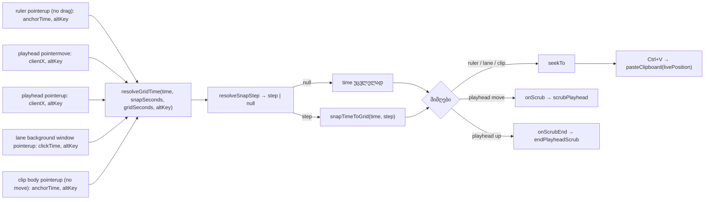

# Studio Lab — დაკვრის/ჩასმის პოზიცია ბადეს მიჰყვება: ruler, playhead, ცარიელი ხაზი, კლიპის body (SRW-14 ეტაპი 3a)

**თარიღი:** 2026-10-17
**სტატუსი:** Round 50 — D-29z15; C-ის შემოწმებას ელოდება
**შეცვლილი პროექტი:** Store

## კონტექსტი

FB-13 (მომხმარებლის ჩანაწერი `2.srt` 05:16–07:53): „კლიპის გადატანა **და დაკვრის პოზიცია** არჩეულ ბადეს უნდა მიჰყვებოდეს“. ეტაპებმა 1–2 (doc 044, 045) ბადე, Snap, კლიპის გადატანა, trim, კლიპის შიგნით დროის მონაკვეთი და Alt-ის წესი მოიტანა. პოზიცია ჯერ კიდევ თავისუფლად იდგმებოდა.

ეტაპი 3 ორად გაიყო, რომ თითო ნაწილი ცალკე შემოწმდეს:

- **3a (ეს რაუნდი, 50):** ყველა pointer gesture, რომელიც პოზიციას (playhead / insert marker) სვამს;
- **3b (რაუნდი 51):** ბიბლიოთეკიდან drop-ის ghost და ადგილი, loop brace-ის drag და ისრები.

იმავე სატესტო ფაილში დაიხურა C-ის ორი Low ტესტის ხარვეზი: C-R49-01 (trim-ის snap → clamp რიგი) და C-R49-02 (`'out-of-range'` → lane ghost-ების არარსებობა).

## მიდგომა

### `resolveGridTime`

`grid.ts`-ში ერთი ახალი pure ფუნქცია — `resolveGridTime(time, snapSeconds, gridSeconds, bypass)`. ბიჯს არსებული `resolveSnapStep` ადგენს (Snap, დანაყოფი, Alt). ბიჯის არარსებობისას დრო **უცვლელად** ბრუნდება, დამრგვალების გარეშე (დღევანდელი თავისუფალი მნიშვნელობა). ბიჯის არსებობისას გამოიყენება `snapTimeToGrid` (მთელი ms, 0-ზე ნაკლები არასოდეს). დანარჩენი `grid.ts` უცვლელია.

### ოთხი შესასვლელი წერტილი

| gesture | ფაილი | რა ხდება |
|---|---|---|
| ruler-ზე click (drag-ის გარეშე) | `ArrangementRuler.tsx` | `onSeek(resolveGridTime(anchorTime, …, pointerup-ის altKey))`. `endRulerNavigation` იღებს მესამე პარამეტრს `bypass` (default `false`); abort/unmount გზები seek-ს არ აკეთებს, როგორც ადრე |
| playhead-ის სახელურის drag | `ArrangementRuler.tsx` | ყოველი `pointermove` sample ხაზზე ჯდება (`onScrub`), `pointerup`-იც (`onScrubEnd`); cancel/lost-capture ინახავს ბოლო (უკვე ხაზზე მდგარ) sample-ს |
| ცარიელ ხაზზე click | `StudioWorkspace.tsx` | `seekTo(resolveGridTime(clickTime, Snap ? დანაყოფი : null, დანაყოფი, window pointerup-ის altKey))`; marquee და cancel უცვლელია |
| კლიპის body-ში click | `ArrangementClip.tsx` | `finishGesture`-ში ერთი ხაზი: `seekTo(resolveGridTime(anchorTime, …, დამამთავრებელი event-ის altKey))` |

ruler-ი Snap-ს და დანაყოფს იმავე optional prop-ებით იღებს, რითაც ხაზები და კლიპები (`snapSeconds`, `gridSeconds`). prop-ების გარეშე ruler-ი ზუსტად ისე მუშაობს, როგორც ადრე.

### B-ის გადაწყვეტილებები (D-29z15)

- **P1 — Alt click-ზე:** click-ს `pointermove` არ აქვს, ამიტომ Alt იკითხება იმ event-იდან, რომელიც მოქმედებას ასრულებს — `pointerup` (ruler, ცარიელი ხაზი, კლიპის body). drag-ზე (playhead) — ყოველ `pointermove`-ზე და ბოლო `pointerup`-ზე, როგორც ეტაპ 2-ში.
- **P2 — playhead-ის drag ყოველ sample-ს ხაზზე სვამს.** წინასწარი ხედი = commit: ხაზი არასოდეს აჩვენებს პოზიციას, რომელსაც აშვება არ შეინახავს.
- **P3 — playhead-ის ←/→ Snap-ით კვლავ ±0.1 წმ-ია.**
- **P4 — paste თავისით არ ჯდება ბადეზე.** `pasteClipboard()` მიმდინარე პოზიციას იყენებს (SRW-09). ხაზზე დასმული click-ის შემდეგ Ctrl+V ხაზზე ჩასვამს. სხვა გზით მიღებული პოზიცია (დაკვრის დროს, Stop-ის შემდეგ, ←/→, Alt-click) უცვლელად რჩება. `ArrangementContext.tsx` არ შეცვლილა.
- **P5 — კლიპის body-ში click-ი კლიპში არ იზღუდება:** პოზიცია timeline-ის პოზიციაა. 7.2-ზე დაწყებულ კლიპში 7.3-ზე click 1 წმ ბადეზე 7.000-ს იძლევა.
- **P6 — timeline-ის ბოლოზე maximum clamp არ არის** (`pointerTime`-საც არ აქვს). snapped მნიშვნელობა დახატულ სიგრძეს შეიძლება ნახევარ დანაყოფზე ნაკლებით გასცდეს.

## არქიტექტურა

## შეცვლილი ფაილები

- `app/lib/arrangement/grid.ts` — ახალი export `resolveGridTime`; არსებული ფუნქციები უცვლელია.
- `app/components/arrangement/ArrangementRuler.tsx` — optional `snapSeconds`/`gridSeconds`; ruler-ზე click-ის seek; playhead-ის drag-ის ორი ადგილი; import.
- `app/components/arrangement/StudioWorkspace.tsx` — ruler-ის ორი prop; ცარიელ ხაზზე click-ის seek; import (CRLF შენარჩუნებულია).
- `app/components/arrangement/ArrangementClip.tsx` — ერთი ხაზი `finishGesture`-ში; import.
- `app/lib/arrangement/__tests__/grid-snap-position.test.tsx` — ახალი (17 ტესტი, SP1–SP17).
- `app/lib/arrangement/__tests__/grid-snap-edit.test.tsx` — SE10 ახალ კონტრაქტზე გადაიწერა; დაემატა SE10b, SE20 (C-R49-01), SE21 (C-R49-02).

## პრობლემები და გადაწყვეტები

- **Problem:** jsdom-ში ruler-ის, ხაზისა და კლიპის rect 0-ია, marquee კი timeline container-ის rect-ს და header-ის სიგანეს (224 px) იყენებს. → **Solution:** SP13 კოორდინატებს ცალსახად ითვლის (`224 + დრო × 40`) და ვერტიკალურად music-ის ხაზს კვეთს. ruler/ხაზის click-ებისთვის დრო = `clientX / 40`; SP2 zoom readout-ით (`40 px/წმ`) ამას ამოწმებს.
- **Problem:** playhead-ის `pointerdown` `stopPropagation`-ს აკეთებს, ამიტომ `dragFrom`-ის ფორმა (root-ზე move/up) აქ არ გამოდგება. → **Solution:** ტესტები move/up/cancel-ს პირდაპირ სახელურზე აგზავნის. `aria-valuenow` სინქრონულად იწერება position store-ის subscription-ით, ამიტომ drag-ის დროს წაკითხვა სანდოა.
- **Problem:** `requestAnimationFrame` ტესტებში არასოდეს გამოიძახება. → **Solution:** SP6 ვერტიკალურ drag-ს იყენებს: `endRulerNavigation` აშვებისას ბოლო ხედს თავად იყენებს, ამიტომ zoom readout-ის ცვლილება ჩანს.
- **Problem:** code-reviewer-მა აღნიშნა, რომ playhead-ის cancel გზა ტესტით არ იყო დაცული. → **Solution:** დაემატა SP17 (cancel ინახავს ბოლო snapped sample-ს). ის ორ mutation-ზე ჩავარდა: cancel → raw x და cancel → snapped cancel x.
- **Problem:** `StudioWorkspace.tsx` CRLF-ია, დანარჩენი owned ფაილები LF. → **Solution:** `StudioWorkspace.tsx` შეიცვალა CRLF-ის შემნახველი script-ით, ხოლო format LF ასლზე `biome format`-ით შემოწმდა: ცვლილება არ ჰქონდა. ხაზის ბოლოები ყოველ ფაილზე node-ით დაითვალა.

## ტესტირება

- **Red** (snapshot-ის კოდი scratch copy-ში, `store/`-ის გარეთ): 9 წითელი / 32 მწვანე — ზუსტად §2.2-ის მოლოდინი. წითელია SP1 (export არ არსებობს), SP3, SP5, SP7, SP11, SP14 (პირველი ნახევარი: 9.3 ≠ 9), SP15, SP16, SE10. SP17 მოგვიანებით დაემატა და snapshot-ზე წითელია (5.4 ≠ 5).
- **Green:** 41/41, SP17-ის შემდეგ 17 + 25.
- **Mutations** (a)–(r), C-ის (q) და SP17-ის (t1), (t2): ყველა ჩავარდა დასახელებულ ტესტზე.
- გაყინული სუიტები, სრული vitest, tsc, build, Biome და `npm run verify`: იხ. `tmp/studio-real-loop/a-round-50.md`.
- **ბრაუზერის smoke** (A, ერთი გაშვება, PASS არ არის): `/studio-lab` 1440×900 → REAL `g` → REAL click ruler-ზე 7.3 წმ-ზე → სახელური `aria-valuenow` 7, `aria-valuetext` `00:07.000`. click gstack `$B click`-ით შესრულდა, ruler-ის შიგნით ჩასმულ 2 px-იან marker-ზე; ეს C-ის მეთოდია. drag და Alt+click-ის მტკიცებულებას C REAL-mouse (PW)-ით აგროვებს; GSTACK-NO-MOUSE მეთოდის გადახვევა ჯერ დაუმტკიცებელია.

## Ableton-ის წყარო და შესაბამისობა

წყარო: Live 12 Reference Manual, თავი 6 (`https://www.ableton.com/en/live-manual/12/arrangement-view/`), სექციები 6.2/6.3, 6.6, 6.9 (`#selecting-clips-and-time`), 6.10 (`#using-the-editing-grid`). ტექსტი B-მ gstack browse-ით მოიპოვა 2026-10-16-ს (`b-round-46/ableton-arrangement-view-20261016.txt`, `b-round-46/ableton-6.7-6.10-20261016.txt`) და 2026-10-17-ს ხელახლა წაიკითხა. ახალი fetch არ გაკეთებულა. ვიდეო არ უნახავთ, Live-ის ინსტალაცია არ გამოყენებულა.

| ქცევა | Ableton-ის წყარო | იქ დადასტურებული | CZABA-ს გადაწყვეტილება / განსხვავება | C-ის შემოწმება |
|---|---|---|---|---|
| arrangement-ის ფონზე click დროის წერტილს სვამს (insert marker) | 6.9 „Clicking into the Arrangement background selects a point in time, represented by a flashing insert marker“ | **დადასტურებული** (ტექსტი) | იგივე: ცარიელ ხაზზე click პოზიციას სვამს | LA-1 |
| ეს წერტილი editing grid-ს მიჰყვება | 6.10 „the cursor will snap to grid lines“ (ზოგადი; insert marker სახელით არ არის ნახსენები) | **დადასტურებული ზოგადად** | იგივე, Snap ჩართულისას | LA-1, CL-1 |
| Alt მოქმედების დროს snap-ს გვერდს უვლის / დროებით რთავს | 6.10 „hold down the Alt (Win) … while performing an action to bypass grid snapping. If the grid is switched off, using the modifier will temporarily enable it“ | **დადასტურებული** (ტექსტი) | იგივე; click-ზე Alt აშვებისას იკითხება (P1) | RU-ALT, RU-ALT-ON, LA-ALT, CL-ALT |
| კლიპის waveform-ში click insert point-ს სვამს | 6.9 ასახელებს კლიპზე click-ს (კლიპს მონიშნავს) და waveform-ში drag-ს (დროს მონიშნავს); უბრალო click waveform-ში აღწერილი არ არის | **დაუდასტურებელი** | CZABA: body click = პოზიცია (SRW-04 / round 49), ახლა ბადეზე. round 49-ის „დადასტურებული“ გადაჭარბება იყო | CL-1 |
| scrub area-ზე click | 6.2/6.3 „Clicking anywhere in the scrub area launches playback from that point … quantized based on the Quantization Menu's value“ | **დადასტურებული** (ტექსტი) | **შეგნებული განსხვავება:** CZABA-ს ruler-ზე click playhead-ს აადგილებს, დაკვრას არ იწყებს (SRW-04, D-27), და editing grid-ს იყენებს. CZABA-ს ერთი ბადე აქვს და launch quantization არ აქვს | RU-1 |
| beat-time ruler-ის drag გადაახვევს/ადიდებს | 6.2 „drag left or right to scroll … drag vertically to zoom“ | **დადასტურებული** | იგივე, უცვლელი, seek-ის გარეშე | RU-NAV |
| playhead-ის სახელურის drag | ვერ მოიძებნა (Live-ში scrub area-ზე დაჭერა launch quantization-ით loop-ავს) | **არ ეხება** / დაუდასტურებელი | CZABA-ს სახელური (SRW-04) ყოველ sample-ს ბადეზე სვამს (P2) | DR-1 |
| ისრები insert marker-ს ამოძრავებს | 6.9 „The insert marker can then be moved in time with the left and right arrow keys“ (ბიჯი მითითებული არ არის) | **დადასტურებული** (რომ ამოძრავებს); ბიჯი **დაუდასტურებელია** | CZABA ტოვებს ±0.1 წმ-ს (P3) | DR-KEY |
| paste insert marker-ზე | 6.9 აღწერს მონიშვნა → ბრძანება (Paste), მაგრამ არა ჩასმის ადგილს | **დაუდასტურებელი** | CZABA: paste მიმდინარე პოზიციაზე (SRW-09); ბადეს snapped პოზიციით მიჰყვება (P4) | PA-1, PA-ALT |
| loop brace-ის ისრები ბადით ამოძრავებს | 6.6 „The left and right arrow keys nudge the loop brace … based on the current grid settings“ | **დადასტურებული** (ტექსტი) | **ეტაპი 3b (რაუნდი 51)** | — |

## TODO / შემდეგი ნაბიჯები

- **ეტაპი 3b (რაუნდი 51):** ბიბლიოთეკიდან drop-ის ghost და ადგილი ბადეზე (`ArrangementLane.tsx`, Alt `DragEvent`-იდან); loop brace-ის გადატანა/ზომა ბადეზე (`ArrangementLoopBrace.tsx`); loop brace-ის ←/→ ბადით (Live 6.6).
- **ეტაპი 4 (რაუნდი 52):** კლიპის კიდეებზე snap (6.7), lane-ებზე right-click დანაყოფის მენიუ, narrow/widen keyboard-ით (Live 6.10).
- **ეტაპი 5 (SRW-15-ის BPM-ის შემდეგ):** მუსიკალური დანაყოფები, bars/beats ruler, R14-G1.
- **Tech Lead R49-T** (1–3) ღიაა.
- **Tech Lead R50-T:** რეალური მაუსით, Snap ჩართული: (1) ruler-ზე, ცარიელ ხაზზე და კლიპის body-ში click — playhead მოსალოდნელ ხაზზე დგება; (2) ასეთი click-ის შემდეგ paste ბადეზე ჯდება; მოელით თუ არა snap-ს Stop/←/→-ის შემდეგაც (P4); (3) Alt+click რეალურ Windows Chrome-ში (app menu, როგორც R49-T(2)).
