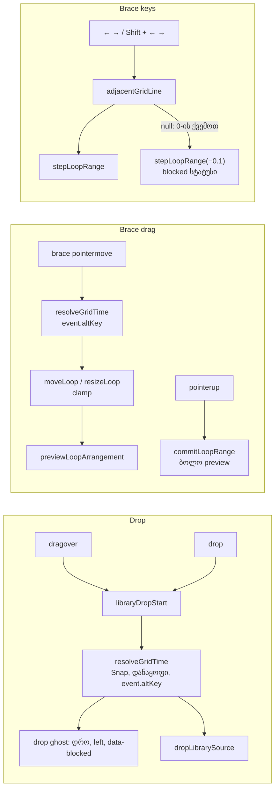

# Studio Lab — ბიბლიოთეკიდან drop და loop brace ბადეს მიჰყვება (SRW-14 ეტაპი 3b)

**თარიღი:** 2026-10-17
**სტატუსი:** Round 51 — D-29z16; C-ის შემოწმებას ელოდება
**შეცვლილი პროექტი:** Store

## კონტექსტი

FB-13 (მომხმარებლის ჩანაწერი `2.srt` 05:16–07:53): „კლიპის გადატანა და დაკვრის პოზიცია არჩეულ ბადეს უნდა მიჰყვებოდეს … თავისუფალი რეჟიმიც“. ეტაპმა 3a (doc 046, რაუნდი 50) ბადეზე დასვა ყველა pointer gesture, რომელიც პოზიციას სვამს. ეს რაუნდი ეტაპის მეორე ნახევარია:

- ბიბლიოთეკიდან lane-ზე ჩაგდებული ხმა Snap-ის დროს ბადის ხაზზე ჯდება, ხოლო drop ghost გაშვებამდე იმავე ხაზს აჩვენებს;
- loop brace-ის ზოლი და კიდეები ბადის ხაზებზე გადაადგილდება, ←/→ კი ხაზიდან ხაზზე ხტება (Live 6.6);
- Alt Snap-ის ჩართვისას ბადეს გვერდს უვლის, გამორთვისას დროებით რთავს მას (Live 6.10; იგივე წესი, რაც ეტაპებში 2–3a).

## მიდგომა

### Q1 — drop

- `ArrangementLane`-ის `libraryDropStart` ახლა `libraryDropTime`-ის შედეგს `resolveGridTime`-ში ატარებს (lane უკვე იღებს `snapSeconds` / `gridSeconds` props-ს). ამ ფუნქციას იძახებს `dragover`-იც (ghost-ის დრო და `canPlaceLibraryClip`) და `drop`-იც (`dropLibrarySource`), ამიტომ ghost და ჩაგდებული კლიპი კონსტრუქციით ერთ დროზეა.
- Alt იკითხება თითო event-იდან: ყოველი `dragover` sample-იდან და ბოლოს თავად `drop`-იდან. Alt-ის ბოლო `dragover`-იდან დამახსოვრება არ ხდება — გადაწყვეტს `drop`.
- თუ ხაზზე დასმული დასაწყისი არსებულ კლიპს ფარავს, drop უარყოფილია დღევანდელი ghost ტექსტით (` · აქ ადგილი არ არის`) და სტატუსით (`LIBRARY_DROP_BLOCKED_MESSAGE`), თუნდაც თავისუფალი დრო ეტეოდეს. CZABA თავისუფალ ადგილს არ ეძებს; თავისუფალ პოზიციას Alt იძლევა.
- ფაილის (`Files`) drop-ის გზა უცვლელია.

### Q2 — brace-ის drag

- `ArrangementLoopBrace` იღებს ორ არასავალდებულო props-ს: `snapSeconds` (default `null`) და `gridSeconds`. მათ გარეშე რენდერი (მაგ. `gesture-guard.test.tsx`) ძველებურად იქცევა.
- `pointermove`-ზე, უცვლელი threshold-ის შემდეგ: **move** ხაზზე სვამს დასაწყისს და სიგრძეს ინარჩუნებს (როგორც კლიპის გადატანა, R47); **start/end** ხაზზე სვამს მხოლოდ გადათრეულ კიდეს.
- რიგი: ჯერ snap, მერე clamp. Clamp-ს ისევ `moveLoop` / `resizeLoop` აკეთებს (დრო 0, მინიმალური სიგრძე 0.1 წმ), ამიტომ clamp-ის შემდეგ კიდე შეიძლება ხაზს გარეთ აღმოჩნდეს — იგივე, რაც trim-ზე (F1 / SE20).
- Snap-ით მიღებული preview, რომელიც საწყისს უდრის, არაფერს ინახავს და Undo-ს ჩანაწერს არ ქმნის: `commitLoopRange` უცვლელ arrangement-ს უგულებელყოფს.

### Q3 — Alt brace-ის drag-ზე

Alt იკითხება ყოველი `pointermove`-დან; ხელის აშვება (`finishLoopGesture`, უცვლელი) ბოლო preview-ს ინახავს. ეს განსხვავდება playhead-ის სახელურისგან (რაუნდ 50-ში `pointerup` ხელახლა იკითხება) და ემთხვევა კლიპის გადატანა/trim-ს. ჩაწერილია, არ შეცვლილა.

### Q4 — brace-ის ისრები

- Snap გამორთულია: ±0.1 წმ, უცვლელი.
- Snap ჩართულია: ← → დასაწყისს გადაიტანს მეზობელ ხაზზე (სიგრძე უცვლელი); Shift + ← → დასასრულს გადაიტანს მეზობელ ხაზზე (clamp start + 0.1-მდე). მიმდინარე მნიშვნელობა იკითხება `getArrangement().loop`-დან, მეზობელი ხაზი — `adjacentGridLine`-ით, ცვლილება კი არსებული `stepLoopRange`-ით (Undo ჩანაწერი და სტატუსი ძველებურია).
- თუ 0-ზე ქვემოთ ხაზი აღარ არის, გამოიძახება ძველი Snap-off გზა (`stepLoopRange(kind, -0.1)`), რომელიც ვერაფერს ამოძრავებს და არსებულ `LOOP_STEP_BLOCKED_MESSAGE`-ს აჩვენებს. ახალი ტექსტი არ არის.
- Alt ისრებზე გავლენას არ ახდენს (როგორც კლიპის nudge, R47).

### Q5 — რაც არ დამატებულა

Live-ის ↑/↓ (loop-ის სიგრძით გადაწევა), Ctrl + ↑/↓ (გაორმაგება/განახევრება) და Ctrl + ← → (სიგრძე ბადით; CZABA იყენებს Shift-ს). მომხმარებლის ჩანაწერები მათ არ ითხოვს — backlog-ის სიგნალი ABLETON-LOOP-KEYS-NOT-REQUESTED.

### Q6 — უცვლელი გზები

Ctrl+L loop-ს მიმდინარე დიაპაზონიდან ქმნის, დიაპაზონი კი უკვე ბადეს მიჰყვება (ეტაპი 2). „＋ დამატება“ / Enter მიმდინარე პოზიციაზე ამატებს, რომელიც უკვე ბადეზეა (ეტაპი 3a).

## არქიტექტურა

`StudioWorkspace` brace-ს გადასცემს იმავე გამოსახულებებს, რასაც ruler-ს და lane-ებს: `snapSeconds={snapEnabled ? gridSeconds : null}`, `gridSeconds={gridSeconds}`.

## შეცვლილი ფაილები

| ფაილი | დანიშნულება |
|---|---|
| `app/components/arrangement/ArrangementLane.tsx` | `libraryDropStart` ბადეზე სვამს drop-ის დროს; `grid`-ის import-ს დაემატა `resolveGridTime` |
| `app/components/arrangement/ArrangementLoopBrace.tsx` | ორი არასავალდებულო prop; drag-ის sample ბადეზე; ისრები მეზობელ ხაზზე Snap-ის დროს |
| `app/components/arrangement/StudioWorkspace.tsx` | brace-ის JSX იღებს `snapSeconds` / `gridSeconds`-ს (CRLF შენარჩუნებულია) |
| `app/lib/arrangement/__tests__/grid-snap-loop-drop.test.tsx` | ახალი: SD1–SD7, SL1–SL9, SK1–SK7 |

`ArrangementContext.tsx`, `loop.ts`, `library.ts`, `grid.ts` და სხვა ყველა ფაილი უცვლელია.

## პრობლემები და გადაწყვეტები

- **პრობლემა:** სატესტო collection-ის ყველა წყარო 40 წამიანი იყო, SD6-ისთვის კი მოკლე SFX იყო საჭირო. **გადაწყვეტა:** ტესტის stub-ში `loadSource` წყაროს id-ის მიხედვით აბრუნებს სიგრძეს (`hit` = 2 წმ, `song` = 40 წმ); mount ელოდება ორივე წყაროს `ready` მდგომარეობას, რომ `getLibraryDragSource` `null` არ დააბრუნოს.
- **პრობლემა:** `StudioWorkspace.tsx` CRLF-ია, Edit ინსტრუმენტი კი LF-ს სვამს. **გადაწყვეტა:** ერთადერთი JSX ჩანაცვლება node სკრიპტით გაკეთდა `\r\n` შეერთებით; CRLF = ხაზების რაოდენობა (1673/1673), ფორმატი შემოწმდა LF ასლზე.
- **პრობლემა:** code-reviewer-მა აღნიშნა, რომ SK7-ის `toBeGreaterThan` სუსტი იყო და start კიდის snap არცერთ ტესტში არ მოწმდებოდა. **გადაწყვეტა:** SK7 ზუსტ `13–14.8`-ს ამოწმებს; დაემატა SL9 (start კიდე −22 px → 12). დამატებითი მუტაცია (start კიდე ბადის გარეშე) SL9-მ ჩააგდო (`a-round-51/mutations.txt`).
- **შენიშვნა:** SL7 (0.3–1.5, ზოლი −30 px) snapshot-ზეც მწვანეა: raw −0.45 ორივე შემთხვევაში 0-მდე clamp-დება. ტესტი B-ის ფიქსჩერით დარჩა; ის clamp-ს ამოწმებს და არა snap-ს.

## ტესტირება

- **Red/green:** ახალი ფაილი snapshot-ის წყაროებზე (scratch ასლი `store/`-ის გარეთ) — B-ის §2.2-ის მოლოდინის შესაბამისი; განსხვავება (გამკაცრებული SK7 და ახალი SL9 წითელია) A-ის ანგარიშშია ახსნილი. მიმდინარე წყაროებზე ყველა მწვანეა.
- **მუტაციები (a)–(m)** და ერთი დამატებითი — `tmp/studio-real-loop/a-round-51/mutations.txt`.
- **Gates:** `tsc` 0; vitest სრული; build; Biome (ფლობილი LF ფაილები 0 diagnostic, `./app` baseline-ის ფარგლებში); `npm run verify`.
- **REAL-mouse (PW) მეთოდის შენიშვნა:** gstack-ს არ აქვს mouse down/move/up, მოდიფიკატორის დაჭერა click-ის დროს და double-click. ამიტომ ბიბლიოთეკიდან HTML5 drag, brace-ის drag და Alt-ის შემთხვევები C-ს standalone Playwright-ით (`page.mouse` / `page.keyboard`) უწევს — ეს ჯერ root/მომხმარებლის მიერ დასამტკიცებელი გადახრაა. Playwright/CDP-ით შესრულებული HTML5 drag ოპერაციული სისტემის ნამდვილი drag **არ არის**: Windows Chrome-ში Alt-ის ქცევა drag-ის დროს (R51-ALT-NATIVE-DRAG) Tech Lead-ის ხელით შესამოწმებელია.

## Ableton-ის წყარო და შესაბამისობა

წყაროები:

- Live 12 Reference Manual, თავი 6, `https://www.ableton.com/en/live-manual/12/arrangement-view/`, **6.6 "The Arrangement Loop"** — B-ის gstack ტექსტი 2026-10-16 (`b-round-46/ableton-arrangement-view-20261016.txt`), ხელახლა წაკითხული 2026-10-17.
- თავი 4, `https://www.ableton.com/en/live-manual/12/working-with-the-browser/`, **4.10 "Adding Content from the Browser to a Live Set"** — B-მა gstack browse-ით 2026-10-17 (`b-round-50/ableton-browser-20261017.txt`); manual-ს აწერია Version 12.
- 6.10 (Alt) — `b-round-46/ableton-6.7-6.10-20261016.txt`.
- ვიდეო არ ნახულა; Live-ის ინსტალაცია არ გამოყენებულა.

| ქცევა | Ableton-ის წყარო | იქ დადასტურებული | CZABA-ს გადაწყვეტილება / განსხვავება | C-ის შემოწმება |
|---|---|---|---|---|
| Loop brace-ის კიდეები და ზოლი გადაითრევა | 6.6 "dragging from the left or right edge adjusts the loop start/end points, while dragging the brace bar horizontally moves the loop without changing its length" | **დადასტურებული** | იგივე (არსებული) | LB-OFF |
| გადათრეული brace ბადის ხაზზე ჯდება | 6.6 ამას არ ამბობს; 6.7 ამბობს, რომ *კლიპები* ბადეზე ჯდება | **დაუდასტურებელი** (კლიპის წესიდან დასკვნა) | CZABA Snap-ის დროს ხაზზე სვამს (მომხმარებელი: ყველაფერი არჩეულ ბადეს მიჰყვება) | LB-MOVE, LB-END |
| ← → brace-ს ბადით აწევს | 6.6 "The left and right arrow keys nudge the loop brace to the left or right based on the current grid settings" | **დადასტურებული** (ტექსტი; ზუსტი წესი — ხაზზე თუ ერთი ბიჯით — არ წერია) | Snap-ით მეზობელ ხაზზე; Snap-ის გარეშე ±0.1 წმ | LK-1, LK-025, LK-OFF |
| Loop-ის დამოკლება/დაგრძელება ბადით | 6.6 "Ctrl (Win) … + the left and right arrow keys shortens or lengthens the loop by the current grid setting" | **დადასტურებული** | **შეგნებული განსხვავება:** CZABA ინარჩუნებს არსებულ Shift + ← →-ს დასასრულისთვის | LK-SHIFT |
| ↑/↓ სიგრძით გადაწევა; Ctrl + ↑/↓ გაორმაგება/განახევრება | 6.6 | **დადასტურებული** | **არ დამატებულა** — მომხმარებელს არ უთხოვია (Q5; სიგნალი) | — |
| Alt გვერდს უვლის / დროებით რთავს ბადეს | 6.10 | **დადასტურებული** (ტექსტი) | იგივე, თითო `pointermove` / drag event-ზე | LB-ALT, LB-ALT-ON, LD-ALT, LD-ALT-ON |
| ბიბლიოთეკიდან ელემენტი ტრეკზე ითრევა | 4.10 "Items can be dragged and dropped from the browser into tracks in the Session or Arrangement View" | **დადასტურებული** (რომ drop ამატებს) | იგივე (არსებული, SRW-07) | LD-OFF |
| Drop-ის პოზიცია ბადეს მიჰყვება | 4.10 პოზიციას არ აღწერს | **დაუდასტურებელი** | CZABA Snap-ის დროს ხაზზე სვამს; ghost = drop | LD-1 |
| ტრეკების ქვემოთ ჩაგდება ახალ ტრეკს ქმნის | 4.10 | **დადასტურებული** | **არ ეხება** — CZABA-ს ხაზები ფიქსირებულია | — |

დაუდასტურებელ სტრიქონებზე არ ითქმის „Ableton-შიც ასე მუშაობს“.

## TODO / შემდეგი ნაბიჯები

- **ეტაპი 4 (რაუნდი 52):** კლიპის კიდეზე snap (Live 6.7), lane-ზე მარჯვენა click-ით დანაყოფის მენიუ, narrow/widen ღილაკები (Live 6.10 Ctrl+1/2), R49-OUTWARD-TRIM-SHRINK / R49-WIDE-DIVISION-RANGE.
- **A-R50-REVIEW-CLIP-CANCEL-SEEK** — ეტაპ 4-ში, `ArrangementClip.tsx`-თან ერთად.
- **ეტაპი 5** SRW-15-ის შემდეგ (BPM ბადე, bars/beats).
- **R50-T** და **R51-T** — Tech Lead-ის ხელით შემოწმება (ნამდვილი library drag Snap-ითა და Alt-ით Windows Chrome-ში, brace-ის drag/ისრები, C-R50-N2).
- **ABLETON-LOOP-KEYS-NOT-REQUESTED** — Live-ის ↑/↓ და Ctrl + ისრები; მხოლოდ Tech Lead-ის მოთხოვნის შემთხვევაში.
- **ARCH-CHECKPOINT-SRW14-PREFS** — brace snap-ის props-ის მეოთხე მომხმარებელია (ruler, lane-ები, კლიპები, brace); root-ის პასუხს ელოდება.
