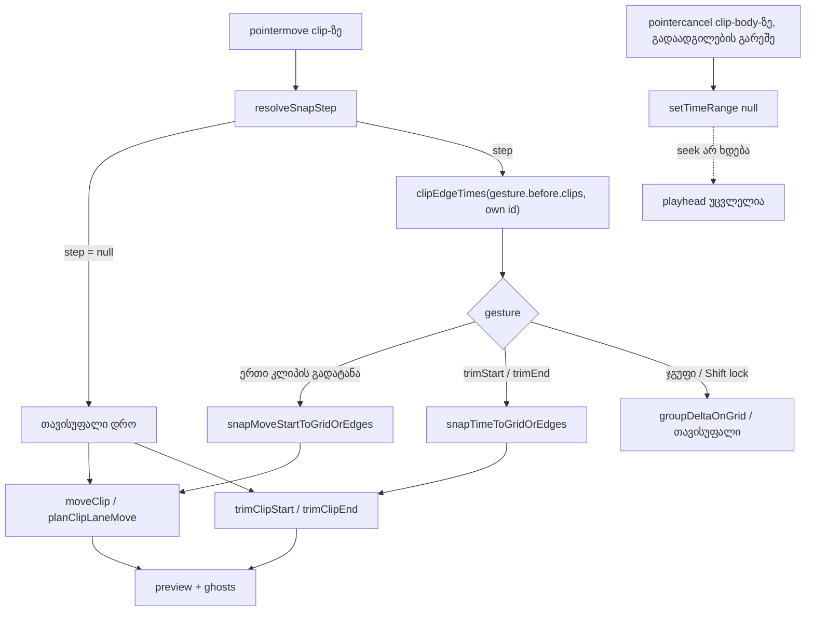
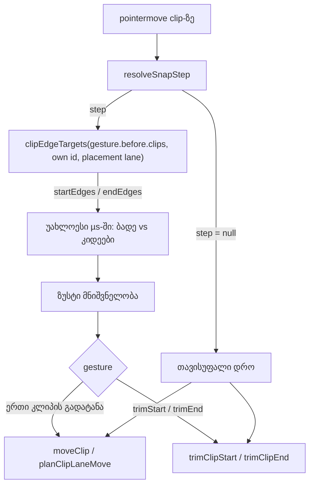

# Studio Lab — კლიპი სხვა კლიპების კიდეებზე ჯდება (SRW-14 ეტაპი 4a)

**თარიღი:** 2026-10-17
**სტატუსი:** Round 52–55 — D-29z17, D-29z18, D-29z19, D-29z20; C-ის შემოწმებას ელოდება
**შეცვლილი პროექტი:** Store

## კონტექსტი

FB-13 (მომხმარებლის ჩანაწერი `2.srt` 07:00–07:53): „… ზედ უნდა დაჯდეს და ჩაიკეტოს, რომ ზუსტი დრო კონტროლდებოდეს“. ეტაპებმა 1–3 (doc 043–047) gesture-ები ბადის ხაზებზე დასვა. მაგრამ ორი ხმის ერთმანეთზე მიდგმა, ან ხმის ზუსტად ვიდეოს ჭრაზე დასრულება, კვლავ Alt-სა და პიქსელის სიზუსტეს ითხოვდა.

ეტაპი 4 სამ ცალკე შემოწმებად ნაწილად გაიყო, მოცულობის შემცირების გარეშე:
- **4a (ეს რაუნდი):** ერთი კლიპის გადატანა და trim კიდეებზე; გაუქმებული clip-body დაჭერა playhead-ს აღარ ამოძრავებს; brace-ის release-ის ტესტის ხარვეზი C-R51-T1.
- **4b (რაუნდი 53):** lane-ის კონტექსტური მენიუ ბადის არჩევისთვის, ბადის დავიწროება/გაფართოება კლავიშებით, C-R51-02-ის ფიქსი, C-R51-01-ის probe.
- **4c (რაუნდი 54):** ჯგუფური გადატანა კიდეებზე და ბიბლიოთეკიდან drop-ის გადაწყვეტილება.

## მიდგომა

Snap-ის ბიჯი იგივე რჩება: `resolveSnapStep(snapSeconds, gridSeconds, altKey)`. Snap ჩართულია და Alt არ არის → არჩეული ბადე; Snap გამორთულია + Alt → არჩეული ბადე; სხვა შემთხვევაში ბიჯი არ არის და gesture თავისუფალია.

- **E1 — კანდიდატები:** gesture-ის დაწყებისას დაფიქსირებული arrangement-ის (`gesture.before`) ყველა სხვა კლიპის დასაწყისი და დასასრული, ყველა ხაზიდან, ვიდეოკლიპის ჩათვლით. გადასატანი/საtrim-ი კლიპის საკუთარი კიდეები არ ითვლება. ყველა შედარება მთელ მილიწამებში ხდება.
- **E2 — ერთი კლიპის გადატანა** (იმავე ან სხვა ხაზზე; არა ჯგუფი, არა Shift-ის დროის ჩაკეტვა). კანდიდატებია: ბადის უახლოესი ხაზი; ყოველი კიდე, სადაც კლიპის დასაწყისი შეეხება; ყოველი პოზიცია, სადაც კლიპის დასასრული შეეხება. 0-ზე ნაკლები კანდიდატები იშლება. იმარჯვებს უახლოესი. თანაბარ მანძილზე ბადე იმარჯვებს, ორ კიდეს შორის კი ადრეული.
- **E3 — trim:** მარცხენა ან მარჯვენა კიდე ბადის ხაზსა და სხვა კლიპების კიდეებს შორის უახლოესზე ჯდება, იგივე tie წესით. შედეგი უცვლელად გადაეცემა `trimClipStart` / `trimClipEnd`-ს, ამიტომ წესი „ჯერ snap, მერე clamp“ (F1, SE20) ძალაში რჩება. წყაროს საზღვრის ან მინიმალური სიგრძის მიღმა მყოფი კიდე იჭრება და ჩნდება არსებული blocked ტექსტი.
- **E4 — უცვლელია:** ჯგუფური გადატანა (მხოლოდ ბადე), clip-body-ის დროის მონიშვნა, ruler, playhead, ცარიელ lane-ზე დაწკაპება, ბიბლიოთეკიდან drop, loop brace, nudge კლავიშები.
- **E5 — გადაფარვა:** კიდე მხოლოდ start/end-ს გვთავაზობს. `moveClip` / `planClipLaneMove` / `trimClip*` გადაფარვას ისევე უარყოფს, როგორც აქამდე; შეხება (ერთის end = მეორის start) დაშვებულია (`ARRANGEMENT_EPS`).
- **Snap off = სრულად თავისუფალი**, კიდეებისთვისაც (მომხმარებლის „თავისუფალი რეჟიმი“). Alt ორივე მნიშვნელობას ინარჩუნებს კიდეებისთვისაც.
- **pointercancel:** clip-body-ზე დაჭერა, რომელიც გადაადგილების გარეშე `pointercancel`-ით სრულდება, დროის მონიშვნას ასუფთავებს, მაგრამ `seekTo`-ს აღარ იძახებს. `pointerup` იძახებს, როგორც აქამდე.

**განხილული ალტერნატივები:**
- პიქსელის რადიუსი (მაგ. 8 px) — უარყოფილია. Live 6.7 მანძილს არ ასახელებს; nearest-wins ყველაზე პატარა დეტერმინისტული წესია (D-29z17).
- კიდეები Snap off-ის დროსაც — უარყოფილია. მომხმარებელმა თავისუფალი რეჟიმი მოითხოვა; Live-ის ქცევა ამ შემთხვევაში დაუდასტურებელია.

## არქიტექტურა

## შეცვლილი ფაილები

- `app/lib/arrangement/grid.ts` — სამი ახალი export: `clipEdgeTimes`, `snapTimeToGridOrEdges`, `snapMoveStartToGridOrEdges` (+ type-only import). არსებული კოდი უცვლელია.
- `app/components/arrangement/ArrangementClip.tsx` — `moveStartOnGrid` კლიპის სიგრძესა და კიდეებს იღებს; trim-ის requested დრო კიდეებს ითვალისწინებს; clip-body-ის `pointercancel` seek-ს აღარ აკეთებს.
- `app/lib/arrangement/__tests__/grid-edges.test.ts` — ახალი, pure (CE1–CE3).
- `app/lib/arrangement/__tests__/grid-snap-clip-edges.test.tsx` — ახალი, mounted (CM1–CM11, CM9b, CT1–CT6, CC1–CC2).
- `app/lib/arrangement/__tests__/grid-snap-loop-drop.test.tsx` — ბოლოში დამატებული helper და `describe` (SL10, SL11, SL7b, SL7c); არსებული 23 შემთხვევა უცვლელია.

## პრობლემები და გადაწყვეტები

- **პრობლემა:** stage-1-ის ორი frozen ტესტი, `grid-snap-ui.test.tsx` GS3 და GS13, ახალ წესთან წინააღმდეგობაშია. ფიქსტურა: m1 მუსიკა 7–11 (4 წმ), m2 12.5–14.5, 40 px/წმ, Snap 1 წმ.
  - GS3-ის მეორე drag 8-დან +15 px-ით: raw 8.375. ბადე 8 არის 0.375-ში, ხოლო m1-ის დასასრული m2-ს 8.5-ზე შეეხება (0.125-ში). შედეგი 8.5-ია, ტესტი 8-ს ელის.
  - GS13: raw 8.4 → 8.5 (m2-ს ეხება) 8-ის ნაცვლად; raw 8.6 → 8.5, blocked ტექსტის გარეშე, ტესტი კი blocked-ს ელის.
  - D-29z17-ის §0.4 ვარაუდობდა, რომ stage 1–3-ის ტესტები მწვანე დარჩებოდა. ეს არასწორია ფიქსტურებისთვის, სადაც მეზობელი `duration + ნახევარი ბიჯის` ფარგლებშია.
  - **გადაწყვეტა:** კოდი E2-ს ზუსტად მიჰყვება; frozen ტესტი და წესი არ შეცვლილა. გადაწყვეტილება B-ს ეკუთვნის: (a) რაუნდ 53-ში GS3/GS13-ის განახლება (m2 შორს გადაიწიოს, ან ტესტმა 8.5-ზე შეხება და blocked-ის არარსებობა შეამოწმოს); ან (b) E2-ის შეცვლა. (b) შეცვლის CM1/CM8/CT1-საც და C-ის EG-1/EG-VIDEO-ს მოლოდინებსაც.
- **პრობლემა:** მუტაცია (l) (Shift-ის დროის ჩაკეტვა კიდეებს იყენებს) CM9-ის ფიქსტურაზე ცოცხლობს: raw start 2 ზუსტად ბადის ხაზზეა, ამიტომ ხაზი ყოველთვის იმარჯვებს.
  - **გადაწყვეტა:** დაემატა CM9b (m1 2.3-ზე, მეზობელი 2.35-ზე). ის მუტაციას იჭერს.
- **პრობლემა:** ფიქსტურის დროის მცურავმძიმიანი შედარება (6.5 / 6.6 / 6.7) არადეტერმინისტული tie-ს იძლევა.
  - **გადაწყვეტა:** ყველა შედარება მთელ მილიწამებშია.

## ტესტირება

- **Red run** snapshot-ის წყაროებზე (scratch ასლი `store/`-ის გარეთ): `grid-edges.test.ts` მთლიანად ჩავარდა (export-ები არ არსებობს). Mounted ფაილში წითელი იყო CM1, CM2, CM6, CM8, CT1, CT2, CT3 და CT6, ასევე CC1. დანარჩენი მწვანე იყო, CM9b-ის ჩათვლით. SL10/SL11/SL7b/SL7c snapshot-ზე მწვანეა (guard-ებია), რასაც (n) და (o) მუტაციები ადასტურებს.
- **Green run:** 3 ფაილი / 50 ტესტი მწვანეა.
- **მუტაციები (a)–(o):** თითოეული თავის დასახელებულ ტესტს ჩაჭრის. (l) CM9-ს ვერ ჩაჭრის, CM9b-ს ჩაჭრის.
- **სრული vitest:** 87 ფაილი / 1488 ტესტი. ჩავარდნილია GS3 და GS13 (იხ. ზემოთ). ორი `sfx-library` ტესტი დატვირთვის გამო timeout-ით ჩავარდა და ცალკე გაშვებისას მწვანეა.
- **დანარჩენი:** tsc 0; build გავიდა. Biome `./app`: 5 შეცდომა / 218 / 1, მხოლოდ baseline-ის CRLF ფაილები. საკუთარი ფაილები: 0. `npm run verify` exit 1 (GS3, GS13).
- **ბრაუზერი:** gstack smoke — გვერდი იტვირთება, REAL `g` → Snap ჩართულია, console-ში მხოლოდ ცნობილი `/api/cart` შეცდომაა.
- **REAL-mouse (PW):** drag, trim და Alt-ის შემთხვევები C-ს ეკუთვნის. gstack-ს mouse down/move/up არ აქვს (GSTACK-NO-MOUSE), ამიტომ ისინი standalone Playwright-ით მოწმდება და ცალკე ილეიბლება. რეალური `pointercancel` ბრაუზერში არ შემოწმებულა; CC1 მხოლოდ unit-ია.

## Ableton-ის წყარო და შესაბამისობა

წყარო: Live 12 Reference Manual, თავი 6, `https://www.ableton.com/en/live-manual/12/arrangement-view/` — 6.7 „Moving and Resizing Clips“ და 6.10 „Using the Editing Grid“. B-მ gstack-ით 2026-10-16-ს ჩაიწერა (`b-round-46/ableton-6.7-6.10-20261016.txt`) და 2026-10-17-ს ხელახლა წაიკითხა. ვიდეო არ ნანახა, Live არ გამოყენებულა.

| ქცევა | Ableton-ის წყარო | იქ დადასტურებული | CZABA-ს გადაწყვეტილება / განსხვავება | C-ის შემოწმება |
|---|---|---|---|---|
| კლიპი ბადეზე ჯდება | 6.7 „Clips snap to the editing grid“ | დადასტურებულია (ტექსტი) | იგივე (ეტაპები 1–2) | EG-LINE, SN-1 |
| კლიპი სხვა კლიპების კიდეებზეც ჯდება | 6.7 „… including the edges of other clips, locators and time signature changes“ | დადასტურებულია (ტექსტი) | იგივე ერთ კლიპზე და trim-ზე (4a); ჯგუფი/drop — 4c | EG-1, EG-VIDEO, EG-CROSS, ET-START, ET-END |
| მიზიდვის მანძილი და ბადე vs კიდე | 6.7 არ ამბობს | დაუდასტურებელი | უახლოესი; tie → ბადე; კიდეებს შორის ადრეული | EG-1 vs EG-LINE |
| რომელი კიდე ერთდება გადატანისას | 6.7 არ ამბობს | დაუდასტურებელი | დასაწყისიც და დასასრულიც | EG-VIDEO (end), EG-1 (start) |
| Locator-ები და ზომის ცვლილებები | 6.7 | დადასტურებულია | ჯერ არ ეხება — locator-ები და ზომა არ გვაქვს (SRW-16) | — |
| ბადე გამორთულია → snap არ ხდება | 6.10 „When the grid is off, the cursor does not snap to meter subdivisions“ | subdivision-ებზე დადასტურებულია; ობიექტებზე დაუდასტურებელი | CZABA: Snap off = სრულად თავისუფალი | EG-OFF |
| Alt ბადეს გვერდს უვლის / დროებით რთავს | 6.10 | დადასტურებულია (ტექსტი) | კიდეებზეც ვრცელდება | EG-ALT, EG-ALT-ON, ET-ALT |
| გაუქმებული დაჭერა playhead-ს არ ამოძრავებს | — | წყარო არ არის | CZABA-ს თანმიმდევრულობა ruler-თან და lane-თან | CC1 (unit) |

დაუდასტურებელ სტრიქონებზე არ ითქმის, რომ „Ableton-შიც ასე მუშაობს“.

## TODO / შემდეგი ნაბიჯები

- **B:** GS3/GS13-ის წინააღმდეგობის გადაწყვეტა (ფიქსტურის განახლება ან E2-ის შეცვლა).
- **B (code-review, Medium):**
  - კიდეები და სიგრძე მილიწამამდე მრგვალდება. ამიტომ sub-ms სიგრძის კლიპზე (ბიბლიოთეკის `buffer.duration`) მიდგმა შეიძლება ≤0.5 ms-ით გადაფაროს მეზობელს და დაიბლოკოს. შეთავაზება: შედარება მილიწამებში, დაბრუნება ზუსტი მნიშვნელობით.
  - სამიზნე ხაზზე „start start-ზე“ და „end end-ზე“ კანდიდატები ყოველთვის გადაფარავს მეზობელს. ასეთი კანდიდატი შეიძლება გაიმარჯვოს და დაბლოკოს გადატანა, რომელიც ადრე თავისუფალ ხაზზე ჯდებოდა.
- **4b (რაუნდი 53):** lane-ის კონტექსტური მენიუ ბადისთვის; ბადის დავიწროება/გაფართოება კლავიშებით (Ctrl+1/2 Chrome-ში ჯერ შესამოწმებელია); C-R51-02-ის ფიქსი; C-R51-01-ის probe.
- **4c (რაუნდი 54):** ჯგუფური გადატანა კიდეებზე (anchor-ის მიხედვით); ბიბლიოთეკიდან drop-ის გადაწყვეტილება.
- **R52-T (Tech Lead):** (1) რეალური მაუსით: ხმა მეზობელ კლიპზე ან ვიდეოს ბოლოზე „ჩაიკეტება“ თუ არა, და 5–10 წმ ბადეზე ხომ არ არის ზედმეტად ძლიერი; (2) Snap off-ის დროსაც უნდა მუშაობდეს თუ არა მაგნიტი.

## Round 53 — შესწორებები (D-29z18)

### კონტექსტი

C-მ round 52-ში სამი დაკავშირებული პრობლემა იპოვა. სამივეს ერთი წყარო აქვს, `grid.ts`-ის კანდიდატების წესი:
- **C-R52-01 (Medium):** D-29z17 E2 ეწინააღმდეგება stage-1-ის GS3 და GS13 ტესტებს. 15 px-იანი nudge მეზობელს ეკვრის (8.5) და `npm run verify` exit 1-ს აბრუნებს.
- **C-R52-02 (Medium):** კიდეები და სიგრძე მთელ მილიწამამდე მრგვალდებოდა. თუ კლიპის სიგრძე მთელი ms არ არის (ბიბლიოთეკის `buffer.duration`), მიდგმული კანდიდატი მეზობელს ≤0.5 ms-ით გადაფარავდა, ხოლო `moveClip` (EPS 1e-4) მას უარყოფდა.
- **C-R52-03 (Low):** იმავე ხაზზე „end სხვის end-ზე“ და „start სხვის start-ზე“ ყოველთვის გადაფარავს. როცა ასეთი კანდიდატი უახლოესი იყო, blocked ტექსტი ჩნდებოდა იქ, სადაც stage 1 თავისუფლად გადაადგილდებოდა.

### მიდგომა

- **R1 — შედარება მიკროწამებში, ზუსტი მნიშვნელობა.** იმარჯვებს კანდიდატი, რომლისთვისაც `Math.round(|candidate − raw| · 1e6)` უმცირესია. თანაბარ მნიშვნელობაზე ბადის ხაზი იმარჯვებს, კიდეებს შორის კი ადრეული (დალაგებული სია, მკაცრი `<`). კანდიდატი, რომლის µs მნიშვნელობა < 0, იშლება. ბრუნდება გამარჯვებულის **ზუსტი** მნიშვნელობა: ხაზი `snapTimeToGrid`-იდან, კიდე ისე, როგორც შენახულია, ან `e − duration` ზუსტი `duration`-ით. მილიწამამდე დამრგვალება აღარ ხდება.
  - µs `ARRANGEMENT_EPS`-ზე (100 µs) უფრო წვრილია და მაინც მთელი რიცხვის შედარებაა, ამიტომ ათწილადური tie (CM7: 0.1 vs 0.1) ზუსტ tie-დ რჩება.
  - მიღებული ნარჩენი: ხაზიდან 1 µs-ის ფარგლებში მყოფი კიდე tie-ა და ხაზი იმარჯვებს.
- **R2 — კიდეების სია.** `clipEdgeTimes` გამორიცხული კლიპის გარდა ყველა კლიპის ზუსტ start-სა და `start + duration`-ს აბრუნებს, ზრდადობით. ერთნაირი µs მნიშვნელობის კიდეებიდან რჩება პირველი (უმცირესი).
- **R3 — ხაზის წესი.** Placement lane არის: გადატანისას `hoverTrackId` (სამიზნე ხაზი), trim-ისას კლიპის საკუთარი ხაზი. ამ ხაზზე კლიპის **start** მხოლოდ სხვა კლიპის **end**-ს ეხება, ხოლო **end** მხოლოდ სხვა კლიპის **start**-ს. დანარჩენ ხაზებზე ყველა კიდე ორივე მხარისთვის კანდიდატი რჩება, როგორც round 52-ში. ახალი export `clipEdgeTargets(clips, excludeClipId, laneTrackId)` აბრუნებს `startEdges`-სა და `endEdges`-ს. გადატანა იყენებს `startEdges`-ს და `endEdges − duration`-ს, მარცხენა trim `startEdges`-ს, მარჯვენა trim `endEdges`-ს.
- **უცვლელია:** E1, E4 და E5. ჯგუფური გადატანა მხოლოდ ბადეზე რჩება, Shift-ის ჩაკეტვა და ruler/playhead/drop/brace/nudge უცვლელია, `moveClip` / `planClipLaneMove` / `trimClip*` კვლავ წყვეტს გადაფარვასა და clamp-ს (F1).
- **C-R52-01 → ვარიანტი (a):** რადიუსი არ შემოდის. GS3 და GS13 ახლა FB-13-ის მაგნიტს აღწერს: 8 → +15 px → 8.5 (m2-ზე მიდგმა), ორი Undo ნაბიჯი. GS13: raw 8.4 → 8.5 blocked-ის გარეშე; raw 8.9 → ხაზი 9 იმარჯვებს, გადაფარავს, blocked ტექსტი ჩნდება და კლიპი 8.5-ზე რჩება.

**უარყოფილი ალტერნატივები:**
- **პიქსელის რადიუსი:** მომხმარებლის მოთხოვნას („ზედ უნდა დაჯდეს და ჩაიკეტოს“) დაასუსტებდა მისი თანხმობის გარეშე. Live 6.7 მანძილს არ ასახელებს. ძალა Tech Lead-ის შესაფასებელია (R52-T(1)).
- **მთელ ms-ში შედარება:** C-ის P1s შემთხვევას ვერ შველის. 6.0004-ის კიდე და 6.0-ის ხაზი ერთსა და იმავე ms-ს იძლევა, ხაზი tie-ს იგებს და გადაფარავს.
- **„უახლოესი, რომელიც ეტევა“:** `model.ts`-ის overlap-ის შემოწმებას `grid.ts`-ში გადაიტანდა და კლიპი სხვა კლიპებს შორის შორს შეიძლება გადახტეს. ხაზის წესი მხოლოდ იმ ორ კანდიდატს შლის, რომელიც placement lane-ზე ვერასოდეს ეტევა. ის A-R52-ის reviewer-ის Low-საც ასწორებს: იმავე ხაზზე მარჯვენა trim, რომლის უახლოესი კანდიდატი მეზობლის end იყო, blocked ტექსტით იჭრებოდა.

### არქიტექტურა

### შეცვლილი ფაილები

- `app/lib/arrangement/grid.ts`: snapshot-ის 1–87 ხაზები უცვლელია. დაემატა ორი private helper: მიკროწამის გასაღები და დალაგება/µs-dedupe. `clipEdgeTimes` და private nearest helper R1/R2-ით გადაიწერა. `snapMoveStartToGridOrEdges`-ს მიემატა არასავალდებულო მე-5 პარამეტრი `endEdges` (default `edges`). ერთი ახალი export: `clipEdgeTargets`.
- `app/components/arrangement/ArrangementClip.tsx`: იცვლება მხოლოდ ოთხი ადგილი:
  - import: `clipEdgeTargets` ჩანაცვლდა `clipEdgeTimes`-ით;
  - `moveStartOnGrid` `startEdges`/`endEdges`-ს იღებს, თავისუფალი შტო უცვლელია;
  - ერთი კლიპის გადატანა `clipEdgeTargets(..., hoverTrackId)`-ს იძახებს;
  - trim-ის `requested` `clipEdgeTargets(..., original.trackId)`-ს იძახებს. სია მხოლოდ snap-ის შტოში აიგება; Snap off-ის დროს აღარ იქმნება (code-review Low).
- `app/lib/arrangement/__tests__/grid-edges.test.ts`: დაემატა CE4–CE6; import-ს ემატება `clipEdgeTargets`.
- `app/lib/arrangement/__tests__/grid-snap-clip-edges.test.tsx`: არსებული helper-ების ქვემოთ დაემატა helper (`exactClipEnd`) და blocked ტექსტის კონსტანტა. ახალი ტესტებია CM12–CM15, CT7 და CT8.
- `app/lib/arrangement/__tests__/grid-snap-ui.test.tsx`: შეიცვალა მხოლოდ GS3 და GS13 (narrow grant).

### პრობლემები და გადაწყვეტები

- **პრობლემა:** B-ის მუტაცია (g) (`clipEdgeTimes` ms-ით მრგვალდება) CT8-ს ვერ ჩაჭრის. R3-ის ფორმულით placement lane-ის კლიპების start/end პირდაპირ კლიპებიდან მოდის და `clipEdgeTimes`-ს არ გადის; CT8-ის მეზობელი კი იმავე ხაზზეა.
  - **გადაწყვეტა:** კოდი და ტესტი არ შეცვლილა. (g) CE6-ს ჩაჭრის. დამატებითი (g′) მუტაცია, რომელიც საერთო დალაგება/dedupe გზას ამრგვალებს, CE6-ს, CM13-ს და CT8-ს ჩაჭრის. საკითხი B-ს გადაეცა.
- **პრობლემა:** `git status`-ში 14-ის ნაცვლად 15 ხაზია. `grid-snap-ui.test.tsx` tracked იყო და baseline-ზე უცვლელი, ამიტომ GS3/GS13-ის ნებადართული ცვლილება ` M`-ად ჩნდება.
  - **გადაწყვეტა:** ეს grant-ის გარდაუვალი შედეგია, ახალი path არ არის. საკითხი B-ს გადაეცა.
- **ცნობილი ნარჩენი (frozen):** `planClipLaneMove` `timeDelta`-ს ms-მდე ამრგვალებს (`selection.ts`). ამიტომ ხაზთაშორისი გადატანა sub-ms სიზუსტეს ჯერ კიდევ კარგავს. ეს B-ს follow-up-ია, ამ რაუნდში არ შეცვლილა.

### ტესტირება

- **Red run** snapshot-ის წყაროებზე (scratch ასლი `store/`-ის გარეთ): 9 წითელი / 43 მწვანე.
  - წითელი: CE4, CE5 (`clipEdgeTargets` არ არსებობს), CE6, CM12, CM13, CM14, CM15, CT7 და CT8.
  - მწვანე: CE1–CE3, CM1–CM11 (CM9b-ის ჩათვლით), CT1–CT6, CC1–CC2, ახალი GS3 და GS13 (guard-ები).
  - CE4-ის რიგები snapshot-ზე: 8.4, 6, 9.6, 9.5. პირველი სამი წითელია, მეოთხე მწვანე.
- **Green run:** 3 ფაილი / 52 ტესტი მწვანეა.
- **მუტაციები:**
  - (a) ჩაჭრის CE4-სა და CM13-ს;
  - (b) ჩაჭრის CE4-ს, CM12-ს, CM13-სა და CT8-ს;
  - (c) ჩაჭრის CE5-ს, CM14-ს, CM15-სა და CT7-ს;
  - (d) ჩაჭრის CE5-ს, CM2-სა და CM6-ს;
  - (e) ჩაჭრის CM15-ს; (f) ჩაჭრის CT7-ს;
  - (g) ჩაჭრის CE6-ს, CT8 ცოცხლობს (იხ. ზემოთ); (g′) ჩაჭრის CE6-ს, CM13-სა და CT8-ს;
  - (h) ჩაჭრის CE6-ს; (r1) ჩაჭრის CE2-ს.
  - code-review-ის შემდეგ დამატებული: (s1) მარცხენა trim `endEdges`-ს იყენებს → ჩაჭრის CT6-ს; (s2) მარჯვენა trim `startEdges`-ს იყენებს → ჩაჭრის CT1-ს, CT7-სა და CT8-ს.
- **Frozen suites:** 18 ფაილი / 356 ტესტი მწვანეა. **სრული vitest:** `npm run verify`-ში 87 ფაილი / 1497 ტესტი, 0 ჩავარდნა. მომდევნო ცალკე გაშვებაში `sfx-library` და `track-layout` 5000 ms-ის timeout-ით ჩავარდა. ცალკე გაშვებისას ორივე მწვანეა; ეს ფაილები ამ რაუნდში არ შეცვლილა (C-R48-01).
- **tsc და build:** tsc 0; build გავიდა.
- **Biome:** `./app` იძლევა 5 შეცდომას / 218 warning-ს / 1 info-ს — მხოლოდ baseline-ის CRLF ფაილებზე. საკუთარ ფაილებზე: 0.
- **ბრაუზერი:** dev server (`127.0.0.1:5173`) A-ის რაუნდის დროს მიუწვდომელი იყო (HTTP `000`), ამიტომ smoke არ გაშვებულა (not run, environment).
- **REAL-mouse (PW):** drag, trim და Alt-ის ბრაუზერული შემთხვევები (R52-EDGE, R53-LANE, R52-TRIM) C-ს ეკუთვნის. gstack-ს mouse down/move/up არ აქვს (GSTACK-NO-MOUSE), ამიტომ ისინი standalone Playwright-ით მოწმდება და ცალკე ილეიბლება. Sub-ms სიგრძეები ამ რაუნდში მხოლოდ unit დონეზე მოწმდება, რადგან demo SFX მთელი წამებია.

### Ableton-ის დამატებითი სტრიქონები

წყარო იგივეა: Live 12 Reference Manual, თავი 6, 6.7 და 6.10. ახალი წყარო არ გამოყენებულა, ვიდეო არ ნანახა, Live არ გამოყენებულა.

| ქცევა | Ableton-ის წყარო | იქ დადასტურებული | CZABA-ს გადაწყვეტილება / განსხვავება | C-ის შემოწმება |
|---|---|---|---|---|
| მიზიდვის მანძილი და ბადე vs კიდე | 6.7 არ ამბობს | დაუდასტურებელი | უახლოესი (µs), tie → ბადე, შემდეგ ადრეული კიდე; რადიუსი არ არის (D-29z18) | EG-1 vs EG-LINE; GS3 |
| მიდგმის სიზუსტე (sub-ms) | — | წყარო არ არის | CZABA: კიდის ზუსტი მნიშვნელობა (C-R52-02) | CM12, CM13, CT8 (unit) |
| რომელი კიდეები წყვილდება იმავე ხაზზე | 6.7 არ ამბობს | დაუდასტურებელი | CZABA: placement lane-ზე მხოლოდ start→end და end→start; სხვა ხაზებზე ყველა წყვილი (C-R52-03) | LN-SHORT, CM14, CM15, CT7 |

დაუდასტურებელ სტრიქონებზე არ ითქმის, რომ „Ableton-შიც ასე მუშაობს“.

### TODO / შემდეგი ნაბიჯები

- **4b (რაუნდი 54):** lane-ის კონტექსტური მენიუ ბადისთვის; ბადის დავიწროება/გაფართოება კლავიშებით; C-R51-02-ის ფიქსი; C-R51-01-ის probe.
- **4c (რაუნდი 55):** ჯგუფური გადატანა კიდეებზე, start-touch და end-touch სამიზნეების ტესტებით (C-R52-T1); ბიბლიოთეკიდან drop-ის გადაწყვეტილება.
- **R52-T (Tech Lead):** (1) რეალური მაუსით: მაგნიტი ბუნებრივად იგრძნობა თუ ზედმეტად ძლიერად (nearest-wins-ით 15 px-იანი nudge მეზობელს ეკვრის, GS3); (2) Snap off-ის დროსაც უნდა მუშაობდეს თუ არა მაგნიტი.
- **B follow-up:** `planClipLaneMove`-ის ms-დამრგვალება ხაზთაშორის sub-ms გადატანაზე; მუტაცია (g)-ის მოლოდინი CT8-ზე; `git status`-ის 14 vs 15 ხაზი.

## Round 54 — სხვა ხაზზე ზუსტი ჩაკეტვა (D-29z19)

### კონტექსტი

- **C-R53-01 (Medium):** კლიპი **სხვა ხაზზე** გადატანისას სამიზნე ხაზის კლიპის sub-ms კიდეზე ვერ ჯდებოდა. C-ის probe P3x: m1 (მუსიკა, 2, სიგრძე 2) სტემების ხაზზე გადაიტანება, სადაც st0 6.0004-ზე მთავრდება (raw 6.05). `grid.ts` სწორ start-ს (6.0004) აბრუნებდა, მაგრამ `planClipLaneMove` დროის delta-ს მთელ მილიწამამდე ამრგვალებდა: 4.0004 → 4.000. start 6.000 ხდებოდა, st0-ს 0.4 ms-ით (> `ARRANGEMENT_EPS` = 100 µs) ფარავდა და გადატანა უარყოფილი იყო. იგივე ხაზზე (P3s) კლიპი 6.0004-ზე ჯდებოდა. რეალური decoded და შეძენილი სტემები `buffer.duration`-ს ინახავს, ამიტომ FB-13-ის „ზედ უნდა დაჯდეს და ჩაიკეტოს“ რეალურ აუდიოზე ხაზებს შორის არ სრულდებოდა.
- **SPEC-R53-G-CT8:** round 53-ის მუტაცია (g) (`clipEdgeTimes` ms-ით მრგვალდება) CT8-ს ვერ ჩაჭრიდა, რადგან CT8-ის მეზობელი იმავე ხაზზეა და R3-ის მიხედვით `clipEdgeTimes`-ს არ გადის. საჭირო იყო ტესტი, სადაც sub-ms მეზობელი **სხვა** ხაზზეა.

### მიდგომა

- `planClipLaneMove`-ში დროის delta მთელ **მიკროწამამდე** მრგვალდება მილიწამის ნაცვლად. იცვლება მხოლოდ ერთი ხაზი.
- **რატომ µs:** D-29z18-ის იგივე გასაღებია — snap-ის კანდიდატები უკვე µs-ში შედარდება და ზუსტად ბრუნდება. მთელი ms-ის delta-ზე (float noise ბევრად ნაკლებია 0.5 µs-ზე) µs და ms დამრგვალება ერთსა და იმავე double-ს იძლევა. ამას B-ის node-შემოწმება (`b-round-53/rounding-check.txt`) და A-ის სრული vitest ადასტურებს. ნარჩენი (≤ 0.5 µs) `ARRANGEMENT_EPS`-ზე 200-ჯერ მცირეა, ამიტომ `findClipPlacementConflict` გადაფარვას ისევე წყვეტს, როგორც აქამდე.
- **უარყოფილი ალტერნატივები:**
  - **დამრგვალების სრული მოხსნა:** ბადეზე დასმული ჯგუფის delta, მაგ. `0.1 * 3` = 0.30000000000000004, ყველა წევრის start-ში float noise-ს შეიტანდა (SL2 ამას იცავს).
  - **„ერთ კლიპზე requested start-ის მიღება“:** frozen `ArrangementClip.tsx`-ს ახალ პარამეტრს და მეორე code path-ს დაუმატებდა.
- **მიღებული გვერდითი ეფექტი:** კლიპი, რომლის start თავად არ არის მთელი ms, Snap off-ით სხვა ხაზზე გადატანისას ახლა free შტოს მიერ მოთხოვნილ მთელ-ms start-ზე ჯდება. ადრე sub-ms ნაშთს ინარჩუნებდა, რადგან მრგვალდებოდა delta და არა start. ამას არცერთი არსებული ტესტი არ ფარავს; ეს დეფექტი არ არის.
- **უცვლელია:** `ArrangementClip.tsx`, `grid.ts` (D-29z18 R1–R3), `model.ts`, `groupMoveBounds`, `moveClips`, refusal ტექსტები, ghost-ები და ისტორიის label-ები.

### შეცვლილი ფაილები

- `app/lib/arrangement/selection.ts` — `planClipLaneMove`-ის delta-ს დამრგვალება (ერთი ხაზი).
- `app/lib/arrangement/__tests__/selection.test.ts` — ბოლოში დაემატა `describe` SL1 და SL2-ით.
- `app/lib/arrangement/__tests__/grid-snap-clip-edges.test.tsx` — ბოლოში დაემატა `describe` CM16 და CT9-ით.

### პრობლემები და გადაწყვეტები

- **პრობლემა:** ერთი gesture-ის ორი ნაწილი სიზუსტის სხვადასხვა წესს იყენებდა: `grid.ts` µs-ს, `planClipLaneMove` ms-ს (A-R53-ის reviewer-ის შენიშვნა).
  - **გადაწყვეტა:** ორივე ახლა µs-ზეა; შესწორება ერთ owner-შია (`selection.ts`).
- **პრობლემა:** მუტაცია (g) CT8-ს ვერ ამოწმებდა (SPEC-R53-G-CT8).
  - **გადაწყვეტა:** CT9 — მარჯვენა trim სხვა ხაზის sub-ms start-ზე. (g) ახლა CT9-ს ჩაჭრის; CT8 უცვლელია.
- **ცნობილი ნარჩენი (code-review Medium, A-R54-REVIEW-SHIFT-SUBMS):** Shift-ის დროის ჩაკეტვა planner-ს delta 0-ს არ აწვდის. `ArrangementClip.tsx` start-ს ms-მდე ამრგვალებს და `requestedStart − original.start`-ს გადასცემს. ამიტომ კლიპი, რომლის start sub-ms-ია (მაგ. 6.0004), Shift-ით სხვა ხაზზე გადატანისას ახლა 6.000-ზე ჯდება. თუ სამიზნე ხაზზე მეზობელი 6.0004-ზე მთავრდება, გადატანა უარყოფილია; ადრე start ზუსტად რჩებოდა. A-მ ეს scratch probe-ით დაადასტურა. მთელ-ms start-ებზე (CM9, CM9b, L52) ქცევა უცვლელია. გამოსწორება frozen `ArrangementClip.tsx`-ს ეხება, ამიტომ B-ს გადაეცა.
- **შენიშვნა:** ხაზებს შორის ჩაკეტვა µs სიზუსტისაა და არა bit-ზუსტი: start = `anchor.start` + µs delta, ნარჩენი ≤ 0.5 µs. SL2 planner-ის კონტრაქტს იცავს; UI-ის ჯგუფური caller-ები delta-ს უკვე ms-ით ამრგვალებენ.

### ტესტირება

- **Red run** snapshot-ის `selection.ts`-ზე (scratch ასლი `store/`-ის გარეთ): წითელია SL1 (ნაწილი 1 უარყოფილია `overlap`-ით) და CM16 (m1 მუსიკის ხაზზე რჩება). მწვანეა SL2 და CT9 (guard-ები) და ორივე ფაილის ყველა არსებული ტესტი. შედეგი §2.2-ს ზუსტად ემთხვევა.
- **Green run:** 3 ფაილი / 59 ტესტი მწვანეა (`selection`, `grid-snap-clip-edges`, `grid-edges`).
- **მუტაციები:**
  - (a) ms დამრგვალების დაბრუნება ჩაჭრის SL1-სა და CM16-ს;
  - (b) დამრგვალების მოხსნა ჩაჭრის SL2-ს;
  - (c) 0.1 ms-მდე დამრგვალება ჩაჭრის SL1-ს;
  - (g) `clipEdgeTimes` ms-ით (scratch `grid.ts`) ჩაჭრის CE6-სა და CT9-ს; CT8 მწვანე რჩება, როგორც მოსალოდნელი იყო.
- **CM16-ის status:** რენდერილი სტრიქონი `გადატანა ხაზზე — სტემები: start 00:06.000.` ტესტში ზუსტად მოწმდება.
- **REAL-mouse (PW):** ბრაუზერში drag, trim და Alt-ის შემთხვევები C-ს ეკუთვნის. gstack-ს mouse down/move/up არ აქვს (GSTACK-NO-MOUSE), ამიტომ ისინი standalone Playwright-ით მოწმდება და ცალკე label-ით აღინიშნება. ხაზებს შორის sub-ms სიზუსტე ამ რაუნდში მხოლოდ unit დონეზე მოწმდება (SL1, CM16). CX-VIDEO დისკრიმინაციულია მხოლოდ მაშინ, თუ ვიდეოს ბოლო V მთელი ms არ არის.

### Ableton-ის დამატებითი სტრიქონი

წყარო არ გამოყენებულა: ახალი ქცევა Ableton-ს არ ედრება. ვიდეო არ ნანახა, Live არ გამოყენებულა.

| ქცევა | Ableton-ის წყარო | იქ დადასტურებული | CZABA-ს გადაწყვეტილება / განსხვავება | C-ის შემოწმება |
|---|---|---|---|---|
| მიდგმის სიზუსტე (sub-ms), ხაზებს შორის | — | წყარო არ არის | CZABA: lane plan-ში delta µs-მდე მრგვალდება (D-29z19) | SL1, CM16, CT9 (unit); CX-VIDEO (დისკრიმინაციულია მხოლოდ sub-ms V-ზე) |

ამ სტრიქონზე არ ითქმის, რომ „Ableton-შიც ასე მუშაობს“.

### TODO / შემდეგი ნაბიჯები

- **4b (რაუნდი 55):** lane-ის კონტექსტური მენიუ ბადისთვის; ბადის დავიწროება/გაფართოება კლავიშებით (Ctrl+1/2 Chrome-ში ჯერ შესამოწმებელია); C-R51-02-ის ფიქსი; C-R51-01-ის probe.
- **4c (რაუნდი 56):** ჯგუფური გადატანა კიდეებზე, start-touch და end-touch სამიზნეების ტესტებით (C-R52-T1); ბიბლიოთეკიდან drop-ის გადაწყვეტილება.
- **R52-T (Tech Lead):** (1) რეალური მაუსით: მაგნიტი ბუნებრივად იგრძნობა თუ ზედმეტად ძლიერად (INFO-R53-NARROW-GAP: როცა სიცარიელე გადასატან კლიპზე მოკლეა, უახლოესმა კიდემ შეიძლება გაიმარჯვოს და გადატანა დაბლოკოს იქ, სადაც მხოლოდ ბადე დასვამდა); (2) Snap off-ის დროსაც უნდა მუშაობდეს თუ არა მაგნიტი.

## Round 55 — Shift-ით დროის ჩაკეტვა sub-ms start-ზე (D-29z20)

### კონტექსტი

- **C-R54-01 (Medium, D-29z19-ის რეგრესია; = A-R54-REVIEW-SHIFT-SUBMS):** კლიპი, რომლის start მთელი ms არ არის (მაგ. 6.0004), Shift-ით სხვა ხაზზე გადატანისას start-ს ვეღარ ინარჩუნებდა. PS-TOUCH-ში (სტემების ხაზზე st0 6.0004-ზე მთავრდება) გადატანა უარყოფილი იყო, PS-FREE-ში (ცარიელი ხაზი) კლიპი 6.000-ზე ჯდებოდა. Shift-ის დროს delta 0 იყო და `snapStep` null, მაგრამ `moveStartOnGrid`-ის free შტო start-ს ms-მდე ამრგვალებდა (6.000) და planner-ს −0.0004 delta მიდიოდა. ადრე planner-ის ms დამრგვალება ამ delta-ს შთანთქავდა; D-29z19-ის µs დამრგვალება მას ინარჩუნებს.
- **C-R54-02 (Low, წინა ხეებშიც არსებობდა):** იგივე გზა **იმავე ხაზზე**: Shift-drag 6.0004-დან კლიპს 6.000-ზე სვამდა, Undo-ში `კლიპის გადატანა` ჩნდებოდა. CM9/CM9b-ის კონტრაქტის მიხედვით Shift-ით ჩაკეტვა start-ს ზუსტად ინარჩუნებს, ხოლო უცვლელი drag ისტორიას არ ცვლის.
- sub-ms start რეალურია: round 53/54-ის კიდეზე ჩაკეტვა decoded აუდიოს `buffer.duration`-ს იყენებს, რომელიც იშვიათად არის მთელი ms. მომხმარებლის მოთხოვნა (`2.srt` 07:00–07:53): „ზედ დაჯდეს და ჩაიკეტოს“, შემდეგ Shift-ით სხვა ხაზზე start-ის შეუცვლელად.

### მიდგომა

- Shift-ით დროჩაკეტილი **ერთი კლიპის** გადატანა planner-ს კლიპის საკუთარ, დაუმრგვალებელ start-ს სთხოვს: `requestedStart` = Shift-ის დროს `original.start`, სხვა შემთხვევაში `moveStartOnGrid(...)` უცვლელი არგუმენტებით.
  - **სხვა ხაზზე:** `timeDelta` ზუსტად 0-ია, planner კლიპს ზუსტად თავის start-ზე სვამს (PS-TOUCH, PS-FREE → 6.0004).
  - **იმავე ხაზზე:** `moveClip` მნიშვნელობით იგივე arrangement-ს აბრუნებს, `commitArrangement` ცვლილებას ვერ ხედავს და ჩანს არსებული ტექსტი `კლიპის გადატანა: ცვლილება არ მოხდა — ისტორია არ შეიცვალა.`, ისტორიის ჩანაწერის გარეშე. მთელ-ms start-ებზე ეს დღევანდელი ქცევის იდენტურია.
- **რატომ caller-ში:** `selection.ts` მიღებულ delta-ს სწორად ამუშავებს (C-R53-01 გამოსწორდა, P3x/P3x-END). შეცდომა ის იყო, რომ caller დროჩაკეტილ gesture-ზე არანულოვან delta-ს ითვლიდა.
- **უარყოფილი ალტერნატივები:**
  - **ms დამრგვალების დაბრუნება planner-ში:** C-R53-01-ს ხელახლა გახსნიდა.
  - **გამონაკლისი planner-ში:** ახალ პარამეტრს მოითხოვდა.
  - **`roundTime`-ის მოხსნა `moveStartOnGrid`-ის free შტოდან:** ყველა Snap off drag-ს შეცვლიდა და pixel noise-ს start-ებში შეიტანდა (C ამას info მუტაციად (d) ამოწმებს).
- **უცვლელია:** ჯგუფური გზა (`groupDeltaOnGrid` `snapStep` null-ით უკვე 0-ს აბრუნებს), ყველა Shift-ის გარეშე გადატანა (Snap on/off, Alt, კიდეები, D-29z18/D-29z19), trim-ები, range-ები, კლავიატურის nudge და ხაზის შეცვლა, ghost-ები, refusal ტექსტები, ისტორიის label-ები, `selection.ts`, `grid.ts`, `model.ts`. Shift-ით გადატანის ghost იმავე planner-იდან მოდის და ზუსტ start-ზე იხატება.
- **მიღებული და აღრიცხული:** Shift-ით გადატანა კვლავ ითვლის `targets`-ს (კიდის კანდიდატებს) და არ იყენებს; ამაზე ქცევა არ არის დამოკიდებული.

### შეცვლილი ფაილები

- `app/components/arrangement/ArrangementClip.tsx` — ერთი კლიპის `requestedStart`-ის მინიჭება (ერთი hunk).
- `app/lib/arrangement/__tests__/grid-snap-clip-edges.test.tsx` — ბოლოში დაემატა `describe` CM9c, CM9d და CM9e-ით.

### პრობლემები და გადაწყვეტები

- **პრობლემა:** D-29z19-მა planner-ში µs სიზუსტე შემოიტანა, caller-ის Shift გზა კი კვლავ ms-ით დამრგვალებულ start-ს აწვდიდა. დრო, რომელიც უნდა ჩაკეტილიყო, 0.4 ms-ით იცვლებოდა.
  - **გადაწყვეტა:** Shift-ის დროს caller start-ს საერთოდ არ ითვლის და `original.start`-ს იყენებს; delta ზუსტად 0-ია.
- **პრობლემა:** იმავე ხაზზე Shift-drag ისტორიაში „ცვლილებას“ წერდა, რომელიც მომხმარებელს არ მოუთხოვია (C-R54-02).
  - **გადაწყვეტა:** იგივე ცვლილება; arrangement მნიშვნელობით არ იცვლება და ისტორია ხელუხლებელია.
- **ღია არქიტექტურული კითხვა:** სიზუსტის წესი ოთხ ადგილასაა (`roundTime` ms, `roundGridTime` ms, `toWholeMicroseconds`, `selection.ts`-ის inline µs). ერთ helper-ში გაერთიანება root-ის ARCH-CHECKPOINT-ს გადაეცა და ამ რაუნდში არ კეთდება.

### ტესტირება

- **CM9c (PS-TOUCH):** m1 მუსიკაზე 6.0004, st0 სტემებზე 0–6.0004; Shift-drag სტემებზე → m1 სტემებზე, start ზუსტად 6.0004 (`toBe`), st0-ის ბოლოზე არ ფარავს, Undo `გადატანა ხაზზე — სტემები`, status `გადატანა ხაზზე — სტემები: start 00:06.000.` (რენდერილი სტრიქონი ზუსტად მოწმდება).
- **CM9d (PS-FREE):** ცარიელ სტემების ხაზზე → start ზუსტად 6.0004, Undo `გადატანა ხაზზე — სტემები`.
- **CM9e (PS-SAME):** იმავე ხაზზე Shift-drag → მუსიკაზე რჩება 6.0004-ზე; Undo label drag-ამდე და შემდეგ იგივეა (ახალ mount-ზე `null`); status `კლიპის გადატანა: ცვლილება არ მოხდა — ისტორია არ შეიცვალა.`.
- **Red run** snapshot-ის `ArrangementClip.tsx`-ზე (scratch ასლი `store/`-ის გარეთ): წითელია CM9c (m1 მუსიკაზე რჩება), CM9d (start 6) და CM9e (start 6). ყველა არსებული ტესტი, მათ შორის CM9, CM9b, CM16 და CT9, მწვანეა. შედეგი დავალებას ზუსტად ემთხვევა.
- **Green run:** 3 ფაილი / 62 ტესტი მწვანეა (`grid-snap-clip-edges`, `selection`, `grid-edges`).
- **მუტაციები:**
  - (a) snapshot-ის `requestedStart` ჩაჭრის CM9c-ს, CM9d-სა და CM9e-ს;
  - (b) მხოლოდ სხვა ხაზის ფიქსი (`timeDelta: timeLocked ? 0 : …`) ჩაჭრის მხოლოდ CM9e-ს;
  - (c) მხოლოდ იმავე ხაზის ფიქსი (`moveClip(…, timeLocked ? original.start : requestedStart)`) ჩაჭრის CM9c-სა და CM9d-ს.
- **REAL-mouse (PW):** ბრაუზერში Shift-ის შემთხვევები (SH-CROSS, SH-SAME) C-ს ეკუთვნის და standalone Playwright-ით მოწმდება (GSTACK-NO-MOUSE). sub-ms შემთხვევა ბრაუზერში დისკრიმინაციულია მხოლოდ მაშინ, თუ `(V − 2) · 1000` მთელი რიცხვი არ არის; სხვა შემთხვევაში ფიქსი მხოლოდ unit/probe დონეზე მოწმდება (CM9c–CM9e, PS-*).

### Ableton-ის დამატებითი სტრიქონი

წყარო: Live 12 Reference Manual, თავი 6, §6.7 და §6.10 (B-ის gstack capture `b-round-46/ableton-6.7-6.10-20261016.txt`, ხელახლა გამოყენებულია 2026-10-17). capture-ში Shift მხოლოდ კლიპის შიგთავსის slip-editing-სა და მონიშვნის გაფართოებაზე ჩანს. ვიდეო არ ნანახა, Live არ გამოყენებულა.

| ქცევა | Ableton-ის წყარო | იქ დადასტურებული | CZABA-ს გადაწყვეტილება / განსხვავება | C-ის შემოწმება |
|---|---|---|---|---|
| Shift ხაზის შეცვლისას დროს ინარჩუნებს | — | წყარო არ არის | CZABA (R8-M): Shift = ხაზის შეცვლა ზუსტად იმავე start-ით, კიდეები და ბადე იგნორირდება; იმავე ხაზზე ცვლილება არ ხდება | CM9, CM9b, CM9c–CM9e; SH-CROSS, SH-SAME |

ამ სტრიქონზე არ ითქმის, რომ „Ableton-შიც ასე მუშაობს“.

### TODO / შემდეგი ნაბიჯები

- **4b:** lane-ის კონტექსტური მენიუ ბადისთვის; ბადის დავიწროება/გაფართოება კლავიშებით (Chrome-ის Ctrl+digit შემოწმების შემდეგ); C-R51-02-ის ფიქსი; C-R51-01-ის probe. იწყება მხოლოდ ეტაპი 4a-ს ბრაუზერის მტკიცებულების შემდეგ.
- **4c:** ჯგუფური გადატანა კიდეებზე (C-R52-T1); ბიბლიოთეკიდან drop-ის გადაწყვეტილება.
- **C-R48-01:** StudioWorkspace-ის jsdom ტესტების 5000 ms timeout დატვირთვისას — root-ის config ან ცალკე B დავალება.
- **ARCH-CHECKPOINT:** სიზუსტის ერთიანი წესის keep/extract კითხვა root-ისა და frontend-architect-ისთვის.
- **R52-T (Tech Lead):** მაგნიტის შეგრძნება რეალური მაუსით და Snap off-ის ქცევა (იხ. ზემოთ).
