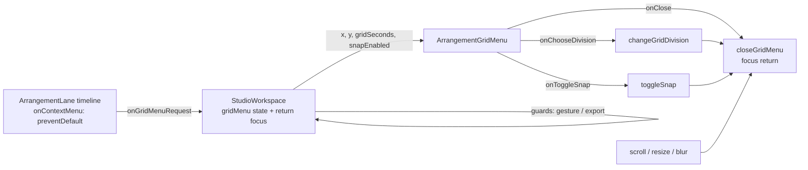

# Studio Lab — lane-ის კონტექსტური მენიუ ბადის არჩევისთვის (SRW-14 ეტაპი 4b-1)

**თარიღი:** 2026-10-17
**სტატუსი:** Round 57 — D-29z22; C-ის შემოწმებას ელოდება
**შეცვლილი პროექტი:** Store

## კონტექსტი

- **მომხმარებლის მოთხოვნა** (`docs/video-to-text-bugs/transcripts/2.srt` 00:06:41–00:07:53): მარჯვენა ღილაკით არეალზე უნდა აირჩეს ბადე, ხოლო „თავისუფალი“ რეჟიმი იქვე უნდა იყოს. აქამდე ბადე მხოლოდ header-ის `<select>`-ით იცვლებოდა, Snap კი ღილაკით ან `G`-თი.
- **Ableton Live 12, Reference Manual §6.10 „Using the Editing Grid“** (`https://www.ableton.com/en/live-manual/12/arrangement-view/`; B-ის ჩანაწერი `b-round-46/ableton-6.7-6.10-20261016.txt`): ბადის სიგანე იცვლება track main lane-ების context menu-დან. ვიდეო არ გვინახავს და Live-ის ინსტალაცია არ გამოგვიყენებია.
- **C-R51-02 (Low):** როცა loop brace-ს focus აქვს, კლიპის header-ზე დაწკაპების შემდეგ `ArrowRight` ისევ brace-ს ამოძრავებდა და არა მონიშნულ კლიპს. მიზეზი: კლიპის pointerdown `preventDefault`-ს იძახებს, ამიტომ ბრაუზერი focus-ს არ ცვლის. მენიუს focus-ის დაბრუნება და ეს ფიქსი ერთი კონტრაქტია.
- **C-R48-01-GRID-RESIDUAL (Low):** ორ grid-snap ტესტ-ფაილს D-29z21-ის `{ timeout: 15_000 }` suite-ოფცია ჯერ არ ჰქონდა.

## მიდგომა

**D-29z22-M — მენიუ**
- **M1:** `contextmenu` lane-ის timeline-ის ელემენტზე (ცარიელი ფონი და კლიპის ტანი, audio და video, დაკეცილიც) ხსნის მენიუს და ყოველთვის `preventDefault`-ს იძახებს. Track header-ი, ruler, loop strip, ბიბლიოთეკა, detail panel და transport ბრაუზერის ჩვეულ მენიუს ინარჩუნებს.
- **M2:** 7 `menuitemradio` (`GRID_DIVISIONS_SECONDS`-ის რიგით, `formatGridDivision`-ის ტექსტით, მონიშნულია მიმდინარე), separator და ერთი `menuitemcheckbox` `Snap (G)`.
- **M3:** არჩევა იძახებს არსებულ `changeGridDivision`-ს ან `toggleSnap`-ს. ამიტომ status, `data-grid-seconds`, `<select>`, ხაზები და snapping იგივეა, რაც `<select>`/`G` გზაზე. ისტორია არ იწერება და playback არ წყდება.
- **M4/M5:** მარჯვენა ღილაკი არაფერს არედაქტირებს (არსებული `button !== 0` guard-ები უცვლელია). აქტიური pointer gesture-ის ან ღია Export dialog-ის დროს მენიუ არ იხსნება.
- **M6:** DOM-ში მაქსიმუმ ერთი მენიუა. ღია მენიუზე ახალი `contextmenu` მხოლოდ პოზიციას ცვლის.
- **M7:** ARIA menu-ის კლავიატურა: focus მონიშნულ ელემენტზე, `ArrowDown`/`ArrowUp` wrap-ით, `Home`/`End`, `Enter`/`Space` ირჩევს, `Escape` და `Tab` ხურავს. ყოველი keydown/keyup მენიუში ჩერდება, ამიტომ workspace-ის window shortcut-ები (Space, G, Delete, Ctrl+Z, ისრები, floating video-ს Escape) არ სრულდება.
- **M8/M9:** იხურება Escape-ით, Tab-ით, გარე დაჭერით, timeline-ის scroll-ით, window-ის resize/blur-ით ან unmount-ით. გარე pointerdown-ს window-ის capture listener „ჭამს“ (`preventDefault` + `stopPropagation`), ამიტომ ეს დაჭერა სხვას არაფერს აკეთებს. Listener იშლება მენიუს დახურვისას.
- **M10:** გახსნისას ინახება `document.activeElement` (pointerdown capture-ის შემდეგ). დახურვისას focus იქ ბრუნდება, თუ ელემენტი ჯერ კიდევ DOM-შია და `body` არ არის.
- **M11:** `position: fixed` pointer-ის კოორდინატებზე, viewport-ში 4 px ზღვრით clamp-ით. მხოლოდ design token-ები: `bg-surface`, `border-outline`, `text-foreground`, მონიშვნა `text-accent`-ით, focus `ring-brand`-ით, `z-50`. ელემენტის სიმაღლე 28 px.
- **M12:** ContextMenu კლავიში და Shift+F10 ამ რაუნდში არ მუშავდება — შეგნებული ზღვარია.

**D-29z22-F — C-R51-02:** `releaseEditFocusOnTimelinePointerDown`-ს დაემატა ცალკე პირობა: თუ focus brace-შია და დაჭერა brace-ის გარეთაა, brace-ს blur ეკეთება ნებისმიერი ღილაკისთვის. არსებული guard-ები (აქტიური gesture, scroller-ის gutter) და range/typing შტოები უცვლელია. Brace-ის შიგნით დაჭერა focus-ს ინარჩუნებს.

**D-29z22-T:** შვიდ top-level `describe`-ს დაემატა `{ timeout: 15_000 }`. ახალ ტესტ-ფაილს ეს ოფცია თავიდანვე აქვს.

**განხილული ალტერნატივები:**
- **მხოლოდ ცარიელი lane-ის ფონი** — უარყოფილია. მომხმარებელი „right-click“-ს არეალზე ითხოვს და კლიპს სხვა მენიუ არ აქვს. Live-ში კლიპის მენიუზე ბადის ელემენტები დაუდასტურებელია, ამიტომ ეს CZABA-ს გადაწყვეტილებაა.
- **მენიუს state ყოველ lane-ში** — უარყოფილია. ერთი state `StudioWorkspace`-ში ავტომატურად იძლევა „მაქსიმუმ ერთ მენიუს“ და ერთ focus-ის დაბრუნებას.
- **narrow/widen ელემენტები ახლავე** — გადატანილია ეტაპ 4b-2-ში (კლავიშები და Chrome-ის Ctrl+digit-ის შემოწმება).
- **დამხურავი დაჭერის გატარება** (არ „ჭამა“) — უარყოფილია. Native context menu-ის დამხურავი დაჭერა გვერდამდე არ აღწევს, და მას შემთხვევითი მონიშვნა ან seek არ უნდა მოჰყვეს.

## არქიტექტურა

## შეცვლილი ფაილები

- `app/components/arrangement/ArrangementGridMenu.tsx` — ახალი presentational მენიუ: ელემენტები, roving `tabIndex`, კლავიატურა, გარე დაჭერის „ჭამა“, clamp.
- `app/components/arrangement/StudioWorkspace.tsx` — მენიუს state, `handleGridMenuRequest` (M5 guard-ები), `closeGridMenu` focus-ის დაბრუნებით, scroll/resize/blur-ზე დახურვა, prop-ის გადაცემა ყველა lane-ზე, C-R51-02-ის პირობა. CRLF შენარჩუნებულია.
- `app/components/arrangement/ArrangementLane.tsx` — optional prop `onGridMenuRequest` და `onContextMenu` timeline-ის ელემენტზე.
- `app/lib/arrangement/__tests__/grid-snap-menu.test.tsx` — ახალი ტესტები GM1–GM15, FR1–FR4.
- `app/lib/arrangement/__tests__/grid-snap-ui.test.tsx`, `grid-snap-loop-drop.test.tsx` — მხოლოდ suite-ის timeout ოფცია.

## პრობლემები და გადაწყვეტები

- **Biome და `<menu role="menu">`:** `noNoninteractiveElementToInteractiveRole` ჩავარდა. გადაწყვეტა: `
` და `<button role="menuitem…">` შვილები. Biome ამას იღებს, ამიტომ `biome-ignore` არ დაგვჭირდა.
- **Mutation g გადარჩა:** brace თავის pointerdown-ზე (მარცხენა ღილაკი) focus-ს თავად იბრუნებს (`ArrangementLoopBrace` `beginLoopGesture`). ამიტომ „ყოველთვის blur“ მარცხენა დაჭერისას არ ჩანს. გადაწყვეტა: FR4-ს თავისი ფარგლებში დაემატა brace-ის კიდეზე მარჯვენა ღილაკის დაჭერა. მას brace იგნორირებს, ამიტომ focus-ს თავად ვერ დაიბრუნებს. ამის შემდეგ g FR4-ს აგდებს.
- **Escape და mutation c:** Escape-ზე `preventDefault` განზრახ არ ხდება. ასე მენიუში stop-ის მოხსნა floating video-ს Escape შტოში ხილული ხდება (GM8).
- **ზედმეტი `preventDefault` (code review):** თავიდან მენიუ Tab/Escape-ის გარდა ყველა კლავიშზე `preventDefault`-ს იძახებდა და ბრაუზერის კლავიშებს (F5, Ctrl+R) ბლოკავდა. გადაწყვეტა: `preventDefault` მხოლოდ დამუშავებულ კლავიშებზე ხდება. `stopPropagation` ყველა კლავიშზე რჩება.
- **GM3 და M6 (code review):** მეორე გახსნა `pointerdown`-ით ჯერ მენიუს ხურავდა, ამიტომ ღია მენიუს ადგილზე გადატანა არ მოწმდებოდა. გადაწყვეტა: GM3-ში მეორე გახსნა მხოლოდ `contextmenu`-ითაა. ტესტი ამოწმებს, რომ ელემენტი იგივეა, პოზიცია ახალია და focus არ შეცვლილა.
- **ღია საკითხები B-სთვის (code review):**
  - მენიუს დამხურავი დაჭერის შემდეგ ბრაუზერი `click`-ს მაინც აგზავნის, ამიტომ ღილაკზე (მაგ. Play) დაწკაპება მენიუსაც ხურავს და ღილაკსაც ააქტიურებს;
  - Follow-ის ავტომატური scroll დაკვრისას მენიუს ხურავს.

  ორივე M9/M8-ის სიტყვასიტყვით ფარგლებს სცდება და browser-ში შესამოწმებელია.
- **`grid-snap-loop-drop` l.700:** ოფციის დამატების შემდეგ ხაზი 100 სიმბოლოს გადასცდა და Biome-მა describe-ის ტანი ხელახლა დააინდენტა. whitespace-ისა და trailing comma-ს გარდა ფაილი token-ით იდენტურია, `it`-ების რაოდენობა 27.

## ტესტირება

- **ახალი ფაილი:** 19/19 (GM1–GM15, FR1–FR4). ყველაზე ნელი ცალკე გაშვებისას GM1-ია, ≈1.2 s (cold mount).
- **Mutations a–g** scratch ასლში (`tmp/studio-real-loop/a-round-57/mutations.txt`) — თითოეული აგდებს დასახელებულ ტესტებს:
  - a → GM1/GM2/GM3/GM12;
  - b → GM4;
  - c → GM7/GM8/GM9;
  - d → GM10;
  - e → GM12;
  - f → FR1/FR3;
  - g → FR4 (FR4-ის გაძლიერების შემდეგ).
- **Gate-ები:**
  - `tsc` 0; build 0; vitest 88 ფაილი / 1523, 0 ჩავარდნა; `npm run verify` 0;
  - Biome `./app` 5/218/1 (baseline-ის CRLF შეცდომები); owned LF ფაილები — 0 diagnostic;
  - `StudioWorkspace` — lint 0 და stdin format უცვლელია.
- **Browser:** არ გაშვებულა — dev server და backend მიუწვდომელი იყო (`000`).

## Ableton-თან კავშირი

| ქცევა | წყარო | Live-ში დადასტურებული | CZABA-ს გადაწყვეტილება |
|---|---|---|---|
| ბადის სიგანე lane-ის context menu-დან | §6.10 | დიახ | იგივე შესასვლელი audio/video lane-ზე. შიგთავსი წამებია, adaptive/fixed რეჟიმებისა და triplet-ების გარეშე — შეგნებული განსხვავება |
| ბადე კლიპის context menu-ში | — | დაუდასტურებელი | CZABA იგივე მენიუს ხსნის კლიპის ტანზე |
| Snap on/off | §6.10 (Ctrl+4, Options) | shortcut დიახ; context menu-ში დაუდასტურებელი | `Snap (G)` ელემენტი; shortcut რჩება `G` |
| მიმდინარე ბიჯის ჩვენება | §6.10 (ruler-ის ქვეშ) | დიახ | header-ის grid control — შეგნებული განსხვავება |
| მარჯვენა ღილაკი არაფერს არედაქტირებს | — | დაუდასტურებელი | CZABA-ს წესი M4 |
| Focus timeline-ის დაჭერის შემდეგ | §6.6 | დაუდასტურებელი | CZABA-ს წესი D-29z17 / D-29z22-F |
| Narrow/widen Ctrl+1/Ctrl+2 | §6.10 | დიახ | ამ რაუნდში არა → 4b-2 |

## TODO / შემდეგი ნაბიჯები

- **4b-2:** narrow/widen კლავიშები (Chrome-ის Ctrl+digit-ის შემოწმების შემდეგ), C-R51-01-ის probe, INFO-R55-FREE-ROUND-UNGUARDED და SHIFT-MIDDRAG ტესტები.
- **4c:** C-R52-T1, ჯგუფური გადატანა კიდეებზე, ბიბლიოთეკიდან drop-ის კიდეები.
- **Browser-ის ნაწილი:** MN-*, R57-FOCUS, R57-PLAY, R57-LOOK, ეტაპ 4a-ს browser-ის ნაწილი და G57-3 — სერვერების აღდგენის შემდეგ.
