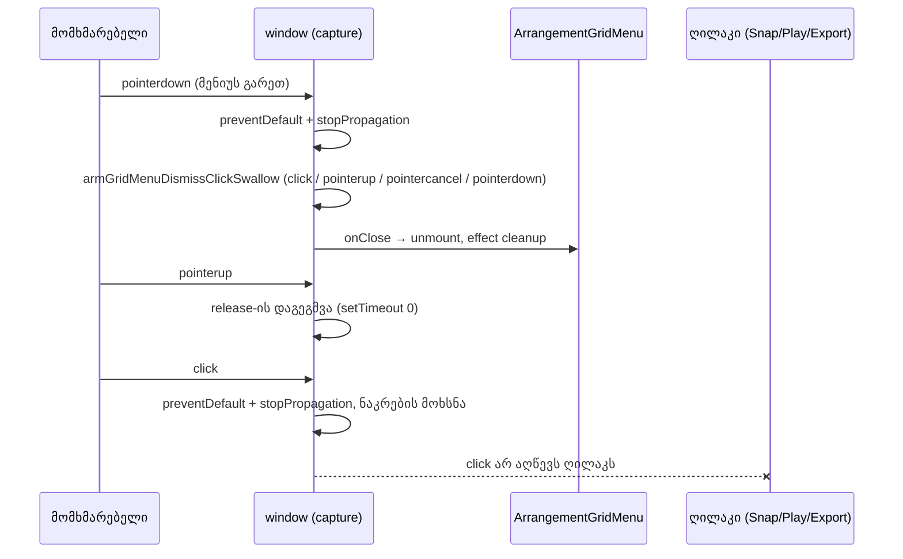

# Studio Lab — ბადის მენიუს დახურვის click და Follow scroll (SRW-14 ეტაპი 4b-1, შესწორებები)

**თარიღი:** 2026-10-18
**სტატუსი:** Round 58 — D-29z23; C-ის შემოწმებას ელოდება
**შეცვლილი პროექტი:** Store

## კონტექსტი

- **G1 (Medium):** round 57-ის M9 გარე `pointerdown`-ს window-ის capture listener-ში „ჭამდა“ (`preventDefault` + `stopPropagation`). Pointer Events-ის წესით `pointerdown`-ის გაუქმება მხოლოდ თავსებადობის mouse event-ებს აჩერებს, `click`-ს არა. ამიტომ ღია მენიუს დროს header-ის Snap ღილაკზე, Play-ზე ან Export-ზე დაჭერა მენიუს ხურავდა **და** ღილაკსაც ააქტიურებდა. ეს M9-ის მოთხოვნას („ეს დაჭერა სხვას არაფერს აკეთებს“) ეწინააღმდეგებოდა.
- **G6:** დაკვრისას, Follow ჩართულზე, ავტომატური გვერდის გადაფურცვლა `scrollLeft`-ს ცვლის. ეს `scroll` event-ს იწვევს და მენიუ ყოველ გადაფურცვლაზე იხურებოდა.
- **C-R57-01 (Low):** არჩევის შემდეგ focus-ის დაბრუნებას ტესტი არ ჰქონდა (C-ის მუტაცია h ცოცხალი რჩებოდა).
- **C-R57-02 (Low):** ღია მენიუს ხელახალი პოზიციონირებისას focus-ის წარმოშობა თავიდან არ უნდა ჩაიწეროს; ამას ტესტი არ ჰქონდა (C-ის მუტაცია i ცოცხალი რჩებოდა).
- **G7:** M5-ის Export dialog-ის guard-ს ტესტი არ ჰქონდა.
- **A-ს round 57-ის ანგარიშის შესწორება:** GM3 C-ის (i) მუტაციას **არ** ფარავს — ის მხოლოდ ამოწმებს, რომ იგივე node ახალ პოზიციაზეა და focus უცვლელია. (i)-ს ახლა GM19 ფარავს. Doc 050 გაყინულია და არ შეცვლილა.

## მიდგომა

**D1 — კონტრაქტი.** გარე `pointerdown` მენიუს ხურავს და ეს დაჭერა სხვას არაფერს აკეთებს, მის შემდგომ `click`-ის ჩათვლით. არსებული `pointerdown`-ის „ჭამა“ უცვლელია (GM10).

**D2 — მექანიზმი.** გარე დაჭერა `onClose`-ს იძახებს. ეს მენიუს unmount-ს და effect-ის cleanup-ს `click`-ის მოსვლამდე იწვევს (`pointerdown` → close → unmount → `pointerup` → `click`). ამიტომ click-ის „ჭამა“ მენიუს lifecycle-ზე არ არის მიბმული:
- `handleOutsidePointerDown` დაჭერის „ჭამისას“ იძახებს module-level ფუნქციას `armGridMenuDismissClickSwallow(window)`. ის window-ზე ერთჯერად, თვითმოხსნად capture listener-ების ნაკრებს აყენებს.
- **`click`:** `preventDefault` + `stopPropagation`, შემდეგ მთელი ნაკრების მოხსნა.
- **`pointerup` / `pointercancel`:** მოხსნა ერთი macrotask-ის შემდეგ (`setTimeout(…, 0)`). თუ `click` არ მოჰყვა (drag-off, მარჯვენა ან შუა ღილაკი), არაფერი რჩება ჩართული.
- **შემდეგი `pointerdown`:** ნაკრების მოხსნა ამ event-ზე შეხების გარეშე. ჩართული ნაკრები შემდეგი, დამოუკიდებელი დაჭერის click-ს ვერასდროს „შეჭამს“.
- მოხსნა idempotent-ია: timer იწმინდება, ხელახალი მოხსნა უვნებელია.
- **დროის დაშვება:** Chromium `click`-ს `pointerup`-ის იმავე task-ში აგზავნის, ამიტომ ერთი macrotask საკმარისია. jsdom ამას ვერ ამტკიცებს — ბრაუზერის შემოწმებაა MN-DISMISS-BUTTON. ჩავარდნის შემთხვევაში fallback-ს B წყვეტს.
- `contextmenu`, `auxclick`, `dblclick` და `keydown`/`keyup` event-ები არ ჩერდება. მენიუს შიგნით დაჭერა არაფერს რთავს.
- **ცნობილი ზღვარი:** სანამ დამხურავი დაჭერა გრძელდება, ან თუ მისი `pointerup` დაიკარგა (მაგ. window-ის blur დაჭერის დროს), ნაკრები ჩართული რჩება შემდეგ `pointerdown`-მდე. ამ დროს კლავიატურით გამოწვეული `click` (Enter/Space ღილაკზე) ერთხელ შეიძლება „შეიჭამოს“. Chrome Android-ზე tap-ის `click` შეიძლება release-ის შემდეგ მოვიდეს. ორივე B-ს გადაეცა, მექანიზმი ამ რაუნდში არ შეცვლილა.
- მეორე მარჯვენა დაჭერა (M6) ნაკრებს რთავს, მაგრამ მარჯვენა ღილაკი `click`-ს არ იძლევა: `pointerup` ნაკრებს ხსნის, `contextmenu` კი მენიუს ისევ ხსნის.
- **Unmount ჩართულ მდგომარეობაში:** თუ workspace ნაკრების ჩართვისას unmount-დება, ნაკრები თავს მაინც მოიხსნის შემდეგ pointer event-ზე ან macrotask-ზე. დამატებითი unmount hook არ გვჭირდება.

**D-29z23-S — scroll.** მენიუ გლობალურ ბადის პარამეტრს ირჩევს, დროის პოზიციაზე მიბმული არ არის და `position: fixed`-ია. ამიტომ Follow-ის პროგრამული scroll მას არ ხურავს. ღია მენიუს effect-ში `scroll`-ის handler-ი (`closeGridMenuOnUserScroll`) მენიუს ხურავს, **გარდა** შემთხვევისა, როცა ერთდროულად: workspace უკრავს, Follow `on`-ზეა და `scrollLeft` Follow-ის ანკერიდან (`autoScrollLeftRef`) ტოლერანსშია, ან ბრაუზერმა ის clamp-ით შეამცირა. ეს იგივე კლასიფიკაციაა, რასაც `handleTimelineScroll` იყენებს. `handleTimelineScroll` უცვლელია, predicate ერთხელ, ახალ handler-შია დაწერილი. `resize` და `blur` კვლავ ხურავს.

**D-29z23-T:** C-R57-01, C-R57-02 და G7-ის კოდი უკვე არსებობდა; დაემატა მხოლოდ ტესტები (GM18–GM20).

**უარყოფილი ალტერნატივები:**
- **მთელი viewport-ის backdrop:** M6-ის რეპოზიციონირებას არღვევს (მეორე `contextmenu` lane-ს ვეღარ მიაღწევს).
- **click-ის „ჭამა“ მენიუს effect-ში:** effect-ი `click`-ის მოსვლამდე იწმინდება.
- **მხოლოდ `wheel`-ზე დახურვა:** scrollbar-ისა და touch-ის scroll-ს გამოტოვებს.
- **scroll-ზე საერთოდ არ დახურვა:** მომხმარებლის scroll-ისთვის M8-ს აუქმებს.

## არქიტექტურა

## შეცვლილი ფაილები

- `app/components/arrangement/ArrangementGridMenu.tsx` — `armGridMenuDismissClickSwallow` და მისი გამოძახება `handleOutsidePointerDown`-დან.
- `app/components/arrangement/StudioWorkspace.tsx` — ღია მენიუს effect-ში `scroll`-ის handler-ი `closeGridMenuOnUserScroll` (CRLF შენარჩუნებულია).
- `app/lib/arrangement/__tests__/grid-snap-menu.test.tsx` — GM16–GM21.
- `docs/implementation/2026/quarter-IV/051-studio-lab-grid-menu-dismiss-click-follow-scroll.md` — ეს დოკუმენტი.

## პრობლემები და გადაწყვეტები

- **პრობლემა:** click-ის „ჭამის“ ადგილი მენიუს lifecycle-ში ვერ იქნებოდა, რადგან მენიუ click-მდე ქრება. → **გადაწყვეტა:** window-ის დონის ერთჯერადი ნაკრები, რომელიც თავად იხსნება.
- **პრობლემა:** click-ის გარეშე დახურვა (მარჯვენა ღილაკი, drag-off) ნაკრებს ჩართულს დატოვებდა და შემდეგ კლავიატურით გამოწვეულ click-ს (Enter Play-ზე) „შეჭამდა“. → **გადაწყვეტა:** `pointerup`/`pointercancel`-ზე macrotask-ით მოხსნა და შემდეგ `pointerdown`-ზე დაუყოვნებლივი მოხსნა (GM17).
- **პრობლემა:** ნაკრების `pointerdown` listener იმავე `pointerdown`-ის დისპეჩის დროს ემატება. → DOM-ის წესით მიმდინარე event-ზე ახალი listener არ გამოიძახება; GM16 ამას ადასტურებს (თორემ click არ შეიჭმებოდა).
- **პრობლემა:** jsdom-ში `scrollLeft`-ის მინიჭება შეიძლებოდა იგნორირებულიყო. → შემოწმდა: მინიჭება ინახება (readback 200), `Object.defineProperty` fallback არ დაგვჭირდა.

## ტესტირება

- **GM16:** ღია მენიუს დროს Snap ღილაკზე `pointerDown` → `pointerUp` → `click`: მენიუ ქრება `pointerDown`-ზე, `click` გაუქმებულია (`false`), `data-snap` უცვლელია; მეორე სრული დაჭერა Snap-ს რთავს. იგივე Play-ზე: დაკვრა არ იწყება, შემდეგი დაჭერა იწყებს.
- **GM17:** (a) click-ის გარეშე დახურვა + ერთი macrotask → Snap-ის click მუშაობს; (b) `pointerup`-ის გარეშე დახურვა → ახალი `pointerdown` ნაკრებს ხსნის და click მუშაობს. ორივეში lane-ის დაჭერამ არაფერი შეცვალა.
- **GM18:** არჩევის შემდეგ focus Snap ღილაკზე ბრუნდება (C-R57-01).
- **GM19:** რეპოზიციონირება + Escape → focus Snap ღილაკზე (C-R57-02).
- **GM20:** ღია Export dialog-ის დროს `contextmenu` მენიუს არ ხსნის, native მენიუ კი მაინც გაუქმებულია (G7).
- **GM21:** დაკვრისას Follow-ის ანკერზე scroll მენიუს არ ხურავს; `scrollLeft = 200` (მომხმარებლის scroll) ხურავს (G6).
- **მუტაციები a–h** (A-ს scratch, `grid-snap-menu` + `grid-snap-ui` + `gesture-guard`): ყველა კვდება — a→GM16, b→GM16/GM17 (+ GM15/GM18/GM20 ჩართული ნაკრების გაჟონვით), c→GM17 (+ GM15), d→GM21, e→GM13/GM21, f→GM18, g→GM19, h→GM20.
- **Gates:** `tsc` 0; vitest 88 ფაილი / 1529 ტესტი; build rc 0; Biome `./app` 5/218/1 (მხოლოდ baseline-ის CRLF ფაილები); owned LF ფაილები 0 diagnostic; `StudioWorkspace.tsx` lint 0 და stdin format უცვლელი.
- **ბრაუზერი:** არ გაშვებულა — `127.0.0.1:5173` და `:5199` მიუწვდომელია (000).

## Ableton

წყარო: Live 12 Reference Manual, თავი 6, `https://www.ableton.com/en/live-manual/12/arrangement-view/` §6.10 (B-ის ჩანაწერი `b-round-46/ableton-6.7-6.10-20261016.txt`, 2026-10-16). ახალი ჩანაწერი, ვიდეო ან Live-ის ინსტალაცია არ გამოგვიყენებია. ამ რაუნდის ქცევები წყაროში არ არის — ისინი CZABA-ს გადაწყვეტილებებია (ანალოგია: OS-ის native context menu და WAI-ARIA menu pattern, არა Live).

| ქცევა | Ableton-ის წყარო | იქ დადასტურებული | CZABA-ს გადაწყვეტილება | C-ის შემოწმება |
|---|---|---|---|---|
| მენიუს დამხურავი დაჭერა, click-ის ჩათვლით, სხვას არაფერს აკეთებს | — | დაუდასტურებელი | წესი D1 | GM10, GM16, GM17, MN-DISMISS-BUTTON |
| Follow-ის auto-scroll მენიუს არ ხურავს; მომხმარებლის scroll ხურავს | — | დაუდასტურებელი | წესი S | GM13, GM21, MN-FOLLOW |
| focus ბრუნდება წარმოშობაზე არჩევის ან რეპოზიციონირება + Escape-ის შემდეგ | — | დაუდასტურებელი (WAI-ARIA, არა Live) | წესი M10 | GM11, GM18, GM19 |
| Export dialog-ის დროს მენიუ არ იხსნება | — | არ ეხება (modal dialog) | წესი M5 | GM20 |
| ბადის სიგანე lane-ის context menu-დან | §6.10 | დიახ (round 57) | შინაარსი შეგნებული განსხვავებაა | round 57-ის ID-ები |

## TODO / შემდეგი ნაბიჯები

- ეტაპი 4b-2 (round 59): narrow/widen კლავიშები Chrome-ის Ctrl+ციფრის შემოწმების შემდეგ, C-R51-01 probe, INFO-R55 და SHIFT-MIDDRAG ტესტები.
- ბრაუზერის probe-ები: MN-DISMISS-BUTTON (click-ის timing-ის დადასტურება), MN-REPOSITION (G5), MN-FOLLOW (G6-PLAY).
- შემდეგ ეტაპი 4c.
