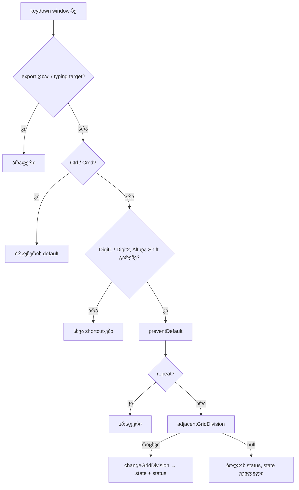

# Studio Lab — ბადის დავიწროება და გაფართოება `1` / `2` კლავიშებით (SRW-14 ეტაპი 4b-2a)

**თარიღი:** 2026-10-18
**სტატუსი:** Round 59 — D-29z24; C-ის შემოწმებას ელოდება
**შეცვლილი პროექტი:** Store

## კონტექსტი

- Live 12-ის Reference Manual-ში (§6.10 „Using the Editing Grid“, §42.13 „Grid Snapping and Drawing“) ბადის სიმჭიდროვე კლავიატურით იცვლება. Ctrl+1 (Mac-ზე Cmd+1) ბადეს ავიწროებს, Ctrl+2 აფართოებს. CZABA-ში ბადის დანაყოფი აქამდე მხოლოდ header-ის `<select>`-ით და lane-ის კონტექსტური მენიუთი (round 57) იცვლებოდა.
- **რატომ არა Ctrl+1/2:** Chrome-ში Ctrl+1…8 ბრაუზერის ჩანართებს გადართავს. გვერდს შეუძლია თუ არა ამის შეჩერება, C ვერ შეამოწმებს: gstack და Playwright კლავიშებს CDP-ით აგზავნიან, CDP-ის კლავიშები კი Chrome-ის accelerator ფენამდე არ აღწევს (იგივე ზღვარი, რაც ALT-CHROME-MENU-ს). ეს Tech Lead-ის ხელით შესამოწმებელი საკითხია (R59-T).
- იმავე რაუნდში დაიხურა C-ის round 58-ის სამი სატესტო ხარვეზი:
  - **C-R58-01 (Low):** თუ click-ის „ჭამა“ მენიუს **შიგნით** დაჭერაზეც ჩაირთვებოდა, არცერთი ტესტი არ ჩავარდებოდა. რეალური შედეგი იქნებოდა მენიუს პუნქტის მაუსით არჩევის დაკარგვა.
  - **C-R58-02 (Low):** თუ ნაკრების მომხსნელი შემდეგი `pointerdown` თავადაც გაუქმდებოდა, არცერთი ტესტი არ ჩავარდებოდა.
  - **C-R58-INFO-M:** მენიუს scroll-ის წესში `followModeRef === 'on'` პირობა დაუცველი იყო (Follow შეჩერებულია, დაკვრა გრძელდება).

## მიდგომა

**K1 — კლავიშები (CZABA-ს გადაწყვეტილება).**
- უბრალო **`1`** (`event.code === 'Digit1'`) ბადეს ავიწროებს: გადადის `GRID_DIVISIONS_SECONDS`-ის (`[10, 5, 2, 1, 0.5, 0.25, 0.1]`) შემდეგ, უფრო **პატარა** მნიშვნელობაზე.
- უბრალო **`2`** (`Digit2`) ბადეს აფართოებს: გადადის შემდეგ, უფრო **დიდ** მნიშვნელობაზე.
- კლავიში `event.code`-ით ემთხვევა, ისევე როგორც `shortcutLetter`-ში. ამიტომ ქართულ და AZERTY განლაგებებზეც მუშაობს.
- **Numpad (`Numpad1`/`Numpad2`) მიბმული არ არის.**
- Ctrl/Cmd + ციფრი არ მუშავდება: არსებული `if (modifier) return;` მას ბრაუზერს უცვლელად უტოვებს. Alt + ციფრი და Shift + ციფრი იგნორირდება და მათი default ქმედება **არ** უქმდება.

**K2 — სად და როგორ.**
- `grid.ts`-ში დაემატა სუფთა ფუნქცია `adjacentGridDivision(current, 'narrow' | 'widen')`. ის აბრუნებს სიაში მეზობელ მნიშვნელობას. სიის ბოლოებზე და სიაში არარსებულ მნიშვნელობაზე (მკაცრი ტოლობით) აბრუნებს `null`-ს.
- `StudioWorkspace.tsx`-ის keydown handler-ს ერთი ახალი განშტოება დაემატა, `if (modifier) return;`-ის შემდეგ, `G`-ს განშტოების გვერდით, `!altKey && !shiftKey` პირობით:
  - ჯერ `preventDefault()`;
  - `event.repeat`-ზე სხვა არაფერი ხდება: ერთ დაჭერაზე ერთი ნაბიჯი, როგორც `G`-ზე;
  - შემდეგ ახალი მნიშვნელობა გადაეცემა არსებულ `changeGridDivision`-ს, რომელიც status-ში წერს `ბადე: 0.5 წმ (Snap ჩართულია | გამორთულია)`;
  - ბოლოზე მდგომარეობა არ იცვლება და status აჩვენებს `ბადე უკვე ყველაზე მჭიდროა — 0.1 წმ (1)` ან `ბადე უკვე ყველაზე ფართოა — 10 წმ (2)`. ორივე ტექსტი module-level მუდმივაა და `formatGridDivision`-ით აიგება.
- არსებული ადრეული `return`-ები ძალაში რჩება:
  - ღია export dialog;
  - typing target, `<select>`-ის ჩათვლით: ფოკუსირებულ select-ზე `1`/`2` select-ის საკუთარ ქცევას ეკუთვნის;
  - Escape, Space და ნავიგაციის კლავიშები.

  ღია ბადის მენიუში `onKeyDown` propagation-ს აჩერებს, ამიტომ იქ `1`/`2` არაფერს აკეთებს.
- **Pointer gesture-ის დროს** `1`/`2` დაშვებულია, როგორც `G`. შემდეგი `pointermove` ახალ `gridSecondsRef`-ს წაიკითხავს. ეს ამ რაუნდში არ ტესტდება.
- **დაკვრისას** დანაყოფი იცვლება და დაკვრა გრძელდება: `changeGridDivision` transport-ს არ ეხება.
- **Snap გამორთულზე** კლავიშები დანაყოფს მაინც ცვლის, Snap კი გამორთული რჩება.
- keydown effect-ის dependency-ებს დაემატა `changeGridDivision`. ის სტაბილური `useCallback([])`-ია, ამიტომ listener ხელახლა არ ირთვება.

**K3 — აღმოჩენადობა.** header-ის დანაყოფის `<select>`-ს დაემატა `aria-keyshortcuts="1 2"`. `title`-ის ორივე ვარიანტს ბოლოში ემატება ` · 1 — უფრო მჭიდრო, 2 — უფრო ფართო`.

**ალტერნატივები:**
- **Ctrl+1/2:** უარყოფილია, რადგან ბრაუზერზეა დამოკიდებული და CDP-ით შეუმოწმებელია.
- **`[` / `]`:** უარყოფილია, რადგან `key` განლაგებაზეა დამოკიდებული და Live-ის mnemonic არ აქვს.
- **ბოლოებზე წრიულად გადასვლა:** უარყოფილია, რადგან 0.1-დან 10-ზე ჩუმი ნახტომი მოულოდნელია.
- **Auto-repeat-ზე ბიჯით სვლა:** უარყოფილია `G`-თან თანმიმდევრულობისთვის.

## არქიტექტურა

## შეცვლილი ფაილები

- `app/lib/arrangement/grid.ts` — `adjacentGridDivision` export.
- `app/components/arrangement/StudioWorkspace.tsx` — ციფრების განშტოება, ორი status მუდმივა, effect-ის dependency და select-ის `aria-keyshortcuts`/`title`. CRLF შენარჩუნებულია.
- `app/lib/arrangement/__tests__/grid-snap-keys.test.tsx` — ახალი: GD1–GD2, GK1–GK10.
- `app/lib/arrangement/__tests__/grid-snap-menu.test.tsx` — GM22–GM24.
- `app/lib/arrangement/__tests__/grid-snap-ui.test.tsx` — select-ის `title`-ის სამი მოსალოდნელი სტრიქონი (K3).

## პრობლემები და გადაწყვეტები

- **`as const` tuple და `indexOf`:**
  - **პრობლემა:** `GRID_DIVISIONS_SECONDS.indexOf(current)` ტიპს არ გადის, რადგან `number` literal union-ს არ ერგება. `findIndex`-ზე კი Biome-ის `useIndexOf` info-ს იძლევა.
  - **გადაწყვეტა:** ლოკალური ცვლადი `readonly number[]` ანოტაციით (assertion არაა) და `indexOf`.
- **`widen` 0 ინდექსზე:**
  - **პრობლემა:** `.at(index - 1)` ბოლოდან წრიულად გადავიდოდა.
  - **გადაწყვეტა:** გამოიყენება კვადრატული ფრჩხილები; ინდექსი `-1` იძლევა `undefined`-ს და `?? null` მას `null`-ად აქცევს.
- **StudioWorkspace-ის CRLF:**
  - **პრობლემა:** ფაილი CRLF-ია და `biome --write` აკრძალულია.
  - **გადაწყვეტა:** EOL-ები node-ით დაითვალა (1783/1783, bare LF 0). ფორმატი შემოწმდა stdin-ით LF ასლზე და შედეგი იდენტურია.

## ტესტირება

- **GD1–GD2:** სრული ნაბიჯები ორივე მიმართულებით, ბოლოები და უცნობი მნიშვნელობა (0.3).
- **GK1–GK10:**
  - plain `1`/`2`, status და select-ის hint;
  - ბოლოები;
  - Ctrl/Meta/Alt/Shift (არცერთი არ უქმდება);
  - ბიბლიოთეკის ძიება და export;
  - repeat;
  - Snap-ის მომხმარებელი (ArrowRight 0.5-ით);
  - `G` + `1`;
  - ფოკუსირებული select;
  - ღია მენიუ.
- **GM22–GM24:**
  - მენიუს შიგნით სრული დაჭერა ირჩევს პუნქტს და ნაკრებს არ რთავს;
  - მომხსნელი `pointerdown` არ უქმდება;
  - Follow შეჩერებულზე anchor-ზე დაბრუნება user scroll-ია და მენიუს ხურავს.
- **მუტაციები a–m** (scratch-ში, `a-round-59/mutations.txt`): ყველა მოკლულია მოთხოვნილი ტესტებით.
- **Gates:** `tsc` 0, vitest 89 ფაილი / 1544, build rc 0, Biome baseline-ის ფარგლებში.
- **ბრაუზერი:** არ გაშვებულა, სერვერები მიუწვდომელი იყო (000).

## Ableton

| ქცევა | წყარო | იქ დადასტურებულია | CZABA |
|---|---|---|---|
| კლავიში ბადეს ავიწროებს | Live 12 §6.10, §42.13 | კი: Ctrl+1 / Cmd+1 | შეგნებული განსხვავება: plain `1`, შემდეგი წამების დანაყოფი (არა ×2; SRW-15-მდე tempo არ არის) |
| კლავიში ბადეს აფართოებს | §6.10, §42.13 | კი: Ctrl+2 / Cmd+2 | შეგნებული განსხვავება: plain `2` |
| ქცევა უკიდურეს დანაყოფზე | — | დაუდასტურებელია (წყარო არ არის) | CZABA: რჩება და status-ს აჩვენებს |
| Triplet (Ctrl+3) | §6.10, §42.13 | კი | ჯერ არ ეხება: SRW-14 ეტაპი 5, SRW-15-ის შემდეგ |
| Snap (Ctrl+4) | §6.10, §42.13 | კი | შეგნებული განსხვავება: `G` |
| მიმდინარე ბიჯის ჩვენება | §6.10 | კი | header-ის select და status line |

წყაროები: B-ის ჩანაწერები `b-round-46/ableton-6.7-6.10-20261016.txt` და `b-round-37/ableton-live-keyboard-shortcuts-20261013.txt`. ვიდეო და Live-ის ინსტალაცია ხელმისაწვდომი არ იყო.

## TODO / შემდეგი ნაბიჯები

- **Round 60 (4b-2b):** მენიუს დარჩენილი სატესტო ხარვეზები:
  - A-R57-REVIEW-MENU-TEST-GAPS;
  - A-R58-REVIEW-AFTEREACH-RELEASE;
  - `pointercancel` და მარჯვენა ღილაკით დახურვა;
  - A-R58-REVIEW-RIGHTCLICK-TRAP.
- **ბრაუზერში შესამოწმებელი (C):**
  - KEY-NARROW, KEY-WIDEN, KEY-ENDS, KEY-MOD, KEY-TYPE, KEY-SELECT, KEY-SNAP, KEY-PLAY, KEY-MENU;
  - round 58-ის MN-DISMISS-BUTTON და MN-FOLLOW.
- **Tech Lead (R59-T):** Ctrl+1/Ctrl+2-ის ქცევა საკუთარ Chrome-ში.
- **შემდეგ:** ეტაპი 4c (round 61).
