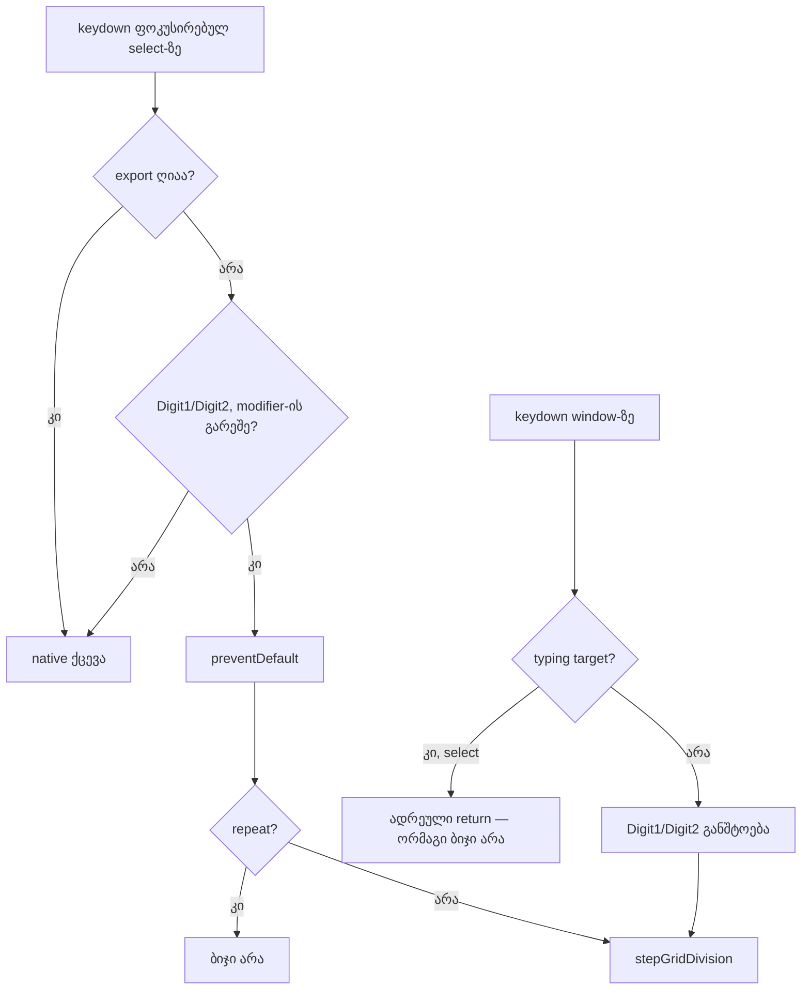
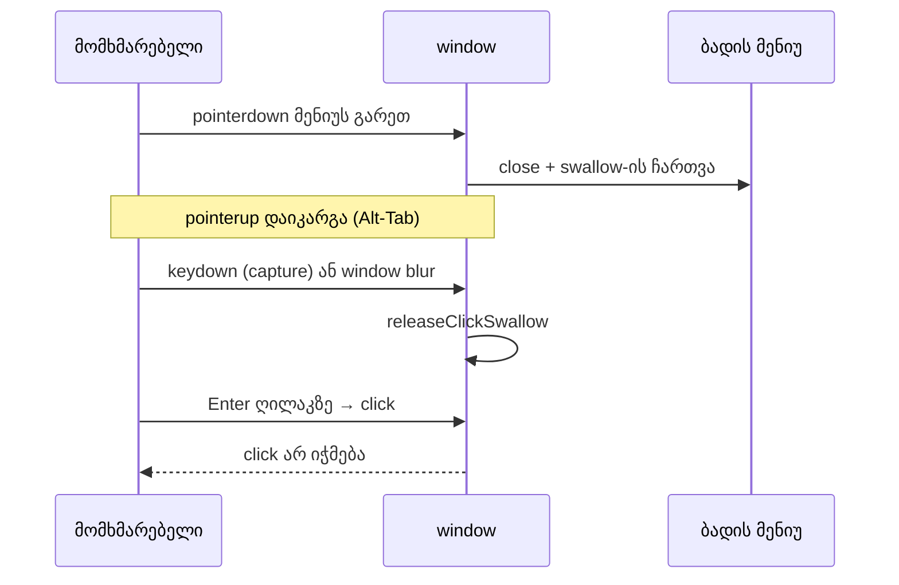

# Studio Lab — `1` / `2` ფოკუსირებულ დანაყოფის select-ზე, მენიუზე მარჯვენა click და „ჭამის“ მოხსნა კლავიშით (SRW-14 ეტაპი 4b-2b)

**თარიღი:** 2026-10-18
**სტატუსი:** Round 60 — D-29z25; C-ის შემოწმებას ელოდება
**შეცვლილი პროექტი:** Store

## კონტექსტი

- **C-R59-01 (Low, C-ის browser-ის გაზომვა):** header-ის დანაყოფის `<select>` ფოკუსირებულია და მომხმარებელი აჭერს `1`-ს. Chrome-ის native type-ahead ირჩევს პირველ ოფციას, რომელიც `1`-ით იწყება, ანუ **10 წმ**-ს. ამავე select-ის `title` კი წერს `1 — უფრო მჭიდრო`. Chrome მაუსით არჩევის შემდეგ ფოკუსს select-ზე ტოვებს, ამიტომ მინიშნების ცდა სწორედ ამ მომენტშია ყველაზე სავარაუდო.
- **ROOT-R50-58-L3 (Low):** ღია ბადის მენიუზე მარჯვენა click მენიუს თავზე Chrome-ის native კონტექსტურ მენიუს აჩენდა.
- **ROOT-R50-58-L2 (Low; იგივეა, რაც A-R58-REVIEW-HELD-PRESS-KEY-CLICK):** თუ მენიუს დამხურავ დაჭერას `pointerup` დაეკარგა (მაგ. Alt-Tab დაჭერილ ღილაკზე), ჩართული „ჭამა“ (click swallow) შემდეგ კლავიატურით გააქტიურებულ click-ს (Enter/Space ღილაკზე) ჭამდა.
- **ROOT-R50-58-L4 და 4b-2b-ს სატესტო ხარვეზები:** A-R57-REVIEW-MENU-TEST-GAPS, A-R58-REVIEW-AFTEREACH-RELEASE, A-R58-REVIEW-CANCEL-RIGHT-UNTESTED, A-R58-REVIEW-RIGHTCLICK-TRAP.
- ეს რაუნდი ეტაპ 4b-ს ასრულებს. ეტაპი 4c რაუნდ 61-შია.

## მიდგომა

**S — `1` / `2` ფოკუსირებულ select-ზე (D-29z25-S).**
- round 59-ის window-ის ციფრების განშტოების სხეული გადავიდა ერთ `stepGridDivision(direction)` `useCallback`-ში. ის კითხულობს `gridSecondsRef`-ს, იძახებს `adjacentGridDivision`-ს და ან `changeGridDivision`-ს, ან ბოლოს status-ს წერს.
- window-ის განშტოება იგივე პირობებითა და რიგით რჩება (`if (modifier) return;`, `!altKey && !shiftKey`, `preventDefault`, repeat-ის `return`) და ბოლოს `stepGridDivision`-ს იძახებს.
- select-ს დაემატა `onKeyDown`:
  - ღია export dialog-ზე (`exportOpenRef`) არაფერს აკეთებს;
  - მხოლოდ `Digit1` / `Digit2`, Ctrl, Meta, Alt და Shift-ის გარეშე;
  - `preventDefault()` თრგუნავს type-ahead-ს, ფოკუსი select-ზე რჩება;
  - `event.repeat`-ზე მხოლოდ `preventDefault`, ბიჯი არა.
- სხვა კლავიშები (ისრები, Home/End, სხვა ციფრები, ასოები, Enter, Space, Escape) native-ად რჩება; `5` კვლავ `5 წმ`-ზე გადადის. `G` ფოკუსირებულ select-ზე კვლავ არაფერს აკეთებს.
- `stopPropagation` საჭირო არ არის: window handler `isTypingTarget(select)`-ზე ადრე ბრუნდება, ამიტომ ორმაგი ბიჯი არ ხდება. `isTypingTarget` არ შეცვლილა.
- keydown effect-ის dependency-ებში `changeGridDivision` შეიცვალა `stepGridDivision`-ით (Biome-ის მოთხოვნა, 0 diagnostic).
- `aria-keyshortcuts="1 2"` და `title`-ის ორივე სუფიქსი უცვლელია; ახლა ამ ელემენტზეც მართალია.
- **ჩანაცვლება:** round 59-ის GK9 / KEY-SELECT კონტრაქტი („ციფრები native select-ს ეკუთვნის“, doc 052) ჩანაცვლებულია D-29z25-S-ით.

**C — მარჯვენა click ღია მენიუზე (D-29z25-C).**
- მენიუს root `div`-ს (`role="menu"`) დაემატა `onContextMenu`, რომელიც მხოლოდ `preventDefault()`-ს იძახებს.
- მენიუ ღია რჩება, პოზიცია, ფოკუსი და დანაყოფი არ იცვლება: მენიუს შიგნით მარჯვენა `pointerdown` უკვე ადრე ბრუნდებოდა, ხოლო მენიუ workspace-ის root-ზე რენდერდება, lane-ის გარეთ, ამიტომ lane-ის reposition არ ხდება.

**R — „ჭამის“ მოხსნა კლავიშით ან ფანჯრის blur-ით (D-29z25-R).**
- `armGridMenuDismissClickSwallow` ახლა ნაკრებს ასევე ხსნის window-ის capture-ფაზის `keydown`-ზე (ნებისმიერი კლავიში) და window-ის `blur`-ზე. `releaseClickSwallow` ორივე listener-ს შლის, დანარჩენ ოთხთან ერთად.
- `blur` განზრახ **non-capture**-ია: დამხურავი დაჭერა ნაკრებს ჯერ რთავს, შემდეგ `closeGridMenu` სინქრონულად აბრუნებს ფოკუსს. ელემენტის `blur` არ ბუბლდება, მაგრამ capture listener window-ზე მას დაინახავდა და ნაკრებს მაშინვე მოხსნიდა. non-capture listener მხოლოდ ფანჯრის საკუთარ `blur`-ს იღებს.
- pointer-ის გზა უცვლელია: outside press რთავს, შემდეგ click იჭმება, მოხსნა `pointerup`/`pointercancel`-ზე + ერთი macrotask ან შემდეგ `pointerdown`-ზე. მომხსნელი არცერთი event არ უქმდება (C-R58-02).
- **ჩაწერილი trade-off:** თუ მომხმარებელი კლავიშს **დამხურავი დაჭერის შენარჩუნებისას** აჭერს, საბოლოო release-ის click აღარ იჭმება. ეს round 58-მდე არსებული ქცევაა და `pointerup`-ის დაკარგვაზე იშვიათია.

**ავტორის შენიშვნა ტესტებისთვის:** `rightClick()` helper ღია მენიუზე ნაკრებს რთავს, რადგან `pointerup`-ს არ აგზავნის. ამიტომ `grid-snap-menu`-ის `afterEach` ჯერ `cleanup()`-ს იძახებს, შემდეგ window-ზე ერთ `pointerdown`-ს აგზავნის (ნებისმიერი დარჩენილი ნაკრების მოსახსნელად) და ბოლოს ამოწმებს, რომ `document.body`-ზე click არ უქმდება. `rightClick` helper არ შეცვლილა.

**ალტერნატივები:**
- **(a) მინიშნების select-იდან მოხსნა:** უარყოფილია — მაუსით არჩევის შემდეგ ნახტომი 10 წმ-ზე რჩება.
- **(b) select-ის blur `onChange`-ის შემდეგ:** უარყოფილია — დახურულ select-ზე ისრებით ნავიგაციას არღვევს.
- **L2-სთვის მხოლოდ Enter/Space-ზე მოხსნა:** უარყოფილია — ნებისმიერი კლავიში უფრო მარტივია და კლავიატურულ აქტივაციას ფარავს.

## არქიტექტურა

## შეცვლილი ფაილები

- `app/components/arrangement/StudioWorkspace.tsx` — `stepGridDivision`, window-ის ციფრების განშტოება მას იძახებს, select-ის `onKeyDown`, effect-ის dependency-ები. CRLF შენარჩუნებულია.
- `app/components/arrangement/ArrangementGridMenu.tsx` — root-ის `onContextMenu`; swallow-ის `keydown` (capture) და `blur` მოხსნა.
- `app/lib/arrangement/__tests__/grid-snap-menu.test.tsx` — `afterEach`-ის მოხსნა და probe; GM25–GM31.
- `app/lib/arrangement/__tests__/grid-snap-keys.test.tsx` — GK9 გადაწერილია; GK11 დაემატა.

## პრობლემები და გადაწყვეტები

- **პრობლემა:** window-ის `blur` capture-ფაზაში ელემენტების blur-საც იღებს, ხოლო მენიუს დახურვა ფოკუსს სინქრონულად აბრუნებს. **გადაწყვეტა:** `blur` listener non-capture-ია. GM16/GM17 უცვლელად გადის, მაგრამ ამ არჩევანს არ ამოწმებს: ორივე ფოკუსით body-ზე იწყება, ამიტომ scratch-ის დამატებითი mutation (`blur` capture-ით) ცოცხალი რჩება. ამის ტესტი (opener-ზე ფოკუსი → outside dismiss → click იჭმება) B-ს გადაეცა.
- **პრობლემა:** GK11-ში export dialog-ის ნაბიჯი 0.1 წმ-ზე ხდება, სადაც `1` ისედაც ვერაფერს ცვლის, ამიტომ მხოლოდ დანაყოფის შემოწმება `exportOpenRef` guard-ის მოხსნას ვერ დაიჭერდა. **გადაწყვეტა:** ტესტი დამატებით ამოწმებს, რომ keydown **არ** უქმდება (`true`).
- **პრობლემა:** `keydown` effect აღარ იყენებს `changeGridDivision`-ს პირდაპირ. **გადაწყვეტა:** dependency-ებში ჩაენაცვლა `stepGridDivision`; ორივე სტაბილური `useCallback`-ია, listener ხელახლა არ ირთვება.

## ტესტირება

- **GM25** — მარჯვენა click მენიუს პუნქტსა და root-ზე უქმდება; ერთი მენიუ, იგივე პოზიცია, ფოკუსი შიგნით, დანაყოფი `1`.
- **GM26** — დაკარგული `pointerup`-ის შემდეგ Enter ღილაკზე და შემდეგ Shift (არა-shortcut კლავიში) ნაკრებს ხსნის; შიშველი click გადის, Snap `on` → `off`, დაკვრა არ იწყება.
- **GM27** — window-ის blur ნაკრებს ხსნის.
- **GM28** — `pointercancel` + ერთი macrotask ნაკრებს ხსნის.
- **GM29** — მარჯვენა ღილაკით დახურვა: native `contextmenu` არ უქმდება, CZABA-ს მენიუ არ იხსნება, `pointerup` (`button: 2`) ნაკრებს ხსნის.
- **GM30** — Tab მენიუში არ უქმდება და მენიუს ხურავს, დანაყოფი უცვლელია.
- **GM31** — unmount-ის შემდეგ window-ზე listener აღარ რჩება.
- **GK9 (გადაწერილი)** — ფოკუსირებულ select-ზე `1` → 0.5, `2` → 1; keydown უქმდება, ფოკუსი რჩება.
- **GK11** — Ctrl/Meta/Alt/Shift + `1` და `5` არ უქმდება და არაფერს ცვლის; repeat უქმდება, ბიჯი არა; 0.1-ზე `1` → უვიწროესის status; export dialog-ზე keydown არ უქმდება და დანაყოფი უცვლელია.
- **`afterEach` probe** — ყველა ტესტის შემდეგ `document.body`-ზე click არ უქმდება.
- **Mutation-ები a–m** და round 58/59-ის ხელახალი გაშვებები scratch ასლში: შედეგები `tmp/studio-real-loop/a-round-60/mutations.txt`-შია.
- **Gates:** `tsc`, სრული vitest, build, Biome, `npm run verify` — შედეგები A-ის ანგარიშშია (`a-round-60.md`).

## Ableton

| ქცევა | Ableton-ის წყარო | იქ დადასტურებული | CZABA-ს გადაწყვეტილება | C-ის შემოწმება |
|---|---|---|---|---|
| დავიწროება/გაფართოება იქ, სადაც ბადის control-ს ფოკუსი აქვს | Live 12 Reference Manual §6.10 „Using the Editing Grid“ (B-ის ჩანაწერი 2026-10-16) | Ctrl+1/2 დადასტურებულია; დანაყოფის select Live-ში არ არის — **არ ეხება** | `1`/`2` მუშაობს body-ზეც და ფოკუსირებულ select-ზეც | GK9, GK11, SEL-KEYS |
| ბადის სიგანე track-ის კონტექსტურ მენიუში | §6.10 | დიახ (round 57) | უცვლელი | მხოლოდ რეგრესია |
| მარჯვენა click ღია კონტექსტურ მენიუზე | — | დაუდასტურებელი (წყარო არ არის) | native მენიუ არ ჩნდება, არაფერი იცვლება | GM25, MN-CONTEXT |
| დახურული მენიუს click კლავიშის ან blur-ის შემდეგ | — | დაუდასტურებელი (წყარო არ არის) | წესი D-29z25-R | GM26–GM29, MN-KEY-RELEASE |
| რამდენიმე კლიპის გადატანა: anchor ბადეზე ჯდება | — | დაუდასტურებელი (წყარო არ არის) | CZABA-ს anchor-ის წესი (doc 044 l.23) | EG-GROUP (მხოლოდ წაკითხვით) |

ვიდეო და Live-ის ინსტალაცია ხელმისაწვდომი არ იყო.

## TODO / შემდეგი ნაბიჯები

- რაუნდი 61 — ეტაპი 4c: ჯგუფური გადაადგილების კიდეებზე snap (C-R52-T1), ბიბლიოთეკიდან ჩაგდების კიდის გადაწყვეტილება და C-R51-01, INFO-R55 და SHIFT-MIDDRAG ტესტები.
- VSCROLL-PROBE-ის შედეგით B დაგეგმავს ROOT-R50-58-L1-ს (ვერტიკალური scroll Follow-ის დროს მენიუს არ ხურავს).
- ARCH checkpoint: `useArrangementGridMenu` და snap-ის პარამეტრების plumbing (root-ის პასუხი).
- Tech Lead R60-T: მაუსით არჩევა ღია native popup-ში, შემდეგ `1`/`2`; რეალური Alt-Tab დაჭერილ ღილაკზე.
