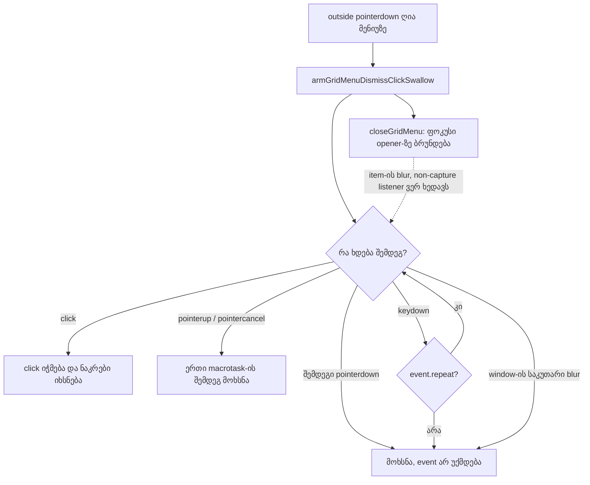
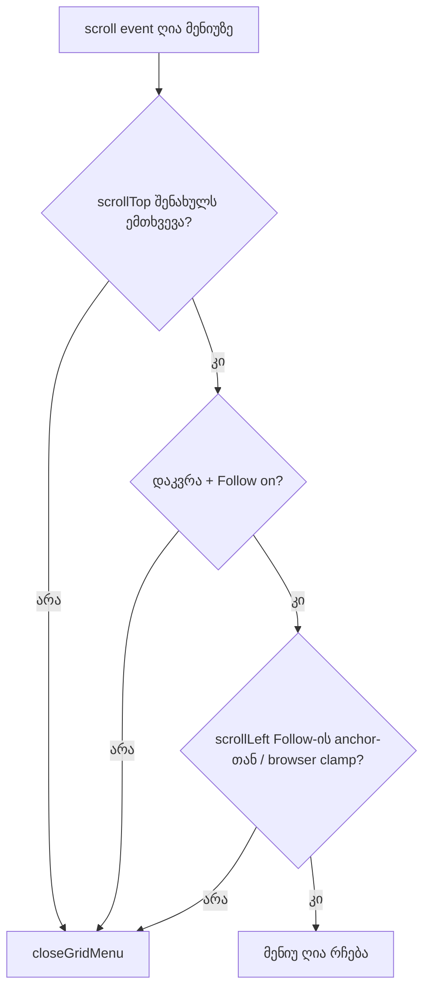

# Studio Lab — ბადის მენიუ: ფოკუსი padding-ზე დაჭერისას, auto-repeat კლავიში და ვერტიკალური scroll (SRW-14, ეტაპი 4b-ის დასრულება)

**თარიღი:** 2026-10-18
**სტატუსი:** Round 61 — D-29z26; C-ის შემოწმებას ელოდება
**შეცვლილი პროექტი:** Store

## კონტექსტი

- **C-R60-01 (Low, C-ის browser-ის გაზომვა):** ღია ბადის მენიუს padding-ზე ან `
` გამყოფზე დაჭერა (მარცხენა ან მარჯვენა ღილაკით) ფოკუსს `BODY`-ზე გადაიტანდა. ამის შემდეგ ArrowDown და Escape აღარაფერს აკეთებდა და მენიუ ღია რჩებოდა მენიუს გარეთ დაჭერამდე. ხარვეზი round 57-დან არსებობს; round 60-ის MN-CONTEXT კრიტერიუმმა გამოაჩინა.
- **C-R60-02 (Low; იგივეა, რაც A-R60-REVIEW-REPEAT-RELEASE):** round 60-ის „ნებისმიერი კლავიში ხსნის ჭამას“ წესი auto-repeat `keydown`-საც (`repeat: true`) ეხებოდა. C-მა გაზომა მეორე `keyboard.down('Shift')`-ით: Shift-ის დაჭერილად დატოვებისას Shift+click მენიუს გარეთ მენიუს ხურავდა **და** თავის მოქმედებასაც ასრულებდა. ეს round 58-ის ჭამის ნაწილობრივი რეგრესიაა.
- **ROOT-R50-58-L1 (Low, დადასტურებულია C round 60 VSCROLL-PROBE-ით):** ვერტიკალური overflow 382 px; Follow-ით დაკვრისას ვერტიკალურმა wheel-მა `scrollTop` 282 → 382 შეცვალა, ერთი `scroll` event გაისროლა, მაგრამ მენიუ ღია დარჩა ისეთ lane-ზე, რომელიც უკვე გადაადგილდა. Follow `on` დარჩა.
- **A-R60-REVIEW-BLUR-CAPTURE-TEST (მხოლოდ ტესტი):** არცერთი ტესტი არ ამოწმებდა, რომ window-ის `blur` listener non-capture-ია; `xblurcap` mutation ცოცხალი რჩებოდა.
- ეს ბოლო მხოლოდ-მენიუს რაუნდია; შემდეგი არის ეტაპი 4c (round 62).

## მიდგომა

**F — padding-ზე ან გამყოფზე დაჭერა ფოკუსს ინარჩუნებს (D-29z26-F).**
- მენიუს root `div`-ს (`role="menu"`) დაემატა `onMouseDown`. თუ `event.target` არ არის `button`-ის შიგნით (`closest('button')`), იძახება `preventDefault()`.
- `mousedown` ის event-ია, რომლის default action ფოკუსს ყველა browser-ში გადაადგილებს; `pointerdown`-ის გაუქმება ფოკუსს მხოლოდ Chromium-ში აჩერებს.
- ფოკუსი აქტიურ item-ზე რჩება, ისრები / Home / End / Enter / Space / Escape / Tab ჩვეულებრივ მუშაობს, მენიუ იმავე ადგილზე და იმავე დანაყოფით ღია რჩება. მარჯვენა დაჭერაზე native მენიუ კვლავ არ ჩანს (round 60-ის `onContextMenu` უცვლელია).
- item-ზე (`button` ან მისი შიდა `span`) დაჭერა **არ** უქმდება: Chrome item-ს ფოკუსს აძლევს და click ირჩევს, როგორც ადრე (GM22 უცვლელია). window-ის outside-press handler უცვლელია.

**K — ჭამას მხოლოდ არა-repeat კლავიში ხსნის (D-29z26-K; ცვლის D-29z25-R-ს).**
- `armGridMenuDismissClickSwallow`-ში capture `keydown` listener ახლა დასახელებული wrapper-ია (`releaseOnFreshKey`): `event.repeat`-ზე არაფერს აკეთებს, სხვა შემთხვევაში `releaseClickSwallow()`-ს იძახებს.
- **ერთი და იგივე reference** ემატება `addEventListener('keydown', …, true)`-ით და იშლება `removeEventListener('keydown', …, true)`-ით `releaseClickSwallow`-ში. inline arrow არ რეგისტრირდება (round 60-ის C-ის `xrepeat` build-ი სწორედ ამაზე ჟონავდა).
- პარამეტრის ტიპი `WindowEventMap['keydown']`-ია, assertion-ის გარეშე.
- **უცვლელი:** არა-repeat კლავიში (Enter, Space, Shift-ის პირველი დაჭერა, …) კვლავ ხსნის (GM26); `blur`, `pointerup`/`pointercancel` + ერთი macrotask და შემდეგი `pointerdown` კვლავ ხსნის; მომხსნელი არცერთი event არ უქმდება (C-R58-02).
- **ჩანაცვლება:** D-29z25-R-ის „ნებისმიერი კლავიში“ ჩანაცვლებულია „ნებისმიერი არა-repeat კლავიშით“. doc 053 უცვლელი რჩება.
- **დავიწროებული trade-off:** თუ კლავიში **პირველად** დაჭერილია მაშინ, როცა დამხურავი დაჭერა ჯერ კიდევ შენარჩუნებულია, საბოლოო release-ის click მაინც გადის. modifier, რომელიც დაჭერამდე უკვე დაჭერილი იყო (და auto-repeat-ს აგზავნის), ჭამას აღარ ხსნის.

**V — ვერტიკალური user scroll მენიუს ხურავს, Follow-ის დროსაც (D-29z26-V).**
- `StudioWorkspace.tsx`-ის მენიუს scroll effect-ში, მენიუს გახსნისას, ერთხელ ინახება `scroller.scrollTop`.
- `closeGridMenuOnUserScroll`-ში, Follow-ის auto-scroll-ის გამონაკლისამდე: თუ `scrollTop` შენახულს არ ემთხვევა → `closeGridMenu()` და return.
- tolerance არ არის: Follow მხოლოდ `scrollLeft`-ს წერს, ამიტომ ნებისმიერი ვერტიკალური ცვლილება მომხმარებლისაა (wheel, scrollbar, კლავიატურა).
- **უცვლელი:** ჰორიზონტალური წესი S (Follow-ის page flip მენიუს ღიად ტოვებს, GM21; user-ის ჰორიზონტალური scroll ხურავს, GM24); resize და window blur ხურავს; Follow რეჟიმი ვერტიკალურ scroll-ზე არ ჩერდება (`handleTimelineScroll` მხოლოდ `scrollLeft`-ს ადარებს და არ შეცვლილა). მეორე მარჯვენა click ღია მენიუზე (reposition) შენახულ მნიშვნელობას ინარჩუნებს, რადგან effect ღია მენიუზე თავიდან არ ეშვება.
- effect-ის dependency-ები უცვლელია (`[isGridMenuOpen, closeGridMenu]`), Biome lint 0.

**T — non-capture `blur`-ის ტესტი (D-29z26-T).** მხოლოდ ტესტი (GM35); წყარო არ შეცვლილა.

**ალტერნატივები:**
- **F:** `tabIndex={-1}` root-ზე + აქტიური item-ის ხელახლა ფოკუსი — უარყოფილია (მენიუს ARIA focus model-ს ცვლის, მეტი კოდია); window-ის Escape, რომელიც მენიუს ხურავს ფოკუსის მიუხედავად — უარყოფილია (სიმპტომს მკურნალობს, ისრები მკვდარი რჩება).
- **K:** „ნებისმიერი კლავიში“-ს შენარჩუნება — უარყოფილია: Shift/Ctrl-click მენიუს გარეთ მოქმედებს.
- **V:** მენიუს დახურვა wheel event-ზე — უარყოფილია: წესი S scroll-ზეა დაფუძნებული (C-R59-02).

## არქიტექტურა

## შეცვლილი ფაილები

- `app/components/arrangement/ArrangementGridMenu.tsx` — root-ის `onMouseDown` (F) და დასახელებული არა-repeat `keydown` wrapper (K).
- `app/components/arrangement/StudioWorkspace.tsx` — მენიუს scroll effect-ში შენახული `scrollTop` და ადრეული დახურვა (V). CRLF შენარჩუნებულია (1812 / 1812).
- `app/lib/arrangement/__tests__/grid-snap-menu.test.tsx` — GM32–GM35 (პირველ `describe`-ში, GM31-ის შემდეგ).
- `docs/implementation/2026/quarter-IV/054-studio-lab-grid-menu-focus-repeat-vscroll.md` — ეს დოკუმენტი.

## პრობლემები და გადაწყვეტები

- **პრობლემა:** jsdom-ში `fireEvent.mouseDown` ფოკუსს არ ამოძრავებს, ამიტომ „ფოკუსი მენიუშია“ შემოწმება GM32-ში ვერ ჩავარდება. **გადაწყვეტა:** ტესტი `fireEvent`-ის დაბრუნებულ მნიშვნელობას ამოწმებს (`false` = default გაუქმდა); რეალური ფოკუსი C-ის MN-EDGE-FOCUS-ით მოწმდება browser-ში.
- **პრობლემა:** mutation e (`scrollTop`-ის შედარება `0`-თან) მხოლოდ მაშინ კვდება, თუ მენიუს გახსნისას `scrollTop` ნულზე მეტია. **გადაწყვეტა:** GM34 `scrollTop = 120`-ს მენიუს გახსნამდე აყენებს; jsdom ამ მნიშვნელობას ინახავს (ტესტი 120-ს და 240-ს ამოწმებს).
- **პრობლემა:** GM35-ის ძალა იმაზეა დამოკიდებული, რომ ნაკრები `closeGridMenu`-ის ფოკუსის დაბრუნებამდე ირთვება. **გადაწყვეტა:** outside-press handler ჯერ `armGridMenuDismissClickSwallow`-ს იძახებს, შემდეგ `onClose`-ს; ამიტომ capture `blur` (mutation f) item-ის blur-ს ხედავს და ნაკრებს მაშინვე ხსნის — GM35 ამას იჭერს.

## ტესტირება

- **ახალი ტესტები:** GM32 (C-R60-01: სამი non-item `mouseDown` → `false`, item `mouseDown` → `true`, მენიუ ღიაა იმავე პოზიციით, Escape ხურავს, დანაყოფი `1`), GM33 (C-R60-02: `repeat: true` Shift-ის შემდეგ bare click იჭმება; არა-repeat Shift-ის შემდეგ გადის; `isPlaying` `false`), GM34 (ROOT-R50-58-L1: უცვლელი scroll მენიუს ღიად ტოვებს, ვერტიკალური ცვლილება ხურავს; დაკვრა და Follow `on` რჩება, `scrollLeft` უცვლელია), GM35 (non-capture `blur`: ფოკუსის დაბრუნების შემდეგ bare click კვლავ იჭმება).
- **Mutations (scratch, `store/`-ის გარეთ):** a (root `onMouseDown` ამოღებული) → GM32; b (item-ის გამონაკლისი ამოღებული) → GM32; c (`repeat` guard ამოღებული) → GM33; d (`scrollTop` შემოწმება ამოღებული) → GM34; e (`0`-თან შედარება) → GM34; f (`blur` capture `true`-ით) → GM35. ხელახლა: g → GM25; h → GM26 + GM33; i → GM27; r58a → GM16 + GM33 + GM35; r58d → GM21 + GM34; r59k → GM23. დამატებით (info): n (2 px tolerance) ცოცხალი რჩება, როგორც მოსალოდნელი იყო; p (მხოლოდ `button === 0`) → GM32; q (Shift-ის იგნორირება) → GM26 + GM33.
- **Gates:** `tsc --noEmit` 0; vitest 89 ფაილი / 1556 ტესტი; `npm run build` rc 0; `npm run verify` rc 0; Biome `./app` 5 / 218 / 1 (baseline-ის CRLF სია); შეცვლილ LF ფაილებზე 0 diagnostic; `StudioWorkspace.tsx` lint 0 და stdin format უცვლელი.

## Ableton

წყარო: Live 12 Reference Manual §6.10 „Using the Editing Grid“ (B-ის capture `b-round-46/ableton-6.7-6.10-20261016.txt`, 2026-10-16, ხელახლა გამოყენებული 2026-10-18). ვიდეო და Live-ის ინსტალაცია არ გამოყენებულა.

| ქცევა | Ableton-ის წყარო | იქ დადასტურებულია | CZABA-ს გადაწყვეტილება / განსხვავება | C-ის შემოწმება |
|---|---|---|---|---|
| ბადის სიგანე ტრეკის კონტექსტურ მენიუშია | §6.10 | კი (round 57-ის სტრიქონი) | უცვლელი | მხოლოდ რეგრესია (MN-KEYS, MN-ITEM-PRESS) |
| დაჭერა ღია მენიუს არა-item ზონაზე | — | დაუდასტურებელი (წყარო არ არის) | CZABA: ფოკუსი და კლავიატურა მენიუში რჩება (D-29z26-F) | GM32, MN-EDGE-FOCUS |
| დაჭერილი modifier მენიუს დახურვისას | — | დაუდასტურებელი (წყარო არ არის) | CZABA: დამხურავი click იჭმება; მხოლოდ არა-repeat კლავიში ხსნის (D-29z26-K) | GM33, MN-REPEAT |
| ვერტიკალური scroll ღია კონტექსტურ მენიუზე | — | დაუდასტურებელი (წყარო არ არის) | CZABA: ნებისმიერი user scroll ხურავს; Follow-ის საკუთარი ჰორიზონტალური scroll — არა (D-29z26-V + წესი S) | GM34, VSCROLL-CLOSE, MN-FOLLOW |

2–4 სტრიქონებზე „Ableton იგივეს აკეთებს“ არ ითქმის.

## TODO / შემდეგი ნაბიჯები

- **Round 62 — SRW-14 ეტაპი 4c:** group-move-ის კიდის snap (C-R52-T1), library-drop-ის კიდის და C-R51-01-ის გადაწყვეტილება, INFO-R55 და SHIFT-MIDDRAG ტესტები.
- **ARCH checkpoint (root):** ARCH-CHECKPOINT-SRW14-PREFS — snap-preference-ის plumbing, დროის სიზუსტის ერთი წესი, საერთო grid test harness და `useArrangementGridMenu` + `isFollowAutoScroll`-ის გამოტანა.
- **მენიუს Low-ები (batched 4c-ის შემდეგ):** A-R60-REVIEW-GK11-EXPORT-STATUS, INFO-R60-FOCUS-RETURN, INFO-R60-SHIFT1-SYNTH, A-R59-REVIEW-PUNCTUATION / END-INDEX / REANNOUNCE, ROOT-R50-58-L5.
- **Tech Lead R61-T:** padding/გამყოფზე click საკუთარ Chrome-ში; Shift-ის ~1 წამით დაჭერა და Play-ზე click ღია მენიუს გარეთ; Shift+1 რეალურ US კლავიატურაზე; ვერტიკალური wheel Follow-ით დაკვრისას.
