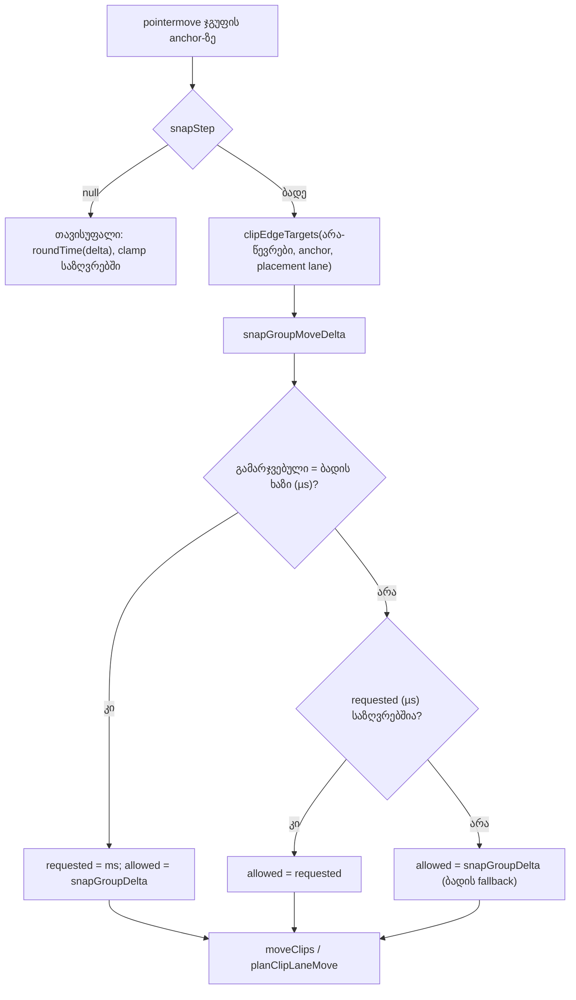

# Studio Lab — ჯგუფის გადატანა სხვა კლიპების კიდეებზე ეკვრება (SRW-14, ეტაპი 4c-1)

**თარიღი:** 2026-10-19
**სტატუსი:** Round 62 — D-29z27; C-ის შემოწმებას ელოდება
**შეცვლილი პროექტი:** Store

## კონტექსტი

- **Live 12 Reference Manual, §6.7 „Moving and Resizing Clips“:** „Clips snap to the editing grid, as well as … the edges of other clips“. ეტაპმა 4a ეს ქცევა ერთი კლიპის გადატანასა და trim-ს მისცა (doc 048). მონიშნული ჯგუფი კი მხოლოდ ბადეზე ეკვროდა.
- **CM10-ის ძველი კონტრაქტი:** „a group move stays on the grid only“. ტესტი ჯგუფის გადატანას ბადის ხაზზე (8) ელოდა, თუმცა სხვა ხაზის კლიპის დასაწყისი (8.4) უფრო ახლოს იყო.
- **C-R52-T1:** CM10 ვერ არჩევდა ერთმანეთისგან start-touch-ისა და end-touch-ის შემთხვევებს. ჯგუფისთვის ორივე კიდის ტიპის ცალკე ტესტი არ არსებობდა.
- **INFO-R55-FREE-ROUND-UNGUARDED:** jsdom-ის ყველა drag 40 px/s-ზე მთელ პიქსელებს იყენებდა, ამიტომ Snap-off გადატანის `start + delta` ყოველთვის მთელი მილიწამი იყო. `roundTime`-ის ამოღება (mutation) round 55-ში ცოცხალი დარჩა.
- **A-R55-REVIEW-SHIFT-MIDDRAG-TEST:** C-ის round-55 probe-ები (PS-MIDDRAG, PS-MIDDRAG-X, PS-GHOST) ამოწმებდა Shift-ს მხოლოდ drag-ის ბოლო ნაბიჯზე და Shift-ის ghost-ს, მაგრამ committed ტესტად არ არსებობდა.

## მიდგომა

**ტერმინები:** ჯგუფი — ერთად გადატანილი მონიშნული კლიპები (2+). anchor — კლიპი, რომლის header-საც მომხმარებელი ათრევს. წევრები — ჯგუფის ყველა კლიპი.

- **G1 — კანდიდატები (Snap ჩართულია).** anchor-ის ახალი დასაწყისი არის უახლოესი შემდეგთაგან:
  - ბადის ხაზი (`snapTimeToGrid`);
  - ყოველი start target (anchor-ის დასაწყისი ეხება კიდეს);
  - ყოველი end target − anchor-ის სიგრძე (anchor-ის დასასრული ეხება კიდეს). უარყოფითი შედეგი გამოირიცხება.

  target-ები მოდის `clipEdgeTargets`-იდან, **მხოლოდ არა-წევრი კლიპებიდან**. lane-ის წესი გამოიყენება anchor-ის placement lane-ზე: cross-lane გადატანისას ეს არის `hoverTrackId`, იმავე ხაზზე ან ვიდეოს anchor-ისთვის — `original.trackId`. placement lane-ზე კლიპის დასასრული მხოლოდ start target-ია, დასაწყისი კი მხოლოდ end target. სხვა ხაზებზე ორივე კიდე ითვლება (round 53-ის წესი, D-29z18).
- **წევრების კიდეები კანდიდატი არ არის** — არც ძველი პოზიცია, არც ახალი. კიდეს მხოლოდ anchor ეხება.
- **G2 — მანძილი და თანაბარი მანძილი:** უცვლელია 4a-დან (`nearestGridOrEdge`). შედარება მთელ მიკროწამებშია. თანაბარ მანძილზე იგებს ბადე, შემდეგ უფრო ადრეული კიდე. pixel-ის რადიუსი არ არსებობს.
- **G3 — delta, სიზუსტე და საზღვრები:**
  - თუ გამარჯვებული target მთელ მიკროწამებში ბადის ხაზს ემთხვევა, ქცევა იგივეა, რაც ადრე: `requested` მილიწამამდე მრგვალდება, `allowed` = `snapGroupDelta`.
  - თუ კიდე იგებს, `requested` ზუსტი მიკროწამია (არა მილიწამი; სხვაგვარად sub-ms butt join 0.5 ms-მდე გაიხსნებოდა). `allowed = requested`, თუ ის ჯგუფის საზღვრებში ჯდება (±1e-6). სხვა შემთხვევაში `allowed` არის დღევანდელი ბადის fallback: `snapGroupDelta` — უახლოესი შესაძლო ბადის ხაზი ან 0.
  - `gesture.blocked`, ჯგუფის შეჩერების status, cross-lane `planClipLaneMove(… timeDelta: requested)` და უარყოფის ghost-ები (`timeDelta: allowed`) უცვლელი გზებით მუშაობს.
- **G4 — უცვლელია:** Snap off (თავისუფალი, `roundTime`), Alt (bypass/enable თითო pointermove-ზე), Shift time lock, ჯგუფის კლავიატურით nudge, ერთი კლიპის გადატანა, trim, range, ruler, playhead, drop, brace, overlap-ის წესები და `selection.ts`.
- **G5 — სად:** `grid.ts`-ში ერთი ახალი pure helper, `snapGroupMoveDelta`. ის იყენებს არსებულ `snapTimeToGrid`-ს, `snapMoveStartToGridOrEdges`-ს, `snapGroupDelta`-სა და `toWholeMicroseconds`-ს. `ArrangementClip.tsx`-ში შეიცვალა მხოლოდ `groupDeltaOnGrid` და მისი გამოძახება: ის არა-წევრებიდან და placement lane-ით აგებს target-ებს და helper-ს იძახებს. import-ის სიაში `snapGroupDelta` შეიცვალა `snapGroupMoveDelta`-ით, რადგან ფაილში `snapGroupDelta` აღარ გამოიყენება. ახალი UI ტექსტი, state და prop არ დამატებულა.
- **CM17, CM9f–CM9h:** მხოლოდ ტესტები. წყარო არ შეცვლილა (D-29z20-მა `roundTime` Snap-off-ის გზაში განზრახ დატოვა).

## უარყოფილი ალტერნატივები

- **ყველა წევრი ეკვრება კიდეებს.** ეს მეტ კანდიდატს და პრიორიტეტის ახალ წესს მოითხოვს, რაც არავის უთხოვია. C-R59-03 / doc 044-მა ჯგუფის წესად anchor-ის წესი დააფიქსირა.
- **საზღვრებს გარეთ მყოფი კიდის საზღვარზე clamp.** ის ჩუმად მიაკრავდა არა-anchor წევრს მის მეზობელს, ანუ უკანა კარიდან წევრის კიდეზე snap იქნებოდა. ბადის fallback დღევანდელ ქცევას ინარჩუნებს.
- **კიდის delta-ს მილიწამამდე დამრგვალება.** sub-ms join 0.5 ms-მდე გაიხსნებოდა (D-29z18/19).

## C-R51-01 — დახურულია დიზაინით (D-29z27-D)

C-ის round-59 probe-მა აჩვენა browser-ის კონტრაქტი: დაბლოკილ ხაზზე ბიბლიოთეკის ელემენტის გაშვებისას `drop` არ ხდება და `dragend.dropEffect` არის `none`. უარყოფა ჩანს, სანამ მომხმარებელს ელემენტი ჯერ კიდევ უჭირავს: წითელი ghost ტექსტით და no-drop კურსორით (D-29z17 Q1). მომხმარებლის მოთხოვნა (`docs/video-to-text-bugs/transcripts/2.srt` 05:16–07:53) ეხება ბადის დანაყოფებს, Snap on/off-ს და თავისუფალ განთავსებას; უარყოფილი გაშვების შემდეგ status-ს არ ითხოვს. გაშვების შემდგომი status სამ ფაილს შეცვლიდა (`ArrangementLibrary`, `ArrangementContext`, lane-ის ghost state) Low პრობლემისთვის, რომელიც არავის მოუთხოვია. ეს CZABA-ს შეგნებული ქცევაა. round 63 (4c-2) LD-BLOCK-ს რეგრესიად გაიმეორებს.

## არქიტექტურა

## შეცვლილი ფაილები

- `app/lib/arrangement/grid.ts` — ახალი exported pure helper `snapGroupMoveDelta`. არსებული ფუნქციები უცვლელია.
- `app/components/arrangement/ArrangementClip.tsx` — `groupDeltaOnGrid` (anchor, ჯგუფი, კლიპები და placement lane), მისი გამოძახება ჯგუფის branch-ში და ერთი import-ის სახელი.
- `app/lib/arrangement/__tests__/grid-edges.test.ts` — CE7–CE9.
- `app/lib/arrangement/__tests__/grid-snap-clip-edges.test.tsx` — CM10-ის ახალი სათაური და სხეული; CM17; CM9f–CM9h; ახალი `describe` CG1–CG6-ით (ჯგუფის მოსანიშნი helper ამ `describe`-ის შიგნითაა).

## პრობლემები და გადაწყვეტები

- **პრობლემა:** რომელი გზით უნდა წავიდეს კიდე, რომელიც ზუსტად ბადის ხაზზე დევს? **გადაწყვეტა:** ბადის გზით (მთელ µs-ში ტოლობა). ასე ქცევა ბაიტის დონეზე იგივე რჩება, sub-ms წევრებით ჯგუფებისთვისაც (PG-GROUP).
- **ცნობილი შეზღუდვა (GROUP-SUBMS-GRID-EDGE):** sub-ms anchor-ისა და ბადის ხაზზე მდებარე მთელი-ms კიდის შემთხვევაში მილიწამამდე დამრგვალებული delta შეიძლება საზღვარს ოდნავ გასცდეს და fallback 0-ს მისცეს. მაგალითი: anchor 6.0004 / 1, იმავე ხაზის მეზობელი 8-ზე, raw 7.05. ეს დღევანდელი ქცევაა და რეგრესია არ არის. demo-ს ასეთი მონაცემები არ აქვს.
- **პრობლემა:** CM17-ს სჭირდება წილადი pixel-ის delta. **გადაწყვეტა:** zoom-ი mount-ის შემდეგ 30 px/s-ზე დგება და ტესტი ამოწმებს, რომ `pxPerSecond`-ის წაკითხული მნიშვნელობა მართლაც 30-ია. ამ zoom-ზე 10 px = 0.3333… წმ, მოსალოდნელი start = 2.333.

## ტესტირება

- **ახალი და შეცვლილი ტესტები:**
  - CE7 — ბადე იგებს, sub-ms anchor-ისთვის delta მთელი ms-ია;
  - CE8 — start touch ზუსტი µs-ით; თანაბარ მანძილზე ბადე იგებს;
  - CE9 — end touch საზღვრებს გარეთაა, ამიტომ მუშაობს fallback;
  - CM10 — end touch სხვა ხაზზე, status-ის ზუსტი ტექსტით;
  - CG1 — start touch;
  - CG2 — წევრების კიდეები target არ არის;
  - CG3 — sub-ms სიზუსტე;
  - CG4 — საზღვრებს გარეთ მყოფი კიდისას ბადის fallback (7 და არა 7.3);
  - CG5 — cross-lane, lane-ის წესი target ხაზზე;
  - CG6 — Alt;
  - CM9f–CM9h — Shift ბოლო ნაბიჯზე და Shift-ის ghost;
  - CM17 — Snap-off-ის მთელი ms წილად zoom-ზე.
- **წითელი → მწვანე:** წყაროს შეცვლამდე CE7–CE9 (helper არ არსებობდა), CM10, CG1 და CG3 ჩავარდა. CM9f–CM9h, CM17, CG2 და CG4–CG6 უკვე გადიოდა, რადგან ისინი არსებულ ქცევას აფიქსირებს და mutation-ებით არის დაცული.
- **Mutation-ები a–k** და 4a-ის განმეორებითი გაშვებები (კიდეები ერთ კლიპზე, lane-ის წესი, D-29z19-ის µs delta) scratch ასლში გაეშვა. დეტალები: `tmp/studio-real-loop/a-round-62/mutations.txt`. mutation f (საზღვარზე clamp) CE9-ის თავდაპირველ fixture-ზე (max 5) ვერ ჩნდებოდა, რადგან clamp-იც და fallback-იც 5-ს იძლევა. ამიტომ CE9-ს დაემატა მეორე შემოწმება max 5.3-ით: fallback 5, clamp 5.3. შედეგი: `mutations-ce9.txt`.
- **Gate-ები** (tsc, სრული vitest, build, Biome, verify) — A-ს ანგარიშში (`tmp/studio-real-loop/a-round-62.md`).

## Ableton

წყარო: Live 12 Reference Manual, https://www.ableton.com/en/live-manual/12/arrangement-view/ , §6.7 და §6.10 (B-ის capture `b-round-46/ableton-6.7-6.10-20261016.txt`, ხელახლა წაკითხულია 2026-10-19). ვიდეო არ გვინახავს და Live-ის ინსტალაცია არ გამოგვიყენებია.

| ქცევა | Ableton-ის წყარო | იქ დადასტურებული | CZABA-ს გადაწყვეტილება / განსხვავება | C-ის შემოწმება |
|---|---|---|---|---|
| გადატანილი კლიპი ეკვრება ბადეს და სხვა კლიპების კიდეებს | §6.7 (ტექსტი) | **დადასტურებულია** „dragging a clip“-ისთვის | ახლა მონიშნული ჯგუფისთვისაც (anchor) | CM10, CG1, GE-START, GE-END |
| multi-selection-ის რომელი კლიპი ეკვრება | — | **დაუდასტურებელი (წყარო არ არის)** | CZABA: მხოლოდ anchor; წევრების კიდეები target არ არის | CG2, GE-MEMBER |
| snap-ის მანძილი და ბადე-vs-კიდის პრიორიტეტი | §6.7 არ ამბობს | **დაუდასტურებელი** | უახლოესი (µs); თანაბარზე ბადე, შემდეგ ადრეული კიდე; რადიუსი არ არის | CE8, CG1 |
| ჯგუფისთვის საზღვრებს გარეთ მყოფი კიდე | — | **დაუდასტურებელი (წყარო არ არის)** | CZABA: დღევანდელი ბადის fallback | CG4, GE-BOUNDS |
| Alt თიშავს / დროებით რთავს | §6.10 (ტექსტი) | **დადასტურებულია** | უცვლელი; ჯგუფის კიდეებზეც | CG6, GE-ALT |
| Shift ინარჩუნებს დროს ხაზის შეცვლისას | — | **წყარო არ არის** | CZABA R8-M, უცვლელი | CM9f–CM9h |

დაუდასტურებელ სტრიქონებზე „Ableton-შიც ასე მუშაობს“ არ ითქმის.

## TODO / შემდეგი ნაბიჯები

- **Round 63 (4c-2):** ბიბლიოთეკიდან drop-ის ghost და drop-ის start ეკვრება კლიპების კიდეებს. LD-BLOCK — C-R51-01-ის რეგრესიად.
- **ARCH-CHECKPOINT-SRW14-PREFS:** snap-ის პარამეტრების გადაცემის გზა და დროის სიზუსტის ერთიანი წესი (`roundTime` ms, `roundGridTime` ms, `toWholeMicroseconds`, `planClipLaneMove` µs). ამ რაუნდმა ms/µs-ის კიდევ ერთი საზღვარი დაამატა (G3).
- **GROUP-SUBMS-GRID-EDGE:** G3-ის ცნობილი შეზღუდვა (იხ. ზემოთ); ცალკე დავალებას საჭიროებს, თუ რეალურ მონაცემებში გამოჩნდება.
