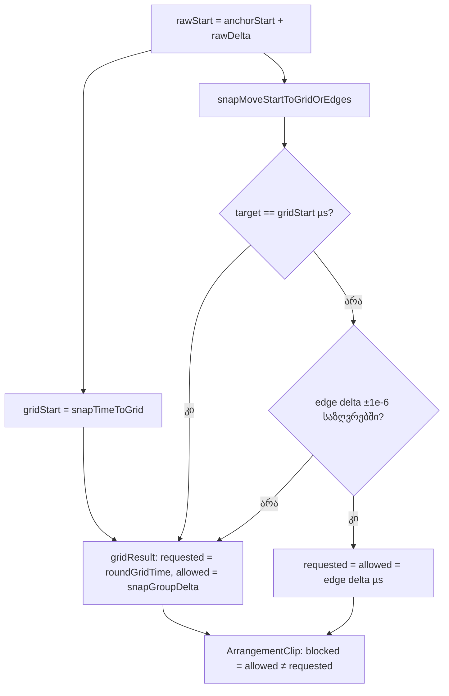

# Studio Lab — მიუწვდომელი კიდე დასრულებულ ჯგუფურ გადატანას აღარ აცხადებს შეჩერებულად (SRW-14, ეტაპი 4c-1 fix-up)

**თარიღი:** 2026-10-19
**სტატუსი:** Round 63 — D-29z28; C-ის შემოწმებას ელოდება
**შეცვლილი პროექტი:** Store

## კონტექსტი

- **C-R62-01 (Low; = A-R62-REVIEW-OOB-EDGE-STATUS).** C-ის repro: Soft impact 4/2 და Slow rise 12.3/5, მეზობელი კლიპი 19.3-ზე, ამიტომ ჯგუფის `maxDelta` = 2.0. division 1, raw start 6.025.
  - უახლოესი კიდე (ვიდეოს დასასრული 6.008, delta 2.008) საზღვრებს გარეთაა, ამიტომ ჯგუფი ბადის ხაზ 6-ზე ჯდება (delta 2). round 62-მდე ეს ჩვეულებრივი, შეუჩერებელი გადატანა იყო.
  - round 62-ის შემდეგ `requested` (2.008) ≠ `allowed` (2), ამიტომ `gesture.blocked` true იყო. drag-ის დროს და release-ის შემდეგ status ამბობდა „ჯგუფის გადატანა შეჩერდა — მეზობელი კლიპი ან დროის დასაწყისი.“, წარმატების ხაზი კი არ იწერებოდა.
  - მონაცემები სწორი იყო; მომხმარებელს კი ეუბნებოდა, რომ დასრულებული გადატანა შეჩერდა.
- **INFO-R62-EDGE-TOL.** C-ის mutation x2 (საზღვრის ±1e-6 ტოლერანსის მოხსნა) round 62-ში ცოცხალი დარჩა.
- **A-R62-REVIEW-R5-POSITIVE-LANE.** CG5 მხოლოდ lane-ის წესის უარყოფით ნახევარს ამოწმებდა. დადებითი ნახევარი (placement lane-ის კლიპის დასაწყისი იჭერს anchor-ის დასასრულს) მხოლოდ browser-ში (GE-CROSS) ჩანდა.
- **C-R62-ALT-ENABLE-GROUP-GAP.** Snap-off + Alt ჯგუფისთვის round 62-ში ხელახლა არ შემოწმებულა.

## მიდგომა

**ახალი G3 (`snapGroupMoveDelta`, D-29z28).** `gridResult` = `{ requested: roundGridTime(gridStart − anchorStart), allowed: snapGroupDelta(…) }` — ზუსტად ის, რასაც grid-win შტო აბრუნებდა.

| გამარჯვებული | შედეგი | ცვლილება |
|---|---|---|
| ბადის ხაზი | `gridResult` | უცვლელი |
| საზღვრებში მყოფი კიდე (±1e-6) | `{ requested, allowed: requested }` | უცვლელი |
| საზღვრებს გარეთ მყოფი კიდე | `gridResult` | **ახალი** (ადრე: `{ requested: კიდის delta, allowed: gridResult.allowed }`) |

შედეგად საზღვრებს გარეთ მყოფი კიდის შემთხვევაში ჯგუფის გადატანა ზუსტად round 62-მდე არსებულ ქცევას იმეორებს: `allowed`, `gesture.blocked`, drag-ის დროს შეჩერების status, release-ის შემდეგ წარმატების status და cross-lane `planClipLaneMove(… timeDelta: requested)`. `ArrangementClip.tsx` არ შეცვლილა: ის `blocked`-ს უკვე `requested`-ისა და `allowed`-ის სხვაობიდან იღებს.

**fixture-ების ეფექტი:**

| Fixture | საზღვარი | ბადის ხაზის delta | კიდე | ადრე → ახლა |
|---|---|---|---|---|
| C-R62-01 (browser) | max 2.0 | 2 (საზღვრებში) | 2.008 (გარეთ) | შეჩერებული → **არა**; წარმატების status იწერება |
| GE-BOUNDS (browser) | max 1.5 | 2 (გარეთ) | 2.008 (გარეთ) | შეჩერებული → შეჩერებული |
| CG4 (unit) | max 5.3 | 6 (გარეთ) | 6.4 (გარეთ) | შეჩერებული → შეჩერებული |
| GS5b `grid-snap-ui` | — | გარეთ | კიდეები არ არის | უცვლელი |
| CE9 (unit) | max 5 | 6 (გარეთ) | 6.4 (გარეთ) | `requested` 6.4 → **6**; `allowed` რჩება 5 |

## უარყოფილი ალტერნატივები

- **(a) შეცდომაში შემყვანი status-ის მიღება** — მომხმარებლის ნებართვის გარეშე status-ის რეგრესია იქნებოდა.
- **(c) წარმატების status-ის ყოველთვის დაწერა, თუ კლიპები გადავიდა** — ნამდვილად შეჩერებულ ჯგუფზეც (GE-BOUNDS) „გადავიდა“ დაიწერებოდა.
- **ბადის delta-ს ხელახლა გამოთვლა `ArrangementClip.tsx`-ში** — helper-ის ლოგიკას გააორმაგებდა, cross-lane `requested` კი კვლავ კიდის delta დარჩებოდა.

## ჩაწერილი შედეგი (ბაგი არ არის)

cross-lane ჯგუფურ გადატანაში, თუ უახლოესი კიდე **source lane-ის** საზღვრებს გარეთაა, ეს კიდე target lane-ზე აღარ იცდება — მოქმედებს round 62-მდე არსებული ბადის ქცევა. C ამას info-დ ამოწმებს (GE-CROSS-OOB).

## არქიტექტურა

## შეცვლილი ფაილები

- `app/lib/arrangement/grid.ts` — მხოლოდ `snapGroupMoveDelta`-ის სხეული: `gridResult` ერთხელ იქმნება და ბრუნდება grid-win და საზღვრებს გარეთ მყოფი კიდის შტოებში.
- `app/lib/arrangement/__tests__/grid-edges.test.ts` — CE9-ის `requested` assertion (6.4 → `toBe(6)`); დაემატა CE10, CE11.
- `app/lib/arrangement/__tests__/grid-snap-clip-edges.test.tsx` — `GROUP_MOVE_BLOCKED_MESSAGE`-ის import; დაემატა CG7, CG8, CG9.
- `docs/implementation/2026/quarter-IV/056-studio-lab-grid-group-oob-edge-status.md` — ეს დოკუმენტი.

## პრობლემები და გადაწყვეტები

- **პრობლემა:** status-ის ტექსტი ამოცანაში ერთი არა-ქართული სიმბოლოთი იყო აკრეფილი. **გადაწყვეტა:** ტესტი `GROUP_MOVE_BLOCKED_MESSAGE`-ს პირდაპირ `selection.ts`-იდან იმპორტირებს (ამოცანის დაშვებული ვარიანტი), ამიტომ ტექსტი არ კოპირდება.
- **პრობლემა:** sub-ms anchor-ის გარეშე mutation (n) — `requested` მთელ მიკროწამებში — ვერ განსხვავდება. **გადაწყვეტა:** info-დ ჩაიწერა; `/studio-lab`-ში sub-ms ხანგრძლივობის asset არ არის (round 62).

## ტესტირება

- **Red run (წყაროს ცვლილებამდე):** CE9 (`expected 6.4 to be 6`), CE10 (`{ requested: 6.4, allowed: 6 }`), CG7 (drag-ის დროს შეჩერების status) ჩავარდა; CE11, CG8, CG9 გაიარა. 3 failed / 52 passed.
- **ახალი ტესტები:** CE10 (საზღვრებს გარეთ მყოფი კიდე + საზღვრებში მყოფი ბადის ხაზი → `{6, 6}`), CE11 (კიდე საზღვრიდან 5e-7 წმ-ით გარეთ max და min მხარეს მაინც ეკვრება), CG7 (C-R62-01: drag-ის დროს არა შეჩერების status; release-ის შემდეგ 8/8/10.2 და „გადატანა (2): 2 კლიპი გადავიდა 00:06.000-ით მარჯვნივ.“), CG8 (placement lane-ის კლიპის დასაწყისი იჭერს anchor-ის დასასრულს: m1 stems 8.4, st2 sfx 6.4), CG9 (Snap off + Alt: ჯგუფი 8.4-ზე, Snap რჩება off).
- **Mutations (scratch, store-ის გარეთ):** a → CE9, CE10, CG7; b → CE11; c → CE9, CE10 (+CG4, CG7); d → CE9; e → CG8; f → CG9 (+CM6, SE1, SE12, SE12b, SE13); g → GS5b. Re-runs: round-62 a → CM10, CG1, CG3, CG8, CG9; round-62 f → CE9, CG4 (+CE10, CE11, CG7); round-62 h → CE7. Info: n ცოცხალია (მოსალოდნელი), p → CM10, CG1, CG8 (+CE8, CE11, CG3, CG9).
- **Gates:** `tsc --noEmit` 0; vitest 89 files / 1574; `npm run build` rc 0; Biome `./app` 5/218/1 (მხოლოდ baseline CRLF ფაილები), owned ფაილები 0 diagnostics; `npm run verify` rc 0 (პირველი მცდელობა, quiet).
- **Browser:** `:5173` და `:5199` A-ის დაწყებისას 000 იყო — browser smoke არ გაშვებულა (გარემო).

## Ableton

წყარო: Live 12 Reference Manual, `https://www.ableton.com/en/live-manual/12/arrangement-view/`, §6.7 და §6.10. B-ის ჩანაწერი `b-round-46/ableton-6.7-6.10-20261016.txt` (2026-10-16). ვიდეო არ უყურებიათ, Live-ის ინსტალაცია არ გამოყენებულა.

| ქცევა | Ableton-ის წყარო | იქ დადასტურებული | CZABA-ს გადაწყვეტილება / განსხვავება | C-ის შემოწმება |
|---|---|---|---|---|
| status-ის ტექსტი ბადის ხაზზე დასრულებული ჯგუფური გადატანის შემდეგ | — | **არ ეხება** (manual-ში status-ის ხაზი არ არის) | „გადავიდა“, როცა გადატანა დასრულდა; „შეჩერდა“ მხოლოდ მაშინ, როცა თავად ბადის ხაზია დაბლოკილი | CG7, GE-OOB-STATUS, GE-BOUNDS-REG |
| საზღვრებს გარეთ მყოფი კიდე → საზღვრებში მყოფი ბადის ხაზი | — | **დაუდასტურებელი (წყარო არ არის)** | D-29z27-იდან უცვლელი (`allowed`); იცვლება მხოლოდ `requested` | CE9, CE10, CG4 |
| Alt Snap-off-ის დროს დროებით რთავს snapping-ს | §6.10 (ტექსტი) | **დადასტურებული** ზოგად წესად | გამოყენებულია ჯგუფის anchor-ზე კიდეებით (CZABA-ს გადაწყვეტილება; manual multi-selection-ს არ აღწერს) | CG9, GE-ALT-ENABLE |
| placement lane-ის კლიპის კიდე იჭერს გადატანილ კლიპს | §6.7 (ტექსტი: „the edges of other clips“) | **დადასტურებული** ერთი კლიპისთვის | lane-ის წესი (D-29z18) და ჯგუფის anchor-ის წესი (D-29z27) CZABA-ს გადაწყვეტილებებია | CG8, GE-CROSS-REG |

არცერთ სტრიქონზე, რომელიც დაუდასტურებელია ან არ ეხება, არ ითქმის „Ableton-შიც ასეა“.

## TODO / შემდეგი ნაბიჯები

- **Round 64 — ეტაპი 4c-2:** library drop-ის ghost და drop start კლიპების კიდეებზე; LD-BLOCK როგორც C-R51-01-ის რეგრესია; INFO-R62-LIB-LOADING-DROP probe (ჯერ ჩაუტვირთავი წყაროს drop).
- **ARCH-CHECKPOINT-SRW14-PREFS** — root-ის read-only checkpoint (დროის სიზუსტის ერთი წესი, snap-preference plumbing, საერთო grid test harness).
- **GROUP-SUBMS-GRID-EDGE** — ჯერ კიდევ ღიაა.
- **A-R63-REVIEW-OOB-HIDES-REACHABLE-EDGE** (info/design, B-ის გადაწყვეტილება) — საზღვრებს გარეთ მყოფი უახლოესი კიდე მალავს უფრო შორს მყოფ, მაგრამ მისაწვდომ კიდეს (CG7: 8.2 ხელმისაწვდომია, ჯგუფი მაინც 8-ზე ჯდება).
- C-ის browser-შემოწმება: GE-OOB-STATUS, GE-OOB-PLAY, GE-BOUNDS-REG, GE-START-REG, GE-CROSS-REG, GE-ALT-ENABLE, GE-CROSS-OOB (info).
