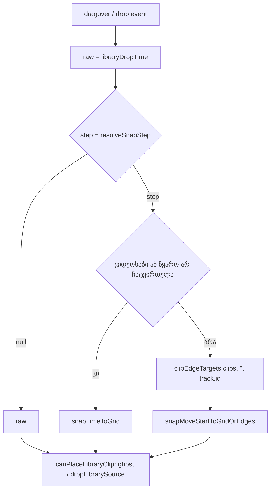

# Studio Lab — ბიბლიოთეკიდან ჩაგდებული ხმა კლიპების კიდეებზე ეკვრის (SRW-14, ეტაპი 4c-2)

**თარიღი:** 2026-10-19
**სტატუსი:** Round 64 — D-29z29; C-ის შემოწმებას ელოდება
**შეცვლილი პროექტი:** Store

## კონტექსტი

- **ეტაპი 4c-2** დაიგეგმა D-29z27-ში და D-29z28-მა გადაწია. ბიბლიოთეკიდან ჩაგდებული ხმის დასაწყისი აქამდე მხოლოდ ბადის ხაზზე ჯდებოდა (`ArrangementLane.libraryDropStart` → `resolveGridTime`).
- ხელით გადატანილი კლიპი კი ეტაპ 4a-დან სხვა კლიპების კიდეებზეც ეკვრის (D-29z17/18). ამიტომ ბიბლიოთეკის ხმას მეზობელ კლიპთან უნაპრალოდ ვერ მიადებდი.
- **round 63** environment-ის გამო დაიბლოკა (`:5173` და `:5199` = 000, `browserVerified: false`). offline შემოწმებამ ყველაფერი გაიარა და ბაგი არ ნაპოვნა. ეს environment-ის პრობლემაა და არა უსაფრთხოების ან მონაცემების დაკარგვის, ამიტომ 4c-2 გრძელდება (2026-10-09-ის წესი). round 63-ის browser-ის რიგებს C ამ რაუნდში პირველ რიგში ამოწმებს.

## მიდგომა

**წესი D-29z29:** ჩაგდება იგივე single-move snap-ის წესს იყენებს, რასაც ერთი კლიპის გადატანა.

1. `raw` = `libraryDropTime(…)`, უცვლელად.
2. `step` = `resolveSnapStep(snapSeconds, gridSeconds, event.altKey)`. Alt იკითხება **მიმდინარე** event-იდან: ghost-ისთვის dragover-იდან, ჩაგდებისთვის drop-იდან.
3. თუ `step === null`, ბრუნდება `raw` (თავისუფალი).
4. ვიდეოხაზზე, ან როცა წყარო ჯერ არ ჩატვირთულა (`dragged === null`), გამოიყენება მხოლოდ ბადე (`snapTimeToGrid`).
5. სხვა შემთხვევაში ჯერ ითვლება `clipEdgeTargets(getArrangement().clips, '', track.id)`, შემდეგ `snapMoveStartToGridOrEdges(raw, dragged.duration, step, startEdges, endEdges)`.
   - არაფერი გამოირიცხება (`''`), რადგან ჩასაგდები კლიპი ჯერ არ არსებობს.
   - ჩაგდების ხაზზე კლიპის დასასრული მხოლოდ start target-ია, მისი დასაწყისი კი მხოლოდ end target. სხვა ხაზების კლიპები ორივეს იძლევა (D-29z18).
   - იგებს უახლოესი, მთელ µs-ში დათვლილი. ტოლობისას ბადის ხაზი იგებს, შემდეგ ადრეული კიდე.

`handleDrop` `getLibraryDragSource()`-ს `dropLibrarySource`-ის გამოძახებამდე კითხულობს, რადგან ეს უკანასკნელი drag ref-ს ასუფთავებს. `canPlaceLibraryClip` და `dropLibrarySource` არ შეცვლილა. გადაფარვის შემოწმება snap-ის შედეგზე ხდება; თუ გამარჯვებული კანდიდატი კლიპს ფარავს, ghost წითელია და არაფერი ემატება.

**Oracle** (B, `b-round-63/oracle/oracle.mts`; Hit = 2 s):

| Fixture | ხაზი | raw | Snap | ძველი | ახალი | თავსდება |
|---|---|---|---|---|---|---|
| `DROP_FIXTURE` | sfx | 9.4 | 1 | 9 | 9 | კი |
| `DROP_FIXTURE` | sfx | 6.2 | 5 | 5 (დაბლოკილი) | **6** (s1-ის დასასრული) | **კი** — ამიტომ SD6 გადაკეთდა |
| `DROP_FIXTURE` | sfx | 4.6 | 5 | 5 (დაბლოკილი) | 5 (დაბლოკილი) | არა |
| `DROP_EDGE_FIXTURE` | sfx | 6.55 | 1 | 7 | **6.4** | კი |
| იგივე | music | 5.25 | 1 | 5 | **5.3** | კი |
| იგივე | stems | 4.5 | 1 | 5 | **4.4** | კი |
| იგივე | sfx | 4.5 | 1 | 5 (დაბლოკილი) | 5 (დაბლოკილი) | არა (lane-ის წესი) |
| იგივე, წყარო არ ჩატვირთულა | sfx | 6.55 | 1 | 7 | 7 | — |
| იგივე | sfx | 6.55 | off + Alt | 7 | **6.4** | კი |
| იგივე | sfx | 6.55 | on + Alt | 6.55 | 6.55 | კი |
| იგივე | sfx | 6.55 | off | 6.55 | 6.55 | კი |
| იგივე | video | 6.55 | 1 | 7 (უარი) | 7 (უარი) | — |

**უარყოფილი ალტერნატივები:**
- **ახალი helper `grid.ts`-ში.** საჭირო ფუნქციები უკვე export-ულია. `grid.ts`-ის შეცვლა იმ ფაილსაც შეცვლიდა, რომლის round-63 browser-ის რიგებიც C-ს ჯერ კიდევ შესამოწმებელი აქვს.
- **გადამფარავი კიდეების გაფილტვრა.** ეს ახალი, placement-aware snap-ის წესი იქნებოდა. single-move წესი ასე არ იქცევა, წითელი ghost კი მომხმარებელს უკვე აჩვენებს, რომ ადგილი დაკავებულია.
- **კიდეები ჩაუტვირთავ წყაროზე duration 0-ით.** ეს ისეთ end touch-ებს შესთავაზებდა, რომლებსაც რეალური კლიპი ვერ გააკეთებს. სანამ duration უცნობია, სწორი შედეგი ბადის ხაზია.

## არქიტექტურა

## შეცვლილი ფაილები

- `app/components/arrangement/ArrangementLane.tsx`
  - `libraryDropStart` ახლა drag-ის წყაროსაც იღებს.
  - `handleLibraryDragOver` და `handleDrop`-ის library შტო წყაროს გადასცემენ.
  - grid-ის import-ის ხაზი შეიცვალა: `resolveGridTime` ამოვიდა, დაემატა `clipEdgeTargets`, `resolveSnapStep`, `snapMoveStartToGridOrEdges` და `snapTimeToGrid`.
- `app/lib/arrangement/__tests__/grid-snap-loop-drop.test.tsx`
  - SD6-ის პირველ ნახევარში ორი კოორდინატი შეიცვალა (6.2 → 4.6).
  - დაემატა `DROP_EDGE_FIXTURE` და ახალი `describe` DE1–DE9 ტესტებით.
- `docs/implementation/2026/quarter-IV/057-studio-lab-grid-library-drop-edges.md` — ეს დოკუმენტი.

## პრობლემები და გადაწყვეტები

- **SD6 ახალ წესზე შეიცვლებოდა.** raw 6.2-ზე, Snap 5-ით, s1-ის დასასრული (6) ბადის ხაზ 5-ზე ახლოსაა და თავსდება. ამიტომ ტესტი ვეღარ დაამტკიცებდა, რომ „გადამფარავი snap-ის დასაწყისი უარყოფილია“.
  - **გადაწყვეტა:** B-ის ვიწრო ნებართვით პირველი ნახევრის ორი კოორდინატი 4.6-ით შეიცვალა. ბადის ხაზი 5 და `m1`-ის end target 5 ტოლია, ტოლობას ბადე იგებს, შედეგი კი დაბლოკილია. assertion-ები, სათაური და Alt ნახევარი უცვლელია. mutation i ამტკიცებს, რომ ცვლილება საჭირო იყო.
- **Biome-ის format.** ახალი `describe`-ის სათაური ხაზის სიგრძეს აჭარბებდა. ბლოკი ხელით გადავიდა ფაილში უკვე არსებულ, გადატანილ `describe(` ფორმაზე, `--write`-ის გარეშე. ტესტები და mutation-ები საბოლოო ფაილზე ხელახლა გაეშვა.

## ტესტირება

- **Red run** (წყარო უცვლელი, snapshot-ის `ArrangementLane.tsx`): `4 failed | 32 passed (36)`. ჩავარდა DE1, DE2, DE3 და DE6. გაეშვა ორჯერ: in-tree და scratch-ში, საბოლოო ტესტ-ფაილზე.
- **DE1–DE9:**
  - DE1–DE3: lane-ის დასასრული, lane-ის დასაწყისი და სხვა ხაზის დასასრული იჭერს ჩაგდებას.
  - DE4: lane-ის წესი; შედეგი ბადეა და დაბლოკილია.
  - DE5: ჩაუტვირთავ წყაროზე მხოლოდ ბადე.
  - DE6/DE7: Alt-ის ორივე მიმართულება.
  - DE8: Snap off, თავისუფალი.
  - DE9: ვიდეოხაზი.
  - ფიქსის შემდეგ ფაილი 36/36-ს გადის.
- **Mutation-ები a–i** (scratch, 4 ფაილი): ყველა მოკლულია. დამატებით j (edge target-ები მხოლოდ ხაზის კლიპებიდან) DE3-მ მოკლა.
- **Gates:** tsc 0; vitest 89 ფაილი / 1583 ტესტი, 0 ჩავარდნა; build rc 0. Biome `./app`: 5/218/1 (baseline-ის CRLF შეცდომები); ჩემს ორ ფაილზე 0 diagnostic. `npm run verify` rc 0.
- **Browser smoke:** gstack, `/studio-lab`, 1440×900. workspace და დემო badge ჩანს. API-ზე მხოლოდ root-ის ნებადართული `GET /api/cart` წავიდა. ეს PASS-ის მტკიცებულება არ არის; browser-ის რიგები C-ს ეკუთვნის.

## Ableton

| ქცევა | წყარო | იქ დადასტურებული | CZABA-ს გადაწყვეტილება | C-ის შემოწმება |
|---|---|---|---|---|
| ბიბლიოთეკის ელემენტი ხაზზე, pointer-ის ადგილას ჩაიგდება | Live 12 Manual §5.10 | **დადასტურებული** (ჩაგდება track-ში; დროის ღერძზე ადგილს ტექსტი არ აღწერს) | არსებული ქცევა SRW-11/12-დან | LD-EDGE, LD-PLAY |
| ჩაგდების დასაწყისი ბადეზე ან სხვა კლიპის კიდეზე ჯდება | — (§5.10 ამაზე არაფერს ამბობს; §6.7 გადატანას აღწერს) | **დაუდასტურებელი (წყარო არ არის)** | CZABA-ს გადაწყვეტილება: ერთი კლიპის გადატანის წესი, თანმიმდევრულობისთვის | DE1–DE4, LD-EDGE, LD-EDGE-END, LD-OTHER |
| Alt Snap off-ზე დროებით რთავს, Snap on-ზე კი გვერდს უვლის | §6.10 | **დადასტურებული, როგორც ზოგადი წესი** | ჩაგდებაზეც გავრცელდა (CZABA-ს გადაწყვეტილება) | DE6, DE7, LD-ALT-ENABLE, LD-ALT-BYPASS |
| ჩაგდება, რომელიც იმავე ხაზის კლიპს გადაფარავს | — | **არ ეხება / დაუდასტურებელი** | წითელი ghost, no-drop cursor, არაფერი ემატება (D-29z17 Q1, C-R51-01) | DE4, LD-BLOCK-REG |

დაუდასტურებელ და „არ ეხება“ რიგებზე ვერ ვიტყვით, რომ Ableton-შიც ასე მუშაობს. video არ ნანახა და Live-ის ინსტალაცია არ გამოყენებულა.

## TODO / შემდეგი ნაბიჯები

- SRW-14-ის ეტაპი 4 C-ის browser-ის შემოწმების შემდეგ დაიხურება (§4.6–§4.8). შემდეგია SRW-15.
- Lows batch: A-R63-REVIEW-OOB-HIDES-REACHABLE-EDGE, GROUP-SUBMS-GRID-EDGE და round-64 review-ის Low-ები:
  - არცერთი unit ტესტი არ ამოწმებს შემთხვევას, როცა იგებს **კიდე** და ის დაბლოკილია;
  - SD5-ის ტიპის Alt-ის სხვაობა edge-ის შტოზე.
- ARCH checkpoint: ARCH-CHECKPOINT-SRW14-PREFS (root).
