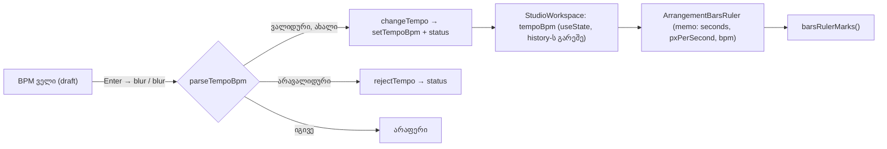

# Studio Lab — პროექტის ტემპი (BPM) და ტაქტების სახაზავი (SRW-15, ეტაპი 1)

**თარიღი:** 2026-10-19
**სტატუსი:** Round 65 — D-29z30; C PASS (round 65), გამოქვეყნდა 3e55c5c
**შეცვლილი პროექტი:** Store

## კონტექსტი

- **FB-09** (`2.mp4` 00:52–01:27): მომხმარებელს ტაქტები სჭირდება ("one bar, two bars, three bars, four bars"). ვიდეოს მონტაჟისთვის წამების სკალა უნდა დარჩეს.
- **FB-11** (`2.mp4` 02:21–03:14): ტემპს მნიშვნელობა აქვს.
- **D-10:** BPM ცვლის მხოლოდ ტაქტების ბადეს (შემდეგ ეტაპზე მეტრონომსაც). აუდიო არასოდეს იწელება (time-stretch არ არის) და UI ამას ამბობს.
- **Backlog-ის შენიშვნა:** პროდუქტს BPM არ აქვს, ამიტომ BPM-ს მომხმარებელი წერს. ტაქტების სახაზავი მხოლოდ ამის შემდეგ ჩანს. 120 ჩუმად არასოდეს იგულისხმება.
- SRW-14 ეტაპი 5 (მუსიკალური დანაყოფები: 1/4, 1/8 …) ამ BPM-ზეა დამოკიდებული, ამიტომ SRW-15 ეტაპი 1 მის წინ დაიგეგმა.

## მიდგომა

**წესი D-29z30:** ტემპი მხოლოდ ბადის მოდელია. ეტაპ 1-ში BPM არაფერს ცვლის ტაქტების სახაზავის გარდა. უცვლელი რჩება:

- წამების სახაზავი და Snap/წამების ბადე;
- კლიპები, დაკვრა, export, history და loop.

**ქცევა:**

1. **საწყისი მდგომარეობა:** ტემპი არ არის (`null`). ველი ცარიელია. ზოლში ნიშნულები არ არის, მხოლოდ მინიშნება: `ტაქტები: მიუთითე BPM — მხოლოდ ბადე, აუდიო არ იწელება`.
2. **ვალიდური შეყვანა:**
   - ტექსტს ჯერ trim უკეთდება და `,` იკითხება როგორც `.`;
   - ტექსტი უნდა ემთხვეოდეს `^\d{1,3}(\.\d{1,2})?$`-ს და მნიშვნელობა უნდა იყოს **20–999**;
   - ინახება 0.01-მდე დამრგვალებით.
3. **შენახვა:**
   - Enter აკეთებს blur-ს და შენახვაც blur-ის დროს ხდება. ასე ერთი შეყვანა ორჯერ ვერ შეინახება.
   - Escape აბრუნებს მიმდინარე მნიშვნელობას და აკეთებს blur-ს status-ის გარეშე.
   - იგივე მნიშვნელობის ხელახლა შენახვა არაფერს ცვლის და status-ს არ წერს.
   - ცარიელი ტექსტი შლის ტემპს. არავალიდური ტექსტი არაფერს ცვლის და ველში ისევ მიმდინარე მნიშვნელობა ჩანს.
4. **History:** ტემპი history-ში არ შედის, ისევე როგორც Snap და დანაყოფი (D-29z12). Undo/Redo-ს სათაურები არ იცვლება.
5. **ზომა:** ფიქსირებული 4/4 (CZABA-ს გამარტივება).
6. **ნიშნულები:** pure ფუნქცია `barsRulerMarks(seconds, pxPerSecond, bpm)`.
   - ტაქტის ხანგრძლივობაა `240 / bpm`.
   - `barStep` არის 2-ის ყველაზე პატარა ხარისხი, რომლითაც ტაქტებს შორის მანძილი ≥ 40 px.
   - დრო ყოველთვის ინდექსიდან ითვლება და არ გროვდება.
   - beat-ები მხოლოდ მაშინ ჩანს, როცა `barStep === 1`. beat-ს label აქვს, თუ beat-ის სიგანე ≥ 40 px.
   - მარჯვენა კიდეზე ნიშნული და label იმავე წესით იჭრება, რითაც `rulerTickMarks`-ში. მუდმივები (`RULER_*`) `view.ts`-დანაა.
7. **რიგი:** sticky chrome-ში, წამების სახაზავსა და Loop-ის რიგს შორის.
   - მარცხენა უჯრაში არის `BPM`, ველი და `4/4`.
   - მარჯვნივ არის ზოლი (`arrangement-bars-ruler`). ზოლი მხოლოდ ჩვენებისთვისაა: pointer handler-ები არ აქვს. seek/zoom/scroll ისევ წამების სახაზავზე ხდება.
8. **Focus-ის გამოსწორება:** scroller-ის `releaseEditFocusOnTimelinePointerDown` ნებისმიერ pointerdown-ზე blur-ს უკეთებდა ფოკუსში მყოფ ტექსტურ ველს, მათ შორის თვითონ ამ ველში დაწკაპუნებისასაც. ამის გამო ნახევრად აკრეფილი `9` შეინახებოდა. ახლა დამატებულია ერთი პირობა: blur ხდება მხოლოდ მაშინ, როცა pointerdown-ის target ფოკუსში მყოფი ელემენტის შიგნით არ არის.

**უარყოფილი ალტერნატივები:**

- **ტემპი arrangement-ის მოდელში ან history-ში:** შეეხებოდა `ArrangementContext`, `model.ts` და `types/arrangement.ts` ფაილებს მნიშვნელობისთვის, რომელიც აუდიოს არ ცვლის.
- **BPM-ის ველი transport-ში:** transport 1280 px-ზე უკვე გადაიტანება მეორე ხაზზე.
- **საწყისი 120 BPM:** backlog კრძალავს.
- **ტაქტების ზოლი `ArrangementRuler`-ის შიგნით:** წამების სახაზავი ბაიტ-ბაიტ უცვლელი უნდა დარჩეს.
- **სხვა:** tempo automation, tap tempo, ზომის ცვლილება, time-stretch. time-stretch მთელი პროექტის ფარგლებს გარეთაა.

## არქიტექტურა

- ზოლი `memo`-ა და მხოლოდ სამ primitive prop-ს იღებს. context-ს და position store-ს არ იყენებს, ამიტომ playhead-ის მოძრაობაზე თავიდან არ იხატება.

## შეცვლილი ფაილები

- `app/lib/arrangement/tempo.ts` (ახალი) — pure ფუნქციები:
  - `parseTempoBpm`, `formatTempoBpm`, `tempoStatusMessage`, `barsRulerMarks`;
  - მუდმივები და UI-ის ტექსტები.
  - Round 70-დან ზოლი მთელ სახაზავს აღარ ხატავს: მხოლოდ ხილვადი ნაწილის გარშემო სამი viewport-ის ფანჯარას (`barsRulerMarks`-ის არჩევითი მეოთხე პარამეტრი, doc 062).
- `app/components/arrangement/ArrangementTempoRow.tsx` (ახალი) — უჯრა ველით (ლოკალური draft) და `memo` ზოლი.
- `app/components/arrangement/StudioWorkspace.tsx` — ოთხი ჩამოთვლილი ცვლილება:
  - focus-ის პირობა;
  - `tempoBpm` state;
  - `changeTempo`/`rejectTempo`;
  - `<ArrangementTempoRow>` და ორი import.
- `app/lib/arrangement/__tests__/tempo.test.ts` (ახალი) — T1–T10.
- `app/lib/arrangement/__tests__/tempo-ui.test.tsx` (ახალი) — U1–U12.

## პრობლემები და გადაწყვეტები

- **Enter + blur ორჯერ შეინახავდა.**
  - პრობლემა: Enter შეინახავდა, მერე blur-იც შეინახავდა.
  - გადაწყვეტა: შენახვის ერთადერთი გზა blur-ია. Enter მხოლოდ blur-ს იწვევს. Escape ჯერ ref-ში იწერს, რომ შენახვა გამოტოვდეს, მერე აკეთებს blur-ს. ref ასევე ნულდება `onFocus`-ზე, ამიტომ ვერ "გაიჭედება".
- **ველში დაწკაპუნება ნახევრად აკრეფილ მნიშვნელობას ინახავდა.**
  - პრობლემა: ველი scroller-ის შიგნითაა და scroller-ის capture handler blur-ს აკეთებდა.
  - გადაწყვეტა: `focused.contains(event.target)` პირობა. ლაინზე, კლიპზე და სახაზავზე pointerdown ისევ ათავისუფლებს focus-ს.
  - რეცენზენტის შენიშვნა: იგივე პირობა ეხება ბადის `<select>`-საც, რომელიც ფოკუსშია. ეს §0.1(10)-ის მიზანია.
- **mutation (a) ცოცხალი რჩებოდა.**
  - პრობლემა: regex 3 ციფრამდე ზღუდავს, ამიტომ `'1000'` ზედა ზღვრის გარეშეც უარყოფილია.
  - გადაწყვეტა: T3-სა და U5-ში დაემატა `'999.5'`. ეს ტესტების გაძლიერებაა §2.2-ის ფარგლებში.
- **`barsRulerMarks(Infinity, …)` არ მთავრდებოდა.**
  - პრობლემა: მარყუჟი უსასრულოდ გრძელდებოდა (code-reviewer-ის Low).
  - გადაწყვეტა: დაემატა `Number.isFinite` შემოწმება. UI ამ მნიშვნელობამდე ვერ მივიდოდა.

## ტესტირება

- **Red run:** ორივე ახალი ფაილი ჩავარდა, რადგან `../tempo` ვერ იპოვა. ეს მოხდა წყაროს დაწერამდე.
- **T1–T10 და U1–U12:** 22/22 გავიდა. ყველაზე ნელი ტესტი U1-ია, დაახლოებით 0.45 წმ.
- **Mutation a–n** (scratch-ში, 6 ფაილზე):
  - ყოველმა mutation-მა დასახელებული ტესტები ჩააგდო;
  - (a) ჩავარდა მხოლოდ `'999.5'`-ის დამატების შემდეგ;
  - ფაილი: `tmp/studio-real-loop/a-round-65/mutations.txt`.
- **Gates:**
  - `tsc` 0;
  - vitest 91/1605;
  - build rc 0;
  - Biome: საკუთარი 5 ფაილი 0 diagnostic, `./app` 4/218/1 (baseline);
  - `npm run verify` rc 0.
- **Browser smoke** (gstack, 1440×900, PASS-ის მტკიცება არ არის):
  - BPM 90 შეინახა და status ზუსტი იყო;
  - ტაქტი 2 დაჯდა 106.66 px-ზე (2.666667 × 40), ტაქტი 3 — 213.33 px-ზე;
  - ველი blur-ში გადავიდა;
  - გვერდის ჰორიზონტალური overflow არ არის;
  - აკრძალული მოთხოვნა არ გაგზავნილა.

## Ableton

წყაროები: Live 12 Reference Manual §9.1.1, §5, §6.1 (B, 2026-10-19). ვიდეო არ ნახულა, Live არ გაშვებულა.

| ქცევა | Ableton | CZABA |
|---|---|---|
| ტემპი BPM-ში, მეასედებით | დადასტურებული (§9.1.1) | 2 ათწილადამდე, chrome-ის რიგში |
| tempo automation | დადასტურებული | შეგნებული განსხვავება: ერთი BPM |
| warping/time-stretch | დადასტურებული (§5) | შეგნებული განსხვავება: არასოდეს |
| beat-time სახაზავი | დადასტურებული (§6.1) | ტაქტები და beat-ები; ზოლი მხოლოდ ჩვენებისთვისაა |
| 4/4 საწყისი ზომა | დადასტურებული (§9.2.4.2) | ფიქსირებული 4/4 |
| დიაპაზონი 20–999 | დაუდასტურებელი | CZABA-ს არჩევანი |
| ტემპი Undo-ში | დაუდასტურებელი | history-ს გარეშე |
| ტემპი თავიდან არ არის | არ ეხება | CZABA-ს მოთხოვნა |

## TODO / შემდეგი ნაბიჯები

- **SRW-15 ეტაპი 2:** მეტრონომი დაკვრისას. ტაქტის ხაზებს ემთხვევა და export-ში არ შედის.
- **SRW-14 ეტაპი 5:** მუსიკალური დანაყოფები BPM-იდან (R14-G1).
- **ARCH-CHECKPOINT-SRW14-PREFS (a):** სად უნდა ცხოვრობდეს `tempoBpm` (StudioWorkspace-ის `useState` თუ პარამეტრების hook/slice). საჭიროა ეტაპ 2-მდე.
- ცარიელი ზოლის მინიშნება მარცხნივაა მიმაგრებული. თუ ხედი მარჯვნივ არის გადახვეული, მინიშნება ეკრანს გარეთ რჩება, მაგრამ ველი sticky უჯრაში ყოველთვის ჩანს.
