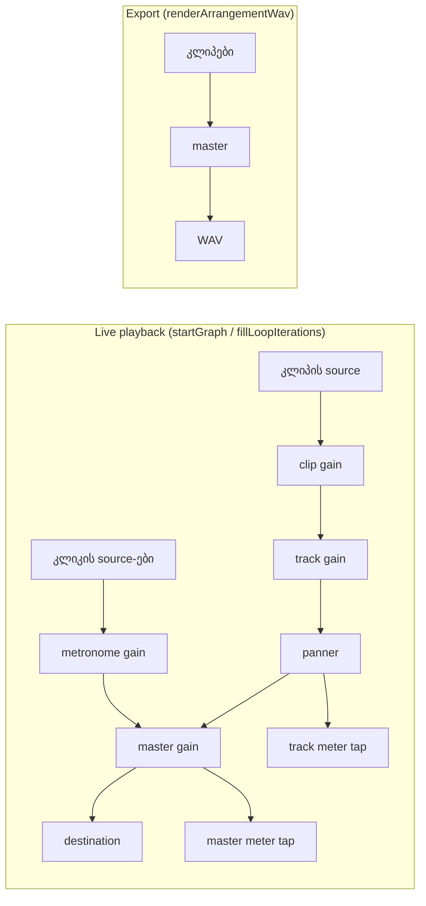

# Studio Lab — მეტრონომი (SRW-15, ეტაპი 2)

**თარიღი:** 2026-10-20
**სტატუსი:** Round 66 — D-29z31; C PASS (round 66), გამოქვეყნდა b5fb12b
**შეცვლილი პროექტი:** Store

## კონტექსტი

- **FB-09** (`2.mp4` 00:52–01:27): მომხმარებელს ტაქტები სჭირდება. მეტრონომიც FB-09-ის ნაწილია.
- **R15-T2** (backlog-ის მიღების კრიტერიუმი): მეტრონომი ჩართულია და დაკვრისას კლიკი ისმის ყოველ დარტყმაზე, ტაქტების ხაზებთან სწორად. Export-ში კლიკი არ არის.
- **D-10:** BPM ცვლის მხოლოდ ტაქტების ბადეს და მეტრონომს. აუდიო არასოდეს იწელება (time-stretch არ არის).
- **D-29z30 (ეტაპი 1):** ტემპს მომხმარებელი წერს, default მნიშვნელობა არ აქვს, history-ში არ შედის, ზომა ფიქსირებულია 4/4-ზე. ეს წესები უცვლელია.

## მიდგომა

**წესი D-29z31:** მეტრონომი მხოლოდ მოსმენის დამხმარეა. ის არ შედის მოდელში, history-ში და export-ში.

**ქცევა:**

1. **ღილაკი `მეტრონომი`** ტემპის ხაზის სათაურის უჯრაშია, `4/4`-ის შემდეგ (`aria-pressed`, `data-testid="arrangement-metronome-toggle"`).
   - BPM არ არის: ღილაკი `disabled`-ია და title არის `მეტრონომი — ჯერ მიუთითე BPM`.
   - BPM არის: ღილაკი აქტიურია. Title ხსნის, რომ კლიკი ყოველ დარტყმაზეა, ტაქტის პირველი უფრო ხმამაღალია, Master-ის ხმა და Mute მასზეც მოქმედებს და export-ში არ შედის.
   - Default: გამორთულია. History-ში არ შედის, keyboard shortcut არ აქვს. დაჭერილი მდგომარეობის სტილი Snap ღილაკისას იმეორებს (`border-accent bg-accent/20 text-accent`).
2. **სტატუსი:** ჩართვისას — `მეტრონომი ჩართულია — {BPM} BPM, 4/4: …`; გამორთვისას — `მეტრონომი გამორთულია.`.
3. **BPM-ის წაშლა მეტრონომს თიშავს.** BPM-ის ხელახლა მითითება მას თავისით აღარ რთავს. ჩართულ მდგომარეობაში ტემპის შეცვლა მეტრონომს ჩართულს ტოვებს.
4. **კლიკების გეგმა** (`planMetronomeClicks`): დარტყმა `k` არის `(k × 60) / bpm` წამზე. დრო ყოველთვის ინდექსიდან ითვლება და არა დაგროვებით, ამიტომ გრძელ პროექტში დრეიფი არ ჩნდება. დარტყმა ფანჯარაში შედის, თუ `time ≥ from − ARRANGEMENT_EPS` და `time < until − ARRANGEMENT_EPS`. ფანჯრის დასაწყისზე კლიკი იწყება `from`-დან და `offset`-ით. ბოლოს კლიკი ფანჯრის საზღვარზე იჭრება. Accent არის `k % 4 === 0`, ანუ ყოველი ტაქტის პირველი დარტყმა.
5. **ხმა** (`generateMetronomeClickSamples`): 30 ms სინუსი exponential decay-ით (5 ms). Accent არის 1600 Hz, peak 0.5 (−6 dBFS); დანარჩენი დარტყმა 1000 Hz, peak 0.25 (−12 dBFS).
6. **მარშრუტი:** კლიკის source-ები → ერთი metronome `GainNode` → schedule-ის master gain. ამიტომ Master-ის ხმა და Mute მოქმედებს და master meter კლიკს აჩვენებს. ტრეკის meter, volume, mute/solo და pan მასზე არ მოქმედებს.
7. **დაგეგმვა:** loop-ის გარეშე კლიკები წინასწარ იგეგმება პროექტის ბოლომდე, ისევე როგორც კლიპები. Loop-ის 0-ოვან iteration-ზე კლიკები იგეგმება `loop.end`-მდე. ყოველი შემდეგი iteration `appendClicks`-ით ემატება, `planLoopIteration`-ის იმავე `from`/`startAt`-ით.
   - Round 71-დან (D-29z36, doc 063) loop-ის გარეშე კლიკები წინასწარ მხოლოდ 2 წმ-ით იგეგმება და დაკვრისას `pumpPlaybackAudio`-დან ივსება.
8. **დაკვრისას ცვლილება:** ჩართვა, გამორთვა ან ტემპის შეცვლა იწვევს ერთ იძულებით resync-ს (`syncPlayback(present, undefined, true)`). კლიპები არსებული handoff-ით გრძელდება.
9. **Export:** `renderArrangementWav` არ შეცვლილა და მეტრონომს არასოდეს იღებს.
10. **Lazy buffer-ები:** კლიკის `AudioBuffer`-ები იქმნება მხოლოდ მაშინ, როცა graph მეტრონომით იგეგმება და არა `ensureAudioContext`-ში. Cache ერთ `AudioContext`-ზეა და unmount-ზე იშლება. ამის მიზეზია ის, რომ frozen UI ტესტების fake-ებს `copyToChannel` არ აქვთ.

**უარყოფილი ალტერნატივები:**

- **Live-ის Preview/Cue გზა:** Master-ის გვერდით ჩასმული კლიკი რეალურ ბრაუზერში არ გაიზომება, რადგან master meter ერთადერთი დაკვირვებადი წერტილია. CZABA-ს cue output-იც არ აქვს.
- **მეტრონომი როგორც სინთეტიკური კლიპები ცალკე ტრეკზე:** ტრეკის solo მას ჩააჩუმებდა და ის მოდელში, history-სა და ტრეკის meter-ში მოხვდებოდა.
- **Lookahead horizon:** კლიპები ახლაც წინასწარ იგეგმება და კლიკები იმავე წესს მიჰყვება. Horizon საჭირო გახდება მხოლოდ გაზომვის შემდეგ (METRONOME-UPFRONT-NODES).
- **Count-in, ხმის არჩევა, მეტრონომის volume, rhythm setting:** არ მოთხოვნილა.

## არქიტექტურა



```mermaid
sequenceDiagram
  participant U as მომხმარებელი
  participant SW as StudioWorkspace
  participant AC as ArrangementContext
  participant G as graph.client
  U->>SW: BPM 40 + მეტრონომი
  SW->>SW: metronomeOn = true, სტატუსი
  SW->>AC: setMetronomeBpm(40) (useEffect)
  AC->>AC: metronomeBpmRef = 40; თუ უკრავს → resync
  AC->>G: applySchedule(…, { metronome: { accent, beat, clicks } })
  G->>G: კლიკის source-ები → metronome gain → master
```

## შეცვლილი ფაილები

| ფაილი | დანიშნულება |
|---|---|
| `app/lib/arrangement/metronome.ts` (ახალი) | Pure მოდული: კლიკების გეგმა, ხმის sample-ები, სტატუსის ტექსტები, title-ები და მუდმივები |
| `app/lib/arrangement/graph.client.ts` | Additive: `ApplyScheduleOptions.metronome`, `ScheduleHandle.appendClicks`, კლიკის source-ების ცალკე სია, metronome gain → master; `stop(when)` და `disconnect()` კლიკებსაც მოიცავს |
| `app/contexts/ArrangementContext.tsx` | `metronomeBpmRef`, lazy click-buffer cache, `startGraph`-ში `options.metronome`, loop refill-ზე `appendClicks`, `setMetronomeBpm`, cache-ის reset unmount-ზე |
| `app/components/arrangement/ArrangementTempoRow.tsx` | `metronomeOn` / `onMetronomeToggle` props და ღილაკი |
| `app/components/arrangement/StudioWorkspace.tsx` | `metronomeOn` state, `toggleMetronome`, BPM-ის წაშლაზე გამორთვა, ერთი `useEffect`, რომელიც ეფექტურ BPM-ს context-ს გადასცემს |
| `app/lib/arrangement/__tests__/metronome.test.ts` (ახალი) | M1–M11 |
| `app/lib/arrangement/__tests__/metronome-ui.test.tsx` (ახალი) | UI1–UI10 |

## პრობლემები და გადაწყვეტები

- **პრობლემა:** frozen UI ტესტების `FakeAudioContext`-ს `createBuffer` არ აქვს, ხოლო `FakeAudioBuffer`-ს `copyToChannel` არ აქვს. Eager შექმნა ყველა ასეთ ტესტს Play-ზე ჩააგდებდა. → **გადაწყვეტა:** buffer-ები იქმნება lazily, მხოლოდ მეტრონომიანი graph-ის დაგეგმვისას, `new AudioBuffer(...)` + `copyToChannel`-ით. `ScheduleAudioContext`-ს ახალი წევრი არ დამატებია. Mutation (k) ამას ამოწმებს.
- **პრობლემა:** retired graph-ის handoff `stop(stopAt)`-ს მომავალი დროით იძახებს. თუ კლიკები ამ `when`-ს უგულებელყოფენ, ისინი ან ადრე გაწყდება, ან resync-ის შემდეგ გაორმაგდება. → **გადაწყვეტა:** კლიკის source-ები იმავე `when`-ით ჩერდება, რითაც კლიპები. Mutations p1/p2 ამას ამოწმებს.
- **პრობლემა:** კლიკები `sources`-ში რომ მოხვედრილიყო, `activeSourceCount` და `setClipGain` შეიცვლებოდა. → **გადაწყვეტა:** კლიკებს ცალკე სია აქვთ (M10, mutation g).
- **პრობლემა:** `Float32Array`-ის generic ტიპი lib.dom-ის `copyToChannel`-თან. → **გადაწყვეტა:** `generateMetronomeClickSamples` აბრუნებს `Float32Array<ArrayBuffer>`-ს.
- **პრობლემა:** `planMetronomeClicks(bpm, from, Infinity)` უსასრულო ციკლს გამოიწვევდა. → **გადაწყვეტა:** `from`/`until`-ის `Number.isFinite` შემოწმება (`[]`). ეს spec-ის მიღმა დამატებული დაცვაა და ანგარიშში deviation-ად წერია.

## ტესტირება

- **Red run** (attempt 1, 2026-10-19 17:49): ორივე ახალი ფაილი ჩავარდა (`../metronome` ვერ მოიძებნა).
- **M1–M11** (`metronome.test.ts`): გეგმის oracle (120/90/92.5/40 BPM, EPS, ბოლოს მოჭრა, ცარიელი შემთხვევები), ხმის sample-ები, ტექსტები, graph-ის მარშრუტი, `appendClicks`/`stop(when)`/`disconnect`, და ის, რომ მეტრონომის გარეშე graph უცვლელია.
- **UI1–UI10** (`metronome-ui.test.tsx`): disabled მდგომარეობა, ჩართვა და Play, დაკვრისას ჩართვა/გამორთვა, ტემპის შეცვლა, BPM-ის წაშლა, loop refill, history, export და Space ფოკუსირებულ ღილაკზე.
- **Mutations a–p** (scratch, `store/`-ის გარეთ): შედეგები `tmp/studio-real-loop/a-round-66/mutations.txt`-შია.
- **Gates:** `tsc` 0; vitest 93 ფაილი / 1626 ტესტი; build 0; Biome owned ფაილებზე 0 diagnostic, `./app` 4/218/1 (baseline).
- რეალური ბრაუზერის შემოწმება (MT-*) C-ის ამოცანაა. A-მ გააკეთა მხოლოდ layout smoke.

### Ableton (Live 12 Reference Manual, §19.4, §19.4.1, §3.1; B, 2026-10-19)

| ქცევა | Ableton | CZABA |
|---|---|---|
| მეტრონომის გადამრთველი ტემპის გვერდითაა და Play-ზე იწყებს | დადასტურებული | ტემპის ხაზის სათაურში; კლიკი მხოლოდ დაკვრისას |
| ხმა Preview Volume-ით, Master-ისგან ცალკე | დადასტურებული | **შეგნებული განსხვავება:** ფიქსირებული დონე Master-ის გავლით |
| Tick interval „Auto“ მნიშვნელს მიჰყვება | დადასტურებული | 4/4 → კლიკი ყოველ მეოთხედზე |
| Count-in, ხმის არჩევა, rhythm, „Only While Recording“ | არსებობს | არ არის (გამარტივება) |
| ტაქტის პირველი დარტყმის accent | დაუდასტურებელი | 1600 Hz −6 dBFS / 1000 Hz −12 dBFS |
| მეტრონომი export-ში არ შედის | დაუდასტურებელი | CZABA-ს მოთხოვნა R15-T2 |
| მეტრონომს ტემპი სჭირდება | არ ეხება | BPM-მდე disabled; BPM-ის წაშლა თიშავს |

## TODO / შემდეგი ნაბიჯები

- SRW-14 ეტაპი 5: მუსიკალური დანაყოფები BPM-დან (ტაქტი, 1/2 … 1/32).
- METRONOME-UPFRONT-NODES: საჭიროა თუ არა horizon, ამას C-ის MT-PERF-INFO გაზომვა გადაწყვეტს.
- ARCH-CHECKPOINT-SRW14-PREFS (a): `tempoBpm` და `metronomeOn` preference-ების ადგილი (StudioWorkspace vs preferences slice / audio engine).
