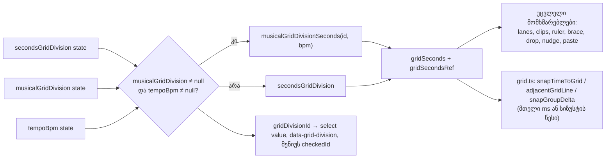

# Studio Lab — ბადის მუსიკალური დანაყოფები BPM-იდან (SRW-14, ეტაპი 5a)

**თარიღი:** 2026-10-20
**სტატუსი:** Round 67–68 — D-29z32, D-29z33; C PASS (round 68), გამოქვეყნდა 8bf9db4
**შეცვლილი პროექტი:** Store

## კონტექსტი

- **FB-13** (`2.mp4` 05:16–07:53): მომხმარებელს სურს ბადის დანაყოფის არჩევა და Snap-ის ჩართვა/გამორთვა. თავისუფალი გადაადგილება რჩება. კლიპის გადატანა და დაკვრის პოზიცია არჩეულ ბადეს თანმიმდევრულად მიჰყვება.
- **SRW-14** backlog-ის სათაური: „Grid divisions (bar, 1/2, 1/4, 1/8, 1/16, 1/32) + free“. მიღების კრიტერიუმი **R14-G1**: Snap ჩართულია, ბადე 1/4 120 BPM-ზე; კლიპის გადატანის შემდეგ start 0.5 წმ-ის ჯერადზე ჯდება.
- **D-10:** BPM ცვლის მხოლოდ ბადეს, ტაქტების სახაზავს და მეტრონომს. აუდიო არასოდეს იწელება.
- **D-29z30:** ტემპს default მნიშვნელობა არ აქვს და history-ში არ შედის. BPM-ის მითითება მიმდინარე ბადეს არ ცვლის (U3 ტესტი).

## მიდგომა

**წესი D-29z32:** მუსიკალური დანაყოფი ბადის ცალკე, ცხადი არჩევანია და BPM-ს საჭიროებს.

1. **სია** (ახალი pure მოდული `grid-divisions.ts`), ფართოდან მჭიდრომდე: `1 ტაქტი` (4 დარტყმა), `1/2` (2), `1/4` (1), `1/8` (0.5), `1/16` (0.25), `1/32` (0.125). ბიჯი წამებში: `(beats * 60) / bpm`. ზომა ფიქსირებულია 4/4-ზე.
2. **ხელმისაწვდომობა:** BPM-ის გარეშე select-ი და lane-ის ბადის მენიუ ზუსტად დღევანდელ 7 წამის დანაყოფს გვთავაზობს. BPM-ით select-ს ემატება `<optgroup label="ტაქტები · {BPM} BPM">`, მენიუს კი — 6 მუსიკალური პუნქტი ცალკე `
`-ის შემდეგ.
3. **არჩევა:** მუსიკალური დანაყოფი ბიჯს `musicalGridDivisionSeconds(id, bpm)`-ზე აყენებს. ყველა არსებული მომხმარებელი (move, group, trim, range, ruler, playhead, lane, drop, brace, nudge, paste) იმავე `gridSeconds`/`snapSeconds` props-ითა და `gridSecondsRef`-ით იღებს ამ რიცხვს; მათი ფაილები არ შეცვლილა. სტატუსი: `ბადე: 1/4 · 0.667 წმ 90 BPM-ზე (Snap ჩართულია)`. History-ში არ შედის.
4. **ატრიბუტები:** grid-control-ის უჯრას დაემატა `data-grid-division` (მიმდინარე id). `data-grid-seconds` ეფექტური ბიჯია, როგორც ადრე.
5. **BPM-ის შეცვლა** მუსიკალურ დანაყოფზე: ბიჯი ახალი BPM-იდან ხელახლა ითვლება, არჩევანი (`1/4`) რჩება. კლიპები ადგილზე რჩება, რადგან წამებშია შენახული (D-10).
6. **BPM-ის წაშლა** მუსიკალურ დანაყოფზე: ბადე ბრუნდება ბოლოს არჩეულ წამის დანაყოფზე (ცალკე state-ია, default 1 წმ). სტატუსს ემატება `ბადე დაბრუნდა წამებზე: {X}.`. BPM-ის ხელახლა მითითება მუსიკალურ დანაყოფს თავისით აღარ ირჩევს.
7. **კლავიშები 1 / 2:** ნაბიჯი მხოლოდ მიმდინარე ოჯახის შიგნით ხდება, წამებსა და მუსიკალურს შორის გადასვლა არ ხდება. ბოლოს შეტყობინებები სიის ბოლოებიდან ითვლება, რითაც დაიხურა **ROOT-R64-L2** (ადრე `GRID_DIVISIONS_SECONDS[6]/[0]` ხისტად იყო ჩაწერილი).
8. **Lane-ის ხაზები:** მექანიზმი უცვლელია, ეფექტური ბიჯის ერთი განმეორებადი gradient.

### სიზუსტის წესი (`grid.ts`)

- **ხაზი k** = `k × step`, ყოველთვის ინდექსიდან (დაგროვების გარეშე). დაბრუნებული დრო მრგვალდება **მთელ მილიწამამდე**, როგორც მოდელის დანარჩენი ნაწილი.
- **მთელი ms-ის ბიჯები** (ყველა წამის დანაყოფი და, მაგალითად, 120 BPM-ზე 1/4 = 0.5) დღევანდელ არითმეტიკას byte-ით ინარჩუნებს.
- **სხვა ბიჯები** (მაგ. 60/90): `snapTimeToGrid` ითვლის `Math.floor(time / step + 0.5)` ინდექსს და `round(k × step × 1000) / 1000`-ს. `adjacentGridLine`-ისა და `snapGroupDelta`-ის floor/ceil ინდექსის გამოსახულებები იყენებს `0.000501` tolerance-ს `1e-6`-ის ნაცვლად, რადგან შენახული ხაზი ზუსტ `k × step`-ს 0.5 ms-მდე შეიძლება ცდებოდეს. `snapGroupDelta`-ის in-bounds შედარებები `1e-6`-ზე რჩება.
- **ჩანაცვლებულია:** `0.000501` tolerance-ისა და `MUSICAL_GRID_INDEX_TOLERANCE`-ის აღწერა მოძველებულია და მის ნაცვლად მოქმედებს ქვემოთ მოცემული სექცია „Round 68 — სიზუსტის შესწორება (D-29z33)“.
- **რატომ:** ძველი ms-ბიჯის არითმეტიკით `snapTimeToGrid(100, 60/90)` = 100.05 (დრეიფი), ხოლო `adjacentGridLine(1.333, 60/90, +1)` = 1.333, ანუ კლავიატურით ჩაჩოჩება საკუთარ ხაზზე იჭედებოდა. ახალი წესით შედეგებია 100 და 2.

### უარყოფილი ვარიანტები

- **BPM-ის აკრეფისას ავტომატურად მუსიკალურზე გადართვა:** ეწინააღმდეგება D-29z30-ს (U3) და ჩუმად შეცვლიდა snapping-ს მომხმარებლისთვის, რომელსაც მხოლოდ ტაქტები უნდოდა.
- **მუსიკალური ბიჯი დღევანდელი ms-ბიჯის არითმეტიკით:** დრეიფს იწვევს (100.05 ხაზ 150-ზე).
- **დაუმრგვალებელი float ხაზები:** მოდელი მთელ ms-ს ინახავს, ამიტომ თავისუფლად გადატანილი კლიპი ან range ხაზებს ზუსტად აღარ დაემთხვეოდა.
- **კლიპების გადაადგილება BPM-ის შეცვლისას** (Live-ის beat-time arrangement): ეს ტემპით მართული დროის რედაქტირებაა, CZABA კი წამებს ინახავს (D-10).
- **Zoom-adaptive ბადე, 2/4/8 ტაქტის სიგანე, უფრო მკვეთრი ტაქტის ხაზები lane-ში:** არ მოთხოვნილა.
- **ტრიოლები:** ეტაპი 5b, შემდეგი რაუნდი.

## არქიტექტურა

## შეცვლილი ფაილები

- `app/lib/arrangement/grid-divisions.ts` (ახალი) — მუსიკალური დანაყოფების ცხრილი, ოფციები, ლეიბლები, ოჯახის შიგნით ნაბიჯი, სტატუსის, ბოლოსა და title-ის ტექსტები.
- `app/lib/arrangement/grid.ts` — მხოლოდ სიზუსტის წესი: private `isWholeMillisecondStep`, `MUSICAL_GRID_INDEX_TOLERANCE`, `gridIndexTolerance`, ერთი ახალი branch `snapTimeToGrid`-ში და ოთხი tolerance-ის ჩანაცვლება.
- `app/components/arrangement/ArrangementGridMenu.tsx` — props: `divisions: GridDivisionOption[]`, `checkedId`, `onChooseDivision(id)`; ოჯახებს შორის `
`.
- `app/components/arrangement/StudioWorkspace.tsx` — წამისა და მუსიკალური დანაყოფის state, მიღებული `gridSeconds`/`gridDivisionId`, refs, `changeGridDivision(id)`, `changeTempo`-ს fallback, `stepGridDivision` ოჯახის შიგნით, select-ის optgroup, `data-grid-division`.
- `app/lib/arrangement/__tests__/grid-musical.test.ts` (ახალი) — GM1–GM9.
- `app/lib/arrangement/__tests__/grid-musical-ui.test.tsx` (ახალი) — GU1–GU11.

## პრობლემები და გადაწყვეტები

- **პრობლემა:** callback-ები (`toggleSnap`, `stepGridDivision`, `changeGridDivision`, `changeTempo`) `[]` dependency-ით უნდა დარჩენილიყო, რომ Biome-ის warning-ების რაოდენობა არ გაზრდილიყო და keydown handler-ი ხელახლა არ შექმნილიყო. **გადაწყვეტა:** refs (`secondsGridDivisionRef`, `musicalGridDivisionRef`, `tempoBpmRef`, `gridDivisionIdRef`) ყოველ render-ზე ახლდება და callback-შიც სინქრონულად იცვლება `setState`-მდე, ისევე როგორც `gridSecondsRef` ადრე.
- **პრობლემა:** მენიუს ოჯახებს შორის გამყოფი `map`-ის შიგნით უნდა ყოფილიყო, key-ის დაკარგვის გარეშე. **გადაწყვეტა:** keyed `Fragment` ყოველ პუნქტზე; `
` ჩნდება მხოლოდ პირველი მუსიკალური პუნქტის წინ. `itemRefs`-ის ინდექსი ოფციის ინდექსად რჩება, ამიტომ keyboard navigation უცვლელია.
- **პრობლემა:** ძველ ms-ბიჯის არითმეტიკას 2/3 წმ-იან ბიჯზე დრეიფი ჰქონდა და ჩაჩოჩება იჭედებოდა. **გადაწყვეტა:** სიზუსტის წესი მხოლოდ არამთელ-ms ბიჯებზე; მთელი ms-ის გზა byte-ით უცვლელია.

## ტესტირება

- **Red run:** ორივე ახალი ტესტის ფაილი წყაროს ცვლილებამდე ჩავარდა (`../grid-divisions` ვერ მოიძებნა; GU1–GU11 ყველა ჩავარდა).
- **GM1–GM9** (pure): სია, ბიჯები 120/90/92.5 BPM-ზე, ოფციები, ოჯახის შიგნით ნაბიჯი, ყველა ტექსტი, B-ის oracle-ის ყველა რიგი `snapTimeToGrid`/`adjacentGridLine`/`snapGroupDelta`-ზე და property ტესტი (7 BPM × 6 დანაყოფი × ყველა ხაზი 600 წმ-მდე, ≈238 600 iteration, ~70 ms).
- **GU1–GU11** (jsdom workspace): BPM-ის გარეშე 7 ოფცია; optgroup ავტომატური გადართვის გარეშე; R14-G1 (5.5, შემდეგ 5); 90 BPM-ზე drag (4.667) და ruler click (6); ჩაჩოჩება 4.667 → 5.333 → 4.667 → 4 → 3.333; BPM-ის შეცვლა და წაშლა; 1/2 კლავიშები ოჯახის შიგნით; მენიუ 13 პუნქტითა და 2 გამყოფით; Snap-ის სტატუსი; history-ის გარეშე.
- **Mutations a–n** (scratch ასლი `store/`-ის გარეთ): ყველა მუტაცია თავის დასახელებულ ტესტებს აგდებს. მუტაცია g-ს frozen `grid-snap-ui`-ის options-ის რიგი ვერ იჭერს, რადგან select-ი optgroup-ს BPM-ის გარეშე საერთოდ არ ხატავს. მას იჭერს GM3, GU1 და frozen `grid-snap-menu` GM1.
- **Gates:** `tsc` 0; vitest 95 ფაილი / 1646 ტესტი; `npm run build` rc 0; Biome `./app` 4/218/1 (მხოლოდ baseline-ის CRLF-ის სია), შეცვლილ ფაილებზე 0 diagnostic.
- **Browser:** `/studio-lab`-ის smoke 1440×900-სა და 1280×720-ზე (A-ის ანგარიშში), PASS-ის მტკიცებულება არ არის. რეალურ შემოწმებას C აკეთებს.

## Ableton (Live 12 Reference Manual §6.10, ნანახია 2026-10-16)

| ქცევა | Ableton | CZABA |
|---|---|---|
| ბადის ხაზები სიმღერის ტემპის დანაყოფებს აჩვენებს | დადასტურებულია | შეგნებული განსხვავება: BPM-ის გარეშე წამის ბადეა; მუსიკალური დანაყოფი BPM-ით ჩნდება და მხოლოდ არჩევისას მოქმედებს |
| სიგანე lane-ის context menu-დან ირჩევა | დადასტურებულია | იგივე მენიუ ახლა მუსიკალურ დანაყოფებსაც შეიცავს |
| Narrow/widen სიმჭიდროვეს აორმაგებს/ანახევრებს | დადასტურებულია | მუსიკალური ოჯახის შიგნით ემთხვევა; Ctrl+1/2-ის ნაცვლად უბრალო 1/2 (D-29z24) |
| ტრიოლის რეჟიმი (Ctrl+3) | დადასტურებულია | ეტაპი 5b |
| Zoom-adaptive და ფიქსირებული ბადე | დადასტურებულია | შეგნებული განსხვავება: მხოლოდ ფიქსირებული |
| მიმდინარე ბიჯი ჩანს | დადასტურებულია | select-ის value/title და სტატუსი წამებით |
| Alt snapping-ს გვერდს უვლის | დადასტურებულია | უცვლელია, მუსიკალურ ბიჯზეც |
| ფიქსირებული სიგანეების სია (bar … 1/32) | დაუდასტურებელი | CZABA-ს სია = SRW-14-ის სათაური |
| BPM-ის შეცვლისას კლიპი beat-პოზიციას ინარჩუნებს | დაუდასტურებელი | CZABA-ს კლიპები წამებში რჩება (D-10) |

დაუდასტურებელ რიგებზე „Ableton-შიც ასეა“ არ ითქმის.

## TODO / შემდეგი ნაბიჯები

- **ეტაპი 5b:** ტრიოლები (Live 6.10-ის triplet mode).
- **Perf რაუნდი:** ROOT-R66-M1 (მეტრონომის horizon) + ROOT-R65-M1 (ტაქტების სახაზავის viewport culling).
- **ARCH-CHECKPOINT-SRW14-PREFS:** StudioWorkspace-ის view/edit preferences (ახლა წამისა და მუსიკალური დანაყოფის წყვილით) და `grid.ts`-ის სიზუსტის წესი, როგორც შესაძლო პროექტის დონის `time-precision.ts`.

## Round 68 — სიზუსტის შესწორება (D-29z33)

### პრობლემები და გადაწყვეტები

- **C-R67-01 (medium). პრობლემა:** Snap-ით ჩაჩოჩება ხაზს გარეთ მდგომი დროიდან ერთ მუსიკალურ ხაზს ტოვებდა. 120 BPM-ზე 1/32 ბიჯზე (0.0625) start 0.187-დან ArrowRight 0.25-ზე ხვდებოდა და 0.188-ს ტოვებდა. მიზეზი: `0.000501` tolerance 0.187-ს ინდექს 3-ის ხაზად თვლიდა, რადგან `3 × 0.0625 = 0.1875`. **გადაწყვეტა:** `adjacentGridLine` არამთელ-ms ბიჯზე **შენახულ ხაზებს** ადარებს: `L(m) = max(0, round(m × step × 1000)) / 1000`. წინ მოძრაობისას ბრუნდება პირველი `L(m) > time + 1e-6`, სადაც m = `floor(time / step)`, +1, +2. უკან მოძრაობისას ბრუნდება ბოლო `L(m) < time − 1e-6`, სადაც m = `ceil(time / step)`, −1, −2. m < 0-ზე შედეგია `null`.
- **A-R67-REVIEW-L1 (low). პრობლემა:** იგივე დეფექტი `snapGroupDelta`-ის clamp branch-ში. floor მხარეს `(0, 0.1875, 0.0625, −10, 0.187)` 0-ს აბრუნებდა 0.125-ის ნაცვლად. ceil მხარეს anchor 0.062-ზე ხვდებოდა, რომელიც შენახული ხაზი არ არის. **გადაწყვეტა:** clamp-ის კანდიდატი არის `round(B − anchorStart)`. დადებით მხარეს B არის **უდიდესი შენახული ხაზი ≤ `anchorStart + high + 1e-6`**, უარყოფითზე — **უმცირესი შენახული ხაზი ≥ `anchorStart + low − 1e-6`**. თითოეულ მხარეს მოწმდება სამი კანდიდატი m; ხაზის არარსებობისას შედეგია 0. in-bounds შემოწმება (`1e-6`) უცვლელია.
- **C-R67-02 (B: medium). პრობლემა:** 90 BPM-ზე 1/4 ბიჯზე loop-ის `1.333 — 2.667` ზოლის გადატანისას დასასრული ხაზზე 1 ms-ით გვიან ჯდებოდა (`2.000 — 3.334`). მიზეზი: სიგრძე ms-ში ინახებოდა (1.334). loop ამიტომ რეალურადაც 1 ms-ით გვიან ბრუნდებოდა. **გადაწყვეტა:** `moveLoop`-ს ემატება არასავალდებულო `gridStep`. თუ ის მოცემულია და loop-ის ორივე კიდე და ახალი start აქტიური ბიჯის ხაზზეა (`|snapTimeToGrid(x) − x| < 1e-6`), დასასრულია `snapTimeToGrid(loop.end + Δstart)`. ანუ სიგრძე **ხაზების რაოდენობით** ინახება. თუ ეს `MIN_LOOP_LENGTH`-ზე მოკლე loop-ს მოგვცემდა, ძველი ms-ის დასასრული რჩება.

### სიზუსტის წესი (განახლება)

- **მთელი ms-ის ბიჯები** (ყველა წამის დანაყოფი, 120 BPM-ზე 1/4 = 0.5): `adjacentGridLine` და `snapGroupDelta` ბრუნდება `b5fb12b`-ის ზუსტ გამოსახულებებზე `GRID_TIME_TOLERANCE`-ით. შედეგები byte-ით უცვლელია.
- **`MUSICAL_GRID_INDEX_TOLERANCE` და `gridIndexTolerance` წაიშალა.** ინდექსის tolerance შენახული ხაზის ცდომილებას (≤ 0.5 ms) ფარავდა, მაგრამ ამავე დროს ხაზის გარეთ მდგომ დროსაც ხაზად თვლიდა (0.187 ≈ 0.1875). შენახულ ხაზებთან პირდაპირი შედარება ორივე პრობლემას ერთად ხსნის. B-მ დაამტკიცა, რომ step > 1 ms-ზე სამი კანდიდატი საკმარისია (უმცირესი ბიჯი: 999 BPM 1/32 = 7.5 ms). reviewer-ის ორკანდიდატიანი ფორმა 999 BPM 1/4-ზე t = 0.3-ზე იჭედება.
- **`snapTimeToGrid`:** მუსიკალური branch ახლა private `storedGridLine` helper-ს იყენებს, შედეგები იდენტურია. მთელი ms-ის branch უცვლელია.
- **შეგნებული წესი (უცვლელი):** გადატანილი კლიპის **დასასრული** და ჯგუფური გადატანის **offset-ები** ზუსტად მილიწამებში ინახება. კლიპის ხანგრძლივობა მედიის დროა (D-10), stage 1-ის ჯგუფური კონტრაქტი კი offset-ებს ინარჩუნებს. loop-ის კიდეები ბადის სიდიდეებია, კლიპის დასასრული — არა.

### Loop-ის გადატანა ბადის სიგრძით

- **Ableton:** Live 12 Reference Manual, „Arrangement View“, loop brace-ის აბზაცი (ნანახია 2026-10-16, `b-round-46/ableton-arrangement-view-20261016.txt`, ხაზი 3): ზოლის ჰორიზონტალური გადატანა loop-ს **სიგრძის შეცვლის გარეშე** აადგილებს; ისრის კლავიშები loop brace-ს მიმდინარე ბადით აჩოჩებს. CZABA-ში მუსიკალურ ბადეზე სიგრძე ხაზების რაოდენობაა. CZABA მთელ ms-ს ინახავს, ამიტომ ms-ში გაზომილი სიგრძე პოზიციების მიხედვით 1 ms-ით შეიძლება განსხვავდებოდეს (შეგნებული განსხვავება).
- **Pointer:** `ArrangementLoopBrace` `moveLoop`-ს გადასცემს `resolveSnapStep(snapSeconds, gridSeconds, altKey)`-ს. Alt-ით ბიჯი `null`-ია და სიგრძე ms-ში რჩება, როგორც ადრე.
- **კლავიატურა:** Snap-ის ჩართვისას `stepLoopRange('move', Δ, snapSeconds)`. `ArrangementContext.stepLoopRange` `gridStep`-ს მხოლოდ `'move'`-ს გადასცემს. Shift+ისრით სიგრძის შეცვლა და Snap-ის გარეშე 0.1 წმ-იანი ნაბიჯი უცვლელია. სტატუსი (`Loop: …`), history-ის ლეიბლი და დაბლოკვის შეტყობინება უცვლელია.

### შეცვლილი ფაილები (Round 68)

- `app/lib/arrangement/grid.ts` — private `storedGridLine`, `storedGridLineAtOrBelow`, `storedGridLineAtOrAbove`, `adjacentStoredGridLine`; არამთელ-ms branch-ები `adjacentGridLine`-სა და `snapGroupDelta`-ის clamp-ში; tolerance-ის კონსტანტის წაშლა.
- `app/lib/arrangement/loop.ts` — `moveLoop(arrangement, start, gridStep = null)` და private `isOnGridLine`.
- `app/components/arrangement/ArrangementLoopBrace.tsx` — ორი გამოძახება და `resolveSnapStep`-ის import.
- `app/contexts/ArrangementContext.tsx` — `stepLoopRange`-ის interface-ის ხაზი და callback (`gridStep`).
- `app/lib/arrangement/__tests__/grid-musical.test.ts` — GM10–GM12.
- `app/lib/arrangement/__tests__/grid-musical-ui.test.tsx` — GU12–GU14, fixture-ის არასავალდებულო `loop` არგუმენტი.

### ტესტირება (Round 68)

- **Red run:** ექვსი ახალი ტესტი ჩავარდა round 68-ის snapshot წყაროებზე (scratch ასლი `store/`-ის გარეთ): GM10 (0.25 ≠ 0.188), GM11 (0 ≠ 0.125), GM12 (end 3.334 ≠ 3.333), GU12 (0.25 ≠ 0.188), GU13 და GU14 (3.334 ≠ 3.333). round 67-ის GM1–GM9 და GU1–GU11 მწვანე დარჩა.
- **GM10:** oracle-ის ყველა `adjacentGridLine` რიგი და sweep: 7 BPM × 6 დანაყოფი × ყოველი მთელი ms 0–10 წმ-ში (≈420 000 input), brute-force სკანირებასთან შედარებით.
- **GM11:** ორი ახალი oracle რიგი (0.125, −0.037), round 67-ის GM8-ის სამი რიგი და floor-ის sweep: 4 BPM × 3 დანაყოფი × anchor/high ბადე, მხოლოდ out-of-bounds შემთხვევები.
- **GM12:** `moveLoop`-ის ყველა oracle რიგი (guard-ის ჩათვლით) და sweep: 3 ბიჯი × k 0–200 × w × d.
- **GU12–GU14** (jsdom workspace): ჩაჩოჩება 0.187-დან (0.188, 0.25, 0.188, 0.125); ზოლის გადატანა (2 — 3.333; Alt-ით 2.7 — 4.033); ისრის კლავიშები brace-ზე (2 — 3.333, 2.667 — 4, 2 — 3.333; Shift → end 4; Snap-ის გარეშე 2.1 — 4.1) და სტატუსი `Loop: 00:02.000 — 00:03.333.`.
- **Mutations a–i** (scratch ასლი `store/`-ის გარეთ): ყველა თავის დასახელებულ ტესტებს აგდებს. მუტაცია i (Alt-ის იგნორირება) თავდაპირველად გადარჩა: GU13-ის Alt-ით გადატანა ხაზის გარეთ (2.7) მთავრდებოდა, სადაც ms-ის წესი ისედაც მოქმედებს. GU13-ს დაემატა Undo და Alt-ით გადატანა ხაზზე 1.333-ზე → `{1.333, 2.666}`; მუტაცია ახლა კვდება. C-ის დამატებითი j (მთელი ms-ის გზის stored-line სკანირება) და k (`1e-3` tolerance) გადარჩა (info; j მნიშვნელობებით ექვივალენტურია).
- **Code review:** Critical/High/Medium არ არის. Low 1: არასასრულო `time`-ზე (Infinity) კანდიდატების ციკლი არ მთავრდებოდა. ციკლები offset-ის მთვლელზე გადავიდა, კანდიდატები უცვლელია. Low 3: GM12-ს დაემატა ორი რიგი: end ხაზის გარეთაა → `{2, 3.367}`; უარყოფითი start → `{0, 1.333}`.
- **Gates:** `tsc` 0; vitest 95 ფაილი / 1652 ტესტი; `npm run build` rc 0; `npm run verify` rc 0; Biome `./app` 4/218/1 (baseline-ის CRLF-ის სია), შეცვლილ ფაილებზე 0 diagnostic. რეალურ ბრაუზერში შემოწმებას C აკეთებს.
