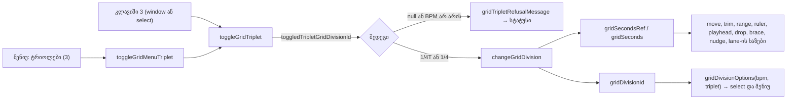

# Studio Lab — ბადის ტრიოლების რეჟიმი (SRW-14, ეტაპი 5b)

**თარიღი:** 2026-10-21
**სტატუსი:** Round 69 — D-29z34; C PASS (round 69), გამოქვეყნდა ae4fc39
**შეცვლილი პროექტი:** Store

## კონტექსტი

- **FB-13** (`2.mp4` 05:16–07:53): მომხმარებელს სურს ბადის დანაყოფის არჩევა, Snap-ის ჩართვა/გამორთვა და თავისუფალი გადაადგილება.
- SRW-14-ის მე-5 ეტაპი მოიცავს მუსიკალურ დანაყოფებს (ტაქტი, 1/2 … 1/32) და **ტრიოლებს**. D-29z32-მა ეს ეტაპი ორად გაყო: 5a (Round 67–68, doc 060) ჩვეულებრივ მუსიკალურ დანაყოფებს მოიცავდა, 5b კი, ეს დოკუმენტი, ტრიოლების რეჟიმს.
- **D-10:** BPM მხოლოდ ბადეს ცვლის, აუდიო არასოდეს იწელება. ტრიოლის ბიჯიც ბადის ბიჯია და კლიპებს არ ამოძრავებს.
- B-ის offline შემოწმებამ (`b-round-68/triplet-oracle.ts`) აჩვენა, რომ გამოქვეყნებული `grid.ts`-ის შენახული ხაზების წესი (D-29z33) ტრიოლის ბიჯებზეც ზუსტია: 400 040 შესავალი, `adjacentGridLine`-ის 0 შეუსაბამობა ორივე მიმართულებით. ამიტომ `grid.ts` და `loop.ts` ამ რაუნდში არ შეცვლილა.

## მიდგომა

**წესი D-29z34:** ტრიოლები მუსიკალური ბადის **რეჟიმია**, როგორც Live 6.10-ში. ცალკე state არ არსებობს: ტრიოლის დანაყოფს საკუთარი id აქვს (`1/4T`), და რეჟიმი id-დან იკითხება.

1. **ცხრილი** `MUSICAL_TRIPLET_GRID_DIVISIONS` (ფართოდან მჭიდრომდე): `1/2T` (4/3 დარტყმა), `1/4T` (2/3), `1/8T` (1/3), `1/16T` (1/6), `1/32T` (1/12). თითო ჩანაწერს აქვს `straight` ველი, რომელიც მის ჩვეულებრივ წყვილზე მიუთითებს. ბიჯი იგივე ფორმულით ითვლება: `beats × 60 / bpm`. მაგალითად, 90 BPM-ზე 1/4T = 0.444… წმ.
2. **`MusicalGridDivisionId`** ორივე ცხრილის id-ების union-ია. ამიტომ `isMusicalGridDivisionId` ტრიოლის id-ზეც `true`-ს აბრუნებს, და `changeGridDivision`, `changeTempo` (BPM-ის შეცვლისას ბიჯის ხელახალი გამოთვლა, წაშლისას წამებზე დაბრუნება) და ყველა `gridSeconds`-ის მომხმარებელი უცვლელად მუშაობს.
3. **კლავიში `3`** (უბრალო `Digit3`) ტრიოლის რეჟიმს რთავს და თიშავს: `1/4` → `1/4T` → `1/4`. დაცვა იგივეა, რაც `1`/`2`-ისთვის: window keydown-ში modifier-ის შემდეგ, Alt/Shift-ის გარეშე, `preventDefault`, `event.repeat` იგნორირდება, export dialog-ის გახსნისას არაფერი ხდება. ტექსტის ველში (BPM, ბიბლიოთეკის ძებნა) `3` ტექსტად რჩება. ფოკუსირებულ select-ზე `onKeyDown` `3`-ს იღებს, რომ type-ahead არ მოხდეს.
4. **`1 ტაქტი`-ს ტრიოლი არ აქვს.** `3` ტაქტზე უარს ამბობს სტატუსით `1 ტაქტს ტრიოლი არ აქვს — აირჩიე 1/2 ან უფრო მჭიდრო (3)` და არაფერს ცვლის. ასევე უარს ამბობს წამის დანაყოფზე (`ტრიოლები მხოლოდ ტაქტების ბადეზე — …`) და BPM-ის გარეშე (`ტრიოლები მხოლოდ ტემპით — ჯერ ჩაწერე BPM (3)`). წარმატებისას სტატუსი არსებული `gridDivisionStatusMessage`-ია: `ბადე: 1/4T · 0.444 წმ 90 BPM-ზე (Snap ჩართულია)`. History-ში არაფერი იწერება.
5. **Lane-ის მენიუ:** Snap-ის შემდეგ დაემატა `menuitemcheckbox` **`ტრიოლები (3)`**, ახალი `
`-ის გარეშე. ის მხოლოდ BPM-ით ჩანს, ამიტომ BPM-ის გარეშე მენიუ უცვლელია (1 checkbox, End Snap-ზე ჩერდება). `aria-checked` ჩართულია, როცა აქტიური id ტრიოლია. Click/Enter/Space იგივე toggle-ს უშვებს, რასაც `3`, უარის სტატუსების ჩათვლით, და მენიუს ხურავს.
6. **Select:** ტრიოლის რეჟიმში მუსიკალური `<optgroup>` ხდება `ტრიოლები · {BPM} BPM` და 5 ტრიოლს შეიცავს (სულ 12 ოფცია). სხვა შემთხვევაში ყველაფერი ისეა, როგორც ადრე: 7 ან 13 ოფცია. `aria-keyshortcuts` BPM-ით არის `1 2 3`, მის გარეშე `1 2`.
7. **`1`/`2` აქტიური ოჯახის შიგნით რჩება:** ტრიოლის რეჟიმში `1/2T … 1/32T`. ბოლოს შეტყობინებები ოჯახის სიიდან ითვლება (`… — 1/32T (1)`, `… — 1/2T (2)`). წამებს, ჩვეულებრივ დანაყოფებსა და ტრიოლებს შორის გადასვლა არ ხდება.
8. **ტაქტების სახაზავი და მეტრონომი არ იცვლება.** იცვლება მხოლოდ ბადე.

### უარყოფილი ვარიანტები

- **5 ახალი ჩანაწერი ყველა სიაში:** გაყინული GM3/GU2/GU9 რაოდენობები დაირღვეოდა, და Live-ის მოდელიც რეჟიმის გადამრთველია.
- **ცალკე boolean `tripletMode` state:** კიდევ ერთ სარკისებურ ref-ს დაამატებდა (ARCH (a)), მაშინ როცა რეჟიმი უკვე id-შია.
- **ტაქტის ტრიოლი (8/3 დარტყმა):** Live-ში ქცევა დაუდასტურებელია.
- **Ctrl+3:** ბრაუზერს ეკუთვნის და C ვერ შეამოწმებს (CTRL-DIGIT-BROWSER-RESERVED, D-29z24).

## არქიტექტურა

## შეცვლილი ფაილები

- `app/lib/arrangement/grid-divisions.ts`: დაემატა ტრიოლების ცხრილი, `isTripletGridDivisionId`, `toggledTripletGridDivisionId`, `gridTripletGroupLabel`, `gridTripletRefusalMessage`, `GRID_TRIPLET_MENU_LABEL` და `gridDivisionOptions`-ის `triplet` პარამეტრი (default `false`). შიდა ძებნა ორივე ცხრილში ეძებს, ხოლო ოჯახის lookup ტრიოლს საკუთარ სიაში ათავსებს. არსებული export-ები უცვლელია.
- `app/components/arrangement/StudioWorkspace.tsx`: imports; `gridTriplet` და `gridDivisionOptions(tempoBpm, gridTriplet)`; `toggleGridTriplet` და `toggleGridMenuTriplet` callback-ები; `Digit3` window keydown-სა და select-ის `onKeyDown`-ში; optgroup-ის ლეიბლი; `aria-keyshortcuts`; მენიუს ორი ახალი prop. ახალი effect, timer ან listener არ დამატებულა, footer-ის ტექსტი უცვლელია.
- `app/components/arrangement/ArrangementGridMenu.tsx`: optional props `tripletChecked` და `onToggleTriplet` (პუნქტი ჩანს მხოლოდ მაშინ, როცა `tripletChecked` boolean-ია და callback გადაცემულია); პუნქტი Snap-ის შემდეგ; `itemCount` და `chooseGridMenuItem` გაფართოვდა.
- `app/lib/arrangement/__tests__/grid-triplet.test.ts` (ახალი): TR1–TR7.
- `app/lib/arrangement/__tests__/grid-triplet-ui.test.tsx` (ახალი): TU1–TU10. Harness-ის helper-ები გადმოკოპირებულია `grid-musical-ui.test.tsx`-იდან (გაყინული ფაილიდან import არ ხდება; დუბლირება ARCH (c) სიგნალია).
- `docs/implementation/2026/quarter-IV/060-…`: სტატუსის ხაზი და ერთი წინადადება, რომ Round 67-ის სიზუსტის აბზაცი Round 68-ის სექციით არის ჩანაცვლებული.

## პრობლემები და გადაწყვეტები

- **პრობლემა:** `isMusicalGridDivisionId` ტრიოლზეც `true` გახდა, ამიტომ ოჯახის lookup-ს შეეძლო ტრიოლი ჩვეულებრივ სიაში მოეთავსებინა. **გადაწყვეტა:** `gridDivisionFamilyIds` ჯერ ტრიოლს ამოწმებს, შემდეგ მუსიკალურს.
- **პრობლემა:** ფოკუსირებულ select-ზე `3` შეიძლებოდა ორჯერ დამუშავებულიყო (select-ისა და window-ის handler-ებით). **გადაწყვეტა:** არ დაგვჭირდა: `isTypingTarget` select-ს უკვე typing target-ად თვლის, ამიტომ window handler ადრე ბრუნდება. TU8 ამოწმებს, რომ ერთი keydown ზუსტად ერთხელ რთავს რეჟიმს.
- **პრობლემა:** BPM-ის გარეშე მენიუ არ უნდა შეცვლილიყო (გაყინული grid-snap-menu GM1/GM7). **გადაწყვეტა:** `tripletChecked={tempoBpm !== null ? gridTriplet : null}`. მუტაცია h (პუნქტი BPM-ის გარეშეც) კლავს TU1-სა და გაყინულ GM1/GM7-ს.

## ტესტირება

- **Red run** (წყარომდე): 17/17 ჩავარდა (უცნობი export-ები და assertion-ები); გაყინული `grid-musical*`, `grid-snap-menu`, `grid-snap-keys` baseline-ზე მწვანე იყო (4 ფაილი / 78).
- **TR1–TR7** (pure): ცხრილი; ბიჯები (90 BPM 1/4T ≈ 0.4444, ტრიოლი = ჩვეულებრივი × 2/3 8 BPM-ზე); ოფციები; toggle ორივე მიმართულებით და უარი `bar`/წამებზე; ოჯახებს შორის გადასვლის არარსებობა; სტრიქონები; გაყინული `snapTimeToGrid`/`adjacentGridLine`/`moveLoop` ტრიოლის ხაზებზე (0.889, 1.778, 3.111, 1.333, 4.444; ჯაჭვი 1.778 → 2.222 → 1.778 → 1.333 → 0.889) და B-ის sweep (400 040 შესავალი, 0 შეუსაბამობა, ~60 ms).
- **TU1–TU10** (jsdom workspace): BPM-ის გარეშე უარი და 1 checkbox; უარი წამებსა და ტაქტზე; toggle select-ის ოჯახებით; drag (0.889), ruler (3.111) და Alt-ით თავისუფალი drag (1.05); ჩაჩოჩება; `1`/`2` ტრიოლის ოჯახში; მენიუს პუნქტი (End, ArrowUp/Down wrap, click, Enter, უარი ტაქტზე); ფოკუსირებული select, BPM-ის ველი, repeat/Shift/Alt; history-ის გარეშე, BPM 120-ზე ხელახალი გამოთვლა, წაშლა; brace-ის drag და კლავიშები.
- **მუტაციები a–k** (scratch, `tmp/studio-real-loop/a-round-69/mutations.txt`): ყველა მოკლულია დასახელებული ტესტებით; დამატებით l/m/n (C-ის შემოთავაზება) და p/q (export-ის გახსნისას select-ზე `3`, Space მენიუს პუნქტზე; code-reviewer-ის Low #2) მოკლულია.
- **Gates:** `tsc --noEmit` 0; vitest 97 ფაილი / 1669; `npm run build` 0; Biome-ის 5 საკუთარი ფაილი 0 დიაგნოსტიკა, `./app` 4/218/1 (baseline).

## Ableton (Live 12 Reference Manual §6.10, ნანახია 2026-10-16)

| ქცევა | Ableton | CZABA |
|---|---|---|
| Shortcut ტრიოლების რეჟიმს რთავს (მერვედი → მერვედის ტრიოლი) | **დადასტურებულია** (Ctrl+3 / Cmd+3) | **შეგნებული განსხვავება:** უბრალო `3`, რადგან Ctrl+ციფრი ბრაუზერს ეკუთვნის (D-29z24) |
| `1`/`2` ტრიოლის რეჟიმში | ჩვეულებრივ შემთხვევაში დადასტურებულია; ტრიოლის რეჟიმში **დაუდასტურებელია** | ოჯახის შიგნით რჩება |
| მთელი ტაქტის ტრიოლი | **დაუდასტურებელია** | უარი სტატუსით |
| ბადის სიგანე context menu-დან | დადასტურებულია (სიგანე); ტრიოლის პუნქტი **დაუდასტურებელია** | checkbox `ტრიოლები (3)` |
| მიმდინარე ბიჯის ჩვენება | დადასტურებულია (ჩვენება არსებობს); `1/4T` ფორმა **დაუდასტურებელია** | სტატუსი და select-ის ლეიბლი |
| Alt snapping-ს გვერდს უვლის | დადასტურებულია | უცვლელია ტრიოლის ბიჯზე |

დაუდასტურებელ სტრიქონებზე არ ვამბობთ, რომ Ableton-შიც ასე მუშაობს.

## TODO / შემდეგი ნაბიჯები

- C-ის შემოწმება რეალურ ბრაუზერში (TR-* სტრიქონები, round 69 §4.6) და Tech Lead-ის R69-T: რამდენად ბუნებრივია `3` და მისაღებია თუ არა ტაქტის ტრიოლზე უარი.
- Lows batch: მენიუს მუსიკალური ჯგუფის accessible name (ROOT-R68-L2), `gridDivisionOptions`-ის memo (ROOT-R68-L4), `?? Number.NaN` fallback (ROOT-R68-L5).
- ARCH-CHECKPOINT-SRW14-PREFS (root): grid/tempo-ს preferences hook, სიზუსტის წესი, საერთო UI test harness (ახლა ოთხი ფაილია).
