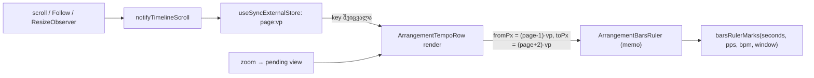

# Studio Lab — ტაქტების სახაზავი მხოლოდ ხილვად ფანჯარაში (SRW-15, ROOT-R65-M1)

**თარიღი:** 2026-10-21
**სტატუსი:** Round 70 — D-29z35; C PASS (round 70), გამოქვეყნდა 2be45df
**შეცვლილი პროექტი:** Store

## კონტექსტი

- **ROOT-R65-M1 (Medium, perf):** Round 65-ის ტაქტების ზოლი (doc 058) ყოველ ტაქტსა და დარტყმას ცალკე absolute `div`-ად ხატავდა **მთელ** timeline-ზე. ნიშნულების რაოდენობა `seconds × bpm / 60`-ია და პროექტის სიგრძესა და ტემპთან ერთად იზრდება, ეკრანზე რა ჩანს, მიუხედავად.
- **C round 66, BD-INFO:** 999 BPM, მაქსიმალური zoom (320 px/წმ), 133 წმ timeline → **2215** ნიშნული და zoom-ის თითო ნაბიჯზე **69–107 ms**. 10-წუთიან პროექტზე ეს ~10 000 ნიშნული იქნებოდა.
- reviewer-ის შემოთავაზებული 16 px-იანი სიმჭიდროვის ზღვარი ამ შემთხვევას არ ზღუდავს: 999 BPM-ზე და 320 px/წმ-ზე დარტყმებს შორის 19.2 px-ია.

## მიდგომა

**D-29z35:** ზოლი ხატავს მხოლოდ იმ ნიშნულებს, რომლებიც ხილვადი ნაწილის გარშემო არსებულ ფანჯარაში ხვდება. ხილვადი შედეგი არ იცვლება: იგივე ნიშნულები, იგივე პოზიციები, ლეიბლები, კლასები და `data-*` ატრიბუტები ყველგან, სადაც მომხმარებელი მათ ხედავს.

1. **Pure ფუნქცია.** `barsRulerMarks`-ს დაემატა არჩევითი მეოთხე პარამეტრი `BarsRulerWindow { fromPx, toPx }`.
   - ფანჯრის გარეშე შედეგი ზუსტად ისეთივეა, როგორიც ადრე.
   - ფანჯრით აბრუნებს სრული სიის ზუსტ ფილტრს (`time × pxPerSecond` ფანჯრის შიგნით, ორივე საზღვრის ჩათვლით), იმავე რიგით.
   - ლეიბლის ჩატევა ისევ **მთელი** სახაზავის სიგანით მოწმდება. ტაქტების გაიშვიათება (`barStep`) არ იცვლება: ნაჩვენები ტაქტები ისევ `barStep`-ის ჯერადებია, ტაქტი 1-დან.
   - ციკლი იწყება ფანჯრის დასაწყისის წინა `barStep`-ის ჯერად ტაქტზე და წყდება პირველივე ტაქტზე, რომელიც ფანჯრის ბოლოს გასცდა. სრული სია არასოდეს იქმნება: 100-საათიან timeline-ზე ეს ~190 ნიშნულს ნიშნავს და არა ~6 მილიონს.
   - არავალიდური ფანჯარა (`NaN`, `Infinity`, `toPx < fromPx`) აბრუნებს ცარიელ სიას.
2. **ფანჯრის წესი** (`ArrangementTempoRow`):
   - `vp = getTimelineViewportPx()`, ანუ scroller-ის სიგანეს გამოკლებული 224 px-იანი header. `vp ≤ 0` (SSR, პირველი render, jsdom) ნიშნავს, რომ ფანჯარა არ არის და იხატება სრული სია. ამიტომ hydration უცვლელია.
   - `page = floor(max(0, scrollLeft) / vp)`, ფანჯარა `[(page − 1)·vp, (page + 2)·vp]`. ხილვადი `[scrollLeft, scrollLeft + vp]` ყოველთვის შიგნითაა, ორივე მხარეს ერთი viewport-ის მარაგით.
   - `scrollLeft` მოდის `getTimelineView()`-დან. zoom-ის დროს ის pending view-ს აბრუნებს, ამიტომ zoom-ის შემდეგ პირველივე commit უკვე შეიცავს ყველა ხილვად ნიშნულს.
3. **განახლება.** `useSyncExternalStore` გამოიწერს არსებულ `subscribeTimelineScroll` არხს. მისი snapshot არის `"page:vp"` სტრიქონი.
   - არხს აფრთხილებს scroll, Follow-ის auto-scroll და `ResizeObserver`.
   - გვერდის შიგნით scroll-ზე snapshot არ იცვლება, ამიტომ არც row და არც ზოლი თავიდან არ იხატება.
   - ზოლი ისევ `memo`-ა და primitive `fromPx`/`toPx`-ს იღებს.
   - ახალი window/document listener, timer ან `ResizeObserver` არ დამატებულა. playhead-ის position frame-ებზე layout არ იკითხება.
4. **`StudioWorkspace`:** ერთადერთი ცვლილებაა, რომ `<ArrangementTempoRow>`-ს გადაეცემა სამი უკვე არსებული სტაბილური callback.

**უარყოფილი ალტერნატივები:**
- **დარტყმების სიმჭიდროვის ზღვარი** (reviewer-ის შემოთავაზება): გაზომილ შემთხვევას არ ზღუდავს (19.2 px > 16 px) და რაოდენობა მაინც სიგრძესთან ერთად იზრდება.
- **დარტყმები CSS gradient-ით:** აქრობს `data-kind="beat"` ნიშნულებს, რომლებსაც გაყინული `tempo-ui` ტესტები და C-ის harness-ები კითხულობს, ლეიბლიან დარტყმებს კი node-ები მაინც სჭირდება.
- **scroll state `StudioWorkspace`-ში:** scroll-ის ყოველ ნაბიჯზე მთელ workspace-ს ხელახლა დახატავდა.

**Code review-ის შემდეგ:** პირველ ვერსიაში ბოლო ნაჩვენები გვერდის key render-ის დროს `ref`-ში იწერებოდა და effect-ის listener counter state-ს ზრდიდა. reviewer-ის რჩევით ეს ჩანაცვლდა `useSyncExternalStore`-ით, რომელიც concurrent rendering-ზე უსაფრთხოა. მეორე review-ის შემდეგ ფანჯარა პირდაპირ snapshot key-დან (`page:vp`) იკითხება, layout-ის მეორე წაკითხვის გარეშე. ამიტომ hydration-ზე server და client ერთსა და იმავე მნიშვნელობას იყენებენ. ქცევა, ტესტები და მუტაციების შედეგი არ შეცვლილა.

## არქიტექტურა

## შეცვლილი ფაილები

- `app/lib/arrangement/tempo.ts`: ტიპი `BarsRulerWindow` და `barsRulerMarks`-ის არჩევითი მეოთხე პარამეტრი. დანარჩენი export-ები უცვლელია.
- `app/components/arrangement/ArrangementTempoRow.tsx`:
  - სამი ახალი prop;
  - ფანჯრის წესი და `useSyncExternalStore`;
  - ზოლის `fromPx`/`toPx`.
  - ველი, მეტრონომის ღილაკი, hint, markup და კლასები უცვლელია.
- `app/components/arrangement/StudioWorkspace.tsx`: სამი prop `<ArrangementTempoRow>`-ზე.
- `app/lib/arrangement/__tests__/tempo-window.test.ts` (ახალი): BW1–BW6.
- `app/lib/arrangement/__tests__/tempo-window-ui.test.tsx` (ახალი): BU1–BU8.
- `docs/implementation/2026/quarter-IV/058-…`: სტატუსის ხაზი და ერთი წინადადება ამ დოკუმენტზე.
- `docs/implementation/2026/quarter-IV/061-…`: სტატუსის ხაზი.

## პრობლემები და გადაწყვეტები

- **UI ტესტების oracle თავიდან ახალ ფუნქციას იძახებდა ფანჯრით.** ძველ კოდზე ის ფანჯარას აიგნორებდა, ამიტომ BU3/BU5/BU6/BU7 red run-ზე ტყუილად მწვანე იყო. გადაწყვეტა: UI oracle ახლა სრულ სიას იღებს და px-ით ფილტრავს, როგორც spec ითხოვს. ამის შემდეგ red run-ზე 6 UI ტესტი ჩავარდა, BU1 და BU8 კი, ქცევის შემნახველი guard-ები, მწვანე დარჩა.
- **ზოლის `memo` მუტაცია g-ს მალავდა** („ყოველ scroll-ზე re-render“): `barsRulerMarks`-ის გამოძახებების რაოდენობა არ იცვლება. გადაწყვეტა: BU4 და BU8 render-ებს ითვლის devtools-hook-ის fiber walk-ით, რომელიც `render-budget`-დან არის კოპირებული და არა import-ით აღებული.
- **BU5-ის zoom ფიქსტურა.** playhead 0-ზე და `scrollLeft` 800-ზე zoom-ის შემდეგ ახალი `scrollLeft` ისევ პირველ გვერდზე რჩებოდა, ასე რომ მუტაცია i ცოცხალი გადარჩებოდა. გადაწყვეტა: playhead 40 წმ-ზე და `scrollLeft` 1000-ზე. zoom-ის შემდეგ `scrollLeft` 1400-ია და გვერდი 0-დან 1-ზე გადადის, რასაც ტესტი ცალკე ამოწმებს.

## ტესტირება

- **BW1–BW6** (pure):
  - ფანჯრის გარეშე შედეგი უცვლელია და BD ფიქსტურაზე 2215 ნიშნულია;
  - 756 შემთხვევის oracle sweep;
  - საზღვრები;
  - გაიშვიათებული ტაქტები (`9, 13, 17 …`);
  - 100-საათიანი timeline ~3 ms-ში;
  - არავალიდური ფანჯარა.
- **BU1–BU8** (workspace, jsdom, `clientWidth` stub-ით vp 1216):
  - გაუზომავი viewport → სრული სია;
  - 127 ნიშნული ჩატვირთვისას;
  - გვერდის შეცვლა;
  - გვერდის შიგნით scroll-ზე 0 render;
  - კლავიატურით zoom;
  - resize;
  - BPM-ის წაშლა და დაყენება;
  - 30 position frame: 0 render და 0 `clientWidth` წაკითხვა.
- **მუტაციები a–k** (`a-round-70/mutations.txt`): ყველა დაიჭირა თავისმა ტესტმა. დამატებით:
  - g2 (`memo`-ს გარეშე) დაიჭირეს;
  - C-ის დამატებითი l დაიჭირეს;
  - m (unsubscribe-ის გარეშე) და n (უარყოფითი `scrollLeft`) ცოცხალი დარჩა და ტესტების ხარვეზად ჩაიწერა.
- **Gates:**
  - `tsc` 0;
  - vitest 99 ფაილი / 1683 ტესტი;
  - `npm run build` და `npm run verify` — rc 0;
  - Biome: შეცვლილ ფაილებში 0 დიაგნოსტიკა.
- **ბრაუზერის smoke** (A, PASS არ არის): `/studio-lab`, 1440×900, BPM 999, მაქსიმალური zoom.
  - DOM-ში 96 ნიშნულია ~500-ის ნაცვლად, vp 918.
  - დასაწყისში, შუაში და ბოლოს ხილვადი სიმრავლე სრულია (0 აკლია).

## TODO / შემდეგი ნაბიჯები

- C-ის ბრაუზერის შემოწმება: BR-COUNT, BR-SCROLL, BR-ZOOM (დრო), BR-FOLLOW, BR-RESIZE, BR-90 და BR-LOOK.
- **ROOT-R66-M1** (მეტრონომის horizon) — Round 71.
- **ინფორმაცია:** თუ ტემპი მომავალში შენახული მდგომარეობიდან აღდგება, პირველი render (როცა scroller ჯერ არ არის გაზომილი) ერთხელ სრულ სიას დახატავს და მერე ფანჯარაზე გადავა.
- **ინფორმაცია:** `getTimelineViewportPx` ყოველ row render-ზე `clientWidth`-ს კითხულობს. ეს მისაღებია, რადგან position frame-ებზე row არ იხატება. თუ საჭირო გახდება, `viewportWidthRef`-ზე გადასვლა `StudioWorkspace`-ის ცალკე დავალებაა.
