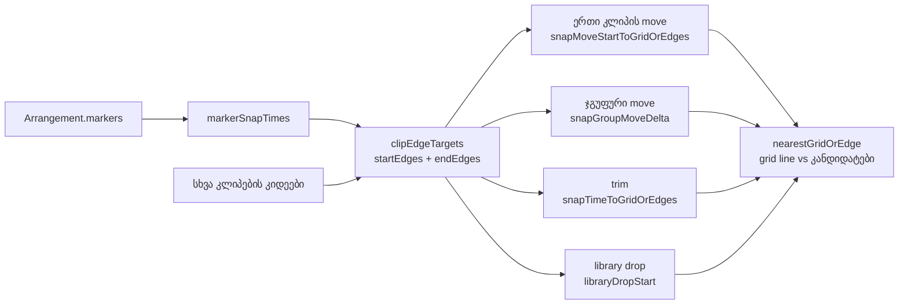

# Studio Lab — კლიპების snap მარკერებზე, ეტაპი 2b-1 (SRW-16 / FB-10)

**თარიღი:** 2026-10-22
**სტატუსი:** Round 76 — C PASS (browserVerified), გამოქვეყნდა `db9cc25` (D-29z41)
**შეცვლილი პროექტი:** Store

## კონტექსტი

ეტაპი 2a-ს ([065](065-studio-lab-marker-move-menu.md)) შემდეგ მარკერი იქმნება, გადაიწევა და მენიუთი იმართება, მაგრამ კლიპის რედაქტირებისას snap-ის სამიზნე არ იყო. FB-10-ის მიზანი სწორედ ისაა, რომ კლიპი მარკერზე (მაგალითად, მონტაჟის ჭრაზე) ზუსტად დაჯდეს. Live 12 manual §6.7: „Clips snap to the editing grid, as well as various objects in the Arrangement including the edges of other clips, locators and time signature changes.“

ეტაპი 2b სამად გაიყო. ყველა ნაწილი დაგეგმილია, არცერთი არ გადადებულა:

- **2b-1 (round 76, ეს დოკუმენტი):** კლიპის move, ჯგუფური move, ხაზებს შორის move, trim და ბიბლიოთეკიდან drop მარკერებზე snap-დება. ამას §6.7-ის ტექსტი პირდაპირ ადასტურებს, ტექნიკურად კი SRW-14-ის არსებული edge-candidate მექანიზმის გაფართოებაა.
- **2b-2 (round 77):** Ctrl+←/→ მონიშნული ხაზების კლიპის კიდეებზეც ჩერდება (§6.9), plus macOS Option binding.
- **2b-3 (round 78):** დროის მონიშვნა (range) და playhead მარკერებზე snap-დება. ეს CZABA-ს გადაწყვეტილებაა; Live-ის ტექსტი ამას არ ამბობს.

გაყოფის მიზეზი: თითო რაუნდში ერთი შემოწმებადი ეტაპი; კლიპების snap ყველაზე მეტად დადასტურებულია და არსებულ მექანიზმს მხოლოდ ავრცობს.

## მიდგომა

მარკერის დრო snap-ის კანდიდატი ხდება **ზუსტად იქ, სადაც დღეს კლიპის კიდეა** (SRW-14 ეტაპი 4: `clipEdgeTargets` → `nearestGridOrEdge`). სხვა არაფერი იცვლება.

| # | წესი |
|---|---|
| M1 | snap step-ის არსებობისას (Snap ჩართული Alt-ის გარეშე, ან Snap გამორთული Alt-ით — `resolveSnapStep`) კლიპის move (ერთი ხაზი ან სხვა ხაზზე) start-ს ან end-ს მარკერზე სვამს. იგებს უახლოესი კანდიდატი: grid line, სხვა კლიპების კიდეები, მარკერები. თანაბარი მანძილისას (tie) grid line იგებს; პიქსელის ზღვარი არ არის. |
| M2 | ჯგუფური move-ის anchor (`snapGroupMoveDelta`) იგივე კანდიდატებს იღებს start/end-ისთვის; bounds-ის გარეთ კანდიდატი grid-ის შედეგზე ბრუნდება (უცვლელი წესი). |
| M3 | Trim: მარცხენა trim → start, მარჯვენა → end მარკერზე; clamp და blocked ტექსტი უცვლელია. |
| M4 | ბიბლიოთეკიდან drop აუდიო ხაზზე start-ს ან end-ს მარკერზე სვამს. ვიდეოხაზი drop-ს ისევ უარყოფს; `isVideo` / ჯერ ჩაუტვირთავი წყაროს grid-only შტო უცვლელია. |
| M5 | მარკერი ხაზს არ ეკუთვნის: ყველა ხაზისთვის start და end სიაშიც არის. CM14 (იმავე ხაზის კლიპის end end-კანდიდატი არაა) მარკერებზე არ ვრცელდება. |
| M6 | Snap off Alt-ის გარეშე, Alt + Snap on და Shift time lock მარკერებს უგულებელყოფს — ზუსტად ისე, როგორც კლიპის კიდეებს. |
| M7 | კლიპის რედაქტირება მარკერებს არ ცვლის (id, დრო, სახელი). ერთი history entry არსებული label-ით; Undo/Redo მხოლოდ კლიპს აბრუნებს. Playback-ის reschedule ისეთივეა, როგორც დღეს. |
| M8 | მარკერების გარეშე ყველა შედეგი round 75-ის ტოლია. |
| M9 | მარკერი, რომელიც კლიპის **მიმდინარე** start/end-ზეა, ვალიდური კანდიდატია (CM11 მხოლოდ კლიპის საკუთარ კიდეებს გამორიცხავს). 1–2 px drag კლიპს ისევ მარკერზე აბრუნებს — ეს M1-ის შედეგია, ბაგი არ არის. |

### ტექნიკური გადაწყვეტა

- `clipEdgeTargets`-ს დაემატა არასავალდებულო ბოლო პარამეტრი `markerTimes` (default ცარიელი სია). მარკერის დროები `startEdges`-შიც და `endEdges`-შიც ერთვება არსებული `sortedUniqueEdgeTimes`-ით (დალაგება + µs-დონის de-duplication). არსებული გამომძახებლების შედეგი უცვლელია.
- `markers.ts`-ს ბოლოში დაემატა ერთი export `markerSnapTimes(arrangement)` — `arrangementMarkers`-ზე აგებული დროების სია.
- `ArrangementClip.tsx`: gesture-ის `before` arrangement-ის მარკერები გადაეცემა სამ ადგილს — ერთი კლიპის move, trim და `groupDeltaOnGrid` (ახალი პარამეტრი `markerTimes`). `moveStartOnGrid`, range-ის `onGrid`, click-seek და Shift lock ხელუხლებელია.
- `ArrangementLane.tsx`: მხოლოდ `libraryDropStart` — `getArrangement()`-ის მარკერები `clipEdgeTargets`-ს გადაეცემა.
- ალტერნატივა იყო ცალკე `markerTargets` ფუნქცია და სამი კანდიდატის სიის გაერთიანება გამომძახებელთან. უარვყავით: ოთხ ადგილას ერთი და იგივე merge განმეორდებოდა და M5 (ორივე სია) ადვილად დაირღვეოდა.

### Ableton-თან მიმართება (Live 12 manual §6.7, §6.9, §6.10; B-ის capture 2026-10-21 / 2026-10-16)

| ქცევა | Ableton-ის წყარო | იქ დადასტურებული | CZABA |
|---|---|---|---|
| კლიპის move snap locator-ზე | §6.7 „Moving and Resizing Clips“ | დადასტურებული (ტექსტი) | M1, M5 |
| Trim snap locator-ზე | §6.7 | დასკვნა (ტექსტი resize-ს პირდაპირ არ ასახელებს) | M3 |
| ჯგუფური move, ბიბლიოთეკის drop | — | დაუდასტურებელი | SRW-14-ის edge წესთან თანმიმდევრულობა (M2, M4) |
| უახლოესი იგებს, ზღვრის გარეშე, tie → grid | — | დაუდასტურებელი | SRW-14 ეტაპი 4-ის წესი (CM3/CM7) |
| Alt bypass, Shift time lock | §6.10; D-29z12 | Alt — დადასტურებული; Shift — CZABA-ს წესი | უცვლელი (M6) |
| Snap time signature change-ზე | §6.7 | დადასტურებული Live-ში | არ ეხება (CZABA-ს time signature change არ აქვს) |
| Range/playhead snap მარკერზე; Ctrl+←/→ კლიპის კიდეზე | §6.9 | ისრები — დადასტურებული; range/playhead — დაუდასტურებელი | ეტაპები 2b-3 / 2b-2 |

ეს რაუნდი ახალ ვებკვლევას არ მოიცავდა; წყარო B-ის შენახული capture-ია. „Ableton-შიც ასე მუშაობს“ მხოლოდ დადასტურებულ რიგებზე ითქმის.

## არქიტექტურა

## შეცვლილი ფაილები

- `app/lib/arrangement/grid.ts` — `clipEdgeTargets`-ის არასავალდებულო `markerTimes` პარამეტრი.
- `app/lib/arrangement/markers.ts` — ახალი export `markerSnapTimes` (ფაილის ბოლოში).
- `app/components/arrangement/ArrangementClip.tsx` — მარკერების გადაცემა move/trim/group snap-ის კანდიდატებში.
- `app/components/arrangement/ArrangementLane.tsx` — მარკერების გადაცემა `libraryDropStart`-ში.
- `app/lib/arrangement/__tests__/marker-snap.test.tsx` — ახალი ტესტები (harness კოპირებულია `grid-snap-clip-edges.test.tsx`-იდან, ეს ფაილი არ შეცვლილა).

## პრობლემები და გადაწყვეტები

- **პრობლემა:** ტესტში მარკერი შეიძლება „შემთხვევით“ ემთხვეოდეს grid line-ს ან კლიპის კიდეს, და PASS მარკერის გარეშეც მოვიდეს.
  **გადაწყვეტა:** მარკერები off-grid დროზეა (12.300, 20.700), კლიპები მათგან შორს; MS1b იგივე drag-ს მარკერების გარეშე უშვებს და grid line-ს (12.000) ელის. ყველა მთავარი ტესტი mutation-ით გაწითლდა.
- **პრობლემა:** ჯგუფის bounds-ის fallback შეიძლება მარკერის გარეშეც იგივე შედეგს იძლეოდეს.
  **გადაწყვეტა:** MS8c-ში მეზობელი კლიპის კიდე (12.25) bounds-შია, მარკერი (12.3) — არა. მარკერების გარეშე ჯგუფი 12.25-ზე ჯდება, მარკერებით კი grid-ის შედეგზე (12.000) ბრუნდება. ასე ტესტი მარკერის კანდიდატს ზუსტად ამოწმებს. ეს არსებული `snapGroupMoveDelta`-ის წესის შედეგია (მხოლოდ უახლოესი კანდიდატი განიხილება): მარკერმა შეიძლება ჯგუფს ადრე მისაწვდომი კიდე „გამოატოვებინოს“. C-მ ეს ბრაუზერის შემოწმებისას უნდა იცოდეს.
- **პრობლემა:** ტოლობის (tie) ტესტი float-ის გამო შეიძლება ცალმხრივად გადაიხაროს.
  **გადაწყვეტა:** მანძილები µs-ზე მრგვალდება (`nearestGridOrEdge`); raw 12.15-ზე ორივე მანძილი 150000 µs-ია და grid line რჩება.

## ტესტირება

`marker-snap.test.tsx` — 25 ტესტი: MSU1–MSU2 (unit), MS1/MS1b, MS2, MS3, MS4–MS6, MS7/MS7b/MS7c (trim), MS8/MS8b/MS8c/MS8d (group), MS9 (cross-lane ghost + drop), MS10/MS10b/MS10c (library drop + ვიდეოს უარყოფა), MS11 (მარკერები byte-equal, Undo/Redo, ერთი history step), MS12/MS12b (კიდე vs მარკერი), MS13 (Shift lock), MS14 (M9: მარკერი კლიპის მიმდინარე start-ზე — 4 px drag კლიპს უკან აბრუნებს, history არ იცვლება; code-review-ის Medium შენიშვნა).

Mutation proofs (თითოეულის შემდეგ ფაილი აღდგა და `cmp`-ით შემოწმდა):

| Mutation | წითელი ტესტები |
|---|---|
| (a) single-move-ის კანდიდატებიდან მარკერების ამოღება | MS1, MS2, MS6, MS9, MS11, MS12b, MS14 |
| (b) trim-ის კანდიდატებიდან | MS7, MS7b, MS7c |
| (c) ჯგუფის გზიდან | MS8, MS8b, MS8c |
| (d) `libraryDropStart`-იდან | MS10, MS10b |
| (e) მარკერები მხოლოდ `startEdges`-ში | MSU1, MS2, MS7, MS8b, MS10b |

A-ს targeted სია (8 ფაილი, 201 ტესტი) მწვანეა; `npm run typecheck` და `npm run lint` — შეცდომის გარეშე. სრული suite, build და `npm run verify` root gate-ის საქმეა. ბრაუზერში რეალური შემოწმება (MS-MOVE … MS-PLAY, ორივე viewport) C-ს ეკუთვნის.

## TODO / შემდეგი ნაბიჯები

- Round 77 — 2b-2: Ctrl/Option+←/→ მონიშნული ხაზების კლიპის კიდეებზე.
- Round 78 — 2b-3: range და playhead snap მარკერებზე.
- შემდეგ SRW-16-ის საზღვარზე frontend-architect checkpoint და GATE75 marker-drag fix-up (S1, S2).
