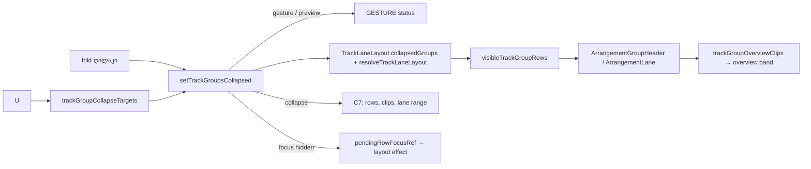

# Studio Lab — ხაზების ჯგუფები, ეტაპი 2: დაკეცვა / გახსნა (SRW-17 / FB-12)

**თარიღი:** 2026-10-22
**სტატუსი:** Round 80 — C PASS (browserVerified), გამოქვეყნდა `68383fa` (D-29z45)
**შეცვლილი პროექტი:** Store

## კონტექსტი

ეტაპ 1-მა (doc 069) ჯგუფის header-ი შექმნა, მაგრამ R17-G1-ის ნახევარი, „დაკეცვა მალავს შვილებს“, ჯერ შესრულებული არ იყო. მომხმარებელს სჭირდება, რომ ჯგუფი ერთი ღილაკით ან `U`-თი დაკეცოს. დაკეცილ ჯგუფში შვილი ხაზები ეკრანიდან ქრება. header-ზე რჩება კლიპების მიმოხილვა (overview), ხოლო დამალული ხაზები ისევ ჟღერს. რაუნდში შევიდა focus-ის სამი დამატებაც (F1–F3), რადგან დაკეცვას იგივე focus-ის აღდგენის მექანიზმი სჭირდება.

## მიდგომა

| # | გადაწყვეტილება |
|---|---|
| C1 | დაკეცვა **view state**-ია, ხაზის fold-ის მსგავსად: `TrackLaneLayout.collapsedGroups` (საწყისი `{}`). ის არ არის arrangement-ის ველი და history-ში არ იწერება. ჯგუფის გაქრობისას id არ იშლება: stale id-ები გამოყენებისას იფილტრება. ამიტომ Group Tracks-ის Undo შვილებს აჩენს, Redo კი ჯგუფს იმავე დაკეცილ მდგომარეობაში აბრუნებს |
| C2 | ღილაკი ჯგუფის header-ში, სახელის მარცხნივ: `▾` (გახსნილი) / `▸` (დაკეცილი), `aria-expanded`, `title="დაკეცვა / გახსნა (U)"`, 24×24 px, `data-testid="arrangement-group-fold"`. Space-ს ღილაკი თავად ამუშავებს (როგორც track fold), ამიტომ playback არ იწყება. glyph-ი იწერება `before:` pseudo-element-ით და დამატებით `data-fold-glyph`-ში (იხ. „პრობლემები“) |
| C3 | ჩვეულებრივი `U` (Ctrl/Cmd/Alt/Shift-ის და repeat-ის გარეშე, ტექსტურ ველებში იგნორირდება) მოქმედებს მონიშნულ **ხილულ** ჯგუფებზე. თუ ერთი მაინც გახსნილია, ყველა იკეცება, თუ არა, ყველა იხსნება. ჯგუფის გარეშე მონიშვნაზე ჩნდება სტატუსი `დასაკეცად მონიშნე ჯგუფი — დააწკაპუნე ჯგუფის სახელზე.` |
| C2/C3 უარი | pointer gesture-ის ან `isArrangementPreviewActive()`-ის დროს ჩნდება `GESTURE_EDIT_BLOCKED_MESSAGE` და არაფერი იცვლება. თუ focus იმ row-შია, რომელსაც დაკეცვა დამალავდა, focus-ის row ჯერ ფიქსირდება, focused ელემენტი იღებს `blur()`-ს (fader-ის `onBlur` pending Volume preview-ს ერთ `Volume` ჩანაწერად აკომიტებს), მერე ჯგუფი იკეცება და focus დამკეცავი ჯგუფის სახელზე გადადის (Round 81, D-29z46) |
| C4 | დამალული ხაზები **არ რენდერდება**: ისინი DOM-იდან და accessibility tree-დან ქრება. nested შემთხვევაში გარე ჯგუფი შიდა header-საც მალავს, შიდა ჯგუფის მდგომარეობა კი ინახება. აუდიო, export და `scheduleKey` არ იცვლება: დაკეცვა mute არ არის |
| C5 | დაკეცილ header-ზე timeline-ის ზოლი იქცევა `aria-hidden`, `pointer-events-none` ზოლად (`arrangement-group-overview`). თითო კლიპი ერთი ბლოკია `ArrangementClip`-ის geometry-ით: `left = start × pxPerSecond`, `width = max(1, duration × pxPerSecond)`. ბლოკს აქვს `data-overview-start/end` (3 ათწილადით), მონიშნულ კლიპს კი `data-overview-selected="true"`. რიგის სიმაღლე ორივე მდგომარეობაში 28 px-ია |
| C6 | დაკეცილი სახელის label: `<name> — ჯგუფი, დაკეცილი, <n> კლიპი` (`, მონიშნული` მონიშვნისას). თუ აქტიური ხაზი დაკეცილ ჯგუფშია, header-ს აქვს `border-l-brand` და `data-contains-active="true"`. ბიბლიოთეკიდან დამატება კვლავ აქტიურ ხაზზე ხდება და overview-ში ახალი ბლოკი ჩნდება |
| C7 | **მხოლოდ დაკეცვის მოქმედებაზე** (ღილაკი ან `U`) ხდება ოთხი რამ. დამალული row-ები ტოვებს ხაზების მონიშვნას, ხოლო anchor ხდება null, თუ თვითონ დაიმალა. დამალულ ხაზზე მყოფი კლიპები ტოვებს clip selection-ს. დამალული ხაზის lane range იშლება. `allTracks` range რჩება. გახსნა მონიშვნას არ ცვლის |
| C8 | fit (`fitLaneHeights`, `detailPanelOpenHeightCap`) იღებს მხოლოდ **ხილულ** ხაზებს. შედეგი იწერება **track id-ით** და დამალული ხაზები ინარჩუნებს წინა სიმაღლეს. group row-ის გამოკლება ითვლის მხოლოდ რენდერებულ ჯგუფებს. `isMotionArmed: true`, ისევე როგორც `toggleTrackFold`-ში: C 300 ms lane transition-ს დაინახავს. 0 ჯგუფის ან 0 დაკეცილის დროს შედეგი `74eca15`-ის იდენტურია. layout-ის refresh გაეშვება რენდერებული row-ების გასაღების ცვლილებაზე (ადრე მხოლოდ ჯგუფების რაოდენობაზე) |
| C9 | G10 და marquee იყენებს მხოლოდ რენდერებულ `[data-track-id]` row-ებს. `clipsInMarquee` DOM-ის `trackOrder`-ს ჭრის, ამიტომ დამალული ხაზები marquee-ში არ ხვდება. `ArrangementClip.tsx` და marquee-ის კოდი არ შეცვლილა |
| C10 | Ctrl+G, Ctrl+Shift+G და F2 დაკეცილ ჯგუფზეც მუშაობს. დაკეცილი ჯგუფის დაშლა შვილებს აჩენს. დაკეცილი ჯგუფის nest-ის შემდეგ ის დაკეცილი რჩება. track fold და group collapse ერთმანეთზე დამოუკიდებელია |
| F1 | Ctrl/Cmd+G-ის შემდეგ focus გადადის ახალი ჯგუფის სახელზე (`preventScroll`), თუ იგი იყო ახალი ჯგუფის წევრის სახელის ღილაკზე ან `BODY`-ზე |
| F2 | Ctrl/Cmd+Shift+G-ის შემდეგ, თუ focus დაშლილი ჯგუფის row-ში იყო, ის გადადის `childIds[0]`-ის სახელის ღილაკზე |
| F3 | დაკეცვის შემდეგ, თუ focus დამალულ row-ში იყო, ის გადადის დამკეცავი ჯგუფის სახელზე. fold ღილაკზე დაჭერისას focus თავად ღილაკზე რჩება |
| H1 | footer hint-ს ბოლოში დაემატა ` · Ctrl+G / Ctrl+Shift+G · F2 · U` |

**ალტერნატივა:** დამალული row-ების `hidden`/`inert`-ით დატოვება. უარვყავით, რადგან doc 029-ის TODO მოითხოვს, რომ ისინი DOM-იდან ამოვიდეს, ხოლო G10/marquee უკვე მხოლოდ რენდერებულ row-ებს კითხულობს.

## Ableton-თან კავშირი (Live 12, წყარო: B, round 80, §4)

| ქცევა | წყარო | დადასტურება | CZABA |
|---|---|---|---|
| ჯგუფის ხაზების ჩვენება/დამალვა title bar-ის ღილაკით | Live 12 manual §18.3 | დადასტურებული (ტექსტი) | C2 |
| დაკეცილი ჯგუფი Arrangement-ში აჩვენებს კლიპების overview-ს | §18.3 | დადასტურებული (ტექსტი) | C5. გახსნილ header-ზე overview არ არის, რადგან ეს ქცევა დაუდასტურებელია |
| `U` — Collapse/Expand Grouped Tracks | §42 | დადასტურებული (ტექსტი) | C3. `U` ჩვეულებრივ ხაზზე და arrow-ით fold მიბმული არ არის (signal `TRACK-FOLD-U`) |
| შერეული მდგომარეობის მონიშვნა `U`-ზე | — | დაუდასტურებელი | CZABA-ს არჩევანი: ერთი გახსნილიც საკმარისია, რომ ყველა დაიკეცოს |
| Alt+U Unfold All | §42 | დადასტურებული (ტექსტი) | არ არის მიბმული (signal) |
| `+`/`−` Show/Hide Grouped Tracks (Session) | §42 | დადასტურებული (ტექსტი) | შეგნებული განსხვავება: `+`/`−` CZABA-ში zoom-ია |
| დაკეცვა undo-ში | — | დაუდასტურებელი | view state, history-ს გარეშე (C1) |
| დამალული ხაზები ჟღერს | §18.3 | დასკვნა | C4: collapse ≠ mute |

## არქიტექტურა

## შეცვლილი ფაილები

- `app/lib/arrangement/groups.ts` — ახალი pure exports: `visibleTrackGroupRows`, `trackGroupDescendantTrackIds`, `trackGroupOverviewClips`, `trackGroupCollapseTargets`, `TRACK_GROUP_COLLAPSE_EMPTY_MESSAGE` და ტიპები `TrackGroupOverviewClip`, `TrackGroupCollapseTargets`. არსებული exports არ შეცვლილა.
- `app/components/arrangement/ArrangementGroupHeader.tsx` — ახალი props `collapsed`, `containsActive`, `overviewClips`, `pxPerSecond`, `onToggleCollapse`, ასევე fold ღილაკი, overview ზოლი, C6 label და accent. კლიპების რაოდენობა `overviewClips.length`-დან გამოითვლება, ამიტომ ცალკე `clipCount` prop საჭირო არ გახდა.
- `app/components/arrangement/StudioWorkspace.tsx` — `collapsedGroups`, ხილული row-ების filter, C8 fit, `U`, C7 pruning, F1–F3, H1.
- `docs/implementation/2026/quarter-IV/069-…` — მხოლოდ სტატუსის ხაზი.
- ტესტები: `app/lib/arrangement/__tests__/track-group-collapse.test.ts`, `app/lib/arrangement/__tests__/track-group-collapse-ui.test.tsx`.

## პრობლემები და გადაწყვეტები

- **პრობლემა:** B-ის C2 label `<name> — ჯგუფის დაკეცვა / გახსნა` ემთხვევა გაყინული `track-groups-ui.test.tsx`-ის `groupName` regex-ს (`^<name> — ჯგუფი`, l.219), რის გამოც ხუთი გაყინული ტესტი „multiple elements“ შეცდომით წითლდებოდა. **გადაწყვეტა:** იგივე სიტყვები, სხვა რიგით: `ჯგუფის დაკეცვა / გახსნა — <name>`. B-მ (D-29z46) ეს ფორმულირება C2-ის კონტრაქტად მიიღო.
- **პრობლემა:** გაყინული `rowOrder`/`selectedRows` group row-ის `textContent`-ს კითხულობს. glyph-ის ტექსტად ჩასმა მათ დაარღვევდა. **გადაწყვეტა:** glyph (▸ / ▾) Tailwind-ის `before:` pseudo-element-ის content-ით ჩნდება და დამატებით `data-fold-glyph`-შიც იწერება. რეალურ Chromium-ში `::before` content შემოწმდა.
- **პრობლემა:** ხაზის Volume-ის კლავიატურული preview `isArrangementPreviewActive()`-ს **არ** რთავს: context მას მხოლოდ შიდა `volumeBeforeRef`-ში ინახავს. რაუნდ 80-ში დაკეცვა ამიტომ უარს ამბობდა, როცა focus დასამალ slider-ზე იდგა. **გადაწყვეტა (Round 81, X1, doc 071):** დაკეცვისას ჯერ იკითხება focused row, შემდეგ `blur()` pending preview-ს ერთ `Volume` ჩანაწერად აკომიტებს, ჯგუფი იკეცება და focus ჯგუფის სახელზე გადადის. pointer gesture-ის დროს დაკეცვა ისევ უარს ამბობს; რაუნდ 80-ის slider-focus-ის უარი აღარ მოქმედებს.
- **ცნობილი შეზღუდვა (C7):** Redo-ით დამალულ row-ებზე pruning არ ხდება. მონიშნული კლიპი მონიშნული რჩება და overview-ში მონიშნულ ბლოკად ჩანს. ამ გზით შეიძლება დარჩეს lane range დამალულ ხაზზე. ეს signal-ია და არა დამალული ბაგი.

## ტესტირება

- Unit (`track-group-collapse.test.ts`, 7): GC1 ხილული row-ები და nested შემთხვევა, stale id, GC2 overview-ს დრო, GC3 toggle-ის სამიზნეები.
- Workspace (`track-group-collapse-ui.test.tsx`, 22): UC1–UC12. მოიცავს fold ღილაკს (click და Space, playback-ის გარეშე), ხელით შეცვლილ სიმაღლეს დამალულ ხაზზე (auto-fit off), `U`-ს და მის უარს (ტექსტური ველები, modifier-ები, gesture, preview, fader focus), nested შემთხვევას, a11y-ს, F1–F3-ს, C7 pruning-ს, C8 fit-ს ხილული ნაწილით და id-ით ჩაწერით, აქტიურ ხაზს, Undo/Redo-ს, drag-სა და marquee-ს დაკეცილ row-ზე, audio-ს (`createBufferSource` = 0) და hint-ს.
- Mutation proofs (a)–(i): ყველა წითლდება. დეტალები: `tmp/studio-real-loop/a-round-80/mutations.md`.
- გაყინული ეტაპ 1-ის ტესტები (`groups.test.ts`, `track-groups-ui.test.tsx`) მწვანეა.

## TODO / შემდეგი ნაბიჯები

- SRW-17 ეტაპი 3: ჯგუფის Mute/Solo/Volume summing-ი playback-სა და export-ში, ასევე half-solo indicator (R17-G2, R17-G3).
- B-ის გადაწყვეტილება fold label-ის ფორმულირებაზე.
- signal-ები: `TRACK-FOLD-U`, Alt+U, Redo-ს შემდეგ დამალული lane range.
