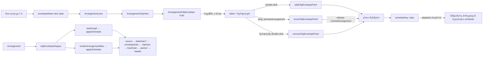

# Studio Lab — კლიპის volume envelope, ეტაპი 2 (SRW-18 / FB-06)

**თარიღი:** 2026-10-22
**სტატუსი:** Round 83 — C PASS (`browserVerified`), გამოქვეყნდა `a68c81d`
**შეცვლილი პროექტი:** Store

## კონტექსტი

FB-06 და R18-A2 ითხოვს, რომ აუდიოკლიპზე volume envelope დაიხატოს: წერტილები კლიპზე, რომლებიც ხმას playback-შიც და export-შიც ცვლის და კლიპის move/split/trim-ს გადაურჩება. ეტაპ 1-ში (doc 072) დაემატა fade-ები; ეს ეტაპი SRW-18-ს ასრულებს.

ამავე რაუნდში გასწორდა GATE82-S1 (X1): fade-ის drag-ის შემდეგ სწრაფი click შეიძლება ბრაუზერმა double-click-ად ჩათვალოს და ახლად დაყენებული fade 0-ზე დააბრუნოს. იგივე წესი envelope-ის წერტილებსაც სჭირდება.

## მიდგომა

| ID | გადაწყვეტილება |
|---|---|
| E1 | `ArrangementClip`-ს და clipboard item-ს დაემატა არასავალდებულო `envelope` — წერტილების სია `{ time, gain }`. `time` წყაროს (source) წამებშია, იმავე ღერძზე, რაც `sourceOffset`, მთელი ms. `gain` წრფივია 0…1-ში, 4 ათწილადით, ანუ მაქსიმუმი 0 dB-ია. ზრდას ისევ Clip Gain იძლევა (−60…+24 dB). ცარიელი სია ინახება როგორც არარსებული key. ვიდეოხაზის კლიპს envelope არ აქვს |
| E1 დრო | წყაროს დრო აირჩია, რადგან envelope აუდიომასალას ეკუთვნის. move მხოლოდ `start`-ს ცვლის, trim `start`-სა და `sourceOffset`-ს ერთად ცვლის, split / Delete Time / duplicate კი `{ ...clip }`-ით კოპირებს. ამიტომ envelope კლიპთან ერთად მოძრაობს და `model.ts` არ შეცვლილა. split-ის შემდეგ ყოველი წყაროს sample-ის დონე იგივეა |
| E1 ფანჯარა | ხილული ფანჯრის გარეთ მდებარე წერტილები არ იშლება (არადესტრუქციული). ისინი ფანჯრის კიდეზე დონეს მაინც განსაზღვრავს, ხოლო trim-ის უკან დაბრუნება მათ ისევ აჩენს |
| E2 | ახალი სუფთა მოდული `envelope.ts`: `clipEnvelopeGainAtSource` (წერტილების გარეშე 1; პირველამდე და ბოლოს შემდეგ კიდის მნიშვნელობა; შუაში წრფივი ინტერპოლაცია), `clipEnvelopeGainAt`, `visibleClipEnvelopePoints`, `addClipEnvelopePoint` (ახალი წერტილი ხაზის მიმდინარე მნიშვნელობას იღებს), `moveClipEnvelopePoint` (მეზობლიდან 1 ms-ით და ფანჯრით შეზღუდული, gain [0, 1]), `removeClipEnvelopePoint`, `clipEnvelopeShapes`, `formatClipEnvelopeGain`, `formatClipEnvelopeData`. ცვლილების არარსებობისას ყველა ფუნქცია იგივე reference-ს აბრუნებს |
| E3 | clipboard-ის სამი builder (`materialInWindow`, `copyClipsToClipboard`, `planClipboardPaste`) envelope-ს უცვლელად ატარებს. range copy მთელ სიას ინახავს — რა ჩანს, ფანჯარა წყვეტს. `cutRangeFromArrangement` მას `{ ...clip }`-ით ინარჩუნებს |
| E4 | live playback და export ერთი `applySchedule` გზით მიდის. წერტილებიან კლიპს ემატება ცალკე `envelopeGain`: `source → fadeGain? → envelopeGain → clipGain`. საწყისი მნიშვნელობა scheduled item-ის წყაროს დასაწყისის ხაზის მნიშვნელობაა (შუა კლიპიდან დაწყებისას 0 dB-დან არ იწყება). შემდეგ ფანჯრის შიგნით მდებარე ყოველ წერტილზე `linearRampToValueAtTime` და ბოლოს ყოველთვის ramp ფანჯრის ბოლოს ხაზის მნიშვნელობამდე. loop-ის ყოველი iteration საკუთარი `startAt`-ით იგეგმება. წერტილების გარეშე კლიპი ძველ graph-ს აგებს |
| E5 | `Env` ღილაკი ბადის მართვის ზოლში და `A` კლავიში რეჟიმს რთავს/თიშავს. რეჟიმი view state-ია, როგორც Snap: ისტორიაში არ იწერება და არ ინახება. drag-ის დროს ღილაკიც და კლავიშიც უარს ამბობს (`GESTURE_EDIT_BLOCKED_MESSAGE`) |
| E6 | ახალი კომპონენტი `ArrangementClipEnvelope`. ხაზი (SVG polyline) ჩანს ყოველთვის, როცა კლიპს ≥ 1 წერტილი აქვს, რეჟიმში კი წერტილების გარეშეც ზედა ხაზად. რეჟიმში და 24 px-ზე ფართო კლიპზე ჩნდება editor (`inset-x-2 z-10`, trim strip-ებს არ ფარავს) და 8×8 px წერტილები (`z-30`, editor-ის და-ძმა ელემენტები, რომ trim strip-ებზე მაღლა იყოს). რეჟიმში fade-ის სახელურები დამალულია, ramp overlay რჩება. root-ზე იწერება `data-envelope` |
| E7 | editor-ზე დაჭერა მხოლოდ კლიპს მონიშნავს (seek და range არ იწყება); double-click ამატებს წერტილს (`Envelope: წერტილის დამატება`). წერტილის drag (3 px threshold, pointer capture წერტილზე) წერს ერთ ჩანაწერს `Envelope: წერტილის გადატანა`; ადგილზე დაჭერა არაფერს წერს; `pointercancel`, დაკარგული pointer და editor-ის unmount drag-ის დროს ცვლილებას აბრუნებს. წერტილზე double-click შლის (`Envelope: წერტილის წაშლა`) |
| X1 | ArrangementClip იმახსოვრებს moved fade gesture-ის დასრულების კიდესა და დროს (`performance.now()`), commit-ის ან cancel-ის მიუხედავად. იმავე კიდის double-click 500 ms-ში იგნორირდება. იგივე წესი აქვს envelope-ის წერტილს მისი moved drag-ის შემდეგ |

ალტერნატივა იყო envelope-ის timeline-ის დროში შენახვა. მაშინ move, trim, split და Delete Time-ისთვის `model.ts`-ში ყოველი წერტილის გადათვლა დაგვჭირდებოდა და ყოველი ახალი edit-ი envelope-ის დაკარგვის რისკს გაზრდიდა. ასევე განვიხილეთ ramp-ის პირდაპირ `clipGain`-ზე დადება; Clip Gain-ის live `setTargetAtTime` მას გააფუჭებდა, ამიტომ envelope ცალკე node-ზეა (იგივე მიზეზი, რაც fade-ისთვის).

### ინტერპოლაციის კანონი

წერტილებს შორის gain წრფივად იცვლება ამპლიტუდაში (არა dB-ში). ეს ემთხვევა Web Audio-ს `linearRampToValueAtTime`-ს, ამიტომ live და export ზუსტად ერთნაირად ჟღერს, ხოლო UI-ის ხაზი (y = 1 − gain) ზუსტად იმას აჩვენებს, რაც ისმის.

### Ableton-თან შედარება (Live 12 Reference Manual, „Automation and Editing Envelopes“ და „Clip Envelopes“, capture 2026-10-22)

- **დადასტურებული და იგივე:** envelope ტალღის ფორმაზე ჩანს Automation Mode-ში და `A` მას რთავს; წერტილი drag-ით მოძრაობს და მნიშვნელობა drag-ისას ჩანს (CZABA-ში სტატუსში და `title`-ში); envelope კლიპთან ერთად მოძრაობს (Lock Envelopes-ის გარეშე); clip-ის edit ბრძანებები (split, copy, duplicate, Delete range, Cut Time) კლიპსაც და envelope-საც ეხება; Automation Mode-ში fade-ის სახელურები დამალულია.
- **შეგნებული განსხვავება:**
  - Live-ში Arrangement-ის volume automation absolute-ია და track-ის automation lane-ზე ცხოვრობს, Arrangement კლიპს კი მხოლოდ modulation envelope აქვს. CZABA-ში, მომხმარებლის FB-06-ის მოთხოვნით, volume envelope კლიპს ეკუთვნის, absolute შესუსტებაა (≤ 0 dB) და Clip Gain-ზე მრავლდება.
  - envelope-ის ხაზი რეჟიმის გამორთვისასაც ჩანს (FB-06: „envelope drawn on clip“).
  - Live-ში segment-ზე click ამატებს წერტილს, segment-ის გარეთ double-click კი ამატებს წერტილს იმ პოზიციაზე. CZABA-ში double-click editor-ის ნებისმიერ ადგილას ამატებს წერტილს **ხაზის მნიშვნელობით** (pointer-ის სიმაღლე არ გამოიყენება); ერთი click წერტილს არ ამატებს.
  - Live-ში წერტილზე click შლის მას; CZABA-ში double-click (click/drag-ის ორაზროვნების გარეშე, GATE82-S1-ის გაკვეთილი).
  - Live-ში წერტილები ბადეზე ჯდება (Alt — გვერდის ავლა); CZABA-ში ეტაპ 2-ში drag თავისუფალია, როგორც fade-ები (signal ENVELOPE-SNAP).
  - Live-ში წერტილი მეზობლის დროზე ჯდება და მეზობლის გადაკვეთისას მას შლის; CZABA-ში წერტილი მეზობლამდე 1 ms-ით ჩერდება და არასოდეს შლის.
  - Shift (ღერძის ჩაკეტვა / ზუსტი ნაბიჯი), Alt-drag (მრუდი segment) და Clear Envelope კონტექსტური მენიუდან FB-06-ში არ არის მოთხოვნილი და არ დამატებულა; segment-ები მხოლოდ წრფივია, წერტილები სათითაოდ იშლება.
- **დაუდასტურებელი:** envelope-ის ქცევა trim-ზე და volume envelope-ის ინტერპოლაციის კანონი capture-ში არ არის. CZABA-ში trim არადესტრუქციულია (E1), ინტერპოლაცია კი წრფივი ამპლიტუდაში. „Ableton-შიც ასე მუშაობს“ ამ ორზე არ ითქმის.

## არქიტექტურა

## შეცვლილი ფაილები

- `app/types/arrangement.ts` — `ArrangementClipEnvelopePoint` და `envelope?` `ArrangementClip`-ზე.
- `app/lib/arrangement/envelope.ts` — ახალი სუფთა მოდული (E2).
- `app/lib/arrangement/clipboard.ts` — `envelope?` clipboard item-ზე და სამი builder (E3).
- `app/lib/arrangement/graph.client.ts` — `clipEnvelopes` ოფცია, `envelopeGain` node და მისი დაგეგმვის helper, ორი cleanup ადგილი და export-ის ერთი ხაზი (E4).
- `app/contexts/ArrangementContext.tsx` — `startGraph`-ში ერთი ხაზი `clipEnvelopes: clipEnvelopeShapes(arrangement),` და import.
- `app/components/arrangement/ArrangementClipEnvelope.tsx` — ახალი კომპონენტი: ხაზი, editor, წერტილები და მათი gesture-ები (E6, E7).
- `app/components/arrangement/ArrangementClip.tsx` — `envelopeMode` prop, envelope-ის რენდერი, fade-ის სახელურების დამალვა რეჟიმში, `data-envelope`, X1.
- `app/components/arrangement/ArrangementLane.tsx` — ერთი არასავალდებულო prop `envelopeMode`.
- `app/components/arrangement/StudioWorkspace.tsx` — `envelopeMode` state, `Env` ღილაკი, `data-envelope-mode`, `A` კლავიში (E5).
- `app/lib/arrangement/__tests__/envelope.test.ts` — EV1–EV6b.
- `app/lib/arrangement/__tests__/clip-envelope-ui.test.tsx` — EU1–EU6.
- `docs/implementation/2026/quarter-IV/072-…` — სტატუსი და სამი ხაზი (GATE82-S1/S2/S3).

## პრობლემები და გადაწყვეტები

- **პრობლემა:** editor-ი `absolute z-10`-ით საკუთარ stacking context-ს ქმნის. მის შიგნით `z-30` წერტილი trim strip-ების (`z-20`) ქვეშ აღმოჩნდებოდა. **გადაწყვეტა:** წერტილები და ხაზი body-ის პირდაპირი შვილებია, editor-ის და-ძმები; editor `inset-x-2`-ით trim strip-ებს არ ეხება.
- **პრობლემა:** ხაზი რეჟიმის გამორთვისასაც ჩანს, ამიტომ თუ drag-ის state ხაზის კომპონენტში იქნებოდა, რეჟიმის გამორთვა ან zoom-ით 24 px-ზე დავიწროება მის cleanup-ს არ გამოიძახებდა და preview დარჩებოდა. **გადაწყვეტა:** drag-ის state ცალკე შიდა editor კომპონენტშია, რომელიც მხოლოდ რედაქტირებისას არსებობს; unmount ჯერ `before`-ს აბრუნებს, მერე claim-ს ათავისუფლებს (EU3, მუტაცია j).
- **პრობლემა:** `watchUncapturedPointerGesture` `ArrangementClip.tsx`-შია, რომელიც ახალ კომპონენტს თავად აიმპორტებს. პირდაპირი import ციკლს შექმნიდა. **გადაწყვეტა:** ფუნქცია prop-ად (`watchLostPointer`) გადაეცემა `claimPointerGesture`-ის გვერდით.
- **პრობლემა:** პირველმა EV3 ტესტმა აჩვენა, რომ ფანჯრის დასაწყისზე 0-ზე clamp-ი `-0`-ს აბრუნებდა (`Math.ceil(-0.001)`). **გადაწყვეტა:** ms-ზე დამრგვალება და ფანჯრის საზღვარი `-0`-ს 0-ად აქცევს.
- **პრობლემა (code review M1):** ხაზის ჩვენების პირობა მხოლოდ ხილულ წერტილებს ითვლიდა. trim-ის შემდეგ, როცა ყველა წერტილი ფანჯრის გარეთაა, კლიპი მაინც შესუსტებული ჟღერს, ხაზი კი რეჟიმის გარეშე არ ჩანდა. **გადაწყვეტა:** ხაზი ჩანს, როცა კლიპს ≥ 1 შენახული წერტილი აქვს (EU7).
- **პრობლემა (code review L2):** drag-ის შემდეგ double-click-ის დაცვა მხოლოდ ჩვეულებრივ release/cancel-ზე ირთვებოდა, claim-abort-ზე ან დაკარგულ pointer-ზე კი არა. **გადაწყვეტა:** დაცვა ირთვება stale gesture-ის დასრულებისასაც (fade-ისთვის და წერტილისთვის). EU6-ის მეორე ტესტი ახლა მართლა ამოწმებს cancel-ის შემდეგ დაცვას.
- **პრობლემა:** გაყინული source-text ტესტები `renderArrangementWav`-ში `pan`-ის substring-ს კრძალავს. **გადაწყვეტა:** export-ში ზუსტად ერთი ხაზი დაემატა `clipEnvelopes: clipEnvelopeShapes(arrangement),`; EV6 ამას იმეორებს.

## ტესტირება

- `envelope.test.ts` 24/24 და `clip-envelope-ui.test.tsx` 23/23.
- `a-round-83/targeted-list.txt`: 64 ფაილი, 1140 ტესტი, ყველა მწვანეა (გაყინული ტესტების ჩათვლით).
- მუტაციები (a)–(j) და review-ის შემდეგ (k)–(m) scratch ასლში (`a-round-83/mut/`), ყველა წითელია.
- `npm run typecheck` სუფთაა. `npm run lint` შეცდომის გარეშეა; მფლობელობის ფაილებზე Biome check სუფთაა.
- A-მ Chromium-ში 1440×900-ზე შეამოწმა: სამი წერტილის დამატება, drag −12.0 dB-მდე (ხაზის y ემთხვევა წერტილს), წაშლა და Undo. ასევე შეამოწმა stacking: წერტილი და trim strip ზემოთაა. ბადის ზოლი ორივე viewport-ზე 18-ივე დანაყოფით ეტევა. Chromium-მა drag-ის შემდეგ სწრაფ click-ზე `dblclick` არ გამოსცა, ამიტომ X1-ის რეალური trigger A-მ ვერ გაიმეორა; დაცვა jsdom-ში მოწმდება (EU6).
- რეალური ბრაუზერის სრული შემოწმება (export-ის ratio, live meter-ის paired სხვაობა, ორი viewport) C-ის რაუნდია.

## TODO / შემდეგი ნაბიჯები

- **ხელმისაწვდომობა:** fade-ის და envelope-ის წერტილების კლავიატურის გზა ერთ backlog-ის ერთეულშია (SRW18-KEYBOARD-FADES).
- **ENVELOPE-SNAP:** წერტილის drag ბადეზე არ ჯდება; signal-ია.
- **code review L1:** ხაზის SVG (fade ramp-ის მსგავსად) root-ის სიგანეს იყენებს body-ის ნაცვლად, ამიტომ ხაზი და წერტილები მარჯვენა კიდესთან 2 px-მდე იცდინება. double-click-ის დრო body-ის კიდიდან ითვლება, ამიტომ ruler-ს 1 px-ით ჩამორჩება. ეს signal-ია.
- **code review signal:** კლიპის root stacking context-ს არ ქმნის, ამიტომ ჰორიზონტალური scroll-ისას `z-30` წერტილები (fade სახელურების მსგავსად) შეიძლება sticky track header-ს გადაეფაროს. ბრაუზერში არ შემოწმებულა; გამოსწორება (`isolate`) ამ რაუნდის grant-ს მიღმაა.
- Clear Envelope, მრუდი segment-ები და Shift-ის ზუსტი ნაბიჯი ჩაწერილი განსხვავებებია; თუ მომხმარებელი მოითხოვს, ცალკე დავალება გახდება.
