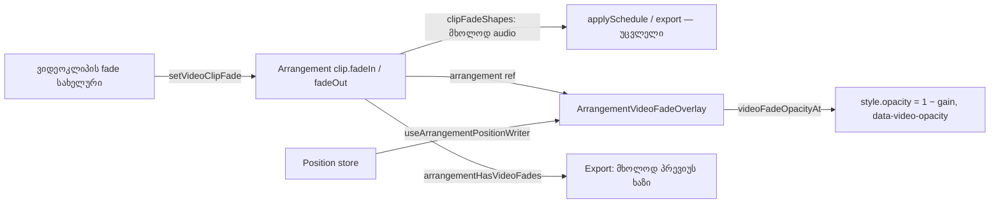

# Studio Lab — ვიდეოკლიპის opacity fade (SRW-19 / FB-07)

**თარიღი:** 2026-10-22
**სტატუსი:** Round 84 — C PASS (`browserVerified`), გამოქვეყნდა `88b0262`
**შეცვლილი პროექტი:** Store

## კონტექსტი

FB-07 და R19-F1 ითხოვს, რომ ვიდეოხაზის კლიპს ჰქონდეს Fade In / Fade Out: სურათი შავიდან ჩნდებოდეს და შავში ქრებოდეს, იმავე სახელურებით, რაც აუდიოკლიპს აქვს (doc 072). R19-F2 ითხოვს, რომ Export-ის დიალოგმა პატიოსნად თქვას: ვიდეოს რენდერი არ კეთდება, ამიტომ fade მხოლოდ პრევიუშია.

ამავე რაუნდში გასწორდა C-R83-L1 (X1): envelope-ის რეჟიმში double-click ruler-ის T დროზე წერტილს T − 1 px-ზე ინახავდა (40 px/s-ზე 6.000-ის ნაცვლად 5.975), ხოლო დახატული წერტილი და polyline-ის წვერო ერთმანეთს 1 px-ით სცდებოდა.

## მიდგომა

| ID | გადაწყვეტილება |
|---|---|
| V1 | ვიდეოკლიპი იყენებს არსებულ `fadeIn?` / `fadeOut?` ველებს (წამები, მთელი ms, 0-ზე key არ ინახება, `fadeIn + fadeOut ≤ duration`). ახალი ველი არ დამატებულა; `types/arrangement.ts`, `model.ts`, `clipboard.ts` და `fades.ts` არ შეცვლილა. `withCutEdges` / `clampClipFadesAfterTrim` უკვე ყველა ტიპის კლიპზე მუშაობს, ამიტომ F3-ის წესები ვიდეოზეც მოქმედებს: move / duplicate / copy-paste ინარჩუნებს fade-ებს, trim ამოკლებს, split / Delete Time / Cut ახალ ჭრილზე fade-ს აგდებს |
| V2 | ახალი სუფთა მოდული `video-fades.ts`: `setVideoClipFade` (`setClipFade`-ის ზუსტი ასლი, მაგრამ მხოლოდ ვიდეოხაზის კლიპზე; აუდიოკლიპზე, არარსებულ კლიპზე, NaN-ზე და ცვლილების არარსებობისას იგივე reference-ს აბრუნებს), `videoFadeOpacityAt` (`findVideoClipAt` + `clipFadeGainAt`; ვიდეოს გარეშე 1) და `arrangementHasVideoFades` (Export-ის დიალოგისთვის, ეფექტური/clamp-ული fade-ებით). `setClipFade` კვლავ მხოლოდ აუდიოა (FD1) |
| V3 | fade მხოლოდ სურათს ეხება. `clipFadeShapes` ისევ გამორიცხავს ვიდეოკლიპს (FD6), ამიტომ ვიდეოს საკუთარი ხმა და ყოველი WAV export fade-ით და მის გარეშე ბიტ-ბიტ ერთნაირია. მიზეზი: FB-07 ითხოვს opacity fade-ს; ხმის ჩაქრობა მეორე, არმოთხოვნილი ქცევა იქნებოდა. სიგნალი VIDEO-FADE-SOUND ჩაწერილია B-სთვის |
| V4 | `ArrangementVideoDock`-ის `arrangement-video-box`-ში, ორივე `<video>`-ის შემდეგ, დაემატა ერთი overlay (`arrangement-video-fade`, `aria-hidden`, `pointer-events-none absolute inset-0 z-10 bg-background`). DOM-ის რიგით ის აქტიურ ვიდეოზე მაღლაა, gap-ის წარწერაზე (`z-20`) და ღილაკებზე (`z-30`) დაბლა. მისი `style.opacity` = 1 − `videoFadeOpacityAt`, ხოლო `data-video-opacity` სურათის opacity-ა (1.000 = სრულად ჩანს). ყოველ position frame-ზე იწერება `useArrangementPositionWriter`-ით (React render-ის გარეშე), arrangement-ის ცვლილებისას კი ერთხელ layout effect-ით — ასე fade-ის edit გაჩერებულ მდგომარეობაშიც მაშინვე ჩანს. DOM მხოლოდ მაშინ იწერება, როცა 3-ათწილადიანი მნიშვნელობა იცვლება; fade-ის გარეთ overlay 0-ზე რჩება და აღარ გადაიწერება. პირველი render უკვე მიმდინარე პოზიციის მნიშვნელობას აჩვენებს (SSR-ის HTML-შიც) |
| V4 შავი | „შავი“ = `bg-background` (`--color-background`, hsl(220 20% 4%)) — პროექტის მუქი ტოკენი, რომელზეც gap-ის წარწერა („ვიდეო არ არის“) უკვე ზის. hex ან ახალი ფერი არ დამატებულა (Tailwind-first) |
| V4 რატომ არა slot opacity | `applyRoles` active / standby slot-ებს `opacity-0` კლასით რთავს და თიშავს. inline opacity slot-ზე ამ ლოგიკას და swap-ს შეეჯახებოდა. ცალკე overlay sync / swap კოდს არ ეხება და docked, floating და expanded ყუთში ერთნაირად მუშაობს |
| V5 | `ArrangementClip`-ში `showFadeHandles`-ს მოეხსნა `!isVideo`. Env რეჟიმი, დაკეცილი ხაზი და 24 px-ზე ვიწრო კლიპი ვიდეოს სახელურებსაც მალავს. ვიდეოს testid-ები: `arrangement-video-fade-in-handle`, `arrangement-video-fade-out-handle`, overlay `arrangement-video-fade-ramps` (`text-accent`); ვიდეოკლიპზე `arrangement-clip-fade-` prefix-ით არაფერი არ რენდერდება (FU1). Title: `Video Fade In — სურათი (ხმა არ იცვლება) · drag · double-click = 0`. ისტორიის label / status: `Video Fade In` / `Video Fade Out`. gesture-ის ტიპები, threshold, capture, `pointercancel`-ის დაბრუნება და round-83-ის 500 ms guard უცვლელია; setter-ი `isVideo`-ზეა დამოკიდებული (`setVideoClipFade` / `setClipFade`) |
| V6 | Export-ის დიალოგში ვიდეოს ვარიანტი ისევ გამორთულია უცვლელი მიზეზით. თუ ვიდეოხაზის რომელიმე კლიპს ეფექტური fade აქვს, ვარიანტის ქვეშ ჩნდება ერთი ხაზი (`arrangement-export-video-fades`): „ვიდეოს fade-ები მხოლოდ პრევიუშია — ვიდეოს რენდერი არ კეთდება, ექსპორტი მხოლოდ აუდიოა.“ ვიდეოფაილი არასოდეს იქმნება |
| X1 | კოორდინატების წესი: envelope-ის ყოველი x იზომება კლიპის root-ის გარე მარცხენა კიდიდან, რომელიც ruler-ის `clip.start`-ის x-ზეა. root-ს 1 px border აქვს, ხოლო body (სადაც envelope ზის) ამ border-ის შიგნითაა. ამიტომ: double-click დროს ითვლის root-ის `getBoundingClientRect().left`-იდან (`closest('[data-clip-id]')`); წერტილის `left` body-ში = `(time − sourceOffset) · pxPerSecond − 1`; SVG body-ში `left: −1 px` და `width = clip-ის სიგანე`-ზეა, ამიტომ `viewBox` 1:1-ით ემთხვევა root-ის გარე ყუთს და polyline-ის ბოლო root-ის მარჯვენა კიდეზე მთავრდება. border-ის სიგანე ერთ ლოკალურ კონსტანტაშია (`CLIP_ENVELOPE_ROOT_BORDER_PX = 1`). fade-ის ramp overlay-ის 1–2 px-იანი გადახრა X1-ში არ შედის (Lows batch) |

ალტერნატივები: (1) ახალი `videoFadeIn` ველი — ზედმეტი იქნებოდა, რადგან არსებული ველები და F3-ის წესები უკვე ტიპისგან დამოუკიდებელია; (2) `setClipFade`-ის გაფართოება ვიდეოზე — frozen FD1 / FD6 ტესტები ამას კრძალავს და audio graph-ს ვიდეოს ხმის ჩაქრობის რისკს შეუქმნიდა; (3) CSS transition opacity-ზე — playback-ის audio position-თან სინქრონს დაკარგავდა.

## არქიტექტურა

## Ableton Live-თან განსხვავებები (§4)

| ქცევა | Live 12 (წყარო) | CZABA |
|---|---|---|
| ვიდეოკლიპი Arrangement-ში აუდიოკლიპივით იმართება | §28.2.1 — დადასტურებული (ტექსტი) | იგივე: იგივე fade სახელურები |
| ვიდეოს gap შავ ეკრანს აჩვენებს | §28.2.2.1 — დადასტურებული (ტექსტი) | იგივე: fade იმავე `bg-background`-ზე ქრება |
| სურათის opacity fade ვიდეოკლიპზე | Chapter 28-ში არ არის | CZABA-ს დამატება (FB-07); Ableton-თან შესაბამისობა: არ ეხება |
| fade წრფივია, სიგრძე სახელურით, `in + out ≤ length` | §6.8 — დადასტურებული (აუდიოკლიპებზე) | იგივე წესი; მხოლოდ სურათზე (V3) |
| Live Export Audio/Video-ში ვიდეოს არენდერებს | §28.3 — დადასტურებული (ტექსტი) | შეგნებული განსხვავება (D-11): CZABA ვიდეოს არ არენდერებს და დიალოგი ამას ამბობს, fade-ების ჩათვლით |
| ვიდეოს fade მის ხმასაც აქრობს | წყაროში არ არის (დაუდასტურებელი) | CZABA: მხოლოდ სურათი; ხმა უცვლელია (V3) |

## შეცვლილი ფაილები

- `app/lib/arrangement/video-fades.ts` — ახალი: `setVideoClipFade`, `videoFadeOpacityAt`, `arrangementHasVideoFades`
- `app/components/arrangement/ArrangementVideoDock.tsx` — fade overlay, მისი position writer და arrangement ref
- `app/components/arrangement/ArrangementClip.tsx` — ვიდეოს fade სახელურები, testid-ები, title-ები, label-ები, setter-ის არჩევა და ramp overlay
- `app/components/arrangement/ArrangementExportDialog.tsx` — ვიდეოს fade-ის პრევიუს ხაზი
- `app/components/arrangement/ArrangementClipEnvelope.tsx` — X1 კოორდინატები
- `app/lib/arrangement/__tests__/video-fades.test.ts` — ახალი (VF1–VF4)
- `app/lib/arrangement/__tests__/video-fades-ui.test.tsx` — ახალი (VU1–VU4)
- `app/lib/arrangement/__tests__/clip-envelope-ui.test.tsx` — ახალი AL1 ტესტი (არსებული literal-ები არ შეცვლილა)
- `docs/implementation/2026/quarter-IV/073-studio-lab-clip-volume-envelope-stage-2.md` — მხოლოდ სტატუსის ხაზი

## პრობლემები და გადაწყვეტები

- **პრობლემა:** position store arrangement-ის ცვლილებაზე არ აცნობებს, ამიტომ მხოლოდ position writer-ით fade-ის edit გაჩერებულ მდგომარეობაში overlay-ს არ განაახლებდა. **გადაწყვეტა:** იგივე write ფუნქცია arrangement-ის ცვლილებისას layout effect-ითაც ერთხელ ეშვება.
- **პრობლემა:** overlay-ზე React-ის მიერ მართული opacity ყოველ re-render-ზე DOM-ს გადაწერდა და per-frame write-ს შეეჯახებოდა. **გადაწყვეტა:** საწყისი მნიშვნელობა ერთხელ ითვლება (`useState` initializer), შემდეგ DOM-ს მხოლოდ writer ცვლის.
- **პრობლემა:** frozen FU1 ვიდეოკლიპზე `arrangement-clip-fade-` prefix-ს კრძალავს. **გადაწყვეტა:** ვიდეოს სახელურებს და overlay-ს `arrangement-video-fade-` prefix აქვს.
- **პრობლემა (X1):** body root-ის 1 px border-ის შიგნითაა, ამიტომ body-დან გაზომილი x 1 px-ით გვიანდებოდა, ხოლო `inset-0` SVG `width − 2` px-ზე `width` ერთეულის viewBox-ს კუმშავდა. **გადაწყვეტა:** x root-იდან, წერტილი −1 px, SVG root-ის გარე ყუთზე. არსებული polyline literal-ები (EU5 / EU7) უცვლელი დარჩა, რადგან viewBox-ის ერთეულები არ შეცვლილა.

## ტესტირება

- `video-fades.test.ts` (12): VF1 setter (clamp, ms, omit-at-0, იგივე reference, `setClipFade`-თან parity), VF2 opacity (2.25 → 0.25 … 7.5 → 0.25, gap, მიმდებარე კლიპები 0-მდე), VF3 move / duplicate / trim / split / copy-paste რეალური `model.ts` / `clipboard.ts`-ით, VF4 `clipFadeShapes` და recording fake-ით `applySchedule` fade-ით და მის გარეშე ერთნაირია.
- `video-fades-ui.test.tsx` (10): VU1 სახელურები / Env / fold / ვიწრო კლიპი, VU2 drag / Undo / Redo / guarded double-click / `pointercancel` / აუდიოს გზა, VU3 overlay (გაჩერებული პოზიციები, edit-ის შემდეგ, პირველი render, ტოლი მნიშვნელობის არგადაწერა MutationObserver-ით, floating ყუთი), VU4 Export-ის ხაზი.
- `clip-envelope-ui.test.tsx` AL1 (ორი შემთხვევა): root და body rect-ები 1 px border-ით. 40 px/s-ზე, trim-ის გარეშე, double-click ruler-ის 6 / 10 / 14 წმ-ზე ინახავს 6.000 / 10.000 / 14.000-ს; 25 px/s-ზე, დასაწყისიდან trim-ულ კლიპზე (`sourceOffset` 1.5), 5 / 8.04 / 12.6 წმ-ზე — 5.000 / 8.040 / 12.600-ს. ორივეში წერტილის ცენტრი, polyline-ის წვერო და ხაზის ბოლო ±0.5 / ±1 px-შია. ცვლილებამდელ კოდზე ორივე წითელია (40 px/s-ზე 5.975 / 9.975 / 13.975).
- Mutation proofs (a)–(h) და X1-ის ორი დამატებითი (i: წერტილის −1 px-ის მოხსნა, j: SVG-ის body-ში დაბრუნება) ცალკე scratch ასლში; თითოეულმა ≥ 1 ტესტი გააწითლა.
- რეალური ბრაუზერის მიღება (VF-PREVIEW, VF-SYNC, VF-AUDIO, X1-ALIGN და სხვ.) C-ის რაუნდშია.

## TODO / შემდეგი ნაბიჯები

- C: ბრაუზერში VF-HANDLES / VF-IN / VF-PREVIEW / VF-OUT / VF-FLOAT / VF-EDITS / VF-UNDO / VF-AUDIO / VF-EXPORT / VF-PLAY-EDIT / VF-SYNC / X1-ALIGN / P-M1.
- სიგნალები B-სთვის: SRW19-RESCHEDULE (ვიდეოს fade-ის edit playback-ის დროს `scheduleKey`-ით აუდიოს თავიდან გეგმავს), VIDEO-FADE-SOUND (ვიდეოს ხმის fade არ კეთდება).
- `video-fades.ts`-ში `fades.ts`-ის სამი private helper-ის ლოკალური ასლია; parity ტესტი (VF1) დრიფტს იჭერს. გაერთიანება — B / root-ის გადაწყვეტილება.
- fade ramp overlay-ის 1–2 px გადახრა — Lows batch.
