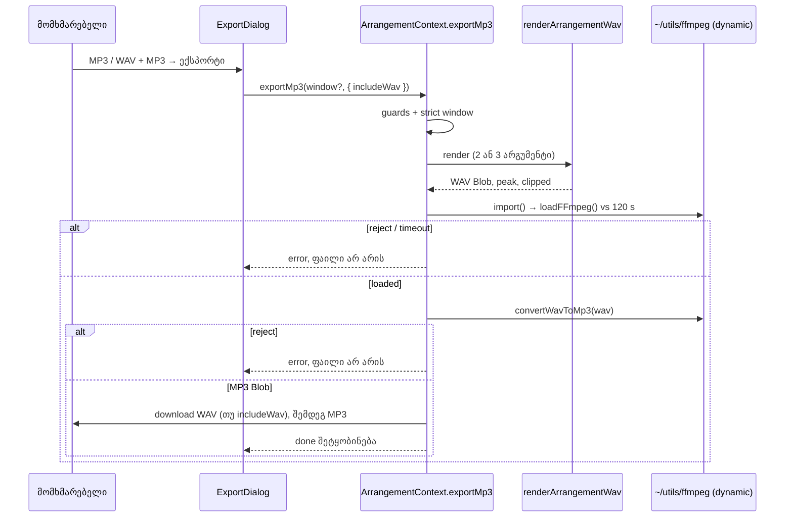

# Studio Lab — MP3 და WAV + MP3 ექსპორტი (SRW-20 ეტაპი 2) და scope radio-ების ხელმისაწვდომობა (C-R85-L2, GATE85-S2)

**თარიღი:** 2026-10-22
**სტატუსი:** Round 86 — C PASS (`browserVerified`), გამოქვეყნდა `971141d`
**შეცვლილი პროექტი:** Store

## კონტექსტი

SRW-20-ის პირველმა ეტაპმა (Round 85, `51e024a`) დაამატა მონიშნული მონაკვეთის WAV ექსპორტი. Export dialog-ში MP3 ჯერ კიდევ გამორთული იყო წარწერით „ამ ეტაპზე ხელმისაწვდომი არ არის“. Live 12-ის manual-ი (§5.1.3.2 „Encoding Options“) აღწერს PCM-ისა და MP3-ის რენდერს, MP3-ს ცალკე ან PCM ფაილთან ერთად. მეორე ეტაპი ამატებს MP3-სა და WAV + MP3-ს. თუ encoder ვერ ჩაიტვირთა, მომხმარებელი ხედავს მკაფიო შეცდომას და ფაილი არ იქმნება (R20-X2).

იმავე რაუნდში გასწორდა ორი Low ხარვეზი იმავე scope radio-ებზე:

- **C-R85-L2** — მონაკვეთის გარეშე „მთელი პროექტი“ radio მონიშნულიც იყო და გამორთულიც. ის მხოლოდ ძველი C-R14-02 ტესტის (ზუსტად 4 აქტიური კონტროლი) გამო იყო გამორთული.
- **GATE85-S2** — გამორთული „მონიშნული მონაკვეთი“ radio-ს მიზეზი screen reader-ს არ უკავშირდებოდა.

## მიდგომა

### X1 — scope radio-ები
- „მთელი პროექტი“ radio გამორთულია მხოლოდ რენდერის დროს. სხვა დროს ჩართულია და მონიშნულია, როცა მონაკვეთის scope აქტიური არ არის.
- „მონიშნული მონაკვეთი“ radio ვალიდური მონაკვეთის გარეშე გამორთული რჩება. მისი `aria-describedby` მიზეზის span-ზე მიუთითებს, span-ის `id` React `useId()`-ით იქმნება (testid უცვლელია). ვალიდური მონაკვეთისას `aria-describedby` არ აქვს.

### R0 — render window-ის საერთო წესი (GATE85-S3)
ახალი pure მოდული `render-window.ts` (DOM-ისა და client-only import-ების გარეშე):
- `ARRANGEMENT_RENDER_WINDOW_MIN_SECONDS = 0.001`;
- `isValidArrangementRenderWindow` — მკაცრი შემოწმება: finite საზღვრები, `start >= 0`, სიგრძე ≥ 1 ms. შებრუნებული window (`{9, 4}`) არავალიდურია;
- `arrangementRangeRenderWindow` — dialog-ისთვის: დროის მონაკვეთს ანორმალიზებს `{min, max}`-ად ან აბრუნებს `null`-ს.

Dialog იყენებს `arrangementRangeRenderWindow`-ს (ლოკალური კონსტანტა წაიშალა). `exportWav` და `exportMp3` იყენებს `isValidArrangementRenderWindow`-ს. შეტყობინებები byte-ით უცვლელია.

### M1 — ფორმატის radio-ები
- რიგი: **WAV** (უცვლელი წარწერა და graph note), **MP3** (`MP3 · 48 kHz · stereo` + LAME/CDN note), **WAV + MP3** (`WAV + MP3 · ორი ფაილი` + „ან ორივე, ან არცერთი“ note), შემდეგ უცვლელი გამორთული ვიდეოს ვარიანტი.
- `UNAVAILABLE_REASON` და `unavailableOptions` წაიშალა.
- ყოველ გახსნაზე ნაგულისხმევია WAV. დახურვისას ფორმატი `scopeChoice`-თან ერთად ნულდება.
- ფორმატის radio-ები რენდერის დროსაც ჩართულია. ეს ინარჩუნებს ძველ ქცევას, როცა focus რენდერისას WAV radio-ზე რჩება. რენდერის დროს ცვლილება მიმდინარე ექსპორტზე არ მოქმედებს.
- ღილაკის წარწერა: `WAV-ის ექსპორტი` / `MP3-ის ექსპორტი` / `WAV + MP3 ექსპორტი`; რენდერისას `მიმდინარეობს…`.

### M2 — `exportMp3(renderWindow?, { includeWav? })`
1. იგივე სამი guard, რაც `exportWav`-ს აქვს: Web Audio, ცარიელი პროექტი და ვიდეოს ხმის დეკოდირება. მათ მოსდევს window-ის მკაცრი შემოწმება. რომელიმე guard-ის ჩავარდნისას რენდერი, encoder-ის ჩატვირთვა და download არ ხდება.
2. ერთი რენდერი უცვლელი `renderArrangementWav`-ით.
3. `await import('~/utils/ffmpeg')` — მხოლოდ dynamic import. Mount, dialog-ის გახსნა და WAV ექსპორტი encoder-ს არ ტვირთავს. მერე `loadFFmpeg()` ეჯიბრება `ARRANGEMENT_MP3_ENCODER_LOAD_TIMEOUT_MS = 120_000`-ს. Timer მხოლოდ `loadFFmpeg()`-ს ფარავს და `finally`-ში იწმინდება. Import-ის ან load-ის reject-ზე ჩნდება load-ის შეცდომა, timeout-ზე timeout-ის შეცდომა.
4. `convertWavToMp3(wavBlob)` ერთი არგუმენტით (util-ის default). Reject-ზე ჩნდება MP3-ის შექმნის შეცდომა ტექსტით.
5. **ან ორივე, ან არცერთი:** ფაილები მხოლოდ მზა MP3 Blob-ის შემდეგ ჩამოიტვირთება. ჯერ ყველა object URL იქმნება, მერე ხდება click-ები: WAV (თუ `includeWav`), შემდეგ MP3. სახელებია `czaba-studio-lab[-range].wav|mp3`.
6. დასრულების შეტყობინებაში სიგრძე იგივე წესით იწერება, რაც WAV-ში, და იგივე master-mute suffix ემატება. Overload warning WAV რენდერის `peak` / `clippedSamples`-იდან მოდის.

### Build config — FFMPEG-DEV-WORKER
B-ის probe-მა (`tmp/studio-real-loop/b-round-85/probe/PROBE-SUMMARY.md`) დაადასტურა პრობლემა: Vite dev-ის dependency pre-bundling ffmpeg-ის worker-ის URL-ს ამტვრევს (`.vite/deps/worker.js` → `ERR_FAILED`). ამის შემდეგ `loadFFmpeg()` არც resolve-დება და არც reject-დება. `vite.config.ts`-ში დაემატა `optimizeDeps.exclude: ['@ffmpeg/ffmpeg', '@ffmpeg/util']`. A-ის Playwright smoke-ში `/studio-lab`-ზე encoder ჩაიტვირთა და `.mp3` ჩამოიტვირთა.

### რატომ რჩება `ffmpeg.ts` უცვლელი (FFMPEG-LOAD-POLLER-HANG)
`app/utils/ffmpeg.ts`-ს იყენებს დაცული შეძენილი Studio (`StudioContext.tsx`), ამიტომ ამ ციკლში ის frozen-ია. მას ორი ცნობილი ნაკლი აქვს. პარალელური გამომძახებელი `isLoaded`-ს უსასრულოდ ელოდება, თუ პირველი load ჩავარდა. Load, რომლის worker-იც არ ჩაირთო, არასდროს აკეთებს reject-ს. 120 წამის race ამ ორივე შემთხვევაში მომხმარებელს პასუხს აძლევს. თუმცა ჩამოკიდებული load util-ს „loading“ მდგომარეობაში ტოვებს, ამიტომ timeout-ის შეტყობინება გვერდის გადატვირთვას ითხოვს. ეს გულწრფელი შეტყობინებაა და არა util-ის გასწორება.

## Ableton-თან შედარება
- **დადასტურებული (manual-ის ტექსტი):** PCM და MP3, MP3 ცალკე ან PCM-თან ერთად; scope (time selection) ყველა ფორმატზე მოქმედებს.
- **შეგნებული განსხვავება:** ორი toggle-ის ნაცვლად ერთი radio (WAV / MP3 / WAV + MP3). Live-ის MP3 არის CBR 320 kbps. აქ frozen ffmpeg-ის ბრძანება (`-b:a 320k -q:a 0`) LAME-ს VBR რეჟიმში უშვებს: smoke-მა აჩვენა Xing (VBR) header, ამიტომ UI 320 kbps-ს არ აცხადებს.
- **იგივე კლასის ქცევა:** MP3-ის დასაწყისში მცირე სიჩუმე (LAME encoder delay) არ იჭრება. C ზომავს lag-ს.
- **არ ეხება:** encoder-ის ჩატვირთვის შეცდომა (Live ადგილობრივად აკოდირებს) — CZABA-ს მოთხოვნაა (R20-X2).

## შეცვლილი ფაილები
- `vite.config.ts` — `optimizeDeps.exclude` ბლოკი.
- `app/lib/arrangement/render-window.ts` — **ახალი**, render window-ის საერთო წესი.
- `app/components/arrangement/ArrangementExportDialog.tsx` — X1, R0-ის გამოყენება, ფორმატის radio-ები, ღილაკის წარწერა და dispatch.
- `app/contexts/ArrangementContext.tsx` — `exportWav`-ის window-ის შემოწმება R0-ით; ახალი `exportMp3`, მისი ტიპი, timeout-ის კონსტანტა და value-ს ჩანაწერები.
- `app/lib/arrangement/__tests__/render-window.test.ts` — **ახალი**, RW1–RW2.
- `app/lib/arrangement/__tests__/export-mp3.test.tsx` — **ახალი**, MX1–MX11.
- `app/lib/arrangement/__tests__/export-dialog-focus.test.tsx` — მხოლოდ C-R14-02 (ახალი Tab-ციკლი და სათაური).
- `app/lib/arrangement/__tests__/export-range-ui.test.tsx` — მხოლოდ ორი XU5 ტესტი (ფორმატების მდგომარეობა/წარწერები და Tab-სია).
- `docs/implementation/2026/quarter-IV/075-…` — სტატუსის ხაზი.

## პრობლემები და გადაწყვეტები
- **პრობლემა:** dev-ში MP3 ექსპორტი სამუდამოდ ჩამოკიდებოდა (worker `ERR_FAILED`, promise არ სრულდება). **გადაწყვეტა:** `optimizeDeps.exclude` და 120 წამის race.
- **პრობლემა:** WAV + MP3-ში WAV შეიძლებოდა ჩამოტვირთულიყო მაშინაც, როცა MP3 ვერ შეიქმნა. **გადაწყვეტა:** download მხოლოდ მზა MP3 Blob-ის შემდეგ. ჯერ იქმნება ყველა object URL, მერე ხდება click-ები.
- **პრობლემა:** ტესტში `loadFFmpeg`-ის მოსალოდნელი ტიპი `FFmpeg` instance-ია, ნამდვილი კლასი კი Node-ში იშლება. **გადაწყვეტა:** ტესტი `@ffmpeg/ffmpeg`-ს მცირე კლასით ანაცვლებს (type assertion-ის გარეშე).

## ტესტირება
- `render-window.test.ts` RW1–RW2, `export-mp3.test.tsx` MX1–MX11; შეცვლილი C-R14-02 და XU5; targeted სია (`tmp/studio-real-loop/a-round-86/targeted-list.txt`).
- Mutation proof-ები (a)–(i) scratch ასლში: თითოეულმა მინიმუმ ერთი მითითებული ტესტი გააწითლა.
- A-ის Playwright smoke (1440×900, dev server): პროექტის MP3 `czaba-studio-lab.mp3`, 48 kHz stereo, Xing (VBR) header; პირველი ექსპორტი encoder-ის ჩატვირთვით ~6 წმ, მეორე ~1.4 წმ, `ffmpeg-core.wasm` ერთხელ მოითხოვა. ეს C-ის მტკიცებულებას არ ცვლის.
- **არ შემოწმდა:** production build-ში MP3 (cloud-ში preview server არ არის).

## TODO / შემდეგი ნაბიჯები
- **ეტაპი 3 (R20-X4):** encoding main thread-ის გარეთ, progress და cancel 5 წუთიან პროექტზე.
- სანამ ეტაპი 3 cancel-ს დაამატებს, dialog-ის „დახურვა“ encoder-ის ჩატვირთვისას გამორთული რჩება (120 წამამდე, არსებული `isRendering` წესით).
- 120 წამის timer არ ფარავს `import()`-სა და `convertWavToMp3`-ს. Unmount-ის შემდეგ დაგვიანებული download მაინც შეიძლება მოხდეს (როგორც `exportWav`-ში). ორივე ეტაპი 3-ის cancel/AbortController-ში უნდა გადაწყდეს (code-reviewer L2/L3).
- `optimizeDeps.exclude` dev-ში დაცული Studio-ს module graph-საც ეხება. Production-ზე არ მოქმედებს. დაცული Studio-ს MP3 dev-ში ამ რაუნდში არ შემოწმებულა (code-reviewer L4).
- FFMPEG-LOAD-POLLER-HANG — `ffmpeg.ts`-ის გასწორება ცალკე დავალებაა, დაცული Studio-ს owner-თან შეთანხმებით.
- რეალურ Chrome-ში ორი ფაილის ჩამოტვირთვისას შეიძლება გამოჩნდეს „multiple downloads“ კითხვა (Tech Lead R86-T).
